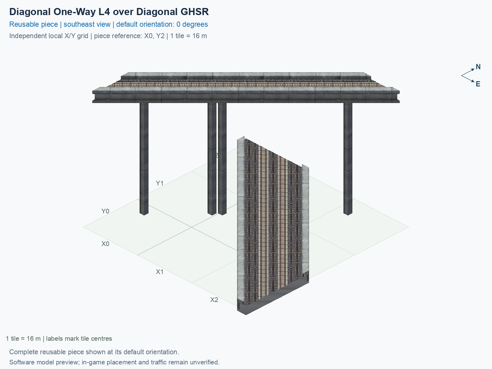

<a id="diagonal-one-way-l4-over-diagonal-ghsr"></a>

# HSR Level 4 (30.5 m) over GHSR Ground (1 m) — Single-Track One-Way over Two-Track Crossing 90° — Both Routes Diagonal

<!-- SUBJECT IDENTITY MIGRATION -->

Identity migration: `interchange-l4-upper-diag-lower-diag-over-ground` → `hsr-l4-over-ghsr-ground-mixed-crossing-diagonal-90deg`. Earlier measurements, observations, and pictures retain their recorded names and fingerprints; they do not establish verification of the renamed build. See the [identity migration rules](../../../../docs/NAMING_CONVENTIONS.md#10-choosing-and-changing-names).

Purpose: explain this reusable piece, its matching connections and current test coverage.

<!-- BEGIN PIECE OVERVIEW -->

Actual rail geometry and directed train paths at two heights. The one-way track and two-way track cross without a transfer. Experimental fixed piece; test rendering, traffic and shadows in the game. The upper route crosses without transferring to the lower two-way route.

Exact reusable identifier: `hsr-l4-over-ghsr-ground-mixed-crossing-diagonal-90deg`.

Footprint: **3 × 3 tiles**. Exact menu name: **HSR Level 4 (30.5 m) over GHSR Ground (1 m) — Single-Track One-Way over Two-Track Crossing 90° — Both Routes Diagonal**.

Choose this exact name in Transportation → Rail. Press Home or End to rotate; use only the supported states listed below. Join each end to a matching port profile and direction.

- [Connections and journeys](#connections-and-journeys)
- [Test checklist](#test-checklist)



<!-- END PIECE OVERVIEW -->

<!-- BEGIN MANUAL SUMMARY -->

## Manual status

Generated from [the exact test cases](#test-checklist) and [authoritative observations](checks/manual-tests.json).

- [ ] Preview review: 0/1 applicable cases passed; 0 failed, 0 stale.
- [ ] In-game rendering: 0/4 applicable cases passed; 0 failed, 0 stale.
- [ ] Directed journeys: 0/12 applicable cases passed; 0 failed, 0 stale.

These observations cover only the named services, directions, poses, rotations, and recorded platforms.

<!-- END MANUAL SUMMARY -->

<!-- BEGIN CONNECTIONS -->

## Connections and journeys

Purpose: describe intrinsic directional interfaces and permitted service journeys.

Generated from [connections.json](connections.json). Coordinates are canonical east, north, and height in metres. A connection class names an encoded route interface; it does not prove visible deck/wall fit or an in-game test.

Supported placement states: 0° CCW, 90° CCW, 180° CCW, 270° CCW. Each state has its own declared manual scope.

A **port** is one directional transport-path endpoint. **Service** identifies the intended network service (for example HSR, street, or tram); **engine** is its internal traffic-class number, separate from the construction network. **Role** distinguishes primary service from auxiliary paths; sharing a traffic class does not establish service compatibility.

A **tangent** is a unit travel-direction vector: `[0,1]` means north. **Grade** is height gained per horizontal metre. These measured facts describe this subject alone. Compatibility requires a separate comparison of the complete joining boundaries; physical seams and actual game operation require their own evidence. See the [class index](../../connection-classes.jsonc) for shared route-interface membership.

| Port | Service / engine / role | Direction | Location; tangent; grade | Connection class |
| --- | --- | --- | --- | --- |
| `upper_in` | hsr / 7 / primary | in | [-8.0, -32.0, 30.5]; [0.7071067811865475, 0.7071067811865475]; 0.0 | `path-interface-13a0d20884fd73110dea` |
| `lower_b_in` | ghsr / 7 / primary | in | [-2.9, 8.0, 1.0]; [0.7071067811865475, -0.7071067811865475]; 0.0 | `path-interface-6ed8ad7d9e460ea9e26e` |
| `lower_a_out` | ghsr / 7 / primary | out | [2.8, 8.0, 1.0]; [-0.7071067811865475, 0.7071067811865475]; 0.0 | `path-interface-08442c19645c28282b17` |
| `upper_out` | hsr / 7 / primary | out | [32.0, 8.0, 30.5]; [0.7071067811865475, 0.7071067811865475]; 0.0 | `path-interface-a70e777e6354823bc5c5` |
| `lower_b_out` | ghsr / 7 / primary | out | [40.0, -34.9, 1.0]; [0.7071067811865475, -0.7071067811865475]; 0.0 | `path-interface-d13580a5f8b596919466` |
| `lower_a_in` | ghsr / 7 / primary | in | [40.0, -29.1, 1.0]; [-0.7071067811865475, 0.7071067811865475]; 0.0 | `path-interface-d13580a5f8b596919466` |

### Directed journeys

| Service | Entry → exit | Role |
| --- | --- | --- |
| hsr | `upper_in` → `upper_out` | primary |
| ghsr | `lower_b_in` → `lower_b_out` | primary |
| ghsr | `lower_a_in` → `lower_a_out` | primary |

### Forbidden transfers

| From service / port | To service / port | Reason |
| --- | --- | --- |
| hsr / `upper_in` | ghsr / `lower_a_out` | No directed route exists between these ports in the saved piece transport paths. In-game confirmation remains unverified. |
| hsr / `upper_in` | ghsr / `lower_b_out` | No directed route exists between these ports in the saved piece transport paths. In-game confirmation remains unverified. |
| ghsr / `lower_b_in` | ghsr / `lower_a_out` | No directed route exists between these ports in the saved piece transport paths. In-game confirmation remains unverified. |
| ghsr / `lower_b_in` | hsr / `upper_out` | No directed route exists between these ports in the saved piece transport paths. In-game confirmation remains unverified. |
| ghsr / `lower_a_in` | hsr / `upper_out` | No directed route exists between these ports in the saved piece transport paths. In-game confirmation remains unverified. |
| ghsr / `lower_a_in` | ghsr / `lower_b_out` | No directed route exists between these ports in the saved piece transport paths. In-game confirmation remains unverified. |

Review the test checklist for the exact tested cases and environments.

<!-- END CONNECTIONS -->

<!-- BEGIN MANUAL CHECKS -->

## Test checklist

Generated from [the authoritative record](checks/manual-tests.json). Only explicit human observations create manual passes; software and preview checks remain separate. Expand a check/service group to see its rotation table, then expand the matching exact scope to copy a case ID and inspect its pose, reviewer, environment, and evidence. Grouping changes only this view; every declared case remains separate.

**States:** [x] passed; [ ] unverified, failed, or stale; N/A is an explicit inapplicable declaration. A dash means no case was declared in that column. Every pass covers only its recorded environment. T means a distinct construction-transposed state.

Four proper rotations are covered. No additional reflected state is established by this record; repeated construction aliases do not create new orientations.

Current totals: unverified: 55, passed: 0, failed: 0, stale: 0, not_applicable: 0.

### Record an observation

Follow the [shared testing guide](../../../../docs/TESTING.md); copy [the unconfirmed example](checks/observation.example.json) to `checks/observation.json`. Case identifiers are in the expandable sections below. Do not edit generated checkboxes.

From the repository folder containing `custom-pieces`, run after filling `checks/observation.json` and explicitly confirming the exact observation:

```sh
python3 -m scp.content record --record custom-pieces/domains/high-speed-rail/00_pieces/hsr-l4-over-ghsr-ground-mixed-crossing-diagonal-90deg/checks/manual-tests.json --observation custom-pieces/domains/high-speed-rail/00_pieces/hsr-l4-over-ghsr-ground-mixed-crossing-diagonal-90deg/checks/observation.json
```

### Detailed current checks

Each collapsed group shows exact case counts and states. Forbidden transfers are grouped by the directed service pair; the table inside retains every port pair and rotation.

<details>
<summary>Compiled resources — Whole subject — 1 case; unverified: 1</summary>

| Check / exact scope | General | 0° | 90° | 180° | 270° |
| --- | --- | --- | --- | --- | --- |
| **Compiled resources**<br>Whole subject | <a href="#case-software_resources-77def6aca8e634374386">[ ] unverified</a> | — | — | — | — |


<details>
<summary>Compiled resources — Whole subject</summary>

<a id="case-software_resources-77def6aca8e634374386"></a>

**General: unverified** — `software_resources-77def6aca8e634374386`.

Verify the actual compiled resources and construction rules.

Scope: Whole subject.

No observation recorded.

</details>

</details>

<details>
<summary>Directed routing graph — Whole subject — 1 case; unverified: 1</summary>

| Check / exact scope | General | 0° | 90° | 180° | 270° |
| --- | --- | --- | --- | --- | --- |
| **Directed routing graph**<br>Whole subject | <a href="#case-software_connectivity-77def6aca8e634374386">[ ] unverified</a> | — | — | — | — |


<details>
<summary>Directed routing graph — Whole subject</summary>

<a id="case-software_connectivity-77def6aca8e634374386"></a>

**General: unverified** — `software_connectivity-77def6aca8e634374386`.

Verify the declared directed journeys and forbidden transfers.

Scope: Whole subject.

No observation recorded.

</details>

</details>

<details>
<summary>Preview review — Images — 1 case; unverified: 1</summary>

| Check / exact scope | General | 0° | 90° | 180° | 270° |
| --- | --- | --- | --- | --- | --- |
| **Preview review**<br>Image: image:interchange-l4-upper-diag-lower-diag-over-ground:canonical-southeast | <a href="#case-preview_review-29a99b4ba1d1d1b1dcb7">[ ] unverified</a> | — | — | — | — |


<details>
<summary>Preview review — Image: image:interchange-l4-upper-diag-lower-diag-over-ground:canonical-southeast</summary>

<a id="case-preview_review-29a99b4ba1d1d1b1dcb7"></a>

**General: unverified** — `preview_review-29a99b4ba1d1d1b1dcb7`.

Inspect this exact preview for tracks, walls, piers, seams and shadows.

Scope: Image: image:interchange-l4-upper-diag-lower-diag-over-ground:canonical-southeast.

No observation recorded.

</details>

</details>

<details>
<summary>In-game rendering — Whole subject — 4 cases; unverified: 4</summary>

| Check / exact scope | General | 0° | 90° | 180° | 270° |
| --- | --- | --- | --- | --- | --- |
| **In-game rendering**<br>Whole subject | — | <a href="#case-in_game_render-ab8ba7d951696c3a3a34">[ ] unverified</a> | <a href="#case-in_game_render-f1ed6088d1f0ddd1754b">[ ] unverified</a> | <a href="#case-in_game_render-03436d8c261317a08ed3">[ ] unverified</a> | <a href="#case-in_game_render-d8d292dfd79eebe05131">[ ] unverified</a> |


<details>
<summary>In-game rendering — Whole subject</summary>

<a id="case-in_game_render-ab8ba7d951696c3a3a34"></a>

**0° CCW: unverified** — `in_game_render-ab8ba7d951696c3a3a34`.

Inspect the placed tracks, walls, piers, seams and shadows in SimCity 4.

Scope: Whole subject.

No observation recorded.

<a id="case-in_game_render-f1ed6088d1f0ddd1754b"></a>

**90° CCW: unverified** — `in_game_render-f1ed6088d1f0ddd1754b`.

Inspect the placed tracks, walls, piers, seams and shadows in SimCity 4.

Scope: Whole subject.

No observation recorded.

<a id="case-in_game_render-03436d8c261317a08ed3"></a>

**180° CCW: unverified** — `in_game_render-03436d8c261317a08ed3`.

Inspect the placed tracks, walls, piers, seams and shadows in SimCity 4.

Scope: Whole subject.

No observation recorded.

<a id="case-in_game_render-d8d292dfd79eebe05131"></a>

**270° CCW: unverified** — `in_game_render-d8d292dfd79eebe05131`.

Inspect the placed tracks, walls, piers, seams and shadows in SimCity 4.

Scope: Whole subject.

No observation recorded.

</details>

</details>

<details>
<summary>Placement — Whole subject — 4 cases; unverified: 4</summary>

| Check / exact scope | General | 0° | 90° | 180° | 270° |
| --- | --- | --- | --- | --- | --- |
| **Placement**<br>Whole subject | — | <a href="#case-in_game_placement-ab8ba7d951696c3a3a34">[ ] unverified</a> | <a href="#case-in_game_placement-f1ed6088d1f0ddd1754b">[ ] unverified</a> | <a href="#case-in_game_placement-03436d8c261317a08ed3">[ ] unverified</a> | <a href="#case-in_game_placement-d8d292dfd79eebe05131">[ ] unverified</a> |


<details>
<summary>Placement — Whole subject</summary>

<a id="case-in_game_placement-ab8ba7d951696c3a3a34"></a>

**0° CCW: unverified** — `in_game_placement-ab8ba7d951696c3a3a34`.

Place this piece or complete blueprint and inspect every occupied tile.

Scope: Whole subject.

No observation recorded.

<a id="case-in_game_placement-f1ed6088d1f0ddd1754b"></a>

**90° CCW: unverified** — `in_game_placement-f1ed6088d1f0ddd1754b`.

Place this piece or complete blueprint and inspect every occupied tile.

Scope: Whole subject.

No observation recorded.

<a id="case-in_game_placement-03436d8c261317a08ed3"></a>

**180° CCW: unverified** — `in_game_placement-03436d8c261317a08ed3`.

Place this piece or complete blueprint and inspect every occupied tile.

Scope: Whole subject.

No observation recorded.

<a id="case-in_game_placement-d8d292dfd79eebe05131"></a>

**270° CCW: unverified** — `in_game_placement-d8d292dfd79eebe05131`.

Place this piece or complete blueprint and inspect every occupied tile.

Scope: Whole subject.

No observation recorded.

</details>

</details>

<details>
<summary>Demolition — Whole subject — 4 cases; unverified: 4</summary>

| Check / exact scope | General | 0° | 90° | 180° | 270° |
| --- | --- | --- | --- | --- | --- |
| **Demolition**<br>Whole subject | — | <a href="#case-in_game_demolition-ab8ba7d951696c3a3a34">[ ] unverified</a> | <a href="#case-in_game_demolition-f1ed6088d1f0ddd1754b">[ ] unverified</a> | <a href="#case-in_game_demolition-03436d8c261317a08ed3">[ ] unverified</a> | <a href="#case-in_game_demolition-d8d292dfd79eebe05131">[ ] unverified</a> |


<details>
<summary>Demolition — Whole subject</summary>

<a id="case-in_game_demolition-ab8ba7d951696c3a3a34"></a>

**0° CCW: unverified** — `in_game_demolition-ab8ba7d951696c3a3a34`.

Bulldoze the complete placement and inspect the cleared area.

Scope: Whole subject.

No observation recorded.

<a id="case-in_game_demolition-f1ed6088d1f0ddd1754b"></a>

**90° CCW: unverified** — `in_game_demolition-f1ed6088d1f0ddd1754b`.

Bulldoze the complete placement and inspect the cleared area.

Scope: Whole subject.

No observation recorded.

<a id="case-in_game_demolition-03436d8c261317a08ed3"></a>

**180° CCW: unverified** — `in_game_demolition-03436d8c261317a08ed3`.

Bulldoze the complete placement and inspect the cleared area.

Scope: Whole subject.

No observation recorded.

<a id="case-in_game_demolition-d8d292dfd79eebe05131"></a>

**270° CCW: unverified** — `in_game_demolition-d8d292dfd79eebe05131`.

Bulldoze the complete placement and inspect the cleared area.

Scope: Whole subject.

No observation recorded.

</details>

</details>

<details>
<summary>Save and reload — Whole subject — 4 cases; unverified: 4</summary>

| Check / exact scope | General | 0° | 90° | 180° | 270° |
| --- | --- | --- | --- | --- | --- |
| **Save and reload**<br>Whole subject | — | <a href="#case-in_game_save_reload-ab8ba7d951696c3a3a34">[ ] unverified</a> | <a href="#case-in_game_save_reload-f1ed6088d1f0ddd1754b">[ ] unverified</a> | <a href="#case-in_game_save_reload-03436d8c261317a08ed3">[ ] unverified</a> | <a href="#case-in_game_save_reload-d8d292dfd79eebe05131">[ ] unverified</a> |


<details>
<summary>Save and reload — Whole subject</summary>

<a id="case-in_game_save_reload-ab8ba7d951696c3a3a34"></a>

**0° CCW: unverified** — `in_game_save_reload-ab8ba7d951696c3a3a34`.

Save, quit, reload and inspect the placement and its paths.

Scope: Whole subject.

No observation recorded.

<a id="case-in_game_save_reload-f1ed6088d1f0ddd1754b"></a>

**90° CCW: unverified** — `in_game_save_reload-f1ed6088d1f0ddd1754b`.

Save, quit, reload and inspect the placement and its paths.

Scope: Whole subject.

No observation recorded.

<a id="case-in_game_save_reload-03436d8c261317a08ed3"></a>

**180° CCW: unverified** — `in_game_save_reload-03436d8c261317a08ed3`.

Save, quit, reload and inspect the placement and its paths.

Scope: Whole subject.

No observation recorded.

<a id="case-in_game_save_reload-d8d292dfd79eebe05131"></a>

**270° CCW: unverified** — `in_game_save_reload-d8d292dfd79eebe05131`.

Save, quit, reload and inspect the placement and its paths.

Scope: Whole subject.

No observation recorded.

</details>

</details>

<details>
<summary>Journey — hsr — 4 cases; unverified: 4</summary>

| Check / exact scope | General | 0° | 90° | 180° | 270° |
| --- | --- | --- | --- | --- | --- |
| **Journey**<br>Service: hsr; role: primary; journey: 7:upper_in>upper_out; entry: upper_in; exit: upper_out | — | <a href="#case-in_game_journey-9bbb06b222e9185e979f">[ ] unverified</a> | <a href="#case-in_game_journey-44884d6a49407c90fcc5">[ ] unverified</a> | <a href="#case-in_game_journey-513001c60e6f116f8546">[ ] unverified</a> | <a href="#case-in_game_journey-5cab6d9c42e781d2a896">[ ] unverified</a> |


<details>
<summary>Journey — Service: hsr; role: primary; journey: 7:upper_in>upper_out; entry: upper_in; exit: upper_out</summary>

<a id="case-in_game_journey-9bbb06b222e9185e979f"></a>

**0° CCW: unverified** — `in_game_journey-9bbb06b222e9185e979f`.

Run the declared journey in this direction using its service network.

Scope: Service: hsr; role: primary; journey: 7:upper_in>upper_out; entry: upper_in; exit: upper_out.

No observation recorded.

<a id="case-in_game_journey-44884d6a49407c90fcc5"></a>

**90° CCW: unverified** — `in_game_journey-44884d6a49407c90fcc5`.

Run the declared journey in this direction using its service network.

Scope: Service: hsr; role: primary; journey: 7:upper_in>upper_out; entry: upper_in; exit: upper_out.

No observation recorded.

<a id="case-in_game_journey-513001c60e6f116f8546"></a>

**180° CCW: unverified** — `in_game_journey-513001c60e6f116f8546`.

Run the declared journey in this direction using its service network.

Scope: Service: hsr; role: primary; journey: 7:upper_in>upper_out; entry: upper_in; exit: upper_out.

No observation recorded.

<a id="case-in_game_journey-5cab6d9c42e781d2a896"></a>

**270° CCW: unverified** — `in_game_journey-5cab6d9c42e781d2a896`.

Run the declared journey in this direction using its service network.

Scope: Service: hsr; role: primary; journey: 7:upper_in>upper_out; entry: upper_in; exit: upper_out.

No observation recorded.

</details>

</details>

<details>
<summary>Journey — ghsr — 8 cases; unverified: 8</summary>

| Check / exact scope | General | 0° | 90° | 180° | 270° |
| --- | --- | --- | --- | --- | --- |
| **Journey**<br>Service: ghsr; role: primary; journey: 7:lower_b_in>lower_b_out; entry: lower_b_in; exit: lower_b_out | — | <a href="#case-in_game_journey-6e517b19900bd9f1502d">[ ] unverified</a> | <a href="#case-in_game_journey-674a54f06767b2cd51ae">[ ] unverified</a> | <a href="#case-in_game_journey-47c9c5240ecae5b7baaa">[ ] unverified</a> | <a href="#case-in_game_journey-d9a930f96df9dd1cdfdb">[ ] unverified</a> |
| **Journey**<br>Service: ghsr; role: primary; journey: 7:lower_a_in>lower_a_out; entry: lower_a_in; exit: lower_a_out | — | <a href="#case-in_game_journey-f1e1fc12af2e869623bd">[ ] unverified</a> | <a href="#case-in_game_journey-aa2fd10744d2519f59fb">[ ] unverified</a> | <a href="#case-in_game_journey-90b6e71172adec6d911f">[ ] unverified</a> | <a href="#case-in_game_journey-4056c0d127516c2f566a">[ ] unverified</a> |


<details>
<summary>Journey — Service: ghsr; role: primary; journey: 7:lower_b_in>lower_b_out; entry: lower_b_in; exit: lower_b_out</summary>

<a id="case-in_game_journey-6e517b19900bd9f1502d"></a>

**0° CCW: unverified** — `in_game_journey-6e517b19900bd9f1502d`.

Run the declared journey in this direction using its service network.

Scope: Service: ghsr; role: primary; journey: 7:lower_b_in>lower_b_out; entry: lower_b_in; exit: lower_b_out.

No observation recorded.

<a id="case-in_game_journey-674a54f06767b2cd51ae"></a>

**90° CCW: unverified** — `in_game_journey-674a54f06767b2cd51ae`.

Run the declared journey in this direction using its service network.

Scope: Service: ghsr; role: primary; journey: 7:lower_b_in>lower_b_out; entry: lower_b_in; exit: lower_b_out.

No observation recorded.

<a id="case-in_game_journey-47c9c5240ecae5b7baaa"></a>

**180° CCW: unverified** — `in_game_journey-47c9c5240ecae5b7baaa`.

Run the declared journey in this direction using its service network.

Scope: Service: ghsr; role: primary; journey: 7:lower_b_in>lower_b_out; entry: lower_b_in; exit: lower_b_out.

No observation recorded.

<a id="case-in_game_journey-d9a930f96df9dd1cdfdb"></a>

**270° CCW: unverified** — `in_game_journey-d9a930f96df9dd1cdfdb`.

Run the declared journey in this direction using its service network.

Scope: Service: ghsr; role: primary; journey: 7:lower_b_in>lower_b_out; entry: lower_b_in; exit: lower_b_out.

No observation recorded.

</details>


<details>
<summary>Journey — Service: ghsr; role: primary; journey: 7:lower_a_in>lower_a_out; entry: lower_a_in; exit: lower_a_out</summary>

<a id="case-in_game_journey-f1e1fc12af2e869623bd"></a>

**0° CCW: unverified** — `in_game_journey-f1e1fc12af2e869623bd`.

Run the declared journey in this direction using its service network.

Scope: Service: ghsr; role: primary; journey: 7:lower_a_in>lower_a_out; entry: lower_a_in; exit: lower_a_out.

No observation recorded.

<a id="case-in_game_journey-aa2fd10744d2519f59fb"></a>

**90° CCW: unverified** — `in_game_journey-aa2fd10744d2519f59fb`.

Run the declared journey in this direction using its service network.

Scope: Service: ghsr; role: primary; journey: 7:lower_a_in>lower_a_out; entry: lower_a_in; exit: lower_a_out.

No observation recorded.

<a id="case-in_game_journey-90b6e71172adec6d911f"></a>

**180° CCW: unverified** — `in_game_journey-90b6e71172adec6d911f`.

Run the declared journey in this direction using its service network.

Scope: Service: ghsr; role: primary; journey: 7:lower_a_in>lower_a_out; entry: lower_a_in; exit: lower_a_out.

No observation recorded.

<a id="case-in_game_journey-4056c0d127516c2f566a"></a>

**270° CCW: unverified** — `in_game_journey-4056c0d127516c2f566a`.

Run the declared journey in this direction using its service network.

Scope: Service: ghsr; role: primary; journey: 7:lower_a_in>lower_a_out; entry: lower_a_in; exit: lower_a_out.

No observation recorded.

</details>

</details>

<details>
<summary>Forbidden transfer — hsr → ghsr — 8 cases; unverified: 8</summary>

| Check / exact scope | General | 0° | 90° | 180° | 270° |
| --- | --- | --- | --- | --- | --- |
| **Forbidden transfer**<br>from port: upper_in; to port: lower_a_out; from service: hsr; to service: ghsr; basis: not reachable in actual saved PATH graph | — | <a href="#case-in_game_forbidden_transfer-14b242d9cb64632f44f0">[ ] unverified</a> | <a href="#case-in_game_forbidden_transfer-374129651547f0ff160f">[ ] unverified</a> | <a href="#case-in_game_forbidden_transfer-3b7498e5ca7293142545">[ ] unverified</a> | <a href="#case-in_game_forbidden_transfer-5ee8495d3c118990c64b">[ ] unverified</a> |
| **Forbidden transfer**<br>from port: upper_in; to port: lower_b_out; from service: hsr; to service: ghsr; basis: not reachable in actual saved PATH graph | — | <a href="#case-in_game_forbidden_transfer-5315458977d0e5520203">[ ] unverified</a> | <a href="#case-in_game_forbidden_transfer-b341afb4928fbebc69e9">[ ] unverified</a> | <a href="#case-in_game_forbidden_transfer-e2f7d3d55460d26c8bc4">[ ] unverified</a> | <a href="#case-in_game_forbidden_transfer-e27321da67bc9c6abd63">[ ] unverified</a> |


<details>
<summary>Forbidden transfer — from port: upper_in; to port: lower_a_out; from service: hsr; to service: ghsr; basis: not reachable in actual saved PATH graph</summary>

<a id="case-in_game_forbidden_transfer-14b242d9cb64632f44f0"></a>

**0° CCW: unverified** — `in_game_forbidden_transfer-14b242d9cb64632f44f0`.

Confirm this undeclared transfer is unavailable.

Scope: from port: upper_in; to port: lower_a_out; from service: hsr; to service: ghsr; basis: not reachable in actual saved PATH graph.

No observation recorded.

<a id="case-in_game_forbidden_transfer-374129651547f0ff160f"></a>

**90° CCW: unverified** — `in_game_forbidden_transfer-374129651547f0ff160f`.

Confirm this undeclared transfer is unavailable.

Scope: from port: upper_in; to port: lower_a_out; from service: hsr; to service: ghsr; basis: not reachable in actual saved PATH graph.

No observation recorded.

<a id="case-in_game_forbidden_transfer-3b7498e5ca7293142545"></a>

**180° CCW: unverified** — `in_game_forbidden_transfer-3b7498e5ca7293142545`.

Confirm this undeclared transfer is unavailable.

Scope: from port: upper_in; to port: lower_a_out; from service: hsr; to service: ghsr; basis: not reachable in actual saved PATH graph.

No observation recorded.

<a id="case-in_game_forbidden_transfer-5ee8495d3c118990c64b"></a>

**270° CCW: unverified** — `in_game_forbidden_transfer-5ee8495d3c118990c64b`.

Confirm this undeclared transfer is unavailable.

Scope: from port: upper_in; to port: lower_a_out; from service: hsr; to service: ghsr; basis: not reachable in actual saved PATH graph.

No observation recorded.

</details>


<details>
<summary>Forbidden transfer — from port: upper_in; to port: lower_b_out; from service: hsr; to service: ghsr; basis: not reachable in actual saved PATH graph</summary>

<a id="case-in_game_forbidden_transfer-5315458977d0e5520203"></a>

**0° CCW: unverified** — `in_game_forbidden_transfer-5315458977d0e5520203`.

Confirm this undeclared transfer is unavailable.

Scope: from port: upper_in; to port: lower_b_out; from service: hsr; to service: ghsr; basis: not reachable in actual saved PATH graph.

No observation recorded.

<a id="case-in_game_forbidden_transfer-b341afb4928fbebc69e9"></a>

**90° CCW: unverified** — `in_game_forbidden_transfer-b341afb4928fbebc69e9`.

Confirm this undeclared transfer is unavailable.

Scope: from port: upper_in; to port: lower_b_out; from service: hsr; to service: ghsr; basis: not reachable in actual saved PATH graph.

No observation recorded.

<a id="case-in_game_forbidden_transfer-e2f7d3d55460d26c8bc4"></a>

**180° CCW: unverified** — `in_game_forbidden_transfer-e2f7d3d55460d26c8bc4`.

Confirm this undeclared transfer is unavailable.

Scope: from port: upper_in; to port: lower_b_out; from service: hsr; to service: ghsr; basis: not reachable in actual saved PATH graph.

No observation recorded.

<a id="case-in_game_forbidden_transfer-e27321da67bc9c6abd63"></a>

**270° CCW: unverified** — `in_game_forbidden_transfer-e27321da67bc9c6abd63`.

Confirm this undeclared transfer is unavailable.

Scope: from port: upper_in; to port: lower_b_out; from service: hsr; to service: ghsr; basis: not reachable in actual saved PATH graph.

No observation recorded.

</details>

</details>

<details>
<summary>Forbidden transfer — ghsr → ghsr — 8 cases; unverified: 8</summary>

| Check / exact scope | General | 0° | 90° | 180° | 270° |
| --- | --- | --- | --- | --- | --- |
| **Forbidden transfer**<br>from port: lower_b_in; to port: lower_a_out; from service: ghsr; to service: ghsr; basis: not reachable in actual saved PATH graph | — | <a href="#case-in_game_forbidden_transfer-2f192e5be0f0168ab314">[ ] unverified</a> | <a href="#case-in_game_forbidden_transfer-c4a4f624c2164ffe44cf">[ ] unverified</a> | <a href="#case-in_game_forbidden_transfer-4422fd14bd4f0d72f254">[ ] unverified</a> | <a href="#case-in_game_forbidden_transfer-65d41cc154445b7f3409">[ ] unverified</a> |
| **Forbidden transfer**<br>from port: lower_a_in; to port: lower_b_out; from service: ghsr; to service: ghsr; basis: not reachable in actual saved PATH graph | — | <a href="#case-in_game_forbidden_transfer-4a26d9ab2dfab53179f8">[ ] unverified</a> | <a href="#case-in_game_forbidden_transfer-4e9fca3437583e9ab030">[ ] unverified</a> | <a href="#case-in_game_forbidden_transfer-072ba3d973180004367a">[ ] unverified</a> | <a href="#case-in_game_forbidden_transfer-df7c8a0df1e69c8e9c50">[ ] unverified</a> |


<details>
<summary>Forbidden transfer — from port: lower_b_in; to port: lower_a_out; from service: ghsr; to service: ghsr; basis: not reachable in actual saved PATH graph</summary>

<a id="case-in_game_forbidden_transfer-2f192e5be0f0168ab314"></a>

**0° CCW: unverified** — `in_game_forbidden_transfer-2f192e5be0f0168ab314`.

Confirm this undeclared transfer is unavailable.

Scope: from port: lower_b_in; to port: lower_a_out; from service: ghsr; to service: ghsr; basis: not reachable in actual saved PATH graph.

No observation recorded.

<a id="case-in_game_forbidden_transfer-c4a4f624c2164ffe44cf"></a>

**90° CCW: unverified** — `in_game_forbidden_transfer-c4a4f624c2164ffe44cf`.

Confirm this undeclared transfer is unavailable.

Scope: from port: lower_b_in; to port: lower_a_out; from service: ghsr; to service: ghsr; basis: not reachable in actual saved PATH graph.

No observation recorded.

<a id="case-in_game_forbidden_transfer-4422fd14bd4f0d72f254"></a>

**180° CCW: unverified** — `in_game_forbidden_transfer-4422fd14bd4f0d72f254`.

Confirm this undeclared transfer is unavailable.

Scope: from port: lower_b_in; to port: lower_a_out; from service: ghsr; to service: ghsr; basis: not reachable in actual saved PATH graph.

No observation recorded.

<a id="case-in_game_forbidden_transfer-65d41cc154445b7f3409"></a>

**270° CCW: unverified** — `in_game_forbidden_transfer-65d41cc154445b7f3409`.

Confirm this undeclared transfer is unavailable.

Scope: from port: lower_b_in; to port: lower_a_out; from service: ghsr; to service: ghsr; basis: not reachable in actual saved PATH graph.

No observation recorded.

</details>


<details>
<summary>Forbidden transfer — from port: lower_a_in; to port: lower_b_out; from service: ghsr; to service: ghsr; basis: not reachable in actual saved PATH graph</summary>

<a id="case-in_game_forbidden_transfer-4a26d9ab2dfab53179f8"></a>

**0° CCW: unverified** — `in_game_forbidden_transfer-4a26d9ab2dfab53179f8`.

Confirm this undeclared transfer is unavailable.

Scope: from port: lower_a_in; to port: lower_b_out; from service: ghsr; to service: ghsr; basis: not reachable in actual saved PATH graph.

No observation recorded.

<a id="case-in_game_forbidden_transfer-4e9fca3437583e9ab030"></a>

**90° CCW: unverified** — `in_game_forbidden_transfer-4e9fca3437583e9ab030`.

Confirm this undeclared transfer is unavailable.

Scope: from port: lower_a_in; to port: lower_b_out; from service: ghsr; to service: ghsr; basis: not reachable in actual saved PATH graph.

No observation recorded.

<a id="case-in_game_forbidden_transfer-072ba3d973180004367a"></a>

**180° CCW: unverified** — `in_game_forbidden_transfer-072ba3d973180004367a`.

Confirm this undeclared transfer is unavailable.

Scope: from port: lower_a_in; to port: lower_b_out; from service: ghsr; to service: ghsr; basis: not reachable in actual saved PATH graph.

No observation recorded.

<a id="case-in_game_forbidden_transfer-df7c8a0df1e69c8e9c50"></a>

**270° CCW: unverified** — `in_game_forbidden_transfer-df7c8a0df1e69c8e9c50`.

Confirm this undeclared transfer is unavailable.

Scope: from port: lower_a_in; to port: lower_b_out; from service: ghsr; to service: ghsr; basis: not reachable in actual saved PATH graph.

No observation recorded.

</details>

</details>

<details>
<summary>Forbidden transfer — ghsr → hsr — 8 cases; unverified: 8</summary>

| Check / exact scope | General | 0° | 90° | 180° | 270° |
| --- | --- | --- | --- | --- | --- |
| **Forbidden transfer**<br>from port: lower_b_in; to port: upper_out; from service: ghsr; to service: hsr; basis: not reachable in actual saved PATH graph | — | <a href="#case-in_game_forbidden_transfer-d82bed05a994e15902c6">[ ] unverified</a> | <a href="#case-in_game_forbidden_transfer-f10a6396358aa9d8fd53">[ ] unverified</a> | <a href="#case-in_game_forbidden_transfer-99ef0ed930cfda914789">[ ] unverified</a> | <a href="#case-in_game_forbidden_transfer-e3f6323ec8469136285d">[ ] unverified</a> |
| **Forbidden transfer**<br>from port: lower_a_in; to port: upper_out; from service: ghsr; to service: hsr; basis: not reachable in actual saved PATH graph | — | <a href="#case-in_game_forbidden_transfer-d480d8e2827430c3f036">[ ] unverified</a> | <a href="#case-in_game_forbidden_transfer-dcb5436c239122fa5aa5">[ ] unverified</a> | <a href="#case-in_game_forbidden_transfer-57702f0a76a3bd811168">[ ] unverified</a> | <a href="#case-in_game_forbidden_transfer-fb02733a6f49a8eeb93c">[ ] unverified</a> |


<details>
<summary>Forbidden transfer — from port: lower_b_in; to port: upper_out; from service: ghsr; to service: hsr; basis: not reachable in actual saved PATH graph</summary>

<a id="case-in_game_forbidden_transfer-d82bed05a994e15902c6"></a>

**0° CCW: unverified** — `in_game_forbidden_transfer-d82bed05a994e15902c6`.

Confirm this undeclared transfer is unavailable.

Scope: from port: lower_b_in; to port: upper_out; from service: ghsr; to service: hsr; basis: not reachable in actual saved PATH graph.

No observation recorded.

<a id="case-in_game_forbidden_transfer-f10a6396358aa9d8fd53"></a>

**90° CCW: unverified** — `in_game_forbidden_transfer-f10a6396358aa9d8fd53`.

Confirm this undeclared transfer is unavailable.

Scope: from port: lower_b_in; to port: upper_out; from service: ghsr; to service: hsr; basis: not reachable in actual saved PATH graph.

No observation recorded.

<a id="case-in_game_forbidden_transfer-99ef0ed930cfda914789"></a>

**180° CCW: unverified** — `in_game_forbidden_transfer-99ef0ed930cfda914789`.

Confirm this undeclared transfer is unavailable.

Scope: from port: lower_b_in; to port: upper_out; from service: ghsr; to service: hsr; basis: not reachable in actual saved PATH graph.

No observation recorded.

<a id="case-in_game_forbidden_transfer-e3f6323ec8469136285d"></a>

**270° CCW: unverified** — `in_game_forbidden_transfer-e3f6323ec8469136285d`.

Confirm this undeclared transfer is unavailable.

Scope: from port: lower_b_in; to port: upper_out; from service: ghsr; to service: hsr; basis: not reachable in actual saved PATH graph.

No observation recorded.

</details>


<details>
<summary>Forbidden transfer — from port: lower_a_in; to port: upper_out; from service: ghsr; to service: hsr; basis: not reachable in actual saved PATH graph</summary>

<a id="case-in_game_forbidden_transfer-d480d8e2827430c3f036"></a>

**0° CCW: unverified** — `in_game_forbidden_transfer-d480d8e2827430c3f036`.

Confirm this undeclared transfer is unavailable.

Scope: from port: lower_a_in; to port: upper_out; from service: ghsr; to service: hsr; basis: not reachable in actual saved PATH graph.

No observation recorded.

<a id="case-in_game_forbidden_transfer-dcb5436c239122fa5aa5"></a>

**90° CCW: unverified** — `in_game_forbidden_transfer-dcb5436c239122fa5aa5`.

Confirm this undeclared transfer is unavailable.

Scope: from port: lower_a_in; to port: upper_out; from service: ghsr; to service: hsr; basis: not reachable in actual saved PATH graph.

No observation recorded.

<a id="case-in_game_forbidden_transfer-57702f0a76a3bd811168"></a>

**180° CCW: unverified** — `in_game_forbidden_transfer-57702f0a76a3bd811168`.

Confirm this undeclared transfer is unavailable.

Scope: from port: lower_a_in; to port: upper_out; from service: ghsr; to service: hsr; basis: not reachable in actual saved PATH graph.

No observation recorded.

<a id="case-in_game_forbidden_transfer-fb02733a6f49a8eeb93c"></a>

**270° CCW: unverified** — `in_game_forbidden_transfer-fb02733a6f49a8eeb93c`.

Confirm this undeclared transfer is unavailable.

Scope: from port: lower_a_in; to port: upper_out; from service: ghsr; to service: hsr; basis: not reachable in actual saved PATH graph.

No observation recorded.

</details>

</details>

<!-- END MANUAL CHECKS -->
