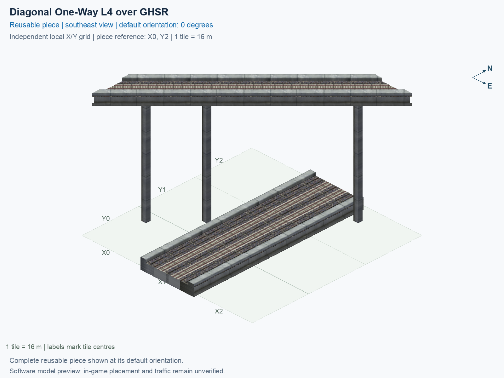

<a id="diagonal-one-way-l4-over-ghsr"></a>

# HSR Level 4 (30.5 m) over GHSR Ground (1 m) — Single-Track One-Way over Two-Track Crossing 45° — Upper Diagonal

<!-- SUBJECT IDENTITY MIGRATION -->

Identity migration: `interchange-l4-upper-diag-lower-grid-over-ground` → `hsr-l4-over-ghsr-ground-mixed-crossing-upper-diagonal-45deg`. Earlier measurements, observations, and pictures retain their recorded names and fingerprints; they do not establish verification of the renamed build. See the [identity migration rules](../../../../docs/NAMING_CONVENTIONS.md#10-choosing-and-changing-names).

Purpose: explain this reusable piece, its matching connections and current test coverage.

<!-- BEGIN PIECE OVERVIEW -->

Actual rail geometry and directed train paths at two heights. The one-way track and two-way track cross without a transfer. Experimental fixed piece; test rendering, traffic and shadows in the game. The upper route crosses without transferring to the lower two-way route.

Exact reusable identifier: `hsr-l4-over-ghsr-ground-mixed-crossing-upper-diagonal-45deg`.

Footprint: **3 × 3 tiles**. Exact menu name: **HSR Level 4 (30.5 m) over GHSR Ground (1 m) — Single-Track One-Way over Two-Track Crossing 45° — Upper Diagonal**.

Choose this exact name in Transportation → Rail. Press Home or End to rotate; use only the supported states listed below. Join each end to a matching port profile and direction.

- [Connections and journeys](#connections-and-journeys)
- [Test checklist](#test-checklist)



<!-- END PIECE OVERVIEW -->

<!-- BEGIN MANUAL SUMMARY -->

## Manual status

Generated from [the exact test cases](#test-checklist) and [authoritative observations](checks/manual-tests.json).

- [ ] Preview review: 0/1 applicable cases passed; 0 failed, 0 stale.
- [ ] In-game rendering: 0/4 applicable cases passed; 0 failed, 0 stale.
- [ ] Directed journeys: 0/12 applicable cases passed; 0 failed, 0 stale.

These observations cover only the named services, directions, poses, rotations, and recorded platforms.

<!-- END MANUAL SUMMARY -->

<!-- BEGIN CONNECTIONS -->

## Connections and journeys

Purpose: describe intrinsic directional interfaces and permitted service journeys.

Generated from [connections.json](connections.json). Coordinates are canonical east, north, and height in metres. A connection class names an encoded route interface; it does not prove visible deck/wall fit or an in-game test.

Supported placement states: 0° CCW, 90° CCW, 180° CCW, 270° CCW. Each state has its own declared manual scope.

A **port** is one directional transport-path endpoint. **Service** identifies the intended network service (for example HSR, street, or tram); **engine** is its internal traffic-class number, separate from the construction network. **Role** distinguishes primary service from auxiliary paths; sharing a traffic class does not establish service compatibility.

A **tangent** is a unit travel-direction vector: `[0,1]` means north. **Grade** is height gained per horizontal metre. These measured facts describe this subject alone. Compatibility requires a separate comparison of the complete joining boundaries; physical seams and actual game operation require their own evidence. See the [class index](../../connection-classes.jsonc) for shared route-interface membership.

| Port | Service / engine / role | Direction | Location; tangent; grade | Connection class |
| --- | --- | --- | --- | --- |
| `upper_in` | hsr / 7 / primary | in | [-8.0, -32.0, 30.5]; [0.7071067811865475, 0.7071067811865475]; 0.0 | `path-interface-13a0d20884fd73110dea` |
| `lower_b_out` | ghsr / 7 / primary | out | [14.0, -40.0, 1.0]; [-0.0, -1.0]; 0.0 | `path-interface-fab587419de6b5848d74` |
| `lower_b_in` | ghsr / 7 / primary | in | [14.0, 8.0, 1.0]; [-0.0, -1.0]; 0.0 | `path-interface-fab587419de6b5848d74` |
| `lower_a_in` | ghsr / 7 / primary | in | [18.0, -40.0, 1.0]; [0.0, 1.0]; 0.0 | `path-interface-fab587419de6b5848d74` |
| `lower_a_out` | ghsr / 7 / primary | out | [18.0, 8.0, 1.0]; [0.0, 1.0]; 0.0 | `path-interface-fab587419de6b5848d74` |
| `upper_out` | hsr / 7 / primary | out | [32.0, 8.0, 30.5]; [0.7071067811865475, 0.7071067811865475]; 0.0 | `path-interface-a70e777e6354823bc5c5` |

### Directed journeys

| Service | Entry → exit | Role |
| --- | --- | --- |
| hsr | `upper_in` → `upper_out` | primary |
| ghsr | `lower_b_in` → `lower_b_out` | primary |
| ghsr | `lower_a_in` → `lower_a_out` | primary |

### Forbidden transfers

| From service / port | To service / port | Reason |
| --- | --- | --- |
| hsr / `upper_in` | ghsr / `lower_b_out` | No directed route exists between these ports in the saved piece transport paths. In-game confirmation remains unverified. |
| hsr / `upper_in` | ghsr / `lower_a_out` | No directed route exists between these ports in the saved piece transport paths. In-game confirmation remains unverified. |
| ghsr / `lower_b_in` | ghsr / `lower_a_out` | No directed route exists between these ports in the saved piece transport paths. In-game confirmation remains unverified. |
| ghsr / `lower_b_in` | hsr / `upper_out` | No directed route exists between these ports in the saved piece transport paths. In-game confirmation remains unverified. |
| ghsr / `lower_a_in` | ghsr / `lower_b_out` | No directed route exists between these ports in the saved piece transport paths. In-game confirmation remains unverified. |
| ghsr / `lower_a_in` | hsr / `upper_out` | No directed route exists between these ports in the saved piece transport paths. In-game confirmation remains unverified. |

Review the test checklist for the exact tested cases and environments.

<!-- END CONNECTIONS -->

<!-- BEGIN MANUAL CHECKS -->

## Test checklist

Generated from [the authoritative record](checks/manual-tests.json). Only explicit human observations create manual passes; software and preview checks remain separate. Expand a check/service group to see its rotation table, then expand the matching exact scope to copy a case ID and inspect its pose, reviewer, environment, and evidence. Grouping changes only this view; every declared case remains separate.

**States:** [x] passed; [ ] unverified, failed, or stale; N/A is an explicit inapplicable declaration. A dash means no case was declared in that column. Every pass covers only its recorded environment. T means a distinct construction-transposed state.

Four proper rotations are covered. No additional reflected state is established by this record; repeated construction aliases do not create new orientations.

Current totals: unverified: 55, passed: 0, failed: 0, stale: 0, not_applicable: 0.

### Record an observation

Follow the [shared testing guide](../../../../docs/TESTING.md); copy [the unconfirmed example](checks/observation.example.json) to `checks/observation.json`. Case identifiers are in the expandable sections below. Do not edit generated checkboxes.

From the repository folder containing `custom-pieces`, run after filling `checks/observation.json` and explicitly confirming the exact observation:

```sh
python3 -m scp.content record --record custom-pieces/domains/high-speed-rail/00_pieces/hsr-l4-over-ghsr-ground-mixed-crossing-upper-diagonal-45deg/checks/manual-tests.json --observation custom-pieces/domains/high-speed-rail/00_pieces/hsr-l4-over-ghsr-ground-mixed-crossing-upper-diagonal-45deg/checks/observation.json
```

### Detailed current checks

Each collapsed group shows exact case counts and states. Forbidden transfers are grouped by the directed service pair; the table inside retains every port pair and rotation.

<details>
<summary>Compiled resources — Whole subject — 1 case; unverified: 1</summary>

| Check / exact scope | General | 0° | 90° | 180° | 270° |
| --- | --- | --- | --- | --- | --- |
| **Compiled resources**<br>Whole subject | <a href="#case-software_resources-19df85449b9f1a41be7a">[ ] unverified</a> | — | — | — | — |


<details>
<summary>Compiled resources — Whole subject</summary>

<a id="case-software_resources-19df85449b9f1a41be7a"></a>

**General: unverified** — `software_resources-19df85449b9f1a41be7a`.

Verify the actual compiled resources and construction rules.

Scope: Whole subject.

No observation recorded.

</details>

</details>

<details>
<summary>Directed routing graph — Whole subject — 1 case; unverified: 1</summary>

| Check / exact scope | General | 0° | 90° | 180° | 270° |
| --- | --- | --- | --- | --- | --- |
| **Directed routing graph**<br>Whole subject | <a href="#case-software_connectivity-19df85449b9f1a41be7a">[ ] unverified</a> | — | — | — | — |


<details>
<summary>Directed routing graph — Whole subject</summary>

<a id="case-software_connectivity-19df85449b9f1a41be7a"></a>

**General: unverified** — `software_connectivity-19df85449b9f1a41be7a`.

Verify the declared directed journeys and forbidden transfers.

Scope: Whole subject.

No observation recorded.

</details>

</details>

<details>
<summary>Preview review — Images — 1 case; unverified: 1</summary>

| Check / exact scope | General | 0° | 90° | 180° | 270° |
| --- | --- | --- | --- | --- | --- |
| **Preview review**<br>Image: image:interchange-l4-upper-diag-lower-grid-over-ground:canonical-southeast | <a href="#case-preview_review-59a90358c1c008af4c72">[ ] unverified</a> | — | — | — | — |


<details>
<summary>Preview review — Image: image:interchange-l4-upper-diag-lower-grid-over-ground:canonical-southeast</summary>

<a id="case-preview_review-59a90358c1c008af4c72"></a>

**General: unverified** — `preview_review-59a90358c1c008af4c72`.

Inspect this exact preview for tracks, walls, piers, seams and shadows.

Scope: Image: image:interchange-l4-upper-diag-lower-grid-over-ground:canonical-southeast.

No observation recorded.

</details>

</details>

<details>
<summary>In-game rendering — Whole subject — 4 cases; unverified: 4</summary>

| Check / exact scope | General | 0° | 90° | 180° | 270° |
| --- | --- | --- | --- | --- | --- |
| **In-game rendering**<br>Whole subject | — | <a href="#case-in_game_render-e11ddb4e2dd46c921eae">[ ] unverified</a> | <a href="#case-in_game_render-9d64b122a581f855e3b5">[ ] unverified</a> | <a href="#case-in_game_render-167d1b7293b114f764f9">[ ] unverified</a> | <a href="#case-in_game_render-76339b5ac3fd6442ae42">[ ] unverified</a> |


<details>
<summary>In-game rendering — Whole subject</summary>

<a id="case-in_game_render-e11ddb4e2dd46c921eae"></a>

**0° CCW: unverified** — `in_game_render-e11ddb4e2dd46c921eae`.

Inspect the placed tracks, walls, piers, seams and shadows in SimCity 4.

Scope: Whole subject.

No observation recorded.

<a id="case-in_game_render-9d64b122a581f855e3b5"></a>

**90° CCW: unverified** — `in_game_render-9d64b122a581f855e3b5`.

Inspect the placed tracks, walls, piers, seams and shadows in SimCity 4.

Scope: Whole subject.

No observation recorded.

<a id="case-in_game_render-167d1b7293b114f764f9"></a>

**180° CCW: unverified** — `in_game_render-167d1b7293b114f764f9`.

Inspect the placed tracks, walls, piers, seams and shadows in SimCity 4.

Scope: Whole subject.

No observation recorded.

<a id="case-in_game_render-76339b5ac3fd6442ae42"></a>

**270° CCW: unverified** — `in_game_render-76339b5ac3fd6442ae42`.

Inspect the placed tracks, walls, piers, seams and shadows in SimCity 4.

Scope: Whole subject.

No observation recorded.

</details>

</details>

<details>
<summary>Placement — Whole subject — 4 cases; unverified: 4</summary>

| Check / exact scope | General | 0° | 90° | 180° | 270° |
| --- | --- | --- | --- | --- | --- |
| **Placement**<br>Whole subject | — | <a href="#case-in_game_placement-e11ddb4e2dd46c921eae">[ ] unverified</a> | <a href="#case-in_game_placement-9d64b122a581f855e3b5">[ ] unverified</a> | <a href="#case-in_game_placement-167d1b7293b114f764f9">[ ] unverified</a> | <a href="#case-in_game_placement-76339b5ac3fd6442ae42">[ ] unverified</a> |


<details>
<summary>Placement — Whole subject</summary>

<a id="case-in_game_placement-e11ddb4e2dd46c921eae"></a>

**0° CCW: unverified** — `in_game_placement-e11ddb4e2dd46c921eae`.

Place this piece or complete blueprint and inspect every occupied tile.

Scope: Whole subject.

No observation recorded.

<a id="case-in_game_placement-9d64b122a581f855e3b5"></a>

**90° CCW: unverified** — `in_game_placement-9d64b122a581f855e3b5`.

Place this piece or complete blueprint and inspect every occupied tile.

Scope: Whole subject.

No observation recorded.

<a id="case-in_game_placement-167d1b7293b114f764f9"></a>

**180° CCW: unverified** — `in_game_placement-167d1b7293b114f764f9`.

Place this piece or complete blueprint and inspect every occupied tile.

Scope: Whole subject.

No observation recorded.

<a id="case-in_game_placement-76339b5ac3fd6442ae42"></a>

**270° CCW: unverified** — `in_game_placement-76339b5ac3fd6442ae42`.

Place this piece or complete blueprint and inspect every occupied tile.

Scope: Whole subject.

No observation recorded.

</details>

</details>

<details>
<summary>Demolition — Whole subject — 4 cases; unverified: 4</summary>

| Check / exact scope | General | 0° | 90° | 180° | 270° |
| --- | --- | --- | --- | --- | --- |
| **Demolition**<br>Whole subject | — | <a href="#case-in_game_demolition-e11ddb4e2dd46c921eae">[ ] unverified</a> | <a href="#case-in_game_demolition-9d64b122a581f855e3b5">[ ] unverified</a> | <a href="#case-in_game_demolition-167d1b7293b114f764f9">[ ] unverified</a> | <a href="#case-in_game_demolition-76339b5ac3fd6442ae42">[ ] unverified</a> |


<details>
<summary>Demolition — Whole subject</summary>

<a id="case-in_game_demolition-e11ddb4e2dd46c921eae"></a>

**0° CCW: unverified** — `in_game_demolition-e11ddb4e2dd46c921eae`.

Bulldoze the complete placement and inspect the cleared area.

Scope: Whole subject.

No observation recorded.

<a id="case-in_game_demolition-9d64b122a581f855e3b5"></a>

**90° CCW: unverified** — `in_game_demolition-9d64b122a581f855e3b5`.

Bulldoze the complete placement and inspect the cleared area.

Scope: Whole subject.

No observation recorded.

<a id="case-in_game_demolition-167d1b7293b114f764f9"></a>

**180° CCW: unverified** — `in_game_demolition-167d1b7293b114f764f9`.

Bulldoze the complete placement and inspect the cleared area.

Scope: Whole subject.

No observation recorded.

<a id="case-in_game_demolition-76339b5ac3fd6442ae42"></a>

**270° CCW: unverified** — `in_game_demolition-76339b5ac3fd6442ae42`.

Bulldoze the complete placement and inspect the cleared area.

Scope: Whole subject.

No observation recorded.

</details>

</details>

<details>
<summary>Save and reload — Whole subject — 4 cases; unverified: 4</summary>

| Check / exact scope | General | 0° | 90° | 180° | 270° |
| --- | --- | --- | --- | --- | --- |
| **Save and reload**<br>Whole subject | — | <a href="#case-in_game_save_reload-e11ddb4e2dd46c921eae">[ ] unverified</a> | <a href="#case-in_game_save_reload-9d64b122a581f855e3b5">[ ] unverified</a> | <a href="#case-in_game_save_reload-167d1b7293b114f764f9">[ ] unverified</a> | <a href="#case-in_game_save_reload-76339b5ac3fd6442ae42">[ ] unverified</a> |


<details>
<summary>Save and reload — Whole subject</summary>

<a id="case-in_game_save_reload-e11ddb4e2dd46c921eae"></a>

**0° CCW: unverified** — `in_game_save_reload-e11ddb4e2dd46c921eae`.

Save, quit, reload and inspect the placement and its paths.

Scope: Whole subject.

No observation recorded.

<a id="case-in_game_save_reload-9d64b122a581f855e3b5"></a>

**90° CCW: unverified** — `in_game_save_reload-9d64b122a581f855e3b5`.

Save, quit, reload and inspect the placement and its paths.

Scope: Whole subject.

No observation recorded.

<a id="case-in_game_save_reload-167d1b7293b114f764f9"></a>

**180° CCW: unverified** — `in_game_save_reload-167d1b7293b114f764f9`.

Save, quit, reload and inspect the placement and its paths.

Scope: Whole subject.

No observation recorded.

<a id="case-in_game_save_reload-76339b5ac3fd6442ae42"></a>

**270° CCW: unverified** — `in_game_save_reload-76339b5ac3fd6442ae42`.

Save, quit, reload and inspect the placement and its paths.

Scope: Whole subject.

No observation recorded.

</details>

</details>

<details>
<summary>Journey — hsr — 4 cases; unverified: 4</summary>

| Check / exact scope | General | 0° | 90° | 180° | 270° |
| --- | --- | --- | --- | --- | --- |
| **Journey**<br>Service: hsr; role: primary; journey: 7:upper_in>upper_out; entry: upper_in; exit: upper_out | — | <a href="#case-in_game_journey-af117030bcbaf725a1e3">[ ] unverified</a> | <a href="#case-in_game_journey-6e6b6b303b1ed8c78141">[ ] unverified</a> | <a href="#case-in_game_journey-58dcd53661d03c947908">[ ] unverified</a> | <a href="#case-in_game_journey-d1179b9f4d90aa6c0031">[ ] unverified</a> |


<details>
<summary>Journey — Service: hsr; role: primary; journey: 7:upper_in>upper_out; entry: upper_in; exit: upper_out</summary>

<a id="case-in_game_journey-af117030bcbaf725a1e3"></a>

**0° CCW: unverified** — `in_game_journey-af117030bcbaf725a1e3`.

Run the declared journey in this direction using its service network.

Scope: Service: hsr; role: primary; journey: 7:upper_in>upper_out; entry: upper_in; exit: upper_out.

No observation recorded.

<a id="case-in_game_journey-6e6b6b303b1ed8c78141"></a>

**90° CCW: unverified** — `in_game_journey-6e6b6b303b1ed8c78141`.

Run the declared journey in this direction using its service network.

Scope: Service: hsr; role: primary; journey: 7:upper_in>upper_out; entry: upper_in; exit: upper_out.

No observation recorded.

<a id="case-in_game_journey-58dcd53661d03c947908"></a>

**180° CCW: unverified** — `in_game_journey-58dcd53661d03c947908`.

Run the declared journey in this direction using its service network.

Scope: Service: hsr; role: primary; journey: 7:upper_in>upper_out; entry: upper_in; exit: upper_out.

No observation recorded.

<a id="case-in_game_journey-d1179b9f4d90aa6c0031"></a>

**270° CCW: unverified** — `in_game_journey-d1179b9f4d90aa6c0031`.

Run the declared journey in this direction using its service network.

Scope: Service: hsr; role: primary; journey: 7:upper_in>upper_out; entry: upper_in; exit: upper_out.

No observation recorded.

</details>

</details>

<details>
<summary>Journey — ghsr — 8 cases; unverified: 8</summary>

| Check / exact scope | General | 0° | 90° | 180° | 270° |
| --- | --- | --- | --- | --- | --- |
| **Journey**<br>Service: ghsr; role: primary; journey: 7:lower_b_in>lower_b_out; entry: lower_b_in; exit: lower_b_out | — | <a href="#case-in_game_journey-c9ce0010914cf26ebb52">[ ] unverified</a> | <a href="#case-in_game_journey-71505012502ff8d05624">[ ] unverified</a> | <a href="#case-in_game_journey-adf2bfca716c519a5247">[ ] unverified</a> | <a href="#case-in_game_journey-4a4eba84ea4640609b1b">[ ] unverified</a> |
| **Journey**<br>Service: ghsr; role: primary; journey: 7:lower_a_in>lower_a_out; entry: lower_a_in; exit: lower_a_out | — | <a href="#case-in_game_journey-03e5193afbf6b1363ed0">[ ] unverified</a> | <a href="#case-in_game_journey-33d1ed80a70da822730e">[ ] unverified</a> | <a href="#case-in_game_journey-42bbeec34a3db98eda08">[ ] unverified</a> | <a href="#case-in_game_journey-5e79bc4e9a29a7d8cfe8">[ ] unverified</a> |


<details>
<summary>Journey — Service: ghsr; role: primary; journey: 7:lower_b_in>lower_b_out; entry: lower_b_in; exit: lower_b_out</summary>

<a id="case-in_game_journey-c9ce0010914cf26ebb52"></a>

**0° CCW: unverified** — `in_game_journey-c9ce0010914cf26ebb52`.

Run the declared journey in this direction using its service network.

Scope: Service: ghsr; role: primary; journey: 7:lower_b_in>lower_b_out; entry: lower_b_in; exit: lower_b_out.

No observation recorded.

<a id="case-in_game_journey-71505012502ff8d05624"></a>

**90° CCW: unverified** — `in_game_journey-71505012502ff8d05624`.

Run the declared journey in this direction using its service network.

Scope: Service: ghsr; role: primary; journey: 7:lower_b_in>lower_b_out; entry: lower_b_in; exit: lower_b_out.

No observation recorded.

<a id="case-in_game_journey-adf2bfca716c519a5247"></a>

**180° CCW: unverified** — `in_game_journey-adf2bfca716c519a5247`.

Run the declared journey in this direction using its service network.

Scope: Service: ghsr; role: primary; journey: 7:lower_b_in>lower_b_out; entry: lower_b_in; exit: lower_b_out.

No observation recorded.

<a id="case-in_game_journey-4a4eba84ea4640609b1b"></a>

**270° CCW: unverified** — `in_game_journey-4a4eba84ea4640609b1b`.

Run the declared journey in this direction using its service network.

Scope: Service: ghsr; role: primary; journey: 7:lower_b_in>lower_b_out; entry: lower_b_in; exit: lower_b_out.

No observation recorded.

</details>


<details>
<summary>Journey — Service: ghsr; role: primary; journey: 7:lower_a_in>lower_a_out; entry: lower_a_in; exit: lower_a_out</summary>

<a id="case-in_game_journey-03e5193afbf6b1363ed0"></a>

**0° CCW: unverified** — `in_game_journey-03e5193afbf6b1363ed0`.

Run the declared journey in this direction using its service network.

Scope: Service: ghsr; role: primary; journey: 7:lower_a_in>lower_a_out; entry: lower_a_in; exit: lower_a_out.

No observation recorded.

<a id="case-in_game_journey-33d1ed80a70da822730e"></a>

**90° CCW: unverified** — `in_game_journey-33d1ed80a70da822730e`.

Run the declared journey in this direction using its service network.

Scope: Service: ghsr; role: primary; journey: 7:lower_a_in>lower_a_out; entry: lower_a_in; exit: lower_a_out.

No observation recorded.

<a id="case-in_game_journey-42bbeec34a3db98eda08"></a>

**180° CCW: unverified** — `in_game_journey-42bbeec34a3db98eda08`.

Run the declared journey in this direction using its service network.

Scope: Service: ghsr; role: primary; journey: 7:lower_a_in>lower_a_out; entry: lower_a_in; exit: lower_a_out.

No observation recorded.

<a id="case-in_game_journey-5e79bc4e9a29a7d8cfe8"></a>

**270° CCW: unverified** — `in_game_journey-5e79bc4e9a29a7d8cfe8`.

Run the declared journey in this direction using its service network.

Scope: Service: ghsr; role: primary; journey: 7:lower_a_in>lower_a_out; entry: lower_a_in; exit: lower_a_out.

No observation recorded.

</details>

</details>

<details>
<summary>Forbidden transfer — hsr → ghsr — 8 cases; unverified: 8</summary>

| Check / exact scope | General | 0° | 90° | 180° | 270° |
| --- | --- | --- | --- | --- | --- |
| **Forbidden transfer**<br>from port: upper_in; to port: lower_b_out; from service: hsr; to service: ghsr; basis: not reachable in actual saved PATH graph | — | <a href="#case-in_game_forbidden_transfer-46a152fedacd1db726bf">[ ] unverified</a> | <a href="#case-in_game_forbidden_transfer-796f54584610c7e3aa1a">[ ] unverified</a> | <a href="#case-in_game_forbidden_transfer-4d3eba712cd73ab0c011">[ ] unverified</a> | <a href="#case-in_game_forbidden_transfer-02fc38e389adfd12045a">[ ] unverified</a> |
| **Forbidden transfer**<br>from port: upper_in; to port: lower_a_out; from service: hsr; to service: ghsr; basis: not reachable in actual saved PATH graph | — | <a href="#case-in_game_forbidden_transfer-1da8557ac39f05b2079b">[ ] unverified</a> | <a href="#case-in_game_forbidden_transfer-a521bc04e63f91588a58">[ ] unverified</a> | <a href="#case-in_game_forbidden_transfer-356fcd816497f9338932">[ ] unverified</a> | <a href="#case-in_game_forbidden_transfer-25d5f54bf862acbc027b">[ ] unverified</a> |


<details>
<summary>Forbidden transfer — from port: upper_in; to port: lower_b_out; from service: hsr; to service: ghsr; basis: not reachable in actual saved PATH graph</summary>

<a id="case-in_game_forbidden_transfer-46a152fedacd1db726bf"></a>

**0° CCW: unverified** — `in_game_forbidden_transfer-46a152fedacd1db726bf`.

Confirm this undeclared transfer is unavailable.

Scope: from port: upper_in; to port: lower_b_out; from service: hsr; to service: ghsr; basis: not reachable in actual saved PATH graph.

No observation recorded.

<a id="case-in_game_forbidden_transfer-796f54584610c7e3aa1a"></a>

**90° CCW: unverified** — `in_game_forbidden_transfer-796f54584610c7e3aa1a`.

Confirm this undeclared transfer is unavailable.

Scope: from port: upper_in; to port: lower_b_out; from service: hsr; to service: ghsr; basis: not reachable in actual saved PATH graph.

No observation recorded.

<a id="case-in_game_forbidden_transfer-4d3eba712cd73ab0c011"></a>

**180° CCW: unverified** — `in_game_forbidden_transfer-4d3eba712cd73ab0c011`.

Confirm this undeclared transfer is unavailable.

Scope: from port: upper_in; to port: lower_b_out; from service: hsr; to service: ghsr; basis: not reachable in actual saved PATH graph.

No observation recorded.

<a id="case-in_game_forbidden_transfer-02fc38e389adfd12045a"></a>

**270° CCW: unverified** — `in_game_forbidden_transfer-02fc38e389adfd12045a`.

Confirm this undeclared transfer is unavailable.

Scope: from port: upper_in; to port: lower_b_out; from service: hsr; to service: ghsr; basis: not reachable in actual saved PATH graph.

No observation recorded.

</details>


<details>
<summary>Forbidden transfer — from port: upper_in; to port: lower_a_out; from service: hsr; to service: ghsr; basis: not reachable in actual saved PATH graph</summary>

<a id="case-in_game_forbidden_transfer-1da8557ac39f05b2079b"></a>

**0° CCW: unverified** — `in_game_forbidden_transfer-1da8557ac39f05b2079b`.

Confirm this undeclared transfer is unavailable.

Scope: from port: upper_in; to port: lower_a_out; from service: hsr; to service: ghsr; basis: not reachable in actual saved PATH graph.

No observation recorded.

<a id="case-in_game_forbidden_transfer-a521bc04e63f91588a58"></a>

**90° CCW: unverified** — `in_game_forbidden_transfer-a521bc04e63f91588a58`.

Confirm this undeclared transfer is unavailable.

Scope: from port: upper_in; to port: lower_a_out; from service: hsr; to service: ghsr; basis: not reachable in actual saved PATH graph.

No observation recorded.

<a id="case-in_game_forbidden_transfer-356fcd816497f9338932"></a>

**180° CCW: unverified** — `in_game_forbidden_transfer-356fcd816497f9338932`.

Confirm this undeclared transfer is unavailable.

Scope: from port: upper_in; to port: lower_a_out; from service: hsr; to service: ghsr; basis: not reachable in actual saved PATH graph.

No observation recorded.

<a id="case-in_game_forbidden_transfer-25d5f54bf862acbc027b"></a>

**270° CCW: unverified** — `in_game_forbidden_transfer-25d5f54bf862acbc027b`.

Confirm this undeclared transfer is unavailable.

Scope: from port: upper_in; to port: lower_a_out; from service: hsr; to service: ghsr; basis: not reachable in actual saved PATH graph.

No observation recorded.

</details>

</details>

<details>
<summary>Forbidden transfer — ghsr → ghsr — 8 cases; unverified: 8</summary>

| Check / exact scope | General | 0° | 90° | 180° | 270° |
| --- | --- | --- | --- | --- | --- |
| **Forbidden transfer**<br>from port: lower_b_in; to port: lower_a_out; from service: ghsr; to service: ghsr; basis: not reachable in actual saved PATH graph | — | <a href="#case-in_game_forbidden_transfer-f1b2b0ed784217e9fc20">[ ] unverified</a> | <a href="#case-in_game_forbidden_transfer-a357272dd445763a98b4">[ ] unverified</a> | <a href="#case-in_game_forbidden_transfer-7da387625637db4dd6ba">[ ] unverified</a> | <a href="#case-in_game_forbidden_transfer-8849809cec7863211680">[ ] unverified</a> |
| **Forbidden transfer**<br>from port: lower_a_in; to port: lower_b_out; from service: ghsr; to service: ghsr; basis: not reachable in actual saved PATH graph | — | <a href="#case-in_game_forbidden_transfer-1984120eee7841d8635b">[ ] unverified</a> | <a href="#case-in_game_forbidden_transfer-bcb039b5953442ea1fbe">[ ] unverified</a> | <a href="#case-in_game_forbidden_transfer-efd33afae44437e92f02">[ ] unverified</a> | <a href="#case-in_game_forbidden_transfer-741b0a1507c8cce89c69">[ ] unverified</a> |


<details>
<summary>Forbidden transfer — from port: lower_b_in; to port: lower_a_out; from service: ghsr; to service: ghsr; basis: not reachable in actual saved PATH graph</summary>

<a id="case-in_game_forbidden_transfer-f1b2b0ed784217e9fc20"></a>

**0° CCW: unverified** — `in_game_forbidden_transfer-f1b2b0ed784217e9fc20`.

Confirm this undeclared transfer is unavailable.

Scope: from port: lower_b_in; to port: lower_a_out; from service: ghsr; to service: ghsr; basis: not reachable in actual saved PATH graph.

No observation recorded.

<a id="case-in_game_forbidden_transfer-a357272dd445763a98b4"></a>

**90° CCW: unverified** — `in_game_forbidden_transfer-a357272dd445763a98b4`.

Confirm this undeclared transfer is unavailable.

Scope: from port: lower_b_in; to port: lower_a_out; from service: ghsr; to service: ghsr; basis: not reachable in actual saved PATH graph.

No observation recorded.

<a id="case-in_game_forbidden_transfer-7da387625637db4dd6ba"></a>

**180° CCW: unverified** — `in_game_forbidden_transfer-7da387625637db4dd6ba`.

Confirm this undeclared transfer is unavailable.

Scope: from port: lower_b_in; to port: lower_a_out; from service: ghsr; to service: ghsr; basis: not reachable in actual saved PATH graph.

No observation recorded.

<a id="case-in_game_forbidden_transfer-8849809cec7863211680"></a>

**270° CCW: unverified** — `in_game_forbidden_transfer-8849809cec7863211680`.

Confirm this undeclared transfer is unavailable.

Scope: from port: lower_b_in; to port: lower_a_out; from service: ghsr; to service: ghsr; basis: not reachable in actual saved PATH graph.

No observation recorded.

</details>


<details>
<summary>Forbidden transfer — from port: lower_a_in; to port: lower_b_out; from service: ghsr; to service: ghsr; basis: not reachable in actual saved PATH graph</summary>

<a id="case-in_game_forbidden_transfer-1984120eee7841d8635b"></a>

**0° CCW: unverified** — `in_game_forbidden_transfer-1984120eee7841d8635b`.

Confirm this undeclared transfer is unavailable.

Scope: from port: lower_a_in; to port: lower_b_out; from service: ghsr; to service: ghsr; basis: not reachable in actual saved PATH graph.

No observation recorded.

<a id="case-in_game_forbidden_transfer-bcb039b5953442ea1fbe"></a>

**90° CCW: unverified** — `in_game_forbidden_transfer-bcb039b5953442ea1fbe`.

Confirm this undeclared transfer is unavailable.

Scope: from port: lower_a_in; to port: lower_b_out; from service: ghsr; to service: ghsr; basis: not reachable in actual saved PATH graph.

No observation recorded.

<a id="case-in_game_forbidden_transfer-efd33afae44437e92f02"></a>

**180° CCW: unverified** — `in_game_forbidden_transfer-efd33afae44437e92f02`.

Confirm this undeclared transfer is unavailable.

Scope: from port: lower_a_in; to port: lower_b_out; from service: ghsr; to service: ghsr; basis: not reachable in actual saved PATH graph.

No observation recorded.

<a id="case-in_game_forbidden_transfer-741b0a1507c8cce89c69"></a>

**270° CCW: unverified** — `in_game_forbidden_transfer-741b0a1507c8cce89c69`.

Confirm this undeclared transfer is unavailable.

Scope: from port: lower_a_in; to port: lower_b_out; from service: ghsr; to service: ghsr; basis: not reachable in actual saved PATH graph.

No observation recorded.

</details>

</details>

<details>
<summary>Forbidden transfer — ghsr → hsr — 8 cases; unverified: 8</summary>

| Check / exact scope | General | 0° | 90° | 180° | 270° |
| --- | --- | --- | --- | --- | --- |
| **Forbidden transfer**<br>from port: lower_b_in; to port: upper_out; from service: ghsr; to service: hsr; basis: not reachable in actual saved PATH graph | — | <a href="#case-in_game_forbidden_transfer-2e545fa80d3d14fdd61c">[ ] unverified</a> | <a href="#case-in_game_forbidden_transfer-b9b8edbb6679371774ca">[ ] unverified</a> | <a href="#case-in_game_forbidden_transfer-36a4b6739db3b424247d">[ ] unverified</a> | <a href="#case-in_game_forbidden_transfer-70d8a56c4b50a4dde9c3">[ ] unverified</a> |
| **Forbidden transfer**<br>from port: lower_a_in; to port: upper_out; from service: ghsr; to service: hsr; basis: not reachable in actual saved PATH graph | — | <a href="#case-in_game_forbidden_transfer-04404f23abb60f0f7cf5">[ ] unverified</a> | <a href="#case-in_game_forbidden_transfer-f6442f5e44612d93a2c1">[ ] unverified</a> | <a href="#case-in_game_forbidden_transfer-dbb6b4e9149087693606">[ ] unverified</a> | <a href="#case-in_game_forbidden_transfer-67d3f228f6dad6479197">[ ] unverified</a> |


<details>
<summary>Forbidden transfer — from port: lower_b_in; to port: upper_out; from service: ghsr; to service: hsr; basis: not reachable in actual saved PATH graph</summary>

<a id="case-in_game_forbidden_transfer-2e545fa80d3d14fdd61c"></a>

**0° CCW: unverified** — `in_game_forbidden_transfer-2e545fa80d3d14fdd61c`.

Confirm this undeclared transfer is unavailable.

Scope: from port: lower_b_in; to port: upper_out; from service: ghsr; to service: hsr; basis: not reachable in actual saved PATH graph.

No observation recorded.

<a id="case-in_game_forbidden_transfer-b9b8edbb6679371774ca"></a>

**90° CCW: unverified** — `in_game_forbidden_transfer-b9b8edbb6679371774ca`.

Confirm this undeclared transfer is unavailable.

Scope: from port: lower_b_in; to port: upper_out; from service: ghsr; to service: hsr; basis: not reachable in actual saved PATH graph.

No observation recorded.

<a id="case-in_game_forbidden_transfer-36a4b6739db3b424247d"></a>

**180° CCW: unverified** — `in_game_forbidden_transfer-36a4b6739db3b424247d`.

Confirm this undeclared transfer is unavailable.

Scope: from port: lower_b_in; to port: upper_out; from service: ghsr; to service: hsr; basis: not reachable in actual saved PATH graph.

No observation recorded.

<a id="case-in_game_forbidden_transfer-70d8a56c4b50a4dde9c3"></a>

**270° CCW: unverified** — `in_game_forbidden_transfer-70d8a56c4b50a4dde9c3`.

Confirm this undeclared transfer is unavailable.

Scope: from port: lower_b_in; to port: upper_out; from service: ghsr; to service: hsr; basis: not reachable in actual saved PATH graph.

No observation recorded.

</details>


<details>
<summary>Forbidden transfer — from port: lower_a_in; to port: upper_out; from service: ghsr; to service: hsr; basis: not reachable in actual saved PATH graph</summary>

<a id="case-in_game_forbidden_transfer-04404f23abb60f0f7cf5"></a>

**0° CCW: unverified** — `in_game_forbidden_transfer-04404f23abb60f0f7cf5`.

Confirm this undeclared transfer is unavailable.

Scope: from port: lower_a_in; to port: upper_out; from service: ghsr; to service: hsr; basis: not reachable in actual saved PATH graph.

No observation recorded.

<a id="case-in_game_forbidden_transfer-f6442f5e44612d93a2c1"></a>

**90° CCW: unverified** — `in_game_forbidden_transfer-f6442f5e44612d93a2c1`.

Confirm this undeclared transfer is unavailable.

Scope: from port: lower_a_in; to port: upper_out; from service: ghsr; to service: hsr; basis: not reachable in actual saved PATH graph.

No observation recorded.

<a id="case-in_game_forbidden_transfer-dbb6b4e9149087693606"></a>

**180° CCW: unverified** — `in_game_forbidden_transfer-dbb6b4e9149087693606`.

Confirm this undeclared transfer is unavailable.

Scope: from port: lower_a_in; to port: upper_out; from service: ghsr; to service: hsr; basis: not reachable in actual saved PATH graph.

No observation recorded.

<a id="case-in_game_forbidden_transfer-67d3f228f6dad6479197"></a>

**270° CCW: unverified** — `in_game_forbidden_transfer-67d3f228f6dad6479197`.

Confirm this undeclared transfer is unavailable.

Scope: from port: lower_a_in; to port: upper_out; from service: ghsr; to service: hsr; basis: not reachable in actual saved PATH graph.

No observation recorded.

</details>

</details>

<!-- END MANUAL CHECKS -->
