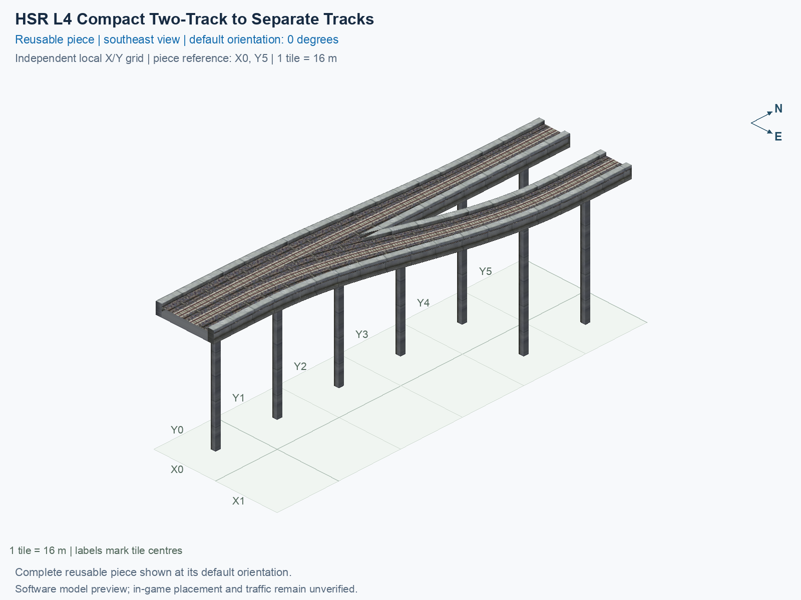

<a id="hsr-l4-compact-two-track-to-separate-tracks"></a>

# HSR Level 4 (30.5 m) — Two-Track to Separate Single-Track Adapter — Compact

<!-- SUBJECT IDENTITY MIGRATION -->

Identity migration: `hsr-component-upper-paired-to-single-adapter-compact` → `hsr-l4-two-track-adapter-separated-compact`. Earlier measurements, observations, and pictures retain their recorded names and fingerprints; they do not establish verification of the renamed build. See the [identity migration rules](../../../../docs/NAMING_CONVENTIONS.md#10-choosing-and-changing-names).

Purpose: explain this reusable piece, its matching connections and current test coverage.

<!-- BEGIN PIECE OVERVIEW -->

A 96 m long upper adapter spreads native opposite-direction tracks into two eight-metre single-track decks, with centres one tile apart and matching flat collars.

Exact reusable identifier: `hsr-l4-two-track-adapter-separated-compact`.

Footprint: **2 × 6 tiles**. Exact menu name: **HSR Level 4 (30.5 m) — Two-Track to Separate Single-Track Adapter — Compact**.

Choose this exact name in Transportation → Rail. Press Home or End to rotate; use only the supported states listed below. Join each end to a matching port profile and direction.

- [Connections and journeys](#connections-and-journeys)
- [Test checklist](#test-checklist)



<!-- END PIECE OVERVIEW -->

<!-- BEGIN MANUAL SUMMARY -->

## Manual status

Generated from [the exact test cases](#test-checklist) and [authoritative observations](checks/manual-tests.json).

- [ ] Preview review: 0/1 applicable cases passed; 0 failed, 0 stale.
- [ ] In-game rendering: 0/4 applicable cases passed; 0 failed, 0 stale.
- [ ] Directed journeys: 0/8 applicable cases passed; 0 failed, 0 stale.

These observations cover only the named services, directions, poses, rotations, and recorded platforms.

<!-- END MANUAL SUMMARY -->

<!-- BEGIN CONNECTIONS -->

## Connections and journeys

Purpose: describe intrinsic directional interfaces and permitted service journeys.

Generated from [connections.json](connections.json). Coordinates are canonical east, north, and height in metres. A connection class names an encoded route interface; it does not prove visible deck/wall fit or an in-game test.

Supported placement states: 0° CCW, 90° CCW, 180° CCW, 270° CCW. Each state has its own declared manual scope.

A **port** is one directional transport-path endpoint. **Service** identifies the intended network service (for example HSR, street, or tram); **engine** is its internal traffic-class number, separate from the construction network. **Role** distinguishes primary service from auxiliary paths; sharing a traffic class does not establish service compatibility.

A **tangent** is a unit travel-direction vector: `[0,1]` means north. **Grade** is height gained per horizontal metre. These measured facts describe this subject alone. Compatibility requires a separate comparison of the complete joining boundaries; physical seams and actual game operation require their own evidence. See the [class index](../../connection-classes.jsonc) for shared route-interface membership.

| Port | Service / engine / role | Direction | Location; tangent; grade | Connection class |
| --- | --- | --- | --- | --- |
| `Sout` | hsr / 7 / primary | out | [-2.0, -88.0, 30.5]; [0.0, -1.0]; 0.0 | `path-interface-ce3ccdc10e5e243d11ae` |
| `Nin` | hsr / 7 / primary | in | [0.0, 8.0, 30.5]; [0.0, -1.0]; 0.0 | `path-interface-a11c9f8debd0ee1c3a94` |
| `Sin` | hsr / 7 / primary | in | [2.0, -88.0, 30.5]; [0.0, 1.0]; 0.0 | `path-interface-9b897a8bacb659f807fe` |
| `Nout` | hsr / 7 / primary | out | [16.0, 8.0, 30.5]; [0.0, 1.0]; 0.0 | `path-interface-90a5bcd3e5d324374d48` |

### Directed journeys

| Service | Entry → exit | Role |
| --- | --- | --- |
| hsr | `Nin` → `Sout` | primary |
| hsr | `Sin` → `Nout` | primary |

### Forbidden transfers

| From service / port | To service / port | Reason |
| --- | --- | --- |
| hsr / `Nin` | hsr / `Nout` | No directed route exists between these ports in the saved piece transport paths. In-game confirmation remains unverified. |
| hsr / `Sin` | hsr / `Sout` | No directed route exists between these ports in the saved piece transport paths. In-game confirmation remains unverified. |

Review the test checklist for the exact tested cases and environments.

<!-- END CONNECTIONS -->

<!-- BEGIN MANUAL CHECKS -->

## Test checklist

Generated from [the authoritative record](checks/manual-tests.json). Only explicit human observations create manual passes; software and preview checks remain separate. Expand a check/service group to see its rotation table, then expand the matching exact scope to copy a case ID and inspect its pose, reviewer, environment, and evidence. Grouping changes only this view; every declared case remains separate.

**States:** [x] passed; [ ] unverified, failed, or stale; N/A is an explicit inapplicable declaration. A dash means no case was declared in that column. Every pass covers only its recorded environment. T means a distinct construction-transposed state.

Four proper rotations are covered. No additional reflected state is established by this record; repeated construction aliases do not create new orientations.

Current totals: unverified: 35, passed: 0, failed: 0, stale: 0, not_applicable: 0.

### Record an observation

Follow the [shared testing guide](../../../../docs/TESTING.md); copy [the unconfirmed example](checks/observation.example.json) to `checks/observation.json`. Case identifiers are in the expandable sections below. Do not edit generated checkboxes.

From the repository folder containing `custom-pieces`, run after filling `checks/observation.json` and explicitly confirming the exact observation:

```sh
python3 -m scp.content record --record custom-pieces/domains/high-speed-rail/00_pieces/hsr-l4-two-track-adapter-separated-compact/checks/manual-tests.json --observation custom-pieces/domains/high-speed-rail/00_pieces/hsr-l4-two-track-adapter-separated-compact/checks/observation.json
```

### Detailed current checks

Each collapsed group shows exact case counts and states. Forbidden transfers are grouped by the directed service pair; the table inside retains every port pair and rotation.

<details>
<summary>Compiled resources — Whole subject — 1 case; unverified: 1</summary>

| Check / exact scope | General | 0° | 90° | 180° | 270° |
| --- | --- | --- | --- | --- | --- |
| **Compiled resources**<br>Whole subject | <a href="#case-software_resources-75fa1c3a83f0125e8fd3">[ ] unverified</a> | — | — | — | — |


<details>
<summary>Compiled resources — Whole subject</summary>

<a id="case-software_resources-75fa1c3a83f0125e8fd3"></a>

**General: unverified** — `software_resources-75fa1c3a83f0125e8fd3`.

Verify the actual compiled resources and construction rules.

Scope: Whole subject.

No observation recorded.

</details>

</details>

<details>
<summary>Directed routing graph — Whole subject — 1 case; unverified: 1</summary>

| Check / exact scope | General | 0° | 90° | 180° | 270° |
| --- | --- | --- | --- | --- | --- |
| **Directed routing graph**<br>Whole subject | <a href="#case-software_connectivity-75fa1c3a83f0125e8fd3">[ ] unverified</a> | — | — | — | — |


<details>
<summary>Directed routing graph — Whole subject</summary>

<a id="case-software_connectivity-75fa1c3a83f0125e8fd3"></a>

**General: unverified** — `software_connectivity-75fa1c3a83f0125e8fd3`.

Verify the declared directed journeys and forbidden transfers.

Scope: Whole subject.

No observation recorded.

</details>

</details>

<details>
<summary>Preview review — Images — 1 case; unverified: 1</summary>

| Check / exact scope | General | 0° | 90° | 180° | 270° |
| --- | --- | --- | --- | --- | --- |
| **Preview review**<br>Image: image:hsr-component-upper-paired-to-single-adapter-compact:canonical-southeast | <a href="#case-preview_review-7a7a10e1573785841a1b">[ ] unverified</a> | — | — | — | — |


<details>
<summary>Preview review — Image: image:hsr-component-upper-paired-to-single-adapter-compact:canonical-southeast</summary>

<a id="case-preview_review-7a7a10e1573785841a1b"></a>

**General: unverified** — `preview_review-7a7a10e1573785841a1b`.

Inspect this exact preview for tracks, walls, piers, seams and shadows.

Scope: Image: image:hsr-component-upper-paired-to-single-adapter-compact:canonical-southeast.

No observation recorded.

</details>

</details>

<details>
<summary>In-game rendering — Whole subject — 4 cases; unverified: 4</summary>

| Check / exact scope | General | 0° | 90° | 180° | 270° |
| --- | --- | --- | --- | --- | --- |
| **In-game rendering**<br>Whole subject | — | <a href="#case-in_game_render-57b365349cd5444fc870">[ ] unverified</a> | <a href="#case-in_game_render-4b2f5dd44b8c9f79becc">[ ] unverified</a> | <a href="#case-in_game_render-627e02b6856abc569e9a">[ ] unverified</a> | <a href="#case-in_game_render-1ff95266aea9f627bfe5">[ ] unverified</a> |


<details>
<summary>In-game rendering — Whole subject</summary>

<a id="case-in_game_render-57b365349cd5444fc870"></a>

**0° CCW: unverified** — `in_game_render-57b365349cd5444fc870`.

Inspect the placed tracks, walls, piers, seams and shadows in SimCity 4.

Scope: Whole subject.

No observation recorded.

<a id="case-in_game_render-4b2f5dd44b8c9f79becc"></a>

**90° CCW: unverified** — `in_game_render-4b2f5dd44b8c9f79becc`.

Inspect the placed tracks, walls, piers, seams and shadows in SimCity 4.

Scope: Whole subject.

No observation recorded.

<a id="case-in_game_render-627e02b6856abc569e9a"></a>

**180° CCW: unverified** — `in_game_render-627e02b6856abc569e9a`.

Inspect the placed tracks, walls, piers, seams and shadows in SimCity 4.

Scope: Whole subject.

No observation recorded.

<a id="case-in_game_render-1ff95266aea9f627bfe5"></a>

**270° CCW: unverified** — `in_game_render-1ff95266aea9f627bfe5`.

Inspect the placed tracks, walls, piers, seams and shadows in SimCity 4.

Scope: Whole subject.

No observation recorded.

</details>

</details>

<details>
<summary>Placement — Whole subject — 4 cases; unverified: 4</summary>

| Check / exact scope | General | 0° | 90° | 180° | 270° |
| --- | --- | --- | --- | --- | --- |
| **Placement**<br>Whole subject | — | <a href="#case-in_game_placement-57b365349cd5444fc870">[ ] unverified</a> | <a href="#case-in_game_placement-4b2f5dd44b8c9f79becc">[ ] unverified</a> | <a href="#case-in_game_placement-627e02b6856abc569e9a">[ ] unverified</a> | <a href="#case-in_game_placement-1ff95266aea9f627bfe5">[ ] unverified</a> |


<details>
<summary>Placement — Whole subject</summary>

<a id="case-in_game_placement-57b365349cd5444fc870"></a>

**0° CCW: unverified** — `in_game_placement-57b365349cd5444fc870`.

Place this piece or complete blueprint and inspect every occupied tile.

Scope: Whole subject.

No observation recorded.

<a id="case-in_game_placement-4b2f5dd44b8c9f79becc"></a>

**90° CCW: unverified** — `in_game_placement-4b2f5dd44b8c9f79becc`.

Place this piece or complete blueprint and inspect every occupied tile.

Scope: Whole subject.

No observation recorded.

<a id="case-in_game_placement-627e02b6856abc569e9a"></a>

**180° CCW: unverified** — `in_game_placement-627e02b6856abc569e9a`.

Place this piece or complete blueprint and inspect every occupied tile.

Scope: Whole subject.

No observation recorded.

<a id="case-in_game_placement-1ff95266aea9f627bfe5"></a>

**270° CCW: unverified** — `in_game_placement-1ff95266aea9f627bfe5`.

Place this piece or complete blueprint and inspect every occupied tile.

Scope: Whole subject.

No observation recorded.

</details>

</details>

<details>
<summary>Demolition — Whole subject — 4 cases; unverified: 4</summary>

| Check / exact scope | General | 0° | 90° | 180° | 270° |
| --- | --- | --- | --- | --- | --- |
| **Demolition**<br>Whole subject | — | <a href="#case-in_game_demolition-57b365349cd5444fc870">[ ] unverified</a> | <a href="#case-in_game_demolition-4b2f5dd44b8c9f79becc">[ ] unverified</a> | <a href="#case-in_game_demolition-627e02b6856abc569e9a">[ ] unverified</a> | <a href="#case-in_game_demolition-1ff95266aea9f627bfe5">[ ] unverified</a> |


<details>
<summary>Demolition — Whole subject</summary>

<a id="case-in_game_demolition-57b365349cd5444fc870"></a>

**0° CCW: unverified** — `in_game_demolition-57b365349cd5444fc870`.

Bulldoze the complete placement and inspect the cleared area.

Scope: Whole subject.

No observation recorded.

<a id="case-in_game_demolition-4b2f5dd44b8c9f79becc"></a>

**90° CCW: unverified** — `in_game_demolition-4b2f5dd44b8c9f79becc`.

Bulldoze the complete placement and inspect the cleared area.

Scope: Whole subject.

No observation recorded.

<a id="case-in_game_demolition-627e02b6856abc569e9a"></a>

**180° CCW: unverified** — `in_game_demolition-627e02b6856abc569e9a`.

Bulldoze the complete placement and inspect the cleared area.

Scope: Whole subject.

No observation recorded.

<a id="case-in_game_demolition-1ff95266aea9f627bfe5"></a>

**270° CCW: unverified** — `in_game_demolition-1ff95266aea9f627bfe5`.

Bulldoze the complete placement and inspect the cleared area.

Scope: Whole subject.

No observation recorded.

</details>

</details>

<details>
<summary>Save and reload — Whole subject — 4 cases; unverified: 4</summary>

| Check / exact scope | General | 0° | 90° | 180° | 270° |
| --- | --- | --- | --- | --- | --- |
| **Save and reload**<br>Whole subject | — | <a href="#case-in_game_save_reload-57b365349cd5444fc870">[ ] unverified</a> | <a href="#case-in_game_save_reload-4b2f5dd44b8c9f79becc">[ ] unverified</a> | <a href="#case-in_game_save_reload-627e02b6856abc569e9a">[ ] unverified</a> | <a href="#case-in_game_save_reload-1ff95266aea9f627bfe5">[ ] unverified</a> |


<details>
<summary>Save and reload — Whole subject</summary>

<a id="case-in_game_save_reload-57b365349cd5444fc870"></a>

**0° CCW: unverified** — `in_game_save_reload-57b365349cd5444fc870`.

Save, quit, reload and inspect the placement and its paths.

Scope: Whole subject.

No observation recorded.

<a id="case-in_game_save_reload-4b2f5dd44b8c9f79becc"></a>

**90° CCW: unverified** — `in_game_save_reload-4b2f5dd44b8c9f79becc`.

Save, quit, reload and inspect the placement and its paths.

Scope: Whole subject.

No observation recorded.

<a id="case-in_game_save_reload-627e02b6856abc569e9a"></a>

**180° CCW: unverified** — `in_game_save_reload-627e02b6856abc569e9a`.

Save, quit, reload and inspect the placement and its paths.

Scope: Whole subject.

No observation recorded.

<a id="case-in_game_save_reload-1ff95266aea9f627bfe5"></a>

**270° CCW: unverified** — `in_game_save_reload-1ff95266aea9f627bfe5`.

Save, quit, reload and inspect the placement and its paths.

Scope: Whole subject.

No observation recorded.

</details>

</details>

<details>
<summary>Journey — hsr — 8 cases; unverified: 8</summary>

| Check / exact scope | General | 0° | 90° | 180° | 270° |
| --- | --- | --- | --- | --- | --- |
| **Journey**<br>Service: hsr; role: primary; journey: 7:Nin>Sout; entry: Nin; exit: Sout | — | <a href="#case-in_game_journey-a9773e9bea6a64f42ea4">[ ] unverified</a> | <a href="#case-in_game_journey-4b72d2611b8a123dbb75">[ ] unverified</a> | <a href="#case-in_game_journey-3c171678b15f79bbddec">[ ] unverified</a> | <a href="#case-in_game_journey-ef9eb48dc04d020fd77c">[ ] unverified</a> |
| **Journey**<br>Service: hsr; role: primary; journey: 7:Sin>Nout; entry: Sin; exit: Nout | — | <a href="#case-in_game_journey-2a6a76d5bc259cea3869">[ ] unverified</a> | <a href="#case-in_game_journey-0095b88bacb3745316c4">[ ] unverified</a> | <a href="#case-in_game_journey-c3276e495ccce08bdf96">[ ] unverified</a> | <a href="#case-in_game_journey-7118f16aaf48d9b309cd">[ ] unverified</a> |


<details>
<summary>Journey — Service: hsr; role: primary; journey: 7:Nin>Sout; entry: Nin; exit: Sout</summary>

<a id="case-in_game_journey-a9773e9bea6a64f42ea4"></a>

**0° CCW: unverified** — `in_game_journey-a9773e9bea6a64f42ea4`.

Run the declared journey in this direction using its service network.

Scope: Service: hsr; role: primary; journey: 7:Nin>Sout; entry: Nin; exit: Sout.

No observation recorded.

<a id="case-in_game_journey-4b72d2611b8a123dbb75"></a>

**90° CCW: unverified** — `in_game_journey-4b72d2611b8a123dbb75`.

Run the declared journey in this direction using its service network.

Scope: Service: hsr; role: primary; journey: 7:Nin>Sout; entry: Nin; exit: Sout.

No observation recorded.

<a id="case-in_game_journey-3c171678b15f79bbddec"></a>

**180° CCW: unverified** — `in_game_journey-3c171678b15f79bbddec`.

Run the declared journey in this direction using its service network.

Scope: Service: hsr; role: primary; journey: 7:Nin>Sout; entry: Nin; exit: Sout.

No observation recorded.

<a id="case-in_game_journey-ef9eb48dc04d020fd77c"></a>

**270° CCW: unverified** — `in_game_journey-ef9eb48dc04d020fd77c`.

Run the declared journey in this direction using its service network.

Scope: Service: hsr; role: primary; journey: 7:Nin>Sout; entry: Nin; exit: Sout.

No observation recorded.

</details>


<details>
<summary>Journey — Service: hsr; role: primary; journey: 7:Sin>Nout; entry: Sin; exit: Nout</summary>

<a id="case-in_game_journey-2a6a76d5bc259cea3869"></a>

**0° CCW: unverified** — `in_game_journey-2a6a76d5bc259cea3869`.

Run the declared journey in this direction using its service network.

Scope: Service: hsr; role: primary; journey: 7:Sin>Nout; entry: Sin; exit: Nout.

No observation recorded.

<a id="case-in_game_journey-0095b88bacb3745316c4"></a>

**90° CCW: unverified** — `in_game_journey-0095b88bacb3745316c4`.

Run the declared journey in this direction using its service network.

Scope: Service: hsr; role: primary; journey: 7:Sin>Nout; entry: Sin; exit: Nout.

No observation recorded.

<a id="case-in_game_journey-c3276e495ccce08bdf96"></a>

**180° CCW: unverified** — `in_game_journey-c3276e495ccce08bdf96`.

Run the declared journey in this direction using its service network.

Scope: Service: hsr; role: primary; journey: 7:Sin>Nout; entry: Sin; exit: Nout.

No observation recorded.

<a id="case-in_game_journey-7118f16aaf48d9b309cd"></a>

**270° CCW: unverified** — `in_game_journey-7118f16aaf48d9b309cd`.

Run the declared journey in this direction using its service network.

Scope: Service: hsr; role: primary; journey: 7:Sin>Nout; entry: Sin; exit: Nout.

No observation recorded.

</details>

</details>

<details>
<summary>Forbidden transfer — hsr → hsr — 8 cases; unverified: 8</summary>

| Check / exact scope | General | 0° | 90° | 180° | 270° |
| --- | --- | --- | --- | --- | --- |
| **Forbidden transfer**<br>from port: Nin; to port: Nout; from service: hsr; to service: hsr; basis: not reachable in actual saved PATH graph | — | <a href="#case-in_game_forbidden_transfer-9e848c291ad4dcfead12">[ ] unverified</a> | <a href="#case-in_game_forbidden_transfer-3a8d720fd4ffaff00b86">[ ] unverified</a> | <a href="#case-in_game_forbidden_transfer-815e433d08d4aa8ea9c8">[ ] unverified</a> | <a href="#case-in_game_forbidden_transfer-da7d0f4830f55be08a89">[ ] unverified</a> |
| **Forbidden transfer**<br>from port: Sin; to port: Sout; from service: hsr; to service: hsr; basis: not reachable in actual saved PATH graph | — | <a href="#case-in_game_forbidden_transfer-ddf9fc550883d66d09fa">[ ] unverified</a> | <a href="#case-in_game_forbidden_transfer-1ecf988cfcb2871143d4">[ ] unverified</a> | <a href="#case-in_game_forbidden_transfer-5391ac26a498e9fdf2dd">[ ] unverified</a> | <a href="#case-in_game_forbidden_transfer-d49e9790acdbfdf264c8">[ ] unverified</a> |


<details>
<summary>Forbidden transfer — from port: Nin; to port: Nout; from service: hsr; to service: hsr; basis: not reachable in actual saved PATH graph</summary>

<a id="case-in_game_forbidden_transfer-9e848c291ad4dcfead12"></a>

**0° CCW: unverified** — `in_game_forbidden_transfer-9e848c291ad4dcfead12`.

Confirm this undeclared transfer is unavailable.

Scope: from port: Nin; to port: Nout; from service: hsr; to service: hsr; basis: not reachable in actual saved PATH graph.

No observation recorded.

<a id="case-in_game_forbidden_transfer-3a8d720fd4ffaff00b86"></a>

**90° CCW: unverified** — `in_game_forbidden_transfer-3a8d720fd4ffaff00b86`.

Confirm this undeclared transfer is unavailable.

Scope: from port: Nin; to port: Nout; from service: hsr; to service: hsr; basis: not reachable in actual saved PATH graph.

No observation recorded.

<a id="case-in_game_forbidden_transfer-815e433d08d4aa8ea9c8"></a>

**180° CCW: unverified** — `in_game_forbidden_transfer-815e433d08d4aa8ea9c8`.

Confirm this undeclared transfer is unavailable.

Scope: from port: Nin; to port: Nout; from service: hsr; to service: hsr; basis: not reachable in actual saved PATH graph.

No observation recorded.

<a id="case-in_game_forbidden_transfer-da7d0f4830f55be08a89"></a>

**270° CCW: unverified** — `in_game_forbidden_transfer-da7d0f4830f55be08a89`.

Confirm this undeclared transfer is unavailable.

Scope: from port: Nin; to port: Nout; from service: hsr; to service: hsr; basis: not reachable in actual saved PATH graph.

No observation recorded.

</details>


<details>
<summary>Forbidden transfer — from port: Sin; to port: Sout; from service: hsr; to service: hsr; basis: not reachable in actual saved PATH graph</summary>

<a id="case-in_game_forbidden_transfer-ddf9fc550883d66d09fa"></a>

**0° CCW: unverified** — `in_game_forbidden_transfer-ddf9fc550883d66d09fa`.

Confirm this undeclared transfer is unavailable.

Scope: from port: Sin; to port: Sout; from service: hsr; to service: hsr; basis: not reachable in actual saved PATH graph.

No observation recorded.

<a id="case-in_game_forbidden_transfer-1ecf988cfcb2871143d4"></a>

**90° CCW: unverified** — `in_game_forbidden_transfer-1ecf988cfcb2871143d4`.

Confirm this undeclared transfer is unavailable.

Scope: from port: Sin; to port: Sout; from service: hsr; to service: hsr; basis: not reachable in actual saved PATH graph.

No observation recorded.

<a id="case-in_game_forbidden_transfer-5391ac26a498e9fdf2dd"></a>

**180° CCW: unverified** — `in_game_forbidden_transfer-5391ac26a498e9fdf2dd`.

Confirm this undeclared transfer is unavailable.

Scope: from port: Sin; to port: Sout; from service: hsr; to service: hsr; basis: not reachable in actual saved PATH graph.

No observation recorded.

<a id="case-in_game_forbidden_transfer-d49e9790acdbfdf264c8"></a>

**270° CCW: unverified** — `in_game_forbidden_transfer-d49e9790acdbfdf264c8`.

Confirm this undeclared transfer is unavailable.

Scope: from port: Sin; to port: Sout; from service: hsr; to service: hsr; basis: not reachable in actual saved PATH graph.

No observation recorded.

</details>

</details>

<!-- END MANUAL CHECKS -->

## Engineering contract

This compact type spans 96 m in a 2 × 6 construction rectangle, with 11 occupied cells, one structural cell, and eight supports. The full-length adapter/split/merge alternatives and wider curves remain separate functional variants. Align neighbours to this type's actual measured ends rather than moving an existing port to fit.

Use the [independent source contract](../../implementation/scp_hsr/hsr_components_verify.py) and this type's [definition](piece.json) for exact expectations. Shared HSR/GHSR facts remain in [NETWORK_SPEC.md](../../NETWORK_SPEC.md). These authored notes supplement generated source views; they do not change geometry, reset observations, or establish game operation.
