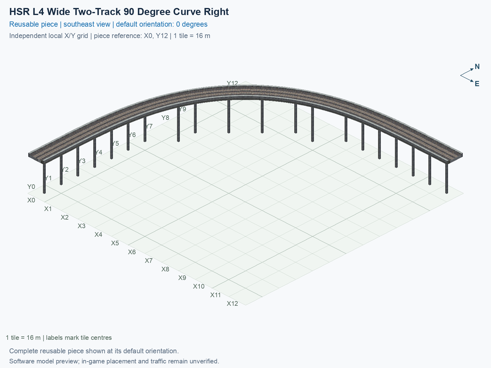

<a id="hsr-l4-wide-two-track-90-degree-curve-right"></a>

# HSR Level 4 (30.5 m) — Two-Track Curve 90° Right — Wide

<!-- SUBJECT IDENTITY MIGRATION -->

Identity migration: `hsr-component-upper-paired-curve90-right-wide` → `hsr-l4-two-track-curve-90deg-right-wide`. Earlier measurements, observations, and pictures retain their recorded names and fingerprints; they do not establish verification of the renamed build. See the [identity migration rules](../../../../docs/NAMING_CONVENTIONS.md#10-choosing-and-changing-names).

Purpose: explain this reusable piece, its matching connections and current test coverage.

<!-- BEGIN PIECE OVERVIEW -->

Two close opposite-direction tracks turn on one upper slab at 30.5 m; two copies form the large northern half-circle of the straight-stem trumpet.

Exact reusable identifier: `hsr-l4-two-track-curve-90deg-right-wide`.

Footprint: **13 × 13 tiles**. Exact menu name: **HSR Level 4 (30.5 m) — Two-Track Curve 90° Right — Wide**.

Choose this exact name in Transportation → Rail. Press Home or End to rotate; use only the supported states listed below. Join each end to a matching port profile and direction.

- [Connections and journeys](#connections-and-journeys)
- [Test checklist](#test-checklist)



<!-- END PIECE OVERVIEW -->

<!-- BEGIN MANUAL SUMMARY -->

## Manual status

Generated from [the exact test cases](#test-checklist) and [authoritative observations](checks/manual-tests.json).

- [ ] Preview review: 0/1 applicable cases passed; 0 failed, 0 stale.
- [ ] In-game rendering: 0/4 applicable cases passed; 0 failed, 0 stale.
- [ ] Directed journeys: 0/8 applicable cases passed; 0 failed, 0 stale.

These observations cover only the named services, directions, poses, rotations, and recorded platforms.

<!-- END MANUAL SUMMARY -->

<!-- BEGIN CONNECTIONS -->

## Connections and journeys

Purpose: describe intrinsic directional interfaces and permitted service journeys.

Generated from [connections.json](connections.json). Coordinates are canonical east, north, and height in metres. A connection class names an encoded route interface; it does not prove visible deck/wall fit or an in-game test.

Supported placement states: 0° CCW, 90° CCW, 180° CCW, 270° CCW. Each state has its own declared manual scope.

A **port** is one directional transport-path endpoint. **Service** identifies the intended network service (for example HSR, street, or tram); **engine** is its internal traffic-class number, separate from the construction network. **Role** distinguishes primary service from auxiliary paths; sharing a traffic class does not establish service compatibility.

A **tangent** is a unit travel-direction vector: `[0,1]` means north. **Grade** is height gained per horizontal metre. These measured facts describe this subject alone. Compatibility requires a separate comparison of the complete joining boundaries; physical seams and actual game operation require their own evidence. See the [class index](../../connection-classes.jsonc) for shared route-interface membership.

| Port | Service / engine / role | Direction | Location; tangent; grade | Connection class |
| --- | --- | --- | --- | --- |
| `Sout` | hsr / 7 / primary | out | [-2.0, -200.0, 30.5]; [0.0, -1.0]; 0.0 | `path-interface-ce3ccdc10e5e243d11ae` |
| `Sin` | hsr / 7 / primary | in | [2.0, -200.0, 30.5]; [0.0, 1.0]; 0.0 | `path-interface-9b897a8bacb659f807fe` |
| `Eout` | hsr / 7 / primary | out | [200.0, -2.0, 30.5]; [1.0, 0.0]; 0.0 | `path-interface-ce3ccdc10e5e243d11ae` |
| `Ein` | hsr / 7 / primary | in | [200.0, 2.0, 30.5]; [-1.0, 0.0]; 0.0 | `path-interface-9b897a8bacb659f807fe` |

### Directed journeys

| Service | Entry → exit | Role |
| --- | --- | --- |
| hsr | `Sin` → `Eout` | primary |
| hsr | `Ein` → `Sout` | primary |

### Forbidden transfers

| From service / port | To service / port | Reason |
| --- | --- | --- |
| hsr / `Sin` | hsr / `Sout` | No directed route exists between these ports in the saved piece transport paths. In-game confirmation remains unverified. |
| hsr / `Ein` | hsr / `Eout` | No directed route exists between these ports in the saved piece transport paths. In-game confirmation remains unverified. |

Review the test checklist for the exact tested cases and environments.

<!-- END CONNECTIONS -->

<!-- BEGIN MANUAL CHECKS -->

## Test checklist

Generated from [the authoritative record](checks/manual-tests.json). Only explicit human observations create manual passes; software and preview checks remain separate. Expand a check/service group to see its rotation table, then expand the matching exact scope to copy a case ID and inspect its pose, reviewer, environment, and evidence. Grouping changes only this view; every declared case remains separate.

**States:** [x] passed; [ ] unverified, failed, or stale; N/A is an explicit inapplicable declaration. A dash means no case was declared in that column. Every pass covers only its recorded environment. T means a distinct construction-transposed state.

Four proper rotations are covered. No additional reflected state is established by this record; repeated construction aliases do not create new orientations.

Current totals: unverified: 35, passed: 0, failed: 0, stale: 0, not_applicable: 0.

### Record an observation

Follow the [shared testing guide](../../../../docs/TESTING.md); copy [the unconfirmed example](checks/observation.example.json) to `checks/observation.json`. Case identifiers are in the expandable sections below. Do not edit generated checkboxes.

From the repository folder containing `custom-pieces`, run after filling `checks/observation.json` and explicitly confirming the exact observation:

```sh
python3 -m scp.content record --record custom-pieces/domains/high-speed-rail/00_pieces/hsr-l4-two-track-curve-90deg-right-wide/checks/manual-tests.json --observation custom-pieces/domains/high-speed-rail/00_pieces/hsr-l4-two-track-curve-90deg-right-wide/checks/observation.json
```

### Detailed current checks

Each collapsed group shows exact case counts and states. Forbidden transfers are grouped by the directed service pair; the table inside retains every port pair and rotation.

<details>
<summary>Compiled resources — Whole subject — 1 case; unverified: 1</summary>

| Check / exact scope | General | 0° | 90° | 180° | 270° |
| --- | --- | --- | --- | --- | --- |
| **Compiled resources**<br>Whole subject | <a href="#case-software_resources-594fdc46c266285e6829">[ ] unverified</a> | — | — | — | — |


<details>
<summary>Compiled resources — Whole subject</summary>

<a id="case-software_resources-594fdc46c266285e6829"></a>

**General: unverified** — `software_resources-594fdc46c266285e6829`.

Verify the actual compiled resources and construction rules.

Scope: Whole subject.

No observation recorded.

</details>

</details>

<details>
<summary>Directed routing graph — Whole subject — 1 case; unverified: 1</summary>

| Check / exact scope | General | 0° | 90° | 180° | 270° |
| --- | --- | --- | --- | --- | --- |
| **Directed routing graph**<br>Whole subject | <a href="#case-software_connectivity-594fdc46c266285e6829">[ ] unverified</a> | — | — | — | — |


<details>
<summary>Directed routing graph — Whole subject</summary>

<a id="case-software_connectivity-594fdc46c266285e6829"></a>

**General: unverified** — `software_connectivity-594fdc46c266285e6829`.

Verify the declared directed journeys and forbidden transfers.

Scope: Whole subject.

No observation recorded.

</details>

</details>

<details>
<summary>Preview review — Images — 1 case; unverified: 1</summary>

| Check / exact scope | General | 0° | 90° | 180° | 270° |
| --- | --- | --- | --- | --- | --- |
| **Preview review**<br>Image: image:hsr-component-upper-paired-curve90-right-wide:canonical-southeast | <a href="#case-preview_review-ec781f405963584706d2">[ ] unverified</a> | — | — | — | — |


<details>
<summary>Preview review — Image: image:hsr-component-upper-paired-curve90-right-wide:canonical-southeast</summary>

<a id="case-preview_review-ec781f405963584706d2"></a>

**General: unverified** — `preview_review-ec781f405963584706d2`.

Inspect this exact preview for tracks, walls, piers, seams and shadows.

Scope: Image: image:hsr-component-upper-paired-curve90-right-wide:canonical-southeast.

No observation recorded.

</details>

</details>

<details>
<summary>In-game rendering — Whole subject — 4 cases; unverified: 4</summary>

| Check / exact scope | General | 0° | 90° | 180° | 270° |
| --- | --- | --- | --- | --- | --- |
| **In-game rendering**<br>Whole subject | — | <a href="#case-in_game_render-36c05cbf7120ba701223">[ ] unverified</a> | <a href="#case-in_game_render-011b070a2da16cefa97e">[ ] unverified</a> | <a href="#case-in_game_render-3d6565fe4661ddecc4de">[ ] unverified</a> | <a href="#case-in_game_render-edc2fe430dfcef9b4999">[ ] unverified</a> |


<details>
<summary>In-game rendering — Whole subject</summary>

<a id="case-in_game_render-36c05cbf7120ba701223"></a>

**0° CCW: unverified** — `in_game_render-36c05cbf7120ba701223`.

Inspect the placed tracks, walls, piers, seams and shadows in SimCity 4.

Scope: Whole subject.

No observation recorded.

<a id="case-in_game_render-011b070a2da16cefa97e"></a>

**90° CCW: unverified** — `in_game_render-011b070a2da16cefa97e`.

Inspect the placed tracks, walls, piers, seams and shadows in SimCity 4.

Scope: Whole subject.

No observation recorded.

<a id="case-in_game_render-3d6565fe4661ddecc4de"></a>

**180° CCW: unverified** — `in_game_render-3d6565fe4661ddecc4de`.

Inspect the placed tracks, walls, piers, seams and shadows in SimCity 4.

Scope: Whole subject.

No observation recorded.

<a id="case-in_game_render-edc2fe430dfcef9b4999"></a>

**270° CCW: unverified** — `in_game_render-edc2fe430dfcef9b4999`.

Inspect the placed tracks, walls, piers, seams and shadows in SimCity 4.

Scope: Whole subject.

No observation recorded.

</details>

</details>

<details>
<summary>Placement — Whole subject — 4 cases; unverified: 4</summary>

| Check / exact scope | General | 0° | 90° | 180° | 270° |
| --- | --- | --- | --- | --- | --- |
| **Placement**<br>Whole subject | — | <a href="#case-in_game_placement-36c05cbf7120ba701223">[ ] unverified</a> | <a href="#case-in_game_placement-011b070a2da16cefa97e">[ ] unverified</a> | <a href="#case-in_game_placement-3d6565fe4661ddecc4de">[ ] unverified</a> | <a href="#case-in_game_placement-edc2fe430dfcef9b4999">[ ] unverified</a> |


<details>
<summary>Placement — Whole subject</summary>

<a id="case-in_game_placement-36c05cbf7120ba701223"></a>

**0° CCW: unverified** — `in_game_placement-36c05cbf7120ba701223`.

Place this piece or complete blueprint and inspect every occupied tile.

Scope: Whole subject.

No observation recorded.

<a id="case-in_game_placement-011b070a2da16cefa97e"></a>

**90° CCW: unverified** — `in_game_placement-011b070a2da16cefa97e`.

Place this piece or complete blueprint and inspect every occupied tile.

Scope: Whole subject.

No observation recorded.

<a id="case-in_game_placement-3d6565fe4661ddecc4de"></a>

**180° CCW: unverified** — `in_game_placement-3d6565fe4661ddecc4de`.

Place this piece or complete blueprint and inspect every occupied tile.

Scope: Whole subject.

No observation recorded.

<a id="case-in_game_placement-edc2fe430dfcef9b4999"></a>

**270° CCW: unverified** — `in_game_placement-edc2fe430dfcef9b4999`.

Place this piece or complete blueprint and inspect every occupied tile.

Scope: Whole subject.

No observation recorded.

</details>

</details>

<details>
<summary>Demolition — Whole subject — 4 cases; unverified: 4</summary>

| Check / exact scope | General | 0° | 90° | 180° | 270° |
| --- | --- | --- | --- | --- | --- |
| **Demolition**<br>Whole subject | — | <a href="#case-in_game_demolition-36c05cbf7120ba701223">[ ] unverified</a> | <a href="#case-in_game_demolition-011b070a2da16cefa97e">[ ] unverified</a> | <a href="#case-in_game_demolition-3d6565fe4661ddecc4de">[ ] unverified</a> | <a href="#case-in_game_demolition-edc2fe430dfcef9b4999">[ ] unverified</a> |


<details>
<summary>Demolition — Whole subject</summary>

<a id="case-in_game_demolition-36c05cbf7120ba701223"></a>

**0° CCW: unverified** — `in_game_demolition-36c05cbf7120ba701223`.

Bulldoze the complete placement and inspect the cleared area.

Scope: Whole subject.

No observation recorded.

<a id="case-in_game_demolition-011b070a2da16cefa97e"></a>

**90° CCW: unverified** — `in_game_demolition-011b070a2da16cefa97e`.

Bulldoze the complete placement and inspect the cleared area.

Scope: Whole subject.

No observation recorded.

<a id="case-in_game_demolition-3d6565fe4661ddecc4de"></a>

**180° CCW: unverified** — `in_game_demolition-3d6565fe4661ddecc4de`.

Bulldoze the complete placement and inspect the cleared area.

Scope: Whole subject.

No observation recorded.

<a id="case-in_game_demolition-edc2fe430dfcef9b4999"></a>

**270° CCW: unverified** — `in_game_demolition-edc2fe430dfcef9b4999`.

Bulldoze the complete placement and inspect the cleared area.

Scope: Whole subject.

No observation recorded.

</details>

</details>

<details>
<summary>Save and reload — Whole subject — 4 cases; unverified: 4</summary>

| Check / exact scope | General | 0° | 90° | 180° | 270° |
| --- | --- | --- | --- | --- | --- |
| **Save and reload**<br>Whole subject | — | <a href="#case-in_game_save_reload-36c05cbf7120ba701223">[ ] unverified</a> | <a href="#case-in_game_save_reload-011b070a2da16cefa97e">[ ] unverified</a> | <a href="#case-in_game_save_reload-3d6565fe4661ddecc4de">[ ] unverified</a> | <a href="#case-in_game_save_reload-edc2fe430dfcef9b4999">[ ] unverified</a> |


<details>
<summary>Save and reload — Whole subject</summary>

<a id="case-in_game_save_reload-36c05cbf7120ba701223"></a>

**0° CCW: unverified** — `in_game_save_reload-36c05cbf7120ba701223`.

Save, quit, reload and inspect the placement and its paths.

Scope: Whole subject.

No observation recorded.

<a id="case-in_game_save_reload-011b070a2da16cefa97e"></a>

**90° CCW: unverified** — `in_game_save_reload-011b070a2da16cefa97e`.

Save, quit, reload and inspect the placement and its paths.

Scope: Whole subject.

No observation recorded.

<a id="case-in_game_save_reload-3d6565fe4661ddecc4de"></a>

**180° CCW: unverified** — `in_game_save_reload-3d6565fe4661ddecc4de`.

Save, quit, reload and inspect the placement and its paths.

Scope: Whole subject.

No observation recorded.

<a id="case-in_game_save_reload-edc2fe430dfcef9b4999"></a>

**270° CCW: unverified** — `in_game_save_reload-edc2fe430dfcef9b4999`.

Save, quit, reload and inspect the placement and its paths.

Scope: Whole subject.

No observation recorded.

</details>

</details>

<details>
<summary>Journey — hsr — 8 cases; unverified: 8</summary>

| Check / exact scope | General | 0° | 90° | 180° | 270° |
| --- | --- | --- | --- | --- | --- |
| **Journey**<br>Service: hsr; role: primary; journey: 7:Sin>Eout; entry: Sin; exit: Eout | — | <a href="#case-in_game_journey-d5550f3e31b01ad0c539">[ ] unverified</a> | <a href="#case-in_game_journey-100fc3c4cc64ae538bf3">[ ] unverified</a> | <a href="#case-in_game_journey-fb2d56f76fe166a28cf8">[ ] unverified</a> | <a href="#case-in_game_journey-e04095300dd57295bcce">[ ] unverified</a> |
| **Journey**<br>Service: hsr; role: primary; journey: 7:Ein>Sout; entry: Ein; exit: Sout | — | <a href="#case-in_game_journey-882e2d48d8db46810cda">[ ] unverified</a> | <a href="#case-in_game_journey-dfa2fdbc0106638277e1">[ ] unverified</a> | <a href="#case-in_game_journey-a164e887fd8188b99045">[ ] unverified</a> | <a href="#case-in_game_journey-1967c15ec9eb9b770580">[ ] unverified</a> |


<details>
<summary>Journey — Service: hsr; role: primary; journey: 7:Sin>Eout; entry: Sin; exit: Eout</summary>

<a id="case-in_game_journey-d5550f3e31b01ad0c539"></a>

**0° CCW: unverified** — `in_game_journey-d5550f3e31b01ad0c539`.

Run the declared journey in this direction using its service network.

Scope: Service: hsr; role: primary; journey: 7:Sin>Eout; entry: Sin; exit: Eout.

No observation recorded.

<a id="case-in_game_journey-100fc3c4cc64ae538bf3"></a>

**90° CCW: unverified** — `in_game_journey-100fc3c4cc64ae538bf3`.

Run the declared journey in this direction using its service network.

Scope: Service: hsr; role: primary; journey: 7:Sin>Eout; entry: Sin; exit: Eout.

No observation recorded.

<a id="case-in_game_journey-fb2d56f76fe166a28cf8"></a>

**180° CCW: unverified** — `in_game_journey-fb2d56f76fe166a28cf8`.

Run the declared journey in this direction using its service network.

Scope: Service: hsr; role: primary; journey: 7:Sin>Eout; entry: Sin; exit: Eout.

No observation recorded.

<a id="case-in_game_journey-e04095300dd57295bcce"></a>

**270° CCW: unverified** — `in_game_journey-e04095300dd57295bcce`.

Run the declared journey in this direction using its service network.

Scope: Service: hsr; role: primary; journey: 7:Sin>Eout; entry: Sin; exit: Eout.

No observation recorded.

</details>


<details>
<summary>Journey — Service: hsr; role: primary; journey: 7:Ein>Sout; entry: Ein; exit: Sout</summary>

<a id="case-in_game_journey-882e2d48d8db46810cda"></a>

**0° CCW: unverified** — `in_game_journey-882e2d48d8db46810cda`.

Run the declared journey in this direction using its service network.

Scope: Service: hsr; role: primary; journey: 7:Ein>Sout; entry: Ein; exit: Sout.

No observation recorded.

<a id="case-in_game_journey-dfa2fdbc0106638277e1"></a>

**90° CCW: unverified** — `in_game_journey-dfa2fdbc0106638277e1`.

Run the declared journey in this direction using its service network.

Scope: Service: hsr; role: primary; journey: 7:Ein>Sout; entry: Ein; exit: Sout.

No observation recorded.

<a id="case-in_game_journey-a164e887fd8188b99045"></a>

**180° CCW: unverified** — `in_game_journey-a164e887fd8188b99045`.

Run the declared journey in this direction using its service network.

Scope: Service: hsr; role: primary; journey: 7:Ein>Sout; entry: Ein; exit: Sout.

No observation recorded.

<a id="case-in_game_journey-1967c15ec9eb9b770580"></a>

**270° CCW: unverified** — `in_game_journey-1967c15ec9eb9b770580`.

Run the declared journey in this direction using its service network.

Scope: Service: hsr; role: primary; journey: 7:Ein>Sout; entry: Ein; exit: Sout.

No observation recorded.

</details>

</details>

<details>
<summary>Forbidden transfer — hsr → hsr — 8 cases; unverified: 8</summary>

| Check / exact scope | General | 0° | 90° | 180° | 270° |
| --- | --- | --- | --- | --- | --- |
| **Forbidden transfer**<br>from port: Sin; to port: Sout; from service: hsr; to service: hsr; basis: not reachable in actual saved PATH graph | — | <a href="#case-in_game_forbidden_transfer-bbbce939ba89336f8b79">[ ] unverified</a> | <a href="#case-in_game_forbidden_transfer-630616425d6c5af80da9">[ ] unverified</a> | <a href="#case-in_game_forbidden_transfer-c563c25dafbdcec87426">[ ] unverified</a> | <a href="#case-in_game_forbidden_transfer-e332c6251c7bfa8a5330">[ ] unverified</a> |
| **Forbidden transfer**<br>from port: Ein; to port: Eout; from service: hsr; to service: hsr; basis: not reachable in actual saved PATH graph | — | <a href="#case-in_game_forbidden_transfer-5af24c932d4814a8fbfc">[ ] unverified</a> | <a href="#case-in_game_forbidden_transfer-6e1117f2f62c77feab74">[ ] unverified</a> | <a href="#case-in_game_forbidden_transfer-5f2fd81aa7a31fdf2f39">[ ] unverified</a> | <a href="#case-in_game_forbidden_transfer-cbdba54f36382af1394a">[ ] unverified</a> |


<details>
<summary>Forbidden transfer — from port: Sin; to port: Sout; from service: hsr; to service: hsr; basis: not reachable in actual saved PATH graph</summary>

<a id="case-in_game_forbidden_transfer-bbbce939ba89336f8b79"></a>

**0° CCW: unverified** — `in_game_forbidden_transfer-bbbce939ba89336f8b79`.

Confirm this undeclared transfer is unavailable.

Scope: from port: Sin; to port: Sout; from service: hsr; to service: hsr; basis: not reachable in actual saved PATH graph.

No observation recorded.

<a id="case-in_game_forbidden_transfer-630616425d6c5af80da9"></a>

**90° CCW: unverified** — `in_game_forbidden_transfer-630616425d6c5af80da9`.

Confirm this undeclared transfer is unavailable.

Scope: from port: Sin; to port: Sout; from service: hsr; to service: hsr; basis: not reachable in actual saved PATH graph.

No observation recorded.

<a id="case-in_game_forbidden_transfer-c563c25dafbdcec87426"></a>

**180° CCW: unverified** — `in_game_forbidden_transfer-c563c25dafbdcec87426`.

Confirm this undeclared transfer is unavailable.

Scope: from port: Sin; to port: Sout; from service: hsr; to service: hsr; basis: not reachable in actual saved PATH graph.

No observation recorded.

<a id="case-in_game_forbidden_transfer-e332c6251c7bfa8a5330"></a>

**270° CCW: unverified** — `in_game_forbidden_transfer-e332c6251c7bfa8a5330`.

Confirm this undeclared transfer is unavailable.

Scope: from port: Sin; to port: Sout; from service: hsr; to service: hsr; basis: not reachable in actual saved PATH graph.

No observation recorded.

</details>


<details>
<summary>Forbidden transfer — from port: Ein; to port: Eout; from service: hsr; to service: hsr; basis: not reachable in actual saved PATH graph</summary>

<a id="case-in_game_forbidden_transfer-5af24c932d4814a8fbfc"></a>

**0° CCW: unverified** — `in_game_forbidden_transfer-5af24c932d4814a8fbfc`.

Confirm this undeclared transfer is unavailable.

Scope: from port: Ein; to port: Eout; from service: hsr; to service: hsr; basis: not reachable in actual saved PATH graph.

No observation recorded.

<a id="case-in_game_forbidden_transfer-6e1117f2f62c77feab74"></a>

**90° CCW: unverified** — `in_game_forbidden_transfer-6e1117f2f62c77feab74`.

Confirm this undeclared transfer is unavailable.

Scope: from port: Ein; to port: Eout; from service: hsr; to service: hsr; basis: not reachable in actual saved PATH graph.

No observation recorded.

<a id="case-in_game_forbidden_transfer-5f2fd81aa7a31fdf2f39"></a>

**180° CCW: unverified** — `in_game_forbidden_transfer-5f2fd81aa7a31fdf2f39`.

Confirm this undeclared transfer is unavailable.

Scope: from port: Ein; to port: Eout; from service: hsr; to service: hsr; basis: not reachable in actual saved PATH graph.

No observation recorded.

<a id="case-in_game_forbidden_transfer-cbdba54f36382af1394a"></a>

**270° CCW: unverified** — `in_game_forbidden_transfer-cbdba54f36382af1394a`.

Confirm this undeclared transfer is unavailable.

Scope: from port: Ein; to port: Eout; from service: hsr; to service: hsr; basis: not reachable in actual saved PATH graph.

No observation recorded.

</details>

</details>

<!-- END MANUAL CHECKS -->
