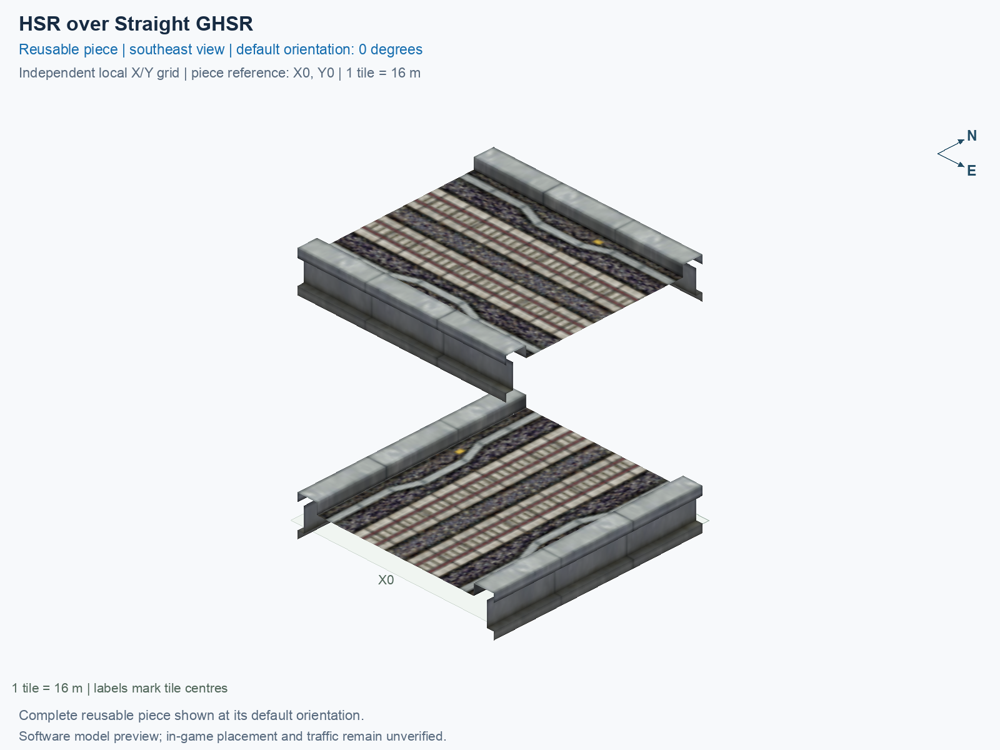

# HSR over Straight GHSR

Purpose: explain this reusable piece, its matching connections and current test coverage.

<!-- BEGIN PIECE OVERVIEW -->

Straight elevated HSR crosses straight ground HSR at a right angle. One tile; no interchange.

Exact reusable identifier: `hsr-straight-ghsr`.

Footprint: **1 × 1 tiles**. Exact menu name: **HSR over Straight GHSR**.

Choose this exact name in Transportation → Rail. Press Home or End to rotate; use only the supported states listed below. Join each end to a matching port profile and direction.

- [Connections and journeys](#connections-and-journeys)
- [Test checklist](#test-checklist)



<!-- END PIECE OVERVIEW -->

<!-- BEGIN MANUAL SUMMARY -->

## Manual status

Generated from [the exact test cases](#test-checklist) and [authoritative observations](checks/manual-tests.json).

- [ ] Preview review: 0/1 applicable cases passed; 0 failed, 0 stale.
- [ ] In-game rendering: 0/4 applicable cases passed; 0 failed, 0 stale.
- [ ] Directed journeys: 0/16 applicable cases passed; 0 failed, 0 stale.

These observations cover only the named services, directions, poses, rotations, and recorded platforms.

<!-- END MANUAL SUMMARY -->

<!-- BEGIN CONNECTIONS -->

## Connections and journeys

Purpose: describe intrinsic directional interfaces and permitted service journeys.

Generated from [connections.json](connections.json). Coordinates are canonical east, north and height in metres. A connection class names an encoded route interface; it does not prove visible deck/wall fit or an in-game test.

Supported placement states: 0° CCW, 90° CCW, 180° CCW, 270° CCW. Each state has its own declared manual scope.

A **port** is one directional transport-path endpoint. **Service** identifies the intended network service (for example HSR, street, or tram); **engine** is its internal traffic-class number, separate from the construction network. **Role** distinguishes primary service from auxiliary paths; sharing a traffic class does not establish service compatibility.

A **tangent** is a unit travel-direction vector: `[0,1]` means north. **Grade** is height gained per horizontal metre. These measured facts describe this subject alone. Compatibility requires a separate comparison of the complete joining boundaries; physical seams and actual game operation require their own evidence. See the [class index](../../connection-classes.json) for shared route-interface membership.

| Port | Service / engine / role | Direction | Location; tangent; grade | Connection class |
| --- | --- | --- | --- | --- |
| `7-W-in-1` | hsr / 7 / primary | in | [-8.0, -2.0, 15.5]; [1.0, 0.0]; 0.0 | `path-interface-12d12be31d2057c5763d` |
| `7-W-out-2` | hsr / 7 / primary | out | [-8.0, 2.0, 15.5]; [-1.0, 0.0]; 0.0 | `path-interface-fba09fbeb87ad95c667a` |
| `7-S-out-3` | ghsr / 7 / primary | out | [-2.0, -8.0, 1.0]; [0.0, -1.0]; 0.0 | `path-interface-c78c5ac4b558d84b46f2` |
| `7-N-in-4` | ghsr / 7 / primary | in | [-2.0, 8.0, 1.0]; [0.0, -1.0]; 0.0 | `path-interface-c78c5ac4b558d84b46f2` |
| `7-S-in-5` | ghsr / 7 / primary | in | [2.0, -8.0, 1.0]; [0.0, 1.0]; 0.0 | `path-interface-fab587419de6b5848d74` |
| `7-N-out-6` | ghsr / 7 / primary | out | [2.0, 8.0, 1.0]; [0.0, 1.0]; 0.0 | `path-interface-fab587419de6b5848d74` |
| `7-E-out-7` | hsr / 7 / primary | out | [8.0, -2.0, 15.5]; [1.0, 0.0]; 0.0 | `path-interface-12d12be31d2057c5763d` |
| `7-E-in-8` | hsr / 7 / primary | in | [8.0, 2.0, 15.5]; [-1.0, 0.0]; 0.0 | `path-interface-fba09fbeb87ad95c667a` |

### Directed journeys

| Service | Entry → exit | Role |
| --- | --- | --- |
| hsr | `7-W-in-1` → `7-E-out-7` | primary |
| ghsr | `7-N-in-4` → `7-S-out-3` | primary |
| ghsr | `7-S-in-5` → `7-N-out-6` | primary |
| hsr | `7-E-in-8` → `7-W-out-2` | primary |

### Forbidden transfers

| From service / port | To service / port | Reason |
| --- | --- | --- |
| hsr / `7-W-in-1` | hsr / `7-W-out-2` | No directed route exists between these ports in the saved piece transport paths. In-game confirmation remains unverified. |
| hsr / `7-W-in-1` | ghsr / `7-S-out-3` | No directed route exists between these ports in the saved piece transport paths. In-game confirmation remains unverified. |
| hsr / `7-W-in-1` | ghsr / `7-N-out-6` | No directed route exists between these ports in the saved piece transport paths. In-game confirmation remains unverified. |
| ghsr / `7-N-in-4` | hsr / `7-W-out-2` | No directed route exists between these ports in the saved piece transport paths. In-game confirmation remains unverified. |
| ghsr / `7-N-in-4` | ghsr / `7-N-out-6` | No directed route exists between these ports in the saved piece transport paths. In-game confirmation remains unverified. |
| ghsr / `7-N-in-4` | hsr / `7-E-out-7` | No directed route exists between these ports in the saved piece transport paths. In-game confirmation remains unverified. |
| ghsr / `7-S-in-5` | hsr / `7-W-out-2` | No directed route exists between these ports in the saved piece transport paths. In-game confirmation remains unverified. |
| ghsr / `7-S-in-5` | ghsr / `7-S-out-3` | No directed route exists between these ports in the saved piece transport paths. In-game confirmation remains unverified. |
| ghsr / `7-S-in-5` | hsr / `7-E-out-7` | No directed route exists between these ports in the saved piece transport paths. In-game confirmation remains unverified. |
| hsr / `7-E-in-8` | ghsr / `7-S-out-3` | No directed route exists between these ports in the saved piece transport paths. In-game confirmation remains unverified. |
| hsr / `7-E-in-8` | ghsr / `7-N-out-6` | No directed route exists between these ports in the saved piece transport paths. In-game confirmation remains unverified. |
| hsr / `7-E-in-8` | hsr / `7-E-out-7` | No directed route exists between these ports in the saved piece transport paths. In-game confirmation remains unverified. |

Review the test checklist for the exact tested cases and environments.

<!-- END CONNECTIONS -->

<!-- BEGIN MANUAL CHECKS -->

## Test checklist

Generated from [the authoritative record](checks/manual-tests.json). Only explicit human observations create manual passes; software and preview checks remain separate. Expand a check/service group to see its rotation table, then expand the matching exact scope to copy a case ID and inspect its pose, reviewer, environment, and evidence. Grouping changes only this view; every declared case remains separate.

**States:** [x] passed; [ ] unverified, failed, or stale; N/A is an explicit inapplicable declaration. A dash means no case was declared in that column. Every pass covers only its recorded environment. T means a distinct construction-transposed state.

Four proper rotations are covered. No additional reflected state is established by this record; repeated construction aliases do not create new orientations.

Current totals: unverified: 83, passed: 0, failed: 0, stale: 0, not_applicable: 0.

### Record an observation

Follow the [shared testing guide](../../../../docs/TESTING.md); copy [the unconfirmed example](checks/observation.example.json) to `checks/observation.json`. Case identifiers are in the expandable sections below. Do not edit generated checkboxes.

From the repository folder containing `custom-pieces`, run after filling `checks/observation.json` and explicitly confirming the exact observation:

```sh
python3 -m scp.content record --record custom-pieces/domains/high-speed-rail/00_pieces/hsr-straight-ghsr/checks/manual-tests.json --observation custom-pieces/domains/high-speed-rail/00_pieces/hsr-straight-ghsr/checks/observation.json
```

### Detailed current checks

Each collapsed group shows exact case counts and states. Forbidden transfers are grouped by the directed service pair; the table inside retains every port pair and rotation.

<details>
<summary>Compiled resources — Whole subject — 1 case; unverified: 1</summary>

| Check / exact scope | General | 0° | 90° | 180° | 270° |
| --- | --- | --- | --- | --- | --- |
| **Compiled resources**<br>Whole subject | <a href="#case-software_resources-8246659cb580957122c8">[ ] unverified</a> | — | — | — | — |


<details>
<summary>Compiled resources — Whole subject</summary>

<a id="case-software_resources-8246659cb580957122c8"></a>

**General: unverified** — `software_resources-8246659cb580957122c8`.

Verify the actual compiled resources and construction rules.

Scope: Whole subject.

No observation recorded.

</details>

</details>

<details>
<summary>Directed routing graph — Whole subject — 1 case; unverified: 1</summary>

| Check / exact scope | General | 0° | 90° | 180° | 270° |
| --- | --- | --- | --- | --- | --- |
| **Directed routing graph**<br>Whole subject | <a href="#case-software_connectivity-8246659cb580957122c8">[ ] unverified</a> | — | — | — | — |


<details>
<summary>Directed routing graph — Whole subject</summary>

<a id="case-software_connectivity-8246659cb580957122c8"></a>

**General: unverified** — `software_connectivity-8246659cb580957122c8`.

Verify the declared directed journeys and forbidden transfers.

Scope: Whole subject.

No observation recorded.

</details>

</details>

<details>
<summary>Preview review — Images — 1 case; unverified: 1</summary>

| Check / exact scope | General | 0° | 90° | 180° | 270° |
| --- | --- | --- | --- | --- | --- |
| **Preview review**<br>Image: image:hsr-straight-ghsr:canonical-southeast | <a href="#case-preview_review-7342edb597a877729bf0">[ ] unverified</a> | — | — | — | — |


<details>
<summary>Preview review — Image: image:hsr-straight-ghsr:canonical-southeast</summary>

<a id="case-preview_review-7342edb597a877729bf0"></a>

**General: unverified** — `preview_review-7342edb597a877729bf0`.

Inspect this exact preview for tracks, walls, piers, seams and shadows.

Scope: Image: image:hsr-straight-ghsr:canonical-southeast.

No observation recorded.

</details>

</details>

<details>
<summary>In-game rendering — Whole subject — 4 cases; unverified: 4</summary>

| Check / exact scope | General | 0° | 90° | 180° | 270° |
| --- | --- | --- | --- | --- | --- |
| **In-game rendering**<br>Whole subject | — | <a href="#case-in_game_render-ec309c4b5fcc5c38e231">[ ] unverified</a> | <a href="#case-in_game_render-48a44434fbc5b5c35fcc">[ ] unverified</a> | <a href="#case-in_game_render-e9a2c19f407e607fc7c9">[ ] unverified</a> | <a href="#case-in_game_render-720440cbe44d54f54a47">[ ] unverified</a> |


<details>
<summary>In-game rendering — Whole subject</summary>

<a id="case-in_game_render-ec309c4b5fcc5c38e231"></a>

**0° CCW: unverified** — `in_game_render-ec309c4b5fcc5c38e231`.

Inspect the placed tracks, walls, piers, seams and shadows in SimCity 4.

Scope: Whole subject.

No observation recorded.

<a id="case-in_game_render-48a44434fbc5b5c35fcc"></a>

**90° CCW: unverified** — `in_game_render-48a44434fbc5b5c35fcc`.

Inspect the placed tracks, walls, piers, seams and shadows in SimCity 4.

Scope: Whole subject.

No observation recorded.

<a id="case-in_game_render-e9a2c19f407e607fc7c9"></a>

**180° CCW: unverified** — `in_game_render-e9a2c19f407e607fc7c9`.

Inspect the placed tracks, walls, piers, seams and shadows in SimCity 4.

Scope: Whole subject.

No observation recorded.

<a id="case-in_game_render-720440cbe44d54f54a47"></a>

**270° CCW: unverified** — `in_game_render-720440cbe44d54f54a47`.

Inspect the placed tracks, walls, piers, seams and shadows in SimCity 4.

Scope: Whole subject.

No observation recorded.

</details>

</details>

<details>
<summary>Placement — Whole subject — 4 cases; unverified: 4</summary>

| Check / exact scope | General | 0° | 90° | 180° | 270° |
| --- | --- | --- | --- | --- | --- |
| **Placement**<br>Whole subject | — | <a href="#case-in_game_placement-ec309c4b5fcc5c38e231">[ ] unverified</a> | <a href="#case-in_game_placement-48a44434fbc5b5c35fcc">[ ] unverified</a> | <a href="#case-in_game_placement-e9a2c19f407e607fc7c9">[ ] unverified</a> | <a href="#case-in_game_placement-720440cbe44d54f54a47">[ ] unverified</a> |


<details>
<summary>Placement — Whole subject</summary>

<a id="case-in_game_placement-ec309c4b5fcc5c38e231"></a>

**0° CCW: unverified** — `in_game_placement-ec309c4b5fcc5c38e231`.

Place this piece or complete blueprint and inspect every occupied tile.

Scope: Whole subject.

No observation recorded.

<a id="case-in_game_placement-48a44434fbc5b5c35fcc"></a>

**90° CCW: unverified** — `in_game_placement-48a44434fbc5b5c35fcc`.

Place this piece or complete blueprint and inspect every occupied tile.

Scope: Whole subject.

No observation recorded.

<a id="case-in_game_placement-e9a2c19f407e607fc7c9"></a>

**180° CCW: unverified** — `in_game_placement-e9a2c19f407e607fc7c9`.

Place this piece or complete blueprint and inspect every occupied tile.

Scope: Whole subject.

No observation recorded.

<a id="case-in_game_placement-720440cbe44d54f54a47"></a>

**270° CCW: unverified** — `in_game_placement-720440cbe44d54f54a47`.

Place this piece or complete blueprint and inspect every occupied tile.

Scope: Whole subject.

No observation recorded.

</details>

</details>

<details>
<summary>Demolition — Whole subject — 4 cases; unverified: 4</summary>

| Check / exact scope | General | 0° | 90° | 180° | 270° |
| --- | --- | --- | --- | --- | --- |
| **Demolition**<br>Whole subject | — | <a href="#case-in_game_demolition-ec309c4b5fcc5c38e231">[ ] unverified</a> | <a href="#case-in_game_demolition-48a44434fbc5b5c35fcc">[ ] unverified</a> | <a href="#case-in_game_demolition-e9a2c19f407e607fc7c9">[ ] unverified</a> | <a href="#case-in_game_demolition-720440cbe44d54f54a47">[ ] unverified</a> |


<details>
<summary>Demolition — Whole subject</summary>

<a id="case-in_game_demolition-ec309c4b5fcc5c38e231"></a>

**0° CCW: unverified** — `in_game_demolition-ec309c4b5fcc5c38e231`.

Bulldoze the complete placement and inspect the cleared area.

Scope: Whole subject.

No observation recorded.

<a id="case-in_game_demolition-48a44434fbc5b5c35fcc"></a>

**90° CCW: unverified** — `in_game_demolition-48a44434fbc5b5c35fcc`.

Bulldoze the complete placement and inspect the cleared area.

Scope: Whole subject.

No observation recorded.

<a id="case-in_game_demolition-e9a2c19f407e607fc7c9"></a>

**180° CCW: unverified** — `in_game_demolition-e9a2c19f407e607fc7c9`.

Bulldoze the complete placement and inspect the cleared area.

Scope: Whole subject.

No observation recorded.

<a id="case-in_game_demolition-720440cbe44d54f54a47"></a>

**270° CCW: unverified** — `in_game_demolition-720440cbe44d54f54a47`.

Bulldoze the complete placement and inspect the cleared area.

Scope: Whole subject.

No observation recorded.

</details>

</details>

<details>
<summary>Save and reload — Whole subject — 4 cases; unverified: 4</summary>

| Check / exact scope | General | 0° | 90° | 180° | 270° |
| --- | --- | --- | --- | --- | --- |
| **Save and reload**<br>Whole subject | — | <a href="#case-in_game_save_reload-ec309c4b5fcc5c38e231">[ ] unverified</a> | <a href="#case-in_game_save_reload-48a44434fbc5b5c35fcc">[ ] unverified</a> | <a href="#case-in_game_save_reload-e9a2c19f407e607fc7c9">[ ] unverified</a> | <a href="#case-in_game_save_reload-720440cbe44d54f54a47">[ ] unverified</a> |


<details>
<summary>Save and reload — Whole subject</summary>

<a id="case-in_game_save_reload-ec309c4b5fcc5c38e231"></a>

**0° CCW: unverified** — `in_game_save_reload-ec309c4b5fcc5c38e231`.

Save, quit, reload and inspect the placement and its paths.

Scope: Whole subject.

No observation recorded.

<a id="case-in_game_save_reload-48a44434fbc5b5c35fcc"></a>

**90° CCW: unverified** — `in_game_save_reload-48a44434fbc5b5c35fcc`.

Save, quit, reload and inspect the placement and its paths.

Scope: Whole subject.

No observation recorded.

<a id="case-in_game_save_reload-e9a2c19f407e607fc7c9"></a>

**180° CCW: unverified** — `in_game_save_reload-e9a2c19f407e607fc7c9`.

Save, quit, reload and inspect the placement and its paths.

Scope: Whole subject.

No observation recorded.

<a id="case-in_game_save_reload-720440cbe44d54f54a47"></a>

**270° CCW: unverified** — `in_game_save_reload-720440cbe44d54f54a47`.

Save, quit, reload and inspect the placement and its paths.

Scope: Whole subject.

No observation recorded.

</details>

</details>

<details>
<summary>Journey — hsr — 8 cases; unverified: 8</summary>

| Check / exact scope | General | 0° | 90° | 180° | 270° |
| --- | --- | --- | --- | --- | --- |
| **Journey**<br>Service: hsr; role: primary; journey: 7:7-W-in-1>7-E-out-7; entry: 7-W-in-1; exit: 7-E-out-7 | — | <a href="#case-in_game_journey-1b1b2927f7b050d24a59">[ ] unverified</a> | <a href="#case-in_game_journey-6c519b31d31a8504e445">[ ] unverified</a> | <a href="#case-in_game_journey-e2517af07b4e1ec6d28b">[ ] unverified</a> | <a href="#case-in_game_journey-ab9708da4dc796d43903">[ ] unverified</a> |
| **Journey**<br>Service: hsr; role: primary; journey: 7:7-E-in-8>7-W-out-2; entry: 7-E-in-8; exit: 7-W-out-2 | — | <a href="#case-in_game_journey-31cb13801dcc573378dc">[ ] unverified</a> | <a href="#case-in_game_journey-1ec6e163df5971762cf6">[ ] unverified</a> | <a href="#case-in_game_journey-38b1846ce7cc68f30e81">[ ] unverified</a> | <a href="#case-in_game_journey-70886cbc7ef0e0e57c7f">[ ] unverified</a> |


<details>
<summary>Journey — Service: hsr; role: primary; journey: 7:7-W-in-1>7-E-out-7; entry: 7-W-in-1; exit: 7-E-out-7</summary>

<a id="case-in_game_journey-1b1b2927f7b050d24a59"></a>

**0° CCW: unverified** — `in_game_journey-1b1b2927f7b050d24a59`.

Run the declared journey in this direction using its service network.

Scope: Service: hsr; role: primary; journey: 7:7-W-in-1>7-E-out-7; entry: 7-W-in-1; exit: 7-E-out-7.

No observation recorded.

<a id="case-in_game_journey-6c519b31d31a8504e445"></a>

**90° CCW: unverified** — `in_game_journey-6c519b31d31a8504e445`.

Run the declared journey in this direction using its service network.

Scope: Service: hsr; role: primary; journey: 7:7-W-in-1>7-E-out-7; entry: 7-W-in-1; exit: 7-E-out-7.

No observation recorded.

<a id="case-in_game_journey-e2517af07b4e1ec6d28b"></a>

**180° CCW: unverified** — `in_game_journey-e2517af07b4e1ec6d28b`.

Run the declared journey in this direction using its service network.

Scope: Service: hsr; role: primary; journey: 7:7-W-in-1>7-E-out-7; entry: 7-W-in-1; exit: 7-E-out-7.

No observation recorded.

<a id="case-in_game_journey-ab9708da4dc796d43903"></a>

**270° CCW: unverified** — `in_game_journey-ab9708da4dc796d43903`.

Run the declared journey in this direction using its service network.

Scope: Service: hsr; role: primary; journey: 7:7-W-in-1>7-E-out-7; entry: 7-W-in-1; exit: 7-E-out-7.

No observation recorded.

</details>


<details>
<summary>Journey — Service: hsr; role: primary; journey: 7:7-E-in-8>7-W-out-2; entry: 7-E-in-8; exit: 7-W-out-2</summary>

<a id="case-in_game_journey-31cb13801dcc573378dc"></a>

**0° CCW: unverified** — `in_game_journey-31cb13801dcc573378dc`.

Run the declared journey in this direction using its service network.

Scope: Service: hsr; role: primary; journey: 7:7-E-in-8>7-W-out-2; entry: 7-E-in-8; exit: 7-W-out-2.

No observation recorded.

<a id="case-in_game_journey-1ec6e163df5971762cf6"></a>

**90° CCW: unverified** — `in_game_journey-1ec6e163df5971762cf6`.

Run the declared journey in this direction using its service network.

Scope: Service: hsr; role: primary; journey: 7:7-E-in-8>7-W-out-2; entry: 7-E-in-8; exit: 7-W-out-2.

No observation recorded.

<a id="case-in_game_journey-38b1846ce7cc68f30e81"></a>

**180° CCW: unverified** — `in_game_journey-38b1846ce7cc68f30e81`.

Run the declared journey in this direction using its service network.

Scope: Service: hsr; role: primary; journey: 7:7-E-in-8>7-W-out-2; entry: 7-E-in-8; exit: 7-W-out-2.

No observation recorded.

<a id="case-in_game_journey-70886cbc7ef0e0e57c7f"></a>

**270° CCW: unverified** — `in_game_journey-70886cbc7ef0e0e57c7f`.

Run the declared journey in this direction using its service network.

Scope: Service: hsr; role: primary; journey: 7:7-E-in-8>7-W-out-2; entry: 7-E-in-8; exit: 7-W-out-2.

No observation recorded.

</details>

</details>

<details>
<summary>Journey — ghsr — 8 cases; unverified: 8</summary>

| Check / exact scope | General | 0° | 90° | 180° | 270° |
| --- | --- | --- | --- | --- | --- |
| **Journey**<br>Service: ghsr; role: primary; journey: 7:7-N-in-4>7-S-out-3; entry: 7-N-in-4; exit: 7-S-out-3 | — | <a href="#case-in_game_journey-6533ff48c363c1863352">[ ] unverified</a> | <a href="#case-in_game_journey-a31b1da0bcb085f03d44">[ ] unverified</a> | <a href="#case-in_game_journey-313581ebda1d553bbfba">[ ] unverified</a> | <a href="#case-in_game_journey-7f91384348e3c4eea4b6">[ ] unverified</a> |
| **Journey**<br>Service: ghsr; role: primary; journey: 7:7-S-in-5>7-N-out-6; entry: 7-S-in-5; exit: 7-N-out-6 | — | <a href="#case-in_game_journey-f4cb0893e593d079a6a2">[ ] unverified</a> | <a href="#case-in_game_journey-b8ab21db96d1b52572ff">[ ] unverified</a> | <a href="#case-in_game_journey-bfb8350f5f74f05af81d">[ ] unverified</a> | <a href="#case-in_game_journey-a40830e6cdab64dd0509">[ ] unverified</a> |


<details>
<summary>Journey — Service: ghsr; role: primary; journey: 7:7-N-in-4>7-S-out-3; entry: 7-N-in-4; exit: 7-S-out-3</summary>

<a id="case-in_game_journey-6533ff48c363c1863352"></a>

**0° CCW: unverified** — `in_game_journey-6533ff48c363c1863352`.

Run the declared journey in this direction using its service network.

Scope: Service: ghsr; role: primary; journey: 7:7-N-in-4>7-S-out-3; entry: 7-N-in-4; exit: 7-S-out-3.

No observation recorded.

<a id="case-in_game_journey-a31b1da0bcb085f03d44"></a>

**90° CCW: unverified** — `in_game_journey-a31b1da0bcb085f03d44`.

Run the declared journey in this direction using its service network.

Scope: Service: ghsr; role: primary; journey: 7:7-N-in-4>7-S-out-3; entry: 7-N-in-4; exit: 7-S-out-3.

No observation recorded.

<a id="case-in_game_journey-313581ebda1d553bbfba"></a>

**180° CCW: unverified** — `in_game_journey-313581ebda1d553bbfba`.

Run the declared journey in this direction using its service network.

Scope: Service: ghsr; role: primary; journey: 7:7-N-in-4>7-S-out-3; entry: 7-N-in-4; exit: 7-S-out-3.

No observation recorded.

<a id="case-in_game_journey-7f91384348e3c4eea4b6"></a>

**270° CCW: unverified** — `in_game_journey-7f91384348e3c4eea4b6`.

Run the declared journey in this direction using its service network.

Scope: Service: ghsr; role: primary; journey: 7:7-N-in-4>7-S-out-3; entry: 7-N-in-4; exit: 7-S-out-3.

No observation recorded.

</details>


<details>
<summary>Journey — Service: ghsr; role: primary; journey: 7:7-S-in-5>7-N-out-6; entry: 7-S-in-5; exit: 7-N-out-6</summary>

<a id="case-in_game_journey-f4cb0893e593d079a6a2"></a>

**0° CCW: unverified** — `in_game_journey-f4cb0893e593d079a6a2`.

Run the declared journey in this direction using its service network.

Scope: Service: ghsr; role: primary; journey: 7:7-S-in-5>7-N-out-6; entry: 7-S-in-5; exit: 7-N-out-6.

No observation recorded.

<a id="case-in_game_journey-b8ab21db96d1b52572ff"></a>

**90° CCW: unverified** — `in_game_journey-b8ab21db96d1b52572ff`.

Run the declared journey in this direction using its service network.

Scope: Service: ghsr; role: primary; journey: 7:7-S-in-5>7-N-out-6; entry: 7-S-in-5; exit: 7-N-out-6.

No observation recorded.

<a id="case-in_game_journey-bfb8350f5f74f05af81d"></a>

**180° CCW: unverified** — `in_game_journey-bfb8350f5f74f05af81d`.

Run the declared journey in this direction using its service network.

Scope: Service: ghsr; role: primary; journey: 7:7-S-in-5>7-N-out-6; entry: 7-S-in-5; exit: 7-N-out-6.

No observation recorded.

<a id="case-in_game_journey-a40830e6cdab64dd0509"></a>

**270° CCW: unverified** — `in_game_journey-a40830e6cdab64dd0509`.

Run the declared journey in this direction using its service network.

Scope: Service: ghsr; role: primary; journey: 7:7-S-in-5>7-N-out-6; entry: 7-S-in-5; exit: 7-N-out-6.

No observation recorded.

</details>

</details>

<details>
<summary>Forbidden transfer — hsr → hsr — 8 cases; unverified: 8</summary>

| Check / exact scope | General | 0° | 90° | 180° | 270° |
| --- | --- | --- | --- | --- | --- |
| **Forbidden transfer**<br>from port: 7-W-in-1; to port: 7-W-out-2; from service: hsr; to service: hsr; basis: not reachable in actual saved PATH graph | — | <a href="#case-in_game_forbidden_transfer-d38771517415f5389457">[ ] unverified</a> | <a href="#case-in_game_forbidden_transfer-bac16899d7d1f5fc9df5">[ ] unverified</a> | <a href="#case-in_game_forbidden_transfer-306b8da236f79469f580">[ ] unverified</a> | <a href="#case-in_game_forbidden_transfer-9558e91fb71ff8f0e558">[ ] unverified</a> |
| **Forbidden transfer**<br>from port: 7-E-in-8; to port: 7-E-out-7; from service: hsr; to service: hsr; basis: not reachable in actual saved PATH graph | — | <a href="#case-in_game_forbidden_transfer-119c7609b7bc56281f05">[ ] unverified</a> | <a href="#case-in_game_forbidden_transfer-fd208285cee32db7ff52">[ ] unverified</a> | <a href="#case-in_game_forbidden_transfer-6a02f9ed72befcc4fa7e">[ ] unverified</a> | <a href="#case-in_game_forbidden_transfer-df625736ffc46c07e669">[ ] unverified</a> |


<details>
<summary>Forbidden transfer — from port: 7-W-in-1; to port: 7-W-out-2; from service: hsr; to service: hsr; basis: not reachable in actual saved PATH graph</summary>

<a id="case-in_game_forbidden_transfer-d38771517415f5389457"></a>

**0° CCW: unverified** — `in_game_forbidden_transfer-d38771517415f5389457`.

Confirm this undeclared transfer is unavailable.

Scope: from port: 7-W-in-1; to port: 7-W-out-2; from service: hsr; to service: hsr; basis: not reachable in actual saved PATH graph.

No observation recorded.

<a id="case-in_game_forbidden_transfer-bac16899d7d1f5fc9df5"></a>

**90° CCW: unverified** — `in_game_forbidden_transfer-bac16899d7d1f5fc9df5`.

Confirm this undeclared transfer is unavailable.

Scope: from port: 7-W-in-1; to port: 7-W-out-2; from service: hsr; to service: hsr; basis: not reachable in actual saved PATH graph.

No observation recorded.

<a id="case-in_game_forbidden_transfer-306b8da236f79469f580"></a>

**180° CCW: unverified** — `in_game_forbidden_transfer-306b8da236f79469f580`.

Confirm this undeclared transfer is unavailable.

Scope: from port: 7-W-in-1; to port: 7-W-out-2; from service: hsr; to service: hsr; basis: not reachable in actual saved PATH graph.

No observation recorded.

<a id="case-in_game_forbidden_transfer-9558e91fb71ff8f0e558"></a>

**270° CCW: unverified** — `in_game_forbidden_transfer-9558e91fb71ff8f0e558`.

Confirm this undeclared transfer is unavailable.

Scope: from port: 7-W-in-1; to port: 7-W-out-2; from service: hsr; to service: hsr; basis: not reachable in actual saved PATH graph.

No observation recorded.

</details>


<details>
<summary>Forbidden transfer — from port: 7-E-in-8; to port: 7-E-out-7; from service: hsr; to service: hsr; basis: not reachable in actual saved PATH graph</summary>

<a id="case-in_game_forbidden_transfer-119c7609b7bc56281f05"></a>

**0° CCW: unverified** — `in_game_forbidden_transfer-119c7609b7bc56281f05`.

Confirm this undeclared transfer is unavailable.

Scope: from port: 7-E-in-8; to port: 7-E-out-7; from service: hsr; to service: hsr; basis: not reachable in actual saved PATH graph.

No observation recorded.

<a id="case-in_game_forbidden_transfer-fd208285cee32db7ff52"></a>

**90° CCW: unverified** — `in_game_forbidden_transfer-fd208285cee32db7ff52`.

Confirm this undeclared transfer is unavailable.

Scope: from port: 7-E-in-8; to port: 7-E-out-7; from service: hsr; to service: hsr; basis: not reachable in actual saved PATH graph.

No observation recorded.

<a id="case-in_game_forbidden_transfer-6a02f9ed72befcc4fa7e"></a>

**180° CCW: unverified** — `in_game_forbidden_transfer-6a02f9ed72befcc4fa7e`.

Confirm this undeclared transfer is unavailable.

Scope: from port: 7-E-in-8; to port: 7-E-out-7; from service: hsr; to service: hsr; basis: not reachable in actual saved PATH graph.

No observation recorded.

<a id="case-in_game_forbidden_transfer-df625736ffc46c07e669"></a>

**270° CCW: unverified** — `in_game_forbidden_transfer-df625736ffc46c07e669`.

Confirm this undeclared transfer is unavailable.

Scope: from port: 7-E-in-8; to port: 7-E-out-7; from service: hsr; to service: hsr; basis: not reachable in actual saved PATH graph.

No observation recorded.

</details>

</details>

<details>
<summary>Forbidden transfer — hsr → ghsr — 16 cases; unverified: 16</summary>

| Check / exact scope | General | 0° | 90° | 180° | 270° |
| --- | --- | --- | --- | --- | --- |
| **Forbidden transfer**<br>from port: 7-W-in-1; to port: 7-S-out-3; from service: hsr; to service: ghsr; basis: not reachable in actual saved PATH graph | — | <a href="#case-in_game_forbidden_transfer-d4c5d75ef2a0301bf6b7">[ ] unverified</a> | <a href="#case-in_game_forbidden_transfer-c3cbc77429b7e915ba74">[ ] unverified</a> | <a href="#case-in_game_forbidden_transfer-2ce1f2929f19392ddce6">[ ] unverified</a> | <a href="#case-in_game_forbidden_transfer-a4069b514a8661a7447d">[ ] unverified</a> |
| **Forbidden transfer**<br>from port: 7-W-in-1; to port: 7-N-out-6; from service: hsr; to service: ghsr; basis: not reachable in actual saved PATH graph | — | <a href="#case-in_game_forbidden_transfer-b6824252556869114c64">[ ] unverified</a> | <a href="#case-in_game_forbidden_transfer-f34627a4ca6e54044d38">[ ] unverified</a> | <a href="#case-in_game_forbidden_transfer-2b3ad60f5c1e93e9d243">[ ] unverified</a> | <a href="#case-in_game_forbidden_transfer-b860d860f94026cb4a7e">[ ] unverified</a> |
| **Forbidden transfer**<br>from port: 7-E-in-8; to port: 7-S-out-3; from service: hsr; to service: ghsr; basis: not reachable in actual saved PATH graph | — | <a href="#case-in_game_forbidden_transfer-d4f114f43e1aecc9a1db">[ ] unverified</a> | <a href="#case-in_game_forbidden_transfer-06f7c7da530259f4c491">[ ] unverified</a> | <a href="#case-in_game_forbidden_transfer-98bacecd51b7f2cfeeac">[ ] unverified</a> | <a href="#case-in_game_forbidden_transfer-378384f2d673c1b0baf5">[ ] unverified</a> |
| **Forbidden transfer**<br>from port: 7-E-in-8; to port: 7-N-out-6; from service: hsr; to service: ghsr; basis: not reachable in actual saved PATH graph | — | <a href="#case-in_game_forbidden_transfer-8856206ed5fc5121c940">[ ] unverified</a> | <a href="#case-in_game_forbidden_transfer-949fc8d8ef36892285ac">[ ] unverified</a> | <a href="#case-in_game_forbidden_transfer-87842f697a7c2bc8e947">[ ] unverified</a> | <a href="#case-in_game_forbidden_transfer-4dd305a31d99c50b0c48">[ ] unverified</a> |


<details>
<summary>Forbidden transfer — from port: 7-W-in-1; to port: 7-S-out-3; from service: hsr; to service: ghsr; basis: not reachable in actual saved PATH graph</summary>

<a id="case-in_game_forbidden_transfer-d4c5d75ef2a0301bf6b7"></a>

**0° CCW: unverified** — `in_game_forbidden_transfer-d4c5d75ef2a0301bf6b7`.

Confirm this undeclared transfer is unavailable.

Scope: from port: 7-W-in-1; to port: 7-S-out-3; from service: hsr; to service: ghsr; basis: not reachable in actual saved PATH graph.

No observation recorded.

<a id="case-in_game_forbidden_transfer-c3cbc77429b7e915ba74"></a>

**90° CCW: unverified** — `in_game_forbidden_transfer-c3cbc77429b7e915ba74`.

Confirm this undeclared transfer is unavailable.

Scope: from port: 7-W-in-1; to port: 7-S-out-3; from service: hsr; to service: ghsr; basis: not reachable in actual saved PATH graph.

No observation recorded.

<a id="case-in_game_forbidden_transfer-2ce1f2929f19392ddce6"></a>

**180° CCW: unverified** — `in_game_forbidden_transfer-2ce1f2929f19392ddce6`.

Confirm this undeclared transfer is unavailable.

Scope: from port: 7-W-in-1; to port: 7-S-out-3; from service: hsr; to service: ghsr; basis: not reachable in actual saved PATH graph.

No observation recorded.

<a id="case-in_game_forbidden_transfer-a4069b514a8661a7447d"></a>

**270° CCW: unverified** — `in_game_forbidden_transfer-a4069b514a8661a7447d`.

Confirm this undeclared transfer is unavailable.

Scope: from port: 7-W-in-1; to port: 7-S-out-3; from service: hsr; to service: ghsr; basis: not reachable in actual saved PATH graph.

No observation recorded.

</details>


<details>
<summary>Forbidden transfer — from port: 7-W-in-1; to port: 7-N-out-6; from service: hsr; to service: ghsr; basis: not reachable in actual saved PATH graph</summary>

<a id="case-in_game_forbidden_transfer-b6824252556869114c64"></a>

**0° CCW: unverified** — `in_game_forbidden_transfer-b6824252556869114c64`.

Confirm this undeclared transfer is unavailable.

Scope: from port: 7-W-in-1; to port: 7-N-out-6; from service: hsr; to service: ghsr; basis: not reachable in actual saved PATH graph.

No observation recorded.

<a id="case-in_game_forbidden_transfer-f34627a4ca6e54044d38"></a>

**90° CCW: unverified** — `in_game_forbidden_transfer-f34627a4ca6e54044d38`.

Confirm this undeclared transfer is unavailable.

Scope: from port: 7-W-in-1; to port: 7-N-out-6; from service: hsr; to service: ghsr; basis: not reachable in actual saved PATH graph.

No observation recorded.

<a id="case-in_game_forbidden_transfer-2b3ad60f5c1e93e9d243"></a>

**180° CCW: unverified** — `in_game_forbidden_transfer-2b3ad60f5c1e93e9d243`.

Confirm this undeclared transfer is unavailable.

Scope: from port: 7-W-in-1; to port: 7-N-out-6; from service: hsr; to service: ghsr; basis: not reachable in actual saved PATH graph.

No observation recorded.

<a id="case-in_game_forbidden_transfer-b860d860f94026cb4a7e"></a>

**270° CCW: unverified** — `in_game_forbidden_transfer-b860d860f94026cb4a7e`.

Confirm this undeclared transfer is unavailable.

Scope: from port: 7-W-in-1; to port: 7-N-out-6; from service: hsr; to service: ghsr; basis: not reachable in actual saved PATH graph.

No observation recorded.

</details>


<details>
<summary>Forbidden transfer — from port: 7-E-in-8; to port: 7-S-out-3; from service: hsr; to service: ghsr; basis: not reachable in actual saved PATH graph</summary>

<a id="case-in_game_forbidden_transfer-d4f114f43e1aecc9a1db"></a>

**0° CCW: unverified** — `in_game_forbidden_transfer-d4f114f43e1aecc9a1db`.

Confirm this undeclared transfer is unavailable.

Scope: from port: 7-E-in-8; to port: 7-S-out-3; from service: hsr; to service: ghsr; basis: not reachable in actual saved PATH graph.

No observation recorded.

<a id="case-in_game_forbidden_transfer-06f7c7da530259f4c491"></a>

**90° CCW: unverified** — `in_game_forbidden_transfer-06f7c7da530259f4c491`.

Confirm this undeclared transfer is unavailable.

Scope: from port: 7-E-in-8; to port: 7-S-out-3; from service: hsr; to service: ghsr; basis: not reachable in actual saved PATH graph.

No observation recorded.

<a id="case-in_game_forbidden_transfer-98bacecd51b7f2cfeeac"></a>

**180° CCW: unverified** — `in_game_forbidden_transfer-98bacecd51b7f2cfeeac`.

Confirm this undeclared transfer is unavailable.

Scope: from port: 7-E-in-8; to port: 7-S-out-3; from service: hsr; to service: ghsr; basis: not reachable in actual saved PATH graph.

No observation recorded.

<a id="case-in_game_forbidden_transfer-378384f2d673c1b0baf5"></a>

**270° CCW: unverified** — `in_game_forbidden_transfer-378384f2d673c1b0baf5`.

Confirm this undeclared transfer is unavailable.

Scope: from port: 7-E-in-8; to port: 7-S-out-3; from service: hsr; to service: ghsr; basis: not reachable in actual saved PATH graph.

No observation recorded.

</details>


<details>
<summary>Forbidden transfer — from port: 7-E-in-8; to port: 7-N-out-6; from service: hsr; to service: ghsr; basis: not reachable in actual saved PATH graph</summary>

<a id="case-in_game_forbidden_transfer-8856206ed5fc5121c940"></a>

**0° CCW: unverified** — `in_game_forbidden_transfer-8856206ed5fc5121c940`.

Confirm this undeclared transfer is unavailable.

Scope: from port: 7-E-in-8; to port: 7-N-out-6; from service: hsr; to service: ghsr; basis: not reachable in actual saved PATH graph.

No observation recorded.

<a id="case-in_game_forbidden_transfer-949fc8d8ef36892285ac"></a>

**90° CCW: unverified** — `in_game_forbidden_transfer-949fc8d8ef36892285ac`.

Confirm this undeclared transfer is unavailable.

Scope: from port: 7-E-in-8; to port: 7-N-out-6; from service: hsr; to service: ghsr; basis: not reachable in actual saved PATH graph.

No observation recorded.

<a id="case-in_game_forbidden_transfer-87842f697a7c2bc8e947"></a>

**180° CCW: unverified** — `in_game_forbidden_transfer-87842f697a7c2bc8e947`.

Confirm this undeclared transfer is unavailable.

Scope: from port: 7-E-in-8; to port: 7-N-out-6; from service: hsr; to service: ghsr; basis: not reachable in actual saved PATH graph.

No observation recorded.

<a id="case-in_game_forbidden_transfer-4dd305a31d99c50b0c48"></a>

**270° CCW: unverified** — `in_game_forbidden_transfer-4dd305a31d99c50b0c48`.

Confirm this undeclared transfer is unavailable.

Scope: from port: 7-E-in-8; to port: 7-N-out-6; from service: hsr; to service: ghsr; basis: not reachable in actual saved PATH graph.

No observation recorded.

</details>

</details>

<details>
<summary>Forbidden transfer — ghsr → hsr — 16 cases; unverified: 16</summary>

| Check / exact scope | General | 0° | 90° | 180° | 270° |
| --- | --- | --- | --- | --- | --- |
| **Forbidden transfer**<br>from port: 7-N-in-4; to port: 7-W-out-2; from service: ghsr; to service: hsr; basis: not reachable in actual saved PATH graph | — | <a href="#case-in_game_forbidden_transfer-0eb18e8ebce2bd6eee48">[ ] unverified</a> | <a href="#case-in_game_forbidden_transfer-c97b3d02ab5992840fc0">[ ] unverified</a> | <a href="#case-in_game_forbidden_transfer-276df607f6b80c2a7492">[ ] unverified</a> | <a href="#case-in_game_forbidden_transfer-87492cd85845f4432c4c">[ ] unverified</a> |
| **Forbidden transfer**<br>from port: 7-N-in-4; to port: 7-E-out-7; from service: ghsr; to service: hsr; basis: not reachable in actual saved PATH graph | — | <a href="#case-in_game_forbidden_transfer-6d4b5cbbc0617908c076">[ ] unverified</a> | <a href="#case-in_game_forbidden_transfer-d4c2ec156ba1a798503d">[ ] unverified</a> | <a href="#case-in_game_forbidden_transfer-5470d3ef36d54419f5e1">[ ] unverified</a> | <a href="#case-in_game_forbidden_transfer-0ed45ed28940948a38fd">[ ] unverified</a> |
| **Forbidden transfer**<br>from port: 7-S-in-5; to port: 7-W-out-2; from service: ghsr; to service: hsr; basis: not reachable in actual saved PATH graph | — | <a href="#case-in_game_forbidden_transfer-bb3d8e1ccac07c3872d4">[ ] unverified</a> | <a href="#case-in_game_forbidden_transfer-d110a6486c781ccca29e">[ ] unverified</a> | <a href="#case-in_game_forbidden_transfer-58f2e4aab606a9a57caf">[ ] unverified</a> | <a href="#case-in_game_forbidden_transfer-cd3ee10720c7908ccc9b">[ ] unverified</a> |
| **Forbidden transfer**<br>from port: 7-S-in-5; to port: 7-E-out-7; from service: ghsr; to service: hsr; basis: not reachable in actual saved PATH graph | — | <a href="#case-in_game_forbidden_transfer-d21585bbc0a3e6305828">[ ] unverified</a> | <a href="#case-in_game_forbidden_transfer-383f74e6c6e882269171">[ ] unverified</a> | <a href="#case-in_game_forbidden_transfer-8c2dc4d925b7f752a76d">[ ] unverified</a> | <a href="#case-in_game_forbidden_transfer-8096d1e18c22f1455564">[ ] unverified</a> |


<details>
<summary>Forbidden transfer — from port: 7-N-in-4; to port: 7-W-out-2; from service: ghsr; to service: hsr; basis: not reachable in actual saved PATH graph</summary>

<a id="case-in_game_forbidden_transfer-0eb18e8ebce2bd6eee48"></a>

**0° CCW: unverified** — `in_game_forbidden_transfer-0eb18e8ebce2bd6eee48`.

Confirm this undeclared transfer is unavailable.

Scope: from port: 7-N-in-4; to port: 7-W-out-2; from service: ghsr; to service: hsr; basis: not reachable in actual saved PATH graph.

No observation recorded.

<a id="case-in_game_forbidden_transfer-c97b3d02ab5992840fc0"></a>

**90° CCW: unverified** — `in_game_forbidden_transfer-c97b3d02ab5992840fc0`.

Confirm this undeclared transfer is unavailable.

Scope: from port: 7-N-in-4; to port: 7-W-out-2; from service: ghsr; to service: hsr; basis: not reachable in actual saved PATH graph.

No observation recorded.

<a id="case-in_game_forbidden_transfer-276df607f6b80c2a7492"></a>

**180° CCW: unverified** — `in_game_forbidden_transfer-276df607f6b80c2a7492`.

Confirm this undeclared transfer is unavailable.

Scope: from port: 7-N-in-4; to port: 7-W-out-2; from service: ghsr; to service: hsr; basis: not reachable in actual saved PATH graph.

No observation recorded.

<a id="case-in_game_forbidden_transfer-87492cd85845f4432c4c"></a>

**270° CCW: unverified** — `in_game_forbidden_transfer-87492cd85845f4432c4c`.

Confirm this undeclared transfer is unavailable.

Scope: from port: 7-N-in-4; to port: 7-W-out-2; from service: ghsr; to service: hsr; basis: not reachable in actual saved PATH graph.

No observation recorded.

</details>


<details>
<summary>Forbidden transfer — from port: 7-N-in-4; to port: 7-E-out-7; from service: ghsr; to service: hsr; basis: not reachable in actual saved PATH graph</summary>

<a id="case-in_game_forbidden_transfer-6d4b5cbbc0617908c076"></a>

**0° CCW: unverified** — `in_game_forbidden_transfer-6d4b5cbbc0617908c076`.

Confirm this undeclared transfer is unavailable.

Scope: from port: 7-N-in-4; to port: 7-E-out-7; from service: ghsr; to service: hsr; basis: not reachable in actual saved PATH graph.

No observation recorded.

<a id="case-in_game_forbidden_transfer-d4c2ec156ba1a798503d"></a>

**90° CCW: unverified** — `in_game_forbidden_transfer-d4c2ec156ba1a798503d`.

Confirm this undeclared transfer is unavailable.

Scope: from port: 7-N-in-4; to port: 7-E-out-7; from service: ghsr; to service: hsr; basis: not reachable in actual saved PATH graph.

No observation recorded.

<a id="case-in_game_forbidden_transfer-5470d3ef36d54419f5e1"></a>

**180° CCW: unverified** — `in_game_forbidden_transfer-5470d3ef36d54419f5e1`.

Confirm this undeclared transfer is unavailable.

Scope: from port: 7-N-in-4; to port: 7-E-out-7; from service: ghsr; to service: hsr; basis: not reachable in actual saved PATH graph.

No observation recorded.

<a id="case-in_game_forbidden_transfer-0ed45ed28940948a38fd"></a>

**270° CCW: unverified** — `in_game_forbidden_transfer-0ed45ed28940948a38fd`.

Confirm this undeclared transfer is unavailable.

Scope: from port: 7-N-in-4; to port: 7-E-out-7; from service: ghsr; to service: hsr; basis: not reachable in actual saved PATH graph.

No observation recorded.

</details>


<details>
<summary>Forbidden transfer — from port: 7-S-in-5; to port: 7-W-out-2; from service: ghsr; to service: hsr; basis: not reachable in actual saved PATH graph</summary>

<a id="case-in_game_forbidden_transfer-bb3d8e1ccac07c3872d4"></a>

**0° CCW: unverified** — `in_game_forbidden_transfer-bb3d8e1ccac07c3872d4`.

Confirm this undeclared transfer is unavailable.

Scope: from port: 7-S-in-5; to port: 7-W-out-2; from service: ghsr; to service: hsr; basis: not reachable in actual saved PATH graph.

No observation recorded.

<a id="case-in_game_forbidden_transfer-d110a6486c781ccca29e"></a>

**90° CCW: unverified** — `in_game_forbidden_transfer-d110a6486c781ccca29e`.

Confirm this undeclared transfer is unavailable.

Scope: from port: 7-S-in-5; to port: 7-W-out-2; from service: ghsr; to service: hsr; basis: not reachable in actual saved PATH graph.

No observation recorded.

<a id="case-in_game_forbidden_transfer-58f2e4aab606a9a57caf"></a>

**180° CCW: unverified** — `in_game_forbidden_transfer-58f2e4aab606a9a57caf`.

Confirm this undeclared transfer is unavailable.

Scope: from port: 7-S-in-5; to port: 7-W-out-2; from service: ghsr; to service: hsr; basis: not reachable in actual saved PATH graph.

No observation recorded.

<a id="case-in_game_forbidden_transfer-cd3ee10720c7908ccc9b"></a>

**270° CCW: unverified** — `in_game_forbidden_transfer-cd3ee10720c7908ccc9b`.

Confirm this undeclared transfer is unavailable.

Scope: from port: 7-S-in-5; to port: 7-W-out-2; from service: ghsr; to service: hsr; basis: not reachable in actual saved PATH graph.

No observation recorded.

</details>


<details>
<summary>Forbidden transfer — from port: 7-S-in-5; to port: 7-E-out-7; from service: ghsr; to service: hsr; basis: not reachable in actual saved PATH graph</summary>

<a id="case-in_game_forbidden_transfer-d21585bbc0a3e6305828"></a>

**0° CCW: unverified** — `in_game_forbidden_transfer-d21585bbc0a3e6305828`.

Confirm this undeclared transfer is unavailable.

Scope: from port: 7-S-in-5; to port: 7-E-out-7; from service: ghsr; to service: hsr; basis: not reachable in actual saved PATH graph.

No observation recorded.

<a id="case-in_game_forbidden_transfer-383f74e6c6e882269171"></a>

**90° CCW: unverified** — `in_game_forbidden_transfer-383f74e6c6e882269171`.

Confirm this undeclared transfer is unavailable.

Scope: from port: 7-S-in-5; to port: 7-E-out-7; from service: ghsr; to service: hsr; basis: not reachable in actual saved PATH graph.

No observation recorded.

<a id="case-in_game_forbidden_transfer-8c2dc4d925b7f752a76d"></a>

**180° CCW: unverified** — `in_game_forbidden_transfer-8c2dc4d925b7f752a76d`.

Confirm this undeclared transfer is unavailable.

Scope: from port: 7-S-in-5; to port: 7-E-out-7; from service: ghsr; to service: hsr; basis: not reachable in actual saved PATH graph.

No observation recorded.

<a id="case-in_game_forbidden_transfer-8096d1e18c22f1455564"></a>

**270° CCW: unverified** — `in_game_forbidden_transfer-8096d1e18c22f1455564`.

Confirm this undeclared transfer is unavailable.

Scope: from port: 7-S-in-5; to port: 7-E-out-7; from service: ghsr; to service: hsr; basis: not reachable in actual saved PATH graph.

No observation recorded.

</details>

</details>

<details>
<summary>Forbidden transfer — ghsr → ghsr — 8 cases; unverified: 8</summary>

| Check / exact scope | General | 0° | 90° | 180° | 270° |
| --- | --- | --- | --- | --- | --- |
| **Forbidden transfer**<br>from port: 7-N-in-4; to port: 7-N-out-6; from service: ghsr; to service: ghsr; basis: not reachable in actual saved PATH graph | — | <a href="#case-in_game_forbidden_transfer-17d1d27d422f4605961d">[ ] unverified</a> | <a href="#case-in_game_forbidden_transfer-0255432a667a33d2e53a">[ ] unverified</a> | <a href="#case-in_game_forbidden_transfer-53a4343bc0df6750dc39">[ ] unverified</a> | <a href="#case-in_game_forbidden_transfer-616de878f369e7c458fb">[ ] unverified</a> |
| **Forbidden transfer**<br>from port: 7-S-in-5; to port: 7-S-out-3; from service: ghsr; to service: ghsr; basis: not reachable in actual saved PATH graph | — | <a href="#case-in_game_forbidden_transfer-36db4afc4a674627ab31">[ ] unverified</a> | <a href="#case-in_game_forbidden_transfer-e237bc3ea9d988ab29a0">[ ] unverified</a> | <a href="#case-in_game_forbidden_transfer-6f024eadb200c4db958f">[ ] unverified</a> | <a href="#case-in_game_forbidden_transfer-b0b82dc4301869885d9f">[ ] unverified</a> |


<details>
<summary>Forbidden transfer — from port: 7-N-in-4; to port: 7-N-out-6; from service: ghsr; to service: ghsr; basis: not reachable in actual saved PATH graph</summary>

<a id="case-in_game_forbidden_transfer-17d1d27d422f4605961d"></a>

**0° CCW: unverified** — `in_game_forbidden_transfer-17d1d27d422f4605961d`.

Confirm this undeclared transfer is unavailable.

Scope: from port: 7-N-in-4; to port: 7-N-out-6; from service: ghsr; to service: ghsr; basis: not reachable in actual saved PATH graph.

No observation recorded.

<a id="case-in_game_forbidden_transfer-0255432a667a33d2e53a"></a>

**90° CCW: unverified** — `in_game_forbidden_transfer-0255432a667a33d2e53a`.

Confirm this undeclared transfer is unavailable.

Scope: from port: 7-N-in-4; to port: 7-N-out-6; from service: ghsr; to service: ghsr; basis: not reachable in actual saved PATH graph.

No observation recorded.

<a id="case-in_game_forbidden_transfer-53a4343bc0df6750dc39"></a>

**180° CCW: unverified** — `in_game_forbidden_transfer-53a4343bc0df6750dc39`.

Confirm this undeclared transfer is unavailable.

Scope: from port: 7-N-in-4; to port: 7-N-out-6; from service: ghsr; to service: ghsr; basis: not reachable in actual saved PATH graph.

No observation recorded.

<a id="case-in_game_forbidden_transfer-616de878f369e7c458fb"></a>

**270° CCW: unverified** — `in_game_forbidden_transfer-616de878f369e7c458fb`.

Confirm this undeclared transfer is unavailable.

Scope: from port: 7-N-in-4; to port: 7-N-out-6; from service: ghsr; to service: ghsr; basis: not reachable in actual saved PATH graph.

No observation recorded.

</details>


<details>
<summary>Forbidden transfer — from port: 7-S-in-5; to port: 7-S-out-3; from service: ghsr; to service: ghsr; basis: not reachable in actual saved PATH graph</summary>

<a id="case-in_game_forbidden_transfer-36db4afc4a674627ab31"></a>

**0° CCW: unverified** — `in_game_forbidden_transfer-36db4afc4a674627ab31`.

Confirm this undeclared transfer is unavailable.

Scope: from port: 7-S-in-5; to port: 7-S-out-3; from service: ghsr; to service: ghsr; basis: not reachable in actual saved PATH graph.

No observation recorded.

<a id="case-in_game_forbidden_transfer-e237bc3ea9d988ab29a0"></a>

**90° CCW: unverified** — `in_game_forbidden_transfer-e237bc3ea9d988ab29a0`.

Confirm this undeclared transfer is unavailable.

Scope: from port: 7-S-in-5; to port: 7-S-out-3; from service: ghsr; to service: ghsr; basis: not reachable in actual saved PATH graph.

No observation recorded.

<a id="case-in_game_forbidden_transfer-6f024eadb200c4db958f"></a>

**180° CCW: unverified** — `in_game_forbidden_transfer-6f024eadb200c4db958f`.

Confirm this undeclared transfer is unavailable.

Scope: from port: 7-S-in-5; to port: 7-S-out-3; from service: ghsr; to service: ghsr; basis: not reachable in actual saved PATH graph.

No observation recorded.

<a id="case-in_game_forbidden_transfer-b0b82dc4301869885d9f"></a>

**270° CCW: unverified** — `in_game_forbidden_transfer-b0b82dc4301869885d9f`.

Confirm this undeclared transfer is unavailable.

Scope: from port: 7-S-in-5; to port: 7-S-out-3; from service: ghsr; to service: ghsr; basis: not reachable in actual saved PATH graph.

No observation recorded.

</details>

</details>

<!-- END MANUAL CHECKS -->
