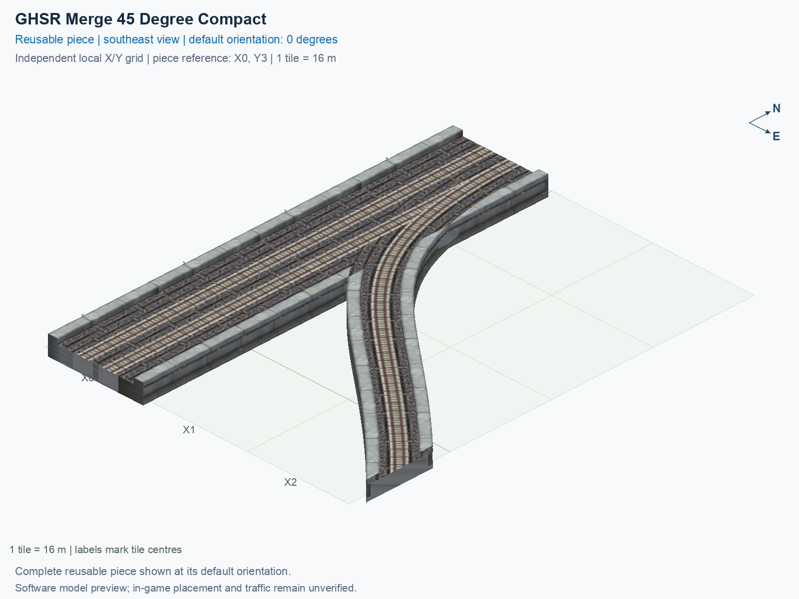

# GHSR Merge 45 Degree Compact

Purpose: explain this reusable piece, its matching connections and current test coverage.

<!-- BEGIN PIECE OVERVIEW -->

GHSR Merge 45 Degree Compact. Fixed click-to-place piece in a 3 by 4 tile area. Follow the arrows and join only matching track widths, directions, and height labels. Four proper rotations; the second four states repeat them. Experimental; game testing pending. The mainline retains both directions; only the branch is one-way.

Exact reusable identifier: `interchange-ground-merge-45-compact`.

Footprint: **3 × 4 tiles**. Exact menu name: **GHSR Merge 45 Degree Compact**.

Choose this exact name in Transportation → Rail. Press Home or End to rotate; use only the supported states listed below. Join each end to a matching port profile and direction.

- [Connections and journeys](#connections-and-journeys)
- [Test checklist](#test-checklist)



<!-- END PIECE OVERVIEW -->

<!-- BEGIN MANUAL SUMMARY -->

## Manual status

Generated from [the exact test cases](#test-checklist) and [authoritative observations](checks/manual-tests.json).

- [ ] Preview review: 0/1 applicable cases passed; 0 failed, 0 stale.
- [ ] In-game rendering: 0/4 applicable cases passed; 0 failed, 0 stale.
- [ ] Directed journeys: 0/12 applicable cases passed; 0 failed, 0 stale.

These observations cover only the named services, directions, poses, rotations, and recorded platforms.

<!-- END MANUAL SUMMARY -->

<!-- BEGIN CONNECTIONS -->

## Connections and journeys

Purpose: describe intrinsic directional interfaces and permitted service journeys.

Generated from [connections.json](connections.json). Coordinates are canonical east, north and height in metres. A connection class names an encoded route interface; it does not prove visible deck/wall fit or an in-game test.

Supported placement states: 0° CCW, 90° CCW, 180° CCW, 270° CCW. Each state has its own declared manual scope.

A **port** is one directional transport-path endpoint. **Service** identifies the intended network service (for example HSR, street, or tram); **engine** is its internal traffic-class number, separate from the construction network. **Role** distinguishes primary service from auxiliary paths; sharing a traffic class does not establish service compatibility.

A **tangent** is a unit travel-direction vector: `[0,1]` means north. **Grade** is height gained per horizontal metre. These measured facts describe this subject alone. Compatibility requires a separate comparison of the complete joining boundaries; physical seams and actual game operation require their own evidence. See the [class index](../../connection-classes.json) for shared route-interface membership.

| Port | Service / engine / role | Direction | Location; tangent; grade | Connection class |
| --- | --- | --- | --- | --- |
| `Sout` | ghsr / 7 / primary | out | [-2.0, -56.0, 1.0]; [0.0, -1.0]; 0.0 | `path-interface-c78c5ac4b558d84b46f2` |
| `Nin` | ghsr / 7 / primary | in | [-2.0, 8.0, 1.0]; [0.0, -1.0]; 0.0 | `path-interface-c78c5ac4b558d84b46f2` |
| `Sin` | ghsr / 7 / primary | in | [2.0, -56.0, 1.0]; [0.0, 1.0]; 0.0 | `path-interface-fab587419de6b5848d74` |
| `Nout` | ghsr / 7 / primary | out | [2.0, 8.0, 1.0]; [0.0, 1.0]; 0.0 | `path-interface-fab587419de6b5848d74` |
| `Bin` | ghsr / 7 / primary | in | [40.0, -48.0, 1.0]; [-0.7071067811865475, 0.7071067811865475]; 0.0 | `path-interface-6c94c39b4abd67a7479e` |

### Directed journeys

| Service | Entry → exit | Role |
| --- | --- | --- |
| ghsr | `Nin` → `Sout` | primary |
| ghsr | `Sin` → `Nout` | primary |
| ghsr | `Bin` → `Nout` | primary |

### Forbidden transfers

| From service / port | To service / port | Reason |
| --- | --- | --- |
| ghsr / `Nin` | ghsr / `Nout` | No directed route exists between these ports in the saved piece transport paths. In-game confirmation remains unverified. |
| ghsr / `Sin` | ghsr / `Sout` | No directed route exists between these ports in the saved piece transport paths. In-game confirmation remains unverified. |
| ghsr / `Bin` | ghsr / `Sout` | No directed route exists between these ports in the saved piece transport paths. In-game confirmation remains unverified. |

Review the test checklist for the exact tested cases and environments.

<!-- END CONNECTIONS -->

<!-- BEGIN MANUAL CHECKS -->

## Test checklist

Generated from [the authoritative record](checks/manual-tests.json). Only explicit human observations create manual passes; software and preview checks remain separate. Expand a check/service group to see its rotation table, then expand the matching exact scope to copy a case ID and inspect its pose, reviewer, environment, and evidence. Grouping changes only this view; every declared case remains separate.

**States:** [x] passed; [ ] unverified, failed, or stale; N/A is an explicit inapplicable declaration. A dash means no case was declared in that column. Every pass covers only its recorded environment. T means a distinct construction-transposed state.

Four proper rotations are covered. No additional reflected state is established by this record; repeated construction aliases do not create new orientations.

Current totals: unverified: 43, passed: 0, failed: 0, stale: 0, not_applicable: 0.

### Record an observation

Follow the [shared testing guide](../../../../docs/TESTING.md); copy [the unconfirmed example](checks/observation.example.json) to `checks/observation.json`. Case identifiers are in the expandable sections below. Do not edit generated checkboxes.

From the repository folder containing `custom-pieces`, run after filling `checks/observation.json` and explicitly confirming the exact observation:

```sh
python3 -m scp.content record --record custom-pieces/domains/high-speed-rail/00_pieces/interchange-ground-merge-45-compact/checks/manual-tests.json --observation custom-pieces/domains/high-speed-rail/00_pieces/interchange-ground-merge-45-compact/checks/observation.json
```

### Detailed current checks

Each collapsed group shows exact case counts and states. Forbidden transfers are grouped by the directed service pair; the table inside retains every port pair and rotation.

<details>
<summary>Compiled resources — Whole subject — 1 case; unverified: 1</summary>

| Check / exact scope | General | 0° | 90° | 180° | 270° |
| --- | --- | --- | --- | --- | --- |
| **Compiled resources**<br>Whole subject | <a href="#case-software_resources-71a975f30889902372d9">[ ] unverified</a> | — | — | — | — |


<details>
<summary>Compiled resources — Whole subject</summary>

<a id="case-software_resources-71a975f30889902372d9"></a>

**General: unverified** — `software_resources-71a975f30889902372d9`.

Verify the actual compiled resources and construction rules.

Scope: Whole subject.

No observation recorded.

</details>

</details>

<details>
<summary>Directed routing graph — Whole subject — 1 case; unverified: 1</summary>

| Check / exact scope | General | 0° | 90° | 180° | 270° |
| --- | --- | --- | --- | --- | --- |
| **Directed routing graph**<br>Whole subject | <a href="#case-software_connectivity-71a975f30889902372d9">[ ] unverified</a> | — | — | — | — |


<details>
<summary>Directed routing graph — Whole subject</summary>

<a id="case-software_connectivity-71a975f30889902372d9"></a>

**General: unverified** — `software_connectivity-71a975f30889902372d9`.

Verify the declared directed journeys and forbidden transfers.

Scope: Whole subject.

No observation recorded.

</details>

</details>

<details>
<summary>Preview review — Images — 1 case; unverified: 1</summary>

| Check / exact scope | General | 0° | 90° | 180° | 270° |
| --- | --- | --- | --- | --- | --- |
| **Preview review**<br>Image: image:interchange-ground-merge-45-compact:canonical-southeast | <a href="#case-preview_review-1d4c90fc54371589eff5">[ ] unverified</a> | — | — | — | — |


<details>
<summary>Preview review — Image: image:interchange-ground-merge-45-compact:canonical-southeast</summary>

<a id="case-preview_review-1d4c90fc54371589eff5"></a>

**General: unverified** — `preview_review-1d4c90fc54371589eff5`.

Inspect this exact preview for tracks, walls, piers, seams and shadows.

Scope: Image: image:interchange-ground-merge-45-compact:canonical-southeast.

No observation recorded.

</details>

</details>

<details>
<summary>In-game rendering — Whole subject — 4 cases; unverified: 4</summary>

| Check / exact scope | General | 0° | 90° | 180° | 270° |
| --- | --- | --- | --- | --- | --- |
| **In-game rendering**<br>Whole subject | — | <a href="#case-in_game_render-81f5bf4e0bb1884b77fe">[ ] unverified</a> | <a href="#case-in_game_render-3e94076d7bea34248fe7">[ ] unverified</a> | <a href="#case-in_game_render-8d5a16a8f4ddc3b63420">[ ] unverified</a> | <a href="#case-in_game_render-7411e91e73ddc8a47f7e">[ ] unverified</a> |


<details>
<summary>In-game rendering — Whole subject</summary>

<a id="case-in_game_render-81f5bf4e0bb1884b77fe"></a>

**0° CCW: unverified** — `in_game_render-81f5bf4e0bb1884b77fe`.

Inspect the placed tracks, walls, piers, seams and shadows in SimCity 4.

Scope: Whole subject.

No observation recorded.

<a id="case-in_game_render-3e94076d7bea34248fe7"></a>

**90° CCW: unverified** — `in_game_render-3e94076d7bea34248fe7`.

Inspect the placed tracks, walls, piers, seams and shadows in SimCity 4.

Scope: Whole subject.

No observation recorded.

<a id="case-in_game_render-8d5a16a8f4ddc3b63420"></a>

**180° CCW: unverified** — `in_game_render-8d5a16a8f4ddc3b63420`.

Inspect the placed tracks, walls, piers, seams and shadows in SimCity 4.

Scope: Whole subject.

No observation recorded.

<a id="case-in_game_render-7411e91e73ddc8a47f7e"></a>

**270° CCW: unverified** — `in_game_render-7411e91e73ddc8a47f7e`.

Inspect the placed tracks, walls, piers, seams and shadows in SimCity 4.

Scope: Whole subject.

No observation recorded.

</details>

</details>

<details>
<summary>Placement — Whole subject — 4 cases; unverified: 4</summary>

| Check / exact scope | General | 0° | 90° | 180° | 270° |
| --- | --- | --- | --- | --- | --- |
| **Placement**<br>Whole subject | — | <a href="#case-in_game_placement-81f5bf4e0bb1884b77fe">[ ] unverified</a> | <a href="#case-in_game_placement-3e94076d7bea34248fe7">[ ] unverified</a> | <a href="#case-in_game_placement-8d5a16a8f4ddc3b63420">[ ] unverified</a> | <a href="#case-in_game_placement-7411e91e73ddc8a47f7e">[ ] unverified</a> |


<details>
<summary>Placement — Whole subject</summary>

<a id="case-in_game_placement-81f5bf4e0bb1884b77fe"></a>

**0° CCW: unverified** — `in_game_placement-81f5bf4e0bb1884b77fe`.

Place this piece or complete blueprint and inspect every occupied tile.

Scope: Whole subject.

No observation recorded.

<a id="case-in_game_placement-3e94076d7bea34248fe7"></a>

**90° CCW: unverified** — `in_game_placement-3e94076d7bea34248fe7`.

Place this piece or complete blueprint and inspect every occupied tile.

Scope: Whole subject.

No observation recorded.

<a id="case-in_game_placement-8d5a16a8f4ddc3b63420"></a>

**180° CCW: unverified** — `in_game_placement-8d5a16a8f4ddc3b63420`.

Place this piece or complete blueprint and inspect every occupied tile.

Scope: Whole subject.

No observation recorded.

<a id="case-in_game_placement-7411e91e73ddc8a47f7e"></a>

**270° CCW: unverified** — `in_game_placement-7411e91e73ddc8a47f7e`.

Place this piece or complete blueprint and inspect every occupied tile.

Scope: Whole subject.

No observation recorded.

</details>

</details>

<details>
<summary>Demolition — Whole subject — 4 cases; unverified: 4</summary>

| Check / exact scope | General | 0° | 90° | 180° | 270° |
| --- | --- | --- | --- | --- | --- |
| **Demolition**<br>Whole subject | — | <a href="#case-in_game_demolition-81f5bf4e0bb1884b77fe">[ ] unverified</a> | <a href="#case-in_game_demolition-3e94076d7bea34248fe7">[ ] unverified</a> | <a href="#case-in_game_demolition-8d5a16a8f4ddc3b63420">[ ] unverified</a> | <a href="#case-in_game_demolition-7411e91e73ddc8a47f7e">[ ] unverified</a> |


<details>
<summary>Demolition — Whole subject</summary>

<a id="case-in_game_demolition-81f5bf4e0bb1884b77fe"></a>

**0° CCW: unverified** — `in_game_demolition-81f5bf4e0bb1884b77fe`.

Bulldoze the complete placement and inspect the cleared area.

Scope: Whole subject.

No observation recorded.

<a id="case-in_game_demolition-3e94076d7bea34248fe7"></a>

**90° CCW: unverified** — `in_game_demolition-3e94076d7bea34248fe7`.

Bulldoze the complete placement and inspect the cleared area.

Scope: Whole subject.

No observation recorded.

<a id="case-in_game_demolition-8d5a16a8f4ddc3b63420"></a>

**180° CCW: unverified** — `in_game_demolition-8d5a16a8f4ddc3b63420`.

Bulldoze the complete placement and inspect the cleared area.

Scope: Whole subject.

No observation recorded.

<a id="case-in_game_demolition-7411e91e73ddc8a47f7e"></a>

**270° CCW: unverified** — `in_game_demolition-7411e91e73ddc8a47f7e`.

Bulldoze the complete placement and inspect the cleared area.

Scope: Whole subject.

No observation recorded.

</details>

</details>

<details>
<summary>Save and reload — Whole subject — 4 cases; unverified: 4</summary>

| Check / exact scope | General | 0° | 90° | 180° | 270° |
| --- | --- | --- | --- | --- | --- |
| **Save and reload**<br>Whole subject | — | <a href="#case-in_game_save_reload-81f5bf4e0bb1884b77fe">[ ] unverified</a> | <a href="#case-in_game_save_reload-3e94076d7bea34248fe7">[ ] unverified</a> | <a href="#case-in_game_save_reload-8d5a16a8f4ddc3b63420">[ ] unverified</a> | <a href="#case-in_game_save_reload-7411e91e73ddc8a47f7e">[ ] unverified</a> |


<details>
<summary>Save and reload — Whole subject</summary>

<a id="case-in_game_save_reload-81f5bf4e0bb1884b77fe"></a>

**0° CCW: unverified** — `in_game_save_reload-81f5bf4e0bb1884b77fe`.

Save, quit, reload and inspect the placement and its paths.

Scope: Whole subject.

No observation recorded.

<a id="case-in_game_save_reload-3e94076d7bea34248fe7"></a>

**90° CCW: unverified** — `in_game_save_reload-3e94076d7bea34248fe7`.

Save, quit, reload and inspect the placement and its paths.

Scope: Whole subject.

No observation recorded.

<a id="case-in_game_save_reload-8d5a16a8f4ddc3b63420"></a>

**180° CCW: unverified** — `in_game_save_reload-8d5a16a8f4ddc3b63420`.

Save, quit, reload and inspect the placement and its paths.

Scope: Whole subject.

No observation recorded.

<a id="case-in_game_save_reload-7411e91e73ddc8a47f7e"></a>

**270° CCW: unverified** — `in_game_save_reload-7411e91e73ddc8a47f7e`.

Save, quit, reload and inspect the placement and its paths.

Scope: Whole subject.

No observation recorded.

</details>

</details>

<details>
<summary>Journey — ghsr — 12 cases; unverified: 12</summary>

| Check / exact scope | General | 0° | 90° | 180° | 270° |
| --- | --- | --- | --- | --- | --- |
| **Journey**<br>Service: ghsr; role: primary; journey: 7:Nin>Sout; entry: Nin; exit: Sout | — | <a href="#case-in_game_journey-11d207680c614ac13ebd">[ ] unverified</a> | <a href="#case-in_game_journey-7843e91e383388713969">[ ] unverified</a> | <a href="#case-in_game_journey-d999f78a855f11a86cce">[ ] unverified</a> | <a href="#case-in_game_journey-d3e6003bcbbcd703436a">[ ] unverified</a> |
| **Journey**<br>Service: ghsr; role: primary; journey: 7:Sin>Nout; entry: Sin; exit: Nout | — | <a href="#case-in_game_journey-b4c80b349ac0a0e9ea41">[ ] unverified</a> | <a href="#case-in_game_journey-46086b3b55e647d13710">[ ] unverified</a> | <a href="#case-in_game_journey-6413f697d1de194ffb01">[ ] unverified</a> | <a href="#case-in_game_journey-3d3225b5d4f65bcdae77">[ ] unverified</a> |
| **Journey**<br>Service: ghsr; role: primary; journey: 7:Bin>Nout; entry: Bin; exit: Nout | — | <a href="#case-in_game_journey-d479d19a4b59baf5210b">[ ] unverified</a> | <a href="#case-in_game_journey-ed55c40d06442f1387bc">[ ] unverified</a> | <a href="#case-in_game_journey-dd3f0579bdaa342547b5">[ ] unverified</a> | <a href="#case-in_game_journey-449e32786970225726c4">[ ] unverified</a> |


<details>
<summary>Journey — Service: ghsr; role: primary; journey: 7:Nin>Sout; entry: Nin; exit: Sout</summary>

<a id="case-in_game_journey-11d207680c614ac13ebd"></a>

**0° CCW: unverified** — `in_game_journey-11d207680c614ac13ebd`.

Run the declared journey in this direction using its service network.

Scope: Service: ghsr; role: primary; journey: 7:Nin>Sout; entry: Nin; exit: Sout.

No observation recorded.

<a id="case-in_game_journey-7843e91e383388713969"></a>

**90° CCW: unverified** — `in_game_journey-7843e91e383388713969`.

Run the declared journey in this direction using its service network.

Scope: Service: ghsr; role: primary; journey: 7:Nin>Sout; entry: Nin; exit: Sout.

No observation recorded.

<a id="case-in_game_journey-d999f78a855f11a86cce"></a>

**180° CCW: unverified** — `in_game_journey-d999f78a855f11a86cce`.

Run the declared journey in this direction using its service network.

Scope: Service: ghsr; role: primary; journey: 7:Nin>Sout; entry: Nin; exit: Sout.

No observation recorded.

<a id="case-in_game_journey-d3e6003bcbbcd703436a"></a>

**270° CCW: unverified** — `in_game_journey-d3e6003bcbbcd703436a`.

Run the declared journey in this direction using its service network.

Scope: Service: ghsr; role: primary; journey: 7:Nin>Sout; entry: Nin; exit: Sout.

No observation recorded.

</details>


<details>
<summary>Journey — Service: ghsr; role: primary; journey: 7:Sin>Nout; entry: Sin; exit: Nout</summary>

<a id="case-in_game_journey-b4c80b349ac0a0e9ea41"></a>

**0° CCW: unverified** — `in_game_journey-b4c80b349ac0a0e9ea41`.

Run the declared journey in this direction using its service network.

Scope: Service: ghsr; role: primary; journey: 7:Sin>Nout; entry: Sin; exit: Nout.

No observation recorded.

<a id="case-in_game_journey-46086b3b55e647d13710"></a>

**90° CCW: unverified** — `in_game_journey-46086b3b55e647d13710`.

Run the declared journey in this direction using its service network.

Scope: Service: ghsr; role: primary; journey: 7:Sin>Nout; entry: Sin; exit: Nout.

No observation recorded.

<a id="case-in_game_journey-6413f697d1de194ffb01"></a>

**180° CCW: unverified** — `in_game_journey-6413f697d1de194ffb01`.

Run the declared journey in this direction using its service network.

Scope: Service: ghsr; role: primary; journey: 7:Sin>Nout; entry: Sin; exit: Nout.

No observation recorded.

<a id="case-in_game_journey-3d3225b5d4f65bcdae77"></a>

**270° CCW: unverified** — `in_game_journey-3d3225b5d4f65bcdae77`.

Run the declared journey in this direction using its service network.

Scope: Service: ghsr; role: primary; journey: 7:Sin>Nout; entry: Sin; exit: Nout.

No observation recorded.

</details>


<details>
<summary>Journey — Service: ghsr; role: primary; journey: 7:Bin>Nout; entry: Bin; exit: Nout</summary>

<a id="case-in_game_journey-d479d19a4b59baf5210b"></a>

**0° CCW: unverified** — `in_game_journey-d479d19a4b59baf5210b`.

Run the declared journey in this direction using its service network.

Scope: Service: ghsr; role: primary; journey: 7:Bin>Nout; entry: Bin; exit: Nout.

No observation recorded.

<a id="case-in_game_journey-ed55c40d06442f1387bc"></a>

**90° CCW: unverified** — `in_game_journey-ed55c40d06442f1387bc`.

Run the declared journey in this direction using its service network.

Scope: Service: ghsr; role: primary; journey: 7:Bin>Nout; entry: Bin; exit: Nout.

No observation recorded.

<a id="case-in_game_journey-dd3f0579bdaa342547b5"></a>

**180° CCW: unverified** — `in_game_journey-dd3f0579bdaa342547b5`.

Run the declared journey in this direction using its service network.

Scope: Service: ghsr; role: primary; journey: 7:Bin>Nout; entry: Bin; exit: Nout.

No observation recorded.

<a id="case-in_game_journey-449e32786970225726c4"></a>

**270° CCW: unverified** — `in_game_journey-449e32786970225726c4`.

Run the declared journey in this direction using its service network.

Scope: Service: ghsr; role: primary; journey: 7:Bin>Nout; entry: Bin; exit: Nout.

No observation recorded.

</details>

</details>

<details>
<summary>Forbidden transfer — ghsr → ghsr — 12 cases; unverified: 12</summary>

| Check / exact scope | General | 0° | 90° | 180° | 270° |
| --- | --- | --- | --- | --- | --- |
| **Forbidden transfer**<br>from port: Nin; to port: Nout; from service: ghsr; to service: ghsr; basis: not reachable in actual saved PATH graph | — | <a href="#case-in_game_forbidden_transfer-08308854ab2ba622f127">[ ] unverified</a> | <a href="#case-in_game_forbidden_transfer-a092c58593126b5e2b34">[ ] unverified</a> | <a href="#case-in_game_forbidden_transfer-fd53d7bc908d04363de0">[ ] unverified</a> | <a href="#case-in_game_forbidden_transfer-4c895c32f2cfd9881d77">[ ] unverified</a> |
| **Forbidden transfer**<br>from port: Sin; to port: Sout; from service: ghsr; to service: ghsr; basis: not reachable in actual saved PATH graph | — | <a href="#case-in_game_forbidden_transfer-757620e16bdf012a6532">[ ] unverified</a> | <a href="#case-in_game_forbidden_transfer-d1915e1265394f93b274">[ ] unverified</a> | <a href="#case-in_game_forbidden_transfer-ebe2aa2a5f4f90f6bb91">[ ] unverified</a> | <a href="#case-in_game_forbidden_transfer-18d02d02ceb5741abf17">[ ] unverified</a> |
| **Forbidden transfer**<br>from port: Bin; to port: Sout; from service: ghsr; to service: ghsr; basis: not reachable in actual saved PATH graph | — | <a href="#case-in_game_forbidden_transfer-2d5b1d02721719b1326c">[ ] unverified</a> | <a href="#case-in_game_forbidden_transfer-d885cf3775be417a25fd">[ ] unverified</a> | <a href="#case-in_game_forbidden_transfer-5aa2f2b01091043c45ea">[ ] unverified</a> | <a href="#case-in_game_forbidden_transfer-f79770269b16233fa673">[ ] unverified</a> |


<details>
<summary>Forbidden transfer — from port: Nin; to port: Nout; from service: ghsr; to service: ghsr; basis: not reachable in actual saved PATH graph</summary>

<a id="case-in_game_forbidden_transfer-08308854ab2ba622f127"></a>

**0° CCW: unverified** — `in_game_forbidden_transfer-08308854ab2ba622f127`.

Confirm this undeclared transfer is unavailable.

Scope: from port: Nin; to port: Nout; from service: ghsr; to service: ghsr; basis: not reachable in actual saved PATH graph.

No observation recorded.

<a id="case-in_game_forbidden_transfer-a092c58593126b5e2b34"></a>

**90° CCW: unverified** — `in_game_forbidden_transfer-a092c58593126b5e2b34`.

Confirm this undeclared transfer is unavailable.

Scope: from port: Nin; to port: Nout; from service: ghsr; to service: ghsr; basis: not reachable in actual saved PATH graph.

No observation recorded.

<a id="case-in_game_forbidden_transfer-fd53d7bc908d04363de0"></a>

**180° CCW: unverified** — `in_game_forbidden_transfer-fd53d7bc908d04363de0`.

Confirm this undeclared transfer is unavailable.

Scope: from port: Nin; to port: Nout; from service: ghsr; to service: ghsr; basis: not reachable in actual saved PATH graph.

No observation recorded.

<a id="case-in_game_forbidden_transfer-4c895c32f2cfd9881d77"></a>

**270° CCW: unverified** — `in_game_forbidden_transfer-4c895c32f2cfd9881d77`.

Confirm this undeclared transfer is unavailable.

Scope: from port: Nin; to port: Nout; from service: ghsr; to service: ghsr; basis: not reachable in actual saved PATH graph.

No observation recorded.

</details>


<details>
<summary>Forbidden transfer — from port: Sin; to port: Sout; from service: ghsr; to service: ghsr; basis: not reachable in actual saved PATH graph</summary>

<a id="case-in_game_forbidden_transfer-757620e16bdf012a6532"></a>

**0° CCW: unverified** — `in_game_forbidden_transfer-757620e16bdf012a6532`.

Confirm this undeclared transfer is unavailable.

Scope: from port: Sin; to port: Sout; from service: ghsr; to service: ghsr; basis: not reachable in actual saved PATH graph.

No observation recorded.

<a id="case-in_game_forbidden_transfer-d1915e1265394f93b274"></a>

**90° CCW: unverified** — `in_game_forbidden_transfer-d1915e1265394f93b274`.

Confirm this undeclared transfer is unavailable.

Scope: from port: Sin; to port: Sout; from service: ghsr; to service: ghsr; basis: not reachable in actual saved PATH graph.

No observation recorded.

<a id="case-in_game_forbidden_transfer-ebe2aa2a5f4f90f6bb91"></a>

**180° CCW: unverified** — `in_game_forbidden_transfer-ebe2aa2a5f4f90f6bb91`.

Confirm this undeclared transfer is unavailable.

Scope: from port: Sin; to port: Sout; from service: ghsr; to service: ghsr; basis: not reachable in actual saved PATH graph.

No observation recorded.

<a id="case-in_game_forbidden_transfer-18d02d02ceb5741abf17"></a>

**270° CCW: unverified** — `in_game_forbidden_transfer-18d02d02ceb5741abf17`.

Confirm this undeclared transfer is unavailable.

Scope: from port: Sin; to port: Sout; from service: ghsr; to service: ghsr; basis: not reachable in actual saved PATH graph.

No observation recorded.

</details>


<details>
<summary>Forbidden transfer — from port: Bin; to port: Sout; from service: ghsr; to service: ghsr; basis: not reachable in actual saved PATH graph</summary>

<a id="case-in_game_forbidden_transfer-2d5b1d02721719b1326c"></a>

**0° CCW: unverified** — `in_game_forbidden_transfer-2d5b1d02721719b1326c`.

Confirm this undeclared transfer is unavailable.

Scope: from port: Bin; to port: Sout; from service: ghsr; to service: ghsr; basis: not reachable in actual saved PATH graph.

No observation recorded.

<a id="case-in_game_forbidden_transfer-d885cf3775be417a25fd"></a>

**90° CCW: unverified** — `in_game_forbidden_transfer-d885cf3775be417a25fd`.

Confirm this undeclared transfer is unavailable.

Scope: from port: Bin; to port: Sout; from service: ghsr; to service: ghsr; basis: not reachable in actual saved PATH graph.

No observation recorded.

<a id="case-in_game_forbidden_transfer-5aa2f2b01091043c45ea"></a>

**180° CCW: unverified** — `in_game_forbidden_transfer-5aa2f2b01091043c45ea`.

Confirm this undeclared transfer is unavailable.

Scope: from port: Bin; to port: Sout; from service: ghsr; to service: ghsr; basis: not reachable in actual saved PATH graph.

No observation recorded.

<a id="case-in_game_forbidden_transfer-f79770269b16233fa673"></a>

**270° CCW: unverified** — `in_game_forbidden_transfer-f79770269b16233fa673`.

Confirm this undeclared transfer is unavailable.

Scope: from port: Bin; to port: Sout; from service: ghsr; to service: ghsr; basis: not reachable in actual saved PATH graph.

No observation recorded.

</details>

</details>

<!-- END MANUAL CHECKS -->
