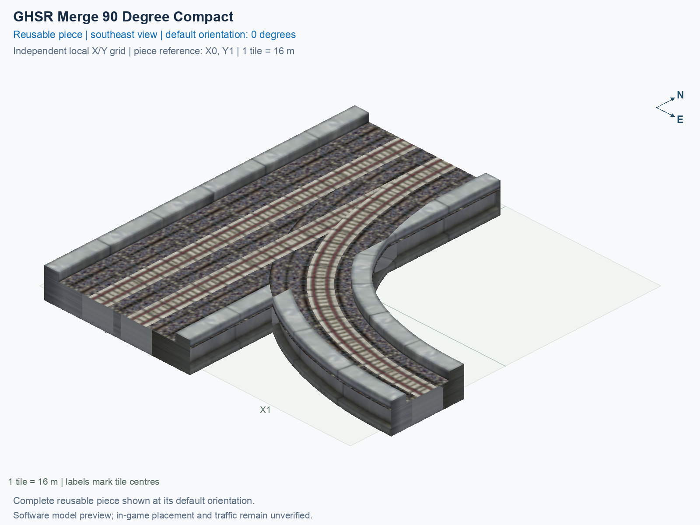

# GHSR Merge 90 Degree Compact

Purpose: explain this reusable piece, its matching connections and current test coverage.

<!-- BEGIN PIECE OVERVIEW -->

GHSR Merge 90 Degree Compact. Fixed click-to-place piece in a 2 by 2 tile area. Follow the arrows and join only matching track widths, directions, and height labels. Four proper rotations; the second four states repeat them. Experimental; game testing pending. The mainline retains both directions; only the branch is one-way.

Exact reusable identifier: `interchange-ground-merge-90-compact`.

Footprint: **2 × 2 tiles**. Exact menu name: **GHSR Merge 90 Degree Compact**.

Choose this exact name in Transportation → Rail. Press Home or End to rotate; use only the supported states listed below. Join each end to a matching port profile and direction.

- [Connections and journeys](#connections-and-journeys)
- [Test checklist](#test-checklist)



<!-- END PIECE OVERVIEW -->

<!-- BEGIN MANUAL SUMMARY -->

## Manual status

Generated from [the exact test cases](#test-checklist) and [authoritative observations](checks/manual-tests.json).

- [ ] Preview review: 0/1 applicable cases passed; 0 failed, 0 stale.
- [ ] In-game rendering: 0/4 applicable cases passed; 0 failed, 0 stale.
- [ ] Directed journeys: 0/12 applicable cases passed; 0 failed, 0 stale.

These observations cover only the named services, directions, poses, rotations, and recorded platforms.

<!-- END MANUAL SUMMARY -->

<!-- BEGIN CONNECTIONS -->

## Connections and journeys

Purpose: describe intrinsic directional interfaces and permitted service journeys.

Generated from [connections.json](connections.json). Coordinates are canonical east, north and height in metres. A connection class names an encoded route interface; it does not prove visible deck/wall fit or an in-game test.

Supported placement states: 0° CCW, 90° CCW, 180° CCW, 270° CCW. Each state has its own declared manual scope.

A **port** is one directional transport-path endpoint. **Service** identifies the intended network service (for example HSR, street, or tram); **engine** is its internal traffic-class number, separate from the construction network. **Role** distinguishes primary service from auxiliary paths; sharing a traffic class does not establish service compatibility.

A **tangent** is a unit travel-direction vector: `[0,1]` means north. **Grade** is height gained per horizontal metre. These measured facts describe this subject alone. Compatibility requires a separate comparison of the complete joining boundaries; physical seams and actual game operation require their own evidence. See the [class index](../../connection-classes.json) for shared route-interface membership.

| Port | Service / engine / role | Direction | Location; tangent; grade | Connection class |
| --- | --- | --- | --- | --- |
| `Sout` | ghsr / 7 / primary | out | [-2.0, -24.0, 1.0]; [0.0, -1.0]; 0.0 | `path-interface-c78c5ac4b558d84b46f2` |
| `Nin` | ghsr / 7 / primary | in | [-2.0, 8.0, 1.0]; [0.0, -1.0]; 0.0 | `path-interface-c78c5ac4b558d84b46f2` |
| `Sin` | ghsr / 7 / primary | in | [2.0, -24.0, 1.0]; [0.0, 1.0]; 0.0 | `path-interface-fab587419de6b5848d74` |
| `Nout` | ghsr / 7 / primary | out | [2.0, 8.0, 1.0]; [0.0, 1.0]; 0.0 | `path-interface-fab587419de6b5848d74` |
| `Bin` | ghsr / 7 / primary | in | [24.0, -16.0, 1.0]; [-1.0, 0.0]; 0.0 | `path-interface-459a3d38a8ff1501aa51` |

### Directed journeys

| Service | Entry → exit | Role |
| --- | --- | --- |
| ghsr | `Nin` → `Sout` | primary |
| ghsr | `Sin` → `Nout` | primary |
| ghsr | `Bin` → `Nout` | primary |

### Forbidden transfers

| From service / port | To service / port | Reason |
| --- | --- | --- |
| ghsr / `Nin` | ghsr / `Nout` | No directed route exists between these ports in the saved piece transport paths. In-game confirmation remains unverified. |
| ghsr / `Sin` | ghsr / `Sout` | No directed route exists between these ports in the saved piece transport paths. In-game confirmation remains unverified. |
| ghsr / `Bin` | ghsr / `Sout` | No directed route exists between these ports in the saved piece transport paths. In-game confirmation remains unverified. |

Review the test checklist for the exact tested cases and environments.

<!-- END CONNECTIONS -->

<!-- BEGIN MANUAL CHECKS -->

## Test checklist

Generated from [the authoritative record](checks/manual-tests.json). Only explicit human observations create manual passes; software and preview checks remain separate. Expand a check/service group to see its rotation table, then expand the matching exact scope to copy a case ID and inspect its pose, reviewer, environment, and evidence. Grouping changes only this view; every declared case remains separate.

**States:** [x] passed; [ ] unverified, failed, or stale; N/A is an explicit inapplicable declaration. A dash means no case was declared in that column. Every pass covers only its recorded environment. T means a distinct construction-transposed state.

Four proper rotations are covered. No additional reflected state is established by this record; repeated construction aliases do not create new orientations.

Current totals: unverified: 43, passed: 0, failed: 0, stale: 0, not_applicable: 0.

### Record an observation

Follow the [shared testing guide](../../../../docs/TESTING.md); copy [the unconfirmed example](checks/observation.example.json) to `checks/observation.json`. Case identifiers are in the expandable sections below. Do not edit generated checkboxes.

From the repository folder containing `custom-pieces`, run after filling `checks/observation.json` and explicitly confirming the exact observation:

```sh
python3 -m scp.content record --record custom-pieces/domains/high-speed-rail/00_pieces/interchange-ground-merge-90-compact/checks/manual-tests.json --observation custom-pieces/domains/high-speed-rail/00_pieces/interchange-ground-merge-90-compact/checks/observation.json
```

### Detailed current checks

Each collapsed group shows exact case counts and states. Forbidden transfers are grouped by the directed service pair; the table inside retains every port pair and rotation.

<details>
<summary>Compiled resources — Whole subject — 1 case; unverified: 1</summary>

| Check / exact scope | General | 0° | 90° | 180° | 270° |
| --- | --- | --- | --- | --- | --- |
| **Compiled resources**<br>Whole subject | <a href="#case-software_resources-e82e054e11136d470f63">[ ] unverified</a> | — | — | — | — |


<details>
<summary>Compiled resources — Whole subject</summary>

<a id="case-software_resources-e82e054e11136d470f63"></a>

**General: unverified** — `software_resources-e82e054e11136d470f63`.

Verify the actual compiled resources and construction rules.

Scope: Whole subject.

No observation recorded.

</details>

</details>

<details>
<summary>Directed routing graph — Whole subject — 1 case; unverified: 1</summary>

| Check / exact scope | General | 0° | 90° | 180° | 270° |
| --- | --- | --- | --- | --- | --- |
| **Directed routing graph**<br>Whole subject | <a href="#case-software_connectivity-e82e054e11136d470f63">[ ] unverified</a> | — | — | — | — |


<details>
<summary>Directed routing graph — Whole subject</summary>

<a id="case-software_connectivity-e82e054e11136d470f63"></a>

**General: unverified** — `software_connectivity-e82e054e11136d470f63`.

Verify the declared directed journeys and forbidden transfers.

Scope: Whole subject.

No observation recorded.

</details>

</details>

<details>
<summary>Preview review — Images — 1 case; unverified: 1</summary>

| Check / exact scope | General | 0° | 90° | 180° | 270° |
| --- | --- | --- | --- | --- | --- |
| **Preview review**<br>Image: image:interchange-ground-merge-90-compact:canonical-southeast | <a href="#case-preview_review-0479de1efa96af2a1533">[ ] unverified</a> | — | — | — | — |


<details>
<summary>Preview review — Image: image:interchange-ground-merge-90-compact:canonical-southeast</summary>

<a id="case-preview_review-0479de1efa96af2a1533"></a>

**General: unverified** — `preview_review-0479de1efa96af2a1533`.

Inspect this exact preview for tracks, walls, piers, seams and shadows.

Scope: Image: image:interchange-ground-merge-90-compact:canonical-southeast.

No observation recorded.

</details>

</details>

<details>
<summary>In-game rendering — Whole subject — 4 cases; unverified: 4</summary>

| Check / exact scope | General | 0° | 90° | 180° | 270° |
| --- | --- | --- | --- | --- | --- |
| **In-game rendering**<br>Whole subject | — | <a href="#case-in_game_render-f1d5ec0d6fa26cb62973">[ ] unverified</a> | <a href="#case-in_game_render-329782edd0d13f0d7525">[ ] unverified</a> | <a href="#case-in_game_render-3aad71730891fef01325">[ ] unverified</a> | <a href="#case-in_game_render-41f4a53c30067c00e14a">[ ] unverified</a> |


<details>
<summary>In-game rendering — Whole subject</summary>

<a id="case-in_game_render-f1d5ec0d6fa26cb62973"></a>

**0° CCW: unverified** — `in_game_render-f1d5ec0d6fa26cb62973`.

Inspect the placed tracks, walls, piers, seams and shadows in SimCity 4.

Scope: Whole subject.

No observation recorded.

<a id="case-in_game_render-329782edd0d13f0d7525"></a>

**90° CCW: unverified** — `in_game_render-329782edd0d13f0d7525`.

Inspect the placed tracks, walls, piers, seams and shadows in SimCity 4.

Scope: Whole subject.

No observation recorded.

<a id="case-in_game_render-3aad71730891fef01325"></a>

**180° CCW: unverified** — `in_game_render-3aad71730891fef01325`.

Inspect the placed tracks, walls, piers, seams and shadows in SimCity 4.

Scope: Whole subject.

No observation recorded.

<a id="case-in_game_render-41f4a53c30067c00e14a"></a>

**270° CCW: unverified** — `in_game_render-41f4a53c30067c00e14a`.

Inspect the placed tracks, walls, piers, seams and shadows in SimCity 4.

Scope: Whole subject.

No observation recorded.

</details>

</details>

<details>
<summary>Placement — Whole subject — 4 cases; unverified: 4</summary>

| Check / exact scope | General | 0° | 90° | 180° | 270° |
| --- | --- | --- | --- | --- | --- |
| **Placement**<br>Whole subject | — | <a href="#case-in_game_placement-f1d5ec0d6fa26cb62973">[ ] unverified</a> | <a href="#case-in_game_placement-329782edd0d13f0d7525">[ ] unverified</a> | <a href="#case-in_game_placement-3aad71730891fef01325">[ ] unverified</a> | <a href="#case-in_game_placement-41f4a53c30067c00e14a">[ ] unverified</a> |


<details>
<summary>Placement — Whole subject</summary>

<a id="case-in_game_placement-f1d5ec0d6fa26cb62973"></a>

**0° CCW: unverified** — `in_game_placement-f1d5ec0d6fa26cb62973`.

Place this piece or complete blueprint and inspect every occupied tile.

Scope: Whole subject.

No observation recorded.

<a id="case-in_game_placement-329782edd0d13f0d7525"></a>

**90° CCW: unverified** — `in_game_placement-329782edd0d13f0d7525`.

Place this piece or complete blueprint and inspect every occupied tile.

Scope: Whole subject.

No observation recorded.

<a id="case-in_game_placement-3aad71730891fef01325"></a>

**180° CCW: unverified** — `in_game_placement-3aad71730891fef01325`.

Place this piece or complete blueprint and inspect every occupied tile.

Scope: Whole subject.

No observation recorded.

<a id="case-in_game_placement-41f4a53c30067c00e14a"></a>

**270° CCW: unverified** — `in_game_placement-41f4a53c30067c00e14a`.

Place this piece or complete blueprint and inspect every occupied tile.

Scope: Whole subject.

No observation recorded.

</details>

</details>

<details>
<summary>Demolition — Whole subject — 4 cases; unverified: 4</summary>

| Check / exact scope | General | 0° | 90° | 180° | 270° |
| --- | --- | --- | --- | --- | --- |
| **Demolition**<br>Whole subject | — | <a href="#case-in_game_demolition-f1d5ec0d6fa26cb62973">[ ] unverified</a> | <a href="#case-in_game_demolition-329782edd0d13f0d7525">[ ] unverified</a> | <a href="#case-in_game_demolition-3aad71730891fef01325">[ ] unverified</a> | <a href="#case-in_game_demolition-41f4a53c30067c00e14a">[ ] unverified</a> |


<details>
<summary>Demolition — Whole subject</summary>

<a id="case-in_game_demolition-f1d5ec0d6fa26cb62973"></a>

**0° CCW: unverified** — `in_game_demolition-f1d5ec0d6fa26cb62973`.

Bulldoze the complete placement and inspect the cleared area.

Scope: Whole subject.

No observation recorded.

<a id="case-in_game_demolition-329782edd0d13f0d7525"></a>

**90° CCW: unverified** — `in_game_demolition-329782edd0d13f0d7525`.

Bulldoze the complete placement and inspect the cleared area.

Scope: Whole subject.

No observation recorded.

<a id="case-in_game_demolition-3aad71730891fef01325"></a>

**180° CCW: unverified** — `in_game_demolition-3aad71730891fef01325`.

Bulldoze the complete placement and inspect the cleared area.

Scope: Whole subject.

No observation recorded.

<a id="case-in_game_demolition-41f4a53c30067c00e14a"></a>

**270° CCW: unverified** — `in_game_demolition-41f4a53c30067c00e14a`.

Bulldoze the complete placement and inspect the cleared area.

Scope: Whole subject.

No observation recorded.

</details>

</details>

<details>
<summary>Save and reload — Whole subject — 4 cases; unverified: 4</summary>

| Check / exact scope | General | 0° | 90° | 180° | 270° |
| --- | --- | --- | --- | --- | --- |
| **Save and reload**<br>Whole subject | — | <a href="#case-in_game_save_reload-f1d5ec0d6fa26cb62973">[ ] unverified</a> | <a href="#case-in_game_save_reload-329782edd0d13f0d7525">[ ] unverified</a> | <a href="#case-in_game_save_reload-3aad71730891fef01325">[ ] unverified</a> | <a href="#case-in_game_save_reload-41f4a53c30067c00e14a">[ ] unverified</a> |


<details>
<summary>Save and reload — Whole subject</summary>

<a id="case-in_game_save_reload-f1d5ec0d6fa26cb62973"></a>

**0° CCW: unverified** — `in_game_save_reload-f1d5ec0d6fa26cb62973`.

Save, quit, reload and inspect the placement and its paths.

Scope: Whole subject.

No observation recorded.

<a id="case-in_game_save_reload-329782edd0d13f0d7525"></a>

**90° CCW: unverified** — `in_game_save_reload-329782edd0d13f0d7525`.

Save, quit, reload and inspect the placement and its paths.

Scope: Whole subject.

No observation recorded.

<a id="case-in_game_save_reload-3aad71730891fef01325"></a>

**180° CCW: unverified** — `in_game_save_reload-3aad71730891fef01325`.

Save, quit, reload and inspect the placement and its paths.

Scope: Whole subject.

No observation recorded.

<a id="case-in_game_save_reload-41f4a53c30067c00e14a"></a>

**270° CCW: unverified** — `in_game_save_reload-41f4a53c30067c00e14a`.

Save, quit, reload and inspect the placement and its paths.

Scope: Whole subject.

No observation recorded.

</details>

</details>

<details>
<summary>Journey — ghsr — 12 cases; unverified: 12</summary>

| Check / exact scope | General | 0° | 90° | 180° | 270° |
| --- | --- | --- | --- | --- | --- |
| **Journey**<br>Service: ghsr; role: primary; journey: 7:Nin>Sout; entry: Nin; exit: Sout | — | <a href="#case-in_game_journey-385eb1a1af18ba9e7d0f">[ ] unverified</a> | <a href="#case-in_game_journey-10075245b3f543f178bf">[ ] unverified</a> | <a href="#case-in_game_journey-f8f3b66336dde8b26f84">[ ] unverified</a> | <a href="#case-in_game_journey-032be09cc1987c2be012">[ ] unverified</a> |
| **Journey**<br>Service: ghsr; role: primary; journey: 7:Sin>Nout; entry: Sin; exit: Nout | — | <a href="#case-in_game_journey-f8e7aba24d22472e2dba">[ ] unverified</a> | <a href="#case-in_game_journey-57be80bf833cfb363760">[ ] unverified</a> | <a href="#case-in_game_journey-4639e07b6b63da01e58f">[ ] unverified</a> | <a href="#case-in_game_journey-e6f3553dc45aeb146082">[ ] unverified</a> |
| **Journey**<br>Service: ghsr; role: primary; journey: 7:Bin>Nout; entry: Bin; exit: Nout | — | <a href="#case-in_game_journey-238569f2d6b386f40fd9">[ ] unverified</a> | <a href="#case-in_game_journey-80f49b2ba463eb9fa7d2">[ ] unverified</a> | <a href="#case-in_game_journey-e486b6275446e6372dfc">[ ] unverified</a> | <a href="#case-in_game_journey-6b2bf1b45bf6b9273387">[ ] unverified</a> |


<details>
<summary>Journey — Service: ghsr; role: primary; journey: 7:Nin>Sout; entry: Nin; exit: Sout</summary>

<a id="case-in_game_journey-385eb1a1af18ba9e7d0f"></a>

**0° CCW: unverified** — `in_game_journey-385eb1a1af18ba9e7d0f`.

Run the declared journey in this direction using its service network.

Scope: Service: ghsr; role: primary; journey: 7:Nin>Sout; entry: Nin; exit: Sout.

No observation recorded.

<a id="case-in_game_journey-10075245b3f543f178bf"></a>

**90° CCW: unverified** — `in_game_journey-10075245b3f543f178bf`.

Run the declared journey in this direction using its service network.

Scope: Service: ghsr; role: primary; journey: 7:Nin>Sout; entry: Nin; exit: Sout.

No observation recorded.

<a id="case-in_game_journey-f8f3b66336dde8b26f84"></a>

**180° CCW: unverified** — `in_game_journey-f8f3b66336dde8b26f84`.

Run the declared journey in this direction using its service network.

Scope: Service: ghsr; role: primary; journey: 7:Nin>Sout; entry: Nin; exit: Sout.

No observation recorded.

<a id="case-in_game_journey-032be09cc1987c2be012"></a>

**270° CCW: unverified** — `in_game_journey-032be09cc1987c2be012`.

Run the declared journey in this direction using its service network.

Scope: Service: ghsr; role: primary; journey: 7:Nin>Sout; entry: Nin; exit: Sout.

No observation recorded.

</details>


<details>
<summary>Journey — Service: ghsr; role: primary; journey: 7:Sin>Nout; entry: Sin; exit: Nout</summary>

<a id="case-in_game_journey-f8e7aba24d22472e2dba"></a>

**0° CCW: unverified** — `in_game_journey-f8e7aba24d22472e2dba`.

Run the declared journey in this direction using its service network.

Scope: Service: ghsr; role: primary; journey: 7:Sin>Nout; entry: Sin; exit: Nout.

No observation recorded.

<a id="case-in_game_journey-57be80bf833cfb363760"></a>

**90° CCW: unverified** — `in_game_journey-57be80bf833cfb363760`.

Run the declared journey in this direction using its service network.

Scope: Service: ghsr; role: primary; journey: 7:Sin>Nout; entry: Sin; exit: Nout.

No observation recorded.

<a id="case-in_game_journey-4639e07b6b63da01e58f"></a>

**180° CCW: unverified** — `in_game_journey-4639e07b6b63da01e58f`.

Run the declared journey in this direction using its service network.

Scope: Service: ghsr; role: primary; journey: 7:Sin>Nout; entry: Sin; exit: Nout.

No observation recorded.

<a id="case-in_game_journey-e6f3553dc45aeb146082"></a>

**270° CCW: unverified** — `in_game_journey-e6f3553dc45aeb146082`.

Run the declared journey in this direction using its service network.

Scope: Service: ghsr; role: primary; journey: 7:Sin>Nout; entry: Sin; exit: Nout.

No observation recorded.

</details>


<details>
<summary>Journey — Service: ghsr; role: primary; journey: 7:Bin>Nout; entry: Bin; exit: Nout</summary>

<a id="case-in_game_journey-238569f2d6b386f40fd9"></a>

**0° CCW: unverified** — `in_game_journey-238569f2d6b386f40fd9`.

Run the declared journey in this direction using its service network.

Scope: Service: ghsr; role: primary; journey: 7:Bin>Nout; entry: Bin; exit: Nout.

No observation recorded.

<a id="case-in_game_journey-80f49b2ba463eb9fa7d2"></a>

**90° CCW: unverified** — `in_game_journey-80f49b2ba463eb9fa7d2`.

Run the declared journey in this direction using its service network.

Scope: Service: ghsr; role: primary; journey: 7:Bin>Nout; entry: Bin; exit: Nout.

No observation recorded.

<a id="case-in_game_journey-e486b6275446e6372dfc"></a>

**180° CCW: unverified** — `in_game_journey-e486b6275446e6372dfc`.

Run the declared journey in this direction using its service network.

Scope: Service: ghsr; role: primary; journey: 7:Bin>Nout; entry: Bin; exit: Nout.

No observation recorded.

<a id="case-in_game_journey-6b2bf1b45bf6b9273387"></a>

**270° CCW: unverified** — `in_game_journey-6b2bf1b45bf6b9273387`.

Run the declared journey in this direction using its service network.

Scope: Service: ghsr; role: primary; journey: 7:Bin>Nout; entry: Bin; exit: Nout.

No observation recorded.

</details>

</details>

<details>
<summary>Forbidden transfer — ghsr → ghsr — 12 cases; unverified: 12</summary>

| Check / exact scope | General | 0° | 90° | 180° | 270° |
| --- | --- | --- | --- | --- | --- |
| **Forbidden transfer**<br>from port: Nin; to port: Nout; from service: ghsr; to service: ghsr; basis: not reachable in actual saved PATH graph | — | <a href="#case-in_game_forbidden_transfer-bd7c09d0817bc2928402">[ ] unverified</a> | <a href="#case-in_game_forbidden_transfer-11ea17b90377d19f979f">[ ] unverified</a> | <a href="#case-in_game_forbidden_transfer-c766ad161cd07de453de">[ ] unverified</a> | <a href="#case-in_game_forbidden_transfer-9d1d50dcb2b67c38debd">[ ] unverified</a> |
| **Forbidden transfer**<br>from port: Sin; to port: Sout; from service: ghsr; to service: ghsr; basis: not reachable in actual saved PATH graph | — | <a href="#case-in_game_forbidden_transfer-b68a12b1bb5e2ae393d3">[ ] unverified</a> | <a href="#case-in_game_forbidden_transfer-d63f88dddfed5f730421">[ ] unverified</a> | <a href="#case-in_game_forbidden_transfer-39296219153930682134">[ ] unverified</a> | <a href="#case-in_game_forbidden_transfer-e6e51f2dd6c6b1871235">[ ] unverified</a> |
| **Forbidden transfer**<br>from port: Bin; to port: Sout; from service: ghsr; to service: ghsr; basis: not reachable in actual saved PATH graph | — | <a href="#case-in_game_forbidden_transfer-bbc26514b4e7a3edf595">[ ] unverified</a> | <a href="#case-in_game_forbidden_transfer-cca12663884a50ce37be">[ ] unverified</a> | <a href="#case-in_game_forbidden_transfer-63236516069070e1bcae">[ ] unverified</a> | <a href="#case-in_game_forbidden_transfer-b273f8c3a73be0e2dcbc">[ ] unverified</a> |


<details>
<summary>Forbidden transfer — from port: Nin; to port: Nout; from service: ghsr; to service: ghsr; basis: not reachable in actual saved PATH graph</summary>

<a id="case-in_game_forbidden_transfer-bd7c09d0817bc2928402"></a>

**0° CCW: unverified** — `in_game_forbidden_transfer-bd7c09d0817bc2928402`.

Confirm this undeclared transfer is unavailable.

Scope: from port: Nin; to port: Nout; from service: ghsr; to service: ghsr; basis: not reachable in actual saved PATH graph.

No observation recorded.

<a id="case-in_game_forbidden_transfer-11ea17b90377d19f979f"></a>

**90° CCW: unverified** — `in_game_forbidden_transfer-11ea17b90377d19f979f`.

Confirm this undeclared transfer is unavailable.

Scope: from port: Nin; to port: Nout; from service: ghsr; to service: ghsr; basis: not reachable in actual saved PATH graph.

No observation recorded.

<a id="case-in_game_forbidden_transfer-c766ad161cd07de453de"></a>

**180° CCW: unverified** — `in_game_forbidden_transfer-c766ad161cd07de453de`.

Confirm this undeclared transfer is unavailable.

Scope: from port: Nin; to port: Nout; from service: ghsr; to service: ghsr; basis: not reachable in actual saved PATH graph.

No observation recorded.

<a id="case-in_game_forbidden_transfer-9d1d50dcb2b67c38debd"></a>

**270° CCW: unverified** — `in_game_forbidden_transfer-9d1d50dcb2b67c38debd`.

Confirm this undeclared transfer is unavailable.

Scope: from port: Nin; to port: Nout; from service: ghsr; to service: ghsr; basis: not reachable in actual saved PATH graph.

No observation recorded.

</details>


<details>
<summary>Forbidden transfer — from port: Sin; to port: Sout; from service: ghsr; to service: ghsr; basis: not reachable in actual saved PATH graph</summary>

<a id="case-in_game_forbidden_transfer-b68a12b1bb5e2ae393d3"></a>

**0° CCW: unverified** — `in_game_forbidden_transfer-b68a12b1bb5e2ae393d3`.

Confirm this undeclared transfer is unavailable.

Scope: from port: Sin; to port: Sout; from service: ghsr; to service: ghsr; basis: not reachable in actual saved PATH graph.

No observation recorded.

<a id="case-in_game_forbidden_transfer-d63f88dddfed5f730421"></a>

**90° CCW: unverified** — `in_game_forbidden_transfer-d63f88dddfed5f730421`.

Confirm this undeclared transfer is unavailable.

Scope: from port: Sin; to port: Sout; from service: ghsr; to service: ghsr; basis: not reachable in actual saved PATH graph.

No observation recorded.

<a id="case-in_game_forbidden_transfer-39296219153930682134"></a>

**180° CCW: unverified** — `in_game_forbidden_transfer-39296219153930682134`.

Confirm this undeclared transfer is unavailable.

Scope: from port: Sin; to port: Sout; from service: ghsr; to service: ghsr; basis: not reachable in actual saved PATH graph.

No observation recorded.

<a id="case-in_game_forbidden_transfer-e6e51f2dd6c6b1871235"></a>

**270° CCW: unverified** — `in_game_forbidden_transfer-e6e51f2dd6c6b1871235`.

Confirm this undeclared transfer is unavailable.

Scope: from port: Sin; to port: Sout; from service: ghsr; to service: ghsr; basis: not reachable in actual saved PATH graph.

No observation recorded.

</details>


<details>
<summary>Forbidden transfer — from port: Bin; to port: Sout; from service: ghsr; to service: ghsr; basis: not reachable in actual saved PATH graph</summary>

<a id="case-in_game_forbidden_transfer-bbc26514b4e7a3edf595"></a>

**0° CCW: unverified** — `in_game_forbidden_transfer-bbc26514b4e7a3edf595`.

Confirm this undeclared transfer is unavailable.

Scope: from port: Bin; to port: Sout; from service: ghsr; to service: ghsr; basis: not reachable in actual saved PATH graph.

No observation recorded.

<a id="case-in_game_forbidden_transfer-cca12663884a50ce37be"></a>

**90° CCW: unverified** — `in_game_forbidden_transfer-cca12663884a50ce37be`.

Confirm this undeclared transfer is unavailable.

Scope: from port: Bin; to port: Sout; from service: ghsr; to service: ghsr; basis: not reachable in actual saved PATH graph.

No observation recorded.

<a id="case-in_game_forbidden_transfer-63236516069070e1bcae"></a>

**180° CCW: unverified** — `in_game_forbidden_transfer-63236516069070e1bcae`.

Confirm this undeclared transfer is unavailable.

Scope: from port: Bin; to port: Sout; from service: ghsr; to service: ghsr; basis: not reachable in actual saved PATH graph.

No observation recorded.

<a id="case-in_game_forbidden_transfer-b273f8c3a73be0e2dcbc"></a>

**270° CCW: unverified** — `in_game_forbidden_transfer-b273f8c3a73be0e2dcbc`.

Confirm this undeclared transfer is unavailable.

Scope: from port: Bin; to port: Sout; from service: ghsr; to service: ghsr; basis: not reachable in actual saved PATH graph.

No observation recorded.

</details>

</details>

<!-- END MANUAL CHECKS -->
