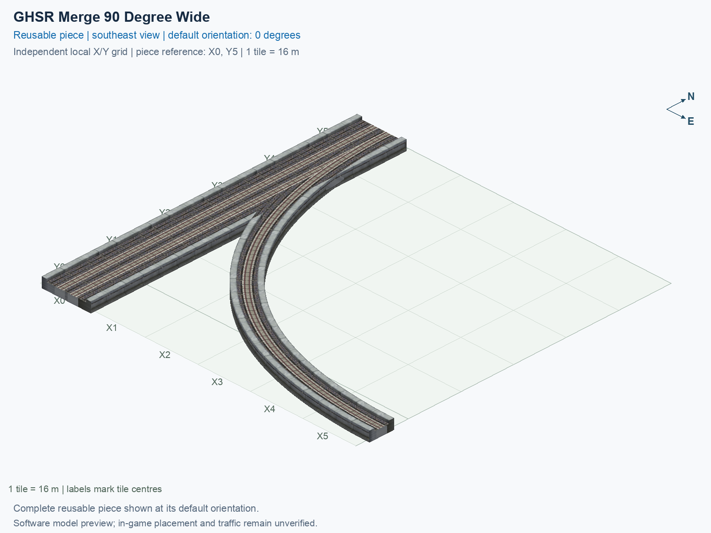

# GHSR Merge 90 Degree Wide

Purpose: explain this reusable piece, its matching connections and current test coverage.

<!-- BEGIN PIECE OVERVIEW -->

GHSR Merge 90 Degree Wide. Fixed click-to-place piece in a 6 by 6 tile area. Follow the arrows and join only matching track widths, directions, and height labels. Four proper rotations; the second four states repeat them. Experimental; game testing pending. The mainline retains both directions; only the branch is one-way.

Exact reusable identifier: `interchange-ground-merge-90-wide`.

Footprint: **6 × 6 tiles**. Exact menu name: **GHSR Merge 90 Degree Wide**.

Choose this exact name in Transportation → Rail. Press Home or End to rotate; use only the supported states listed below. Join each end to a matching port profile and direction.

- [Connections and journeys](#connections-and-journeys)
- [Test checklist](#test-checklist)



<!-- END PIECE OVERVIEW -->

<!-- BEGIN MANUAL SUMMARY -->

## Manual status

Generated from [the exact test cases](#test-checklist) and [authoritative observations](checks/manual-tests.json).

- [ ] Preview review: 0/1 applicable cases passed; 0 failed, 0 stale.
- [ ] In-game rendering: 0/4 applicable cases passed; 0 failed, 0 stale.
- [ ] Directed journeys: 0/12 applicable cases passed; 0 failed, 0 stale.

These observations cover only the named services, directions, poses, rotations, and recorded platforms.

<!-- END MANUAL SUMMARY -->

<!-- BEGIN CONNECTIONS -->

## Connections and journeys

Purpose: describe intrinsic directional interfaces and permitted service journeys.

Generated from [connections.json](connections.json). Coordinates are canonical east, north and height in metres. A connection class names an encoded route interface; it does not prove visible deck/wall fit or an in-game test.

Supported placement states: 0° CCW, 90° CCW, 180° CCW, 270° CCW. Each state has its own declared manual scope.

A **port** is one directional transport-path endpoint. **Service** identifies the intended network service (for example HSR, street, or tram); **engine** is its internal traffic-class number, separate from the construction network. **Role** distinguishes primary service from auxiliary paths; sharing a traffic class does not establish service compatibility.

A **tangent** is a unit travel-direction vector: `[0,1]` means north. **Grade** is height gained per horizontal metre. These measured facts describe this subject alone. Compatibility requires a separate comparison of the complete joining boundaries; physical seams and actual game operation require their own evidence. See the [class index](../../connection-classes.json) for shared route-interface membership.

| Port | Service / engine / role | Direction | Location; tangent; grade | Connection class |
| --- | --- | --- | --- | --- |
| `Sout` | ghsr / 7 / primary | out | [-2.0, -88.0, 1.0]; [0.0, -1.0]; 0.0 | `path-interface-c78c5ac4b558d84b46f2` |
| `Nin` | ghsr / 7 / primary | in | [-2.0, 8.0, 1.0]; [0.0, -1.0]; 0.0 | `path-interface-c78c5ac4b558d84b46f2` |
| `Sin` | ghsr / 7 / primary | in | [2.0, -88.0, 1.0]; [0.0, 1.0]; 0.0 | `path-interface-fab587419de6b5848d74` |
| `Nout` | ghsr / 7 / primary | out | [2.0, 8.0, 1.0]; [0.0, 1.0]; 0.0 | `path-interface-fab587419de6b5848d74` |
| `Bin` | ghsr / 7 / primary | in | [88.0, -80.0, 1.0]; [-1.0, 0.0]; 0.0 | `path-interface-459a3d38a8ff1501aa51` |

### Directed journeys

| Service | Entry → exit | Role |
| --- | --- | --- |
| ghsr | `Nin` → `Sout` | primary |
| ghsr | `Sin` → `Nout` | primary |
| ghsr | `Bin` → `Nout` | primary |

### Forbidden transfers

| From service / port | To service / port | Reason |
| --- | --- | --- |
| ghsr / `Nin` | ghsr / `Nout` | No directed route exists between these ports in the saved piece transport paths. In-game confirmation remains unverified. |
| ghsr / `Sin` | ghsr / `Sout` | No directed route exists between these ports in the saved piece transport paths. In-game confirmation remains unverified. |
| ghsr / `Bin` | ghsr / `Sout` | No directed route exists between these ports in the saved piece transport paths. In-game confirmation remains unverified. |

Review the test checklist for the exact tested cases and environments.

<!-- END CONNECTIONS -->

<!-- BEGIN MANUAL CHECKS -->

## Test checklist

Generated from [the authoritative record](checks/manual-tests.json). Only explicit human observations create manual passes; software and preview checks remain separate. Expand a check/service group to see its rotation table, then expand the matching exact scope to copy a case ID and inspect its pose, reviewer, environment, and evidence. Grouping changes only this view; every declared case remains separate.

**States:** [x] passed; [ ] unverified, failed, or stale; N/A is an explicit inapplicable declaration. A dash means no case was declared in that column. Every pass covers only its recorded environment. T means a distinct construction-transposed state.

Four proper rotations are covered. No additional reflected state is established by this record; repeated construction aliases do not create new orientations.

Current totals: unverified: 43, passed: 0, failed: 0, stale: 0, not_applicable: 0.

### Record an observation

Follow the [shared testing guide](../../../../docs/TESTING.md); copy [the unconfirmed example](checks/observation.example.json) to `checks/observation.json`. Case identifiers are in the expandable sections below. Do not edit generated checkboxes.

From the repository folder containing `custom-pieces`, run after filling `checks/observation.json` and explicitly confirming the exact observation:

```sh
python3 -m scp.content record --record custom-pieces/domains/high-speed-rail/00_pieces/interchange-ground-merge-90-wide/checks/manual-tests.json --observation custom-pieces/domains/high-speed-rail/00_pieces/interchange-ground-merge-90-wide/checks/observation.json
```

### Detailed current checks

Each collapsed group shows exact case counts and states. Forbidden transfers are grouped by the directed service pair; the table inside retains every port pair and rotation.

<details>
<summary>Compiled resources — Whole subject — 1 case; unverified: 1</summary>

| Check / exact scope | General | 0° | 90° | 180° | 270° |
| --- | --- | --- | --- | --- | --- |
| **Compiled resources**<br>Whole subject | <a href="#case-software_resources-75a96a675c19f250dfa0">[ ] unverified</a> | — | — | — | — |


<details>
<summary>Compiled resources — Whole subject</summary>

<a id="case-software_resources-75a96a675c19f250dfa0"></a>

**General: unverified** — `software_resources-75a96a675c19f250dfa0`.

Verify the actual compiled resources and construction rules.

Scope: Whole subject.

No observation recorded.

</details>

</details>

<details>
<summary>Directed routing graph — Whole subject — 1 case; unverified: 1</summary>

| Check / exact scope | General | 0° | 90° | 180° | 270° |
| --- | --- | --- | --- | --- | --- |
| **Directed routing graph**<br>Whole subject | <a href="#case-software_connectivity-75a96a675c19f250dfa0">[ ] unverified</a> | — | — | — | — |


<details>
<summary>Directed routing graph — Whole subject</summary>

<a id="case-software_connectivity-75a96a675c19f250dfa0"></a>

**General: unverified** — `software_connectivity-75a96a675c19f250dfa0`.

Verify the declared directed journeys and forbidden transfers.

Scope: Whole subject.

No observation recorded.

</details>

</details>

<details>
<summary>Preview review — Images — 1 case; unverified: 1</summary>

| Check / exact scope | General | 0° | 90° | 180° | 270° |
| --- | --- | --- | --- | --- | --- |
| **Preview review**<br>Image: image:interchange-ground-merge-90-wide:canonical-southeast | <a href="#case-preview_review-11663161fcbde9637b06">[ ] unverified</a> | — | — | — | — |


<details>
<summary>Preview review — Image: image:interchange-ground-merge-90-wide:canonical-southeast</summary>

<a id="case-preview_review-11663161fcbde9637b06"></a>

**General: unverified** — `preview_review-11663161fcbde9637b06`.

Inspect this exact preview for tracks, walls, piers, seams and shadows.

Scope: Image: image:interchange-ground-merge-90-wide:canonical-southeast.

No observation recorded.

</details>

</details>

<details>
<summary>In-game rendering — Whole subject — 4 cases; unverified: 4</summary>

| Check / exact scope | General | 0° | 90° | 180° | 270° |
| --- | --- | --- | --- | --- | --- |
| **In-game rendering**<br>Whole subject | — | <a href="#case-in_game_render-2a56b969c45c713fdb48">[ ] unverified</a> | <a href="#case-in_game_render-27c7992e4b687e1a9cb5">[ ] unverified</a> | <a href="#case-in_game_render-e5dbf9c1a094bbc74d64">[ ] unverified</a> | <a href="#case-in_game_render-69c28dd17327808e6734">[ ] unverified</a> |


<details>
<summary>In-game rendering — Whole subject</summary>

<a id="case-in_game_render-2a56b969c45c713fdb48"></a>

**0° CCW: unverified** — `in_game_render-2a56b969c45c713fdb48`.

Inspect the placed tracks, walls, piers, seams and shadows in SimCity 4.

Scope: Whole subject.

No observation recorded.

<a id="case-in_game_render-27c7992e4b687e1a9cb5"></a>

**90° CCW: unverified** — `in_game_render-27c7992e4b687e1a9cb5`.

Inspect the placed tracks, walls, piers, seams and shadows in SimCity 4.

Scope: Whole subject.

No observation recorded.

<a id="case-in_game_render-e5dbf9c1a094bbc74d64"></a>

**180° CCW: unverified** — `in_game_render-e5dbf9c1a094bbc74d64`.

Inspect the placed tracks, walls, piers, seams and shadows in SimCity 4.

Scope: Whole subject.

No observation recorded.

<a id="case-in_game_render-69c28dd17327808e6734"></a>

**270° CCW: unverified** — `in_game_render-69c28dd17327808e6734`.

Inspect the placed tracks, walls, piers, seams and shadows in SimCity 4.

Scope: Whole subject.

No observation recorded.

</details>

</details>

<details>
<summary>Placement — Whole subject — 4 cases; unverified: 4</summary>

| Check / exact scope | General | 0° | 90° | 180° | 270° |
| --- | --- | --- | --- | --- | --- |
| **Placement**<br>Whole subject | — | <a href="#case-in_game_placement-2a56b969c45c713fdb48">[ ] unverified</a> | <a href="#case-in_game_placement-27c7992e4b687e1a9cb5">[ ] unverified</a> | <a href="#case-in_game_placement-e5dbf9c1a094bbc74d64">[ ] unverified</a> | <a href="#case-in_game_placement-69c28dd17327808e6734">[ ] unverified</a> |


<details>
<summary>Placement — Whole subject</summary>

<a id="case-in_game_placement-2a56b969c45c713fdb48"></a>

**0° CCW: unverified** — `in_game_placement-2a56b969c45c713fdb48`.

Place this piece or complete blueprint and inspect every occupied tile.

Scope: Whole subject.

No observation recorded.

<a id="case-in_game_placement-27c7992e4b687e1a9cb5"></a>

**90° CCW: unverified** — `in_game_placement-27c7992e4b687e1a9cb5`.

Place this piece or complete blueprint and inspect every occupied tile.

Scope: Whole subject.

No observation recorded.

<a id="case-in_game_placement-e5dbf9c1a094bbc74d64"></a>

**180° CCW: unverified** — `in_game_placement-e5dbf9c1a094bbc74d64`.

Place this piece or complete blueprint and inspect every occupied tile.

Scope: Whole subject.

No observation recorded.

<a id="case-in_game_placement-69c28dd17327808e6734"></a>

**270° CCW: unverified** — `in_game_placement-69c28dd17327808e6734`.

Place this piece or complete blueprint and inspect every occupied tile.

Scope: Whole subject.

No observation recorded.

</details>

</details>

<details>
<summary>Demolition — Whole subject — 4 cases; unverified: 4</summary>

| Check / exact scope | General | 0° | 90° | 180° | 270° |
| --- | --- | --- | --- | --- | --- |
| **Demolition**<br>Whole subject | — | <a href="#case-in_game_demolition-2a56b969c45c713fdb48">[ ] unverified</a> | <a href="#case-in_game_demolition-27c7992e4b687e1a9cb5">[ ] unverified</a> | <a href="#case-in_game_demolition-e5dbf9c1a094bbc74d64">[ ] unverified</a> | <a href="#case-in_game_demolition-69c28dd17327808e6734">[ ] unverified</a> |


<details>
<summary>Demolition — Whole subject</summary>

<a id="case-in_game_demolition-2a56b969c45c713fdb48"></a>

**0° CCW: unverified** — `in_game_demolition-2a56b969c45c713fdb48`.

Bulldoze the complete placement and inspect the cleared area.

Scope: Whole subject.

No observation recorded.

<a id="case-in_game_demolition-27c7992e4b687e1a9cb5"></a>

**90° CCW: unverified** — `in_game_demolition-27c7992e4b687e1a9cb5`.

Bulldoze the complete placement and inspect the cleared area.

Scope: Whole subject.

No observation recorded.

<a id="case-in_game_demolition-e5dbf9c1a094bbc74d64"></a>

**180° CCW: unverified** — `in_game_demolition-e5dbf9c1a094bbc74d64`.

Bulldoze the complete placement and inspect the cleared area.

Scope: Whole subject.

No observation recorded.

<a id="case-in_game_demolition-69c28dd17327808e6734"></a>

**270° CCW: unverified** — `in_game_demolition-69c28dd17327808e6734`.

Bulldoze the complete placement and inspect the cleared area.

Scope: Whole subject.

No observation recorded.

</details>

</details>

<details>
<summary>Save and reload — Whole subject — 4 cases; unverified: 4</summary>

| Check / exact scope | General | 0° | 90° | 180° | 270° |
| --- | --- | --- | --- | --- | --- |
| **Save and reload**<br>Whole subject | — | <a href="#case-in_game_save_reload-2a56b969c45c713fdb48">[ ] unverified</a> | <a href="#case-in_game_save_reload-27c7992e4b687e1a9cb5">[ ] unverified</a> | <a href="#case-in_game_save_reload-e5dbf9c1a094bbc74d64">[ ] unverified</a> | <a href="#case-in_game_save_reload-69c28dd17327808e6734">[ ] unverified</a> |


<details>
<summary>Save and reload — Whole subject</summary>

<a id="case-in_game_save_reload-2a56b969c45c713fdb48"></a>

**0° CCW: unverified** — `in_game_save_reload-2a56b969c45c713fdb48`.

Save, quit, reload and inspect the placement and its paths.

Scope: Whole subject.

No observation recorded.

<a id="case-in_game_save_reload-27c7992e4b687e1a9cb5"></a>

**90° CCW: unverified** — `in_game_save_reload-27c7992e4b687e1a9cb5`.

Save, quit, reload and inspect the placement and its paths.

Scope: Whole subject.

No observation recorded.

<a id="case-in_game_save_reload-e5dbf9c1a094bbc74d64"></a>

**180° CCW: unverified** — `in_game_save_reload-e5dbf9c1a094bbc74d64`.

Save, quit, reload and inspect the placement and its paths.

Scope: Whole subject.

No observation recorded.

<a id="case-in_game_save_reload-69c28dd17327808e6734"></a>

**270° CCW: unverified** — `in_game_save_reload-69c28dd17327808e6734`.

Save, quit, reload and inspect the placement and its paths.

Scope: Whole subject.

No observation recorded.

</details>

</details>

<details>
<summary>Journey — ghsr — 12 cases; unverified: 12</summary>

| Check / exact scope | General | 0° | 90° | 180° | 270° |
| --- | --- | --- | --- | --- | --- |
| **Journey**<br>Service: ghsr; role: primary; journey: 7:Nin>Sout; entry: Nin; exit: Sout | — | <a href="#case-in_game_journey-8a6a7c0e0090d88c942e">[ ] unverified</a> | <a href="#case-in_game_journey-6242ebbcf3a5fcbcb82e">[ ] unverified</a> | <a href="#case-in_game_journey-084ae84dda7729276d29">[ ] unverified</a> | <a href="#case-in_game_journey-de68d1cdeb724e507db7">[ ] unverified</a> |
| **Journey**<br>Service: ghsr; role: primary; journey: 7:Sin>Nout; entry: Sin; exit: Nout | — | <a href="#case-in_game_journey-111afe47119c29a33f59">[ ] unverified</a> | <a href="#case-in_game_journey-ebd9a5440eb19997dd7c">[ ] unverified</a> | <a href="#case-in_game_journey-0b2bc15af1c9086c6d6d">[ ] unverified</a> | <a href="#case-in_game_journey-acbdde2f5f36af90ee08">[ ] unverified</a> |
| **Journey**<br>Service: ghsr; role: primary; journey: 7:Bin>Nout; entry: Bin; exit: Nout | — | <a href="#case-in_game_journey-02d42526b9ed9b88c0bb">[ ] unverified</a> | <a href="#case-in_game_journey-3471cd9683bf9ba61dcb">[ ] unverified</a> | <a href="#case-in_game_journey-7379efba91766e843163">[ ] unverified</a> | <a href="#case-in_game_journey-8bc09fc17ec5d1d6d766">[ ] unverified</a> |


<details>
<summary>Journey — Service: ghsr; role: primary; journey: 7:Nin>Sout; entry: Nin; exit: Sout</summary>

<a id="case-in_game_journey-8a6a7c0e0090d88c942e"></a>

**0° CCW: unverified** — `in_game_journey-8a6a7c0e0090d88c942e`.

Run the declared journey in this direction using its service network.

Scope: Service: ghsr; role: primary; journey: 7:Nin>Sout; entry: Nin; exit: Sout.

No observation recorded.

<a id="case-in_game_journey-6242ebbcf3a5fcbcb82e"></a>

**90° CCW: unverified** — `in_game_journey-6242ebbcf3a5fcbcb82e`.

Run the declared journey in this direction using its service network.

Scope: Service: ghsr; role: primary; journey: 7:Nin>Sout; entry: Nin; exit: Sout.

No observation recorded.

<a id="case-in_game_journey-084ae84dda7729276d29"></a>

**180° CCW: unverified** — `in_game_journey-084ae84dda7729276d29`.

Run the declared journey in this direction using its service network.

Scope: Service: ghsr; role: primary; journey: 7:Nin>Sout; entry: Nin; exit: Sout.

No observation recorded.

<a id="case-in_game_journey-de68d1cdeb724e507db7"></a>

**270° CCW: unverified** — `in_game_journey-de68d1cdeb724e507db7`.

Run the declared journey in this direction using its service network.

Scope: Service: ghsr; role: primary; journey: 7:Nin>Sout; entry: Nin; exit: Sout.

No observation recorded.

</details>


<details>
<summary>Journey — Service: ghsr; role: primary; journey: 7:Sin>Nout; entry: Sin; exit: Nout</summary>

<a id="case-in_game_journey-111afe47119c29a33f59"></a>

**0° CCW: unverified** — `in_game_journey-111afe47119c29a33f59`.

Run the declared journey in this direction using its service network.

Scope: Service: ghsr; role: primary; journey: 7:Sin>Nout; entry: Sin; exit: Nout.

No observation recorded.

<a id="case-in_game_journey-ebd9a5440eb19997dd7c"></a>

**90° CCW: unverified** — `in_game_journey-ebd9a5440eb19997dd7c`.

Run the declared journey in this direction using its service network.

Scope: Service: ghsr; role: primary; journey: 7:Sin>Nout; entry: Sin; exit: Nout.

No observation recorded.

<a id="case-in_game_journey-0b2bc15af1c9086c6d6d"></a>

**180° CCW: unverified** — `in_game_journey-0b2bc15af1c9086c6d6d`.

Run the declared journey in this direction using its service network.

Scope: Service: ghsr; role: primary; journey: 7:Sin>Nout; entry: Sin; exit: Nout.

No observation recorded.

<a id="case-in_game_journey-acbdde2f5f36af90ee08"></a>

**270° CCW: unverified** — `in_game_journey-acbdde2f5f36af90ee08`.

Run the declared journey in this direction using its service network.

Scope: Service: ghsr; role: primary; journey: 7:Sin>Nout; entry: Sin; exit: Nout.

No observation recorded.

</details>


<details>
<summary>Journey — Service: ghsr; role: primary; journey: 7:Bin>Nout; entry: Bin; exit: Nout</summary>

<a id="case-in_game_journey-02d42526b9ed9b88c0bb"></a>

**0° CCW: unverified** — `in_game_journey-02d42526b9ed9b88c0bb`.

Run the declared journey in this direction using its service network.

Scope: Service: ghsr; role: primary; journey: 7:Bin>Nout; entry: Bin; exit: Nout.

No observation recorded.

<a id="case-in_game_journey-3471cd9683bf9ba61dcb"></a>

**90° CCW: unverified** — `in_game_journey-3471cd9683bf9ba61dcb`.

Run the declared journey in this direction using its service network.

Scope: Service: ghsr; role: primary; journey: 7:Bin>Nout; entry: Bin; exit: Nout.

No observation recorded.

<a id="case-in_game_journey-7379efba91766e843163"></a>

**180° CCW: unverified** — `in_game_journey-7379efba91766e843163`.

Run the declared journey in this direction using its service network.

Scope: Service: ghsr; role: primary; journey: 7:Bin>Nout; entry: Bin; exit: Nout.

No observation recorded.

<a id="case-in_game_journey-8bc09fc17ec5d1d6d766"></a>

**270° CCW: unverified** — `in_game_journey-8bc09fc17ec5d1d6d766`.

Run the declared journey in this direction using its service network.

Scope: Service: ghsr; role: primary; journey: 7:Bin>Nout; entry: Bin; exit: Nout.

No observation recorded.

</details>

</details>

<details>
<summary>Forbidden transfer — ghsr → ghsr — 12 cases; unverified: 12</summary>

| Check / exact scope | General | 0° | 90° | 180° | 270° |
| --- | --- | --- | --- | --- | --- |
| **Forbidden transfer**<br>from port: Nin; to port: Nout; from service: ghsr; to service: ghsr; basis: not reachable in actual saved PATH graph | — | <a href="#case-in_game_forbidden_transfer-b61d116cfdac59bf3967">[ ] unverified</a> | <a href="#case-in_game_forbidden_transfer-1339898e1518d67ad89c">[ ] unverified</a> | <a href="#case-in_game_forbidden_transfer-39cb6f9eedab29ac4d26">[ ] unverified</a> | <a href="#case-in_game_forbidden_transfer-1bd61f65945ede766723">[ ] unverified</a> |
| **Forbidden transfer**<br>from port: Sin; to port: Sout; from service: ghsr; to service: ghsr; basis: not reachable in actual saved PATH graph | — | <a href="#case-in_game_forbidden_transfer-6f1b6b8fe9b36659575f">[ ] unverified</a> | <a href="#case-in_game_forbidden_transfer-7f389e5b2a14d6473ff3">[ ] unverified</a> | <a href="#case-in_game_forbidden_transfer-74ba2044ad3d8c9ab33c">[ ] unverified</a> | <a href="#case-in_game_forbidden_transfer-0b7a0be234233069c8c7">[ ] unverified</a> |
| **Forbidden transfer**<br>from port: Bin; to port: Sout; from service: ghsr; to service: ghsr; basis: not reachable in actual saved PATH graph | — | <a href="#case-in_game_forbidden_transfer-368e1f4246bcb2566952">[ ] unverified</a> | <a href="#case-in_game_forbidden_transfer-21607402aad05f245b3d">[ ] unverified</a> | <a href="#case-in_game_forbidden_transfer-5fba56417c7c834d42d0">[ ] unverified</a> | <a href="#case-in_game_forbidden_transfer-0c9870ed2bdc68e4f5a2">[ ] unverified</a> |


<details>
<summary>Forbidden transfer — from port: Nin; to port: Nout; from service: ghsr; to service: ghsr; basis: not reachable in actual saved PATH graph</summary>

<a id="case-in_game_forbidden_transfer-b61d116cfdac59bf3967"></a>

**0° CCW: unverified** — `in_game_forbidden_transfer-b61d116cfdac59bf3967`.

Confirm this undeclared transfer is unavailable.

Scope: from port: Nin; to port: Nout; from service: ghsr; to service: ghsr; basis: not reachable in actual saved PATH graph.

No observation recorded.

<a id="case-in_game_forbidden_transfer-1339898e1518d67ad89c"></a>

**90° CCW: unverified** — `in_game_forbidden_transfer-1339898e1518d67ad89c`.

Confirm this undeclared transfer is unavailable.

Scope: from port: Nin; to port: Nout; from service: ghsr; to service: ghsr; basis: not reachable in actual saved PATH graph.

No observation recorded.

<a id="case-in_game_forbidden_transfer-39cb6f9eedab29ac4d26"></a>

**180° CCW: unverified** — `in_game_forbidden_transfer-39cb6f9eedab29ac4d26`.

Confirm this undeclared transfer is unavailable.

Scope: from port: Nin; to port: Nout; from service: ghsr; to service: ghsr; basis: not reachable in actual saved PATH graph.

No observation recorded.

<a id="case-in_game_forbidden_transfer-1bd61f65945ede766723"></a>

**270° CCW: unverified** — `in_game_forbidden_transfer-1bd61f65945ede766723`.

Confirm this undeclared transfer is unavailable.

Scope: from port: Nin; to port: Nout; from service: ghsr; to service: ghsr; basis: not reachable in actual saved PATH graph.

No observation recorded.

</details>


<details>
<summary>Forbidden transfer — from port: Sin; to port: Sout; from service: ghsr; to service: ghsr; basis: not reachable in actual saved PATH graph</summary>

<a id="case-in_game_forbidden_transfer-6f1b6b8fe9b36659575f"></a>

**0° CCW: unverified** — `in_game_forbidden_transfer-6f1b6b8fe9b36659575f`.

Confirm this undeclared transfer is unavailable.

Scope: from port: Sin; to port: Sout; from service: ghsr; to service: ghsr; basis: not reachable in actual saved PATH graph.

No observation recorded.

<a id="case-in_game_forbidden_transfer-7f389e5b2a14d6473ff3"></a>

**90° CCW: unverified** — `in_game_forbidden_transfer-7f389e5b2a14d6473ff3`.

Confirm this undeclared transfer is unavailable.

Scope: from port: Sin; to port: Sout; from service: ghsr; to service: ghsr; basis: not reachable in actual saved PATH graph.

No observation recorded.

<a id="case-in_game_forbidden_transfer-74ba2044ad3d8c9ab33c"></a>

**180° CCW: unverified** — `in_game_forbidden_transfer-74ba2044ad3d8c9ab33c`.

Confirm this undeclared transfer is unavailable.

Scope: from port: Sin; to port: Sout; from service: ghsr; to service: ghsr; basis: not reachable in actual saved PATH graph.

No observation recorded.

<a id="case-in_game_forbidden_transfer-0b7a0be234233069c8c7"></a>

**270° CCW: unverified** — `in_game_forbidden_transfer-0b7a0be234233069c8c7`.

Confirm this undeclared transfer is unavailable.

Scope: from port: Sin; to port: Sout; from service: ghsr; to service: ghsr; basis: not reachable in actual saved PATH graph.

No observation recorded.

</details>


<details>
<summary>Forbidden transfer — from port: Bin; to port: Sout; from service: ghsr; to service: ghsr; basis: not reachable in actual saved PATH graph</summary>

<a id="case-in_game_forbidden_transfer-368e1f4246bcb2566952"></a>

**0° CCW: unverified** — `in_game_forbidden_transfer-368e1f4246bcb2566952`.

Confirm this undeclared transfer is unavailable.

Scope: from port: Bin; to port: Sout; from service: ghsr; to service: ghsr; basis: not reachable in actual saved PATH graph.

No observation recorded.

<a id="case-in_game_forbidden_transfer-21607402aad05f245b3d"></a>

**90° CCW: unverified** — `in_game_forbidden_transfer-21607402aad05f245b3d`.

Confirm this undeclared transfer is unavailable.

Scope: from port: Bin; to port: Sout; from service: ghsr; to service: ghsr; basis: not reachable in actual saved PATH graph.

No observation recorded.

<a id="case-in_game_forbidden_transfer-5fba56417c7c834d42d0"></a>

**180° CCW: unverified** — `in_game_forbidden_transfer-5fba56417c7c834d42d0`.

Confirm this undeclared transfer is unavailable.

Scope: from port: Bin; to port: Sout; from service: ghsr; to service: ghsr; basis: not reachable in actual saved PATH graph.

No observation recorded.

<a id="case-in_game_forbidden_transfer-0c9870ed2bdc68e4f5a2"></a>

**270° CCW: unverified** — `in_game_forbidden_transfer-0c9870ed2bdc68e4f5a2`.

Confirm this undeclared transfer is unavailable.

Scope: from port: Bin; to port: Sout; from service: ghsr; to service: ghsr; basis: not reachable in actual saved PATH graph.

No observation recorded.

</details>

</details>

<!-- END MANUAL CHECKS -->
