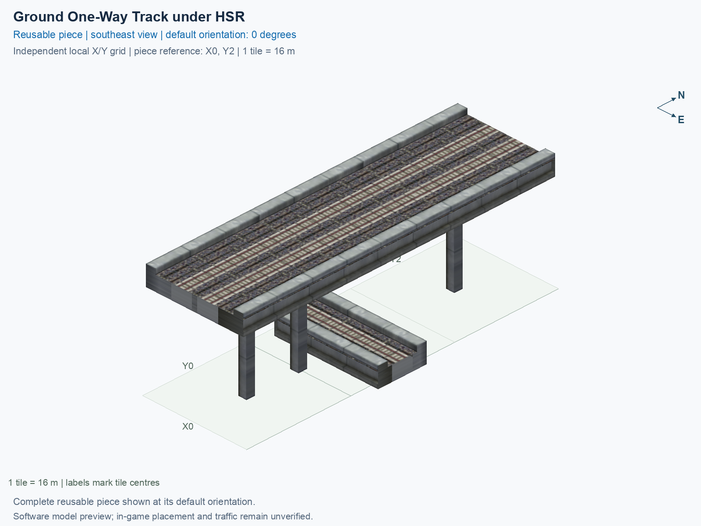

# Ground One-Way Track under HSR

Purpose: explain this reusable piece, its matching connections and current test coverage.

<!-- BEGIN PIECE OVERVIEW -->

Actual rail geometry and directed train paths at two heights. The one-way track and two-way track cross without a transfer. Experimental fixed piece; test rendering, traffic and shadows in the game. The lower track is one-way and the upper track is two-way; there is no transfer.

Exact reusable identifier: `interchange-ground-oneway-under-hsr`.

Footprint: **1 × 3 tiles**. Exact menu name: **Ground One-Way Track under HSR**.

Choose this exact name in Transportation → Rail. Press Home or End to rotate; use only the supported states listed below. Join each end to a matching port profile and direction.

- [Connections and journeys](#connections-and-journeys)
- [Test checklist](#test-checklist)



<!-- END PIECE OVERVIEW -->

<!-- BEGIN MANUAL SUMMARY -->

## Manual status

Generated from [the exact test cases](#test-checklist) and [authoritative observations](checks/manual-tests.json).

- [ ] Preview review: 0/1 applicable cases passed; 0 failed, 0 stale.
- [ ] In-game rendering: 0/4 applicable cases passed; 0 failed, 0 stale.
- [ ] Directed journeys: 0/12 applicable cases passed; 0 failed, 0 stale.

These observations cover only the named services, directions, poses, rotations, and recorded platforms.

<!-- END MANUAL SUMMARY -->

<!-- BEGIN CONNECTIONS -->

## Connections and journeys

Purpose: describe intrinsic directional interfaces and permitted service journeys.

Generated from [connections.json](connections.json). Coordinates are canonical east, north and height in metres. A connection class names an encoded route interface; it does not prove visible deck/wall fit or an in-game test.

Supported placement states: 0° CCW, 90° CCW, 180° CCW, 270° CCW. Each state has its own declared manual scope.

A **port** is one directional transport-path endpoint. **Service** identifies the intended network service (for example HSR, street, or tram); **engine** is its internal traffic-class number, separate from the construction network. **Role** distinguishes primary service from auxiliary paths; sharing a traffic class does not establish service compatibility.

A **tangent** is a unit travel-direction vector: `[0,1]` means north. **Grade** is height gained per horizontal metre. These measured facts describe this subject alone. Compatibility requires a separate comparison of the complete joining boundaries; physical seams and actual game operation require their own evidence. See the [class index](../../connection-classes.json) for shared route-interface membership.

| Port | Service / engine / role | Direction | Location; tangent; grade | Connection class |
| --- | --- | --- | --- | --- |
| `Win` | ghsr / 7 / primary | in | [-8.0, -16.0, 1.0]; [1.0, 0.0]; 0.0 | `path-interface-ab4e40517da7fa0dbd34` |
| `Sout` | hsr / 7 / primary | out | [-2.0, -40.0, 15.5]; [0.0, -1.0]; 0.0 | `path-interface-12d12be31d2057c5763d` |
| `Nin` | hsr / 7 / primary | in | [-2.0, 8.0, 15.5]; [0.0, -1.0]; 0.0 | `path-interface-12d12be31d2057c5763d` |
| `Sin` | hsr / 7 / primary | in | [2.0, -40.0, 15.5]; [0.0, 1.0]; 0.0 | `path-interface-fba09fbeb87ad95c667a` |
| `Nout` | hsr / 7 / primary | out | [2.0, 8.0, 15.5]; [0.0, 1.0]; 0.0 | `path-interface-fba09fbeb87ad95c667a` |
| `Eout` | ghsr / 7 / primary | out | [8.0, -16.0, 1.0]; [1.0, 0.0]; 0.0 | `path-interface-ab4e40517da7fa0dbd34` |

### Directed journeys

| Service | Entry → exit | Role |
| --- | --- | --- |
| ghsr | `Win` → `Eout` | primary |
| hsr | `Nin` → `Sout` | primary |
| hsr | `Sin` → `Nout` | primary |

### Forbidden transfers

| From service / port | To service / port | Reason |
| --- | --- | --- |
| ghsr / `Win` | hsr / `Sout` | No directed route exists between these ports in the saved piece transport paths. In-game confirmation remains unverified. |
| ghsr / `Win` | hsr / `Nout` | No directed route exists between these ports in the saved piece transport paths. In-game confirmation remains unverified. |
| hsr / `Nin` | hsr / `Nout` | No directed route exists between these ports in the saved piece transport paths. In-game confirmation remains unverified. |
| hsr / `Nin` | ghsr / `Eout` | No directed route exists between these ports in the saved piece transport paths. In-game confirmation remains unverified. |
| hsr / `Sin` | hsr / `Sout` | No directed route exists between these ports in the saved piece transport paths. In-game confirmation remains unverified. |
| hsr / `Sin` | ghsr / `Eout` | No directed route exists between these ports in the saved piece transport paths. In-game confirmation remains unverified. |

Review the test checklist for the exact tested cases and environments.

<!-- END CONNECTIONS -->

<!-- BEGIN MANUAL CHECKS -->

## Test checklist

Generated from [the authoritative record](checks/manual-tests.json). Only explicit human observations create manual passes; software and preview checks remain separate. Expand a check/service group to see its rotation table, then expand the matching exact scope to copy a case ID and inspect its pose, reviewer, environment, and evidence. Grouping changes only this view; every declared case remains separate.

**States:** [x] passed; [ ] unverified, failed, or stale; N/A is an explicit inapplicable declaration. A dash means no case was declared in that column. Every pass covers only its recorded environment. T means a distinct construction-transposed state.

Four proper rotations are covered. No additional reflected state is established by this record; repeated construction aliases do not create new orientations.

Current totals: unverified: 55, passed: 0, failed: 0, stale: 0, not_applicable: 0.

### Record an observation

Follow the [shared testing guide](../../../../docs/TESTING.md); copy [the unconfirmed example](checks/observation.example.json) to `checks/observation.json`. Case identifiers are in the expandable sections below. Do not edit generated checkboxes.

From the repository folder containing `custom-pieces`, run after filling `checks/observation.json` and explicitly confirming the exact observation:

```sh
python3 -m scp.content record --record custom-pieces/domains/high-speed-rail/00_pieces/interchange-ground-oneway-under-hsr/checks/manual-tests.json --observation custom-pieces/domains/high-speed-rail/00_pieces/interchange-ground-oneway-under-hsr/checks/observation.json
```

### Detailed current checks

Each collapsed group shows exact case counts and states. Forbidden transfers are grouped by the directed service pair; the table inside retains every port pair and rotation.

<details>
<summary>Compiled resources — Whole subject — 1 case; unverified: 1</summary>

| Check / exact scope | General | 0° | 90° | 180° | 270° |
| --- | --- | --- | --- | --- | --- |
| **Compiled resources**<br>Whole subject | <a href="#case-software_resources-ec2ffb08dfb3c01bdc37">[ ] unverified</a> | — | — | — | — |


<details>
<summary>Compiled resources — Whole subject</summary>

<a id="case-software_resources-ec2ffb08dfb3c01bdc37"></a>

**General: unverified** — `software_resources-ec2ffb08dfb3c01bdc37`.

Verify the actual compiled resources and construction rules.

Scope: Whole subject.

No observation recorded.

</details>

</details>

<details>
<summary>Directed routing graph — Whole subject — 1 case; unverified: 1</summary>

| Check / exact scope | General | 0° | 90° | 180° | 270° |
| --- | --- | --- | --- | --- | --- |
| **Directed routing graph**<br>Whole subject | <a href="#case-software_connectivity-ec2ffb08dfb3c01bdc37">[ ] unverified</a> | — | — | — | — |


<details>
<summary>Directed routing graph — Whole subject</summary>

<a id="case-software_connectivity-ec2ffb08dfb3c01bdc37"></a>

**General: unverified** — `software_connectivity-ec2ffb08dfb3c01bdc37`.

Verify the declared directed journeys and forbidden transfers.

Scope: Whole subject.

No observation recorded.

</details>

</details>

<details>
<summary>Preview review — Images — 1 case; unverified: 1</summary>

| Check / exact scope | General | 0° | 90° | 180° | 270° |
| --- | --- | --- | --- | --- | --- |
| **Preview review**<br>Image: image:interchange-ground-oneway-under-hsr:canonical-southeast | <a href="#case-preview_review-6eca5ee58040a3a172d9">[ ] unverified</a> | — | — | — | — |


<details>
<summary>Preview review — Image: image:interchange-ground-oneway-under-hsr:canonical-southeast</summary>

<a id="case-preview_review-6eca5ee58040a3a172d9"></a>

**General: unverified** — `preview_review-6eca5ee58040a3a172d9`.

Inspect this exact preview for tracks, walls, piers, seams and shadows.

Scope: Image: image:interchange-ground-oneway-under-hsr:canonical-southeast.

No observation recorded.

</details>

</details>

<details>
<summary>In-game rendering — Whole subject — 4 cases; unverified: 4</summary>

| Check / exact scope | General | 0° | 90° | 180° | 270° |
| --- | --- | --- | --- | --- | --- |
| **In-game rendering**<br>Whole subject | — | <a href="#case-in_game_render-96380aefc22fae68b5b5">[ ] unverified</a> | <a href="#case-in_game_render-6ece50a59cd362e83cc7">[ ] unverified</a> | <a href="#case-in_game_render-e07eb1d396a3d4b853b2">[ ] unverified</a> | <a href="#case-in_game_render-199d1c44cd7d783d0760">[ ] unverified</a> |


<details>
<summary>In-game rendering — Whole subject</summary>

<a id="case-in_game_render-96380aefc22fae68b5b5"></a>

**0° CCW: unverified** — `in_game_render-96380aefc22fae68b5b5`.

Inspect the placed tracks, walls, piers, seams and shadows in SimCity 4.

Scope: Whole subject.

No observation recorded.

<a id="case-in_game_render-6ece50a59cd362e83cc7"></a>

**90° CCW: unverified** — `in_game_render-6ece50a59cd362e83cc7`.

Inspect the placed tracks, walls, piers, seams and shadows in SimCity 4.

Scope: Whole subject.

No observation recorded.

<a id="case-in_game_render-e07eb1d396a3d4b853b2"></a>

**180° CCW: unverified** — `in_game_render-e07eb1d396a3d4b853b2`.

Inspect the placed tracks, walls, piers, seams and shadows in SimCity 4.

Scope: Whole subject.

No observation recorded.

<a id="case-in_game_render-199d1c44cd7d783d0760"></a>

**270° CCW: unverified** — `in_game_render-199d1c44cd7d783d0760`.

Inspect the placed tracks, walls, piers, seams and shadows in SimCity 4.

Scope: Whole subject.

No observation recorded.

</details>

</details>

<details>
<summary>Placement — Whole subject — 4 cases; unverified: 4</summary>

| Check / exact scope | General | 0° | 90° | 180° | 270° |
| --- | --- | --- | --- | --- | --- |
| **Placement**<br>Whole subject | — | <a href="#case-in_game_placement-96380aefc22fae68b5b5">[ ] unverified</a> | <a href="#case-in_game_placement-6ece50a59cd362e83cc7">[ ] unverified</a> | <a href="#case-in_game_placement-e07eb1d396a3d4b853b2">[ ] unverified</a> | <a href="#case-in_game_placement-199d1c44cd7d783d0760">[ ] unverified</a> |


<details>
<summary>Placement — Whole subject</summary>

<a id="case-in_game_placement-96380aefc22fae68b5b5"></a>

**0° CCW: unverified** — `in_game_placement-96380aefc22fae68b5b5`.

Place this piece or complete blueprint and inspect every occupied tile.

Scope: Whole subject.

No observation recorded.

<a id="case-in_game_placement-6ece50a59cd362e83cc7"></a>

**90° CCW: unverified** — `in_game_placement-6ece50a59cd362e83cc7`.

Place this piece or complete blueprint and inspect every occupied tile.

Scope: Whole subject.

No observation recorded.

<a id="case-in_game_placement-e07eb1d396a3d4b853b2"></a>

**180° CCW: unverified** — `in_game_placement-e07eb1d396a3d4b853b2`.

Place this piece or complete blueprint and inspect every occupied tile.

Scope: Whole subject.

No observation recorded.

<a id="case-in_game_placement-199d1c44cd7d783d0760"></a>

**270° CCW: unverified** — `in_game_placement-199d1c44cd7d783d0760`.

Place this piece or complete blueprint and inspect every occupied tile.

Scope: Whole subject.

No observation recorded.

</details>

</details>

<details>
<summary>Demolition — Whole subject — 4 cases; unverified: 4</summary>

| Check / exact scope | General | 0° | 90° | 180° | 270° |
| --- | --- | --- | --- | --- | --- |
| **Demolition**<br>Whole subject | — | <a href="#case-in_game_demolition-96380aefc22fae68b5b5">[ ] unverified</a> | <a href="#case-in_game_demolition-6ece50a59cd362e83cc7">[ ] unverified</a> | <a href="#case-in_game_demolition-e07eb1d396a3d4b853b2">[ ] unverified</a> | <a href="#case-in_game_demolition-199d1c44cd7d783d0760">[ ] unverified</a> |


<details>
<summary>Demolition — Whole subject</summary>

<a id="case-in_game_demolition-96380aefc22fae68b5b5"></a>

**0° CCW: unverified** — `in_game_demolition-96380aefc22fae68b5b5`.

Bulldoze the complete placement and inspect the cleared area.

Scope: Whole subject.

No observation recorded.

<a id="case-in_game_demolition-6ece50a59cd362e83cc7"></a>

**90° CCW: unverified** — `in_game_demolition-6ece50a59cd362e83cc7`.

Bulldoze the complete placement and inspect the cleared area.

Scope: Whole subject.

No observation recorded.

<a id="case-in_game_demolition-e07eb1d396a3d4b853b2"></a>

**180° CCW: unverified** — `in_game_demolition-e07eb1d396a3d4b853b2`.

Bulldoze the complete placement and inspect the cleared area.

Scope: Whole subject.

No observation recorded.

<a id="case-in_game_demolition-199d1c44cd7d783d0760"></a>

**270° CCW: unverified** — `in_game_demolition-199d1c44cd7d783d0760`.

Bulldoze the complete placement and inspect the cleared area.

Scope: Whole subject.

No observation recorded.

</details>

</details>

<details>
<summary>Save and reload — Whole subject — 4 cases; unverified: 4</summary>

| Check / exact scope | General | 0° | 90° | 180° | 270° |
| --- | --- | --- | --- | --- | --- |
| **Save and reload**<br>Whole subject | — | <a href="#case-in_game_save_reload-96380aefc22fae68b5b5">[ ] unverified</a> | <a href="#case-in_game_save_reload-6ece50a59cd362e83cc7">[ ] unverified</a> | <a href="#case-in_game_save_reload-e07eb1d396a3d4b853b2">[ ] unverified</a> | <a href="#case-in_game_save_reload-199d1c44cd7d783d0760">[ ] unverified</a> |


<details>
<summary>Save and reload — Whole subject</summary>

<a id="case-in_game_save_reload-96380aefc22fae68b5b5"></a>

**0° CCW: unverified** — `in_game_save_reload-96380aefc22fae68b5b5`.

Save, quit, reload and inspect the placement and its paths.

Scope: Whole subject.

No observation recorded.

<a id="case-in_game_save_reload-6ece50a59cd362e83cc7"></a>

**90° CCW: unverified** — `in_game_save_reload-6ece50a59cd362e83cc7`.

Save, quit, reload and inspect the placement and its paths.

Scope: Whole subject.

No observation recorded.

<a id="case-in_game_save_reload-e07eb1d396a3d4b853b2"></a>

**180° CCW: unverified** — `in_game_save_reload-e07eb1d396a3d4b853b2`.

Save, quit, reload and inspect the placement and its paths.

Scope: Whole subject.

No observation recorded.

<a id="case-in_game_save_reload-199d1c44cd7d783d0760"></a>

**270° CCW: unverified** — `in_game_save_reload-199d1c44cd7d783d0760`.

Save, quit, reload and inspect the placement and its paths.

Scope: Whole subject.

No observation recorded.

</details>

</details>

<details>
<summary>Journey — ghsr — 4 cases; unverified: 4</summary>

| Check / exact scope | General | 0° | 90° | 180° | 270° |
| --- | --- | --- | --- | --- | --- |
| **Journey**<br>Service: ghsr; role: primary; journey: 7:Win>Eout; entry: Win; exit: Eout | — | <a href="#case-in_game_journey-2fbb8495803210dbc5b3">[ ] unverified</a> | <a href="#case-in_game_journey-6a9589cee94eb9b4019b">[ ] unverified</a> | <a href="#case-in_game_journey-cb666a22a61f5f644b97">[ ] unverified</a> | <a href="#case-in_game_journey-5d74bf94d4e02240a1f4">[ ] unverified</a> |


<details>
<summary>Journey — Service: ghsr; role: primary; journey: 7:Win>Eout; entry: Win; exit: Eout</summary>

<a id="case-in_game_journey-2fbb8495803210dbc5b3"></a>

**0° CCW: unverified** — `in_game_journey-2fbb8495803210dbc5b3`.

Run the declared journey in this direction using its service network.

Scope: Service: ghsr; role: primary; journey: 7:Win>Eout; entry: Win; exit: Eout.

No observation recorded.

<a id="case-in_game_journey-6a9589cee94eb9b4019b"></a>

**90° CCW: unverified** — `in_game_journey-6a9589cee94eb9b4019b`.

Run the declared journey in this direction using its service network.

Scope: Service: ghsr; role: primary; journey: 7:Win>Eout; entry: Win; exit: Eout.

No observation recorded.

<a id="case-in_game_journey-cb666a22a61f5f644b97"></a>

**180° CCW: unverified** — `in_game_journey-cb666a22a61f5f644b97`.

Run the declared journey in this direction using its service network.

Scope: Service: ghsr; role: primary; journey: 7:Win>Eout; entry: Win; exit: Eout.

No observation recorded.

<a id="case-in_game_journey-5d74bf94d4e02240a1f4"></a>

**270° CCW: unverified** — `in_game_journey-5d74bf94d4e02240a1f4`.

Run the declared journey in this direction using its service network.

Scope: Service: ghsr; role: primary; journey: 7:Win>Eout; entry: Win; exit: Eout.

No observation recorded.

</details>

</details>

<details>
<summary>Journey — hsr — 8 cases; unverified: 8</summary>

| Check / exact scope | General | 0° | 90° | 180° | 270° |
| --- | --- | --- | --- | --- | --- |
| **Journey**<br>Service: hsr; role: primary; journey: 7:Nin>Sout; entry: Nin; exit: Sout | — | <a href="#case-in_game_journey-3e8bdeea2d9b9d0562fe">[ ] unverified</a> | <a href="#case-in_game_journey-4bfea87051b1edee52d1">[ ] unverified</a> | <a href="#case-in_game_journey-72cd9183b41490f3fe66">[ ] unverified</a> | <a href="#case-in_game_journey-250a02c5032d01ad0bdc">[ ] unverified</a> |
| **Journey**<br>Service: hsr; role: primary; journey: 7:Sin>Nout; entry: Sin; exit: Nout | — | <a href="#case-in_game_journey-78d1c7c8948499f33395">[ ] unverified</a> | <a href="#case-in_game_journey-b3c3f3eb66abb93fadb0">[ ] unverified</a> | <a href="#case-in_game_journey-3c2f4370931b91690cb7">[ ] unverified</a> | <a href="#case-in_game_journey-d3318cf99af1877cdf64">[ ] unverified</a> |


<details>
<summary>Journey — Service: hsr; role: primary; journey: 7:Nin>Sout; entry: Nin; exit: Sout</summary>

<a id="case-in_game_journey-3e8bdeea2d9b9d0562fe"></a>

**0° CCW: unverified** — `in_game_journey-3e8bdeea2d9b9d0562fe`.

Run the declared journey in this direction using its service network.

Scope: Service: hsr; role: primary; journey: 7:Nin>Sout; entry: Nin; exit: Sout.

No observation recorded.

<a id="case-in_game_journey-4bfea87051b1edee52d1"></a>

**90° CCW: unverified** — `in_game_journey-4bfea87051b1edee52d1`.

Run the declared journey in this direction using its service network.

Scope: Service: hsr; role: primary; journey: 7:Nin>Sout; entry: Nin; exit: Sout.

No observation recorded.

<a id="case-in_game_journey-72cd9183b41490f3fe66"></a>

**180° CCW: unverified** — `in_game_journey-72cd9183b41490f3fe66`.

Run the declared journey in this direction using its service network.

Scope: Service: hsr; role: primary; journey: 7:Nin>Sout; entry: Nin; exit: Sout.

No observation recorded.

<a id="case-in_game_journey-250a02c5032d01ad0bdc"></a>

**270° CCW: unverified** — `in_game_journey-250a02c5032d01ad0bdc`.

Run the declared journey in this direction using its service network.

Scope: Service: hsr; role: primary; journey: 7:Nin>Sout; entry: Nin; exit: Sout.

No observation recorded.

</details>


<details>
<summary>Journey — Service: hsr; role: primary; journey: 7:Sin>Nout; entry: Sin; exit: Nout</summary>

<a id="case-in_game_journey-78d1c7c8948499f33395"></a>

**0° CCW: unverified** — `in_game_journey-78d1c7c8948499f33395`.

Run the declared journey in this direction using its service network.

Scope: Service: hsr; role: primary; journey: 7:Sin>Nout; entry: Sin; exit: Nout.

No observation recorded.

<a id="case-in_game_journey-b3c3f3eb66abb93fadb0"></a>

**90° CCW: unverified** — `in_game_journey-b3c3f3eb66abb93fadb0`.

Run the declared journey in this direction using its service network.

Scope: Service: hsr; role: primary; journey: 7:Sin>Nout; entry: Sin; exit: Nout.

No observation recorded.

<a id="case-in_game_journey-3c2f4370931b91690cb7"></a>

**180° CCW: unverified** — `in_game_journey-3c2f4370931b91690cb7`.

Run the declared journey in this direction using its service network.

Scope: Service: hsr; role: primary; journey: 7:Sin>Nout; entry: Sin; exit: Nout.

No observation recorded.

<a id="case-in_game_journey-d3318cf99af1877cdf64"></a>

**270° CCW: unverified** — `in_game_journey-d3318cf99af1877cdf64`.

Run the declared journey in this direction using its service network.

Scope: Service: hsr; role: primary; journey: 7:Sin>Nout; entry: Sin; exit: Nout.

No observation recorded.

</details>

</details>

<details>
<summary>Forbidden transfer — ghsr → hsr — 8 cases; unverified: 8</summary>

| Check / exact scope | General | 0° | 90° | 180° | 270° |
| --- | --- | --- | --- | --- | --- |
| **Forbidden transfer**<br>from port: Win; to port: Sout; from service: ghsr; to service: hsr; basis: not reachable in actual saved PATH graph | — | <a href="#case-in_game_forbidden_transfer-362004ff1d21a19580c0">[ ] unverified</a> | <a href="#case-in_game_forbidden_transfer-ee9ea44d7f2cde7dde5c">[ ] unverified</a> | <a href="#case-in_game_forbidden_transfer-5fd4e268bf981ccbc911">[ ] unverified</a> | <a href="#case-in_game_forbidden_transfer-de2d339fbe8aa5a3d71d">[ ] unverified</a> |
| **Forbidden transfer**<br>from port: Win; to port: Nout; from service: ghsr; to service: hsr; basis: not reachable in actual saved PATH graph | — | <a href="#case-in_game_forbidden_transfer-e2d3f558a4061432e67d">[ ] unverified</a> | <a href="#case-in_game_forbidden_transfer-6e7b56b13a3f45202cf5">[ ] unverified</a> | <a href="#case-in_game_forbidden_transfer-96a039c25c55561b9631">[ ] unverified</a> | <a href="#case-in_game_forbidden_transfer-a98a73d1f16552098582">[ ] unverified</a> |


<details>
<summary>Forbidden transfer — from port: Win; to port: Sout; from service: ghsr; to service: hsr; basis: not reachable in actual saved PATH graph</summary>

<a id="case-in_game_forbidden_transfer-362004ff1d21a19580c0"></a>

**0° CCW: unverified** — `in_game_forbidden_transfer-362004ff1d21a19580c0`.

Confirm this undeclared transfer is unavailable.

Scope: from port: Win; to port: Sout; from service: ghsr; to service: hsr; basis: not reachable in actual saved PATH graph.

No observation recorded.

<a id="case-in_game_forbidden_transfer-ee9ea44d7f2cde7dde5c"></a>

**90° CCW: unverified** — `in_game_forbidden_transfer-ee9ea44d7f2cde7dde5c`.

Confirm this undeclared transfer is unavailable.

Scope: from port: Win; to port: Sout; from service: ghsr; to service: hsr; basis: not reachable in actual saved PATH graph.

No observation recorded.

<a id="case-in_game_forbidden_transfer-5fd4e268bf981ccbc911"></a>

**180° CCW: unverified** — `in_game_forbidden_transfer-5fd4e268bf981ccbc911`.

Confirm this undeclared transfer is unavailable.

Scope: from port: Win; to port: Sout; from service: ghsr; to service: hsr; basis: not reachable in actual saved PATH graph.

No observation recorded.

<a id="case-in_game_forbidden_transfer-de2d339fbe8aa5a3d71d"></a>

**270° CCW: unverified** — `in_game_forbidden_transfer-de2d339fbe8aa5a3d71d`.

Confirm this undeclared transfer is unavailable.

Scope: from port: Win; to port: Sout; from service: ghsr; to service: hsr; basis: not reachable in actual saved PATH graph.

No observation recorded.

</details>


<details>
<summary>Forbidden transfer — from port: Win; to port: Nout; from service: ghsr; to service: hsr; basis: not reachable in actual saved PATH graph</summary>

<a id="case-in_game_forbidden_transfer-e2d3f558a4061432e67d"></a>

**0° CCW: unverified** — `in_game_forbidden_transfer-e2d3f558a4061432e67d`.

Confirm this undeclared transfer is unavailable.

Scope: from port: Win; to port: Nout; from service: ghsr; to service: hsr; basis: not reachable in actual saved PATH graph.

No observation recorded.

<a id="case-in_game_forbidden_transfer-6e7b56b13a3f45202cf5"></a>

**90° CCW: unverified** — `in_game_forbidden_transfer-6e7b56b13a3f45202cf5`.

Confirm this undeclared transfer is unavailable.

Scope: from port: Win; to port: Nout; from service: ghsr; to service: hsr; basis: not reachable in actual saved PATH graph.

No observation recorded.

<a id="case-in_game_forbidden_transfer-96a039c25c55561b9631"></a>

**180° CCW: unverified** — `in_game_forbidden_transfer-96a039c25c55561b9631`.

Confirm this undeclared transfer is unavailable.

Scope: from port: Win; to port: Nout; from service: ghsr; to service: hsr; basis: not reachable in actual saved PATH graph.

No observation recorded.

<a id="case-in_game_forbidden_transfer-a98a73d1f16552098582"></a>

**270° CCW: unverified** — `in_game_forbidden_transfer-a98a73d1f16552098582`.

Confirm this undeclared transfer is unavailable.

Scope: from port: Win; to port: Nout; from service: ghsr; to service: hsr; basis: not reachable in actual saved PATH graph.

No observation recorded.

</details>

</details>

<details>
<summary>Forbidden transfer — hsr → hsr — 8 cases; unverified: 8</summary>

| Check / exact scope | General | 0° | 90° | 180° | 270° |
| --- | --- | --- | --- | --- | --- |
| **Forbidden transfer**<br>from port: Nin; to port: Nout; from service: hsr; to service: hsr; basis: not reachable in actual saved PATH graph | — | <a href="#case-in_game_forbidden_transfer-9cb510c3c687ae6a69ca">[ ] unverified</a> | <a href="#case-in_game_forbidden_transfer-25451153363ce031cb0b">[ ] unverified</a> | <a href="#case-in_game_forbidden_transfer-4f35396dd690d8cb8ed4">[ ] unverified</a> | <a href="#case-in_game_forbidden_transfer-51d1891bea8e7d6f0347">[ ] unverified</a> |
| **Forbidden transfer**<br>from port: Sin; to port: Sout; from service: hsr; to service: hsr; basis: not reachable in actual saved PATH graph | — | <a href="#case-in_game_forbidden_transfer-a4a6c8fbeae5f14edd9c">[ ] unverified</a> | <a href="#case-in_game_forbidden_transfer-67adfec1b540f3925c1f">[ ] unverified</a> | <a href="#case-in_game_forbidden_transfer-a515bbdc7c49bc46ac9a">[ ] unverified</a> | <a href="#case-in_game_forbidden_transfer-69825d369e2c12c7ad59">[ ] unverified</a> |


<details>
<summary>Forbidden transfer — from port: Nin; to port: Nout; from service: hsr; to service: hsr; basis: not reachable in actual saved PATH graph</summary>

<a id="case-in_game_forbidden_transfer-9cb510c3c687ae6a69ca"></a>

**0° CCW: unverified** — `in_game_forbidden_transfer-9cb510c3c687ae6a69ca`.

Confirm this undeclared transfer is unavailable.

Scope: from port: Nin; to port: Nout; from service: hsr; to service: hsr; basis: not reachable in actual saved PATH graph.

No observation recorded.

<a id="case-in_game_forbidden_transfer-25451153363ce031cb0b"></a>

**90° CCW: unverified** — `in_game_forbidden_transfer-25451153363ce031cb0b`.

Confirm this undeclared transfer is unavailable.

Scope: from port: Nin; to port: Nout; from service: hsr; to service: hsr; basis: not reachable in actual saved PATH graph.

No observation recorded.

<a id="case-in_game_forbidden_transfer-4f35396dd690d8cb8ed4"></a>

**180° CCW: unverified** — `in_game_forbidden_transfer-4f35396dd690d8cb8ed4`.

Confirm this undeclared transfer is unavailable.

Scope: from port: Nin; to port: Nout; from service: hsr; to service: hsr; basis: not reachable in actual saved PATH graph.

No observation recorded.

<a id="case-in_game_forbidden_transfer-51d1891bea8e7d6f0347"></a>

**270° CCW: unverified** — `in_game_forbidden_transfer-51d1891bea8e7d6f0347`.

Confirm this undeclared transfer is unavailable.

Scope: from port: Nin; to port: Nout; from service: hsr; to service: hsr; basis: not reachable in actual saved PATH graph.

No observation recorded.

</details>


<details>
<summary>Forbidden transfer — from port: Sin; to port: Sout; from service: hsr; to service: hsr; basis: not reachable in actual saved PATH graph</summary>

<a id="case-in_game_forbidden_transfer-a4a6c8fbeae5f14edd9c"></a>

**0° CCW: unverified** — `in_game_forbidden_transfer-a4a6c8fbeae5f14edd9c`.

Confirm this undeclared transfer is unavailable.

Scope: from port: Sin; to port: Sout; from service: hsr; to service: hsr; basis: not reachable in actual saved PATH graph.

No observation recorded.

<a id="case-in_game_forbidden_transfer-67adfec1b540f3925c1f"></a>

**90° CCW: unverified** — `in_game_forbidden_transfer-67adfec1b540f3925c1f`.

Confirm this undeclared transfer is unavailable.

Scope: from port: Sin; to port: Sout; from service: hsr; to service: hsr; basis: not reachable in actual saved PATH graph.

No observation recorded.

<a id="case-in_game_forbidden_transfer-a515bbdc7c49bc46ac9a"></a>

**180° CCW: unverified** — `in_game_forbidden_transfer-a515bbdc7c49bc46ac9a`.

Confirm this undeclared transfer is unavailable.

Scope: from port: Sin; to port: Sout; from service: hsr; to service: hsr; basis: not reachable in actual saved PATH graph.

No observation recorded.

<a id="case-in_game_forbidden_transfer-69825d369e2c12c7ad59"></a>

**270° CCW: unverified** — `in_game_forbidden_transfer-69825d369e2c12c7ad59`.

Confirm this undeclared transfer is unavailable.

Scope: from port: Sin; to port: Sout; from service: hsr; to service: hsr; basis: not reachable in actual saved PATH graph.

No observation recorded.

</details>

</details>

<details>
<summary>Forbidden transfer — hsr → ghsr — 8 cases; unverified: 8</summary>

| Check / exact scope | General | 0° | 90° | 180° | 270° |
| --- | --- | --- | --- | --- | --- |
| **Forbidden transfer**<br>from port: Nin; to port: Eout; from service: hsr; to service: ghsr; basis: not reachable in actual saved PATH graph | — | <a href="#case-in_game_forbidden_transfer-89894d5ae1c14a01ca5d">[ ] unverified</a> | <a href="#case-in_game_forbidden_transfer-a054394fa0de9cd01f5b">[ ] unverified</a> | <a href="#case-in_game_forbidden_transfer-a6ed80e7202e03ab524d">[ ] unverified</a> | <a href="#case-in_game_forbidden_transfer-7d2a8b4752d7e3821c80">[ ] unverified</a> |
| **Forbidden transfer**<br>from port: Sin; to port: Eout; from service: hsr; to service: ghsr; basis: not reachable in actual saved PATH graph | — | <a href="#case-in_game_forbidden_transfer-2e50b225b7dfa98f6eef">[ ] unverified</a> | <a href="#case-in_game_forbidden_transfer-e457ccec8d223b74b701">[ ] unverified</a> | <a href="#case-in_game_forbidden_transfer-c5fe455e10f2621594b6">[ ] unverified</a> | <a href="#case-in_game_forbidden_transfer-3270c5ade0caab51350d">[ ] unverified</a> |


<details>
<summary>Forbidden transfer — from port: Nin; to port: Eout; from service: hsr; to service: ghsr; basis: not reachable in actual saved PATH graph</summary>

<a id="case-in_game_forbidden_transfer-89894d5ae1c14a01ca5d"></a>

**0° CCW: unverified** — `in_game_forbidden_transfer-89894d5ae1c14a01ca5d`.

Confirm this undeclared transfer is unavailable.

Scope: from port: Nin; to port: Eout; from service: hsr; to service: ghsr; basis: not reachable in actual saved PATH graph.

No observation recorded.

<a id="case-in_game_forbidden_transfer-a054394fa0de9cd01f5b"></a>

**90° CCW: unverified** — `in_game_forbidden_transfer-a054394fa0de9cd01f5b`.

Confirm this undeclared transfer is unavailable.

Scope: from port: Nin; to port: Eout; from service: hsr; to service: ghsr; basis: not reachable in actual saved PATH graph.

No observation recorded.

<a id="case-in_game_forbidden_transfer-a6ed80e7202e03ab524d"></a>

**180° CCW: unverified** — `in_game_forbidden_transfer-a6ed80e7202e03ab524d`.

Confirm this undeclared transfer is unavailable.

Scope: from port: Nin; to port: Eout; from service: hsr; to service: ghsr; basis: not reachable in actual saved PATH graph.

No observation recorded.

<a id="case-in_game_forbidden_transfer-7d2a8b4752d7e3821c80"></a>

**270° CCW: unverified** — `in_game_forbidden_transfer-7d2a8b4752d7e3821c80`.

Confirm this undeclared transfer is unavailable.

Scope: from port: Nin; to port: Eout; from service: hsr; to service: ghsr; basis: not reachable in actual saved PATH graph.

No observation recorded.

</details>


<details>
<summary>Forbidden transfer — from port: Sin; to port: Eout; from service: hsr; to service: ghsr; basis: not reachable in actual saved PATH graph</summary>

<a id="case-in_game_forbidden_transfer-2e50b225b7dfa98f6eef"></a>

**0° CCW: unverified** — `in_game_forbidden_transfer-2e50b225b7dfa98f6eef`.

Confirm this undeclared transfer is unavailable.

Scope: from port: Sin; to port: Eout; from service: hsr; to service: ghsr; basis: not reachable in actual saved PATH graph.

No observation recorded.

<a id="case-in_game_forbidden_transfer-e457ccec8d223b74b701"></a>

**90° CCW: unverified** — `in_game_forbidden_transfer-e457ccec8d223b74b701`.

Confirm this undeclared transfer is unavailable.

Scope: from port: Sin; to port: Eout; from service: hsr; to service: ghsr; basis: not reachable in actual saved PATH graph.

No observation recorded.

<a id="case-in_game_forbidden_transfer-c5fe455e10f2621594b6"></a>

**180° CCW: unverified** — `in_game_forbidden_transfer-c5fe455e10f2621594b6`.

Confirm this undeclared transfer is unavailable.

Scope: from port: Sin; to port: Eout; from service: hsr; to service: ghsr; basis: not reachable in actual saved PATH graph.

No observation recorded.

<a id="case-in_game_forbidden_transfer-3270c5ade0caab51350d"></a>

**270° CCW: unverified** — `in_game_forbidden_transfer-3270c5ade0caab51350d`.

Confirm this undeclared transfer is unavailable.

Scope: from port: Sin; to port: Eout; from service: hsr; to service: ghsr; basis: not reachable in actual saved PATH graph.

No observation recorded.

</details>

</details>

<!-- END MANUAL CHECKS -->
