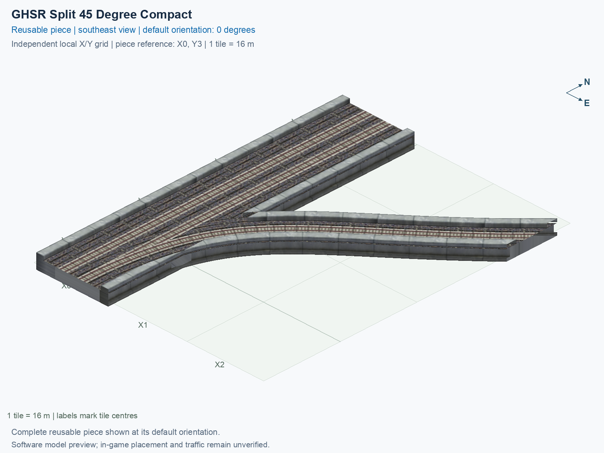

# GHSR Split 45 Degree Compact

Purpose: explain this reusable piece, its matching connections and current test coverage.

<!-- BEGIN PIECE OVERVIEW -->

GHSR Split 45 Degree Compact. Fixed click-to-place piece in a 3 by 4 tile area. Follow the arrows and join only matching track widths, directions, and height labels. Four proper rotations; the second four states repeat them. Experimental; game testing pending. The mainline retains both directions; only the branch is one-way.

Exact reusable identifier: `interchange-ground-split-45-compact`.

Footprint: **3 × 4 tiles**. Exact menu name: **GHSR Split 45 Degree Compact**.

Choose this exact name in Transportation → Rail. Press Home or End to rotate; use only the supported states listed below. Join each end to a matching port profile and direction.

- [Connections and journeys](#connections-and-journeys)
- [Test checklist](#test-checklist)



<!-- END PIECE OVERVIEW -->

<!-- BEGIN MANUAL SUMMARY -->

## Manual status

Generated from [the exact test cases](#test-checklist) and [authoritative observations](checks/manual-tests.json).

- [ ] Preview review: 0/1 applicable cases passed; 0 failed, 0 stale.
- [ ] In-game rendering: 0/4 applicable cases passed; 0 failed, 0 stale.
- [ ] Directed journeys: 0/12 applicable cases passed; 0 failed, 0 stale.

These observations cover only the named services, directions, poses, rotations, and recorded platforms.

<!-- END MANUAL SUMMARY -->

<!-- BEGIN CONNECTIONS -->

## Connections and journeys

Purpose: describe intrinsic directional interfaces and permitted service journeys.

Generated from [connections.json](connections.json). Coordinates are canonical east, north and height in metres. A connection class names an encoded route interface; it does not prove visible deck/wall fit or an in-game test.

Supported placement states: 0° CCW, 90° CCW, 180° CCW, 270° CCW. Each state has its own declared manual scope.

A **port** is one directional transport-path endpoint. **Service** identifies the intended network service (for example HSR, street, or tram); **engine** is its internal traffic-class number, separate from the construction network. **Role** distinguishes primary service from auxiliary paths; sharing a traffic class does not establish service compatibility.

A **tangent** is a unit travel-direction vector: `[0,1]` means north. **Grade** is height gained per horizontal metre. These measured facts describe this subject alone. Compatibility requires a separate comparison of the complete joining boundaries; physical seams and actual game operation require their own evidence. See the [class index](../../connection-classes.json) for shared route-interface membership.

| Port | Service / engine / role | Direction | Location; tangent; grade | Connection class |
| --- | --- | --- | --- | --- |
| `Sout` | ghsr / 7 / primary | out | [-2.0, -56.0, 1.0]; [0.0, -1.0]; 0.0 | `path-interface-c78c5ac4b558d84b46f2` |
| `Nin` | ghsr / 7 / primary | in | [-2.0, 8.0, 1.0]; [0.0, -1.0]; 0.0 | `path-interface-c78c5ac4b558d84b46f2` |
| `Sin` | ghsr / 7 / primary | in | [2.0, -56.0, 1.0]; [0.0, 1.0]; 0.0 | `path-interface-fab587419de6b5848d74` |
| `Nout` | ghsr / 7 / primary | out | [2.0, 8.0, 1.0]; [0.0, 1.0]; 0.0 | `path-interface-fab587419de6b5848d74` |
| `Bout` | ghsr / 7 / primary | out | [40.0, 0.0, 1.0]; [0.7071067811865475, 0.7071067811865475]; 0.0 | `path-interface-f99fce9a9cdaf09202fb` |

### Directed journeys

| Service | Entry → exit | Role |
| --- | --- | --- |
| ghsr | `Nin` → `Sout` | primary |
| ghsr | `Sin` → `Bout` | primary |
| ghsr | `Sin` → `Nout` | primary |

### Forbidden transfers

| From service / port | To service / port | Reason |
| --- | --- | --- |
| ghsr / `Nin` | ghsr / `Nout` | No directed route exists between these ports in the saved piece transport paths. In-game confirmation remains unverified. |
| ghsr / `Nin` | ghsr / `Bout` | No directed route exists between these ports in the saved piece transport paths. In-game confirmation remains unverified. |
| ghsr / `Sin` | ghsr / `Sout` | No directed route exists between these ports in the saved piece transport paths. In-game confirmation remains unverified. |

Review the test checklist for the exact tested cases and environments.

<!-- END CONNECTIONS -->

<!-- BEGIN MANUAL CHECKS -->

## Test checklist

Generated from [the authoritative record](checks/manual-tests.json). Only explicit human observations create manual passes; software and preview checks remain separate. Expand a check/service group to see its rotation table, then expand the matching exact scope to copy a case ID and inspect its pose, reviewer, environment, and evidence. Grouping changes only this view; every declared case remains separate.

**States:** [x] passed; [ ] unverified, failed, or stale; N/A is an explicit inapplicable declaration. A dash means no case was declared in that column. Every pass covers only its recorded environment. T means a distinct construction-transposed state.

Four proper rotations are covered. No additional reflected state is established by this record; repeated construction aliases do not create new orientations.

Current totals: unverified: 43, passed: 0, failed: 0, stale: 0, not_applicable: 0.

### Record an observation

Follow the [shared testing guide](../../../../docs/TESTING.md); copy [the unconfirmed example](checks/observation.example.json) to `checks/observation.json`. Case identifiers are in the expandable sections below. Do not edit generated checkboxes.

From the repository folder containing `custom-pieces`, run after filling `checks/observation.json` and explicitly confirming the exact observation:

```sh
python3 -m scp.content record --record custom-pieces/domains/high-speed-rail/00_pieces/interchange-ground-split-45-compact/checks/manual-tests.json --observation custom-pieces/domains/high-speed-rail/00_pieces/interchange-ground-split-45-compact/checks/observation.json
```

### Detailed current checks

Each collapsed group shows exact case counts and states. Forbidden transfers are grouped by the directed service pair; the table inside retains every port pair and rotation.

<details>
<summary>Compiled resources — Whole subject — 1 case; unverified: 1</summary>

| Check / exact scope | General | 0° | 90° | 180° | 270° |
| --- | --- | --- | --- | --- | --- |
| **Compiled resources**<br>Whole subject | <a href="#case-software_resources-a93523712e0efcdf0ccd">[ ] unverified</a> | — | — | — | — |


<details>
<summary>Compiled resources — Whole subject</summary>

<a id="case-software_resources-a93523712e0efcdf0ccd"></a>

**General: unverified** — `software_resources-a93523712e0efcdf0ccd`.

Verify the actual compiled resources and construction rules.

Scope: Whole subject.

No observation recorded.

</details>

</details>

<details>
<summary>Directed routing graph — Whole subject — 1 case; unverified: 1</summary>

| Check / exact scope | General | 0° | 90° | 180° | 270° |
| --- | --- | --- | --- | --- | --- |
| **Directed routing graph**<br>Whole subject | <a href="#case-software_connectivity-a93523712e0efcdf0ccd">[ ] unverified</a> | — | — | — | — |


<details>
<summary>Directed routing graph — Whole subject</summary>

<a id="case-software_connectivity-a93523712e0efcdf0ccd"></a>

**General: unverified** — `software_connectivity-a93523712e0efcdf0ccd`.

Verify the declared directed journeys and forbidden transfers.

Scope: Whole subject.

No observation recorded.

</details>

</details>

<details>
<summary>Preview review — Images — 1 case; unverified: 1</summary>

| Check / exact scope | General | 0° | 90° | 180° | 270° |
| --- | --- | --- | --- | --- | --- |
| **Preview review**<br>Image: image:interchange-ground-split-45-compact:canonical-southeast | <a href="#case-preview_review-5c08299117fd057f9bbf">[ ] unverified</a> | — | — | — | — |


<details>
<summary>Preview review — Image: image:interchange-ground-split-45-compact:canonical-southeast</summary>

<a id="case-preview_review-5c08299117fd057f9bbf"></a>

**General: unverified** — `preview_review-5c08299117fd057f9bbf`.

Inspect this exact preview for tracks, walls, piers, seams and shadows.

Scope: Image: image:interchange-ground-split-45-compact:canonical-southeast.

No observation recorded.

</details>

</details>

<details>
<summary>In-game rendering — Whole subject — 4 cases; unverified: 4</summary>

| Check / exact scope | General | 0° | 90° | 180° | 270° |
| --- | --- | --- | --- | --- | --- |
| **In-game rendering**<br>Whole subject | — | <a href="#case-in_game_render-d1abfbfb0ae1da7de75f">[ ] unverified</a> | <a href="#case-in_game_render-a3e42bd2125b9ed88706">[ ] unverified</a> | <a href="#case-in_game_render-dcef0db6a728de3ece84">[ ] unverified</a> | <a href="#case-in_game_render-eaf8b94d4fded74bbf6a">[ ] unverified</a> |


<details>
<summary>In-game rendering — Whole subject</summary>

<a id="case-in_game_render-d1abfbfb0ae1da7de75f"></a>

**0° CCW: unverified** — `in_game_render-d1abfbfb0ae1da7de75f`.

Inspect the placed tracks, walls, piers, seams and shadows in SimCity 4.

Scope: Whole subject.

No observation recorded.

<a id="case-in_game_render-a3e42bd2125b9ed88706"></a>

**90° CCW: unverified** — `in_game_render-a3e42bd2125b9ed88706`.

Inspect the placed tracks, walls, piers, seams and shadows in SimCity 4.

Scope: Whole subject.

No observation recorded.

<a id="case-in_game_render-dcef0db6a728de3ece84"></a>

**180° CCW: unverified** — `in_game_render-dcef0db6a728de3ece84`.

Inspect the placed tracks, walls, piers, seams and shadows in SimCity 4.

Scope: Whole subject.

No observation recorded.

<a id="case-in_game_render-eaf8b94d4fded74bbf6a"></a>

**270° CCW: unverified** — `in_game_render-eaf8b94d4fded74bbf6a`.

Inspect the placed tracks, walls, piers, seams and shadows in SimCity 4.

Scope: Whole subject.

No observation recorded.

</details>

</details>

<details>
<summary>Placement — Whole subject — 4 cases; unverified: 4</summary>

| Check / exact scope | General | 0° | 90° | 180° | 270° |
| --- | --- | --- | --- | --- | --- |
| **Placement**<br>Whole subject | — | <a href="#case-in_game_placement-d1abfbfb0ae1da7de75f">[ ] unverified</a> | <a href="#case-in_game_placement-a3e42bd2125b9ed88706">[ ] unverified</a> | <a href="#case-in_game_placement-dcef0db6a728de3ece84">[ ] unverified</a> | <a href="#case-in_game_placement-eaf8b94d4fded74bbf6a">[ ] unverified</a> |


<details>
<summary>Placement — Whole subject</summary>

<a id="case-in_game_placement-d1abfbfb0ae1da7de75f"></a>

**0° CCW: unverified** — `in_game_placement-d1abfbfb0ae1da7de75f`.

Place this piece or complete blueprint and inspect every occupied tile.

Scope: Whole subject.

No observation recorded.

<a id="case-in_game_placement-a3e42bd2125b9ed88706"></a>

**90° CCW: unverified** — `in_game_placement-a3e42bd2125b9ed88706`.

Place this piece or complete blueprint and inspect every occupied tile.

Scope: Whole subject.

No observation recorded.

<a id="case-in_game_placement-dcef0db6a728de3ece84"></a>

**180° CCW: unverified** — `in_game_placement-dcef0db6a728de3ece84`.

Place this piece or complete blueprint and inspect every occupied tile.

Scope: Whole subject.

No observation recorded.

<a id="case-in_game_placement-eaf8b94d4fded74bbf6a"></a>

**270° CCW: unverified** — `in_game_placement-eaf8b94d4fded74bbf6a`.

Place this piece or complete blueprint and inspect every occupied tile.

Scope: Whole subject.

No observation recorded.

</details>

</details>

<details>
<summary>Demolition — Whole subject — 4 cases; unverified: 4</summary>

| Check / exact scope | General | 0° | 90° | 180° | 270° |
| --- | --- | --- | --- | --- | --- |
| **Demolition**<br>Whole subject | — | <a href="#case-in_game_demolition-d1abfbfb0ae1da7de75f">[ ] unverified</a> | <a href="#case-in_game_demolition-a3e42bd2125b9ed88706">[ ] unverified</a> | <a href="#case-in_game_demolition-dcef0db6a728de3ece84">[ ] unverified</a> | <a href="#case-in_game_demolition-eaf8b94d4fded74bbf6a">[ ] unverified</a> |


<details>
<summary>Demolition — Whole subject</summary>

<a id="case-in_game_demolition-d1abfbfb0ae1da7de75f"></a>

**0° CCW: unverified** — `in_game_demolition-d1abfbfb0ae1da7de75f`.

Bulldoze the complete placement and inspect the cleared area.

Scope: Whole subject.

No observation recorded.

<a id="case-in_game_demolition-a3e42bd2125b9ed88706"></a>

**90° CCW: unverified** — `in_game_demolition-a3e42bd2125b9ed88706`.

Bulldoze the complete placement and inspect the cleared area.

Scope: Whole subject.

No observation recorded.

<a id="case-in_game_demolition-dcef0db6a728de3ece84"></a>

**180° CCW: unverified** — `in_game_demolition-dcef0db6a728de3ece84`.

Bulldoze the complete placement and inspect the cleared area.

Scope: Whole subject.

No observation recorded.

<a id="case-in_game_demolition-eaf8b94d4fded74bbf6a"></a>

**270° CCW: unverified** — `in_game_demolition-eaf8b94d4fded74bbf6a`.

Bulldoze the complete placement and inspect the cleared area.

Scope: Whole subject.

No observation recorded.

</details>

</details>

<details>
<summary>Save and reload — Whole subject — 4 cases; unverified: 4</summary>

| Check / exact scope | General | 0° | 90° | 180° | 270° |
| --- | --- | --- | --- | --- | --- |
| **Save and reload**<br>Whole subject | — | <a href="#case-in_game_save_reload-d1abfbfb0ae1da7de75f">[ ] unverified</a> | <a href="#case-in_game_save_reload-a3e42bd2125b9ed88706">[ ] unverified</a> | <a href="#case-in_game_save_reload-dcef0db6a728de3ece84">[ ] unverified</a> | <a href="#case-in_game_save_reload-eaf8b94d4fded74bbf6a">[ ] unverified</a> |


<details>
<summary>Save and reload — Whole subject</summary>

<a id="case-in_game_save_reload-d1abfbfb0ae1da7de75f"></a>

**0° CCW: unverified** — `in_game_save_reload-d1abfbfb0ae1da7de75f`.

Save, quit, reload and inspect the placement and its paths.

Scope: Whole subject.

No observation recorded.

<a id="case-in_game_save_reload-a3e42bd2125b9ed88706"></a>

**90° CCW: unverified** — `in_game_save_reload-a3e42bd2125b9ed88706`.

Save, quit, reload and inspect the placement and its paths.

Scope: Whole subject.

No observation recorded.

<a id="case-in_game_save_reload-dcef0db6a728de3ece84"></a>

**180° CCW: unverified** — `in_game_save_reload-dcef0db6a728de3ece84`.

Save, quit, reload and inspect the placement and its paths.

Scope: Whole subject.

No observation recorded.

<a id="case-in_game_save_reload-eaf8b94d4fded74bbf6a"></a>

**270° CCW: unverified** — `in_game_save_reload-eaf8b94d4fded74bbf6a`.

Save, quit, reload and inspect the placement and its paths.

Scope: Whole subject.

No observation recorded.

</details>

</details>

<details>
<summary>Journey — ghsr — 12 cases; unverified: 12</summary>

| Check / exact scope | General | 0° | 90° | 180° | 270° |
| --- | --- | --- | --- | --- | --- |
| **Journey**<br>Service: ghsr; role: primary; journey: 7:Nin>Sout; entry: Nin; exit: Sout | — | <a href="#case-in_game_journey-66262318f21d529cc1cc">[ ] unverified</a> | <a href="#case-in_game_journey-67fae5be0829bec7c996">[ ] unverified</a> | <a href="#case-in_game_journey-5ac02c0d12cff48f1518">[ ] unverified</a> | <a href="#case-in_game_journey-b7e3c5b4d77ca72a7a23">[ ] unverified</a> |
| **Journey**<br>Service: ghsr; role: primary; journey: 7:Sin>Bout; entry: Sin; exit: Bout | — | <a href="#case-in_game_journey-5a5d254343803b8bf6b3">[ ] unverified</a> | <a href="#case-in_game_journey-3b5c9a5b34e443f937f5">[ ] unverified</a> | <a href="#case-in_game_journey-669a8d67dd5fc9e38abc">[ ] unverified</a> | <a href="#case-in_game_journey-6ada977203435259123d">[ ] unverified</a> |
| **Journey**<br>Service: ghsr; role: primary; journey: 7:Sin>Nout; entry: Sin; exit: Nout | — | <a href="#case-in_game_journey-e0f9e145332cd3c720e6">[ ] unverified</a> | <a href="#case-in_game_journey-df76b7d9589c51f444e0">[ ] unverified</a> | <a href="#case-in_game_journey-d18c6df14aaf51a238c3">[ ] unverified</a> | <a href="#case-in_game_journey-26ed9d650bfea1686c71">[ ] unverified</a> |


<details>
<summary>Journey — Service: ghsr; role: primary; journey: 7:Nin>Sout; entry: Nin; exit: Sout</summary>

<a id="case-in_game_journey-66262318f21d529cc1cc"></a>

**0° CCW: unverified** — `in_game_journey-66262318f21d529cc1cc`.

Run the declared journey in this direction using its service network.

Scope: Service: ghsr; role: primary; journey: 7:Nin>Sout; entry: Nin; exit: Sout.

No observation recorded.

<a id="case-in_game_journey-67fae5be0829bec7c996"></a>

**90° CCW: unverified** — `in_game_journey-67fae5be0829bec7c996`.

Run the declared journey in this direction using its service network.

Scope: Service: ghsr; role: primary; journey: 7:Nin>Sout; entry: Nin; exit: Sout.

No observation recorded.

<a id="case-in_game_journey-5ac02c0d12cff48f1518"></a>

**180° CCW: unverified** — `in_game_journey-5ac02c0d12cff48f1518`.

Run the declared journey in this direction using its service network.

Scope: Service: ghsr; role: primary; journey: 7:Nin>Sout; entry: Nin; exit: Sout.

No observation recorded.

<a id="case-in_game_journey-b7e3c5b4d77ca72a7a23"></a>

**270° CCW: unverified** — `in_game_journey-b7e3c5b4d77ca72a7a23`.

Run the declared journey in this direction using its service network.

Scope: Service: ghsr; role: primary; journey: 7:Nin>Sout; entry: Nin; exit: Sout.

No observation recorded.

</details>


<details>
<summary>Journey — Service: ghsr; role: primary; journey: 7:Sin>Bout; entry: Sin; exit: Bout</summary>

<a id="case-in_game_journey-5a5d254343803b8bf6b3"></a>

**0° CCW: unverified** — `in_game_journey-5a5d254343803b8bf6b3`.

Run the declared journey in this direction using its service network.

Scope: Service: ghsr; role: primary; journey: 7:Sin>Bout; entry: Sin; exit: Bout.

No observation recorded.

<a id="case-in_game_journey-3b5c9a5b34e443f937f5"></a>

**90° CCW: unverified** — `in_game_journey-3b5c9a5b34e443f937f5`.

Run the declared journey in this direction using its service network.

Scope: Service: ghsr; role: primary; journey: 7:Sin>Bout; entry: Sin; exit: Bout.

No observation recorded.

<a id="case-in_game_journey-669a8d67dd5fc9e38abc"></a>

**180° CCW: unverified** — `in_game_journey-669a8d67dd5fc9e38abc`.

Run the declared journey in this direction using its service network.

Scope: Service: ghsr; role: primary; journey: 7:Sin>Bout; entry: Sin; exit: Bout.

No observation recorded.

<a id="case-in_game_journey-6ada977203435259123d"></a>

**270° CCW: unverified** — `in_game_journey-6ada977203435259123d`.

Run the declared journey in this direction using its service network.

Scope: Service: ghsr; role: primary; journey: 7:Sin>Bout; entry: Sin; exit: Bout.

No observation recorded.

</details>


<details>
<summary>Journey — Service: ghsr; role: primary; journey: 7:Sin>Nout; entry: Sin; exit: Nout</summary>

<a id="case-in_game_journey-e0f9e145332cd3c720e6"></a>

**0° CCW: unverified** — `in_game_journey-e0f9e145332cd3c720e6`.

Run the declared journey in this direction using its service network.

Scope: Service: ghsr; role: primary; journey: 7:Sin>Nout; entry: Sin; exit: Nout.

No observation recorded.

<a id="case-in_game_journey-df76b7d9589c51f444e0"></a>

**90° CCW: unverified** — `in_game_journey-df76b7d9589c51f444e0`.

Run the declared journey in this direction using its service network.

Scope: Service: ghsr; role: primary; journey: 7:Sin>Nout; entry: Sin; exit: Nout.

No observation recorded.

<a id="case-in_game_journey-d18c6df14aaf51a238c3"></a>

**180° CCW: unverified** — `in_game_journey-d18c6df14aaf51a238c3`.

Run the declared journey in this direction using its service network.

Scope: Service: ghsr; role: primary; journey: 7:Sin>Nout; entry: Sin; exit: Nout.

No observation recorded.

<a id="case-in_game_journey-26ed9d650bfea1686c71"></a>

**270° CCW: unverified** — `in_game_journey-26ed9d650bfea1686c71`.

Run the declared journey in this direction using its service network.

Scope: Service: ghsr; role: primary; journey: 7:Sin>Nout; entry: Sin; exit: Nout.

No observation recorded.

</details>

</details>

<details>
<summary>Forbidden transfer — ghsr → ghsr — 12 cases; unverified: 12</summary>

| Check / exact scope | General | 0° | 90° | 180° | 270° |
| --- | --- | --- | --- | --- | --- |
| **Forbidden transfer**<br>from port: Nin; to port: Nout; from service: ghsr; to service: ghsr; basis: not reachable in actual saved PATH graph | — | <a href="#case-in_game_forbidden_transfer-5ac54e0783432adcbe03">[ ] unverified</a> | <a href="#case-in_game_forbidden_transfer-f25d258ba05416dac017">[ ] unverified</a> | <a href="#case-in_game_forbidden_transfer-19f9f5df025f35188e16">[ ] unverified</a> | <a href="#case-in_game_forbidden_transfer-602aa8cfb620574e5a4a">[ ] unverified</a> |
| **Forbidden transfer**<br>from port: Nin; to port: Bout; from service: ghsr; to service: ghsr; basis: not reachable in actual saved PATH graph | — | <a href="#case-in_game_forbidden_transfer-6d592e6ed4945775740e">[ ] unverified</a> | <a href="#case-in_game_forbidden_transfer-9037d7fcfc3b4d715bb5">[ ] unverified</a> | <a href="#case-in_game_forbidden_transfer-3fe596c4c7b54e5806c6">[ ] unverified</a> | <a href="#case-in_game_forbidden_transfer-6d15d7fef7a108054f49">[ ] unverified</a> |
| **Forbidden transfer**<br>from port: Sin; to port: Sout; from service: ghsr; to service: ghsr; basis: not reachable in actual saved PATH graph | — | <a href="#case-in_game_forbidden_transfer-6d131703a3fd4f411a02">[ ] unverified</a> | <a href="#case-in_game_forbidden_transfer-d4ffa92f6bd16ce7b6a5">[ ] unverified</a> | <a href="#case-in_game_forbidden_transfer-cf9020fe5e8ecd3c5aa9">[ ] unverified</a> | <a href="#case-in_game_forbidden_transfer-de2ca7f22c7d67d3c85a">[ ] unverified</a> |


<details>
<summary>Forbidden transfer — from port: Nin; to port: Nout; from service: ghsr; to service: ghsr; basis: not reachable in actual saved PATH graph</summary>

<a id="case-in_game_forbidden_transfer-5ac54e0783432adcbe03"></a>

**0° CCW: unverified** — `in_game_forbidden_transfer-5ac54e0783432adcbe03`.

Confirm this undeclared transfer is unavailable.

Scope: from port: Nin; to port: Nout; from service: ghsr; to service: ghsr; basis: not reachable in actual saved PATH graph.

No observation recorded.

<a id="case-in_game_forbidden_transfer-f25d258ba05416dac017"></a>

**90° CCW: unverified** — `in_game_forbidden_transfer-f25d258ba05416dac017`.

Confirm this undeclared transfer is unavailable.

Scope: from port: Nin; to port: Nout; from service: ghsr; to service: ghsr; basis: not reachable in actual saved PATH graph.

No observation recorded.

<a id="case-in_game_forbidden_transfer-19f9f5df025f35188e16"></a>

**180° CCW: unverified** — `in_game_forbidden_transfer-19f9f5df025f35188e16`.

Confirm this undeclared transfer is unavailable.

Scope: from port: Nin; to port: Nout; from service: ghsr; to service: ghsr; basis: not reachable in actual saved PATH graph.

No observation recorded.

<a id="case-in_game_forbidden_transfer-602aa8cfb620574e5a4a"></a>

**270° CCW: unverified** — `in_game_forbidden_transfer-602aa8cfb620574e5a4a`.

Confirm this undeclared transfer is unavailable.

Scope: from port: Nin; to port: Nout; from service: ghsr; to service: ghsr; basis: not reachable in actual saved PATH graph.

No observation recorded.

</details>


<details>
<summary>Forbidden transfer — from port: Nin; to port: Bout; from service: ghsr; to service: ghsr; basis: not reachable in actual saved PATH graph</summary>

<a id="case-in_game_forbidden_transfer-6d592e6ed4945775740e"></a>

**0° CCW: unverified** — `in_game_forbidden_transfer-6d592e6ed4945775740e`.

Confirm this undeclared transfer is unavailable.

Scope: from port: Nin; to port: Bout; from service: ghsr; to service: ghsr; basis: not reachable in actual saved PATH graph.

No observation recorded.

<a id="case-in_game_forbidden_transfer-9037d7fcfc3b4d715bb5"></a>

**90° CCW: unverified** — `in_game_forbidden_transfer-9037d7fcfc3b4d715bb5`.

Confirm this undeclared transfer is unavailable.

Scope: from port: Nin; to port: Bout; from service: ghsr; to service: ghsr; basis: not reachable in actual saved PATH graph.

No observation recorded.

<a id="case-in_game_forbidden_transfer-3fe596c4c7b54e5806c6"></a>

**180° CCW: unverified** — `in_game_forbidden_transfer-3fe596c4c7b54e5806c6`.

Confirm this undeclared transfer is unavailable.

Scope: from port: Nin; to port: Bout; from service: ghsr; to service: ghsr; basis: not reachable in actual saved PATH graph.

No observation recorded.

<a id="case-in_game_forbidden_transfer-6d15d7fef7a108054f49"></a>

**270° CCW: unverified** — `in_game_forbidden_transfer-6d15d7fef7a108054f49`.

Confirm this undeclared transfer is unavailable.

Scope: from port: Nin; to port: Bout; from service: ghsr; to service: ghsr; basis: not reachable in actual saved PATH graph.

No observation recorded.

</details>


<details>
<summary>Forbidden transfer — from port: Sin; to port: Sout; from service: ghsr; to service: ghsr; basis: not reachable in actual saved PATH graph</summary>

<a id="case-in_game_forbidden_transfer-6d131703a3fd4f411a02"></a>

**0° CCW: unverified** — `in_game_forbidden_transfer-6d131703a3fd4f411a02`.

Confirm this undeclared transfer is unavailable.

Scope: from port: Sin; to port: Sout; from service: ghsr; to service: ghsr; basis: not reachable in actual saved PATH graph.

No observation recorded.

<a id="case-in_game_forbidden_transfer-d4ffa92f6bd16ce7b6a5"></a>

**90° CCW: unverified** — `in_game_forbidden_transfer-d4ffa92f6bd16ce7b6a5`.

Confirm this undeclared transfer is unavailable.

Scope: from port: Sin; to port: Sout; from service: ghsr; to service: ghsr; basis: not reachable in actual saved PATH graph.

No observation recorded.

<a id="case-in_game_forbidden_transfer-cf9020fe5e8ecd3c5aa9"></a>

**180° CCW: unverified** — `in_game_forbidden_transfer-cf9020fe5e8ecd3c5aa9`.

Confirm this undeclared transfer is unavailable.

Scope: from port: Sin; to port: Sout; from service: ghsr; to service: ghsr; basis: not reachable in actual saved PATH graph.

No observation recorded.

<a id="case-in_game_forbidden_transfer-de2ca7f22c7d67d3c85a"></a>

**270° CCW: unverified** — `in_game_forbidden_transfer-de2ca7f22c7d67d3c85a`.

Confirm this undeclared transfer is unavailable.

Scope: from port: Sin; to port: Sout; from service: ghsr; to service: ghsr; basis: not reachable in actual saved PATH graph.

No observation recorded.

</details>

</details>

<!-- END MANUAL CHECKS -->
