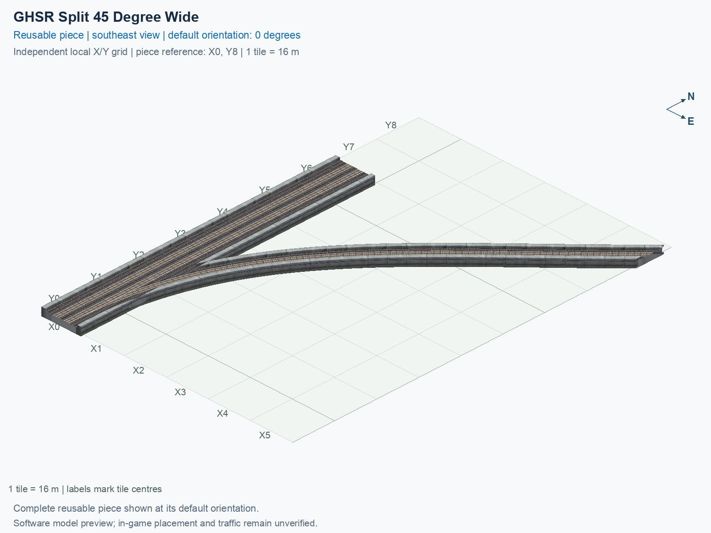

# GHSR Split 45 Degree Wide

Purpose: explain this reusable piece, its matching connections and current test coverage.

<!-- BEGIN PIECE OVERVIEW -->

GHSR Split 45 Degree Wide. Fixed click-to-place piece in a 6 by 9 tile area. Follow the arrows and join only matching track widths, directions, and height labels. Four proper rotations; the second four states repeat them. Experimental; game testing pending. The mainline retains both directions; only the branch is one-way.

Exact reusable identifier: `interchange-ground-split-45-wide`.

Footprint: **6 × 9 tiles**. Exact menu name: **GHSR Split 45 Degree Wide**.

Choose this exact name in Transportation → Rail. Press Home or End to rotate; use only the supported states listed below. Join each end to a matching port profile and direction.

- [Connections and journeys](#connections-and-journeys)
- [Test checklist](#test-checklist)



<!-- END PIECE OVERVIEW -->

<!-- BEGIN MANUAL SUMMARY -->

## Manual status

Generated from [the exact test cases](#test-checklist) and [authoritative observations](checks/manual-tests.json).

- [ ] Preview review: 0/1 applicable cases passed; 0 failed, 0 stale.
- [ ] In-game rendering: 0/4 applicable cases passed; 0 failed, 0 stale.
- [ ] Directed journeys: 0/12 applicable cases passed; 0 failed, 0 stale.

These observations cover only the named services, directions, poses, rotations, and recorded platforms.

<!-- END MANUAL SUMMARY -->

<!-- BEGIN CONNECTIONS -->

## Connections and journeys

Purpose: describe intrinsic directional interfaces and permitted service journeys.

Generated from [connections.json](connections.json). Coordinates are canonical east, north and height in metres. A connection class names an encoded route interface; it does not prove visible deck/wall fit or an in-game test.

Supported placement states: 0° CCW, 90° CCW, 180° CCW, 270° CCW. Each state has its own declared manual scope.

A **port** is one directional transport-path endpoint. **Service** identifies the intended network service (for example HSR, street, or tram); **engine** is its internal traffic-class number, separate from the construction network. **Role** distinguishes primary service from auxiliary paths; sharing a traffic class does not establish service compatibility.

A **tangent** is a unit travel-direction vector: `[0,1]` means north. **Grade** is height gained per horizontal metre. These measured facts describe this subject alone. Compatibility requires a separate comparison of the complete joining boundaries; physical seams and actual game operation require their own evidence. See the [class index](../../connection-classes.json) for shared route-interface membership.

| Port | Service / engine / role | Direction | Location; tangent; grade | Connection class |
| --- | --- | --- | --- | --- |
| `Sout` | ghsr / 7 / primary | out | [-2.0, -136.0, 1.0]; [0.0, -1.0]; 0.0 | `path-interface-c78c5ac4b558d84b46f2` |
| `Nin` | ghsr / 7 / primary | in | [-2.0, -24.0, 1.0]; [0.0, -1.0]; 0.0 | `path-interface-c78c5ac4b558d84b46f2` |
| `Sin` | ghsr / 7 / primary | in | [2.0, -136.0, 1.0]; [0.0, 1.0]; 0.0 | `path-interface-fab587419de6b5848d74` |
| `Nout` | ghsr / 7 / primary | out | [2.0, -24.0, 1.0]; [0.0, 1.0]; 0.0 | `path-interface-fab587419de6b5848d74` |
| `Bout` | ghsr / 7 / primary | out | [88.0, 0.0, 1.0]; [0.7071067811865475, 0.7071067811865475]; 0.0 | `path-interface-f99fce9a9cdaf09202fb` |

### Directed journeys

| Service | Entry → exit | Role |
| --- | --- | --- |
| ghsr | `Nin` → `Sout` | primary |
| ghsr | `Sin` → `Nout` | primary |
| ghsr | `Sin` → `Bout` | primary |

### Forbidden transfers

| From service / port | To service / port | Reason |
| --- | --- | --- |
| ghsr / `Nin` | ghsr / `Nout` | No directed route exists between these ports in the saved piece transport paths. In-game confirmation remains unverified. |
| ghsr / `Nin` | ghsr / `Bout` | No directed route exists between these ports in the saved piece transport paths. In-game confirmation remains unverified. |
| ghsr / `Sin` | ghsr / `Sout` | No directed route exists between these ports in the saved piece transport paths. In-game confirmation remains unverified. |

Review the test checklist for the exact tested cases and environments.

<!-- END CONNECTIONS -->

<!-- BEGIN MANUAL CHECKS -->

## Test checklist

Generated from [the authoritative record](checks/manual-tests.json). Only explicit human observations create manual passes; software and preview checks remain separate. Expand a check/service group to see its rotation table, then expand the matching exact scope to copy a case ID and inspect its pose, reviewer, environment, and evidence. Grouping changes only this view; every declared case remains separate.

**States:** [x] passed; [ ] unverified, failed, or stale; N/A is an explicit inapplicable declaration. A dash means no case was declared in that column. Every pass covers only its recorded environment. T means a distinct construction-transposed state.

Four proper rotations are covered. No additional reflected state is established by this record; repeated construction aliases do not create new orientations.

Current totals: unverified: 43, passed: 0, failed: 0, stale: 0, not_applicable: 0.

### Record an observation

Follow the [shared testing guide](../../../../docs/TESTING.md); copy [the unconfirmed example](checks/observation.example.json) to `checks/observation.json`. Case identifiers are in the expandable sections below. Do not edit generated checkboxes.

From the repository folder containing `custom-pieces`, run after filling `checks/observation.json` and explicitly confirming the exact observation:

```sh
python3 -m scp.content record --record custom-pieces/domains/high-speed-rail/00_pieces/interchange-ground-split-45-wide/checks/manual-tests.json --observation custom-pieces/domains/high-speed-rail/00_pieces/interchange-ground-split-45-wide/checks/observation.json
```

### Detailed current checks

Each collapsed group shows exact case counts and states. Forbidden transfers are grouped by the directed service pair; the table inside retains every port pair and rotation.

<details>
<summary>Compiled resources — Whole subject — 1 case; unverified: 1</summary>

| Check / exact scope | General | 0° | 90° | 180° | 270° |
| --- | --- | --- | --- | --- | --- |
| **Compiled resources**<br>Whole subject | <a href="#case-software_resources-26af4a72b2647a5a67cd">[ ] unverified</a> | — | — | — | — |


<details>
<summary>Compiled resources — Whole subject</summary>

<a id="case-software_resources-26af4a72b2647a5a67cd"></a>

**General: unverified** — `software_resources-26af4a72b2647a5a67cd`.

Verify the actual compiled resources and construction rules.

Scope: Whole subject.

No observation recorded.

</details>

</details>

<details>
<summary>Directed routing graph — Whole subject — 1 case; unverified: 1</summary>

| Check / exact scope | General | 0° | 90° | 180° | 270° |
| --- | --- | --- | --- | --- | --- |
| **Directed routing graph**<br>Whole subject | <a href="#case-software_connectivity-26af4a72b2647a5a67cd">[ ] unverified</a> | — | — | — | — |


<details>
<summary>Directed routing graph — Whole subject</summary>

<a id="case-software_connectivity-26af4a72b2647a5a67cd"></a>

**General: unverified** — `software_connectivity-26af4a72b2647a5a67cd`.

Verify the declared directed journeys and forbidden transfers.

Scope: Whole subject.

No observation recorded.

</details>

</details>

<details>
<summary>Preview review — Images — 1 case; unverified: 1</summary>

| Check / exact scope | General | 0° | 90° | 180° | 270° |
| --- | --- | --- | --- | --- | --- |
| **Preview review**<br>Image: image:interchange-ground-split-45-wide:canonical-southeast | <a href="#case-preview_review-3ac5a8bcdfaa3846af45">[ ] unverified</a> | — | — | — | — |


<details>
<summary>Preview review — Image: image:interchange-ground-split-45-wide:canonical-southeast</summary>

<a id="case-preview_review-3ac5a8bcdfaa3846af45"></a>

**General: unverified** — `preview_review-3ac5a8bcdfaa3846af45`.

Inspect this exact preview for tracks, walls, piers, seams and shadows.

Scope: Image: image:interchange-ground-split-45-wide:canonical-southeast.

No observation recorded.

</details>

</details>

<details>
<summary>In-game rendering — Whole subject — 4 cases; unverified: 4</summary>

| Check / exact scope | General | 0° | 90° | 180° | 270° |
| --- | --- | --- | --- | --- | --- |
| **In-game rendering**<br>Whole subject | — | <a href="#case-in_game_render-b9dc8d57445c6b07a286">[ ] unverified</a> | <a href="#case-in_game_render-8c9273ac728ef51e0aa1">[ ] unverified</a> | <a href="#case-in_game_render-139f5c0cca610ef6806c">[ ] unverified</a> | <a href="#case-in_game_render-8aba1078bbfddd23f2e5">[ ] unverified</a> |


<details>
<summary>In-game rendering — Whole subject</summary>

<a id="case-in_game_render-b9dc8d57445c6b07a286"></a>

**0° CCW: unverified** — `in_game_render-b9dc8d57445c6b07a286`.

Inspect the placed tracks, walls, piers, seams and shadows in SimCity 4.

Scope: Whole subject.

No observation recorded.

<a id="case-in_game_render-8c9273ac728ef51e0aa1"></a>

**90° CCW: unverified** — `in_game_render-8c9273ac728ef51e0aa1`.

Inspect the placed tracks, walls, piers, seams and shadows in SimCity 4.

Scope: Whole subject.

No observation recorded.

<a id="case-in_game_render-139f5c0cca610ef6806c"></a>

**180° CCW: unverified** — `in_game_render-139f5c0cca610ef6806c`.

Inspect the placed tracks, walls, piers, seams and shadows in SimCity 4.

Scope: Whole subject.

No observation recorded.

<a id="case-in_game_render-8aba1078bbfddd23f2e5"></a>

**270° CCW: unverified** — `in_game_render-8aba1078bbfddd23f2e5`.

Inspect the placed tracks, walls, piers, seams and shadows in SimCity 4.

Scope: Whole subject.

No observation recorded.

</details>

</details>

<details>
<summary>Placement — Whole subject — 4 cases; unverified: 4</summary>

| Check / exact scope | General | 0° | 90° | 180° | 270° |
| --- | --- | --- | --- | --- | --- |
| **Placement**<br>Whole subject | — | <a href="#case-in_game_placement-b9dc8d57445c6b07a286">[ ] unverified</a> | <a href="#case-in_game_placement-8c9273ac728ef51e0aa1">[ ] unverified</a> | <a href="#case-in_game_placement-139f5c0cca610ef6806c">[ ] unverified</a> | <a href="#case-in_game_placement-8aba1078bbfddd23f2e5">[ ] unverified</a> |


<details>
<summary>Placement — Whole subject</summary>

<a id="case-in_game_placement-b9dc8d57445c6b07a286"></a>

**0° CCW: unverified** — `in_game_placement-b9dc8d57445c6b07a286`.

Place this piece or complete blueprint and inspect every occupied tile.

Scope: Whole subject.

No observation recorded.

<a id="case-in_game_placement-8c9273ac728ef51e0aa1"></a>

**90° CCW: unverified** — `in_game_placement-8c9273ac728ef51e0aa1`.

Place this piece or complete blueprint and inspect every occupied tile.

Scope: Whole subject.

No observation recorded.

<a id="case-in_game_placement-139f5c0cca610ef6806c"></a>

**180° CCW: unverified** — `in_game_placement-139f5c0cca610ef6806c`.

Place this piece or complete blueprint and inspect every occupied tile.

Scope: Whole subject.

No observation recorded.

<a id="case-in_game_placement-8aba1078bbfddd23f2e5"></a>

**270° CCW: unverified** — `in_game_placement-8aba1078bbfddd23f2e5`.

Place this piece or complete blueprint and inspect every occupied tile.

Scope: Whole subject.

No observation recorded.

</details>

</details>

<details>
<summary>Demolition — Whole subject — 4 cases; unverified: 4</summary>

| Check / exact scope | General | 0° | 90° | 180° | 270° |
| --- | --- | --- | --- | --- | --- |
| **Demolition**<br>Whole subject | — | <a href="#case-in_game_demolition-b9dc8d57445c6b07a286">[ ] unverified</a> | <a href="#case-in_game_demolition-8c9273ac728ef51e0aa1">[ ] unverified</a> | <a href="#case-in_game_demolition-139f5c0cca610ef6806c">[ ] unverified</a> | <a href="#case-in_game_demolition-8aba1078bbfddd23f2e5">[ ] unverified</a> |


<details>
<summary>Demolition — Whole subject</summary>

<a id="case-in_game_demolition-b9dc8d57445c6b07a286"></a>

**0° CCW: unverified** — `in_game_demolition-b9dc8d57445c6b07a286`.

Bulldoze the complete placement and inspect the cleared area.

Scope: Whole subject.

No observation recorded.

<a id="case-in_game_demolition-8c9273ac728ef51e0aa1"></a>

**90° CCW: unverified** — `in_game_demolition-8c9273ac728ef51e0aa1`.

Bulldoze the complete placement and inspect the cleared area.

Scope: Whole subject.

No observation recorded.

<a id="case-in_game_demolition-139f5c0cca610ef6806c"></a>

**180° CCW: unverified** — `in_game_demolition-139f5c0cca610ef6806c`.

Bulldoze the complete placement and inspect the cleared area.

Scope: Whole subject.

No observation recorded.

<a id="case-in_game_demolition-8aba1078bbfddd23f2e5"></a>

**270° CCW: unverified** — `in_game_demolition-8aba1078bbfddd23f2e5`.

Bulldoze the complete placement and inspect the cleared area.

Scope: Whole subject.

No observation recorded.

</details>

</details>

<details>
<summary>Save and reload — Whole subject — 4 cases; unverified: 4</summary>

| Check / exact scope | General | 0° | 90° | 180° | 270° |
| --- | --- | --- | --- | --- | --- |
| **Save and reload**<br>Whole subject | — | <a href="#case-in_game_save_reload-b9dc8d57445c6b07a286">[ ] unverified</a> | <a href="#case-in_game_save_reload-8c9273ac728ef51e0aa1">[ ] unverified</a> | <a href="#case-in_game_save_reload-139f5c0cca610ef6806c">[ ] unverified</a> | <a href="#case-in_game_save_reload-8aba1078bbfddd23f2e5">[ ] unverified</a> |


<details>
<summary>Save and reload — Whole subject</summary>

<a id="case-in_game_save_reload-b9dc8d57445c6b07a286"></a>

**0° CCW: unverified** — `in_game_save_reload-b9dc8d57445c6b07a286`.

Save, quit, reload and inspect the placement and its paths.

Scope: Whole subject.

No observation recorded.

<a id="case-in_game_save_reload-8c9273ac728ef51e0aa1"></a>

**90° CCW: unverified** — `in_game_save_reload-8c9273ac728ef51e0aa1`.

Save, quit, reload and inspect the placement and its paths.

Scope: Whole subject.

No observation recorded.

<a id="case-in_game_save_reload-139f5c0cca610ef6806c"></a>

**180° CCW: unverified** — `in_game_save_reload-139f5c0cca610ef6806c`.

Save, quit, reload and inspect the placement and its paths.

Scope: Whole subject.

No observation recorded.

<a id="case-in_game_save_reload-8aba1078bbfddd23f2e5"></a>

**270° CCW: unverified** — `in_game_save_reload-8aba1078bbfddd23f2e5`.

Save, quit, reload and inspect the placement and its paths.

Scope: Whole subject.

No observation recorded.

</details>

</details>

<details>
<summary>Journey — ghsr — 12 cases; unverified: 12</summary>

| Check / exact scope | General | 0° | 90° | 180° | 270° |
| --- | --- | --- | --- | --- | --- |
| **Journey**<br>Service: ghsr; role: primary; journey: 7:Nin>Sout; entry: Nin; exit: Sout | — | <a href="#case-in_game_journey-2ea964b52f8f76e8cf77">[ ] unverified</a> | <a href="#case-in_game_journey-48a16d72d5dcf67885b9">[ ] unverified</a> | <a href="#case-in_game_journey-fea453af160ce9c80f6f">[ ] unverified</a> | <a href="#case-in_game_journey-57ba10baacc6ccce4700">[ ] unverified</a> |
| **Journey**<br>Service: ghsr; role: primary; journey: 7:Sin>Nout; entry: Sin; exit: Nout | — | <a href="#case-in_game_journey-d33923d8eaf14446444b">[ ] unverified</a> | <a href="#case-in_game_journey-908f3e8b51d3a3be2cc2">[ ] unverified</a> | <a href="#case-in_game_journey-a2f3c74816cdb60ebf13">[ ] unverified</a> | <a href="#case-in_game_journey-6cbe6a93ba0c1ce4afb4">[ ] unverified</a> |
| **Journey**<br>Service: ghsr; role: primary; journey: 7:Sin>Bout; entry: Sin; exit: Bout | — | <a href="#case-in_game_journey-945b53fc79df8bed1efa">[ ] unverified</a> | <a href="#case-in_game_journey-f34b9d73af779e516d3b">[ ] unverified</a> | <a href="#case-in_game_journey-4fc3c1a2b93c8ac8f3b0">[ ] unverified</a> | <a href="#case-in_game_journey-5f9cfbafaf438448af59">[ ] unverified</a> |


<details>
<summary>Journey — Service: ghsr; role: primary; journey: 7:Nin>Sout; entry: Nin; exit: Sout</summary>

<a id="case-in_game_journey-2ea964b52f8f76e8cf77"></a>

**0° CCW: unverified** — `in_game_journey-2ea964b52f8f76e8cf77`.

Run the declared journey in this direction using its service network.

Scope: Service: ghsr; role: primary; journey: 7:Nin>Sout; entry: Nin; exit: Sout.

No observation recorded.

<a id="case-in_game_journey-48a16d72d5dcf67885b9"></a>

**90° CCW: unverified** — `in_game_journey-48a16d72d5dcf67885b9`.

Run the declared journey in this direction using its service network.

Scope: Service: ghsr; role: primary; journey: 7:Nin>Sout; entry: Nin; exit: Sout.

No observation recorded.

<a id="case-in_game_journey-fea453af160ce9c80f6f"></a>

**180° CCW: unverified** — `in_game_journey-fea453af160ce9c80f6f`.

Run the declared journey in this direction using its service network.

Scope: Service: ghsr; role: primary; journey: 7:Nin>Sout; entry: Nin; exit: Sout.

No observation recorded.

<a id="case-in_game_journey-57ba10baacc6ccce4700"></a>

**270° CCW: unverified** — `in_game_journey-57ba10baacc6ccce4700`.

Run the declared journey in this direction using its service network.

Scope: Service: ghsr; role: primary; journey: 7:Nin>Sout; entry: Nin; exit: Sout.

No observation recorded.

</details>


<details>
<summary>Journey — Service: ghsr; role: primary; journey: 7:Sin>Nout; entry: Sin; exit: Nout</summary>

<a id="case-in_game_journey-d33923d8eaf14446444b"></a>

**0° CCW: unverified** — `in_game_journey-d33923d8eaf14446444b`.

Run the declared journey in this direction using its service network.

Scope: Service: ghsr; role: primary; journey: 7:Sin>Nout; entry: Sin; exit: Nout.

No observation recorded.

<a id="case-in_game_journey-908f3e8b51d3a3be2cc2"></a>

**90° CCW: unverified** — `in_game_journey-908f3e8b51d3a3be2cc2`.

Run the declared journey in this direction using its service network.

Scope: Service: ghsr; role: primary; journey: 7:Sin>Nout; entry: Sin; exit: Nout.

No observation recorded.

<a id="case-in_game_journey-a2f3c74816cdb60ebf13"></a>

**180° CCW: unverified** — `in_game_journey-a2f3c74816cdb60ebf13`.

Run the declared journey in this direction using its service network.

Scope: Service: ghsr; role: primary; journey: 7:Sin>Nout; entry: Sin; exit: Nout.

No observation recorded.

<a id="case-in_game_journey-6cbe6a93ba0c1ce4afb4"></a>

**270° CCW: unverified** — `in_game_journey-6cbe6a93ba0c1ce4afb4`.

Run the declared journey in this direction using its service network.

Scope: Service: ghsr; role: primary; journey: 7:Sin>Nout; entry: Sin; exit: Nout.

No observation recorded.

</details>


<details>
<summary>Journey — Service: ghsr; role: primary; journey: 7:Sin>Bout; entry: Sin; exit: Bout</summary>

<a id="case-in_game_journey-945b53fc79df8bed1efa"></a>

**0° CCW: unverified** — `in_game_journey-945b53fc79df8bed1efa`.

Run the declared journey in this direction using its service network.

Scope: Service: ghsr; role: primary; journey: 7:Sin>Bout; entry: Sin; exit: Bout.

No observation recorded.

<a id="case-in_game_journey-f34b9d73af779e516d3b"></a>

**90° CCW: unverified** — `in_game_journey-f34b9d73af779e516d3b`.

Run the declared journey in this direction using its service network.

Scope: Service: ghsr; role: primary; journey: 7:Sin>Bout; entry: Sin; exit: Bout.

No observation recorded.

<a id="case-in_game_journey-4fc3c1a2b93c8ac8f3b0"></a>

**180° CCW: unverified** — `in_game_journey-4fc3c1a2b93c8ac8f3b0`.

Run the declared journey in this direction using its service network.

Scope: Service: ghsr; role: primary; journey: 7:Sin>Bout; entry: Sin; exit: Bout.

No observation recorded.

<a id="case-in_game_journey-5f9cfbafaf438448af59"></a>

**270° CCW: unverified** — `in_game_journey-5f9cfbafaf438448af59`.

Run the declared journey in this direction using its service network.

Scope: Service: ghsr; role: primary; journey: 7:Sin>Bout; entry: Sin; exit: Bout.

No observation recorded.

</details>

</details>

<details>
<summary>Forbidden transfer — ghsr → ghsr — 12 cases; unverified: 12</summary>

| Check / exact scope | General | 0° | 90° | 180° | 270° |
| --- | --- | --- | --- | --- | --- |
| **Forbidden transfer**<br>from port: Nin; to port: Nout; from service: ghsr; to service: ghsr; basis: not reachable in actual saved PATH graph | — | <a href="#case-in_game_forbidden_transfer-c56c625893e22b13f9e2">[ ] unverified</a> | <a href="#case-in_game_forbidden_transfer-92df2bab201635c22bbe">[ ] unverified</a> | <a href="#case-in_game_forbidden_transfer-ecc6f36c8d9ef1f35265">[ ] unverified</a> | <a href="#case-in_game_forbidden_transfer-edd42d12a91dc31e80c0">[ ] unverified</a> |
| **Forbidden transfer**<br>from port: Nin; to port: Bout; from service: ghsr; to service: ghsr; basis: not reachable in actual saved PATH graph | — | <a href="#case-in_game_forbidden_transfer-f9dfc7d97c6559e2923c">[ ] unverified</a> | <a href="#case-in_game_forbidden_transfer-2cd2d1a0c303f77b3b33">[ ] unverified</a> | <a href="#case-in_game_forbidden_transfer-09cb9d40f95d9eeea79e">[ ] unverified</a> | <a href="#case-in_game_forbidden_transfer-0d16e7e39f3062371593">[ ] unverified</a> |
| **Forbidden transfer**<br>from port: Sin; to port: Sout; from service: ghsr; to service: ghsr; basis: not reachable in actual saved PATH graph | — | <a href="#case-in_game_forbidden_transfer-0c3eab46f8744ad9a9a1">[ ] unverified</a> | <a href="#case-in_game_forbidden_transfer-f3675d0ac214f743c8a1">[ ] unverified</a> | <a href="#case-in_game_forbidden_transfer-7ac46af2ad25294cdb4c">[ ] unverified</a> | <a href="#case-in_game_forbidden_transfer-eba6238f0a0bd0a4c0be">[ ] unverified</a> |


<details>
<summary>Forbidden transfer — from port: Nin; to port: Nout; from service: ghsr; to service: ghsr; basis: not reachable in actual saved PATH graph</summary>

<a id="case-in_game_forbidden_transfer-c56c625893e22b13f9e2"></a>

**0° CCW: unverified** — `in_game_forbidden_transfer-c56c625893e22b13f9e2`.

Confirm this undeclared transfer is unavailable.

Scope: from port: Nin; to port: Nout; from service: ghsr; to service: ghsr; basis: not reachable in actual saved PATH graph.

No observation recorded.

<a id="case-in_game_forbidden_transfer-92df2bab201635c22bbe"></a>

**90° CCW: unverified** — `in_game_forbidden_transfer-92df2bab201635c22bbe`.

Confirm this undeclared transfer is unavailable.

Scope: from port: Nin; to port: Nout; from service: ghsr; to service: ghsr; basis: not reachable in actual saved PATH graph.

No observation recorded.

<a id="case-in_game_forbidden_transfer-ecc6f36c8d9ef1f35265"></a>

**180° CCW: unverified** — `in_game_forbidden_transfer-ecc6f36c8d9ef1f35265`.

Confirm this undeclared transfer is unavailable.

Scope: from port: Nin; to port: Nout; from service: ghsr; to service: ghsr; basis: not reachable in actual saved PATH graph.

No observation recorded.

<a id="case-in_game_forbidden_transfer-edd42d12a91dc31e80c0"></a>

**270° CCW: unverified** — `in_game_forbidden_transfer-edd42d12a91dc31e80c0`.

Confirm this undeclared transfer is unavailable.

Scope: from port: Nin; to port: Nout; from service: ghsr; to service: ghsr; basis: not reachable in actual saved PATH graph.

No observation recorded.

</details>


<details>
<summary>Forbidden transfer — from port: Nin; to port: Bout; from service: ghsr; to service: ghsr; basis: not reachable in actual saved PATH graph</summary>

<a id="case-in_game_forbidden_transfer-f9dfc7d97c6559e2923c"></a>

**0° CCW: unverified** — `in_game_forbidden_transfer-f9dfc7d97c6559e2923c`.

Confirm this undeclared transfer is unavailable.

Scope: from port: Nin; to port: Bout; from service: ghsr; to service: ghsr; basis: not reachable in actual saved PATH graph.

No observation recorded.

<a id="case-in_game_forbidden_transfer-2cd2d1a0c303f77b3b33"></a>

**90° CCW: unverified** — `in_game_forbidden_transfer-2cd2d1a0c303f77b3b33`.

Confirm this undeclared transfer is unavailable.

Scope: from port: Nin; to port: Bout; from service: ghsr; to service: ghsr; basis: not reachable in actual saved PATH graph.

No observation recorded.

<a id="case-in_game_forbidden_transfer-09cb9d40f95d9eeea79e"></a>

**180° CCW: unverified** — `in_game_forbidden_transfer-09cb9d40f95d9eeea79e`.

Confirm this undeclared transfer is unavailable.

Scope: from port: Nin; to port: Bout; from service: ghsr; to service: ghsr; basis: not reachable in actual saved PATH graph.

No observation recorded.

<a id="case-in_game_forbidden_transfer-0d16e7e39f3062371593"></a>

**270° CCW: unverified** — `in_game_forbidden_transfer-0d16e7e39f3062371593`.

Confirm this undeclared transfer is unavailable.

Scope: from port: Nin; to port: Bout; from service: ghsr; to service: ghsr; basis: not reachable in actual saved PATH graph.

No observation recorded.

</details>


<details>
<summary>Forbidden transfer — from port: Sin; to port: Sout; from service: ghsr; to service: ghsr; basis: not reachable in actual saved PATH graph</summary>

<a id="case-in_game_forbidden_transfer-0c3eab46f8744ad9a9a1"></a>

**0° CCW: unverified** — `in_game_forbidden_transfer-0c3eab46f8744ad9a9a1`.

Confirm this undeclared transfer is unavailable.

Scope: from port: Sin; to port: Sout; from service: ghsr; to service: ghsr; basis: not reachable in actual saved PATH graph.

No observation recorded.

<a id="case-in_game_forbidden_transfer-f3675d0ac214f743c8a1"></a>

**90° CCW: unverified** — `in_game_forbidden_transfer-f3675d0ac214f743c8a1`.

Confirm this undeclared transfer is unavailable.

Scope: from port: Sin; to port: Sout; from service: ghsr; to service: ghsr; basis: not reachable in actual saved PATH graph.

No observation recorded.

<a id="case-in_game_forbidden_transfer-7ac46af2ad25294cdb4c"></a>

**180° CCW: unverified** — `in_game_forbidden_transfer-7ac46af2ad25294cdb4c`.

Confirm this undeclared transfer is unavailable.

Scope: from port: Sin; to port: Sout; from service: ghsr; to service: ghsr; basis: not reachable in actual saved PATH graph.

No observation recorded.

<a id="case-in_game_forbidden_transfer-eba6238f0a0bd0a4c0be"></a>

**270° CCW: unverified** — `in_game_forbidden_transfer-eba6238f0a0bd0a4c0be`.

Confirm this undeclared transfer is unavailable.

Scope: from port: Sin; to port: Sout; from service: ghsr; to service: ghsr; basis: not reachable in actual saved PATH graph.

No observation recorded.

</details>

</details>

<!-- END MANUAL CHECKS -->
