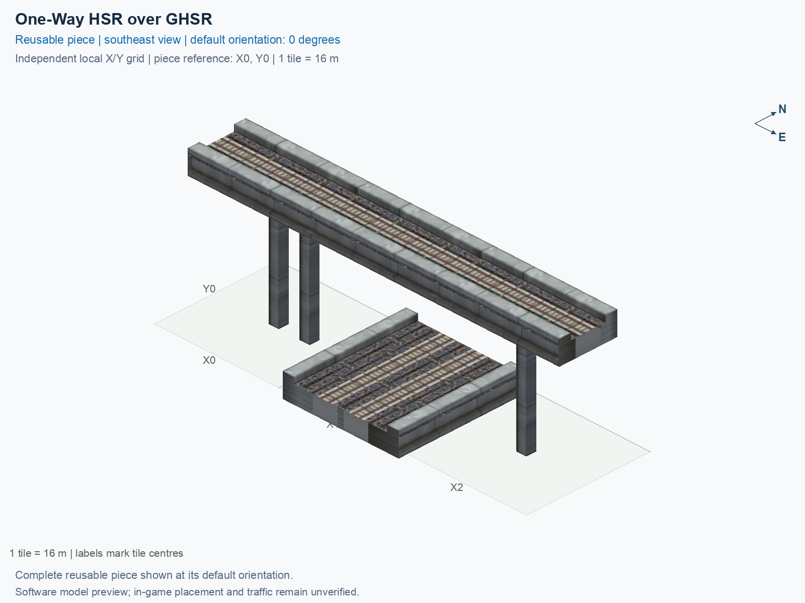

# One-Way HSR over GHSR

Purpose: explain this reusable piece, its matching connections and current test coverage.

<!-- BEGIN PIECE OVERVIEW -->

Actual rail geometry and directed train paths at two heights. The one-way track and two-way track cross without a transfer. Experimental fixed piece; test rendering, traffic and shadows in the game. The upper route crosses without transferring to the lower two-way route.

Exact reusable identifier: `interchange-hsr-oneway-over-ground`.

Footprint: **3 × 1 tiles**. Exact menu name: **One-Way HSR over GHSR**.

Choose this exact name in Transportation → Rail. Press Home or End to rotate; use only the supported states listed below. Join each end to a matching port profile and direction.

- [Connections and journeys](#connections-and-journeys)
- [Test checklist](#test-checklist)



<!-- END PIECE OVERVIEW -->

<!-- BEGIN MANUAL SUMMARY -->

## Manual status

Generated from [the exact test cases](#test-checklist) and [authoritative observations](checks/manual-tests.json).

- [ ] Preview review: 0/1 applicable cases passed; 0 failed, 0 stale.
- [ ] In-game rendering: 0/4 applicable cases passed; 0 failed, 0 stale.
- [ ] Directed journeys: 0/12 applicable cases passed; 0 failed, 0 stale.

These observations cover only the named services, directions, poses, rotations, and recorded platforms.

<!-- END MANUAL SUMMARY -->

<!-- BEGIN CONNECTIONS -->

## Connections and journeys

Purpose: describe intrinsic directional interfaces and permitted service journeys.

Generated from [connections.json](connections.json). Coordinates are canonical east, north and height in metres. A connection class names an encoded route interface; it does not prove visible deck/wall fit or an in-game test.

Supported placement states: 0° CCW, 90° CCW, 180° CCW, 270° CCW. Each state has its own declared manual scope.

A **port** is one directional transport-path endpoint. **Service** identifies the intended network service (for example HSR, street, or tram); **engine** is its internal traffic-class number, separate from the construction network. **Role** distinguishes primary service from auxiliary paths; sharing a traffic class does not establish service compatibility.

A **tangent** is a unit travel-direction vector: `[0,1]` means north. **Grade** is height gained per horizontal metre. These measured facts describe this subject alone. Compatibility requires a separate comparison of the complete joining boundaries; physical seams and actual game operation require their own evidence. See the [class index](../../connection-classes.json) for shared route-interface membership.

| Port | Service / engine / role | Direction | Location; tangent; grade | Connection class |
| --- | --- | --- | --- | --- |
| `Win` | hsr / 7 / primary | in | [-8.0, 0.0, 15.5]; [1.0, 0.0]; 0.0 | `path-interface-365752af76285c80cd0b` |
| `Sout` | ghsr / 7 / primary | out | [14.0, -8.0, 1.0]; [0.0, -1.0]; 0.0 | `path-interface-c78c5ac4b558d84b46f2` |
| `Nin` | ghsr / 7 / primary | in | [14.0, 8.0, 1.0]; [0.0, -1.0]; 0.0 | `path-interface-c78c5ac4b558d84b46f2` |
| `Sin` | ghsr / 7 / primary | in | [18.0, -8.0, 1.0]; [0.0, 1.0]; 0.0 | `path-interface-fab587419de6b5848d74` |
| `Nout` | ghsr / 7 / primary | out | [18.0, 8.0, 1.0]; [0.0, 1.0]; 0.0 | `path-interface-fab587419de6b5848d74` |
| `Eout` | hsr / 7 / primary | out | [40.0, 0.0, 15.5]; [1.0, 0.0]; 0.0 | `path-interface-365752af76285c80cd0b` |

### Directed journeys

| Service | Entry → exit | Role |
| --- | --- | --- |
| hsr | `Win` → `Eout` | primary |
| ghsr | `Nin` → `Sout` | primary |
| ghsr | `Sin` → `Nout` | primary |

### Forbidden transfers

| From service / port | To service / port | Reason |
| --- | --- | --- |
| hsr / `Win` | ghsr / `Sout` | No directed route exists between these ports in the saved piece transport paths. In-game confirmation remains unverified. |
| hsr / `Win` | ghsr / `Nout` | No directed route exists between these ports in the saved piece transport paths. In-game confirmation remains unverified. |
| ghsr / `Nin` | ghsr / `Nout` | No directed route exists between these ports in the saved piece transport paths. In-game confirmation remains unverified. |
| ghsr / `Nin` | hsr / `Eout` | No directed route exists between these ports in the saved piece transport paths. In-game confirmation remains unverified. |
| ghsr / `Sin` | ghsr / `Sout` | No directed route exists between these ports in the saved piece transport paths. In-game confirmation remains unverified. |
| ghsr / `Sin` | hsr / `Eout` | No directed route exists between these ports in the saved piece transport paths. In-game confirmation remains unverified. |

Review the test checklist for the exact tested cases and environments.

<!-- END CONNECTIONS -->

<!-- BEGIN MANUAL CHECKS -->

## Test checklist

Generated from [the authoritative record](checks/manual-tests.json). Only explicit human observations create manual passes; software and preview checks remain separate. Expand a check/service group to see its rotation table, then expand the matching exact scope to copy a case ID and inspect its pose, reviewer, environment, and evidence. Grouping changes only this view; every declared case remains separate.

**States:** [x] passed; [ ] unverified, failed, or stale; N/A is an explicit inapplicable declaration. A dash means no case was declared in that column. Every pass covers only its recorded environment. T means a distinct construction-transposed state.

Four proper rotations are covered. No additional reflected state is established by this record; repeated construction aliases do not create new orientations.

Current totals: unverified: 55, passed: 0, failed: 0, stale: 0, not_applicable: 0.

### Record an observation

Follow the [shared testing guide](../../../../docs/TESTING.md); copy [the unconfirmed example](checks/observation.example.json) to `checks/observation.json`. Case identifiers are in the expandable sections below. Do not edit generated checkboxes.

From the repository folder containing `custom-pieces`, run after filling `checks/observation.json` and explicitly confirming the exact observation:

```sh
python3 -m scp.content record --record custom-pieces/domains/high-speed-rail/00_pieces/interchange-hsr-oneway-over-ground/checks/manual-tests.json --observation custom-pieces/domains/high-speed-rail/00_pieces/interchange-hsr-oneway-over-ground/checks/observation.json
```

### Detailed current checks

Each collapsed group shows exact case counts and states. Forbidden transfers are grouped by the directed service pair; the table inside retains every port pair and rotation.

<details>
<summary>Compiled resources — Whole subject — 1 case; unverified: 1</summary>

| Check / exact scope | General | 0° | 90° | 180° | 270° |
| --- | --- | --- | --- | --- | --- |
| **Compiled resources**<br>Whole subject | <a href="#case-software_resources-1f7d689f61ea9907b029">[ ] unverified</a> | — | — | — | — |


<details>
<summary>Compiled resources — Whole subject</summary>

<a id="case-software_resources-1f7d689f61ea9907b029"></a>

**General: unverified** — `software_resources-1f7d689f61ea9907b029`.

Verify the actual compiled resources and construction rules.

Scope: Whole subject.

No observation recorded.

</details>

</details>

<details>
<summary>Directed routing graph — Whole subject — 1 case; unverified: 1</summary>

| Check / exact scope | General | 0° | 90° | 180° | 270° |
| --- | --- | --- | --- | --- | --- |
| **Directed routing graph**<br>Whole subject | <a href="#case-software_connectivity-1f7d689f61ea9907b029">[ ] unverified</a> | — | — | — | — |


<details>
<summary>Directed routing graph — Whole subject</summary>

<a id="case-software_connectivity-1f7d689f61ea9907b029"></a>

**General: unverified** — `software_connectivity-1f7d689f61ea9907b029`.

Verify the declared directed journeys and forbidden transfers.

Scope: Whole subject.

No observation recorded.

</details>

</details>

<details>
<summary>Preview review — Images — 1 case; unverified: 1</summary>

| Check / exact scope | General | 0° | 90° | 180° | 270° |
| --- | --- | --- | --- | --- | --- |
| **Preview review**<br>Image: image:interchange-hsr-oneway-over-ground:canonical-southeast | <a href="#case-preview_review-5872f9742cd7169d94b8">[ ] unverified</a> | — | — | — | — |


<details>
<summary>Preview review — Image: image:interchange-hsr-oneway-over-ground:canonical-southeast</summary>

<a id="case-preview_review-5872f9742cd7169d94b8"></a>

**General: unverified** — `preview_review-5872f9742cd7169d94b8`.

Inspect this exact preview for tracks, walls, piers, seams and shadows.

Scope: Image: image:interchange-hsr-oneway-over-ground:canonical-southeast.

No observation recorded.

</details>

</details>

<details>
<summary>In-game rendering — Whole subject — 4 cases; unverified: 4</summary>

| Check / exact scope | General | 0° | 90° | 180° | 270° |
| --- | --- | --- | --- | --- | --- |
| **In-game rendering**<br>Whole subject | — | <a href="#case-in_game_render-5d9433df2de9638fa38e">[ ] unverified</a> | <a href="#case-in_game_render-34fee46557eebdba5d03">[ ] unverified</a> | <a href="#case-in_game_render-910d16de0778af516c81">[ ] unverified</a> | <a href="#case-in_game_render-10cbbe8a9637dc83187d">[ ] unverified</a> |


<details>
<summary>In-game rendering — Whole subject</summary>

<a id="case-in_game_render-5d9433df2de9638fa38e"></a>

**0° CCW: unverified** — `in_game_render-5d9433df2de9638fa38e`.

Inspect the placed tracks, walls, piers, seams and shadows in SimCity 4.

Scope: Whole subject.

No observation recorded.

<a id="case-in_game_render-34fee46557eebdba5d03"></a>

**90° CCW: unverified** — `in_game_render-34fee46557eebdba5d03`.

Inspect the placed tracks, walls, piers, seams and shadows in SimCity 4.

Scope: Whole subject.

No observation recorded.

<a id="case-in_game_render-910d16de0778af516c81"></a>

**180° CCW: unverified** — `in_game_render-910d16de0778af516c81`.

Inspect the placed tracks, walls, piers, seams and shadows in SimCity 4.

Scope: Whole subject.

No observation recorded.

<a id="case-in_game_render-10cbbe8a9637dc83187d"></a>

**270° CCW: unverified** — `in_game_render-10cbbe8a9637dc83187d`.

Inspect the placed tracks, walls, piers, seams and shadows in SimCity 4.

Scope: Whole subject.

No observation recorded.

</details>

</details>

<details>
<summary>Placement — Whole subject — 4 cases; unverified: 4</summary>

| Check / exact scope | General | 0° | 90° | 180° | 270° |
| --- | --- | --- | --- | --- | --- |
| **Placement**<br>Whole subject | — | <a href="#case-in_game_placement-5d9433df2de9638fa38e">[ ] unverified</a> | <a href="#case-in_game_placement-34fee46557eebdba5d03">[ ] unverified</a> | <a href="#case-in_game_placement-910d16de0778af516c81">[ ] unverified</a> | <a href="#case-in_game_placement-10cbbe8a9637dc83187d">[ ] unverified</a> |


<details>
<summary>Placement — Whole subject</summary>

<a id="case-in_game_placement-5d9433df2de9638fa38e"></a>

**0° CCW: unverified** — `in_game_placement-5d9433df2de9638fa38e`.

Place this piece or complete blueprint and inspect every occupied tile.

Scope: Whole subject.

No observation recorded.

<a id="case-in_game_placement-34fee46557eebdba5d03"></a>

**90° CCW: unverified** — `in_game_placement-34fee46557eebdba5d03`.

Place this piece or complete blueprint and inspect every occupied tile.

Scope: Whole subject.

No observation recorded.

<a id="case-in_game_placement-910d16de0778af516c81"></a>

**180° CCW: unverified** — `in_game_placement-910d16de0778af516c81`.

Place this piece or complete blueprint and inspect every occupied tile.

Scope: Whole subject.

No observation recorded.

<a id="case-in_game_placement-10cbbe8a9637dc83187d"></a>

**270° CCW: unverified** — `in_game_placement-10cbbe8a9637dc83187d`.

Place this piece or complete blueprint and inspect every occupied tile.

Scope: Whole subject.

No observation recorded.

</details>

</details>

<details>
<summary>Demolition — Whole subject — 4 cases; unverified: 4</summary>

| Check / exact scope | General | 0° | 90° | 180° | 270° |
| --- | --- | --- | --- | --- | --- |
| **Demolition**<br>Whole subject | — | <a href="#case-in_game_demolition-5d9433df2de9638fa38e">[ ] unverified</a> | <a href="#case-in_game_demolition-34fee46557eebdba5d03">[ ] unverified</a> | <a href="#case-in_game_demolition-910d16de0778af516c81">[ ] unverified</a> | <a href="#case-in_game_demolition-10cbbe8a9637dc83187d">[ ] unverified</a> |


<details>
<summary>Demolition — Whole subject</summary>

<a id="case-in_game_demolition-5d9433df2de9638fa38e"></a>

**0° CCW: unverified** — `in_game_demolition-5d9433df2de9638fa38e`.

Bulldoze the complete placement and inspect the cleared area.

Scope: Whole subject.

No observation recorded.

<a id="case-in_game_demolition-34fee46557eebdba5d03"></a>

**90° CCW: unverified** — `in_game_demolition-34fee46557eebdba5d03`.

Bulldoze the complete placement and inspect the cleared area.

Scope: Whole subject.

No observation recorded.

<a id="case-in_game_demolition-910d16de0778af516c81"></a>

**180° CCW: unverified** — `in_game_demolition-910d16de0778af516c81`.

Bulldoze the complete placement and inspect the cleared area.

Scope: Whole subject.

No observation recorded.

<a id="case-in_game_demolition-10cbbe8a9637dc83187d"></a>

**270° CCW: unverified** — `in_game_demolition-10cbbe8a9637dc83187d`.

Bulldoze the complete placement and inspect the cleared area.

Scope: Whole subject.

No observation recorded.

</details>

</details>

<details>
<summary>Save and reload — Whole subject — 4 cases; unverified: 4</summary>

| Check / exact scope | General | 0° | 90° | 180° | 270° |
| --- | --- | --- | --- | --- | --- |
| **Save and reload**<br>Whole subject | — | <a href="#case-in_game_save_reload-5d9433df2de9638fa38e">[ ] unverified</a> | <a href="#case-in_game_save_reload-34fee46557eebdba5d03">[ ] unverified</a> | <a href="#case-in_game_save_reload-910d16de0778af516c81">[ ] unverified</a> | <a href="#case-in_game_save_reload-10cbbe8a9637dc83187d">[ ] unverified</a> |


<details>
<summary>Save and reload — Whole subject</summary>

<a id="case-in_game_save_reload-5d9433df2de9638fa38e"></a>

**0° CCW: unverified** — `in_game_save_reload-5d9433df2de9638fa38e`.

Save, quit, reload and inspect the placement and its paths.

Scope: Whole subject.

No observation recorded.

<a id="case-in_game_save_reload-34fee46557eebdba5d03"></a>

**90° CCW: unverified** — `in_game_save_reload-34fee46557eebdba5d03`.

Save, quit, reload and inspect the placement and its paths.

Scope: Whole subject.

No observation recorded.

<a id="case-in_game_save_reload-910d16de0778af516c81"></a>

**180° CCW: unverified** — `in_game_save_reload-910d16de0778af516c81`.

Save, quit, reload and inspect the placement and its paths.

Scope: Whole subject.

No observation recorded.

<a id="case-in_game_save_reload-10cbbe8a9637dc83187d"></a>

**270° CCW: unverified** — `in_game_save_reload-10cbbe8a9637dc83187d`.

Save, quit, reload and inspect the placement and its paths.

Scope: Whole subject.

No observation recorded.

</details>

</details>

<details>
<summary>Journey — hsr — 4 cases; unverified: 4</summary>

| Check / exact scope | General | 0° | 90° | 180° | 270° |
| --- | --- | --- | --- | --- | --- |
| **Journey**<br>Service: hsr; role: primary; journey: 7:Win>Eout; entry: Win; exit: Eout | — | <a href="#case-in_game_journey-ce51b73d3107f565b7b0">[ ] unverified</a> | <a href="#case-in_game_journey-577688e647f82a071b5f">[ ] unverified</a> | <a href="#case-in_game_journey-488b8c2b5163dcc9a478">[ ] unverified</a> | <a href="#case-in_game_journey-0a49ed24d88ded9c0ee2">[ ] unverified</a> |


<details>
<summary>Journey — Service: hsr; role: primary; journey: 7:Win>Eout; entry: Win; exit: Eout</summary>

<a id="case-in_game_journey-ce51b73d3107f565b7b0"></a>

**0° CCW: unverified** — `in_game_journey-ce51b73d3107f565b7b0`.

Run the declared journey in this direction using its service network.

Scope: Service: hsr; role: primary; journey: 7:Win>Eout; entry: Win; exit: Eout.

No observation recorded.

<a id="case-in_game_journey-577688e647f82a071b5f"></a>

**90° CCW: unverified** — `in_game_journey-577688e647f82a071b5f`.

Run the declared journey in this direction using its service network.

Scope: Service: hsr; role: primary; journey: 7:Win>Eout; entry: Win; exit: Eout.

No observation recorded.

<a id="case-in_game_journey-488b8c2b5163dcc9a478"></a>

**180° CCW: unverified** — `in_game_journey-488b8c2b5163dcc9a478`.

Run the declared journey in this direction using its service network.

Scope: Service: hsr; role: primary; journey: 7:Win>Eout; entry: Win; exit: Eout.

No observation recorded.

<a id="case-in_game_journey-0a49ed24d88ded9c0ee2"></a>

**270° CCW: unverified** — `in_game_journey-0a49ed24d88ded9c0ee2`.

Run the declared journey in this direction using its service network.

Scope: Service: hsr; role: primary; journey: 7:Win>Eout; entry: Win; exit: Eout.

No observation recorded.

</details>

</details>

<details>
<summary>Journey — ghsr — 8 cases; unverified: 8</summary>

| Check / exact scope | General | 0° | 90° | 180° | 270° |
| --- | --- | --- | --- | --- | --- |
| **Journey**<br>Service: ghsr; role: primary; journey: 7:Nin>Sout; entry: Nin; exit: Sout | — | <a href="#case-in_game_journey-ae9af4441bd165b17f19">[ ] unverified</a> | <a href="#case-in_game_journey-04c66fc4fa39180b0034">[ ] unverified</a> | <a href="#case-in_game_journey-51448a637deaacb9ef9a">[ ] unverified</a> | <a href="#case-in_game_journey-7d6b48ac810e6b4aa798">[ ] unverified</a> |
| **Journey**<br>Service: ghsr; role: primary; journey: 7:Sin>Nout; entry: Sin; exit: Nout | — | <a href="#case-in_game_journey-f4969cdccf5e3049f96b">[ ] unverified</a> | <a href="#case-in_game_journey-f24e3c5010937531e4dc">[ ] unverified</a> | <a href="#case-in_game_journey-5bc7fff2ac7220c6fa27">[ ] unverified</a> | <a href="#case-in_game_journey-c9137160ac2cd7a46f11">[ ] unverified</a> |


<details>
<summary>Journey — Service: ghsr; role: primary; journey: 7:Nin>Sout; entry: Nin; exit: Sout</summary>

<a id="case-in_game_journey-ae9af4441bd165b17f19"></a>

**0° CCW: unverified** — `in_game_journey-ae9af4441bd165b17f19`.

Run the declared journey in this direction using its service network.

Scope: Service: ghsr; role: primary; journey: 7:Nin>Sout; entry: Nin; exit: Sout.

No observation recorded.

<a id="case-in_game_journey-04c66fc4fa39180b0034"></a>

**90° CCW: unverified** — `in_game_journey-04c66fc4fa39180b0034`.

Run the declared journey in this direction using its service network.

Scope: Service: ghsr; role: primary; journey: 7:Nin>Sout; entry: Nin; exit: Sout.

No observation recorded.

<a id="case-in_game_journey-51448a637deaacb9ef9a"></a>

**180° CCW: unverified** — `in_game_journey-51448a637deaacb9ef9a`.

Run the declared journey in this direction using its service network.

Scope: Service: ghsr; role: primary; journey: 7:Nin>Sout; entry: Nin; exit: Sout.

No observation recorded.

<a id="case-in_game_journey-7d6b48ac810e6b4aa798"></a>

**270° CCW: unverified** — `in_game_journey-7d6b48ac810e6b4aa798`.

Run the declared journey in this direction using its service network.

Scope: Service: ghsr; role: primary; journey: 7:Nin>Sout; entry: Nin; exit: Sout.

No observation recorded.

</details>


<details>
<summary>Journey — Service: ghsr; role: primary; journey: 7:Sin>Nout; entry: Sin; exit: Nout</summary>

<a id="case-in_game_journey-f4969cdccf5e3049f96b"></a>

**0° CCW: unverified** — `in_game_journey-f4969cdccf5e3049f96b`.

Run the declared journey in this direction using its service network.

Scope: Service: ghsr; role: primary; journey: 7:Sin>Nout; entry: Sin; exit: Nout.

No observation recorded.

<a id="case-in_game_journey-f24e3c5010937531e4dc"></a>

**90° CCW: unverified** — `in_game_journey-f24e3c5010937531e4dc`.

Run the declared journey in this direction using its service network.

Scope: Service: ghsr; role: primary; journey: 7:Sin>Nout; entry: Sin; exit: Nout.

No observation recorded.

<a id="case-in_game_journey-5bc7fff2ac7220c6fa27"></a>

**180° CCW: unverified** — `in_game_journey-5bc7fff2ac7220c6fa27`.

Run the declared journey in this direction using its service network.

Scope: Service: ghsr; role: primary; journey: 7:Sin>Nout; entry: Sin; exit: Nout.

No observation recorded.

<a id="case-in_game_journey-c9137160ac2cd7a46f11"></a>

**270° CCW: unverified** — `in_game_journey-c9137160ac2cd7a46f11`.

Run the declared journey in this direction using its service network.

Scope: Service: ghsr; role: primary; journey: 7:Sin>Nout; entry: Sin; exit: Nout.

No observation recorded.

</details>

</details>

<details>
<summary>Forbidden transfer — hsr → ghsr — 8 cases; unverified: 8</summary>

| Check / exact scope | General | 0° | 90° | 180° | 270° |
| --- | --- | --- | --- | --- | --- |
| **Forbidden transfer**<br>from port: Win; to port: Sout; from service: hsr; to service: ghsr; basis: not reachable in actual saved PATH graph | — | <a href="#case-in_game_forbidden_transfer-487dee036e71963e5506">[ ] unverified</a> | <a href="#case-in_game_forbidden_transfer-74e021adb31cc77a34e8">[ ] unverified</a> | <a href="#case-in_game_forbidden_transfer-ac632ea4873a126ca1c1">[ ] unverified</a> | <a href="#case-in_game_forbidden_transfer-3d6705e8ebd8815954bf">[ ] unverified</a> |
| **Forbidden transfer**<br>from port: Win; to port: Nout; from service: hsr; to service: ghsr; basis: not reachable in actual saved PATH graph | — | <a href="#case-in_game_forbidden_transfer-0c452444ded0cad323a3">[ ] unverified</a> | <a href="#case-in_game_forbidden_transfer-9f5f659e974f3687c05d">[ ] unverified</a> | <a href="#case-in_game_forbidden_transfer-84719faba5f1b232319a">[ ] unverified</a> | <a href="#case-in_game_forbidden_transfer-17e25c05cc7a6d5357d8">[ ] unverified</a> |


<details>
<summary>Forbidden transfer — from port: Win; to port: Sout; from service: hsr; to service: ghsr; basis: not reachable in actual saved PATH graph</summary>

<a id="case-in_game_forbidden_transfer-487dee036e71963e5506"></a>

**0° CCW: unverified** — `in_game_forbidden_transfer-487dee036e71963e5506`.

Confirm this undeclared transfer is unavailable.

Scope: from port: Win; to port: Sout; from service: hsr; to service: ghsr; basis: not reachable in actual saved PATH graph.

No observation recorded.

<a id="case-in_game_forbidden_transfer-74e021adb31cc77a34e8"></a>

**90° CCW: unverified** — `in_game_forbidden_transfer-74e021adb31cc77a34e8`.

Confirm this undeclared transfer is unavailable.

Scope: from port: Win; to port: Sout; from service: hsr; to service: ghsr; basis: not reachable in actual saved PATH graph.

No observation recorded.

<a id="case-in_game_forbidden_transfer-ac632ea4873a126ca1c1"></a>

**180° CCW: unverified** — `in_game_forbidden_transfer-ac632ea4873a126ca1c1`.

Confirm this undeclared transfer is unavailable.

Scope: from port: Win; to port: Sout; from service: hsr; to service: ghsr; basis: not reachable in actual saved PATH graph.

No observation recorded.

<a id="case-in_game_forbidden_transfer-3d6705e8ebd8815954bf"></a>

**270° CCW: unverified** — `in_game_forbidden_transfer-3d6705e8ebd8815954bf`.

Confirm this undeclared transfer is unavailable.

Scope: from port: Win; to port: Sout; from service: hsr; to service: ghsr; basis: not reachable in actual saved PATH graph.

No observation recorded.

</details>


<details>
<summary>Forbidden transfer — from port: Win; to port: Nout; from service: hsr; to service: ghsr; basis: not reachable in actual saved PATH graph</summary>

<a id="case-in_game_forbidden_transfer-0c452444ded0cad323a3"></a>

**0° CCW: unverified** — `in_game_forbidden_transfer-0c452444ded0cad323a3`.

Confirm this undeclared transfer is unavailable.

Scope: from port: Win; to port: Nout; from service: hsr; to service: ghsr; basis: not reachable in actual saved PATH graph.

No observation recorded.

<a id="case-in_game_forbidden_transfer-9f5f659e974f3687c05d"></a>

**90° CCW: unverified** — `in_game_forbidden_transfer-9f5f659e974f3687c05d`.

Confirm this undeclared transfer is unavailable.

Scope: from port: Win; to port: Nout; from service: hsr; to service: ghsr; basis: not reachable in actual saved PATH graph.

No observation recorded.

<a id="case-in_game_forbidden_transfer-84719faba5f1b232319a"></a>

**180° CCW: unverified** — `in_game_forbidden_transfer-84719faba5f1b232319a`.

Confirm this undeclared transfer is unavailable.

Scope: from port: Win; to port: Nout; from service: hsr; to service: ghsr; basis: not reachable in actual saved PATH graph.

No observation recorded.

<a id="case-in_game_forbidden_transfer-17e25c05cc7a6d5357d8"></a>

**270° CCW: unverified** — `in_game_forbidden_transfer-17e25c05cc7a6d5357d8`.

Confirm this undeclared transfer is unavailable.

Scope: from port: Win; to port: Nout; from service: hsr; to service: ghsr; basis: not reachable in actual saved PATH graph.

No observation recorded.

</details>

</details>

<details>
<summary>Forbidden transfer — ghsr → ghsr — 8 cases; unverified: 8</summary>

| Check / exact scope | General | 0° | 90° | 180° | 270° |
| --- | --- | --- | --- | --- | --- |
| **Forbidden transfer**<br>from port: Nin; to port: Nout; from service: ghsr; to service: ghsr; basis: not reachable in actual saved PATH graph | — | <a href="#case-in_game_forbidden_transfer-04e8e1a1e7edb4d04a63">[ ] unverified</a> | <a href="#case-in_game_forbidden_transfer-810155a0c45bbef0b4fb">[ ] unverified</a> | <a href="#case-in_game_forbidden_transfer-402ddc1fb72c19674e8c">[ ] unverified</a> | <a href="#case-in_game_forbidden_transfer-d8ee5c7003a55e38c8fc">[ ] unverified</a> |
| **Forbidden transfer**<br>from port: Sin; to port: Sout; from service: ghsr; to service: ghsr; basis: not reachable in actual saved PATH graph | — | <a href="#case-in_game_forbidden_transfer-f8823905c33e44e1c143">[ ] unverified</a> | <a href="#case-in_game_forbidden_transfer-e68c311183806eca6566">[ ] unverified</a> | <a href="#case-in_game_forbidden_transfer-b0253a2a6b4f8e752e1f">[ ] unverified</a> | <a href="#case-in_game_forbidden_transfer-c659ad56c9e6ec145833">[ ] unverified</a> |


<details>
<summary>Forbidden transfer — from port: Nin; to port: Nout; from service: ghsr; to service: ghsr; basis: not reachable in actual saved PATH graph</summary>

<a id="case-in_game_forbidden_transfer-04e8e1a1e7edb4d04a63"></a>

**0° CCW: unverified** — `in_game_forbidden_transfer-04e8e1a1e7edb4d04a63`.

Confirm this undeclared transfer is unavailable.

Scope: from port: Nin; to port: Nout; from service: ghsr; to service: ghsr; basis: not reachable in actual saved PATH graph.

No observation recorded.

<a id="case-in_game_forbidden_transfer-810155a0c45bbef0b4fb"></a>

**90° CCW: unverified** — `in_game_forbidden_transfer-810155a0c45bbef0b4fb`.

Confirm this undeclared transfer is unavailable.

Scope: from port: Nin; to port: Nout; from service: ghsr; to service: ghsr; basis: not reachable in actual saved PATH graph.

No observation recorded.

<a id="case-in_game_forbidden_transfer-402ddc1fb72c19674e8c"></a>

**180° CCW: unverified** — `in_game_forbidden_transfer-402ddc1fb72c19674e8c`.

Confirm this undeclared transfer is unavailable.

Scope: from port: Nin; to port: Nout; from service: ghsr; to service: ghsr; basis: not reachable in actual saved PATH graph.

No observation recorded.

<a id="case-in_game_forbidden_transfer-d8ee5c7003a55e38c8fc"></a>

**270° CCW: unverified** — `in_game_forbidden_transfer-d8ee5c7003a55e38c8fc`.

Confirm this undeclared transfer is unavailable.

Scope: from port: Nin; to port: Nout; from service: ghsr; to service: ghsr; basis: not reachable in actual saved PATH graph.

No observation recorded.

</details>


<details>
<summary>Forbidden transfer — from port: Sin; to port: Sout; from service: ghsr; to service: ghsr; basis: not reachable in actual saved PATH graph</summary>

<a id="case-in_game_forbidden_transfer-f8823905c33e44e1c143"></a>

**0° CCW: unverified** — `in_game_forbidden_transfer-f8823905c33e44e1c143`.

Confirm this undeclared transfer is unavailable.

Scope: from port: Sin; to port: Sout; from service: ghsr; to service: ghsr; basis: not reachable in actual saved PATH graph.

No observation recorded.

<a id="case-in_game_forbidden_transfer-e68c311183806eca6566"></a>

**90° CCW: unverified** — `in_game_forbidden_transfer-e68c311183806eca6566`.

Confirm this undeclared transfer is unavailable.

Scope: from port: Sin; to port: Sout; from service: ghsr; to service: ghsr; basis: not reachable in actual saved PATH graph.

No observation recorded.

<a id="case-in_game_forbidden_transfer-b0253a2a6b4f8e752e1f"></a>

**180° CCW: unverified** — `in_game_forbidden_transfer-b0253a2a6b4f8e752e1f`.

Confirm this undeclared transfer is unavailable.

Scope: from port: Sin; to port: Sout; from service: ghsr; to service: ghsr; basis: not reachable in actual saved PATH graph.

No observation recorded.

<a id="case-in_game_forbidden_transfer-c659ad56c9e6ec145833"></a>

**270° CCW: unverified** — `in_game_forbidden_transfer-c659ad56c9e6ec145833`.

Confirm this undeclared transfer is unavailable.

Scope: from port: Sin; to port: Sout; from service: ghsr; to service: ghsr; basis: not reachable in actual saved PATH graph.

No observation recorded.

</details>

</details>

<details>
<summary>Forbidden transfer — ghsr → hsr — 8 cases; unverified: 8</summary>

| Check / exact scope | General | 0° | 90° | 180° | 270° |
| --- | --- | --- | --- | --- | --- |
| **Forbidden transfer**<br>from port: Nin; to port: Eout; from service: ghsr; to service: hsr; basis: not reachable in actual saved PATH graph | — | <a href="#case-in_game_forbidden_transfer-b4ce773668d45a7d9af9">[ ] unverified</a> | <a href="#case-in_game_forbidden_transfer-0c9bf9d42cac3c896e6a">[ ] unverified</a> | <a href="#case-in_game_forbidden_transfer-2093fe2afff841045811">[ ] unverified</a> | <a href="#case-in_game_forbidden_transfer-71cfd385637dd4248686">[ ] unverified</a> |
| **Forbidden transfer**<br>from port: Sin; to port: Eout; from service: ghsr; to service: hsr; basis: not reachable in actual saved PATH graph | — | <a href="#case-in_game_forbidden_transfer-6e9999f11d897022b56d">[ ] unverified</a> | <a href="#case-in_game_forbidden_transfer-a4319cb79fc1f7f3ca0f">[ ] unverified</a> | <a href="#case-in_game_forbidden_transfer-8d7e214bc4b80484d813">[ ] unverified</a> | <a href="#case-in_game_forbidden_transfer-d97050d14a8ede0342f7">[ ] unverified</a> |


<details>
<summary>Forbidden transfer — from port: Nin; to port: Eout; from service: ghsr; to service: hsr; basis: not reachable in actual saved PATH graph</summary>

<a id="case-in_game_forbidden_transfer-b4ce773668d45a7d9af9"></a>

**0° CCW: unverified** — `in_game_forbidden_transfer-b4ce773668d45a7d9af9`.

Confirm this undeclared transfer is unavailable.

Scope: from port: Nin; to port: Eout; from service: ghsr; to service: hsr; basis: not reachable in actual saved PATH graph.

No observation recorded.

<a id="case-in_game_forbidden_transfer-0c9bf9d42cac3c896e6a"></a>

**90° CCW: unverified** — `in_game_forbidden_transfer-0c9bf9d42cac3c896e6a`.

Confirm this undeclared transfer is unavailable.

Scope: from port: Nin; to port: Eout; from service: ghsr; to service: hsr; basis: not reachable in actual saved PATH graph.

No observation recorded.

<a id="case-in_game_forbidden_transfer-2093fe2afff841045811"></a>

**180° CCW: unverified** — `in_game_forbidden_transfer-2093fe2afff841045811`.

Confirm this undeclared transfer is unavailable.

Scope: from port: Nin; to port: Eout; from service: ghsr; to service: hsr; basis: not reachable in actual saved PATH graph.

No observation recorded.

<a id="case-in_game_forbidden_transfer-71cfd385637dd4248686"></a>

**270° CCW: unverified** — `in_game_forbidden_transfer-71cfd385637dd4248686`.

Confirm this undeclared transfer is unavailable.

Scope: from port: Nin; to port: Eout; from service: ghsr; to service: hsr; basis: not reachable in actual saved PATH graph.

No observation recorded.

</details>


<details>
<summary>Forbidden transfer — from port: Sin; to port: Eout; from service: ghsr; to service: hsr; basis: not reachable in actual saved PATH graph</summary>

<a id="case-in_game_forbidden_transfer-6e9999f11d897022b56d"></a>

**0° CCW: unverified** — `in_game_forbidden_transfer-6e9999f11d897022b56d`.

Confirm this undeclared transfer is unavailable.

Scope: from port: Sin; to port: Eout; from service: ghsr; to service: hsr; basis: not reachable in actual saved PATH graph.

No observation recorded.

<a id="case-in_game_forbidden_transfer-a4319cb79fc1f7f3ca0f"></a>

**90° CCW: unverified** — `in_game_forbidden_transfer-a4319cb79fc1f7f3ca0f`.

Confirm this undeclared transfer is unavailable.

Scope: from port: Sin; to port: Eout; from service: ghsr; to service: hsr; basis: not reachable in actual saved PATH graph.

No observation recorded.

<a id="case-in_game_forbidden_transfer-8d7e214bc4b80484d813"></a>

**180° CCW: unverified** — `in_game_forbidden_transfer-8d7e214bc4b80484d813`.

Confirm this undeclared transfer is unavailable.

Scope: from port: Sin; to port: Eout; from service: ghsr; to service: hsr; basis: not reachable in actual saved PATH graph.

No observation recorded.

<a id="case-in_game_forbidden_transfer-d97050d14a8ede0342f7"></a>

**270° CCW: unverified** — `in_game_forbidden_transfer-d97050d14a8ede0342f7`.

Confirm this undeclared transfer is unavailable.

Scope: from port: Sin; to port: Eout; from service: ghsr; to service: hsr; basis: not reachable in actual saved PATH graph.

No observation recorded.

</details>

</details>

<!-- END MANUAL CHECKS -->
