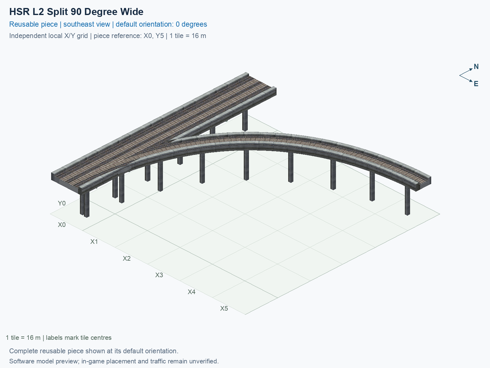

# HSR L2 Split 90 Degree Wide

Purpose: explain this reusable piece, its matching connections and current test coverage.

<!-- BEGIN PIECE OVERVIEW -->

HSR L2 Split 90 Degree Wide. Fixed click-to-place piece in a 6 by 6 tile area. Follow the arrows and join only matching track widths, directions, and height labels. Four proper rotations; the second four states repeat them. Experimental; game testing pending. The mainline retains both directions; only the branch is one-way.

Exact reusable identifier: `interchange-hsr-split-90-wide`.

Footprint: **6 × 6 tiles**. Exact menu name: **HSR L2 Split 90 Degree Wide**.

Choose this exact name in Transportation → Rail. Press Home or End to rotate; use only the supported states listed below. Join each end to a matching port profile and direction.

- [Connections and journeys](#connections-and-journeys)
- [Test checklist](#test-checklist)

### Design review

**REVIEW NEEDED** — Closely spaced pillars need a support-consolidation review.

- Separate 1.3 m-square pillar foundations have centres less than 2.6 m apart near shared rail geometry. The foundations do not overlap, but the close pair should be reviewed and consolidated to address the reported duplicate-pillar appearance. The 2.6 m review cutoff is an authoring convention, not a structural or game collision threshold.

[Design-review evidence](../../junction-design-review.json).



<!-- END PIECE OVERVIEW -->

<!-- BEGIN MANUAL SUMMARY -->

## Manual status

Generated from [the exact test cases](#test-checklist) and [authoritative observations](checks/manual-tests.json).

- [ ] Preview review: 0/1 applicable cases passed; 0 failed, 0 stale.
- [ ] In-game rendering: 0/4 applicable cases passed; 0 failed, 0 stale.
- [ ] Directed journeys: 0/12 applicable cases passed; 0 failed, 0 stale.

These observations cover only the named services, directions, poses, rotations, and recorded platforms.

<!-- END MANUAL SUMMARY -->

<!-- BEGIN CONNECTIONS -->

## Connections and journeys

Purpose: describe intrinsic directional interfaces and permitted service journeys.

Generated from [connections.json](connections.json). Coordinates are canonical east, north and height in metres. A connection class names an encoded route interface; it does not prove visible deck/wall fit or an in-game test.

Supported placement states: 0° CCW, 90° CCW, 180° CCW, 270° CCW. Each state has its own declared manual scope.

A **port** is one directional transport-path endpoint. **Service** identifies the intended network service (for example HSR, street, or tram); **engine** is its internal traffic-class number, separate from the construction network. **Role** distinguishes primary service from auxiliary paths; sharing a traffic class does not establish service compatibility.

A **tangent** is a unit travel-direction vector: `[0,1]` means north. **Grade** is height gained per horizontal metre. These measured facts describe this subject alone. Compatibility requires a separate comparison of the complete joining boundaries; physical seams and actual game operation require their own evidence. See the [class index](../../connection-classes.json) for shared route-interface membership.

| Port | Service / engine / role | Direction | Location; tangent; grade | Connection class |
| --- | --- | --- | --- | --- |
| `Sout` | hsr / 7 / primary | out | [-2.0, -88.0, 15.5]; [0.0, -1.0]; 0.0 | `path-interface-12d12be31d2057c5763d` |
| `Nin` | hsr / 7 / primary | in | [-2.0, 8.0, 15.5]; [0.0, -1.0]; 0.0 | `path-interface-12d12be31d2057c5763d` |
| `Sin` | hsr / 7 / primary | in | [2.0, -88.0, 15.5]; [0.0, 1.0]; 0.0 | `path-interface-fba09fbeb87ad95c667a` |
| `Nout` | hsr / 7 / primary | out | [2.0, 8.0, 15.5]; [0.0, 1.0]; 0.0 | `path-interface-fba09fbeb87ad95c667a` |
| `Bout` | hsr / 7 / primary | out | [88.0, 0.0, 15.5]; [1.0, 0.0]; 0.0 | `path-interface-365752af76285c80cd0b` |

### Directed journeys

| Service | Entry → exit | Role |
| --- | --- | --- |
| hsr | `Nin` → `Sout` | primary |
| hsr | `Sin` → `Bout` | primary |
| hsr | `Sin` → `Nout` | primary |

### Forbidden transfers

| From service / port | To service / port | Reason |
| --- | --- | --- |
| hsr / `Nin` | hsr / `Nout` | No directed route exists between these ports in the saved piece transport paths. In-game confirmation remains unverified. |
| hsr / `Nin` | hsr / `Bout` | No directed route exists between these ports in the saved piece transport paths. In-game confirmation remains unverified. |
| hsr / `Sin` | hsr / `Sout` | No directed route exists between these ports in the saved piece transport paths. In-game confirmation remains unverified. |

Review the test checklist for the exact tested cases and environments.

<!-- END CONNECTIONS -->

<!-- BEGIN MANUAL CHECKS -->

## Test checklist

Generated from [the authoritative record](checks/manual-tests.json). Only explicit human observations create manual passes; software and preview checks remain separate. Expand a check/service group to see its rotation table, then expand the matching exact scope to copy a case ID and inspect its pose, reviewer, environment, and evidence. Grouping changes only this view; every declared case remains separate.

**States:** [x] passed; [ ] unverified, failed, or stale; N/A is an explicit inapplicable declaration. A dash means no case was declared in that column. Every pass covers only its recorded environment. T means a distinct construction-transposed state.

Four proper rotations are covered. No additional reflected state is established by this record; repeated construction aliases do not create new orientations.

Current totals: unverified: 43, passed: 0, failed: 0, stale: 0, not_applicable: 0.

### Record an observation

Follow the [shared testing guide](../../../../docs/TESTING.md); copy [the unconfirmed example](checks/observation.example.json) to `checks/observation.json`. Case identifiers are in the expandable sections below. Do not edit generated checkboxes.

From the repository folder containing `custom-pieces`, run after filling `checks/observation.json` and explicitly confirming the exact observation:

```sh
python3 -m scp.content record --record custom-pieces/domains/high-speed-rail/00_pieces/interchange-hsr-split-90-wide/checks/manual-tests.json --observation custom-pieces/domains/high-speed-rail/00_pieces/interchange-hsr-split-90-wide/checks/observation.json
```

### Detailed current checks

Each collapsed group shows exact case counts and states. Forbidden transfers are grouped by the directed service pair; the table inside retains every port pair and rotation.

<details>
<summary>Compiled resources — Whole subject — 1 case; unverified: 1</summary>

| Check / exact scope | General | 0° | 90° | 180° | 270° |
| --- | --- | --- | --- | --- | --- |
| **Compiled resources**<br>Whole subject | <a href="#case-software_resources-bbd626473e4204da9011">[ ] unverified</a> | — | — | — | — |


<details>
<summary>Compiled resources — Whole subject</summary>

<a id="case-software_resources-bbd626473e4204da9011"></a>

**General: unverified** — `software_resources-bbd626473e4204da9011`.

Verify the actual compiled resources and construction rules.

Scope: Whole subject.

No observation recorded.

</details>

</details>

<details>
<summary>Directed routing graph — Whole subject — 1 case; unverified: 1</summary>

| Check / exact scope | General | 0° | 90° | 180° | 270° |
| --- | --- | --- | --- | --- | --- |
| **Directed routing graph**<br>Whole subject | <a href="#case-software_connectivity-bbd626473e4204da9011">[ ] unverified</a> | — | — | — | — |


<details>
<summary>Directed routing graph — Whole subject</summary>

<a id="case-software_connectivity-bbd626473e4204da9011"></a>

**General: unverified** — `software_connectivity-bbd626473e4204da9011`.

Verify the declared directed journeys and forbidden transfers.

Scope: Whole subject.

No observation recorded.

</details>

</details>

<details>
<summary>Preview review — Images — 1 case; unverified: 1</summary>

| Check / exact scope | General | 0° | 90° | 180° | 270° |
| --- | --- | --- | --- | --- | --- |
| **Preview review**<br>Image: image:interchange-hsr-split-90-wide:canonical-southeast | <a href="#case-preview_review-e920bef097b70fd2fc14">[ ] unverified</a> | — | — | — | — |


<details>
<summary>Preview review — Image: image:interchange-hsr-split-90-wide:canonical-southeast</summary>

<a id="case-preview_review-e920bef097b70fd2fc14"></a>

**General: unverified** — `preview_review-e920bef097b70fd2fc14`.

Inspect this exact preview for tracks, walls, piers, seams and shadows.

Scope: Image: image:interchange-hsr-split-90-wide:canonical-southeast.

No observation recorded.

</details>

</details>

<details>
<summary>In-game rendering — Whole subject — 4 cases; unverified: 4</summary>

| Check / exact scope | General | 0° | 90° | 180° | 270° |
| --- | --- | --- | --- | --- | --- |
| **In-game rendering**<br>Whole subject | — | <a href="#case-in_game_render-7b962481b1ed046b6dba">[ ] unverified</a> | <a href="#case-in_game_render-6a48318ff0d00a5c237f">[ ] unverified</a> | <a href="#case-in_game_render-03aa258c0331fbebcd89">[ ] unverified</a> | <a href="#case-in_game_render-c0c5cac9c9b7661193b6">[ ] unverified</a> |


<details>
<summary>In-game rendering — Whole subject</summary>

<a id="case-in_game_render-7b962481b1ed046b6dba"></a>

**0° CCW: unverified** — `in_game_render-7b962481b1ed046b6dba`.

Inspect the placed tracks, walls, piers, seams and shadows in SimCity 4.

Scope: Whole subject.

No observation recorded.

<a id="case-in_game_render-6a48318ff0d00a5c237f"></a>

**90° CCW: unverified** — `in_game_render-6a48318ff0d00a5c237f`.

Inspect the placed tracks, walls, piers, seams and shadows in SimCity 4.

Scope: Whole subject.

No observation recorded.

<a id="case-in_game_render-03aa258c0331fbebcd89"></a>

**180° CCW: unverified** — `in_game_render-03aa258c0331fbebcd89`.

Inspect the placed tracks, walls, piers, seams and shadows in SimCity 4.

Scope: Whole subject.

No observation recorded.

<a id="case-in_game_render-c0c5cac9c9b7661193b6"></a>

**270° CCW: unverified** — `in_game_render-c0c5cac9c9b7661193b6`.

Inspect the placed tracks, walls, piers, seams and shadows in SimCity 4.

Scope: Whole subject.

No observation recorded.

</details>

</details>

<details>
<summary>Placement — Whole subject — 4 cases; unverified: 4</summary>

| Check / exact scope | General | 0° | 90° | 180° | 270° |
| --- | --- | --- | --- | --- | --- |
| **Placement**<br>Whole subject | — | <a href="#case-in_game_placement-7b962481b1ed046b6dba">[ ] unverified</a> | <a href="#case-in_game_placement-6a48318ff0d00a5c237f">[ ] unverified</a> | <a href="#case-in_game_placement-03aa258c0331fbebcd89">[ ] unverified</a> | <a href="#case-in_game_placement-c0c5cac9c9b7661193b6">[ ] unverified</a> |


<details>
<summary>Placement — Whole subject</summary>

<a id="case-in_game_placement-7b962481b1ed046b6dba"></a>

**0° CCW: unverified** — `in_game_placement-7b962481b1ed046b6dba`.

Place this piece or complete blueprint and inspect every occupied tile.

Scope: Whole subject.

No observation recorded.

<a id="case-in_game_placement-6a48318ff0d00a5c237f"></a>

**90° CCW: unverified** — `in_game_placement-6a48318ff0d00a5c237f`.

Place this piece or complete blueprint and inspect every occupied tile.

Scope: Whole subject.

No observation recorded.

<a id="case-in_game_placement-03aa258c0331fbebcd89"></a>

**180° CCW: unverified** — `in_game_placement-03aa258c0331fbebcd89`.

Place this piece or complete blueprint and inspect every occupied tile.

Scope: Whole subject.

No observation recorded.

<a id="case-in_game_placement-c0c5cac9c9b7661193b6"></a>

**270° CCW: unverified** — `in_game_placement-c0c5cac9c9b7661193b6`.

Place this piece or complete blueprint and inspect every occupied tile.

Scope: Whole subject.

No observation recorded.

</details>

</details>

<details>
<summary>Demolition — Whole subject — 4 cases; unverified: 4</summary>

| Check / exact scope | General | 0° | 90° | 180° | 270° |
| --- | --- | --- | --- | --- | --- |
| **Demolition**<br>Whole subject | — | <a href="#case-in_game_demolition-7b962481b1ed046b6dba">[ ] unverified</a> | <a href="#case-in_game_demolition-6a48318ff0d00a5c237f">[ ] unverified</a> | <a href="#case-in_game_demolition-03aa258c0331fbebcd89">[ ] unverified</a> | <a href="#case-in_game_demolition-c0c5cac9c9b7661193b6">[ ] unverified</a> |


<details>
<summary>Demolition — Whole subject</summary>

<a id="case-in_game_demolition-7b962481b1ed046b6dba"></a>

**0° CCW: unverified** — `in_game_demolition-7b962481b1ed046b6dba`.

Bulldoze the complete placement and inspect the cleared area.

Scope: Whole subject.

No observation recorded.

<a id="case-in_game_demolition-6a48318ff0d00a5c237f"></a>

**90° CCW: unverified** — `in_game_demolition-6a48318ff0d00a5c237f`.

Bulldoze the complete placement and inspect the cleared area.

Scope: Whole subject.

No observation recorded.

<a id="case-in_game_demolition-03aa258c0331fbebcd89"></a>

**180° CCW: unverified** — `in_game_demolition-03aa258c0331fbebcd89`.

Bulldoze the complete placement and inspect the cleared area.

Scope: Whole subject.

No observation recorded.

<a id="case-in_game_demolition-c0c5cac9c9b7661193b6"></a>

**270° CCW: unverified** — `in_game_demolition-c0c5cac9c9b7661193b6`.

Bulldoze the complete placement and inspect the cleared area.

Scope: Whole subject.

No observation recorded.

</details>

</details>

<details>
<summary>Save and reload — Whole subject — 4 cases; unverified: 4</summary>

| Check / exact scope | General | 0° | 90° | 180° | 270° |
| --- | --- | --- | --- | --- | --- |
| **Save and reload**<br>Whole subject | — | <a href="#case-in_game_save_reload-7b962481b1ed046b6dba">[ ] unverified</a> | <a href="#case-in_game_save_reload-6a48318ff0d00a5c237f">[ ] unverified</a> | <a href="#case-in_game_save_reload-03aa258c0331fbebcd89">[ ] unverified</a> | <a href="#case-in_game_save_reload-c0c5cac9c9b7661193b6">[ ] unverified</a> |


<details>
<summary>Save and reload — Whole subject</summary>

<a id="case-in_game_save_reload-7b962481b1ed046b6dba"></a>

**0° CCW: unverified** — `in_game_save_reload-7b962481b1ed046b6dba`.

Save, quit, reload and inspect the placement and its paths.

Scope: Whole subject.

No observation recorded.

<a id="case-in_game_save_reload-6a48318ff0d00a5c237f"></a>

**90° CCW: unverified** — `in_game_save_reload-6a48318ff0d00a5c237f`.

Save, quit, reload and inspect the placement and its paths.

Scope: Whole subject.

No observation recorded.

<a id="case-in_game_save_reload-03aa258c0331fbebcd89"></a>

**180° CCW: unverified** — `in_game_save_reload-03aa258c0331fbebcd89`.

Save, quit, reload and inspect the placement and its paths.

Scope: Whole subject.

No observation recorded.

<a id="case-in_game_save_reload-c0c5cac9c9b7661193b6"></a>

**270° CCW: unverified** — `in_game_save_reload-c0c5cac9c9b7661193b6`.

Save, quit, reload and inspect the placement and its paths.

Scope: Whole subject.

No observation recorded.

</details>

</details>

<details>
<summary>Journey — hsr — 12 cases; unverified: 12</summary>

| Check / exact scope | General | 0° | 90° | 180° | 270° |
| --- | --- | --- | --- | --- | --- |
| **Journey**<br>Service: hsr; role: primary; journey: 7:Nin>Sout; entry: Nin; exit: Sout | — | <a href="#case-in_game_journey-ed6a4cf6f1384ac43968">[ ] unverified</a> | <a href="#case-in_game_journey-f3e09d472647368c3684">[ ] unverified</a> | <a href="#case-in_game_journey-64e1a52b1a7f1e11b36a">[ ] unverified</a> | <a href="#case-in_game_journey-a51d2b855368d1dd3ba6">[ ] unverified</a> |
| **Journey**<br>Service: hsr; role: primary; journey: 7:Sin>Bout; entry: Sin; exit: Bout | — | <a href="#case-in_game_journey-9a85f069cf9d49d00aef">[ ] unverified</a> | <a href="#case-in_game_journey-b23f59c7b614affcd735">[ ] unverified</a> | <a href="#case-in_game_journey-69e76d46e7053c03a58c">[ ] unverified</a> | <a href="#case-in_game_journey-58ad21c4f466e5f54989">[ ] unverified</a> |
| **Journey**<br>Service: hsr; role: primary; journey: 7:Sin>Nout; entry: Sin; exit: Nout | — | <a href="#case-in_game_journey-73ebbd40012f5e181841">[ ] unverified</a> | <a href="#case-in_game_journey-c0941683f8320c4b1990">[ ] unverified</a> | <a href="#case-in_game_journey-9dfd27baa1e7be5d38b9">[ ] unverified</a> | <a href="#case-in_game_journey-8037b6389bc8a0ba136a">[ ] unverified</a> |


<details>
<summary>Journey — Service: hsr; role: primary; journey: 7:Nin>Sout; entry: Nin; exit: Sout</summary>

<a id="case-in_game_journey-ed6a4cf6f1384ac43968"></a>

**0° CCW: unverified** — `in_game_journey-ed6a4cf6f1384ac43968`.

Run the declared journey in this direction using its service network.

Scope: Service: hsr; role: primary; journey: 7:Nin>Sout; entry: Nin; exit: Sout.

No observation recorded.

<a id="case-in_game_journey-f3e09d472647368c3684"></a>

**90° CCW: unverified** — `in_game_journey-f3e09d472647368c3684`.

Run the declared journey in this direction using its service network.

Scope: Service: hsr; role: primary; journey: 7:Nin>Sout; entry: Nin; exit: Sout.

No observation recorded.

<a id="case-in_game_journey-64e1a52b1a7f1e11b36a"></a>

**180° CCW: unverified** — `in_game_journey-64e1a52b1a7f1e11b36a`.

Run the declared journey in this direction using its service network.

Scope: Service: hsr; role: primary; journey: 7:Nin>Sout; entry: Nin; exit: Sout.

No observation recorded.

<a id="case-in_game_journey-a51d2b855368d1dd3ba6"></a>

**270° CCW: unverified** — `in_game_journey-a51d2b855368d1dd3ba6`.

Run the declared journey in this direction using its service network.

Scope: Service: hsr; role: primary; journey: 7:Nin>Sout; entry: Nin; exit: Sout.

No observation recorded.

</details>


<details>
<summary>Journey — Service: hsr; role: primary; journey: 7:Sin>Bout; entry: Sin; exit: Bout</summary>

<a id="case-in_game_journey-9a85f069cf9d49d00aef"></a>

**0° CCW: unverified** — `in_game_journey-9a85f069cf9d49d00aef`.

Run the declared journey in this direction using its service network.

Scope: Service: hsr; role: primary; journey: 7:Sin>Bout; entry: Sin; exit: Bout.

No observation recorded.

<a id="case-in_game_journey-b23f59c7b614affcd735"></a>

**90° CCW: unverified** — `in_game_journey-b23f59c7b614affcd735`.

Run the declared journey in this direction using its service network.

Scope: Service: hsr; role: primary; journey: 7:Sin>Bout; entry: Sin; exit: Bout.

No observation recorded.

<a id="case-in_game_journey-69e76d46e7053c03a58c"></a>

**180° CCW: unverified** — `in_game_journey-69e76d46e7053c03a58c`.

Run the declared journey in this direction using its service network.

Scope: Service: hsr; role: primary; journey: 7:Sin>Bout; entry: Sin; exit: Bout.

No observation recorded.

<a id="case-in_game_journey-58ad21c4f466e5f54989"></a>

**270° CCW: unverified** — `in_game_journey-58ad21c4f466e5f54989`.

Run the declared journey in this direction using its service network.

Scope: Service: hsr; role: primary; journey: 7:Sin>Bout; entry: Sin; exit: Bout.

No observation recorded.

</details>


<details>
<summary>Journey — Service: hsr; role: primary; journey: 7:Sin>Nout; entry: Sin; exit: Nout</summary>

<a id="case-in_game_journey-73ebbd40012f5e181841"></a>

**0° CCW: unverified** — `in_game_journey-73ebbd40012f5e181841`.

Run the declared journey in this direction using its service network.

Scope: Service: hsr; role: primary; journey: 7:Sin>Nout; entry: Sin; exit: Nout.

No observation recorded.

<a id="case-in_game_journey-c0941683f8320c4b1990"></a>

**90° CCW: unverified** — `in_game_journey-c0941683f8320c4b1990`.

Run the declared journey in this direction using its service network.

Scope: Service: hsr; role: primary; journey: 7:Sin>Nout; entry: Sin; exit: Nout.

No observation recorded.

<a id="case-in_game_journey-9dfd27baa1e7be5d38b9"></a>

**180° CCW: unverified** — `in_game_journey-9dfd27baa1e7be5d38b9`.

Run the declared journey in this direction using its service network.

Scope: Service: hsr; role: primary; journey: 7:Sin>Nout; entry: Sin; exit: Nout.

No observation recorded.

<a id="case-in_game_journey-8037b6389bc8a0ba136a"></a>

**270° CCW: unverified** — `in_game_journey-8037b6389bc8a0ba136a`.

Run the declared journey in this direction using its service network.

Scope: Service: hsr; role: primary; journey: 7:Sin>Nout; entry: Sin; exit: Nout.

No observation recorded.

</details>

</details>

<details>
<summary>Forbidden transfer — hsr → hsr — 12 cases; unverified: 12</summary>

| Check / exact scope | General | 0° | 90° | 180° | 270° |
| --- | --- | --- | --- | --- | --- |
| **Forbidden transfer**<br>from port: Nin; to port: Nout; from service: hsr; to service: hsr; basis: not reachable in actual saved PATH graph | — | <a href="#case-in_game_forbidden_transfer-6b99e914b976724ff668">[ ] unverified</a> | <a href="#case-in_game_forbidden_transfer-b6dc6c458eeed0f7e205">[ ] unverified</a> | <a href="#case-in_game_forbidden_transfer-3fcd6f2d403f03e9da66">[ ] unverified</a> | <a href="#case-in_game_forbidden_transfer-a7dde6c7bf3e7b9659e2">[ ] unverified</a> |
| **Forbidden transfer**<br>from port: Nin; to port: Bout; from service: hsr; to service: hsr; basis: not reachable in actual saved PATH graph | — | <a href="#case-in_game_forbidden_transfer-7a228756df79a2feece0">[ ] unverified</a> | <a href="#case-in_game_forbidden_transfer-0e5e96075dcb7844f0ba">[ ] unverified</a> | <a href="#case-in_game_forbidden_transfer-ee02e4a548fed4ffe815">[ ] unverified</a> | <a href="#case-in_game_forbidden_transfer-f04824163e7c8abced5f">[ ] unverified</a> |
| **Forbidden transfer**<br>from port: Sin; to port: Sout; from service: hsr; to service: hsr; basis: not reachable in actual saved PATH graph | — | <a href="#case-in_game_forbidden_transfer-239d8468f27b9ca57e44">[ ] unverified</a> | <a href="#case-in_game_forbidden_transfer-9636014170c0d234c16a">[ ] unverified</a> | <a href="#case-in_game_forbidden_transfer-3fafb5fffef54623b648">[ ] unverified</a> | <a href="#case-in_game_forbidden_transfer-509e08a026183288e13d">[ ] unverified</a> |


<details>
<summary>Forbidden transfer — from port: Nin; to port: Nout; from service: hsr; to service: hsr; basis: not reachable in actual saved PATH graph</summary>

<a id="case-in_game_forbidden_transfer-6b99e914b976724ff668"></a>

**0° CCW: unverified** — `in_game_forbidden_transfer-6b99e914b976724ff668`.

Confirm this undeclared transfer is unavailable.

Scope: from port: Nin; to port: Nout; from service: hsr; to service: hsr; basis: not reachable in actual saved PATH graph.

No observation recorded.

<a id="case-in_game_forbidden_transfer-b6dc6c458eeed0f7e205"></a>

**90° CCW: unverified** — `in_game_forbidden_transfer-b6dc6c458eeed0f7e205`.

Confirm this undeclared transfer is unavailable.

Scope: from port: Nin; to port: Nout; from service: hsr; to service: hsr; basis: not reachable in actual saved PATH graph.

No observation recorded.

<a id="case-in_game_forbidden_transfer-3fcd6f2d403f03e9da66"></a>

**180° CCW: unverified** — `in_game_forbidden_transfer-3fcd6f2d403f03e9da66`.

Confirm this undeclared transfer is unavailable.

Scope: from port: Nin; to port: Nout; from service: hsr; to service: hsr; basis: not reachable in actual saved PATH graph.

No observation recorded.

<a id="case-in_game_forbidden_transfer-a7dde6c7bf3e7b9659e2"></a>

**270° CCW: unverified** — `in_game_forbidden_transfer-a7dde6c7bf3e7b9659e2`.

Confirm this undeclared transfer is unavailable.

Scope: from port: Nin; to port: Nout; from service: hsr; to service: hsr; basis: not reachable in actual saved PATH graph.

No observation recorded.

</details>


<details>
<summary>Forbidden transfer — from port: Nin; to port: Bout; from service: hsr; to service: hsr; basis: not reachable in actual saved PATH graph</summary>

<a id="case-in_game_forbidden_transfer-7a228756df79a2feece0"></a>

**0° CCW: unverified** — `in_game_forbidden_transfer-7a228756df79a2feece0`.

Confirm this undeclared transfer is unavailable.

Scope: from port: Nin; to port: Bout; from service: hsr; to service: hsr; basis: not reachable in actual saved PATH graph.

No observation recorded.

<a id="case-in_game_forbidden_transfer-0e5e96075dcb7844f0ba"></a>

**90° CCW: unverified** — `in_game_forbidden_transfer-0e5e96075dcb7844f0ba`.

Confirm this undeclared transfer is unavailable.

Scope: from port: Nin; to port: Bout; from service: hsr; to service: hsr; basis: not reachable in actual saved PATH graph.

No observation recorded.

<a id="case-in_game_forbidden_transfer-ee02e4a548fed4ffe815"></a>

**180° CCW: unverified** — `in_game_forbidden_transfer-ee02e4a548fed4ffe815`.

Confirm this undeclared transfer is unavailable.

Scope: from port: Nin; to port: Bout; from service: hsr; to service: hsr; basis: not reachable in actual saved PATH graph.

No observation recorded.

<a id="case-in_game_forbidden_transfer-f04824163e7c8abced5f"></a>

**270° CCW: unverified** — `in_game_forbidden_transfer-f04824163e7c8abced5f`.

Confirm this undeclared transfer is unavailable.

Scope: from port: Nin; to port: Bout; from service: hsr; to service: hsr; basis: not reachable in actual saved PATH graph.

No observation recorded.

</details>


<details>
<summary>Forbidden transfer — from port: Sin; to port: Sout; from service: hsr; to service: hsr; basis: not reachable in actual saved PATH graph</summary>

<a id="case-in_game_forbidden_transfer-239d8468f27b9ca57e44"></a>

**0° CCW: unverified** — `in_game_forbidden_transfer-239d8468f27b9ca57e44`.

Confirm this undeclared transfer is unavailable.

Scope: from port: Sin; to port: Sout; from service: hsr; to service: hsr; basis: not reachable in actual saved PATH graph.

No observation recorded.

<a id="case-in_game_forbidden_transfer-9636014170c0d234c16a"></a>

**90° CCW: unverified** — `in_game_forbidden_transfer-9636014170c0d234c16a`.

Confirm this undeclared transfer is unavailable.

Scope: from port: Sin; to port: Sout; from service: hsr; to service: hsr; basis: not reachable in actual saved PATH graph.

No observation recorded.

<a id="case-in_game_forbidden_transfer-3fafb5fffef54623b648"></a>

**180° CCW: unverified** — `in_game_forbidden_transfer-3fafb5fffef54623b648`.

Confirm this undeclared transfer is unavailable.

Scope: from port: Sin; to port: Sout; from service: hsr; to service: hsr; basis: not reachable in actual saved PATH graph.

No observation recorded.

<a id="case-in_game_forbidden_transfer-509e08a026183288e13d"></a>

**270° CCW: unverified** — `in_game_forbidden_transfer-509e08a026183288e13d`.

Confirm this undeclared transfer is unavailable.

Scope: from port: Sin; to port: Sout; from service: hsr; to service: hsr; basis: not reachable in actual saved PATH graph.

No observation recorded.

</details>

</details>

<!-- END MANUAL CHECKS -->
