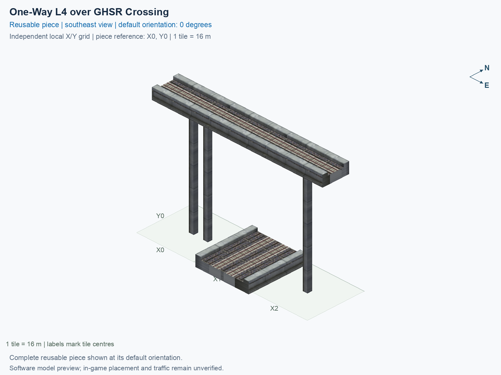

# One-Way L4 over GHSR Crossing

Purpose: explain this reusable piece, its matching connections and current test coverage.

<!-- BEGIN PIECE OVERVIEW -->

One-Way L4 over GHSR Crossing. Fixed click-to-place piece in a 3 by 1 tile area. Follow the arrows and join only matching track widths, directions, and height labels. Four proper rotations; the second four states repeat them. Experimental; game testing pending. The upper route crosses without transferring to the lower two-way route.

Exact reusable identifier: `interchange-l4-oneway-over-ground`.

Footprint: **3 × 1 tiles**. Exact menu name: **One-Way L4 over GHSR Crossing**.

Choose this exact name in Transportation → Rail. Press Home or End to rotate; use only the supported states listed below. Join each end to a matching port profile and direction.

- [Connections and journeys](#connections-and-journeys)
- [Test checklist](#test-checklist)



<!-- END PIECE OVERVIEW -->

<!-- BEGIN MANUAL SUMMARY -->

## Manual status

Generated from [the exact test cases](#test-checklist) and [authoritative observations](checks/manual-tests.json).

- [ ] Preview review: 0/1 applicable cases passed; 0 failed, 0 stale.
- [ ] In-game rendering: 0/4 applicable cases passed; 0 failed, 0 stale.
- [ ] Directed journeys: 0/12 applicable cases passed; 0 failed, 0 stale.

These observations cover only the named services, directions, poses, rotations, and recorded platforms.

<!-- END MANUAL SUMMARY -->

<!-- BEGIN CONNECTIONS -->

## Connections and journeys

Purpose: describe intrinsic directional interfaces and permitted service journeys.

Generated from [connections.json](connections.json). Coordinates are canonical east, north and height in metres. A connection class names an encoded route interface; it does not prove visible deck/wall fit or an in-game test.

Supported placement states: 0° CCW, 90° CCW, 180° CCW, 270° CCW. Each state has its own declared manual scope.

A **port** is one directional transport-path endpoint. **Service** identifies the intended network service (for example HSR, street, or tram); **engine** is its internal traffic-class number, separate from the construction network. **Role** distinguishes primary service from auxiliary paths; sharing a traffic class does not establish service compatibility.

A **tangent** is a unit travel-direction vector: `[0,1]` means north. **Grade** is height gained per horizontal metre. These measured facts describe this subject alone. Compatibility requires a separate comparison of the complete joining boundaries; physical seams and actual game operation require their own evidence. See the [class index](../../connection-classes.json) for shared route-interface membership.

| Port | Service / engine / role | Direction | Location; tangent; grade | Connection class |
| --- | --- | --- | --- | --- |
| `Win` | hsr / 7 / primary | in | [-8.0, 0.0, 30.5]; [1.0, 0.0]; 0.0 | `path-interface-a11c9f8debd0ee1c3a94` |
| `Sout` | ghsr / 7 / primary | out | [14.0, -8.0, 1.0]; [0.0, -1.0]; 0.0 | `path-interface-c78c5ac4b558d84b46f2` |
| `Nin` | ghsr / 7 / primary | in | [14.0, 8.0, 1.0]; [0.0, -1.0]; 0.0 | `path-interface-c78c5ac4b558d84b46f2` |
| `Sin` | ghsr / 7 / primary | in | [18.0, -8.0, 1.0]; [0.0, 1.0]; 0.0 | `path-interface-fab587419de6b5848d74` |
| `Nout` | ghsr / 7 / primary | out | [18.0, 8.0, 1.0]; [0.0, 1.0]; 0.0 | `path-interface-fab587419de6b5848d74` |
| `Eout` | hsr / 7 / primary | out | [40.0, 0.0, 30.5]; [1.0, 0.0]; 0.0 | `path-interface-a11c9f8debd0ee1c3a94` |

### Directed journeys

| Service | Entry → exit | Role |
| --- | --- | --- |
| hsr | `Win` → `Eout` | primary |
| ghsr | `Nin` → `Sout` | primary |
| ghsr | `Sin` → `Nout` | primary |

### Forbidden transfers

| From service / port | To service / port | Reason |
| --- | --- | --- |
| hsr / `Win` | ghsr / `Sout` | No directed route exists between these ports in the saved piece transport paths. In-game confirmation remains unverified. |
| hsr / `Win` | ghsr / `Nout` | No directed route exists between these ports in the saved piece transport paths. In-game confirmation remains unverified. |
| ghsr / `Nin` | ghsr / `Nout` | No directed route exists between these ports in the saved piece transport paths. In-game confirmation remains unverified. |
| ghsr / `Nin` | hsr / `Eout` | No directed route exists between these ports in the saved piece transport paths. In-game confirmation remains unverified. |
| ghsr / `Sin` | ghsr / `Sout` | No directed route exists between these ports in the saved piece transport paths. In-game confirmation remains unverified. |
| ghsr / `Sin` | hsr / `Eout` | No directed route exists between these ports in the saved piece transport paths. In-game confirmation remains unverified. |

Review the test checklist for the exact tested cases and environments.

<!-- END CONNECTIONS -->

<!-- BEGIN MANUAL CHECKS -->

## Test checklist

Generated from [the authoritative record](checks/manual-tests.json). Only explicit human observations create manual passes; software and preview checks remain separate. Expand a check/service group to see its rotation table, then expand the matching exact scope to copy a case ID and inspect its pose, reviewer, environment, and evidence. Grouping changes only this view; every declared case remains separate.

**States:** [x] passed; [ ] unverified, failed, or stale; N/A is an explicit inapplicable declaration. A dash means no case was declared in that column. Every pass covers only its recorded environment. T means a distinct construction-transposed state.

Four proper rotations are covered. No additional reflected state is established by this record; repeated construction aliases do not create new orientations.

Current totals: unverified: 55, passed: 0, failed: 0, stale: 0, not_applicable: 0.

### Record an observation

Follow the [shared testing guide](../../../../docs/TESTING.md); copy [the unconfirmed example](checks/observation.example.json) to `checks/observation.json`. Case identifiers are in the expandable sections below. Do not edit generated checkboxes.

From the repository folder containing `custom-pieces`, run after filling `checks/observation.json` and explicitly confirming the exact observation:

```sh
python3 -m scp.content record --record custom-pieces/domains/high-speed-rail/00_pieces/interchange-l4-oneway-over-ground/checks/manual-tests.json --observation custom-pieces/domains/high-speed-rail/00_pieces/interchange-l4-oneway-over-ground/checks/observation.json
```

### Detailed current checks

Each collapsed group shows exact case counts and states. Forbidden transfers are grouped by the directed service pair; the table inside retains every port pair and rotation.

<details>
<summary>Compiled resources — Whole subject — 1 case; unverified: 1</summary>

| Check / exact scope | General | 0° | 90° | 180° | 270° |
| --- | --- | --- | --- | --- | --- |
| **Compiled resources**<br>Whole subject | <a href="#case-software_resources-f9b3853adab5ba7f5bed">[ ] unverified</a> | — | — | — | — |


<details>
<summary>Compiled resources — Whole subject</summary>

<a id="case-software_resources-f9b3853adab5ba7f5bed"></a>

**General: unverified** — `software_resources-f9b3853adab5ba7f5bed`.

Verify the actual compiled resources and construction rules.

Scope: Whole subject.

No observation recorded.

</details>

</details>

<details>
<summary>Directed routing graph — Whole subject — 1 case; unverified: 1</summary>

| Check / exact scope | General | 0° | 90° | 180° | 270° |
| --- | --- | --- | --- | --- | --- |
| **Directed routing graph**<br>Whole subject | <a href="#case-software_connectivity-f9b3853adab5ba7f5bed">[ ] unverified</a> | — | — | — | — |


<details>
<summary>Directed routing graph — Whole subject</summary>

<a id="case-software_connectivity-f9b3853adab5ba7f5bed"></a>

**General: unverified** — `software_connectivity-f9b3853adab5ba7f5bed`.

Verify the declared directed journeys and forbidden transfers.

Scope: Whole subject.

No observation recorded.

</details>

</details>

<details>
<summary>Preview review — Images — 1 case; unverified: 1</summary>

| Check / exact scope | General | 0° | 90° | 180° | 270° |
| --- | --- | --- | --- | --- | --- |
| **Preview review**<br>Image: image:interchange-l4-oneway-over-ground:canonical-southeast | <a href="#case-preview_review-d0cf33f4a4d6fd0ba241">[ ] unverified</a> | — | — | — | — |


<details>
<summary>Preview review — Image: image:interchange-l4-oneway-over-ground:canonical-southeast</summary>

<a id="case-preview_review-d0cf33f4a4d6fd0ba241"></a>

**General: unverified** — `preview_review-d0cf33f4a4d6fd0ba241`.

Inspect this exact preview for tracks, walls, piers, seams and shadows.

Scope: Image: image:interchange-l4-oneway-over-ground:canonical-southeast.

No observation recorded.

</details>

</details>

<details>
<summary>In-game rendering — Whole subject — 4 cases; unverified: 4</summary>

| Check / exact scope | General | 0° | 90° | 180° | 270° |
| --- | --- | --- | --- | --- | --- |
| **In-game rendering**<br>Whole subject | — | <a href="#case-in_game_render-baecd8625563efedfff9">[ ] unverified</a> | <a href="#case-in_game_render-1fb04f4db3d234699cb1">[ ] unverified</a> | <a href="#case-in_game_render-fdc0c2e645daacd4dcd6">[ ] unverified</a> | <a href="#case-in_game_render-ef319bf8d310350ed6ed">[ ] unverified</a> |


<details>
<summary>In-game rendering — Whole subject</summary>

<a id="case-in_game_render-baecd8625563efedfff9"></a>

**0° CCW: unverified** — `in_game_render-baecd8625563efedfff9`.

Inspect the placed tracks, walls, piers, seams and shadows in SimCity 4.

Scope: Whole subject.

No observation recorded.

<a id="case-in_game_render-1fb04f4db3d234699cb1"></a>

**90° CCW: unverified** — `in_game_render-1fb04f4db3d234699cb1`.

Inspect the placed tracks, walls, piers, seams and shadows in SimCity 4.

Scope: Whole subject.

No observation recorded.

<a id="case-in_game_render-fdc0c2e645daacd4dcd6"></a>

**180° CCW: unverified** — `in_game_render-fdc0c2e645daacd4dcd6`.

Inspect the placed tracks, walls, piers, seams and shadows in SimCity 4.

Scope: Whole subject.

No observation recorded.

<a id="case-in_game_render-ef319bf8d310350ed6ed"></a>

**270° CCW: unverified** — `in_game_render-ef319bf8d310350ed6ed`.

Inspect the placed tracks, walls, piers, seams and shadows in SimCity 4.

Scope: Whole subject.

No observation recorded.

</details>

</details>

<details>
<summary>Placement — Whole subject — 4 cases; unverified: 4</summary>

| Check / exact scope | General | 0° | 90° | 180° | 270° |
| --- | --- | --- | --- | --- | --- |
| **Placement**<br>Whole subject | — | <a href="#case-in_game_placement-baecd8625563efedfff9">[ ] unverified</a> | <a href="#case-in_game_placement-1fb04f4db3d234699cb1">[ ] unverified</a> | <a href="#case-in_game_placement-fdc0c2e645daacd4dcd6">[ ] unverified</a> | <a href="#case-in_game_placement-ef319bf8d310350ed6ed">[ ] unverified</a> |


<details>
<summary>Placement — Whole subject</summary>

<a id="case-in_game_placement-baecd8625563efedfff9"></a>

**0° CCW: unverified** — `in_game_placement-baecd8625563efedfff9`.

Place this piece or complete blueprint and inspect every occupied tile.

Scope: Whole subject.

No observation recorded.

<a id="case-in_game_placement-1fb04f4db3d234699cb1"></a>

**90° CCW: unverified** — `in_game_placement-1fb04f4db3d234699cb1`.

Place this piece or complete blueprint and inspect every occupied tile.

Scope: Whole subject.

No observation recorded.

<a id="case-in_game_placement-fdc0c2e645daacd4dcd6"></a>

**180° CCW: unverified** — `in_game_placement-fdc0c2e645daacd4dcd6`.

Place this piece or complete blueprint and inspect every occupied tile.

Scope: Whole subject.

No observation recorded.

<a id="case-in_game_placement-ef319bf8d310350ed6ed"></a>

**270° CCW: unverified** — `in_game_placement-ef319bf8d310350ed6ed`.

Place this piece or complete blueprint and inspect every occupied tile.

Scope: Whole subject.

No observation recorded.

</details>

</details>

<details>
<summary>Demolition — Whole subject — 4 cases; unverified: 4</summary>

| Check / exact scope | General | 0° | 90° | 180° | 270° |
| --- | --- | --- | --- | --- | --- |
| **Demolition**<br>Whole subject | — | <a href="#case-in_game_demolition-baecd8625563efedfff9">[ ] unverified</a> | <a href="#case-in_game_demolition-1fb04f4db3d234699cb1">[ ] unverified</a> | <a href="#case-in_game_demolition-fdc0c2e645daacd4dcd6">[ ] unverified</a> | <a href="#case-in_game_demolition-ef319bf8d310350ed6ed">[ ] unverified</a> |


<details>
<summary>Demolition — Whole subject</summary>

<a id="case-in_game_demolition-baecd8625563efedfff9"></a>

**0° CCW: unverified** — `in_game_demolition-baecd8625563efedfff9`.

Bulldoze the complete placement and inspect the cleared area.

Scope: Whole subject.

No observation recorded.

<a id="case-in_game_demolition-1fb04f4db3d234699cb1"></a>

**90° CCW: unverified** — `in_game_demolition-1fb04f4db3d234699cb1`.

Bulldoze the complete placement and inspect the cleared area.

Scope: Whole subject.

No observation recorded.

<a id="case-in_game_demolition-fdc0c2e645daacd4dcd6"></a>

**180° CCW: unverified** — `in_game_demolition-fdc0c2e645daacd4dcd6`.

Bulldoze the complete placement and inspect the cleared area.

Scope: Whole subject.

No observation recorded.

<a id="case-in_game_demolition-ef319bf8d310350ed6ed"></a>

**270° CCW: unverified** — `in_game_demolition-ef319bf8d310350ed6ed`.

Bulldoze the complete placement and inspect the cleared area.

Scope: Whole subject.

No observation recorded.

</details>

</details>

<details>
<summary>Save and reload — Whole subject — 4 cases; unverified: 4</summary>

| Check / exact scope | General | 0° | 90° | 180° | 270° |
| --- | --- | --- | --- | --- | --- |
| **Save and reload**<br>Whole subject | — | <a href="#case-in_game_save_reload-baecd8625563efedfff9">[ ] unverified</a> | <a href="#case-in_game_save_reload-1fb04f4db3d234699cb1">[ ] unverified</a> | <a href="#case-in_game_save_reload-fdc0c2e645daacd4dcd6">[ ] unverified</a> | <a href="#case-in_game_save_reload-ef319bf8d310350ed6ed">[ ] unverified</a> |


<details>
<summary>Save and reload — Whole subject</summary>

<a id="case-in_game_save_reload-baecd8625563efedfff9"></a>

**0° CCW: unverified** — `in_game_save_reload-baecd8625563efedfff9`.

Save, quit, reload and inspect the placement and its paths.

Scope: Whole subject.

No observation recorded.

<a id="case-in_game_save_reload-1fb04f4db3d234699cb1"></a>

**90° CCW: unverified** — `in_game_save_reload-1fb04f4db3d234699cb1`.

Save, quit, reload and inspect the placement and its paths.

Scope: Whole subject.

No observation recorded.

<a id="case-in_game_save_reload-fdc0c2e645daacd4dcd6"></a>

**180° CCW: unverified** — `in_game_save_reload-fdc0c2e645daacd4dcd6`.

Save, quit, reload and inspect the placement and its paths.

Scope: Whole subject.

No observation recorded.

<a id="case-in_game_save_reload-ef319bf8d310350ed6ed"></a>

**270° CCW: unverified** — `in_game_save_reload-ef319bf8d310350ed6ed`.

Save, quit, reload and inspect the placement and its paths.

Scope: Whole subject.

No observation recorded.

</details>

</details>

<details>
<summary>Journey — hsr — 4 cases; unverified: 4</summary>

| Check / exact scope | General | 0° | 90° | 180° | 270° |
| --- | --- | --- | --- | --- | --- |
| **Journey**<br>Service: hsr; role: primary; journey: 7:Win>Eout; entry: Win; exit: Eout | — | <a href="#case-in_game_journey-1dbc043e2980cbc00f2b">[ ] unverified</a> | <a href="#case-in_game_journey-8f54982492ffafa7c463">[ ] unverified</a> | <a href="#case-in_game_journey-f90abf93fbe8f1f8c87a">[ ] unverified</a> | <a href="#case-in_game_journey-de0efcf001561ef842ce">[ ] unverified</a> |


<details>
<summary>Journey — Service: hsr; role: primary; journey: 7:Win>Eout; entry: Win; exit: Eout</summary>

<a id="case-in_game_journey-1dbc043e2980cbc00f2b"></a>

**0° CCW: unverified** — `in_game_journey-1dbc043e2980cbc00f2b`.

Run the declared journey in this direction using its service network.

Scope: Service: hsr; role: primary; journey: 7:Win>Eout; entry: Win; exit: Eout.

No observation recorded.

<a id="case-in_game_journey-8f54982492ffafa7c463"></a>

**90° CCW: unverified** — `in_game_journey-8f54982492ffafa7c463`.

Run the declared journey in this direction using its service network.

Scope: Service: hsr; role: primary; journey: 7:Win>Eout; entry: Win; exit: Eout.

No observation recorded.

<a id="case-in_game_journey-f90abf93fbe8f1f8c87a"></a>

**180° CCW: unverified** — `in_game_journey-f90abf93fbe8f1f8c87a`.

Run the declared journey in this direction using its service network.

Scope: Service: hsr; role: primary; journey: 7:Win>Eout; entry: Win; exit: Eout.

No observation recorded.

<a id="case-in_game_journey-de0efcf001561ef842ce"></a>

**270° CCW: unverified** — `in_game_journey-de0efcf001561ef842ce`.

Run the declared journey in this direction using its service network.

Scope: Service: hsr; role: primary; journey: 7:Win>Eout; entry: Win; exit: Eout.

No observation recorded.

</details>

</details>

<details>
<summary>Journey — ghsr — 8 cases; unverified: 8</summary>

| Check / exact scope | General | 0° | 90° | 180° | 270° |
| --- | --- | --- | --- | --- | --- |
| **Journey**<br>Service: ghsr; role: primary; journey: 7:Nin>Sout; entry: Nin; exit: Sout | — | <a href="#case-in_game_journey-bab876e813c2d1125f2e">[ ] unverified</a> | <a href="#case-in_game_journey-079f322d4e9eacb44452">[ ] unverified</a> | <a href="#case-in_game_journey-4448122b218c6b1d31ce">[ ] unverified</a> | <a href="#case-in_game_journey-f8d5b628761effe4979f">[ ] unverified</a> |
| **Journey**<br>Service: ghsr; role: primary; journey: 7:Sin>Nout; entry: Sin; exit: Nout | — | <a href="#case-in_game_journey-e0ddc709bdc803e6efaf">[ ] unverified</a> | <a href="#case-in_game_journey-0314b260cba88b8d63a7">[ ] unverified</a> | <a href="#case-in_game_journey-61ea9c00e810eda20347">[ ] unverified</a> | <a href="#case-in_game_journey-249f29fdf8419233884e">[ ] unverified</a> |


<details>
<summary>Journey — Service: ghsr; role: primary; journey: 7:Nin>Sout; entry: Nin; exit: Sout</summary>

<a id="case-in_game_journey-bab876e813c2d1125f2e"></a>

**0° CCW: unverified** — `in_game_journey-bab876e813c2d1125f2e`.

Run the declared journey in this direction using its service network.

Scope: Service: ghsr; role: primary; journey: 7:Nin>Sout; entry: Nin; exit: Sout.

No observation recorded.

<a id="case-in_game_journey-079f322d4e9eacb44452"></a>

**90° CCW: unverified** — `in_game_journey-079f322d4e9eacb44452`.

Run the declared journey in this direction using its service network.

Scope: Service: ghsr; role: primary; journey: 7:Nin>Sout; entry: Nin; exit: Sout.

No observation recorded.

<a id="case-in_game_journey-4448122b218c6b1d31ce"></a>

**180° CCW: unverified** — `in_game_journey-4448122b218c6b1d31ce`.

Run the declared journey in this direction using its service network.

Scope: Service: ghsr; role: primary; journey: 7:Nin>Sout; entry: Nin; exit: Sout.

No observation recorded.

<a id="case-in_game_journey-f8d5b628761effe4979f"></a>

**270° CCW: unverified** — `in_game_journey-f8d5b628761effe4979f`.

Run the declared journey in this direction using its service network.

Scope: Service: ghsr; role: primary; journey: 7:Nin>Sout; entry: Nin; exit: Sout.

No observation recorded.

</details>


<details>
<summary>Journey — Service: ghsr; role: primary; journey: 7:Sin>Nout; entry: Sin; exit: Nout</summary>

<a id="case-in_game_journey-e0ddc709bdc803e6efaf"></a>

**0° CCW: unverified** — `in_game_journey-e0ddc709bdc803e6efaf`.

Run the declared journey in this direction using its service network.

Scope: Service: ghsr; role: primary; journey: 7:Sin>Nout; entry: Sin; exit: Nout.

No observation recorded.

<a id="case-in_game_journey-0314b260cba88b8d63a7"></a>

**90° CCW: unverified** — `in_game_journey-0314b260cba88b8d63a7`.

Run the declared journey in this direction using its service network.

Scope: Service: ghsr; role: primary; journey: 7:Sin>Nout; entry: Sin; exit: Nout.

No observation recorded.

<a id="case-in_game_journey-61ea9c00e810eda20347"></a>

**180° CCW: unverified** — `in_game_journey-61ea9c00e810eda20347`.

Run the declared journey in this direction using its service network.

Scope: Service: ghsr; role: primary; journey: 7:Sin>Nout; entry: Sin; exit: Nout.

No observation recorded.

<a id="case-in_game_journey-249f29fdf8419233884e"></a>

**270° CCW: unverified** — `in_game_journey-249f29fdf8419233884e`.

Run the declared journey in this direction using its service network.

Scope: Service: ghsr; role: primary; journey: 7:Sin>Nout; entry: Sin; exit: Nout.

No observation recorded.

</details>

</details>

<details>
<summary>Forbidden transfer — hsr → ghsr — 8 cases; unverified: 8</summary>

| Check / exact scope | General | 0° | 90° | 180° | 270° |
| --- | --- | --- | --- | --- | --- |
| **Forbidden transfer**<br>from port: Win; to port: Sout; from service: hsr; to service: ghsr; basis: not reachable in actual saved PATH graph | — | <a href="#case-in_game_forbidden_transfer-bb84c8acc2da3391e02d">[ ] unverified</a> | <a href="#case-in_game_forbidden_transfer-e6bb1e1e1d0ee6049ba2">[ ] unverified</a> | <a href="#case-in_game_forbidden_transfer-61bec9d538b749e1be76">[ ] unverified</a> | <a href="#case-in_game_forbidden_transfer-be1c7630a9e98327af66">[ ] unverified</a> |
| **Forbidden transfer**<br>from port: Win; to port: Nout; from service: hsr; to service: ghsr; basis: not reachable in actual saved PATH graph | — | <a href="#case-in_game_forbidden_transfer-91c5e09893a0debc1472">[ ] unverified</a> | <a href="#case-in_game_forbidden_transfer-2375f35a8404f532fbc5">[ ] unverified</a> | <a href="#case-in_game_forbidden_transfer-55a6c27dc90bad81b791">[ ] unverified</a> | <a href="#case-in_game_forbidden_transfer-0e8ace374cf9e0ddd642">[ ] unverified</a> |


<details>
<summary>Forbidden transfer — from port: Win; to port: Sout; from service: hsr; to service: ghsr; basis: not reachable in actual saved PATH graph</summary>

<a id="case-in_game_forbidden_transfer-bb84c8acc2da3391e02d"></a>

**0° CCW: unverified** — `in_game_forbidden_transfer-bb84c8acc2da3391e02d`.

Confirm this undeclared transfer is unavailable.

Scope: from port: Win; to port: Sout; from service: hsr; to service: ghsr; basis: not reachable in actual saved PATH graph.

No observation recorded.

<a id="case-in_game_forbidden_transfer-e6bb1e1e1d0ee6049ba2"></a>

**90° CCW: unverified** — `in_game_forbidden_transfer-e6bb1e1e1d0ee6049ba2`.

Confirm this undeclared transfer is unavailable.

Scope: from port: Win; to port: Sout; from service: hsr; to service: ghsr; basis: not reachable in actual saved PATH graph.

No observation recorded.

<a id="case-in_game_forbidden_transfer-61bec9d538b749e1be76"></a>

**180° CCW: unverified** — `in_game_forbidden_transfer-61bec9d538b749e1be76`.

Confirm this undeclared transfer is unavailable.

Scope: from port: Win; to port: Sout; from service: hsr; to service: ghsr; basis: not reachable in actual saved PATH graph.

No observation recorded.

<a id="case-in_game_forbidden_transfer-be1c7630a9e98327af66"></a>

**270° CCW: unverified** — `in_game_forbidden_transfer-be1c7630a9e98327af66`.

Confirm this undeclared transfer is unavailable.

Scope: from port: Win; to port: Sout; from service: hsr; to service: ghsr; basis: not reachable in actual saved PATH graph.

No observation recorded.

</details>


<details>
<summary>Forbidden transfer — from port: Win; to port: Nout; from service: hsr; to service: ghsr; basis: not reachable in actual saved PATH graph</summary>

<a id="case-in_game_forbidden_transfer-91c5e09893a0debc1472"></a>

**0° CCW: unverified** — `in_game_forbidden_transfer-91c5e09893a0debc1472`.

Confirm this undeclared transfer is unavailable.

Scope: from port: Win; to port: Nout; from service: hsr; to service: ghsr; basis: not reachable in actual saved PATH graph.

No observation recorded.

<a id="case-in_game_forbidden_transfer-2375f35a8404f532fbc5"></a>

**90° CCW: unverified** — `in_game_forbidden_transfer-2375f35a8404f532fbc5`.

Confirm this undeclared transfer is unavailable.

Scope: from port: Win; to port: Nout; from service: hsr; to service: ghsr; basis: not reachable in actual saved PATH graph.

No observation recorded.

<a id="case-in_game_forbidden_transfer-55a6c27dc90bad81b791"></a>

**180° CCW: unverified** — `in_game_forbidden_transfer-55a6c27dc90bad81b791`.

Confirm this undeclared transfer is unavailable.

Scope: from port: Win; to port: Nout; from service: hsr; to service: ghsr; basis: not reachable in actual saved PATH graph.

No observation recorded.

<a id="case-in_game_forbidden_transfer-0e8ace374cf9e0ddd642"></a>

**270° CCW: unverified** — `in_game_forbidden_transfer-0e8ace374cf9e0ddd642`.

Confirm this undeclared transfer is unavailable.

Scope: from port: Win; to port: Nout; from service: hsr; to service: ghsr; basis: not reachable in actual saved PATH graph.

No observation recorded.

</details>

</details>

<details>
<summary>Forbidden transfer — ghsr → ghsr — 8 cases; unverified: 8</summary>

| Check / exact scope | General | 0° | 90° | 180° | 270° |
| --- | --- | --- | --- | --- | --- |
| **Forbidden transfer**<br>from port: Nin; to port: Nout; from service: ghsr; to service: ghsr; basis: not reachable in actual saved PATH graph | — | <a href="#case-in_game_forbidden_transfer-dda00a7404e7ec0d4056">[ ] unverified</a> | <a href="#case-in_game_forbidden_transfer-f1c5f264be70be3f08fd">[ ] unverified</a> | <a href="#case-in_game_forbidden_transfer-4d0e41d3b4786a636030">[ ] unverified</a> | <a href="#case-in_game_forbidden_transfer-e2d148dd5867c1ee3607">[ ] unverified</a> |
| **Forbidden transfer**<br>from port: Sin; to port: Sout; from service: ghsr; to service: ghsr; basis: not reachable in actual saved PATH graph | — | <a href="#case-in_game_forbidden_transfer-c8acc03b8df7519fb2f9">[ ] unverified</a> | <a href="#case-in_game_forbidden_transfer-478c9ee3d0f46992e324">[ ] unverified</a> | <a href="#case-in_game_forbidden_transfer-f777d9f236b7d1cb6481">[ ] unverified</a> | <a href="#case-in_game_forbidden_transfer-13026b59753c60683b2b">[ ] unverified</a> |


<details>
<summary>Forbidden transfer — from port: Nin; to port: Nout; from service: ghsr; to service: ghsr; basis: not reachable in actual saved PATH graph</summary>

<a id="case-in_game_forbidden_transfer-dda00a7404e7ec0d4056"></a>

**0° CCW: unverified** — `in_game_forbidden_transfer-dda00a7404e7ec0d4056`.

Confirm this undeclared transfer is unavailable.

Scope: from port: Nin; to port: Nout; from service: ghsr; to service: ghsr; basis: not reachable in actual saved PATH graph.

No observation recorded.

<a id="case-in_game_forbidden_transfer-f1c5f264be70be3f08fd"></a>

**90° CCW: unverified** — `in_game_forbidden_transfer-f1c5f264be70be3f08fd`.

Confirm this undeclared transfer is unavailable.

Scope: from port: Nin; to port: Nout; from service: ghsr; to service: ghsr; basis: not reachable in actual saved PATH graph.

No observation recorded.

<a id="case-in_game_forbidden_transfer-4d0e41d3b4786a636030"></a>

**180° CCW: unverified** — `in_game_forbidden_transfer-4d0e41d3b4786a636030`.

Confirm this undeclared transfer is unavailable.

Scope: from port: Nin; to port: Nout; from service: ghsr; to service: ghsr; basis: not reachable in actual saved PATH graph.

No observation recorded.

<a id="case-in_game_forbidden_transfer-e2d148dd5867c1ee3607"></a>

**270° CCW: unverified** — `in_game_forbidden_transfer-e2d148dd5867c1ee3607`.

Confirm this undeclared transfer is unavailable.

Scope: from port: Nin; to port: Nout; from service: ghsr; to service: ghsr; basis: not reachable in actual saved PATH graph.

No observation recorded.

</details>


<details>
<summary>Forbidden transfer — from port: Sin; to port: Sout; from service: ghsr; to service: ghsr; basis: not reachable in actual saved PATH graph</summary>

<a id="case-in_game_forbidden_transfer-c8acc03b8df7519fb2f9"></a>

**0° CCW: unverified** — `in_game_forbidden_transfer-c8acc03b8df7519fb2f9`.

Confirm this undeclared transfer is unavailable.

Scope: from port: Sin; to port: Sout; from service: ghsr; to service: ghsr; basis: not reachable in actual saved PATH graph.

No observation recorded.

<a id="case-in_game_forbidden_transfer-478c9ee3d0f46992e324"></a>

**90° CCW: unverified** — `in_game_forbidden_transfer-478c9ee3d0f46992e324`.

Confirm this undeclared transfer is unavailable.

Scope: from port: Sin; to port: Sout; from service: ghsr; to service: ghsr; basis: not reachable in actual saved PATH graph.

No observation recorded.

<a id="case-in_game_forbidden_transfer-f777d9f236b7d1cb6481"></a>

**180° CCW: unverified** — `in_game_forbidden_transfer-f777d9f236b7d1cb6481`.

Confirm this undeclared transfer is unavailable.

Scope: from port: Sin; to port: Sout; from service: ghsr; to service: ghsr; basis: not reachable in actual saved PATH graph.

No observation recorded.

<a id="case-in_game_forbidden_transfer-13026b59753c60683b2b"></a>

**270° CCW: unverified** — `in_game_forbidden_transfer-13026b59753c60683b2b`.

Confirm this undeclared transfer is unavailable.

Scope: from port: Sin; to port: Sout; from service: ghsr; to service: ghsr; basis: not reachable in actual saved PATH graph.

No observation recorded.

</details>

</details>

<details>
<summary>Forbidden transfer — ghsr → hsr — 8 cases; unverified: 8</summary>

| Check / exact scope | General | 0° | 90° | 180° | 270° |
| --- | --- | --- | --- | --- | --- |
| **Forbidden transfer**<br>from port: Nin; to port: Eout; from service: ghsr; to service: hsr; basis: not reachable in actual saved PATH graph | — | <a href="#case-in_game_forbidden_transfer-d438016a343307101d2a">[ ] unverified</a> | <a href="#case-in_game_forbidden_transfer-dde95ec11c1d01dab604">[ ] unverified</a> | <a href="#case-in_game_forbidden_transfer-3e69e831076ff9fac6dd">[ ] unverified</a> | <a href="#case-in_game_forbidden_transfer-64e4d44b0e4bbe63f1b0">[ ] unverified</a> |
| **Forbidden transfer**<br>from port: Sin; to port: Eout; from service: ghsr; to service: hsr; basis: not reachable in actual saved PATH graph | — | <a href="#case-in_game_forbidden_transfer-3ae32852eb61ff264b7f">[ ] unverified</a> | <a href="#case-in_game_forbidden_transfer-29375a2f26ff61b37185">[ ] unverified</a> | <a href="#case-in_game_forbidden_transfer-057ca6b4bd9757b0cde2">[ ] unverified</a> | <a href="#case-in_game_forbidden_transfer-d9b8e2fb6381e6cfb887">[ ] unverified</a> |


<details>
<summary>Forbidden transfer — from port: Nin; to port: Eout; from service: ghsr; to service: hsr; basis: not reachable in actual saved PATH graph</summary>

<a id="case-in_game_forbidden_transfer-d438016a343307101d2a"></a>

**0° CCW: unverified** — `in_game_forbidden_transfer-d438016a343307101d2a`.

Confirm this undeclared transfer is unavailable.

Scope: from port: Nin; to port: Eout; from service: ghsr; to service: hsr; basis: not reachable in actual saved PATH graph.

No observation recorded.

<a id="case-in_game_forbidden_transfer-dde95ec11c1d01dab604"></a>

**90° CCW: unverified** — `in_game_forbidden_transfer-dde95ec11c1d01dab604`.

Confirm this undeclared transfer is unavailable.

Scope: from port: Nin; to port: Eout; from service: ghsr; to service: hsr; basis: not reachable in actual saved PATH graph.

No observation recorded.

<a id="case-in_game_forbidden_transfer-3e69e831076ff9fac6dd"></a>

**180° CCW: unverified** — `in_game_forbidden_transfer-3e69e831076ff9fac6dd`.

Confirm this undeclared transfer is unavailable.

Scope: from port: Nin; to port: Eout; from service: ghsr; to service: hsr; basis: not reachable in actual saved PATH graph.

No observation recorded.

<a id="case-in_game_forbidden_transfer-64e4d44b0e4bbe63f1b0"></a>

**270° CCW: unverified** — `in_game_forbidden_transfer-64e4d44b0e4bbe63f1b0`.

Confirm this undeclared transfer is unavailable.

Scope: from port: Nin; to port: Eout; from service: ghsr; to service: hsr; basis: not reachable in actual saved PATH graph.

No observation recorded.

</details>


<details>
<summary>Forbidden transfer — from port: Sin; to port: Eout; from service: ghsr; to service: hsr; basis: not reachable in actual saved PATH graph</summary>

<a id="case-in_game_forbidden_transfer-3ae32852eb61ff264b7f"></a>

**0° CCW: unverified** — `in_game_forbidden_transfer-3ae32852eb61ff264b7f`.

Confirm this undeclared transfer is unavailable.

Scope: from port: Sin; to port: Eout; from service: ghsr; to service: hsr; basis: not reachable in actual saved PATH graph.

No observation recorded.

<a id="case-in_game_forbidden_transfer-29375a2f26ff61b37185"></a>

**90° CCW: unverified** — `in_game_forbidden_transfer-29375a2f26ff61b37185`.

Confirm this undeclared transfer is unavailable.

Scope: from port: Sin; to port: Eout; from service: ghsr; to service: hsr; basis: not reachable in actual saved PATH graph.

No observation recorded.

<a id="case-in_game_forbidden_transfer-057ca6b4bd9757b0cde2"></a>

**180° CCW: unverified** — `in_game_forbidden_transfer-057ca6b4bd9757b0cde2`.

Confirm this undeclared transfer is unavailable.

Scope: from port: Sin; to port: Eout; from service: ghsr; to service: hsr; basis: not reachable in actual saved PATH graph.

No observation recorded.

<a id="case-in_game_forbidden_transfer-d9b8e2fb6381e6cfb887"></a>

**270° CCW: unverified** — `in_game_forbidden_transfer-d9b8e2fb6381e6cfb887`.

Confirm this undeclared transfer is unavailable.

Scope: from port: Sin; to port: Eout; from service: ghsr; to service: hsr; basis: not reachable in actual saved PATH graph.

No observation recorded.

</details>

</details>

<!-- END MANUAL CHECKS -->
