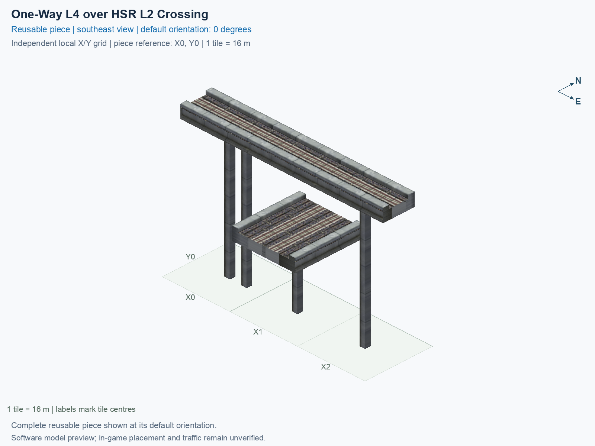

# One-Way L4 over HSR L2 Crossing

Purpose: explain this reusable piece, its matching connections and current test coverage.

<!-- BEGIN PIECE OVERVIEW -->

One-Way L4 over HSR L2 Crossing. Fixed click-to-place piece in a 3 by 1 tile area. Follow the arrows and join only matching track widths, directions, and height labels. Four proper rotations; the second four states repeat them. Experimental; game testing pending. The upper route crosses without transferring to the lower two-way route.

Exact reusable identifier: `interchange-l4-oneway-over-hsr`.

Footprint: **3 × 1 tiles**. Exact menu name: **One-Way L4 over HSR L2 Crossing**.

Choose this exact name in Transportation → Rail. Press Home or End to rotate; use only the supported states listed below. Join each end to a matching port profile and direction.

- [Connections and journeys](#connections-and-journeys)
- [Test checklist](#test-checklist)



<!-- END PIECE OVERVIEW -->

<!-- BEGIN MANUAL SUMMARY -->

## Manual status

Generated from [the exact test cases](#test-checklist) and [authoritative observations](checks/manual-tests.json).

- [ ] Preview review: 0/1 applicable cases passed; 0 failed, 0 stale.
- [ ] In-game rendering: 0/4 applicable cases passed; 0 failed, 0 stale.
- [ ] Directed journeys: 0/12 applicable cases passed; 0 failed, 0 stale.

These observations cover only the named services, directions, poses, rotations, and recorded platforms.

<!-- END MANUAL SUMMARY -->

<!-- BEGIN CONNECTIONS -->

## Connections and journeys

Purpose: describe intrinsic directional interfaces and permitted service journeys.

Generated from [connections.json](connections.json). Coordinates are canonical east, north and height in metres. A connection class names an encoded route interface; it does not prove visible deck/wall fit or an in-game test.

Supported placement states: 0° CCW, 90° CCW, 180° CCW, 270° CCW. Each state has its own declared manual scope.

A **port** is one directional transport-path endpoint. **Service** identifies the intended network service (for example HSR, street, or tram); **engine** is its internal traffic-class number, separate from the construction network. **Role** distinguishes primary service from auxiliary paths; sharing a traffic class does not establish service compatibility.

A **tangent** is a unit travel-direction vector: `[0,1]` means north. **Grade** is height gained per horizontal metre. These measured facts describe this subject alone. Compatibility requires a separate comparison of the complete joining boundaries; physical seams and actual game operation require their own evidence. See the [class index](../../connection-classes.json) for shared route-interface membership.

| Port | Service / engine / role | Direction | Location; tangent; grade | Connection class |
| --- | --- | --- | --- | --- |
| `Win` | hsr / 7 / primary | in | [-8.0, 0.0, 30.5]; [1.0, 0.0]; 0.0 | `path-interface-a11c9f8debd0ee1c3a94` |
| `Sout` | hsr / 7 / primary | out | [14.0, -8.0, 15.5]; [0.0, -1.0]; 0.0 | `path-interface-12d12be31d2057c5763d` |
| `Nin` | hsr / 7 / primary | in | [14.0, 8.0, 15.5]; [0.0, -1.0]; 0.0 | `path-interface-12d12be31d2057c5763d` |
| `Sin` | hsr / 7 / primary | in | [18.0, -8.0, 15.5]; [0.0, 1.0]; 0.0 | `path-interface-fba09fbeb87ad95c667a` |
| `Nout` | hsr / 7 / primary | out | [18.0, 8.0, 15.5]; [0.0, 1.0]; 0.0 | `path-interface-fba09fbeb87ad95c667a` |
| `Eout` | hsr / 7 / primary | out | [40.0, 0.0, 30.5]; [1.0, 0.0]; 0.0 | `path-interface-a11c9f8debd0ee1c3a94` |

### Directed journeys

| Service | Entry → exit | Role |
| --- | --- | --- |
| hsr | `Win` → `Eout` | primary |
| hsr | `Nin` → `Sout` | primary |
| hsr | `Sin` → `Nout` | primary |

### Forbidden transfers

| From service / port | To service / port | Reason |
| --- | --- | --- |
| hsr / `Win` | hsr / `Sout` | No directed route exists between these ports in the saved piece transport paths. In-game confirmation remains unverified. |
| hsr / `Win` | hsr / `Nout` | No directed route exists between these ports in the saved piece transport paths. In-game confirmation remains unverified. |
| hsr / `Nin` | hsr / `Nout` | No directed route exists between these ports in the saved piece transport paths. In-game confirmation remains unverified. |
| hsr / `Nin` | hsr / `Eout` | No directed route exists between these ports in the saved piece transport paths. In-game confirmation remains unverified. |
| hsr / `Sin` | hsr / `Sout` | No directed route exists between these ports in the saved piece transport paths. In-game confirmation remains unverified. |
| hsr / `Sin` | hsr / `Eout` | No directed route exists between these ports in the saved piece transport paths. In-game confirmation remains unverified. |

Review the test checklist for the exact tested cases and environments.

<!-- END CONNECTIONS -->

<!-- BEGIN MANUAL CHECKS -->

## Test checklist

Generated from [the authoritative record](checks/manual-tests.json). Only explicit human observations create manual passes; software and preview checks remain separate. Expand a check/service group to see its rotation table, then expand the matching exact scope to copy a case ID and inspect its pose, reviewer, environment, and evidence. Grouping changes only this view; every declared case remains separate.

**States:** [x] passed; [ ] unverified, failed, or stale; N/A is an explicit inapplicable declaration. A dash means no case was declared in that column. Every pass covers only its recorded environment. T means a distinct construction-transposed state.

Four proper rotations are covered. No additional reflected state is established by this record; repeated construction aliases do not create new orientations.

Current totals: unverified: 55, passed: 0, failed: 0, stale: 0, not_applicable: 0.

### Record an observation

Follow the [shared testing guide](../../../../docs/TESTING.md); copy [the unconfirmed example](checks/observation.example.json) to `checks/observation.json`. Case identifiers are in the expandable sections below. Do not edit generated checkboxes.

From the repository folder containing `custom-pieces`, run after filling `checks/observation.json` and explicitly confirming the exact observation:

```sh
python3 -m scp.content record --record custom-pieces/domains/high-speed-rail/00_pieces/interchange-l4-oneway-over-hsr/checks/manual-tests.json --observation custom-pieces/domains/high-speed-rail/00_pieces/interchange-l4-oneway-over-hsr/checks/observation.json
```

### Detailed current checks

Each collapsed group shows exact case counts and states. Forbidden transfers are grouped by the directed service pair; the table inside retains every port pair and rotation.

<details>
<summary>Compiled resources — Whole subject — 1 case; unverified: 1</summary>

| Check / exact scope | General | 0° | 90° | 180° | 270° |
| --- | --- | --- | --- | --- | --- |
| **Compiled resources**<br>Whole subject | <a href="#case-software_resources-d570e15a6b18347a62e6">[ ] unverified</a> | — | — | — | — |


<details>
<summary>Compiled resources — Whole subject</summary>

<a id="case-software_resources-d570e15a6b18347a62e6"></a>

**General: unverified** — `software_resources-d570e15a6b18347a62e6`.

Verify the actual compiled resources and construction rules.

Scope: Whole subject.

No observation recorded.

</details>

</details>

<details>
<summary>Directed routing graph — Whole subject — 1 case; unverified: 1</summary>

| Check / exact scope | General | 0° | 90° | 180° | 270° |
| --- | --- | --- | --- | --- | --- |
| **Directed routing graph**<br>Whole subject | <a href="#case-software_connectivity-d570e15a6b18347a62e6">[ ] unverified</a> | — | — | — | — |


<details>
<summary>Directed routing graph — Whole subject</summary>

<a id="case-software_connectivity-d570e15a6b18347a62e6"></a>

**General: unverified** — `software_connectivity-d570e15a6b18347a62e6`.

Verify the declared directed journeys and forbidden transfers.

Scope: Whole subject.

No observation recorded.

</details>

</details>

<details>
<summary>Preview review — Images — 1 case; unverified: 1</summary>

| Check / exact scope | General | 0° | 90° | 180° | 270° |
| --- | --- | --- | --- | --- | --- |
| **Preview review**<br>Image: image:interchange-l4-oneway-over-hsr:canonical-southeast | <a href="#case-preview_review-4bdd26928698003407e4">[ ] unverified</a> | — | — | — | — |


<details>
<summary>Preview review — Image: image:interchange-l4-oneway-over-hsr:canonical-southeast</summary>

<a id="case-preview_review-4bdd26928698003407e4"></a>

**General: unverified** — `preview_review-4bdd26928698003407e4`.

Inspect this exact preview for tracks, walls, piers, seams and shadows.

Scope: Image: image:interchange-l4-oneway-over-hsr:canonical-southeast.

No observation recorded.

</details>

</details>

<details>
<summary>In-game rendering — Whole subject — 4 cases; unverified: 4</summary>

| Check / exact scope | General | 0° | 90° | 180° | 270° |
| --- | --- | --- | --- | --- | --- |
| **In-game rendering**<br>Whole subject | — | <a href="#case-in_game_render-f314e92d3ce3526c784d">[ ] unverified</a> | <a href="#case-in_game_render-d31a0e1f6646138a1d76">[ ] unverified</a> | <a href="#case-in_game_render-fd3e48cda2884bd9de28">[ ] unverified</a> | <a href="#case-in_game_render-36177012f903a44e4daf">[ ] unverified</a> |


<details>
<summary>In-game rendering — Whole subject</summary>

<a id="case-in_game_render-f314e92d3ce3526c784d"></a>

**0° CCW: unverified** — `in_game_render-f314e92d3ce3526c784d`.

Inspect the placed tracks, walls, piers, seams and shadows in SimCity 4.

Scope: Whole subject.

No observation recorded.

<a id="case-in_game_render-d31a0e1f6646138a1d76"></a>

**90° CCW: unverified** — `in_game_render-d31a0e1f6646138a1d76`.

Inspect the placed tracks, walls, piers, seams and shadows in SimCity 4.

Scope: Whole subject.

No observation recorded.

<a id="case-in_game_render-fd3e48cda2884bd9de28"></a>

**180° CCW: unverified** — `in_game_render-fd3e48cda2884bd9de28`.

Inspect the placed tracks, walls, piers, seams and shadows in SimCity 4.

Scope: Whole subject.

No observation recorded.

<a id="case-in_game_render-36177012f903a44e4daf"></a>

**270° CCW: unverified** — `in_game_render-36177012f903a44e4daf`.

Inspect the placed tracks, walls, piers, seams and shadows in SimCity 4.

Scope: Whole subject.

No observation recorded.

</details>

</details>

<details>
<summary>Placement — Whole subject — 4 cases; unverified: 4</summary>

| Check / exact scope | General | 0° | 90° | 180° | 270° |
| --- | --- | --- | --- | --- | --- |
| **Placement**<br>Whole subject | — | <a href="#case-in_game_placement-f314e92d3ce3526c784d">[ ] unverified</a> | <a href="#case-in_game_placement-d31a0e1f6646138a1d76">[ ] unverified</a> | <a href="#case-in_game_placement-fd3e48cda2884bd9de28">[ ] unverified</a> | <a href="#case-in_game_placement-36177012f903a44e4daf">[ ] unverified</a> |


<details>
<summary>Placement — Whole subject</summary>

<a id="case-in_game_placement-f314e92d3ce3526c784d"></a>

**0° CCW: unverified** — `in_game_placement-f314e92d3ce3526c784d`.

Place this piece or complete blueprint and inspect every occupied tile.

Scope: Whole subject.

No observation recorded.

<a id="case-in_game_placement-d31a0e1f6646138a1d76"></a>

**90° CCW: unverified** — `in_game_placement-d31a0e1f6646138a1d76`.

Place this piece or complete blueprint and inspect every occupied tile.

Scope: Whole subject.

No observation recorded.

<a id="case-in_game_placement-fd3e48cda2884bd9de28"></a>

**180° CCW: unverified** — `in_game_placement-fd3e48cda2884bd9de28`.

Place this piece or complete blueprint and inspect every occupied tile.

Scope: Whole subject.

No observation recorded.

<a id="case-in_game_placement-36177012f903a44e4daf"></a>

**270° CCW: unverified** — `in_game_placement-36177012f903a44e4daf`.

Place this piece or complete blueprint and inspect every occupied tile.

Scope: Whole subject.

No observation recorded.

</details>

</details>

<details>
<summary>Demolition — Whole subject — 4 cases; unverified: 4</summary>

| Check / exact scope | General | 0° | 90° | 180° | 270° |
| --- | --- | --- | --- | --- | --- |
| **Demolition**<br>Whole subject | — | <a href="#case-in_game_demolition-f314e92d3ce3526c784d">[ ] unverified</a> | <a href="#case-in_game_demolition-d31a0e1f6646138a1d76">[ ] unverified</a> | <a href="#case-in_game_demolition-fd3e48cda2884bd9de28">[ ] unverified</a> | <a href="#case-in_game_demolition-36177012f903a44e4daf">[ ] unverified</a> |


<details>
<summary>Demolition — Whole subject</summary>

<a id="case-in_game_demolition-f314e92d3ce3526c784d"></a>

**0° CCW: unverified** — `in_game_demolition-f314e92d3ce3526c784d`.

Bulldoze the complete placement and inspect the cleared area.

Scope: Whole subject.

No observation recorded.

<a id="case-in_game_demolition-d31a0e1f6646138a1d76"></a>

**90° CCW: unverified** — `in_game_demolition-d31a0e1f6646138a1d76`.

Bulldoze the complete placement and inspect the cleared area.

Scope: Whole subject.

No observation recorded.

<a id="case-in_game_demolition-fd3e48cda2884bd9de28"></a>

**180° CCW: unverified** — `in_game_demolition-fd3e48cda2884bd9de28`.

Bulldoze the complete placement and inspect the cleared area.

Scope: Whole subject.

No observation recorded.

<a id="case-in_game_demolition-36177012f903a44e4daf"></a>

**270° CCW: unverified** — `in_game_demolition-36177012f903a44e4daf`.

Bulldoze the complete placement and inspect the cleared area.

Scope: Whole subject.

No observation recorded.

</details>

</details>

<details>
<summary>Save and reload — Whole subject — 4 cases; unverified: 4</summary>

| Check / exact scope | General | 0° | 90° | 180° | 270° |
| --- | --- | --- | --- | --- | --- |
| **Save and reload**<br>Whole subject | — | <a href="#case-in_game_save_reload-f314e92d3ce3526c784d">[ ] unverified</a> | <a href="#case-in_game_save_reload-d31a0e1f6646138a1d76">[ ] unverified</a> | <a href="#case-in_game_save_reload-fd3e48cda2884bd9de28">[ ] unverified</a> | <a href="#case-in_game_save_reload-36177012f903a44e4daf">[ ] unverified</a> |


<details>
<summary>Save and reload — Whole subject</summary>

<a id="case-in_game_save_reload-f314e92d3ce3526c784d"></a>

**0° CCW: unverified** — `in_game_save_reload-f314e92d3ce3526c784d`.

Save, quit, reload and inspect the placement and its paths.

Scope: Whole subject.

No observation recorded.

<a id="case-in_game_save_reload-d31a0e1f6646138a1d76"></a>

**90° CCW: unverified** — `in_game_save_reload-d31a0e1f6646138a1d76`.

Save, quit, reload and inspect the placement and its paths.

Scope: Whole subject.

No observation recorded.

<a id="case-in_game_save_reload-fd3e48cda2884bd9de28"></a>

**180° CCW: unverified** — `in_game_save_reload-fd3e48cda2884bd9de28`.

Save, quit, reload and inspect the placement and its paths.

Scope: Whole subject.

No observation recorded.

<a id="case-in_game_save_reload-36177012f903a44e4daf"></a>

**270° CCW: unverified** — `in_game_save_reload-36177012f903a44e4daf`.

Save, quit, reload and inspect the placement and its paths.

Scope: Whole subject.

No observation recorded.

</details>

</details>

<details>
<summary>Journey — hsr — 12 cases; unverified: 12</summary>

| Check / exact scope | General | 0° | 90° | 180° | 270° |
| --- | --- | --- | --- | --- | --- |
| **Journey**<br>Service: hsr; role: primary; journey: 7:Win>Eout; entry: Win; exit: Eout | — | <a href="#case-in_game_journey-1eef4b7dba00d39f86f1">[ ] unverified</a> | <a href="#case-in_game_journey-93569325b2fda711c165">[ ] unverified</a> | <a href="#case-in_game_journey-6f6ea77415b42635f6e9">[ ] unverified</a> | <a href="#case-in_game_journey-ba2e8bcd6b52f3db012e">[ ] unverified</a> |
| **Journey**<br>Service: hsr; role: primary; journey: 7:Nin>Sout; entry: Nin; exit: Sout | — | <a href="#case-in_game_journey-0a905f5ddf07cff744d3">[ ] unverified</a> | <a href="#case-in_game_journey-8febe9b32fa8bcee3587">[ ] unverified</a> | <a href="#case-in_game_journey-6a751a8cf6d62e2a1c1c">[ ] unverified</a> | <a href="#case-in_game_journey-9ec0a16d44af0e2b7550">[ ] unverified</a> |
| **Journey**<br>Service: hsr; role: primary; journey: 7:Sin>Nout; entry: Sin; exit: Nout | — | <a href="#case-in_game_journey-086d134f95d5a334d87c">[ ] unverified</a> | <a href="#case-in_game_journey-2ebe6cdbe2065da039eb">[ ] unverified</a> | <a href="#case-in_game_journey-7e4395e4950869573dd9">[ ] unverified</a> | <a href="#case-in_game_journey-a37bec7be104e46b05f1">[ ] unverified</a> |


<details>
<summary>Journey — Service: hsr; role: primary; journey: 7:Win>Eout; entry: Win; exit: Eout</summary>

<a id="case-in_game_journey-1eef4b7dba00d39f86f1"></a>

**0° CCW: unverified** — `in_game_journey-1eef4b7dba00d39f86f1`.

Run the declared journey in this direction using its service network.

Scope: Service: hsr; role: primary; journey: 7:Win>Eout; entry: Win; exit: Eout.

No observation recorded.

<a id="case-in_game_journey-93569325b2fda711c165"></a>

**90° CCW: unverified** — `in_game_journey-93569325b2fda711c165`.

Run the declared journey in this direction using its service network.

Scope: Service: hsr; role: primary; journey: 7:Win>Eout; entry: Win; exit: Eout.

No observation recorded.

<a id="case-in_game_journey-6f6ea77415b42635f6e9"></a>

**180° CCW: unverified** — `in_game_journey-6f6ea77415b42635f6e9`.

Run the declared journey in this direction using its service network.

Scope: Service: hsr; role: primary; journey: 7:Win>Eout; entry: Win; exit: Eout.

No observation recorded.

<a id="case-in_game_journey-ba2e8bcd6b52f3db012e"></a>

**270° CCW: unverified** — `in_game_journey-ba2e8bcd6b52f3db012e`.

Run the declared journey in this direction using its service network.

Scope: Service: hsr; role: primary; journey: 7:Win>Eout; entry: Win; exit: Eout.

No observation recorded.

</details>


<details>
<summary>Journey — Service: hsr; role: primary; journey: 7:Nin>Sout; entry: Nin; exit: Sout</summary>

<a id="case-in_game_journey-0a905f5ddf07cff744d3"></a>

**0° CCW: unverified** — `in_game_journey-0a905f5ddf07cff744d3`.

Run the declared journey in this direction using its service network.

Scope: Service: hsr; role: primary; journey: 7:Nin>Sout; entry: Nin; exit: Sout.

No observation recorded.

<a id="case-in_game_journey-8febe9b32fa8bcee3587"></a>

**90° CCW: unverified** — `in_game_journey-8febe9b32fa8bcee3587`.

Run the declared journey in this direction using its service network.

Scope: Service: hsr; role: primary; journey: 7:Nin>Sout; entry: Nin; exit: Sout.

No observation recorded.

<a id="case-in_game_journey-6a751a8cf6d62e2a1c1c"></a>

**180° CCW: unverified** — `in_game_journey-6a751a8cf6d62e2a1c1c`.

Run the declared journey in this direction using its service network.

Scope: Service: hsr; role: primary; journey: 7:Nin>Sout; entry: Nin; exit: Sout.

No observation recorded.

<a id="case-in_game_journey-9ec0a16d44af0e2b7550"></a>

**270° CCW: unverified** — `in_game_journey-9ec0a16d44af0e2b7550`.

Run the declared journey in this direction using its service network.

Scope: Service: hsr; role: primary; journey: 7:Nin>Sout; entry: Nin; exit: Sout.

No observation recorded.

</details>


<details>
<summary>Journey — Service: hsr; role: primary; journey: 7:Sin>Nout; entry: Sin; exit: Nout</summary>

<a id="case-in_game_journey-086d134f95d5a334d87c"></a>

**0° CCW: unverified** — `in_game_journey-086d134f95d5a334d87c`.

Run the declared journey in this direction using its service network.

Scope: Service: hsr; role: primary; journey: 7:Sin>Nout; entry: Sin; exit: Nout.

No observation recorded.

<a id="case-in_game_journey-2ebe6cdbe2065da039eb"></a>

**90° CCW: unverified** — `in_game_journey-2ebe6cdbe2065da039eb`.

Run the declared journey in this direction using its service network.

Scope: Service: hsr; role: primary; journey: 7:Sin>Nout; entry: Sin; exit: Nout.

No observation recorded.

<a id="case-in_game_journey-7e4395e4950869573dd9"></a>

**180° CCW: unverified** — `in_game_journey-7e4395e4950869573dd9`.

Run the declared journey in this direction using its service network.

Scope: Service: hsr; role: primary; journey: 7:Sin>Nout; entry: Sin; exit: Nout.

No observation recorded.

<a id="case-in_game_journey-a37bec7be104e46b05f1"></a>

**270° CCW: unverified** — `in_game_journey-a37bec7be104e46b05f1`.

Run the declared journey in this direction using its service network.

Scope: Service: hsr; role: primary; journey: 7:Sin>Nout; entry: Sin; exit: Nout.

No observation recorded.

</details>

</details>

<details>
<summary>Forbidden transfer — hsr → hsr — 24 cases; unverified: 24</summary>

| Check / exact scope | General | 0° | 90° | 180° | 270° |
| --- | --- | --- | --- | --- | --- |
| **Forbidden transfer**<br>from port: Win; to port: Sout; from service: hsr; to service: hsr; basis: not reachable in actual saved PATH graph | — | <a href="#case-in_game_forbidden_transfer-bb39c81be7aed5c98668">[ ] unverified</a> | <a href="#case-in_game_forbidden_transfer-ced811a4620d8995e497">[ ] unverified</a> | <a href="#case-in_game_forbidden_transfer-3bd76cff04bfb813dd99">[ ] unverified</a> | <a href="#case-in_game_forbidden_transfer-70705119efaf5ef5a744">[ ] unverified</a> |
| **Forbidden transfer**<br>from port: Win; to port: Nout; from service: hsr; to service: hsr; basis: not reachable in actual saved PATH graph | — | <a href="#case-in_game_forbidden_transfer-b293ee9fa97d9238b1f0">[ ] unverified</a> | <a href="#case-in_game_forbidden_transfer-f9bbfa93d9923b94d026">[ ] unverified</a> | <a href="#case-in_game_forbidden_transfer-8eaa4eed0a1b78a4ae5e">[ ] unverified</a> | <a href="#case-in_game_forbidden_transfer-fcb55fec27b58bcbde3d">[ ] unverified</a> |
| **Forbidden transfer**<br>from port: Nin; to port: Nout; from service: hsr; to service: hsr; basis: not reachable in actual saved PATH graph | — | <a href="#case-in_game_forbidden_transfer-335e121d686b5b9a1843">[ ] unverified</a> | <a href="#case-in_game_forbidden_transfer-6d923dd771435950ec40">[ ] unverified</a> | <a href="#case-in_game_forbidden_transfer-3893e09baee59474ac69">[ ] unverified</a> | <a href="#case-in_game_forbidden_transfer-4f0a45f88d29bb3830ab">[ ] unverified</a> |
| **Forbidden transfer**<br>from port: Nin; to port: Eout; from service: hsr; to service: hsr; basis: not reachable in actual saved PATH graph | — | <a href="#case-in_game_forbidden_transfer-388decf42b133de400cd">[ ] unverified</a> | <a href="#case-in_game_forbidden_transfer-11120fbd1e81833288fb">[ ] unverified</a> | <a href="#case-in_game_forbidden_transfer-435c02524a8664999e51">[ ] unverified</a> | <a href="#case-in_game_forbidden_transfer-352fc0df5d801c4d3076">[ ] unverified</a> |
| **Forbidden transfer**<br>from port: Sin; to port: Sout; from service: hsr; to service: hsr; basis: not reachable in actual saved PATH graph | — | <a href="#case-in_game_forbidden_transfer-c165a81ffc6f5322e307">[ ] unverified</a> | <a href="#case-in_game_forbidden_transfer-dfd51545d7ecabefbeb5">[ ] unverified</a> | <a href="#case-in_game_forbidden_transfer-e32ef7683bb02e16293e">[ ] unverified</a> | <a href="#case-in_game_forbidden_transfer-1b4b9893d35a718e4264">[ ] unverified</a> |
| **Forbidden transfer**<br>from port: Sin; to port: Eout; from service: hsr; to service: hsr; basis: not reachable in actual saved PATH graph | — | <a href="#case-in_game_forbidden_transfer-d45a1f0f66d025ad2c5e">[ ] unverified</a> | <a href="#case-in_game_forbidden_transfer-1bbcccd2f173cadc612d">[ ] unverified</a> | <a href="#case-in_game_forbidden_transfer-bc07e62536da23582217">[ ] unverified</a> | <a href="#case-in_game_forbidden_transfer-491025608d0febd71d7e">[ ] unverified</a> |


<details>
<summary>Forbidden transfer — from port: Win; to port: Sout; from service: hsr; to service: hsr; basis: not reachable in actual saved PATH graph</summary>

<a id="case-in_game_forbidden_transfer-bb39c81be7aed5c98668"></a>

**0° CCW: unverified** — `in_game_forbidden_transfer-bb39c81be7aed5c98668`.

Confirm this undeclared transfer is unavailable.

Scope: from port: Win; to port: Sout; from service: hsr; to service: hsr; basis: not reachable in actual saved PATH graph.

No observation recorded.

<a id="case-in_game_forbidden_transfer-ced811a4620d8995e497"></a>

**90° CCW: unverified** — `in_game_forbidden_transfer-ced811a4620d8995e497`.

Confirm this undeclared transfer is unavailable.

Scope: from port: Win; to port: Sout; from service: hsr; to service: hsr; basis: not reachable in actual saved PATH graph.

No observation recorded.

<a id="case-in_game_forbidden_transfer-3bd76cff04bfb813dd99"></a>

**180° CCW: unverified** — `in_game_forbidden_transfer-3bd76cff04bfb813dd99`.

Confirm this undeclared transfer is unavailable.

Scope: from port: Win; to port: Sout; from service: hsr; to service: hsr; basis: not reachable in actual saved PATH graph.

No observation recorded.

<a id="case-in_game_forbidden_transfer-70705119efaf5ef5a744"></a>

**270° CCW: unverified** — `in_game_forbidden_transfer-70705119efaf5ef5a744`.

Confirm this undeclared transfer is unavailable.

Scope: from port: Win; to port: Sout; from service: hsr; to service: hsr; basis: not reachable in actual saved PATH graph.

No observation recorded.

</details>


<details>
<summary>Forbidden transfer — from port: Win; to port: Nout; from service: hsr; to service: hsr; basis: not reachable in actual saved PATH graph</summary>

<a id="case-in_game_forbidden_transfer-b293ee9fa97d9238b1f0"></a>

**0° CCW: unverified** — `in_game_forbidden_transfer-b293ee9fa97d9238b1f0`.

Confirm this undeclared transfer is unavailable.

Scope: from port: Win; to port: Nout; from service: hsr; to service: hsr; basis: not reachable in actual saved PATH graph.

No observation recorded.

<a id="case-in_game_forbidden_transfer-f9bbfa93d9923b94d026"></a>

**90° CCW: unverified** — `in_game_forbidden_transfer-f9bbfa93d9923b94d026`.

Confirm this undeclared transfer is unavailable.

Scope: from port: Win; to port: Nout; from service: hsr; to service: hsr; basis: not reachable in actual saved PATH graph.

No observation recorded.

<a id="case-in_game_forbidden_transfer-8eaa4eed0a1b78a4ae5e"></a>

**180° CCW: unverified** — `in_game_forbidden_transfer-8eaa4eed0a1b78a4ae5e`.

Confirm this undeclared transfer is unavailable.

Scope: from port: Win; to port: Nout; from service: hsr; to service: hsr; basis: not reachable in actual saved PATH graph.

No observation recorded.

<a id="case-in_game_forbidden_transfer-fcb55fec27b58bcbde3d"></a>

**270° CCW: unverified** — `in_game_forbidden_transfer-fcb55fec27b58bcbde3d`.

Confirm this undeclared transfer is unavailable.

Scope: from port: Win; to port: Nout; from service: hsr; to service: hsr; basis: not reachable in actual saved PATH graph.

No observation recorded.

</details>


<details>
<summary>Forbidden transfer — from port: Nin; to port: Nout; from service: hsr; to service: hsr; basis: not reachable in actual saved PATH graph</summary>

<a id="case-in_game_forbidden_transfer-335e121d686b5b9a1843"></a>

**0° CCW: unverified** — `in_game_forbidden_transfer-335e121d686b5b9a1843`.

Confirm this undeclared transfer is unavailable.

Scope: from port: Nin; to port: Nout; from service: hsr; to service: hsr; basis: not reachable in actual saved PATH graph.

No observation recorded.

<a id="case-in_game_forbidden_transfer-6d923dd771435950ec40"></a>

**90° CCW: unverified** — `in_game_forbidden_transfer-6d923dd771435950ec40`.

Confirm this undeclared transfer is unavailable.

Scope: from port: Nin; to port: Nout; from service: hsr; to service: hsr; basis: not reachable in actual saved PATH graph.

No observation recorded.

<a id="case-in_game_forbidden_transfer-3893e09baee59474ac69"></a>

**180° CCW: unverified** — `in_game_forbidden_transfer-3893e09baee59474ac69`.

Confirm this undeclared transfer is unavailable.

Scope: from port: Nin; to port: Nout; from service: hsr; to service: hsr; basis: not reachable in actual saved PATH graph.

No observation recorded.

<a id="case-in_game_forbidden_transfer-4f0a45f88d29bb3830ab"></a>

**270° CCW: unverified** — `in_game_forbidden_transfer-4f0a45f88d29bb3830ab`.

Confirm this undeclared transfer is unavailable.

Scope: from port: Nin; to port: Nout; from service: hsr; to service: hsr; basis: not reachable in actual saved PATH graph.

No observation recorded.

</details>


<details>
<summary>Forbidden transfer — from port: Nin; to port: Eout; from service: hsr; to service: hsr; basis: not reachable in actual saved PATH graph</summary>

<a id="case-in_game_forbidden_transfer-388decf42b133de400cd"></a>

**0° CCW: unverified** — `in_game_forbidden_transfer-388decf42b133de400cd`.

Confirm this undeclared transfer is unavailable.

Scope: from port: Nin; to port: Eout; from service: hsr; to service: hsr; basis: not reachable in actual saved PATH graph.

No observation recorded.

<a id="case-in_game_forbidden_transfer-11120fbd1e81833288fb"></a>

**90° CCW: unverified** — `in_game_forbidden_transfer-11120fbd1e81833288fb`.

Confirm this undeclared transfer is unavailable.

Scope: from port: Nin; to port: Eout; from service: hsr; to service: hsr; basis: not reachable in actual saved PATH graph.

No observation recorded.

<a id="case-in_game_forbidden_transfer-435c02524a8664999e51"></a>

**180° CCW: unverified** — `in_game_forbidden_transfer-435c02524a8664999e51`.

Confirm this undeclared transfer is unavailable.

Scope: from port: Nin; to port: Eout; from service: hsr; to service: hsr; basis: not reachable in actual saved PATH graph.

No observation recorded.

<a id="case-in_game_forbidden_transfer-352fc0df5d801c4d3076"></a>

**270° CCW: unverified** — `in_game_forbidden_transfer-352fc0df5d801c4d3076`.

Confirm this undeclared transfer is unavailable.

Scope: from port: Nin; to port: Eout; from service: hsr; to service: hsr; basis: not reachable in actual saved PATH graph.

No observation recorded.

</details>


<details>
<summary>Forbidden transfer — from port: Sin; to port: Sout; from service: hsr; to service: hsr; basis: not reachable in actual saved PATH graph</summary>

<a id="case-in_game_forbidden_transfer-c165a81ffc6f5322e307"></a>

**0° CCW: unverified** — `in_game_forbidden_transfer-c165a81ffc6f5322e307`.

Confirm this undeclared transfer is unavailable.

Scope: from port: Sin; to port: Sout; from service: hsr; to service: hsr; basis: not reachable in actual saved PATH graph.

No observation recorded.

<a id="case-in_game_forbidden_transfer-dfd51545d7ecabefbeb5"></a>

**90° CCW: unverified** — `in_game_forbidden_transfer-dfd51545d7ecabefbeb5`.

Confirm this undeclared transfer is unavailable.

Scope: from port: Sin; to port: Sout; from service: hsr; to service: hsr; basis: not reachable in actual saved PATH graph.

No observation recorded.

<a id="case-in_game_forbidden_transfer-e32ef7683bb02e16293e"></a>

**180° CCW: unverified** — `in_game_forbidden_transfer-e32ef7683bb02e16293e`.

Confirm this undeclared transfer is unavailable.

Scope: from port: Sin; to port: Sout; from service: hsr; to service: hsr; basis: not reachable in actual saved PATH graph.

No observation recorded.

<a id="case-in_game_forbidden_transfer-1b4b9893d35a718e4264"></a>

**270° CCW: unverified** — `in_game_forbidden_transfer-1b4b9893d35a718e4264`.

Confirm this undeclared transfer is unavailable.

Scope: from port: Sin; to port: Sout; from service: hsr; to service: hsr; basis: not reachable in actual saved PATH graph.

No observation recorded.

</details>


<details>
<summary>Forbidden transfer — from port: Sin; to port: Eout; from service: hsr; to service: hsr; basis: not reachable in actual saved PATH graph</summary>

<a id="case-in_game_forbidden_transfer-d45a1f0f66d025ad2c5e"></a>

**0° CCW: unverified** — `in_game_forbidden_transfer-d45a1f0f66d025ad2c5e`.

Confirm this undeclared transfer is unavailable.

Scope: from port: Sin; to port: Eout; from service: hsr; to service: hsr; basis: not reachable in actual saved PATH graph.

No observation recorded.

<a id="case-in_game_forbidden_transfer-1bbcccd2f173cadc612d"></a>

**90° CCW: unverified** — `in_game_forbidden_transfer-1bbcccd2f173cadc612d`.

Confirm this undeclared transfer is unavailable.

Scope: from port: Sin; to port: Eout; from service: hsr; to service: hsr; basis: not reachable in actual saved PATH graph.

No observation recorded.

<a id="case-in_game_forbidden_transfer-bc07e62536da23582217"></a>

**180° CCW: unverified** — `in_game_forbidden_transfer-bc07e62536da23582217`.

Confirm this undeclared transfer is unavailable.

Scope: from port: Sin; to port: Eout; from service: hsr; to service: hsr; basis: not reachable in actual saved PATH graph.

No observation recorded.

<a id="case-in_game_forbidden_transfer-491025608d0febd71d7e"></a>

**270° CCW: unverified** — `in_game_forbidden_transfer-491025608d0febd71d7e`.

Confirm this undeclared transfer is unavailable.

Scope: from port: Sin; to port: Eout; from service: hsr; to service: hsr; basis: not reachable in actual saved PATH graph.

No observation recorded.

</details>

</details>

<!-- END MANUAL CHECKS -->
