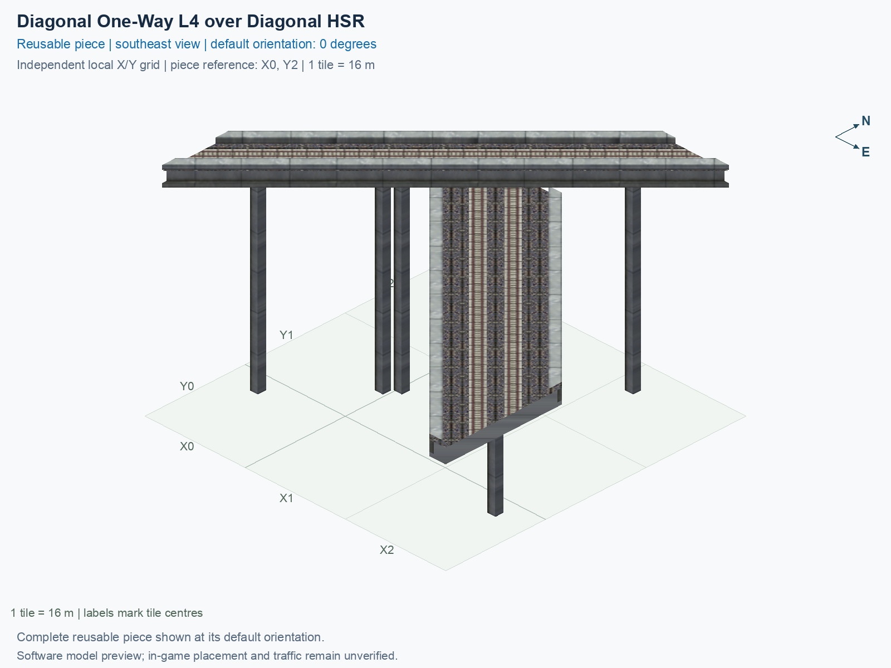

# Diagonal One-Way L4 over Diagonal HSR

Purpose: explain this reusable piece, its matching connections and current test coverage.

<!-- BEGIN PIECE OVERVIEW -->

Actual rail geometry and directed train paths at two heights. The one-way track and two-way track cross without a transfer. Experimental fixed piece; test rendering, traffic and shadows in the game. The upper route crosses without transferring to the lower two-way route.

Exact reusable identifier: `interchange-l4-upper-diag-lower-diag-over-hsr`.

Footprint: **3 × 3 tiles**. Exact menu name: **Diagonal One-Way L4 over Diagonal HSR**.

Choose this exact name in Transportation → Rail. Press Home or End to rotate; use only the supported states listed below. Join each end to a matching port profile and direction.

- [Connections and journeys](#connections-and-journeys)
- [Test checklist](#test-checklist)



<!-- END PIECE OVERVIEW -->

<!-- BEGIN MANUAL SUMMARY -->

## Manual status

Generated from [the exact test cases](#test-checklist) and [authoritative observations](checks/manual-tests.json).

- [ ] Preview review: 0/1 applicable cases passed; 0 failed, 0 stale.
- [ ] In-game rendering: 0/4 applicable cases passed; 0 failed, 0 stale.
- [ ] Directed journeys: 0/12 applicable cases passed; 0 failed, 0 stale.

These observations cover only the named services, directions, poses, rotations, and recorded platforms.

<!-- END MANUAL SUMMARY -->

<!-- BEGIN CONNECTIONS -->

## Connections and journeys

Purpose: describe intrinsic directional interfaces and permitted service journeys.

Generated from [connections.json](connections.json). Coordinates are canonical east, north and height in metres. A connection class names an encoded route interface; it does not prove visible deck/wall fit or an in-game test.

Supported placement states: 0° CCW, 90° CCW, 180° CCW, 270° CCW. Each state has its own declared manual scope.

A **port** is one directional transport-path endpoint. **Service** identifies the intended network service (for example HSR, street, or tram); **engine** is its internal traffic-class number, separate from the construction network. **Role** distinguishes primary service from auxiliary paths; sharing a traffic class does not establish service compatibility.

A **tangent** is a unit travel-direction vector: `[0,1]` means north. **Grade** is height gained per horizontal metre. These measured facts describe this subject alone. Compatibility requires a separate comparison of the complete joining boundaries; physical seams and actual game operation require their own evidence. See the [class index](../../connection-classes.json) for shared route-interface membership.

| Port | Service / engine / role | Direction | Location; tangent; grade | Connection class |
| --- | --- | --- | --- | --- |
| `upper_in` | hsr / 7 / primary | in | [-8.0, -32.0, 30.5]; [0.7071067811865475, 0.7071067811865475]; 0.0 | `path-interface-13a0d20884fd73110dea` |
| `lower_b_in` | hsr / 7 / primary | in | [-2.9, 8.0, 15.5]; [0.7071067811865475, -0.7071067811865475]; 0.0 | `path-interface-9f8c3dd2cd3e736ce4f1` |
| `lower_a_out` | hsr / 7 / primary | out | [2.8, 8.0, 15.5]; [-0.7071067811865475, 0.7071067811865475]; 0.0 | `path-interface-88adae773e3ea9f487d2` |
| `upper_out` | hsr / 7 / primary | out | [32.0, 8.0, 30.5]; [0.7071067811865475, 0.7071067811865475]; 0.0 | `path-interface-a70e777e6354823bc5c5` |
| `lower_b_out` | hsr / 7 / primary | out | [40.0, -34.9, 15.5]; [0.7071067811865475, -0.7071067811865475]; 0.0 | `path-interface-50cc847d03cb7f174ed0` |
| `lower_a_in` | hsr / 7 / primary | in | [40.0, -29.1, 15.5]; [-0.7071067811865475, 0.7071067811865475]; 0.0 | `path-interface-50cc847d03cb7f174ed0` |

### Directed journeys

| Service | Entry → exit | Role |
| --- | --- | --- |
| hsr | `upper_in` → `upper_out` | primary |
| hsr | `lower_b_in` → `lower_b_out` | primary |
| hsr | `lower_a_in` → `lower_a_out` | primary |

### Forbidden transfers

| From service / port | To service / port | Reason |
| --- | --- | --- |
| hsr / `upper_in` | hsr / `lower_a_out` | No directed route exists between these ports in the saved piece transport paths. In-game confirmation remains unverified. |
| hsr / `upper_in` | hsr / `lower_b_out` | No directed route exists between these ports in the saved piece transport paths. In-game confirmation remains unverified. |
| hsr / `lower_b_in` | hsr / `lower_a_out` | No directed route exists between these ports in the saved piece transport paths. In-game confirmation remains unverified. |
| hsr / `lower_b_in` | hsr / `upper_out` | No directed route exists between these ports in the saved piece transport paths. In-game confirmation remains unverified. |
| hsr / `lower_a_in` | hsr / `upper_out` | No directed route exists between these ports in the saved piece transport paths. In-game confirmation remains unverified. |
| hsr / `lower_a_in` | hsr / `lower_b_out` | No directed route exists between these ports in the saved piece transport paths. In-game confirmation remains unverified. |

Review the test checklist for the exact tested cases and environments.

<!-- END CONNECTIONS -->

<!-- BEGIN MANUAL CHECKS -->

## Test checklist

Generated from [the authoritative record](checks/manual-tests.json). Only explicit human observations create manual passes; software and preview checks remain separate. Expand a check/service group to see its rotation table, then expand the matching exact scope to copy a case ID and inspect its pose, reviewer, environment, and evidence. Grouping changes only this view; every declared case remains separate.

**States:** [x] passed; [ ] unverified, failed, or stale; N/A is an explicit inapplicable declaration. A dash means no case was declared in that column. Every pass covers only its recorded environment. T means a distinct construction-transposed state.

Four proper rotations are covered. No additional reflected state is established by this record; repeated construction aliases do not create new orientations.

Current totals: unverified: 55, passed: 0, failed: 0, stale: 0, not_applicable: 0.

### Record an observation

Follow the [shared testing guide](../../../../docs/TESTING.md); copy [the unconfirmed example](checks/observation.example.json) to `checks/observation.json`. Case identifiers are in the expandable sections below. Do not edit generated checkboxes.

From the repository folder containing `custom-pieces`, run after filling `checks/observation.json` and explicitly confirming the exact observation:

```sh
python3 -m scp.content record --record custom-pieces/domains/high-speed-rail/00_pieces/interchange-l4-upper-diag-lower-diag-over-hsr/checks/manual-tests.json --observation custom-pieces/domains/high-speed-rail/00_pieces/interchange-l4-upper-diag-lower-diag-over-hsr/checks/observation.json
```

### Detailed current checks

Each collapsed group shows exact case counts and states. Forbidden transfers are grouped by the directed service pair; the table inside retains every port pair and rotation.

<details>
<summary>Compiled resources — Whole subject — 1 case; unverified: 1</summary>

| Check / exact scope | General | 0° | 90° | 180° | 270° |
| --- | --- | --- | --- | --- | --- |
| **Compiled resources**<br>Whole subject | <a href="#case-software_resources-c3461084deec45982ce4">[ ] unverified</a> | — | — | — | — |


<details>
<summary>Compiled resources — Whole subject</summary>

<a id="case-software_resources-c3461084deec45982ce4"></a>

**General: unverified** — `software_resources-c3461084deec45982ce4`.

Verify the actual compiled resources and construction rules.

Scope: Whole subject.

No observation recorded.

</details>

</details>

<details>
<summary>Directed routing graph — Whole subject — 1 case; unverified: 1</summary>

| Check / exact scope | General | 0° | 90° | 180° | 270° |
| --- | --- | --- | --- | --- | --- |
| **Directed routing graph**<br>Whole subject | <a href="#case-software_connectivity-c3461084deec45982ce4">[ ] unverified</a> | — | — | — | — |


<details>
<summary>Directed routing graph — Whole subject</summary>

<a id="case-software_connectivity-c3461084deec45982ce4"></a>

**General: unverified** — `software_connectivity-c3461084deec45982ce4`.

Verify the declared directed journeys and forbidden transfers.

Scope: Whole subject.

No observation recorded.

</details>

</details>

<details>
<summary>Preview review — Images — 1 case; unverified: 1</summary>

| Check / exact scope | General | 0° | 90° | 180° | 270° |
| --- | --- | --- | --- | --- | --- |
| **Preview review**<br>Image: image:interchange-l4-upper-diag-lower-diag-over-hsr:canonical-southeast | <a href="#case-preview_review-1bb8fef8031131e2aab2">[ ] unverified</a> | — | — | — | — |


<details>
<summary>Preview review — Image: image:interchange-l4-upper-diag-lower-diag-over-hsr:canonical-southeast</summary>

<a id="case-preview_review-1bb8fef8031131e2aab2"></a>

**General: unverified** — `preview_review-1bb8fef8031131e2aab2`.

Inspect this exact preview for tracks, walls, piers, seams and shadows.

Scope: Image: image:interchange-l4-upper-diag-lower-diag-over-hsr:canonical-southeast.

No observation recorded.

</details>

</details>

<details>
<summary>In-game rendering — Whole subject — 4 cases; unverified: 4</summary>

| Check / exact scope | General | 0° | 90° | 180° | 270° |
| --- | --- | --- | --- | --- | --- |
| **In-game rendering**<br>Whole subject | — | <a href="#case-in_game_render-1b5b405a5593710fce31">[ ] unverified</a> | <a href="#case-in_game_render-d57f7a426debf73a54a4">[ ] unverified</a> | <a href="#case-in_game_render-00241010469c2f6fb312">[ ] unverified</a> | <a href="#case-in_game_render-733ca7ed267905510977">[ ] unverified</a> |


<details>
<summary>In-game rendering — Whole subject</summary>

<a id="case-in_game_render-1b5b405a5593710fce31"></a>

**0° CCW: unverified** — `in_game_render-1b5b405a5593710fce31`.

Inspect the placed tracks, walls, piers, seams and shadows in SimCity 4.

Scope: Whole subject.

No observation recorded.

<a id="case-in_game_render-d57f7a426debf73a54a4"></a>

**90° CCW: unverified** — `in_game_render-d57f7a426debf73a54a4`.

Inspect the placed tracks, walls, piers, seams and shadows in SimCity 4.

Scope: Whole subject.

No observation recorded.

<a id="case-in_game_render-00241010469c2f6fb312"></a>

**180° CCW: unverified** — `in_game_render-00241010469c2f6fb312`.

Inspect the placed tracks, walls, piers, seams and shadows in SimCity 4.

Scope: Whole subject.

No observation recorded.

<a id="case-in_game_render-733ca7ed267905510977"></a>

**270° CCW: unverified** — `in_game_render-733ca7ed267905510977`.

Inspect the placed tracks, walls, piers, seams and shadows in SimCity 4.

Scope: Whole subject.

No observation recorded.

</details>

</details>

<details>
<summary>Placement — Whole subject — 4 cases; unverified: 4</summary>

| Check / exact scope | General | 0° | 90° | 180° | 270° |
| --- | --- | --- | --- | --- | --- |
| **Placement**<br>Whole subject | — | <a href="#case-in_game_placement-1b5b405a5593710fce31">[ ] unverified</a> | <a href="#case-in_game_placement-d57f7a426debf73a54a4">[ ] unverified</a> | <a href="#case-in_game_placement-00241010469c2f6fb312">[ ] unverified</a> | <a href="#case-in_game_placement-733ca7ed267905510977">[ ] unverified</a> |


<details>
<summary>Placement — Whole subject</summary>

<a id="case-in_game_placement-1b5b405a5593710fce31"></a>

**0° CCW: unverified** — `in_game_placement-1b5b405a5593710fce31`.

Place this piece or complete blueprint and inspect every occupied tile.

Scope: Whole subject.

No observation recorded.

<a id="case-in_game_placement-d57f7a426debf73a54a4"></a>

**90° CCW: unverified** — `in_game_placement-d57f7a426debf73a54a4`.

Place this piece or complete blueprint and inspect every occupied tile.

Scope: Whole subject.

No observation recorded.

<a id="case-in_game_placement-00241010469c2f6fb312"></a>

**180° CCW: unverified** — `in_game_placement-00241010469c2f6fb312`.

Place this piece or complete blueprint and inspect every occupied tile.

Scope: Whole subject.

No observation recorded.

<a id="case-in_game_placement-733ca7ed267905510977"></a>

**270° CCW: unverified** — `in_game_placement-733ca7ed267905510977`.

Place this piece or complete blueprint and inspect every occupied tile.

Scope: Whole subject.

No observation recorded.

</details>

</details>

<details>
<summary>Demolition — Whole subject — 4 cases; unverified: 4</summary>

| Check / exact scope | General | 0° | 90° | 180° | 270° |
| --- | --- | --- | --- | --- | --- |
| **Demolition**<br>Whole subject | — | <a href="#case-in_game_demolition-1b5b405a5593710fce31">[ ] unverified</a> | <a href="#case-in_game_demolition-d57f7a426debf73a54a4">[ ] unverified</a> | <a href="#case-in_game_demolition-00241010469c2f6fb312">[ ] unverified</a> | <a href="#case-in_game_demolition-733ca7ed267905510977">[ ] unverified</a> |


<details>
<summary>Demolition — Whole subject</summary>

<a id="case-in_game_demolition-1b5b405a5593710fce31"></a>

**0° CCW: unverified** — `in_game_demolition-1b5b405a5593710fce31`.

Bulldoze the complete placement and inspect the cleared area.

Scope: Whole subject.

No observation recorded.

<a id="case-in_game_demolition-d57f7a426debf73a54a4"></a>

**90° CCW: unverified** — `in_game_demolition-d57f7a426debf73a54a4`.

Bulldoze the complete placement and inspect the cleared area.

Scope: Whole subject.

No observation recorded.

<a id="case-in_game_demolition-00241010469c2f6fb312"></a>

**180° CCW: unverified** — `in_game_demolition-00241010469c2f6fb312`.

Bulldoze the complete placement and inspect the cleared area.

Scope: Whole subject.

No observation recorded.

<a id="case-in_game_demolition-733ca7ed267905510977"></a>

**270° CCW: unverified** — `in_game_demolition-733ca7ed267905510977`.

Bulldoze the complete placement and inspect the cleared area.

Scope: Whole subject.

No observation recorded.

</details>

</details>

<details>
<summary>Save and reload — Whole subject — 4 cases; unverified: 4</summary>

| Check / exact scope | General | 0° | 90° | 180° | 270° |
| --- | --- | --- | --- | --- | --- |
| **Save and reload**<br>Whole subject | — | <a href="#case-in_game_save_reload-1b5b405a5593710fce31">[ ] unverified</a> | <a href="#case-in_game_save_reload-d57f7a426debf73a54a4">[ ] unverified</a> | <a href="#case-in_game_save_reload-00241010469c2f6fb312">[ ] unverified</a> | <a href="#case-in_game_save_reload-733ca7ed267905510977">[ ] unverified</a> |


<details>
<summary>Save and reload — Whole subject</summary>

<a id="case-in_game_save_reload-1b5b405a5593710fce31"></a>

**0° CCW: unverified** — `in_game_save_reload-1b5b405a5593710fce31`.

Save, quit, reload and inspect the placement and its paths.

Scope: Whole subject.

No observation recorded.

<a id="case-in_game_save_reload-d57f7a426debf73a54a4"></a>

**90° CCW: unverified** — `in_game_save_reload-d57f7a426debf73a54a4`.

Save, quit, reload and inspect the placement and its paths.

Scope: Whole subject.

No observation recorded.

<a id="case-in_game_save_reload-00241010469c2f6fb312"></a>

**180° CCW: unverified** — `in_game_save_reload-00241010469c2f6fb312`.

Save, quit, reload and inspect the placement and its paths.

Scope: Whole subject.

No observation recorded.

<a id="case-in_game_save_reload-733ca7ed267905510977"></a>

**270° CCW: unverified** — `in_game_save_reload-733ca7ed267905510977`.

Save, quit, reload and inspect the placement and its paths.

Scope: Whole subject.

No observation recorded.

</details>

</details>

<details>
<summary>Journey — hsr — 12 cases; unverified: 12</summary>

| Check / exact scope | General | 0° | 90° | 180° | 270° |
| --- | --- | --- | --- | --- | --- |
| **Journey**<br>Service: hsr; role: primary; journey: 7:upper_in>upper_out; entry: upper_in; exit: upper_out | — | <a href="#case-in_game_journey-bc44d32ad6c55e5f8393">[ ] unverified</a> | <a href="#case-in_game_journey-436b58fc35ee3dfa4b96">[ ] unverified</a> | <a href="#case-in_game_journey-37a7b0d7710f50cacd8e">[ ] unverified</a> | <a href="#case-in_game_journey-5b4770cae136eb286de5">[ ] unverified</a> |
| **Journey**<br>Service: hsr; role: primary; journey: 7:lower_b_in>lower_b_out; entry: lower_b_in; exit: lower_b_out | — | <a href="#case-in_game_journey-3acc2a1fbb6db5383ad8">[ ] unverified</a> | <a href="#case-in_game_journey-a17d9916e0bbc50cc878">[ ] unverified</a> | <a href="#case-in_game_journey-681730614327a02bd6d6">[ ] unverified</a> | <a href="#case-in_game_journey-44a59bb59778aed50576">[ ] unverified</a> |
| **Journey**<br>Service: hsr; role: primary; journey: 7:lower_a_in>lower_a_out; entry: lower_a_in; exit: lower_a_out | — | <a href="#case-in_game_journey-ccf6e04e21ad7ddcd3bc">[ ] unverified</a> | <a href="#case-in_game_journey-26e3e4ceff89fc6f1f05">[ ] unverified</a> | <a href="#case-in_game_journey-2fe60f591eeba08b0694">[ ] unverified</a> | <a href="#case-in_game_journey-b5a7609408101168138a">[ ] unverified</a> |


<details>
<summary>Journey — Service: hsr; role: primary; journey: 7:upper_in>upper_out; entry: upper_in; exit: upper_out</summary>

<a id="case-in_game_journey-bc44d32ad6c55e5f8393"></a>

**0° CCW: unverified** — `in_game_journey-bc44d32ad6c55e5f8393`.

Run the declared journey in this direction using its service network.

Scope: Service: hsr; role: primary; journey: 7:upper_in>upper_out; entry: upper_in; exit: upper_out.

No observation recorded.

<a id="case-in_game_journey-436b58fc35ee3dfa4b96"></a>

**90° CCW: unverified** — `in_game_journey-436b58fc35ee3dfa4b96`.

Run the declared journey in this direction using its service network.

Scope: Service: hsr; role: primary; journey: 7:upper_in>upper_out; entry: upper_in; exit: upper_out.

No observation recorded.

<a id="case-in_game_journey-37a7b0d7710f50cacd8e"></a>

**180° CCW: unverified** — `in_game_journey-37a7b0d7710f50cacd8e`.

Run the declared journey in this direction using its service network.

Scope: Service: hsr; role: primary; journey: 7:upper_in>upper_out; entry: upper_in; exit: upper_out.

No observation recorded.

<a id="case-in_game_journey-5b4770cae136eb286de5"></a>

**270° CCW: unverified** — `in_game_journey-5b4770cae136eb286de5`.

Run the declared journey in this direction using its service network.

Scope: Service: hsr; role: primary; journey: 7:upper_in>upper_out; entry: upper_in; exit: upper_out.

No observation recorded.

</details>


<details>
<summary>Journey — Service: hsr; role: primary; journey: 7:lower_b_in>lower_b_out; entry: lower_b_in; exit: lower_b_out</summary>

<a id="case-in_game_journey-3acc2a1fbb6db5383ad8"></a>

**0° CCW: unverified** — `in_game_journey-3acc2a1fbb6db5383ad8`.

Run the declared journey in this direction using its service network.

Scope: Service: hsr; role: primary; journey: 7:lower_b_in>lower_b_out; entry: lower_b_in; exit: lower_b_out.

No observation recorded.

<a id="case-in_game_journey-a17d9916e0bbc50cc878"></a>

**90° CCW: unverified** — `in_game_journey-a17d9916e0bbc50cc878`.

Run the declared journey in this direction using its service network.

Scope: Service: hsr; role: primary; journey: 7:lower_b_in>lower_b_out; entry: lower_b_in; exit: lower_b_out.

No observation recorded.

<a id="case-in_game_journey-681730614327a02bd6d6"></a>

**180° CCW: unverified** — `in_game_journey-681730614327a02bd6d6`.

Run the declared journey in this direction using its service network.

Scope: Service: hsr; role: primary; journey: 7:lower_b_in>lower_b_out; entry: lower_b_in; exit: lower_b_out.

No observation recorded.

<a id="case-in_game_journey-44a59bb59778aed50576"></a>

**270° CCW: unverified** — `in_game_journey-44a59bb59778aed50576`.

Run the declared journey in this direction using its service network.

Scope: Service: hsr; role: primary; journey: 7:lower_b_in>lower_b_out; entry: lower_b_in; exit: lower_b_out.

No observation recorded.

</details>


<details>
<summary>Journey — Service: hsr; role: primary; journey: 7:lower_a_in>lower_a_out; entry: lower_a_in; exit: lower_a_out</summary>

<a id="case-in_game_journey-ccf6e04e21ad7ddcd3bc"></a>

**0° CCW: unverified** — `in_game_journey-ccf6e04e21ad7ddcd3bc`.

Run the declared journey in this direction using its service network.

Scope: Service: hsr; role: primary; journey: 7:lower_a_in>lower_a_out; entry: lower_a_in; exit: lower_a_out.

No observation recorded.

<a id="case-in_game_journey-26e3e4ceff89fc6f1f05"></a>

**90° CCW: unverified** — `in_game_journey-26e3e4ceff89fc6f1f05`.

Run the declared journey in this direction using its service network.

Scope: Service: hsr; role: primary; journey: 7:lower_a_in>lower_a_out; entry: lower_a_in; exit: lower_a_out.

No observation recorded.

<a id="case-in_game_journey-2fe60f591eeba08b0694"></a>

**180° CCW: unverified** — `in_game_journey-2fe60f591eeba08b0694`.

Run the declared journey in this direction using its service network.

Scope: Service: hsr; role: primary; journey: 7:lower_a_in>lower_a_out; entry: lower_a_in; exit: lower_a_out.

No observation recorded.

<a id="case-in_game_journey-b5a7609408101168138a"></a>

**270° CCW: unverified** — `in_game_journey-b5a7609408101168138a`.

Run the declared journey in this direction using its service network.

Scope: Service: hsr; role: primary; journey: 7:lower_a_in>lower_a_out; entry: lower_a_in; exit: lower_a_out.

No observation recorded.

</details>

</details>

<details>
<summary>Forbidden transfer — hsr → hsr — 24 cases; unverified: 24</summary>

| Check / exact scope | General | 0° | 90° | 180° | 270° |
| --- | --- | --- | --- | --- | --- |
| **Forbidden transfer**<br>from port: upper_in; to port: lower_a_out; from service: hsr; to service: hsr; basis: not reachable in actual saved PATH graph | — | <a href="#case-in_game_forbidden_transfer-5602fe1a9a4d47313797">[ ] unverified</a> | <a href="#case-in_game_forbidden_transfer-5081a3e2c55de8a4e0e9">[ ] unverified</a> | <a href="#case-in_game_forbidden_transfer-611f4ea8fe595a16d02d">[ ] unverified</a> | <a href="#case-in_game_forbidden_transfer-168f004f22f6930faf27">[ ] unverified</a> |
| **Forbidden transfer**<br>from port: upper_in; to port: lower_b_out; from service: hsr; to service: hsr; basis: not reachable in actual saved PATH graph | — | <a href="#case-in_game_forbidden_transfer-c0ecba1f9b03d0d28e29">[ ] unverified</a> | <a href="#case-in_game_forbidden_transfer-1a96e728ea9433ff8522">[ ] unverified</a> | <a href="#case-in_game_forbidden_transfer-4607c13ee5dd28f543dd">[ ] unverified</a> | <a href="#case-in_game_forbidden_transfer-da0354e8a863a04a6ebe">[ ] unverified</a> |
| **Forbidden transfer**<br>from port: lower_b_in; to port: lower_a_out; from service: hsr; to service: hsr; basis: not reachable in actual saved PATH graph | — | <a href="#case-in_game_forbidden_transfer-122c3810b06bad00db7d">[ ] unverified</a> | <a href="#case-in_game_forbidden_transfer-fa12898fb583025ee833">[ ] unverified</a> | <a href="#case-in_game_forbidden_transfer-95ca24f17b2bc0ccd18b">[ ] unverified</a> | <a href="#case-in_game_forbidden_transfer-4a87e0a36a2ffef8635e">[ ] unverified</a> |
| **Forbidden transfer**<br>from port: lower_b_in; to port: upper_out; from service: hsr; to service: hsr; basis: not reachable in actual saved PATH graph | — | <a href="#case-in_game_forbidden_transfer-35c668e6ad58bfdd2581">[ ] unverified</a> | <a href="#case-in_game_forbidden_transfer-0ae3c59fc665bd2d6908">[ ] unverified</a> | <a href="#case-in_game_forbidden_transfer-28fc03b2657fe74ed78a">[ ] unverified</a> | <a href="#case-in_game_forbidden_transfer-8428d7f786f3deb0aede">[ ] unverified</a> |
| **Forbidden transfer**<br>from port: lower_a_in; to port: upper_out; from service: hsr; to service: hsr; basis: not reachable in actual saved PATH graph | — | <a href="#case-in_game_forbidden_transfer-fee4c2c7d9d1429434ed">[ ] unverified</a> | <a href="#case-in_game_forbidden_transfer-2f993371793b9e60502b">[ ] unverified</a> | <a href="#case-in_game_forbidden_transfer-cd2e727c52ed5ab72503">[ ] unverified</a> | <a href="#case-in_game_forbidden_transfer-15345b52d17fedaaddf3">[ ] unverified</a> |
| **Forbidden transfer**<br>from port: lower_a_in; to port: lower_b_out; from service: hsr; to service: hsr; basis: not reachable in actual saved PATH graph | — | <a href="#case-in_game_forbidden_transfer-c055be91cade20e51200">[ ] unverified</a> | <a href="#case-in_game_forbidden_transfer-5efa76135e163ee60014">[ ] unverified</a> | <a href="#case-in_game_forbidden_transfer-623acd65645adb4ad161">[ ] unverified</a> | <a href="#case-in_game_forbidden_transfer-2878002420c9fc5e0684">[ ] unverified</a> |


<details>
<summary>Forbidden transfer — from port: upper_in; to port: lower_a_out; from service: hsr; to service: hsr; basis: not reachable in actual saved PATH graph</summary>

<a id="case-in_game_forbidden_transfer-5602fe1a9a4d47313797"></a>

**0° CCW: unverified** — `in_game_forbidden_transfer-5602fe1a9a4d47313797`.

Confirm this undeclared transfer is unavailable.

Scope: from port: upper_in; to port: lower_a_out; from service: hsr; to service: hsr; basis: not reachable in actual saved PATH graph.

No observation recorded.

<a id="case-in_game_forbidden_transfer-5081a3e2c55de8a4e0e9"></a>

**90° CCW: unverified** — `in_game_forbidden_transfer-5081a3e2c55de8a4e0e9`.

Confirm this undeclared transfer is unavailable.

Scope: from port: upper_in; to port: lower_a_out; from service: hsr; to service: hsr; basis: not reachable in actual saved PATH graph.

No observation recorded.

<a id="case-in_game_forbidden_transfer-611f4ea8fe595a16d02d"></a>

**180° CCW: unverified** — `in_game_forbidden_transfer-611f4ea8fe595a16d02d`.

Confirm this undeclared transfer is unavailable.

Scope: from port: upper_in; to port: lower_a_out; from service: hsr; to service: hsr; basis: not reachable in actual saved PATH graph.

No observation recorded.

<a id="case-in_game_forbidden_transfer-168f004f22f6930faf27"></a>

**270° CCW: unverified** — `in_game_forbidden_transfer-168f004f22f6930faf27`.

Confirm this undeclared transfer is unavailable.

Scope: from port: upper_in; to port: lower_a_out; from service: hsr; to service: hsr; basis: not reachable in actual saved PATH graph.

No observation recorded.

</details>


<details>
<summary>Forbidden transfer — from port: upper_in; to port: lower_b_out; from service: hsr; to service: hsr; basis: not reachable in actual saved PATH graph</summary>

<a id="case-in_game_forbidden_transfer-c0ecba1f9b03d0d28e29"></a>

**0° CCW: unverified** — `in_game_forbidden_transfer-c0ecba1f9b03d0d28e29`.

Confirm this undeclared transfer is unavailable.

Scope: from port: upper_in; to port: lower_b_out; from service: hsr; to service: hsr; basis: not reachable in actual saved PATH graph.

No observation recorded.

<a id="case-in_game_forbidden_transfer-1a96e728ea9433ff8522"></a>

**90° CCW: unverified** — `in_game_forbidden_transfer-1a96e728ea9433ff8522`.

Confirm this undeclared transfer is unavailable.

Scope: from port: upper_in; to port: lower_b_out; from service: hsr; to service: hsr; basis: not reachable in actual saved PATH graph.

No observation recorded.

<a id="case-in_game_forbidden_transfer-4607c13ee5dd28f543dd"></a>

**180° CCW: unverified** — `in_game_forbidden_transfer-4607c13ee5dd28f543dd`.

Confirm this undeclared transfer is unavailable.

Scope: from port: upper_in; to port: lower_b_out; from service: hsr; to service: hsr; basis: not reachable in actual saved PATH graph.

No observation recorded.

<a id="case-in_game_forbidden_transfer-da0354e8a863a04a6ebe"></a>

**270° CCW: unverified** — `in_game_forbidden_transfer-da0354e8a863a04a6ebe`.

Confirm this undeclared transfer is unavailable.

Scope: from port: upper_in; to port: lower_b_out; from service: hsr; to service: hsr; basis: not reachable in actual saved PATH graph.

No observation recorded.

</details>


<details>
<summary>Forbidden transfer — from port: lower_b_in; to port: lower_a_out; from service: hsr; to service: hsr; basis: not reachable in actual saved PATH graph</summary>

<a id="case-in_game_forbidden_transfer-122c3810b06bad00db7d"></a>

**0° CCW: unverified** — `in_game_forbidden_transfer-122c3810b06bad00db7d`.

Confirm this undeclared transfer is unavailable.

Scope: from port: lower_b_in; to port: lower_a_out; from service: hsr; to service: hsr; basis: not reachable in actual saved PATH graph.

No observation recorded.

<a id="case-in_game_forbidden_transfer-fa12898fb583025ee833"></a>

**90° CCW: unverified** — `in_game_forbidden_transfer-fa12898fb583025ee833`.

Confirm this undeclared transfer is unavailable.

Scope: from port: lower_b_in; to port: lower_a_out; from service: hsr; to service: hsr; basis: not reachable in actual saved PATH graph.

No observation recorded.

<a id="case-in_game_forbidden_transfer-95ca24f17b2bc0ccd18b"></a>

**180° CCW: unverified** — `in_game_forbidden_transfer-95ca24f17b2bc0ccd18b`.

Confirm this undeclared transfer is unavailable.

Scope: from port: lower_b_in; to port: lower_a_out; from service: hsr; to service: hsr; basis: not reachable in actual saved PATH graph.

No observation recorded.

<a id="case-in_game_forbidden_transfer-4a87e0a36a2ffef8635e"></a>

**270° CCW: unverified** — `in_game_forbidden_transfer-4a87e0a36a2ffef8635e`.

Confirm this undeclared transfer is unavailable.

Scope: from port: lower_b_in; to port: lower_a_out; from service: hsr; to service: hsr; basis: not reachable in actual saved PATH graph.

No observation recorded.

</details>


<details>
<summary>Forbidden transfer — from port: lower_b_in; to port: upper_out; from service: hsr; to service: hsr; basis: not reachable in actual saved PATH graph</summary>

<a id="case-in_game_forbidden_transfer-35c668e6ad58bfdd2581"></a>

**0° CCW: unverified** — `in_game_forbidden_transfer-35c668e6ad58bfdd2581`.

Confirm this undeclared transfer is unavailable.

Scope: from port: lower_b_in; to port: upper_out; from service: hsr; to service: hsr; basis: not reachable in actual saved PATH graph.

No observation recorded.

<a id="case-in_game_forbidden_transfer-0ae3c59fc665bd2d6908"></a>

**90° CCW: unverified** — `in_game_forbidden_transfer-0ae3c59fc665bd2d6908`.

Confirm this undeclared transfer is unavailable.

Scope: from port: lower_b_in; to port: upper_out; from service: hsr; to service: hsr; basis: not reachable in actual saved PATH graph.

No observation recorded.

<a id="case-in_game_forbidden_transfer-28fc03b2657fe74ed78a"></a>

**180° CCW: unverified** — `in_game_forbidden_transfer-28fc03b2657fe74ed78a`.

Confirm this undeclared transfer is unavailable.

Scope: from port: lower_b_in; to port: upper_out; from service: hsr; to service: hsr; basis: not reachable in actual saved PATH graph.

No observation recorded.

<a id="case-in_game_forbidden_transfer-8428d7f786f3deb0aede"></a>

**270° CCW: unverified** — `in_game_forbidden_transfer-8428d7f786f3deb0aede`.

Confirm this undeclared transfer is unavailable.

Scope: from port: lower_b_in; to port: upper_out; from service: hsr; to service: hsr; basis: not reachable in actual saved PATH graph.

No observation recorded.

</details>


<details>
<summary>Forbidden transfer — from port: lower_a_in; to port: upper_out; from service: hsr; to service: hsr; basis: not reachable in actual saved PATH graph</summary>

<a id="case-in_game_forbidden_transfer-fee4c2c7d9d1429434ed"></a>

**0° CCW: unverified** — `in_game_forbidden_transfer-fee4c2c7d9d1429434ed`.

Confirm this undeclared transfer is unavailable.

Scope: from port: lower_a_in; to port: upper_out; from service: hsr; to service: hsr; basis: not reachable in actual saved PATH graph.

No observation recorded.

<a id="case-in_game_forbidden_transfer-2f993371793b9e60502b"></a>

**90° CCW: unverified** — `in_game_forbidden_transfer-2f993371793b9e60502b`.

Confirm this undeclared transfer is unavailable.

Scope: from port: lower_a_in; to port: upper_out; from service: hsr; to service: hsr; basis: not reachable in actual saved PATH graph.

No observation recorded.

<a id="case-in_game_forbidden_transfer-cd2e727c52ed5ab72503"></a>

**180° CCW: unverified** — `in_game_forbidden_transfer-cd2e727c52ed5ab72503`.

Confirm this undeclared transfer is unavailable.

Scope: from port: lower_a_in; to port: upper_out; from service: hsr; to service: hsr; basis: not reachable in actual saved PATH graph.

No observation recorded.

<a id="case-in_game_forbidden_transfer-15345b52d17fedaaddf3"></a>

**270° CCW: unverified** — `in_game_forbidden_transfer-15345b52d17fedaaddf3`.

Confirm this undeclared transfer is unavailable.

Scope: from port: lower_a_in; to port: upper_out; from service: hsr; to service: hsr; basis: not reachable in actual saved PATH graph.

No observation recorded.

</details>


<details>
<summary>Forbidden transfer — from port: lower_a_in; to port: lower_b_out; from service: hsr; to service: hsr; basis: not reachable in actual saved PATH graph</summary>

<a id="case-in_game_forbidden_transfer-c055be91cade20e51200"></a>

**0° CCW: unverified** — `in_game_forbidden_transfer-c055be91cade20e51200`.

Confirm this undeclared transfer is unavailable.

Scope: from port: lower_a_in; to port: lower_b_out; from service: hsr; to service: hsr; basis: not reachable in actual saved PATH graph.

No observation recorded.

<a id="case-in_game_forbidden_transfer-5efa76135e163ee60014"></a>

**90° CCW: unverified** — `in_game_forbidden_transfer-5efa76135e163ee60014`.

Confirm this undeclared transfer is unavailable.

Scope: from port: lower_a_in; to port: lower_b_out; from service: hsr; to service: hsr; basis: not reachable in actual saved PATH graph.

No observation recorded.

<a id="case-in_game_forbidden_transfer-623acd65645adb4ad161"></a>

**180° CCW: unverified** — `in_game_forbidden_transfer-623acd65645adb4ad161`.

Confirm this undeclared transfer is unavailable.

Scope: from port: lower_a_in; to port: lower_b_out; from service: hsr; to service: hsr; basis: not reachable in actual saved PATH graph.

No observation recorded.

<a id="case-in_game_forbidden_transfer-2878002420c9fc5e0684"></a>

**270° CCW: unverified** — `in_game_forbidden_transfer-2878002420c9fc5e0684`.

Confirm this undeclared transfer is unavailable.

Scope: from port: lower_a_in; to port: lower_b_out; from service: hsr; to service: hsr; basis: not reachable in actual saved PATH graph.

No observation recorded.

</details>

</details>

<!-- END MANUAL CHECKS -->
