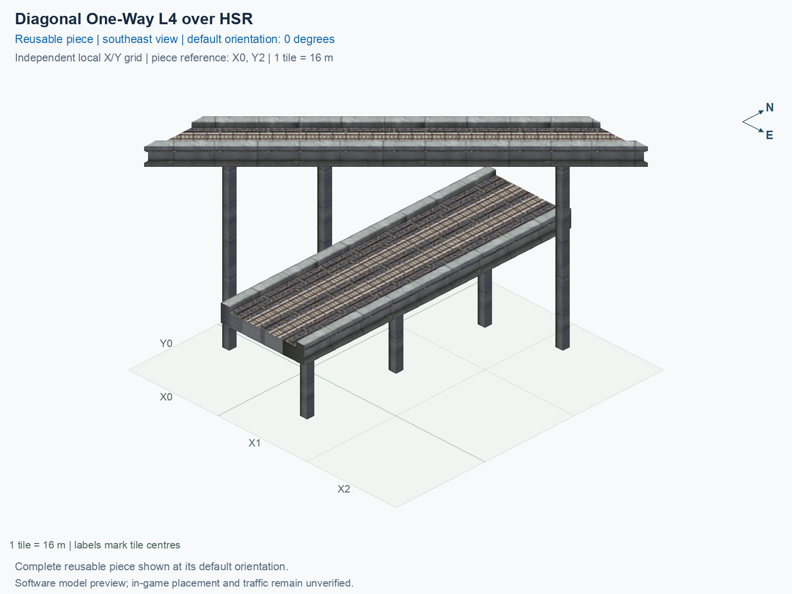

# Diagonal One-Way L4 over HSR

Purpose: explain this reusable piece, its matching connections and current test coverage.

<!-- BEGIN PIECE OVERVIEW -->

Actual rail geometry and directed train paths at two heights. The one-way track and two-way track cross without a transfer. Experimental fixed piece; test rendering, traffic and shadows in the game. The upper route crosses without transferring to the lower two-way route.

Exact reusable identifier: `interchange-l4-upper-diag-lower-grid-over-hsr`.

Footprint: **3 × 3 tiles**. Exact menu name: **Diagonal One-Way L4 over HSR**.

Choose this exact name in Transportation → Rail. Press Home or End to rotate; use only the supported states listed below. Join each end to a matching port profile and direction.

- [Connections and journeys](#connections-and-journeys)
- [Test checklist](#test-checklist)



<!-- END PIECE OVERVIEW -->

<!-- BEGIN MANUAL SUMMARY -->

## Manual status

Generated from [the exact test cases](#test-checklist) and [authoritative observations](checks/manual-tests.json).

- [ ] Preview review: 0/1 applicable cases passed; 0 failed, 0 stale.
- [ ] In-game rendering: 0/4 applicable cases passed; 0 failed, 0 stale.
- [ ] Directed journeys: 0/12 applicable cases passed; 0 failed, 0 stale.

These observations cover only the named services, directions, poses, rotations, and recorded platforms.

<!-- END MANUAL SUMMARY -->

<!-- BEGIN CONNECTIONS -->

## Connections and journeys

Purpose: describe intrinsic directional interfaces and permitted service journeys.

Generated from [connections.json](connections.json). Coordinates are canonical east, north and height in metres. A connection class names an encoded route interface; it does not prove visible deck/wall fit or an in-game test.

Supported placement states: 0° CCW, 90° CCW, 180° CCW, 270° CCW. Each state has its own declared manual scope.

A **port** is one directional transport-path endpoint. **Service** identifies the intended network service (for example HSR, street, or tram); **engine** is its internal traffic-class number, separate from the construction network. **Role** distinguishes primary service from auxiliary paths; sharing a traffic class does not establish service compatibility.

A **tangent** is a unit travel-direction vector: `[0,1]` means north. **Grade** is height gained per horizontal metre. These measured facts describe this subject alone. Compatibility requires a separate comparison of the complete joining boundaries; physical seams and actual game operation require their own evidence. See the [class index](../../connection-classes.json) for shared route-interface membership.

| Port | Service / engine / role | Direction | Location; tangent; grade | Connection class |
| --- | --- | --- | --- | --- |
| `upper_in` | hsr / 7 / primary | in | [-8.0, -32.0, 30.5]; [0.7071067811865475, 0.7071067811865475]; 0.0 | `path-interface-13a0d20884fd73110dea` |
| `lower_b_out` | hsr / 7 / primary | out | [14.0, -40.0, 15.5]; [-0.0, -1.0]; 0.0 | `path-interface-fba09fbeb87ad95c667a` |
| `lower_b_in` | hsr / 7 / primary | in | [14.0, 8.0, 15.5]; [-0.0, -1.0]; 0.0 | `path-interface-fba09fbeb87ad95c667a` |
| `lower_a_in` | hsr / 7 / primary | in | [18.0, -40.0, 15.5]; [0.0, 1.0]; 0.0 | `path-interface-fba09fbeb87ad95c667a` |
| `lower_a_out` | hsr / 7 / primary | out | [18.0, 8.0, 15.5]; [0.0, 1.0]; 0.0 | `path-interface-fba09fbeb87ad95c667a` |
| `upper_out` | hsr / 7 / primary | out | [32.0, 8.0, 30.5]; [0.7071067811865475, 0.7071067811865475]; 0.0 | `path-interface-a70e777e6354823bc5c5` |

### Directed journeys

| Service | Entry → exit | Role |
| --- | --- | --- |
| hsr | `upper_in` → `upper_out` | primary |
| hsr | `lower_b_in` → `lower_b_out` | primary |
| hsr | `lower_a_in` → `lower_a_out` | primary |

### Forbidden transfers

| From service / port | To service / port | Reason |
| --- | --- | --- |
| hsr / `upper_in` | hsr / `lower_b_out` | No directed route exists between these ports in the saved piece transport paths. In-game confirmation remains unverified. |
| hsr / `upper_in` | hsr / `lower_a_out` | No directed route exists between these ports in the saved piece transport paths. In-game confirmation remains unverified. |
| hsr / `lower_b_in` | hsr / `lower_a_out` | No directed route exists between these ports in the saved piece transport paths. In-game confirmation remains unverified. |
| hsr / `lower_b_in` | hsr / `upper_out` | No directed route exists between these ports in the saved piece transport paths. In-game confirmation remains unverified. |
| hsr / `lower_a_in` | hsr / `lower_b_out` | No directed route exists between these ports in the saved piece transport paths. In-game confirmation remains unverified. |
| hsr / `lower_a_in` | hsr / `upper_out` | No directed route exists between these ports in the saved piece transport paths. In-game confirmation remains unverified. |

Review the test checklist for the exact tested cases and environments.

<!-- END CONNECTIONS -->

<!-- BEGIN MANUAL CHECKS -->

## Test checklist

Generated from [the authoritative record](checks/manual-tests.json). Only explicit human observations create manual passes; software and preview checks remain separate. Expand a check/service group to see its rotation table, then expand the matching exact scope to copy a case ID and inspect its pose, reviewer, environment, and evidence. Grouping changes only this view; every declared case remains separate.

**States:** [x] passed; [ ] unverified, failed, or stale; N/A is an explicit inapplicable declaration. A dash means no case was declared in that column. Every pass covers only its recorded environment. T means a distinct construction-transposed state.

Four proper rotations are covered. No additional reflected state is established by this record; repeated construction aliases do not create new orientations.

Current totals: unverified: 55, passed: 0, failed: 0, stale: 0, not_applicable: 0.

### Record an observation

Follow the [shared testing guide](../../../../docs/TESTING.md); copy [the unconfirmed example](checks/observation.example.json) to `checks/observation.json`. Case identifiers are in the expandable sections below. Do not edit generated checkboxes.

From the repository folder containing `custom-pieces`, run after filling `checks/observation.json` and explicitly confirming the exact observation:

```sh
python3 -m scp.content record --record custom-pieces/domains/high-speed-rail/00_pieces/interchange-l4-upper-diag-lower-grid-over-hsr/checks/manual-tests.json --observation custom-pieces/domains/high-speed-rail/00_pieces/interchange-l4-upper-diag-lower-grid-over-hsr/checks/observation.json
```

### Detailed current checks

Each collapsed group shows exact case counts and states. Forbidden transfers are grouped by the directed service pair; the table inside retains every port pair and rotation.

<details>
<summary>Compiled resources — Whole subject — 1 case; unverified: 1</summary>

| Check / exact scope | General | 0° | 90° | 180° | 270° |
| --- | --- | --- | --- | --- | --- |
| **Compiled resources**<br>Whole subject | <a href="#case-software_resources-3e9a4997e9d3b376e406">[ ] unverified</a> | — | — | — | — |


<details>
<summary>Compiled resources — Whole subject</summary>

<a id="case-software_resources-3e9a4997e9d3b376e406"></a>

**General: unverified** — `software_resources-3e9a4997e9d3b376e406`.

Verify the actual compiled resources and construction rules.

Scope: Whole subject.

No observation recorded.

</details>

</details>

<details>
<summary>Directed routing graph — Whole subject — 1 case; unverified: 1</summary>

| Check / exact scope | General | 0° | 90° | 180° | 270° |
| --- | --- | --- | --- | --- | --- |
| **Directed routing graph**<br>Whole subject | <a href="#case-software_connectivity-3e9a4997e9d3b376e406">[ ] unverified</a> | — | — | — | — |


<details>
<summary>Directed routing graph — Whole subject</summary>

<a id="case-software_connectivity-3e9a4997e9d3b376e406"></a>

**General: unverified** — `software_connectivity-3e9a4997e9d3b376e406`.

Verify the declared directed journeys and forbidden transfers.

Scope: Whole subject.

No observation recorded.

</details>

</details>

<details>
<summary>Preview review — Images — 1 case; unverified: 1</summary>

| Check / exact scope | General | 0° | 90° | 180° | 270° |
| --- | --- | --- | --- | --- | --- |
| **Preview review**<br>Image: image:interchange-l4-upper-diag-lower-grid-over-hsr:canonical-southeast | <a href="#case-preview_review-fe458d9bb48cb5f3c1e9">[ ] unverified</a> | — | — | — | — |


<details>
<summary>Preview review — Image: image:interchange-l4-upper-diag-lower-grid-over-hsr:canonical-southeast</summary>

<a id="case-preview_review-fe458d9bb48cb5f3c1e9"></a>

**General: unverified** — `preview_review-fe458d9bb48cb5f3c1e9`.

Inspect this exact preview for tracks, walls, piers, seams and shadows.

Scope: Image: image:interchange-l4-upper-diag-lower-grid-over-hsr:canonical-southeast.

No observation recorded.

</details>

</details>

<details>
<summary>In-game rendering — Whole subject — 4 cases; unverified: 4</summary>

| Check / exact scope | General | 0° | 90° | 180° | 270° |
| --- | --- | --- | --- | --- | --- |
| **In-game rendering**<br>Whole subject | — | <a href="#case-in_game_render-a0fdf50ede3635d85a31">[ ] unverified</a> | <a href="#case-in_game_render-045aaffb7f54c5f41b39">[ ] unverified</a> | <a href="#case-in_game_render-22bbd30859e1f4dc7d27">[ ] unverified</a> | <a href="#case-in_game_render-14205ef808234b726f75">[ ] unverified</a> |


<details>
<summary>In-game rendering — Whole subject</summary>

<a id="case-in_game_render-a0fdf50ede3635d85a31"></a>

**0° CCW: unverified** — `in_game_render-a0fdf50ede3635d85a31`.

Inspect the placed tracks, walls, piers, seams and shadows in SimCity 4.

Scope: Whole subject.

No observation recorded.

<a id="case-in_game_render-045aaffb7f54c5f41b39"></a>

**90° CCW: unverified** — `in_game_render-045aaffb7f54c5f41b39`.

Inspect the placed tracks, walls, piers, seams and shadows in SimCity 4.

Scope: Whole subject.

No observation recorded.

<a id="case-in_game_render-22bbd30859e1f4dc7d27"></a>

**180° CCW: unverified** — `in_game_render-22bbd30859e1f4dc7d27`.

Inspect the placed tracks, walls, piers, seams and shadows in SimCity 4.

Scope: Whole subject.

No observation recorded.

<a id="case-in_game_render-14205ef808234b726f75"></a>

**270° CCW: unverified** — `in_game_render-14205ef808234b726f75`.

Inspect the placed tracks, walls, piers, seams and shadows in SimCity 4.

Scope: Whole subject.

No observation recorded.

</details>

</details>

<details>
<summary>Placement — Whole subject — 4 cases; unverified: 4</summary>

| Check / exact scope | General | 0° | 90° | 180° | 270° |
| --- | --- | --- | --- | --- | --- |
| **Placement**<br>Whole subject | — | <a href="#case-in_game_placement-a0fdf50ede3635d85a31">[ ] unverified</a> | <a href="#case-in_game_placement-045aaffb7f54c5f41b39">[ ] unverified</a> | <a href="#case-in_game_placement-22bbd30859e1f4dc7d27">[ ] unverified</a> | <a href="#case-in_game_placement-14205ef808234b726f75">[ ] unverified</a> |


<details>
<summary>Placement — Whole subject</summary>

<a id="case-in_game_placement-a0fdf50ede3635d85a31"></a>

**0° CCW: unverified** — `in_game_placement-a0fdf50ede3635d85a31`.

Place this piece or complete blueprint and inspect every occupied tile.

Scope: Whole subject.

No observation recorded.

<a id="case-in_game_placement-045aaffb7f54c5f41b39"></a>

**90° CCW: unverified** — `in_game_placement-045aaffb7f54c5f41b39`.

Place this piece or complete blueprint and inspect every occupied tile.

Scope: Whole subject.

No observation recorded.

<a id="case-in_game_placement-22bbd30859e1f4dc7d27"></a>

**180° CCW: unverified** — `in_game_placement-22bbd30859e1f4dc7d27`.

Place this piece or complete blueprint and inspect every occupied tile.

Scope: Whole subject.

No observation recorded.

<a id="case-in_game_placement-14205ef808234b726f75"></a>

**270° CCW: unverified** — `in_game_placement-14205ef808234b726f75`.

Place this piece or complete blueprint and inspect every occupied tile.

Scope: Whole subject.

No observation recorded.

</details>

</details>

<details>
<summary>Demolition — Whole subject — 4 cases; unverified: 4</summary>

| Check / exact scope | General | 0° | 90° | 180° | 270° |
| --- | --- | --- | --- | --- | --- |
| **Demolition**<br>Whole subject | — | <a href="#case-in_game_demolition-a0fdf50ede3635d85a31">[ ] unverified</a> | <a href="#case-in_game_demolition-045aaffb7f54c5f41b39">[ ] unverified</a> | <a href="#case-in_game_demolition-22bbd30859e1f4dc7d27">[ ] unverified</a> | <a href="#case-in_game_demolition-14205ef808234b726f75">[ ] unverified</a> |


<details>
<summary>Demolition — Whole subject</summary>

<a id="case-in_game_demolition-a0fdf50ede3635d85a31"></a>

**0° CCW: unverified** — `in_game_demolition-a0fdf50ede3635d85a31`.

Bulldoze the complete placement and inspect the cleared area.

Scope: Whole subject.

No observation recorded.

<a id="case-in_game_demolition-045aaffb7f54c5f41b39"></a>

**90° CCW: unverified** — `in_game_demolition-045aaffb7f54c5f41b39`.

Bulldoze the complete placement and inspect the cleared area.

Scope: Whole subject.

No observation recorded.

<a id="case-in_game_demolition-22bbd30859e1f4dc7d27"></a>

**180° CCW: unverified** — `in_game_demolition-22bbd30859e1f4dc7d27`.

Bulldoze the complete placement and inspect the cleared area.

Scope: Whole subject.

No observation recorded.

<a id="case-in_game_demolition-14205ef808234b726f75"></a>

**270° CCW: unverified** — `in_game_demolition-14205ef808234b726f75`.

Bulldoze the complete placement and inspect the cleared area.

Scope: Whole subject.

No observation recorded.

</details>

</details>

<details>
<summary>Save and reload — Whole subject — 4 cases; unverified: 4</summary>

| Check / exact scope | General | 0° | 90° | 180° | 270° |
| --- | --- | --- | --- | --- | --- |
| **Save and reload**<br>Whole subject | — | <a href="#case-in_game_save_reload-a0fdf50ede3635d85a31">[ ] unverified</a> | <a href="#case-in_game_save_reload-045aaffb7f54c5f41b39">[ ] unverified</a> | <a href="#case-in_game_save_reload-22bbd30859e1f4dc7d27">[ ] unverified</a> | <a href="#case-in_game_save_reload-14205ef808234b726f75">[ ] unverified</a> |


<details>
<summary>Save and reload — Whole subject</summary>

<a id="case-in_game_save_reload-a0fdf50ede3635d85a31"></a>

**0° CCW: unverified** — `in_game_save_reload-a0fdf50ede3635d85a31`.

Save, quit, reload and inspect the placement and its paths.

Scope: Whole subject.

No observation recorded.

<a id="case-in_game_save_reload-045aaffb7f54c5f41b39"></a>

**90° CCW: unverified** — `in_game_save_reload-045aaffb7f54c5f41b39`.

Save, quit, reload and inspect the placement and its paths.

Scope: Whole subject.

No observation recorded.

<a id="case-in_game_save_reload-22bbd30859e1f4dc7d27"></a>

**180° CCW: unverified** — `in_game_save_reload-22bbd30859e1f4dc7d27`.

Save, quit, reload and inspect the placement and its paths.

Scope: Whole subject.

No observation recorded.

<a id="case-in_game_save_reload-14205ef808234b726f75"></a>

**270° CCW: unverified** — `in_game_save_reload-14205ef808234b726f75`.

Save, quit, reload and inspect the placement and its paths.

Scope: Whole subject.

No observation recorded.

</details>

</details>

<details>
<summary>Journey — hsr — 12 cases; unverified: 12</summary>

| Check / exact scope | General | 0° | 90° | 180° | 270° |
| --- | --- | --- | --- | --- | --- |
| **Journey**<br>Service: hsr; role: primary; journey: 7:upper_in>upper_out; entry: upper_in; exit: upper_out | — | <a href="#case-in_game_journey-115049fe816a667377bd">[ ] unverified</a> | <a href="#case-in_game_journey-d5dfba3a42d8cc1463f0">[ ] unverified</a> | <a href="#case-in_game_journey-4cdb4fcea41d908b2d1e">[ ] unverified</a> | <a href="#case-in_game_journey-c6fb6dd5bd82029ad982">[ ] unverified</a> |
| **Journey**<br>Service: hsr; role: primary; journey: 7:lower_b_in>lower_b_out; entry: lower_b_in; exit: lower_b_out | — | <a href="#case-in_game_journey-81126809feebef12243a">[ ] unverified</a> | <a href="#case-in_game_journey-e249bee6f5bf55586a0a">[ ] unverified</a> | <a href="#case-in_game_journey-7011e6662146aff67ebc">[ ] unverified</a> | <a href="#case-in_game_journey-91158726b4b840f5418a">[ ] unverified</a> |
| **Journey**<br>Service: hsr; role: primary; journey: 7:lower_a_in>lower_a_out; entry: lower_a_in; exit: lower_a_out | — | <a href="#case-in_game_journey-7f614b9154051d14d978">[ ] unverified</a> | <a href="#case-in_game_journey-018b6948e92c240587ff">[ ] unverified</a> | <a href="#case-in_game_journey-f882c7745d72be8fbb37">[ ] unverified</a> | <a href="#case-in_game_journey-7eeab6c68cc03b66ea1f">[ ] unverified</a> |


<details>
<summary>Journey — Service: hsr; role: primary; journey: 7:upper_in>upper_out; entry: upper_in; exit: upper_out</summary>

<a id="case-in_game_journey-115049fe816a667377bd"></a>

**0° CCW: unverified** — `in_game_journey-115049fe816a667377bd`.

Run the declared journey in this direction using its service network.

Scope: Service: hsr; role: primary; journey: 7:upper_in>upper_out; entry: upper_in; exit: upper_out.

No observation recorded.

<a id="case-in_game_journey-d5dfba3a42d8cc1463f0"></a>

**90° CCW: unverified** — `in_game_journey-d5dfba3a42d8cc1463f0`.

Run the declared journey in this direction using its service network.

Scope: Service: hsr; role: primary; journey: 7:upper_in>upper_out; entry: upper_in; exit: upper_out.

No observation recorded.

<a id="case-in_game_journey-4cdb4fcea41d908b2d1e"></a>

**180° CCW: unverified** — `in_game_journey-4cdb4fcea41d908b2d1e`.

Run the declared journey in this direction using its service network.

Scope: Service: hsr; role: primary; journey: 7:upper_in>upper_out; entry: upper_in; exit: upper_out.

No observation recorded.

<a id="case-in_game_journey-c6fb6dd5bd82029ad982"></a>

**270° CCW: unverified** — `in_game_journey-c6fb6dd5bd82029ad982`.

Run the declared journey in this direction using its service network.

Scope: Service: hsr; role: primary; journey: 7:upper_in>upper_out; entry: upper_in; exit: upper_out.

No observation recorded.

</details>


<details>
<summary>Journey — Service: hsr; role: primary; journey: 7:lower_b_in>lower_b_out; entry: lower_b_in; exit: lower_b_out</summary>

<a id="case-in_game_journey-81126809feebef12243a"></a>

**0° CCW: unverified** — `in_game_journey-81126809feebef12243a`.

Run the declared journey in this direction using its service network.

Scope: Service: hsr; role: primary; journey: 7:lower_b_in>lower_b_out; entry: lower_b_in; exit: lower_b_out.

No observation recorded.

<a id="case-in_game_journey-e249bee6f5bf55586a0a"></a>

**90° CCW: unverified** — `in_game_journey-e249bee6f5bf55586a0a`.

Run the declared journey in this direction using its service network.

Scope: Service: hsr; role: primary; journey: 7:lower_b_in>lower_b_out; entry: lower_b_in; exit: lower_b_out.

No observation recorded.

<a id="case-in_game_journey-7011e6662146aff67ebc"></a>

**180° CCW: unverified** — `in_game_journey-7011e6662146aff67ebc`.

Run the declared journey in this direction using its service network.

Scope: Service: hsr; role: primary; journey: 7:lower_b_in>lower_b_out; entry: lower_b_in; exit: lower_b_out.

No observation recorded.

<a id="case-in_game_journey-91158726b4b840f5418a"></a>

**270° CCW: unverified** — `in_game_journey-91158726b4b840f5418a`.

Run the declared journey in this direction using its service network.

Scope: Service: hsr; role: primary; journey: 7:lower_b_in>lower_b_out; entry: lower_b_in; exit: lower_b_out.

No observation recorded.

</details>


<details>
<summary>Journey — Service: hsr; role: primary; journey: 7:lower_a_in>lower_a_out; entry: lower_a_in; exit: lower_a_out</summary>

<a id="case-in_game_journey-7f614b9154051d14d978"></a>

**0° CCW: unverified** — `in_game_journey-7f614b9154051d14d978`.

Run the declared journey in this direction using its service network.

Scope: Service: hsr; role: primary; journey: 7:lower_a_in>lower_a_out; entry: lower_a_in; exit: lower_a_out.

No observation recorded.

<a id="case-in_game_journey-018b6948e92c240587ff"></a>

**90° CCW: unverified** — `in_game_journey-018b6948e92c240587ff`.

Run the declared journey in this direction using its service network.

Scope: Service: hsr; role: primary; journey: 7:lower_a_in>lower_a_out; entry: lower_a_in; exit: lower_a_out.

No observation recorded.

<a id="case-in_game_journey-f882c7745d72be8fbb37"></a>

**180° CCW: unverified** — `in_game_journey-f882c7745d72be8fbb37`.

Run the declared journey in this direction using its service network.

Scope: Service: hsr; role: primary; journey: 7:lower_a_in>lower_a_out; entry: lower_a_in; exit: lower_a_out.

No observation recorded.

<a id="case-in_game_journey-7eeab6c68cc03b66ea1f"></a>

**270° CCW: unverified** — `in_game_journey-7eeab6c68cc03b66ea1f`.

Run the declared journey in this direction using its service network.

Scope: Service: hsr; role: primary; journey: 7:lower_a_in>lower_a_out; entry: lower_a_in; exit: lower_a_out.

No observation recorded.

</details>

</details>

<details>
<summary>Forbidden transfer — hsr → hsr — 24 cases; unverified: 24</summary>

| Check / exact scope | General | 0° | 90° | 180° | 270° |
| --- | --- | --- | --- | --- | --- |
| **Forbidden transfer**<br>from port: upper_in; to port: lower_b_out; from service: hsr; to service: hsr; basis: not reachable in actual saved PATH graph | — | <a href="#case-in_game_forbidden_transfer-81e7dce7ca6f0c475a2f">[ ] unverified</a> | <a href="#case-in_game_forbidden_transfer-c21c8b9c1b076d204ee2">[ ] unverified</a> | <a href="#case-in_game_forbidden_transfer-33a9ec3c22f69be380b5">[ ] unverified</a> | <a href="#case-in_game_forbidden_transfer-fde53aedaeff9d3a7c00">[ ] unverified</a> |
| **Forbidden transfer**<br>from port: upper_in; to port: lower_a_out; from service: hsr; to service: hsr; basis: not reachable in actual saved PATH graph | — | <a href="#case-in_game_forbidden_transfer-e48cca359d73a26443fa">[ ] unverified</a> | <a href="#case-in_game_forbidden_transfer-13c893d632768abc2337">[ ] unverified</a> | <a href="#case-in_game_forbidden_transfer-88e107cdd769b23aaec6">[ ] unverified</a> | <a href="#case-in_game_forbidden_transfer-2344c8751ec5af3e8f81">[ ] unverified</a> |
| **Forbidden transfer**<br>from port: lower_b_in; to port: lower_a_out; from service: hsr; to service: hsr; basis: not reachable in actual saved PATH graph | — | <a href="#case-in_game_forbidden_transfer-ae3fafff18852052aab5">[ ] unverified</a> | <a href="#case-in_game_forbidden_transfer-1eb324d44a4d959ee996">[ ] unverified</a> | <a href="#case-in_game_forbidden_transfer-ad7434acfc74f596213f">[ ] unverified</a> | <a href="#case-in_game_forbidden_transfer-2b45429c6ab847664319">[ ] unverified</a> |
| **Forbidden transfer**<br>from port: lower_b_in; to port: upper_out; from service: hsr; to service: hsr; basis: not reachable in actual saved PATH graph | — | <a href="#case-in_game_forbidden_transfer-4ce75c44d887d1213c6f">[ ] unverified</a> | <a href="#case-in_game_forbidden_transfer-83cbd6fed417778c7677">[ ] unverified</a> | <a href="#case-in_game_forbidden_transfer-77efd868dc74602966f7">[ ] unverified</a> | <a href="#case-in_game_forbidden_transfer-2bdefedbf5a93f8fdf19">[ ] unverified</a> |
| **Forbidden transfer**<br>from port: lower_a_in; to port: lower_b_out; from service: hsr; to service: hsr; basis: not reachable in actual saved PATH graph | — | <a href="#case-in_game_forbidden_transfer-69742565a24f837a2249">[ ] unverified</a> | <a href="#case-in_game_forbidden_transfer-cc4e7a136fbc680c7c81">[ ] unverified</a> | <a href="#case-in_game_forbidden_transfer-1d9dc4eb85bfe870811d">[ ] unverified</a> | <a href="#case-in_game_forbidden_transfer-10f442e0ad1e0ea1e07a">[ ] unverified</a> |
| **Forbidden transfer**<br>from port: lower_a_in; to port: upper_out; from service: hsr; to service: hsr; basis: not reachable in actual saved PATH graph | — | <a href="#case-in_game_forbidden_transfer-8e6884af9fc694488e3c">[ ] unverified</a> | <a href="#case-in_game_forbidden_transfer-c99e81fafe32c2f80c3c">[ ] unverified</a> | <a href="#case-in_game_forbidden_transfer-96db9edbaa615437405c">[ ] unverified</a> | <a href="#case-in_game_forbidden_transfer-4f474b9b536de494e4c7">[ ] unverified</a> |


<details>
<summary>Forbidden transfer — from port: upper_in; to port: lower_b_out; from service: hsr; to service: hsr; basis: not reachable in actual saved PATH graph</summary>

<a id="case-in_game_forbidden_transfer-81e7dce7ca6f0c475a2f"></a>

**0° CCW: unverified** — `in_game_forbidden_transfer-81e7dce7ca6f0c475a2f`.

Confirm this undeclared transfer is unavailable.

Scope: from port: upper_in; to port: lower_b_out; from service: hsr; to service: hsr; basis: not reachable in actual saved PATH graph.

No observation recorded.

<a id="case-in_game_forbidden_transfer-c21c8b9c1b076d204ee2"></a>

**90° CCW: unverified** — `in_game_forbidden_transfer-c21c8b9c1b076d204ee2`.

Confirm this undeclared transfer is unavailable.

Scope: from port: upper_in; to port: lower_b_out; from service: hsr; to service: hsr; basis: not reachable in actual saved PATH graph.

No observation recorded.

<a id="case-in_game_forbidden_transfer-33a9ec3c22f69be380b5"></a>

**180° CCW: unverified** — `in_game_forbidden_transfer-33a9ec3c22f69be380b5`.

Confirm this undeclared transfer is unavailable.

Scope: from port: upper_in; to port: lower_b_out; from service: hsr; to service: hsr; basis: not reachable in actual saved PATH graph.

No observation recorded.

<a id="case-in_game_forbidden_transfer-fde53aedaeff9d3a7c00"></a>

**270° CCW: unverified** — `in_game_forbidden_transfer-fde53aedaeff9d3a7c00`.

Confirm this undeclared transfer is unavailable.

Scope: from port: upper_in; to port: lower_b_out; from service: hsr; to service: hsr; basis: not reachable in actual saved PATH graph.

No observation recorded.

</details>


<details>
<summary>Forbidden transfer — from port: upper_in; to port: lower_a_out; from service: hsr; to service: hsr; basis: not reachable in actual saved PATH graph</summary>

<a id="case-in_game_forbidden_transfer-e48cca359d73a26443fa"></a>

**0° CCW: unverified** — `in_game_forbidden_transfer-e48cca359d73a26443fa`.

Confirm this undeclared transfer is unavailable.

Scope: from port: upper_in; to port: lower_a_out; from service: hsr; to service: hsr; basis: not reachable in actual saved PATH graph.

No observation recorded.

<a id="case-in_game_forbidden_transfer-13c893d632768abc2337"></a>

**90° CCW: unverified** — `in_game_forbidden_transfer-13c893d632768abc2337`.

Confirm this undeclared transfer is unavailable.

Scope: from port: upper_in; to port: lower_a_out; from service: hsr; to service: hsr; basis: not reachable in actual saved PATH graph.

No observation recorded.

<a id="case-in_game_forbidden_transfer-88e107cdd769b23aaec6"></a>

**180° CCW: unverified** — `in_game_forbidden_transfer-88e107cdd769b23aaec6`.

Confirm this undeclared transfer is unavailable.

Scope: from port: upper_in; to port: lower_a_out; from service: hsr; to service: hsr; basis: not reachable in actual saved PATH graph.

No observation recorded.

<a id="case-in_game_forbidden_transfer-2344c8751ec5af3e8f81"></a>

**270° CCW: unverified** — `in_game_forbidden_transfer-2344c8751ec5af3e8f81`.

Confirm this undeclared transfer is unavailable.

Scope: from port: upper_in; to port: lower_a_out; from service: hsr; to service: hsr; basis: not reachable in actual saved PATH graph.

No observation recorded.

</details>


<details>
<summary>Forbidden transfer — from port: lower_b_in; to port: lower_a_out; from service: hsr; to service: hsr; basis: not reachable in actual saved PATH graph</summary>

<a id="case-in_game_forbidden_transfer-ae3fafff18852052aab5"></a>

**0° CCW: unverified** — `in_game_forbidden_transfer-ae3fafff18852052aab5`.

Confirm this undeclared transfer is unavailable.

Scope: from port: lower_b_in; to port: lower_a_out; from service: hsr; to service: hsr; basis: not reachable in actual saved PATH graph.

No observation recorded.

<a id="case-in_game_forbidden_transfer-1eb324d44a4d959ee996"></a>

**90° CCW: unverified** — `in_game_forbidden_transfer-1eb324d44a4d959ee996`.

Confirm this undeclared transfer is unavailable.

Scope: from port: lower_b_in; to port: lower_a_out; from service: hsr; to service: hsr; basis: not reachable in actual saved PATH graph.

No observation recorded.

<a id="case-in_game_forbidden_transfer-ad7434acfc74f596213f"></a>

**180° CCW: unverified** — `in_game_forbidden_transfer-ad7434acfc74f596213f`.

Confirm this undeclared transfer is unavailable.

Scope: from port: lower_b_in; to port: lower_a_out; from service: hsr; to service: hsr; basis: not reachable in actual saved PATH graph.

No observation recorded.

<a id="case-in_game_forbidden_transfer-2b45429c6ab847664319"></a>

**270° CCW: unverified** — `in_game_forbidden_transfer-2b45429c6ab847664319`.

Confirm this undeclared transfer is unavailable.

Scope: from port: lower_b_in; to port: lower_a_out; from service: hsr; to service: hsr; basis: not reachable in actual saved PATH graph.

No observation recorded.

</details>


<details>
<summary>Forbidden transfer — from port: lower_b_in; to port: upper_out; from service: hsr; to service: hsr; basis: not reachable in actual saved PATH graph</summary>

<a id="case-in_game_forbidden_transfer-4ce75c44d887d1213c6f"></a>

**0° CCW: unverified** — `in_game_forbidden_transfer-4ce75c44d887d1213c6f`.

Confirm this undeclared transfer is unavailable.

Scope: from port: lower_b_in; to port: upper_out; from service: hsr; to service: hsr; basis: not reachable in actual saved PATH graph.

No observation recorded.

<a id="case-in_game_forbidden_transfer-83cbd6fed417778c7677"></a>

**90° CCW: unverified** — `in_game_forbidden_transfer-83cbd6fed417778c7677`.

Confirm this undeclared transfer is unavailable.

Scope: from port: lower_b_in; to port: upper_out; from service: hsr; to service: hsr; basis: not reachable in actual saved PATH graph.

No observation recorded.

<a id="case-in_game_forbidden_transfer-77efd868dc74602966f7"></a>

**180° CCW: unverified** — `in_game_forbidden_transfer-77efd868dc74602966f7`.

Confirm this undeclared transfer is unavailable.

Scope: from port: lower_b_in; to port: upper_out; from service: hsr; to service: hsr; basis: not reachable in actual saved PATH graph.

No observation recorded.

<a id="case-in_game_forbidden_transfer-2bdefedbf5a93f8fdf19"></a>

**270° CCW: unverified** — `in_game_forbidden_transfer-2bdefedbf5a93f8fdf19`.

Confirm this undeclared transfer is unavailable.

Scope: from port: lower_b_in; to port: upper_out; from service: hsr; to service: hsr; basis: not reachable in actual saved PATH graph.

No observation recorded.

</details>


<details>
<summary>Forbidden transfer — from port: lower_a_in; to port: lower_b_out; from service: hsr; to service: hsr; basis: not reachable in actual saved PATH graph</summary>

<a id="case-in_game_forbidden_transfer-69742565a24f837a2249"></a>

**0° CCW: unverified** — `in_game_forbidden_transfer-69742565a24f837a2249`.

Confirm this undeclared transfer is unavailable.

Scope: from port: lower_a_in; to port: lower_b_out; from service: hsr; to service: hsr; basis: not reachable in actual saved PATH graph.

No observation recorded.

<a id="case-in_game_forbidden_transfer-cc4e7a136fbc680c7c81"></a>

**90° CCW: unverified** — `in_game_forbidden_transfer-cc4e7a136fbc680c7c81`.

Confirm this undeclared transfer is unavailable.

Scope: from port: lower_a_in; to port: lower_b_out; from service: hsr; to service: hsr; basis: not reachable in actual saved PATH graph.

No observation recorded.

<a id="case-in_game_forbidden_transfer-1d9dc4eb85bfe870811d"></a>

**180° CCW: unverified** — `in_game_forbidden_transfer-1d9dc4eb85bfe870811d`.

Confirm this undeclared transfer is unavailable.

Scope: from port: lower_a_in; to port: lower_b_out; from service: hsr; to service: hsr; basis: not reachable in actual saved PATH graph.

No observation recorded.

<a id="case-in_game_forbidden_transfer-10f442e0ad1e0ea1e07a"></a>

**270° CCW: unverified** — `in_game_forbidden_transfer-10f442e0ad1e0ea1e07a`.

Confirm this undeclared transfer is unavailable.

Scope: from port: lower_a_in; to port: lower_b_out; from service: hsr; to service: hsr; basis: not reachable in actual saved PATH graph.

No observation recorded.

</details>


<details>
<summary>Forbidden transfer — from port: lower_a_in; to port: upper_out; from service: hsr; to service: hsr; basis: not reachable in actual saved PATH graph</summary>

<a id="case-in_game_forbidden_transfer-8e6884af9fc694488e3c"></a>

**0° CCW: unverified** — `in_game_forbidden_transfer-8e6884af9fc694488e3c`.

Confirm this undeclared transfer is unavailable.

Scope: from port: lower_a_in; to port: upper_out; from service: hsr; to service: hsr; basis: not reachable in actual saved PATH graph.

No observation recorded.

<a id="case-in_game_forbidden_transfer-c99e81fafe32c2f80c3c"></a>

**90° CCW: unverified** — `in_game_forbidden_transfer-c99e81fafe32c2f80c3c`.

Confirm this undeclared transfer is unavailable.

Scope: from port: lower_a_in; to port: upper_out; from service: hsr; to service: hsr; basis: not reachable in actual saved PATH graph.

No observation recorded.

<a id="case-in_game_forbidden_transfer-96db9edbaa615437405c"></a>

**180° CCW: unverified** — `in_game_forbidden_transfer-96db9edbaa615437405c`.

Confirm this undeclared transfer is unavailable.

Scope: from port: lower_a_in; to port: upper_out; from service: hsr; to service: hsr; basis: not reachable in actual saved PATH graph.

No observation recorded.

<a id="case-in_game_forbidden_transfer-4f474b9b536de494e4c7"></a>

**270° CCW: unverified** — `in_game_forbidden_transfer-4f474b9b536de494e4c7`.

Confirm this undeclared transfer is unavailable.

Scope: from port: lower_a_in; to port: upper_out; from service: hsr; to service: hsr; basis: not reachable in actual saved PATH graph.

No observation recorded.

</details>

</details>

<!-- END MANUAL CHECKS -->
