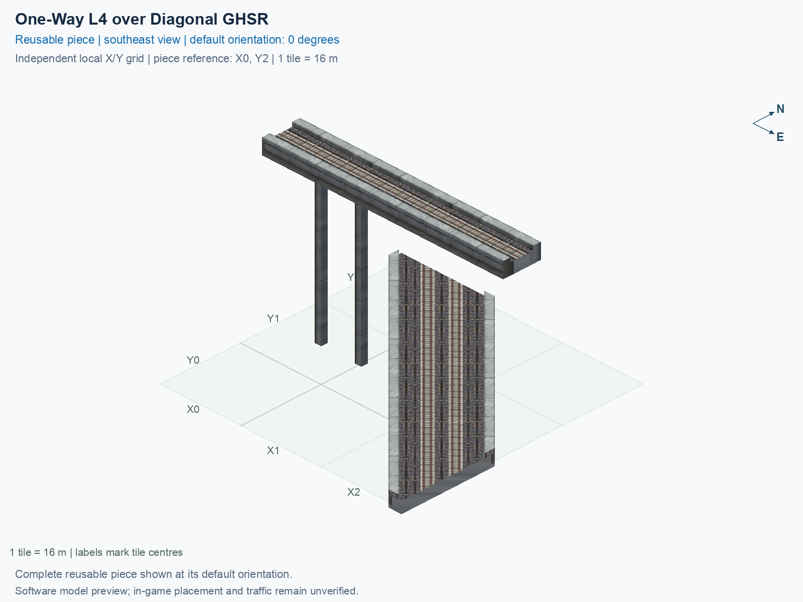

# One-Way L4 over Diagonal GHSR

Purpose: explain this reusable piece, its matching connections and current test coverage.

<!-- BEGIN PIECE OVERVIEW -->

Actual rail geometry and directed train paths at two heights. The one-way track and two-way track cross without a transfer. Experimental fixed piece; test rendering, traffic and shadows in the game. The upper route crosses without transferring to the lower two-way route.

Exact reusable identifier: `interchange-l4-upper-grid-lower-diag-over-ground`.

Footprint: **3 × 3 tiles**. Exact menu name: **One-Way L4 over Diagonal GHSR**.

Choose this exact name in Transportation → Rail. Press Home or End to rotate; use only the supported states listed below. Join each end to a matching port profile and direction.

- [Connections and journeys](#connections-and-journeys)
- [Test checklist](#test-checklist)



<!-- END PIECE OVERVIEW -->

<!-- BEGIN MANUAL SUMMARY -->

## Manual status

Generated from [the exact test cases](#test-checklist) and [authoritative observations](checks/manual-tests.json).

- [ ] Preview review: 0/1 applicable cases passed; 0 failed, 0 stale.
- [ ] In-game rendering: 0/4 applicable cases passed; 0 failed, 0 stale.
- [ ] Directed journeys: 0/12 applicable cases passed; 0 failed, 0 stale.

These observations cover only the named services, directions, poses, rotations, and recorded platforms.

<!-- END MANUAL SUMMARY -->

<!-- BEGIN CONNECTIONS -->

## Connections and journeys

Purpose: describe intrinsic directional interfaces and permitted service journeys.

Generated from [connections.json](connections.json). Coordinates are canonical east, north and height in metres. A connection class names an encoded route interface; it does not prove visible deck/wall fit or an in-game test.

Supported placement states: 0° CCW, 90° CCW, 180° CCW, 270° CCW. Each state has its own declared manual scope.

A **port** is one directional transport-path endpoint. **Service** identifies the intended network service (for example HSR, street, or tram); **engine** is its internal traffic-class number, separate from the construction network. **Role** distinguishes primary service from auxiliary paths; sharing a traffic class does not establish service compatibility.

A **tangent** is a unit travel-direction vector: `[0,1]` means north. **Grade** is height gained per horizontal metre. These measured facts describe this subject alone. Compatibility requires a separate comparison of the complete joining boundaries; physical seams and actual game operation require their own evidence. See the [class index](../../connection-classes.json) for shared route-interface membership.

| Port | Service / engine / role | Direction | Location; tangent; grade | Connection class |
| --- | --- | --- | --- | --- |
| `upper_in` | hsr / 7 / primary | in | [-8.0, -16.0, 30.5]; [1.0, 0.0]; 0.0 | `path-interface-a11c9f8debd0ee1c3a94` |
| `lower_b_in` | ghsr / 7 / primary | in | [-2.9, 8.0, 1.0]; [0.7071067811865475, -0.7071067811865475]; 0.0 | `path-interface-6ed8ad7d9e460ea9e26e` |
| `lower_a_out` | ghsr / 7 / primary | out | [2.8, 8.0, 1.0]; [-0.7071067811865475, 0.7071067811865475]; 0.0 | `path-interface-08442c19645c28282b17` |
| `lower_b_out` | ghsr / 7 / primary | out | [40.0, -34.9, 1.0]; [0.7071067811865475, -0.7071067811865475]; 0.0 | `path-interface-d13580a5f8b596919466` |
| `lower_a_in` | ghsr / 7 / primary | in | [40.0, -29.1, 1.0]; [-0.7071067811865475, 0.7071067811865475]; 0.0 | `path-interface-d13580a5f8b596919466` |
| `upper_out` | hsr / 7 / primary | out | [40.0, -16.0, 30.5]; [1.0, 0.0]; 0.0 | `path-interface-a11c9f8debd0ee1c3a94` |

### Directed journeys

| Service | Entry → exit | Role |
| --- | --- | --- |
| hsr | `upper_in` → `upper_out` | primary |
| ghsr | `lower_b_in` → `lower_b_out` | primary |
| ghsr | `lower_a_in` → `lower_a_out` | primary |

### Forbidden transfers

| From service / port | To service / port | Reason |
| --- | --- | --- |
| hsr / `upper_in` | ghsr / `lower_a_out` | No directed route exists between these ports in the saved piece transport paths. In-game confirmation remains unverified. |
| hsr / `upper_in` | ghsr / `lower_b_out` | No directed route exists between these ports in the saved piece transport paths. In-game confirmation remains unverified. |
| ghsr / `lower_b_in` | ghsr / `lower_a_out` | No directed route exists between these ports in the saved piece transport paths. In-game confirmation remains unverified. |
| ghsr / `lower_b_in` | hsr / `upper_out` | No directed route exists between these ports in the saved piece transport paths. In-game confirmation remains unverified. |
| ghsr / `lower_a_in` | ghsr / `lower_b_out` | No directed route exists between these ports in the saved piece transport paths. In-game confirmation remains unverified. |
| ghsr / `lower_a_in` | hsr / `upper_out` | No directed route exists between these ports in the saved piece transport paths. In-game confirmation remains unverified. |

Review the test checklist for the exact tested cases and environments.

<!-- END CONNECTIONS -->

<!-- BEGIN MANUAL CHECKS -->

## Test checklist

Generated from [the authoritative record](checks/manual-tests.json). Only explicit human observations create manual passes; software and preview checks remain separate. Expand a check/service group to see its rotation table, then expand the matching exact scope to copy a case ID and inspect its pose, reviewer, environment, and evidence. Grouping changes only this view; every declared case remains separate.

**States:** [x] passed; [ ] unverified, failed, or stale; N/A is an explicit inapplicable declaration. A dash means no case was declared in that column. Every pass covers only its recorded environment. T means a distinct construction-transposed state.

Four proper rotations are covered. No additional reflected state is established by this record; repeated construction aliases do not create new orientations.

Current totals: unverified: 55, passed: 0, failed: 0, stale: 0, not_applicable: 0.

### Record an observation

Follow the [shared testing guide](../../../../docs/TESTING.md); copy [the unconfirmed example](checks/observation.example.json) to `checks/observation.json`. Case identifiers are in the expandable sections below. Do not edit generated checkboxes.

From the repository folder containing `custom-pieces`, run after filling `checks/observation.json` and explicitly confirming the exact observation:

```sh
python3 -m scp.content record --record custom-pieces/domains/high-speed-rail/00_pieces/interchange-l4-upper-grid-lower-diag-over-ground/checks/manual-tests.json --observation custom-pieces/domains/high-speed-rail/00_pieces/interchange-l4-upper-grid-lower-diag-over-ground/checks/observation.json
```

### Detailed current checks

Each collapsed group shows exact case counts and states. Forbidden transfers are grouped by the directed service pair; the table inside retains every port pair and rotation.

<details>
<summary>Compiled resources — Whole subject — 1 case; unverified: 1</summary>

| Check / exact scope | General | 0° | 90° | 180° | 270° |
| --- | --- | --- | --- | --- | --- |
| **Compiled resources**<br>Whole subject | <a href="#case-software_resources-b001d2d28188aebd2a1c">[ ] unverified</a> | — | — | — | — |


<details>
<summary>Compiled resources — Whole subject</summary>

<a id="case-software_resources-b001d2d28188aebd2a1c"></a>

**General: unverified** — `software_resources-b001d2d28188aebd2a1c`.

Verify the actual compiled resources and construction rules.

Scope: Whole subject.

No observation recorded.

</details>

</details>

<details>
<summary>Directed routing graph — Whole subject — 1 case; unverified: 1</summary>

| Check / exact scope | General | 0° | 90° | 180° | 270° |
| --- | --- | --- | --- | --- | --- |
| **Directed routing graph**<br>Whole subject | <a href="#case-software_connectivity-b001d2d28188aebd2a1c">[ ] unverified</a> | — | — | — | — |


<details>
<summary>Directed routing graph — Whole subject</summary>

<a id="case-software_connectivity-b001d2d28188aebd2a1c"></a>

**General: unverified** — `software_connectivity-b001d2d28188aebd2a1c`.

Verify the declared directed journeys and forbidden transfers.

Scope: Whole subject.

No observation recorded.

</details>

</details>

<details>
<summary>Preview review — Images — 1 case; unverified: 1</summary>

| Check / exact scope | General | 0° | 90° | 180° | 270° |
| --- | --- | --- | --- | --- | --- |
| **Preview review**<br>Image: image:interchange-l4-upper-grid-lower-diag-over-ground:canonical-southeast | <a href="#case-preview_review-0531c9d28cb0b69e2632">[ ] unverified</a> | — | — | — | — |


<details>
<summary>Preview review — Image: image:interchange-l4-upper-grid-lower-diag-over-ground:canonical-southeast</summary>

<a id="case-preview_review-0531c9d28cb0b69e2632"></a>

**General: unverified** — `preview_review-0531c9d28cb0b69e2632`.

Inspect this exact preview for tracks, walls, piers, seams and shadows.

Scope: Image: image:interchange-l4-upper-grid-lower-diag-over-ground:canonical-southeast.

No observation recorded.

</details>

</details>

<details>
<summary>In-game rendering — Whole subject — 4 cases; unverified: 4</summary>

| Check / exact scope | General | 0° | 90° | 180° | 270° |
| --- | --- | --- | --- | --- | --- |
| **In-game rendering**<br>Whole subject | — | <a href="#case-in_game_render-8315bd82bf5fe3ed3789">[ ] unverified</a> | <a href="#case-in_game_render-eb9ee8de63406511b2d8">[ ] unverified</a> | <a href="#case-in_game_render-dd6a9bbc29d702946fba">[ ] unverified</a> | <a href="#case-in_game_render-58507bc598a0cdc53b65">[ ] unverified</a> |


<details>
<summary>In-game rendering — Whole subject</summary>

<a id="case-in_game_render-8315bd82bf5fe3ed3789"></a>

**0° CCW: unverified** — `in_game_render-8315bd82bf5fe3ed3789`.

Inspect the placed tracks, walls, piers, seams and shadows in SimCity 4.

Scope: Whole subject.

No observation recorded.

<a id="case-in_game_render-eb9ee8de63406511b2d8"></a>

**90° CCW: unverified** — `in_game_render-eb9ee8de63406511b2d8`.

Inspect the placed tracks, walls, piers, seams and shadows in SimCity 4.

Scope: Whole subject.

No observation recorded.

<a id="case-in_game_render-dd6a9bbc29d702946fba"></a>

**180° CCW: unverified** — `in_game_render-dd6a9bbc29d702946fba`.

Inspect the placed tracks, walls, piers, seams and shadows in SimCity 4.

Scope: Whole subject.

No observation recorded.

<a id="case-in_game_render-58507bc598a0cdc53b65"></a>

**270° CCW: unverified** — `in_game_render-58507bc598a0cdc53b65`.

Inspect the placed tracks, walls, piers, seams and shadows in SimCity 4.

Scope: Whole subject.

No observation recorded.

</details>

</details>

<details>
<summary>Placement — Whole subject — 4 cases; unverified: 4</summary>

| Check / exact scope | General | 0° | 90° | 180° | 270° |
| --- | --- | --- | --- | --- | --- |
| **Placement**<br>Whole subject | — | <a href="#case-in_game_placement-8315bd82bf5fe3ed3789">[ ] unverified</a> | <a href="#case-in_game_placement-eb9ee8de63406511b2d8">[ ] unverified</a> | <a href="#case-in_game_placement-dd6a9bbc29d702946fba">[ ] unverified</a> | <a href="#case-in_game_placement-58507bc598a0cdc53b65">[ ] unverified</a> |


<details>
<summary>Placement — Whole subject</summary>

<a id="case-in_game_placement-8315bd82bf5fe3ed3789"></a>

**0° CCW: unverified** — `in_game_placement-8315bd82bf5fe3ed3789`.

Place this piece or complete blueprint and inspect every occupied tile.

Scope: Whole subject.

No observation recorded.

<a id="case-in_game_placement-eb9ee8de63406511b2d8"></a>

**90° CCW: unverified** — `in_game_placement-eb9ee8de63406511b2d8`.

Place this piece or complete blueprint and inspect every occupied tile.

Scope: Whole subject.

No observation recorded.

<a id="case-in_game_placement-dd6a9bbc29d702946fba"></a>

**180° CCW: unverified** — `in_game_placement-dd6a9bbc29d702946fba`.

Place this piece or complete blueprint and inspect every occupied tile.

Scope: Whole subject.

No observation recorded.

<a id="case-in_game_placement-58507bc598a0cdc53b65"></a>

**270° CCW: unverified** — `in_game_placement-58507bc598a0cdc53b65`.

Place this piece or complete blueprint and inspect every occupied tile.

Scope: Whole subject.

No observation recorded.

</details>

</details>

<details>
<summary>Demolition — Whole subject — 4 cases; unverified: 4</summary>

| Check / exact scope | General | 0° | 90° | 180° | 270° |
| --- | --- | --- | --- | --- | --- |
| **Demolition**<br>Whole subject | — | <a href="#case-in_game_demolition-8315bd82bf5fe3ed3789">[ ] unverified</a> | <a href="#case-in_game_demolition-eb9ee8de63406511b2d8">[ ] unverified</a> | <a href="#case-in_game_demolition-dd6a9bbc29d702946fba">[ ] unverified</a> | <a href="#case-in_game_demolition-58507bc598a0cdc53b65">[ ] unverified</a> |


<details>
<summary>Demolition — Whole subject</summary>

<a id="case-in_game_demolition-8315bd82bf5fe3ed3789"></a>

**0° CCW: unverified** — `in_game_demolition-8315bd82bf5fe3ed3789`.

Bulldoze the complete placement and inspect the cleared area.

Scope: Whole subject.

No observation recorded.

<a id="case-in_game_demolition-eb9ee8de63406511b2d8"></a>

**90° CCW: unverified** — `in_game_demolition-eb9ee8de63406511b2d8`.

Bulldoze the complete placement and inspect the cleared area.

Scope: Whole subject.

No observation recorded.

<a id="case-in_game_demolition-dd6a9bbc29d702946fba"></a>

**180° CCW: unverified** — `in_game_demolition-dd6a9bbc29d702946fba`.

Bulldoze the complete placement and inspect the cleared area.

Scope: Whole subject.

No observation recorded.

<a id="case-in_game_demolition-58507bc598a0cdc53b65"></a>

**270° CCW: unverified** — `in_game_demolition-58507bc598a0cdc53b65`.

Bulldoze the complete placement and inspect the cleared area.

Scope: Whole subject.

No observation recorded.

</details>

</details>

<details>
<summary>Save and reload — Whole subject — 4 cases; unverified: 4</summary>

| Check / exact scope | General | 0° | 90° | 180° | 270° |
| --- | --- | --- | --- | --- | --- |
| **Save and reload**<br>Whole subject | — | <a href="#case-in_game_save_reload-8315bd82bf5fe3ed3789">[ ] unverified</a> | <a href="#case-in_game_save_reload-eb9ee8de63406511b2d8">[ ] unverified</a> | <a href="#case-in_game_save_reload-dd6a9bbc29d702946fba">[ ] unverified</a> | <a href="#case-in_game_save_reload-58507bc598a0cdc53b65">[ ] unverified</a> |


<details>
<summary>Save and reload — Whole subject</summary>

<a id="case-in_game_save_reload-8315bd82bf5fe3ed3789"></a>

**0° CCW: unverified** — `in_game_save_reload-8315bd82bf5fe3ed3789`.

Save, quit, reload and inspect the placement and its paths.

Scope: Whole subject.

No observation recorded.

<a id="case-in_game_save_reload-eb9ee8de63406511b2d8"></a>

**90° CCW: unverified** — `in_game_save_reload-eb9ee8de63406511b2d8`.

Save, quit, reload and inspect the placement and its paths.

Scope: Whole subject.

No observation recorded.

<a id="case-in_game_save_reload-dd6a9bbc29d702946fba"></a>

**180° CCW: unverified** — `in_game_save_reload-dd6a9bbc29d702946fba`.

Save, quit, reload and inspect the placement and its paths.

Scope: Whole subject.

No observation recorded.

<a id="case-in_game_save_reload-58507bc598a0cdc53b65"></a>

**270° CCW: unverified** — `in_game_save_reload-58507bc598a0cdc53b65`.

Save, quit, reload and inspect the placement and its paths.

Scope: Whole subject.

No observation recorded.

</details>

</details>

<details>
<summary>Journey — hsr — 4 cases; unverified: 4</summary>

| Check / exact scope | General | 0° | 90° | 180° | 270° |
| --- | --- | --- | --- | --- | --- |
| **Journey**<br>Service: hsr; role: primary; journey: 7:upper_in>upper_out; entry: upper_in; exit: upper_out | — | <a href="#case-in_game_journey-d927a75f768251bfc0d9">[ ] unverified</a> | <a href="#case-in_game_journey-f897ae6a0ad847de9c17">[ ] unverified</a> | <a href="#case-in_game_journey-5e4968b711fbf18efd48">[ ] unverified</a> | <a href="#case-in_game_journey-10c49b2815b63a57ba03">[ ] unverified</a> |


<details>
<summary>Journey — Service: hsr; role: primary; journey: 7:upper_in>upper_out; entry: upper_in; exit: upper_out</summary>

<a id="case-in_game_journey-d927a75f768251bfc0d9"></a>

**0° CCW: unverified** — `in_game_journey-d927a75f768251bfc0d9`.

Run the declared journey in this direction using its service network.

Scope: Service: hsr; role: primary; journey: 7:upper_in>upper_out; entry: upper_in; exit: upper_out.

No observation recorded.

<a id="case-in_game_journey-f897ae6a0ad847de9c17"></a>

**90° CCW: unverified** — `in_game_journey-f897ae6a0ad847de9c17`.

Run the declared journey in this direction using its service network.

Scope: Service: hsr; role: primary; journey: 7:upper_in>upper_out; entry: upper_in; exit: upper_out.

No observation recorded.

<a id="case-in_game_journey-5e4968b711fbf18efd48"></a>

**180° CCW: unverified** — `in_game_journey-5e4968b711fbf18efd48`.

Run the declared journey in this direction using its service network.

Scope: Service: hsr; role: primary; journey: 7:upper_in>upper_out; entry: upper_in; exit: upper_out.

No observation recorded.

<a id="case-in_game_journey-10c49b2815b63a57ba03"></a>

**270° CCW: unverified** — `in_game_journey-10c49b2815b63a57ba03`.

Run the declared journey in this direction using its service network.

Scope: Service: hsr; role: primary; journey: 7:upper_in>upper_out; entry: upper_in; exit: upper_out.

No observation recorded.

</details>

</details>

<details>
<summary>Journey — ghsr — 8 cases; unverified: 8</summary>

| Check / exact scope | General | 0° | 90° | 180° | 270° |
| --- | --- | --- | --- | --- | --- |
| **Journey**<br>Service: ghsr; role: primary; journey: 7:lower_b_in>lower_b_out; entry: lower_b_in; exit: lower_b_out | — | <a href="#case-in_game_journey-08b2757ce66987cd5079">[ ] unverified</a> | <a href="#case-in_game_journey-a37e8ca1189c2603701c">[ ] unverified</a> | <a href="#case-in_game_journey-25bcaf9037a4ae7e49f7">[ ] unverified</a> | <a href="#case-in_game_journey-33334bdb13f188480038">[ ] unverified</a> |
| **Journey**<br>Service: ghsr; role: primary; journey: 7:lower_a_in>lower_a_out; entry: lower_a_in; exit: lower_a_out | — | <a href="#case-in_game_journey-f387a7887df4c1548f6b">[ ] unverified</a> | <a href="#case-in_game_journey-a33bbadcdabacf50538d">[ ] unverified</a> | <a href="#case-in_game_journey-00e9ff71ac43dc5291da">[ ] unverified</a> | <a href="#case-in_game_journey-c99aca225749836947ef">[ ] unverified</a> |


<details>
<summary>Journey — Service: ghsr; role: primary; journey: 7:lower_b_in>lower_b_out; entry: lower_b_in; exit: lower_b_out</summary>

<a id="case-in_game_journey-08b2757ce66987cd5079"></a>

**0° CCW: unverified** — `in_game_journey-08b2757ce66987cd5079`.

Run the declared journey in this direction using its service network.

Scope: Service: ghsr; role: primary; journey: 7:lower_b_in>lower_b_out; entry: lower_b_in; exit: lower_b_out.

No observation recorded.

<a id="case-in_game_journey-a37e8ca1189c2603701c"></a>

**90° CCW: unverified** — `in_game_journey-a37e8ca1189c2603701c`.

Run the declared journey in this direction using its service network.

Scope: Service: ghsr; role: primary; journey: 7:lower_b_in>lower_b_out; entry: lower_b_in; exit: lower_b_out.

No observation recorded.

<a id="case-in_game_journey-25bcaf9037a4ae7e49f7"></a>

**180° CCW: unverified** — `in_game_journey-25bcaf9037a4ae7e49f7`.

Run the declared journey in this direction using its service network.

Scope: Service: ghsr; role: primary; journey: 7:lower_b_in>lower_b_out; entry: lower_b_in; exit: lower_b_out.

No observation recorded.

<a id="case-in_game_journey-33334bdb13f188480038"></a>

**270° CCW: unverified** — `in_game_journey-33334bdb13f188480038`.

Run the declared journey in this direction using its service network.

Scope: Service: ghsr; role: primary; journey: 7:lower_b_in>lower_b_out; entry: lower_b_in; exit: lower_b_out.

No observation recorded.

</details>


<details>
<summary>Journey — Service: ghsr; role: primary; journey: 7:lower_a_in>lower_a_out; entry: lower_a_in; exit: lower_a_out</summary>

<a id="case-in_game_journey-f387a7887df4c1548f6b"></a>

**0° CCW: unverified** — `in_game_journey-f387a7887df4c1548f6b`.

Run the declared journey in this direction using its service network.

Scope: Service: ghsr; role: primary; journey: 7:lower_a_in>lower_a_out; entry: lower_a_in; exit: lower_a_out.

No observation recorded.

<a id="case-in_game_journey-a33bbadcdabacf50538d"></a>

**90° CCW: unverified** — `in_game_journey-a33bbadcdabacf50538d`.

Run the declared journey in this direction using its service network.

Scope: Service: ghsr; role: primary; journey: 7:lower_a_in>lower_a_out; entry: lower_a_in; exit: lower_a_out.

No observation recorded.

<a id="case-in_game_journey-00e9ff71ac43dc5291da"></a>

**180° CCW: unverified** — `in_game_journey-00e9ff71ac43dc5291da`.

Run the declared journey in this direction using its service network.

Scope: Service: ghsr; role: primary; journey: 7:lower_a_in>lower_a_out; entry: lower_a_in; exit: lower_a_out.

No observation recorded.

<a id="case-in_game_journey-c99aca225749836947ef"></a>

**270° CCW: unverified** — `in_game_journey-c99aca225749836947ef`.

Run the declared journey in this direction using its service network.

Scope: Service: ghsr; role: primary; journey: 7:lower_a_in>lower_a_out; entry: lower_a_in; exit: lower_a_out.

No observation recorded.

</details>

</details>

<details>
<summary>Forbidden transfer — hsr → ghsr — 8 cases; unverified: 8</summary>

| Check / exact scope | General | 0° | 90° | 180° | 270° |
| --- | --- | --- | --- | --- | --- |
| **Forbidden transfer**<br>from port: upper_in; to port: lower_a_out; from service: hsr; to service: ghsr; basis: not reachable in actual saved PATH graph | — | <a href="#case-in_game_forbidden_transfer-bc0583ed568d9c9dffc8">[ ] unverified</a> | <a href="#case-in_game_forbidden_transfer-504768ca04d48ec10d58">[ ] unverified</a> | <a href="#case-in_game_forbidden_transfer-afc7e2579302ed8c64cb">[ ] unverified</a> | <a href="#case-in_game_forbidden_transfer-c5b917c44a6fcaa76a55">[ ] unverified</a> |
| **Forbidden transfer**<br>from port: upper_in; to port: lower_b_out; from service: hsr; to service: ghsr; basis: not reachable in actual saved PATH graph | — | <a href="#case-in_game_forbidden_transfer-3db952a52d2059c0f786">[ ] unverified</a> | <a href="#case-in_game_forbidden_transfer-4d301a91e07c735fa363">[ ] unverified</a> | <a href="#case-in_game_forbidden_transfer-e666d4133e21469aa727">[ ] unverified</a> | <a href="#case-in_game_forbidden_transfer-9d98cb871b93cf6cfb71">[ ] unverified</a> |


<details>
<summary>Forbidden transfer — from port: upper_in; to port: lower_a_out; from service: hsr; to service: ghsr; basis: not reachable in actual saved PATH graph</summary>

<a id="case-in_game_forbidden_transfer-bc0583ed568d9c9dffc8"></a>

**0° CCW: unverified** — `in_game_forbidden_transfer-bc0583ed568d9c9dffc8`.

Confirm this undeclared transfer is unavailable.

Scope: from port: upper_in; to port: lower_a_out; from service: hsr; to service: ghsr; basis: not reachable in actual saved PATH graph.

No observation recorded.

<a id="case-in_game_forbidden_transfer-504768ca04d48ec10d58"></a>

**90° CCW: unverified** — `in_game_forbidden_transfer-504768ca04d48ec10d58`.

Confirm this undeclared transfer is unavailable.

Scope: from port: upper_in; to port: lower_a_out; from service: hsr; to service: ghsr; basis: not reachable in actual saved PATH graph.

No observation recorded.

<a id="case-in_game_forbidden_transfer-afc7e2579302ed8c64cb"></a>

**180° CCW: unverified** — `in_game_forbidden_transfer-afc7e2579302ed8c64cb`.

Confirm this undeclared transfer is unavailable.

Scope: from port: upper_in; to port: lower_a_out; from service: hsr; to service: ghsr; basis: not reachable in actual saved PATH graph.

No observation recorded.

<a id="case-in_game_forbidden_transfer-c5b917c44a6fcaa76a55"></a>

**270° CCW: unverified** — `in_game_forbidden_transfer-c5b917c44a6fcaa76a55`.

Confirm this undeclared transfer is unavailable.

Scope: from port: upper_in; to port: lower_a_out; from service: hsr; to service: ghsr; basis: not reachable in actual saved PATH graph.

No observation recorded.

</details>


<details>
<summary>Forbidden transfer — from port: upper_in; to port: lower_b_out; from service: hsr; to service: ghsr; basis: not reachable in actual saved PATH graph</summary>

<a id="case-in_game_forbidden_transfer-3db952a52d2059c0f786"></a>

**0° CCW: unverified** — `in_game_forbidden_transfer-3db952a52d2059c0f786`.

Confirm this undeclared transfer is unavailable.

Scope: from port: upper_in; to port: lower_b_out; from service: hsr; to service: ghsr; basis: not reachable in actual saved PATH graph.

No observation recorded.

<a id="case-in_game_forbidden_transfer-4d301a91e07c735fa363"></a>

**90° CCW: unverified** — `in_game_forbidden_transfer-4d301a91e07c735fa363`.

Confirm this undeclared transfer is unavailable.

Scope: from port: upper_in; to port: lower_b_out; from service: hsr; to service: ghsr; basis: not reachable in actual saved PATH graph.

No observation recorded.

<a id="case-in_game_forbidden_transfer-e666d4133e21469aa727"></a>

**180° CCW: unverified** — `in_game_forbidden_transfer-e666d4133e21469aa727`.

Confirm this undeclared transfer is unavailable.

Scope: from port: upper_in; to port: lower_b_out; from service: hsr; to service: ghsr; basis: not reachable in actual saved PATH graph.

No observation recorded.

<a id="case-in_game_forbidden_transfer-9d98cb871b93cf6cfb71"></a>

**270° CCW: unverified** — `in_game_forbidden_transfer-9d98cb871b93cf6cfb71`.

Confirm this undeclared transfer is unavailable.

Scope: from port: upper_in; to port: lower_b_out; from service: hsr; to service: ghsr; basis: not reachable in actual saved PATH graph.

No observation recorded.

</details>

</details>

<details>
<summary>Forbidden transfer — ghsr → ghsr — 8 cases; unverified: 8</summary>

| Check / exact scope | General | 0° | 90° | 180° | 270° |
| --- | --- | --- | --- | --- | --- |
| **Forbidden transfer**<br>from port: lower_b_in; to port: lower_a_out; from service: ghsr; to service: ghsr; basis: not reachable in actual saved PATH graph | — | <a href="#case-in_game_forbidden_transfer-109e2fa6dd3a1c1ce42d">[ ] unverified</a> | <a href="#case-in_game_forbidden_transfer-6f6ff13bb0cadc6a7c45">[ ] unverified</a> | <a href="#case-in_game_forbidden_transfer-d5959f0cfb5b01f91f6d">[ ] unverified</a> | <a href="#case-in_game_forbidden_transfer-93fe7e80fce6411abae9">[ ] unverified</a> |
| **Forbidden transfer**<br>from port: lower_a_in; to port: lower_b_out; from service: ghsr; to service: ghsr; basis: not reachable in actual saved PATH graph | — | <a href="#case-in_game_forbidden_transfer-19d60ba401e5226daabb">[ ] unverified</a> | <a href="#case-in_game_forbidden_transfer-62aff56319bcf4d67cb2">[ ] unverified</a> | <a href="#case-in_game_forbidden_transfer-a172b11c54a288c391f9">[ ] unverified</a> | <a href="#case-in_game_forbidden_transfer-39672710581e9a4b55cf">[ ] unverified</a> |


<details>
<summary>Forbidden transfer — from port: lower_b_in; to port: lower_a_out; from service: ghsr; to service: ghsr; basis: not reachable in actual saved PATH graph</summary>

<a id="case-in_game_forbidden_transfer-109e2fa6dd3a1c1ce42d"></a>

**0° CCW: unverified** — `in_game_forbidden_transfer-109e2fa6dd3a1c1ce42d`.

Confirm this undeclared transfer is unavailable.

Scope: from port: lower_b_in; to port: lower_a_out; from service: ghsr; to service: ghsr; basis: not reachable in actual saved PATH graph.

No observation recorded.

<a id="case-in_game_forbidden_transfer-6f6ff13bb0cadc6a7c45"></a>

**90° CCW: unverified** — `in_game_forbidden_transfer-6f6ff13bb0cadc6a7c45`.

Confirm this undeclared transfer is unavailable.

Scope: from port: lower_b_in; to port: lower_a_out; from service: ghsr; to service: ghsr; basis: not reachable in actual saved PATH graph.

No observation recorded.

<a id="case-in_game_forbidden_transfer-d5959f0cfb5b01f91f6d"></a>

**180° CCW: unverified** — `in_game_forbidden_transfer-d5959f0cfb5b01f91f6d`.

Confirm this undeclared transfer is unavailable.

Scope: from port: lower_b_in; to port: lower_a_out; from service: ghsr; to service: ghsr; basis: not reachable in actual saved PATH graph.

No observation recorded.

<a id="case-in_game_forbidden_transfer-93fe7e80fce6411abae9"></a>

**270° CCW: unverified** — `in_game_forbidden_transfer-93fe7e80fce6411abae9`.

Confirm this undeclared transfer is unavailable.

Scope: from port: lower_b_in; to port: lower_a_out; from service: ghsr; to service: ghsr; basis: not reachable in actual saved PATH graph.

No observation recorded.

</details>


<details>
<summary>Forbidden transfer — from port: lower_a_in; to port: lower_b_out; from service: ghsr; to service: ghsr; basis: not reachable in actual saved PATH graph</summary>

<a id="case-in_game_forbidden_transfer-19d60ba401e5226daabb"></a>

**0° CCW: unverified** — `in_game_forbidden_transfer-19d60ba401e5226daabb`.

Confirm this undeclared transfer is unavailable.

Scope: from port: lower_a_in; to port: lower_b_out; from service: ghsr; to service: ghsr; basis: not reachable in actual saved PATH graph.

No observation recorded.

<a id="case-in_game_forbidden_transfer-62aff56319bcf4d67cb2"></a>

**90° CCW: unverified** — `in_game_forbidden_transfer-62aff56319bcf4d67cb2`.

Confirm this undeclared transfer is unavailable.

Scope: from port: lower_a_in; to port: lower_b_out; from service: ghsr; to service: ghsr; basis: not reachable in actual saved PATH graph.

No observation recorded.

<a id="case-in_game_forbidden_transfer-a172b11c54a288c391f9"></a>

**180° CCW: unverified** — `in_game_forbidden_transfer-a172b11c54a288c391f9`.

Confirm this undeclared transfer is unavailable.

Scope: from port: lower_a_in; to port: lower_b_out; from service: ghsr; to service: ghsr; basis: not reachable in actual saved PATH graph.

No observation recorded.

<a id="case-in_game_forbidden_transfer-39672710581e9a4b55cf"></a>

**270° CCW: unverified** — `in_game_forbidden_transfer-39672710581e9a4b55cf`.

Confirm this undeclared transfer is unavailable.

Scope: from port: lower_a_in; to port: lower_b_out; from service: ghsr; to service: ghsr; basis: not reachable in actual saved PATH graph.

No observation recorded.

</details>

</details>

<details>
<summary>Forbidden transfer — ghsr → hsr — 8 cases; unverified: 8</summary>

| Check / exact scope | General | 0° | 90° | 180° | 270° |
| --- | --- | --- | --- | --- | --- |
| **Forbidden transfer**<br>from port: lower_b_in; to port: upper_out; from service: ghsr; to service: hsr; basis: not reachable in actual saved PATH graph | — | <a href="#case-in_game_forbidden_transfer-70c94daf88510dcb8f08">[ ] unverified</a> | <a href="#case-in_game_forbidden_transfer-ef7c91c172ab626dae69">[ ] unverified</a> | <a href="#case-in_game_forbidden_transfer-fb6eb2aeab89449b771e">[ ] unverified</a> | <a href="#case-in_game_forbidden_transfer-6817ca54ffab84ef9b7a">[ ] unverified</a> |
| **Forbidden transfer**<br>from port: lower_a_in; to port: upper_out; from service: ghsr; to service: hsr; basis: not reachable in actual saved PATH graph | — | <a href="#case-in_game_forbidden_transfer-a3db04d0ba63c85b96f9">[ ] unverified</a> | <a href="#case-in_game_forbidden_transfer-66c2733838e50d1761f3">[ ] unverified</a> | <a href="#case-in_game_forbidden_transfer-52530628d6ccb0d45fa3">[ ] unverified</a> | <a href="#case-in_game_forbidden_transfer-ee99963e9ca929cb224b">[ ] unverified</a> |


<details>
<summary>Forbidden transfer — from port: lower_b_in; to port: upper_out; from service: ghsr; to service: hsr; basis: not reachable in actual saved PATH graph</summary>

<a id="case-in_game_forbidden_transfer-70c94daf88510dcb8f08"></a>

**0° CCW: unverified** — `in_game_forbidden_transfer-70c94daf88510dcb8f08`.

Confirm this undeclared transfer is unavailable.

Scope: from port: lower_b_in; to port: upper_out; from service: ghsr; to service: hsr; basis: not reachable in actual saved PATH graph.

No observation recorded.

<a id="case-in_game_forbidden_transfer-ef7c91c172ab626dae69"></a>

**90° CCW: unverified** — `in_game_forbidden_transfer-ef7c91c172ab626dae69`.

Confirm this undeclared transfer is unavailable.

Scope: from port: lower_b_in; to port: upper_out; from service: ghsr; to service: hsr; basis: not reachable in actual saved PATH graph.

No observation recorded.

<a id="case-in_game_forbidden_transfer-fb6eb2aeab89449b771e"></a>

**180° CCW: unverified** — `in_game_forbidden_transfer-fb6eb2aeab89449b771e`.

Confirm this undeclared transfer is unavailable.

Scope: from port: lower_b_in; to port: upper_out; from service: ghsr; to service: hsr; basis: not reachable in actual saved PATH graph.

No observation recorded.

<a id="case-in_game_forbidden_transfer-6817ca54ffab84ef9b7a"></a>

**270° CCW: unverified** — `in_game_forbidden_transfer-6817ca54ffab84ef9b7a`.

Confirm this undeclared transfer is unavailable.

Scope: from port: lower_b_in; to port: upper_out; from service: ghsr; to service: hsr; basis: not reachable in actual saved PATH graph.

No observation recorded.

</details>


<details>
<summary>Forbidden transfer — from port: lower_a_in; to port: upper_out; from service: ghsr; to service: hsr; basis: not reachable in actual saved PATH graph</summary>

<a id="case-in_game_forbidden_transfer-a3db04d0ba63c85b96f9"></a>

**0° CCW: unverified** — `in_game_forbidden_transfer-a3db04d0ba63c85b96f9`.

Confirm this undeclared transfer is unavailable.

Scope: from port: lower_a_in; to port: upper_out; from service: ghsr; to service: hsr; basis: not reachable in actual saved PATH graph.

No observation recorded.

<a id="case-in_game_forbidden_transfer-66c2733838e50d1761f3"></a>

**90° CCW: unverified** — `in_game_forbidden_transfer-66c2733838e50d1761f3`.

Confirm this undeclared transfer is unavailable.

Scope: from port: lower_a_in; to port: upper_out; from service: ghsr; to service: hsr; basis: not reachable in actual saved PATH graph.

No observation recorded.

<a id="case-in_game_forbidden_transfer-52530628d6ccb0d45fa3"></a>

**180° CCW: unverified** — `in_game_forbidden_transfer-52530628d6ccb0d45fa3`.

Confirm this undeclared transfer is unavailable.

Scope: from port: lower_a_in; to port: upper_out; from service: ghsr; to service: hsr; basis: not reachable in actual saved PATH graph.

No observation recorded.

<a id="case-in_game_forbidden_transfer-ee99963e9ca929cb224b"></a>

**270° CCW: unverified** — `in_game_forbidden_transfer-ee99963e9ca929cb224b`.

Confirm this undeclared transfer is unavailable.

Scope: from port: lower_a_in; to port: upper_out; from service: ghsr; to service: hsr; basis: not reachable in actual saved PATH graph.

No observation recorded.

</details>

</details>

<!-- END MANUAL CHECKS -->
