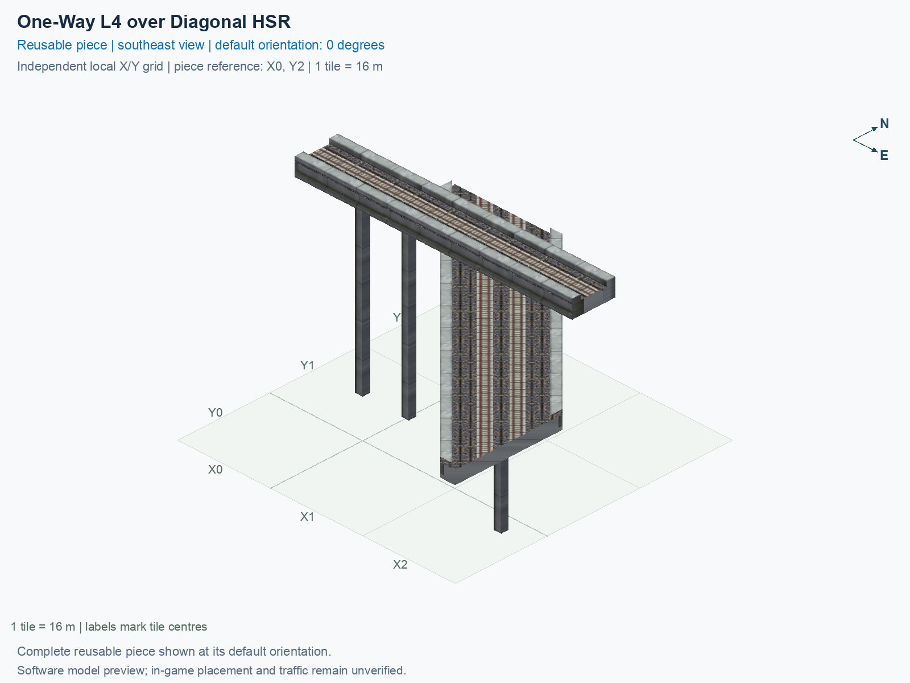

# One-Way L4 over Diagonal HSR

Purpose: explain this reusable piece, its matching connections and current test coverage.

<!-- BEGIN PIECE OVERVIEW -->

Actual rail geometry and directed train paths at two heights. The one-way track and two-way track cross without a transfer. Experimental fixed piece; test rendering, traffic and shadows in the game. The upper route crosses without transferring to the lower two-way route.

Exact reusable identifier: `interchange-l4-upper-grid-lower-diag-over-hsr`.

Footprint: **3 × 3 tiles**. Exact menu name: **One-Way L4 over Diagonal HSR**.

Choose this exact name in Transportation → Rail. Press Home or End to rotate; use only the supported states listed below. Join each end to a matching port profile and direction.

- [Connections and journeys](#connections-and-journeys)
- [Test checklist](#test-checklist)



<!-- END PIECE OVERVIEW -->

<!-- BEGIN MANUAL SUMMARY -->

## Manual status

Generated from [the exact test cases](#test-checklist) and [authoritative observations](checks/manual-tests.json).

- [ ] Preview review: 0/1 applicable cases passed; 0 failed, 0 stale.
- [ ] In-game rendering: 0/4 applicable cases passed; 0 failed, 0 stale.
- [ ] Directed journeys: 0/12 applicable cases passed; 0 failed, 0 stale.

These observations cover only the named services, directions, poses, rotations, and recorded platforms.

<!-- END MANUAL SUMMARY -->

<!-- BEGIN CONNECTIONS -->

## Connections and journeys

Purpose: describe intrinsic directional interfaces and permitted service journeys.

Generated from [connections.json](connections.json). Coordinates are canonical east, north and height in metres. A connection class names an encoded route interface; it does not prove visible deck/wall fit or an in-game test.

Supported placement states: 0° CCW, 90° CCW, 180° CCW, 270° CCW. Each state has its own declared manual scope.

A **port** is one directional transport-path endpoint. **Service** identifies the intended network service (for example HSR, street, or tram); **engine** is its internal traffic-class number, separate from the construction network. **Role** distinguishes primary service from auxiliary paths; sharing a traffic class does not establish service compatibility.

A **tangent** is a unit travel-direction vector: `[0,1]` means north. **Grade** is height gained per horizontal metre. These measured facts describe this subject alone. Compatibility requires a separate comparison of the complete joining boundaries; physical seams and actual game operation require their own evidence. See the [class index](../../connection-classes.json) for shared route-interface membership.

| Port | Service / engine / role | Direction | Location; tangent; grade | Connection class |
| --- | --- | --- | --- | --- |
| `upper_in` | hsr / 7 / primary | in | [-8.0, -16.0, 30.5]; [1.0, 0.0]; 0.0 | `path-interface-a11c9f8debd0ee1c3a94` |
| `lower_b_in` | hsr / 7 / primary | in | [-2.9, 8.0, 15.5]; [0.7071067811865475, -0.7071067811865475]; 0.0 | `path-interface-9f8c3dd2cd3e736ce4f1` |
| `lower_a_out` | hsr / 7 / primary | out | [2.8, 8.0, 15.5]; [-0.7071067811865475, 0.7071067811865475]; 0.0 | `path-interface-88adae773e3ea9f487d2` |
| `lower_b_out` | hsr / 7 / primary | out | [40.0, -34.9, 15.5]; [0.7071067811865475, -0.7071067811865475]; 0.0 | `path-interface-50cc847d03cb7f174ed0` |
| `lower_a_in` | hsr / 7 / primary | in | [40.0, -29.1, 15.5]; [-0.7071067811865475, 0.7071067811865475]; 0.0 | `path-interface-50cc847d03cb7f174ed0` |
| `upper_out` | hsr / 7 / primary | out | [40.0, -16.0, 30.5]; [1.0, 0.0]; 0.0 | `path-interface-a11c9f8debd0ee1c3a94` |

### Directed journeys

| Service | Entry → exit | Role |
| --- | --- | --- |
| hsr | `upper_in` → `upper_out` | primary |
| hsr | `lower_b_in` → `lower_b_out` | primary |
| hsr | `lower_a_in` → `lower_a_out` | primary |

### Forbidden transfers

| From service / port | To service / port | Reason |
| --- | --- | --- |
| hsr / `upper_in` | hsr / `lower_a_out` | No directed route exists between these ports in the saved piece transport paths. In-game confirmation remains unverified. |
| hsr / `upper_in` | hsr / `lower_b_out` | No directed route exists between these ports in the saved piece transport paths. In-game confirmation remains unverified. |
| hsr / `lower_b_in` | hsr / `lower_a_out` | No directed route exists between these ports in the saved piece transport paths. In-game confirmation remains unverified. |
| hsr / `lower_b_in` | hsr / `upper_out` | No directed route exists between these ports in the saved piece transport paths. In-game confirmation remains unverified. |
| hsr / `lower_a_in` | hsr / `lower_b_out` | No directed route exists between these ports in the saved piece transport paths. In-game confirmation remains unverified. |
| hsr / `lower_a_in` | hsr / `upper_out` | No directed route exists between these ports in the saved piece transport paths. In-game confirmation remains unverified. |

Review the test checklist for the exact tested cases and environments.

<!-- END CONNECTIONS -->

<!-- BEGIN MANUAL CHECKS -->

## Test checklist

Generated from [the authoritative record](checks/manual-tests.json). Only explicit human observations create manual passes; software and preview checks remain separate. Expand a check/service group to see its rotation table, then expand the matching exact scope to copy a case ID and inspect its pose, reviewer, environment, and evidence. Grouping changes only this view; every declared case remains separate.

**States:** [x] passed; [ ] unverified, failed, or stale; N/A is an explicit inapplicable declaration. A dash means no case was declared in that column. Every pass covers only its recorded environment. T means a distinct construction-transposed state.

Four proper rotations are covered. No additional reflected state is established by this record; repeated construction aliases do not create new orientations.

Current totals: unverified: 55, passed: 0, failed: 0, stale: 0, not_applicable: 0.

### Record an observation

Follow the [shared testing guide](../../../../docs/TESTING.md); copy [the unconfirmed example](checks/observation.example.json) to `checks/observation.json`. Case identifiers are in the expandable sections below. Do not edit generated checkboxes.

From the repository folder containing `custom-pieces`, run after filling `checks/observation.json` and explicitly confirming the exact observation:

```sh
python3 -m scp.content record --record custom-pieces/domains/high-speed-rail/00_pieces/interchange-l4-upper-grid-lower-diag-over-hsr/checks/manual-tests.json --observation custom-pieces/domains/high-speed-rail/00_pieces/interchange-l4-upper-grid-lower-diag-over-hsr/checks/observation.json
```

### Detailed current checks

Each collapsed group shows exact case counts and states. Forbidden transfers are grouped by the directed service pair; the table inside retains every port pair and rotation.

<details>
<summary>Compiled resources — Whole subject — 1 case; unverified: 1</summary>

| Check / exact scope | General | 0° | 90° | 180° | 270° |
| --- | --- | --- | --- | --- | --- |
| **Compiled resources**<br>Whole subject | <a href="#case-software_resources-4d38c45ba436e3915915">[ ] unverified</a> | — | — | — | — |


<details>
<summary>Compiled resources — Whole subject</summary>

<a id="case-software_resources-4d38c45ba436e3915915"></a>

**General: unverified** — `software_resources-4d38c45ba436e3915915`.

Verify the actual compiled resources and construction rules.

Scope: Whole subject.

No observation recorded.

</details>

</details>

<details>
<summary>Directed routing graph — Whole subject — 1 case; unverified: 1</summary>

| Check / exact scope | General | 0° | 90° | 180° | 270° |
| --- | --- | --- | --- | --- | --- |
| **Directed routing graph**<br>Whole subject | <a href="#case-software_connectivity-4d38c45ba436e3915915">[ ] unverified</a> | — | — | — | — |


<details>
<summary>Directed routing graph — Whole subject</summary>

<a id="case-software_connectivity-4d38c45ba436e3915915"></a>

**General: unverified** — `software_connectivity-4d38c45ba436e3915915`.

Verify the declared directed journeys and forbidden transfers.

Scope: Whole subject.

No observation recorded.

</details>

</details>

<details>
<summary>Preview review — Images — 1 case; unverified: 1</summary>

| Check / exact scope | General | 0° | 90° | 180° | 270° |
| --- | --- | --- | --- | --- | --- |
| **Preview review**<br>Image: image:interchange-l4-upper-grid-lower-diag-over-hsr:canonical-southeast | <a href="#case-preview_review-d9ad91fcd827b6b800f1">[ ] unverified</a> | — | — | — | — |


<details>
<summary>Preview review — Image: image:interchange-l4-upper-grid-lower-diag-over-hsr:canonical-southeast</summary>

<a id="case-preview_review-d9ad91fcd827b6b800f1"></a>

**General: unverified** — `preview_review-d9ad91fcd827b6b800f1`.

Inspect this exact preview for tracks, walls, piers, seams and shadows.

Scope: Image: image:interchange-l4-upper-grid-lower-diag-over-hsr:canonical-southeast.

No observation recorded.

</details>

</details>

<details>
<summary>In-game rendering — Whole subject — 4 cases; unverified: 4</summary>

| Check / exact scope | General | 0° | 90° | 180° | 270° |
| --- | --- | --- | --- | --- | --- |
| **In-game rendering**<br>Whole subject | — | <a href="#case-in_game_render-fbe12bfdd5735c740003">[ ] unverified</a> | <a href="#case-in_game_render-0c319390675fee280529">[ ] unverified</a> | <a href="#case-in_game_render-7638d4109556d0eb1dcc">[ ] unverified</a> | <a href="#case-in_game_render-ecec1de07beff85c91c3">[ ] unverified</a> |


<details>
<summary>In-game rendering — Whole subject</summary>

<a id="case-in_game_render-fbe12bfdd5735c740003"></a>

**0° CCW: unverified** — `in_game_render-fbe12bfdd5735c740003`.

Inspect the placed tracks, walls, piers, seams and shadows in SimCity 4.

Scope: Whole subject.

No observation recorded.

<a id="case-in_game_render-0c319390675fee280529"></a>

**90° CCW: unverified** — `in_game_render-0c319390675fee280529`.

Inspect the placed tracks, walls, piers, seams and shadows in SimCity 4.

Scope: Whole subject.

No observation recorded.

<a id="case-in_game_render-7638d4109556d0eb1dcc"></a>

**180° CCW: unverified** — `in_game_render-7638d4109556d0eb1dcc`.

Inspect the placed tracks, walls, piers, seams and shadows in SimCity 4.

Scope: Whole subject.

No observation recorded.

<a id="case-in_game_render-ecec1de07beff85c91c3"></a>

**270° CCW: unverified** — `in_game_render-ecec1de07beff85c91c3`.

Inspect the placed tracks, walls, piers, seams and shadows in SimCity 4.

Scope: Whole subject.

No observation recorded.

</details>

</details>

<details>
<summary>Placement — Whole subject — 4 cases; unverified: 4</summary>

| Check / exact scope | General | 0° | 90° | 180° | 270° |
| --- | --- | --- | --- | --- | --- |
| **Placement**<br>Whole subject | — | <a href="#case-in_game_placement-fbe12bfdd5735c740003">[ ] unverified</a> | <a href="#case-in_game_placement-0c319390675fee280529">[ ] unverified</a> | <a href="#case-in_game_placement-7638d4109556d0eb1dcc">[ ] unverified</a> | <a href="#case-in_game_placement-ecec1de07beff85c91c3">[ ] unverified</a> |


<details>
<summary>Placement — Whole subject</summary>

<a id="case-in_game_placement-fbe12bfdd5735c740003"></a>

**0° CCW: unverified** — `in_game_placement-fbe12bfdd5735c740003`.

Place this piece or complete blueprint and inspect every occupied tile.

Scope: Whole subject.

No observation recorded.

<a id="case-in_game_placement-0c319390675fee280529"></a>

**90° CCW: unverified** — `in_game_placement-0c319390675fee280529`.

Place this piece or complete blueprint and inspect every occupied tile.

Scope: Whole subject.

No observation recorded.

<a id="case-in_game_placement-7638d4109556d0eb1dcc"></a>

**180° CCW: unverified** — `in_game_placement-7638d4109556d0eb1dcc`.

Place this piece or complete blueprint and inspect every occupied tile.

Scope: Whole subject.

No observation recorded.

<a id="case-in_game_placement-ecec1de07beff85c91c3"></a>

**270° CCW: unverified** — `in_game_placement-ecec1de07beff85c91c3`.

Place this piece or complete blueprint and inspect every occupied tile.

Scope: Whole subject.

No observation recorded.

</details>

</details>

<details>
<summary>Demolition — Whole subject — 4 cases; unverified: 4</summary>

| Check / exact scope | General | 0° | 90° | 180° | 270° |
| --- | --- | --- | --- | --- | --- |
| **Demolition**<br>Whole subject | — | <a href="#case-in_game_demolition-fbe12bfdd5735c740003">[ ] unverified</a> | <a href="#case-in_game_demolition-0c319390675fee280529">[ ] unverified</a> | <a href="#case-in_game_demolition-7638d4109556d0eb1dcc">[ ] unverified</a> | <a href="#case-in_game_demolition-ecec1de07beff85c91c3">[ ] unverified</a> |


<details>
<summary>Demolition — Whole subject</summary>

<a id="case-in_game_demolition-fbe12bfdd5735c740003"></a>

**0° CCW: unverified** — `in_game_demolition-fbe12bfdd5735c740003`.

Bulldoze the complete placement and inspect the cleared area.

Scope: Whole subject.

No observation recorded.

<a id="case-in_game_demolition-0c319390675fee280529"></a>

**90° CCW: unverified** — `in_game_demolition-0c319390675fee280529`.

Bulldoze the complete placement and inspect the cleared area.

Scope: Whole subject.

No observation recorded.

<a id="case-in_game_demolition-7638d4109556d0eb1dcc"></a>

**180° CCW: unverified** — `in_game_demolition-7638d4109556d0eb1dcc`.

Bulldoze the complete placement and inspect the cleared area.

Scope: Whole subject.

No observation recorded.

<a id="case-in_game_demolition-ecec1de07beff85c91c3"></a>

**270° CCW: unverified** — `in_game_demolition-ecec1de07beff85c91c3`.

Bulldoze the complete placement and inspect the cleared area.

Scope: Whole subject.

No observation recorded.

</details>

</details>

<details>
<summary>Save and reload — Whole subject — 4 cases; unverified: 4</summary>

| Check / exact scope | General | 0° | 90° | 180° | 270° |
| --- | --- | --- | --- | --- | --- |
| **Save and reload**<br>Whole subject | — | <a href="#case-in_game_save_reload-fbe12bfdd5735c740003">[ ] unverified</a> | <a href="#case-in_game_save_reload-0c319390675fee280529">[ ] unverified</a> | <a href="#case-in_game_save_reload-7638d4109556d0eb1dcc">[ ] unverified</a> | <a href="#case-in_game_save_reload-ecec1de07beff85c91c3">[ ] unverified</a> |


<details>
<summary>Save and reload — Whole subject</summary>

<a id="case-in_game_save_reload-fbe12bfdd5735c740003"></a>

**0° CCW: unverified** — `in_game_save_reload-fbe12bfdd5735c740003`.

Save, quit, reload and inspect the placement and its paths.

Scope: Whole subject.

No observation recorded.

<a id="case-in_game_save_reload-0c319390675fee280529"></a>

**90° CCW: unverified** — `in_game_save_reload-0c319390675fee280529`.

Save, quit, reload and inspect the placement and its paths.

Scope: Whole subject.

No observation recorded.

<a id="case-in_game_save_reload-7638d4109556d0eb1dcc"></a>

**180° CCW: unverified** — `in_game_save_reload-7638d4109556d0eb1dcc`.

Save, quit, reload and inspect the placement and its paths.

Scope: Whole subject.

No observation recorded.

<a id="case-in_game_save_reload-ecec1de07beff85c91c3"></a>

**270° CCW: unverified** — `in_game_save_reload-ecec1de07beff85c91c3`.

Save, quit, reload and inspect the placement and its paths.

Scope: Whole subject.

No observation recorded.

</details>

</details>

<details>
<summary>Journey — hsr — 12 cases; unverified: 12</summary>

| Check / exact scope | General | 0° | 90° | 180° | 270° |
| --- | --- | --- | --- | --- | --- |
| **Journey**<br>Service: hsr; role: primary; journey: 7:upper_in>upper_out; entry: upper_in; exit: upper_out | — | <a href="#case-in_game_journey-86c7f7c4ae63a8315cd9">[ ] unverified</a> | <a href="#case-in_game_journey-24874484c547831598b8">[ ] unverified</a> | <a href="#case-in_game_journey-66d671a61a86d6dab693">[ ] unverified</a> | <a href="#case-in_game_journey-43e5f74dc74291c8e0e7">[ ] unverified</a> |
| **Journey**<br>Service: hsr; role: primary; journey: 7:lower_b_in>lower_b_out; entry: lower_b_in; exit: lower_b_out | — | <a href="#case-in_game_journey-739a9063d4e3a83c9611">[ ] unverified</a> | <a href="#case-in_game_journey-c699c55bb7b6c7f794c7">[ ] unverified</a> | <a href="#case-in_game_journey-c00e19beab71bbc9e690">[ ] unverified</a> | <a href="#case-in_game_journey-94c432426f1f157815ac">[ ] unverified</a> |
| **Journey**<br>Service: hsr; role: primary; journey: 7:lower_a_in>lower_a_out; entry: lower_a_in; exit: lower_a_out | — | <a href="#case-in_game_journey-6032e3fa76ef1119fe6b">[ ] unverified</a> | <a href="#case-in_game_journey-2b2b263ee5a3c1c6058e">[ ] unverified</a> | <a href="#case-in_game_journey-3e3904d461207d7e873d">[ ] unverified</a> | <a href="#case-in_game_journey-b3beafd1ba5026cf9ff1">[ ] unverified</a> |


<details>
<summary>Journey — Service: hsr; role: primary; journey: 7:upper_in>upper_out; entry: upper_in; exit: upper_out</summary>

<a id="case-in_game_journey-86c7f7c4ae63a8315cd9"></a>

**0° CCW: unverified** — `in_game_journey-86c7f7c4ae63a8315cd9`.

Run the declared journey in this direction using its service network.

Scope: Service: hsr; role: primary; journey: 7:upper_in>upper_out; entry: upper_in; exit: upper_out.

No observation recorded.

<a id="case-in_game_journey-24874484c547831598b8"></a>

**90° CCW: unverified** — `in_game_journey-24874484c547831598b8`.

Run the declared journey in this direction using its service network.

Scope: Service: hsr; role: primary; journey: 7:upper_in>upper_out; entry: upper_in; exit: upper_out.

No observation recorded.

<a id="case-in_game_journey-66d671a61a86d6dab693"></a>

**180° CCW: unverified** — `in_game_journey-66d671a61a86d6dab693`.

Run the declared journey in this direction using its service network.

Scope: Service: hsr; role: primary; journey: 7:upper_in>upper_out; entry: upper_in; exit: upper_out.

No observation recorded.

<a id="case-in_game_journey-43e5f74dc74291c8e0e7"></a>

**270° CCW: unverified** — `in_game_journey-43e5f74dc74291c8e0e7`.

Run the declared journey in this direction using its service network.

Scope: Service: hsr; role: primary; journey: 7:upper_in>upper_out; entry: upper_in; exit: upper_out.

No observation recorded.

</details>


<details>
<summary>Journey — Service: hsr; role: primary; journey: 7:lower_b_in>lower_b_out; entry: lower_b_in; exit: lower_b_out</summary>

<a id="case-in_game_journey-739a9063d4e3a83c9611"></a>

**0° CCW: unverified** — `in_game_journey-739a9063d4e3a83c9611`.

Run the declared journey in this direction using its service network.

Scope: Service: hsr; role: primary; journey: 7:lower_b_in>lower_b_out; entry: lower_b_in; exit: lower_b_out.

No observation recorded.

<a id="case-in_game_journey-c699c55bb7b6c7f794c7"></a>

**90° CCW: unverified** — `in_game_journey-c699c55bb7b6c7f794c7`.

Run the declared journey in this direction using its service network.

Scope: Service: hsr; role: primary; journey: 7:lower_b_in>lower_b_out; entry: lower_b_in; exit: lower_b_out.

No observation recorded.

<a id="case-in_game_journey-c00e19beab71bbc9e690"></a>

**180° CCW: unverified** — `in_game_journey-c00e19beab71bbc9e690`.

Run the declared journey in this direction using its service network.

Scope: Service: hsr; role: primary; journey: 7:lower_b_in>lower_b_out; entry: lower_b_in; exit: lower_b_out.

No observation recorded.

<a id="case-in_game_journey-94c432426f1f157815ac"></a>

**270° CCW: unverified** — `in_game_journey-94c432426f1f157815ac`.

Run the declared journey in this direction using its service network.

Scope: Service: hsr; role: primary; journey: 7:lower_b_in>lower_b_out; entry: lower_b_in; exit: lower_b_out.

No observation recorded.

</details>


<details>
<summary>Journey — Service: hsr; role: primary; journey: 7:lower_a_in>lower_a_out; entry: lower_a_in; exit: lower_a_out</summary>

<a id="case-in_game_journey-6032e3fa76ef1119fe6b"></a>

**0° CCW: unverified** — `in_game_journey-6032e3fa76ef1119fe6b`.

Run the declared journey in this direction using its service network.

Scope: Service: hsr; role: primary; journey: 7:lower_a_in>lower_a_out; entry: lower_a_in; exit: lower_a_out.

No observation recorded.

<a id="case-in_game_journey-2b2b263ee5a3c1c6058e"></a>

**90° CCW: unverified** — `in_game_journey-2b2b263ee5a3c1c6058e`.

Run the declared journey in this direction using its service network.

Scope: Service: hsr; role: primary; journey: 7:lower_a_in>lower_a_out; entry: lower_a_in; exit: lower_a_out.

No observation recorded.

<a id="case-in_game_journey-3e3904d461207d7e873d"></a>

**180° CCW: unverified** — `in_game_journey-3e3904d461207d7e873d`.

Run the declared journey in this direction using its service network.

Scope: Service: hsr; role: primary; journey: 7:lower_a_in>lower_a_out; entry: lower_a_in; exit: lower_a_out.

No observation recorded.

<a id="case-in_game_journey-b3beafd1ba5026cf9ff1"></a>

**270° CCW: unverified** — `in_game_journey-b3beafd1ba5026cf9ff1`.

Run the declared journey in this direction using its service network.

Scope: Service: hsr; role: primary; journey: 7:lower_a_in>lower_a_out; entry: lower_a_in; exit: lower_a_out.

No observation recorded.

</details>

</details>

<details>
<summary>Forbidden transfer — hsr → hsr — 24 cases; unverified: 24</summary>

| Check / exact scope | General | 0° | 90° | 180° | 270° |
| --- | --- | --- | --- | --- | --- |
| **Forbidden transfer**<br>from port: upper_in; to port: lower_a_out; from service: hsr; to service: hsr; basis: not reachable in actual saved PATH graph | — | <a href="#case-in_game_forbidden_transfer-cf3458c1f6d2c30aaecf">[ ] unverified</a> | <a href="#case-in_game_forbidden_transfer-4268865cc49252606edd">[ ] unverified</a> | <a href="#case-in_game_forbidden_transfer-33162f029bb950570b10">[ ] unverified</a> | <a href="#case-in_game_forbidden_transfer-3067e9f5167cbd29e453">[ ] unverified</a> |
| **Forbidden transfer**<br>from port: upper_in; to port: lower_b_out; from service: hsr; to service: hsr; basis: not reachable in actual saved PATH graph | — | <a href="#case-in_game_forbidden_transfer-bc902b653961ca502c32">[ ] unverified</a> | <a href="#case-in_game_forbidden_transfer-541fc373fb9fd3ba82e4">[ ] unverified</a> | <a href="#case-in_game_forbidden_transfer-258755d9e51173a5c67c">[ ] unverified</a> | <a href="#case-in_game_forbidden_transfer-a90088fcfefb2c7476c7">[ ] unverified</a> |
| **Forbidden transfer**<br>from port: lower_b_in; to port: lower_a_out; from service: hsr; to service: hsr; basis: not reachable in actual saved PATH graph | — | <a href="#case-in_game_forbidden_transfer-0d7cbaee8f25f6d150f6">[ ] unverified</a> | <a href="#case-in_game_forbidden_transfer-6d1c9449aa1e240501e7">[ ] unverified</a> | <a href="#case-in_game_forbidden_transfer-351f187773fc5ada20ee">[ ] unverified</a> | <a href="#case-in_game_forbidden_transfer-227acc59149bbf0d1011">[ ] unverified</a> |
| **Forbidden transfer**<br>from port: lower_b_in; to port: upper_out; from service: hsr; to service: hsr; basis: not reachable in actual saved PATH graph | — | <a href="#case-in_game_forbidden_transfer-b8c48182f4dc3d34b7e2">[ ] unverified</a> | <a href="#case-in_game_forbidden_transfer-9674076e8de2e9d21118">[ ] unverified</a> | <a href="#case-in_game_forbidden_transfer-610a9da40d4237842398">[ ] unverified</a> | <a href="#case-in_game_forbidden_transfer-cb39c09cb5102dfd56f5">[ ] unverified</a> |
| **Forbidden transfer**<br>from port: lower_a_in; to port: lower_b_out; from service: hsr; to service: hsr; basis: not reachable in actual saved PATH graph | — | <a href="#case-in_game_forbidden_transfer-d3c69ed4f3f6595f0c16">[ ] unverified</a> | <a href="#case-in_game_forbidden_transfer-dd430757f7e85baee49f">[ ] unverified</a> | <a href="#case-in_game_forbidden_transfer-06cfc26b72bc2e9f41d0">[ ] unverified</a> | <a href="#case-in_game_forbidden_transfer-06394f6ff1cfb2c07879">[ ] unverified</a> |
| **Forbidden transfer**<br>from port: lower_a_in; to port: upper_out; from service: hsr; to service: hsr; basis: not reachable in actual saved PATH graph | — | <a href="#case-in_game_forbidden_transfer-413041c974fdbdcf48b6">[ ] unverified</a> | <a href="#case-in_game_forbidden_transfer-632dceac402bb7abab6f">[ ] unverified</a> | <a href="#case-in_game_forbidden_transfer-2a28e32cafd98d0b7cda">[ ] unverified</a> | <a href="#case-in_game_forbidden_transfer-9fbcc3649529a5c34cb2">[ ] unverified</a> |


<details>
<summary>Forbidden transfer — from port: upper_in; to port: lower_a_out; from service: hsr; to service: hsr; basis: not reachable in actual saved PATH graph</summary>

<a id="case-in_game_forbidden_transfer-cf3458c1f6d2c30aaecf"></a>

**0° CCW: unverified** — `in_game_forbidden_transfer-cf3458c1f6d2c30aaecf`.

Confirm this undeclared transfer is unavailable.

Scope: from port: upper_in; to port: lower_a_out; from service: hsr; to service: hsr; basis: not reachable in actual saved PATH graph.

No observation recorded.

<a id="case-in_game_forbidden_transfer-4268865cc49252606edd"></a>

**90° CCW: unverified** — `in_game_forbidden_transfer-4268865cc49252606edd`.

Confirm this undeclared transfer is unavailable.

Scope: from port: upper_in; to port: lower_a_out; from service: hsr; to service: hsr; basis: not reachable in actual saved PATH graph.

No observation recorded.

<a id="case-in_game_forbidden_transfer-33162f029bb950570b10"></a>

**180° CCW: unverified** — `in_game_forbidden_transfer-33162f029bb950570b10`.

Confirm this undeclared transfer is unavailable.

Scope: from port: upper_in; to port: lower_a_out; from service: hsr; to service: hsr; basis: not reachable in actual saved PATH graph.

No observation recorded.

<a id="case-in_game_forbidden_transfer-3067e9f5167cbd29e453"></a>

**270° CCW: unverified** — `in_game_forbidden_transfer-3067e9f5167cbd29e453`.

Confirm this undeclared transfer is unavailable.

Scope: from port: upper_in; to port: lower_a_out; from service: hsr; to service: hsr; basis: not reachable in actual saved PATH graph.

No observation recorded.

</details>


<details>
<summary>Forbidden transfer — from port: upper_in; to port: lower_b_out; from service: hsr; to service: hsr; basis: not reachable in actual saved PATH graph</summary>

<a id="case-in_game_forbidden_transfer-bc902b653961ca502c32"></a>

**0° CCW: unverified** — `in_game_forbidden_transfer-bc902b653961ca502c32`.

Confirm this undeclared transfer is unavailable.

Scope: from port: upper_in; to port: lower_b_out; from service: hsr; to service: hsr; basis: not reachable in actual saved PATH graph.

No observation recorded.

<a id="case-in_game_forbidden_transfer-541fc373fb9fd3ba82e4"></a>

**90° CCW: unverified** — `in_game_forbidden_transfer-541fc373fb9fd3ba82e4`.

Confirm this undeclared transfer is unavailable.

Scope: from port: upper_in; to port: lower_b_out; from service: hsr; to service: hsr; basis: not reachable in actual saved PATH graph.

No observation recorded.

<a id="case-in_game_forbidden_transfer-258755d9e51173a5c67c"></a>

**180° CCW: unverified** — `in_game_forbidden_transfer-258755d9e51173a5c67c`.

Confirm this undeclared transfer is unavailable.

Scope: from port: upper_in; to port: lower_b_out; from service: hsr; to service: hsr; basis: not reachable in actual saved PATH graph.

No observation recorded.

<a id="case-in_game_forbidden_transfer-a90088fcfefb2c7476c7"></a>

**270° CCW: unverified** — `in_game_forbidden_transfer-a90088fcfefb2c7476c7`.

Confirm this undeclared transfer is unavailable.

Scope: from port: upper_in; to port: lower_b_out; from service: hsr; to service: hsr; basis: not reachable in actual saved PATH graph.

No observation recorded.

</details>


<details>
<summary>Forbidden transfer — from port: lower_b_in; to port: lower_a_out; from service: hsr; to service: hsr; basis: not reachable in actual saved PATH graph</summary>

<a id="case-in_game_forbidden_transfer-0d7cbaee8f25f6d150f6"></a>

**0° CCW: unverified** — `in_game_forbidden_transfer-0d7cbaee8f25f6d150f6`.

Confirm this undeclared transfer is unavailable.

Scope: from port: lower_b_in; to port: lower_a_out; from service: hsr; to service: hsr; basis: not reachable in actual saved PATH graph.

No observation recorded.

<a id="case-in_game_forbidden_transfer-6d1c9449aa1e240501e7"></a>

**90° CCW: unverified** — `in_game_forbidden_transfer-6d1c9449aa1e240501e7`.

Confirm this undeclared transfer is unavailable.

Scope: from port: lower_b_in; to port: lower_a_out; from service: hsr; to service: hsr; basis: not reachable in actual saved PATH graph.

No observation recorded.

<a id="case-in_game_forbidden_transfer-351f187773fc5ada20ee"></a>

**180° CCW: unverified** — `in_game_forbidden_transfer-351f187773fc5ada20ee`.

Confirm this undeclared transfer is unavailable.

Scope: from port: lower_b_in; to port: lower_a_out; from service: hsr; to service: hsr; basis: not reachable in actual saved PATH graph.

No observation recorded.

<a id="case-in_game_forbidden_transfer-227acc59149bbf0d1011"></a>

**270° CCW: unverified** — `in_game_forbidden_transfer-227acc59149bbf0d1011`.

Confirm this undeclared transfer is unavailable.

Scope: from port: lower_b_in; to port: lower_a_out; from service: hsr; to service: hsr; basis: not reachable in actual saved PATH graph.

No observation recorded.

</details>


<details>
<summary>Forbidden transfer — from port: lower_b_in; to port: upper_out; from service: hsr; to service: hsr; basis: not reachable in actual saved PATH graph</summary>

<a id="case-in_game_forbidden_transfer-b8c48182f4dc3d34b7e2"></a>

**0° CCW: unverified** — `in_game_forbidden_transfer-b8c48182f4dc3d34b7e2`.

Confirm this undeclared transfer is unavailable.

Scope: from port: lower_b_in; to port: upper_out; from service: hsr; to service: hsr; basis: not reachable in actual saved PATH graph.

No observation recorded.

<a id="case-in_game_forbidden_transfer-9674076e8de2e9d21118"></a>

**90° CCW: unverified** — `in_game_forbidden_transfer-9674076e8de2e9d21118`.

Confirm this undeclared transfer is unavailable.

Scope: from port: lower_b_in; to port: upper_out; from service: hsr; to service: hsr; basis: not reachable in actual saved PATH graph.

No observation recorded.

<a id="case-in_game_forbidden_transfer-610a9da40d4237842398"></a>

**180° CCW: unverified** — `in_game_forbidden_transfer-610a9da40d4237842398`.

Confirm this undeclared transfer is unavailable.

Scope: from port: lower_b_in; to port: upper_out; from service: hsr; to service: hsr; basis: not reachable in actual saved PATH graph.

No observation recorded.

<a id="case-in_game_forbidden_transfer-cb39c09cb5102dfd56f5"></a>

**270° CCW: unverified** — `in_game_forbidden_transfer-cb39c09cb5102dfd56f5`.

Confirm this undeclared transfer is unavailable.

Scope: from port: lower_b_in; to port: upper_out; from service: hsr; to service: hsr; basis: not reachable in actual saved PATH graph.

No observation recorded.

</details>


<details>
<summary>Forbidden transfer — from port: lower_a_in; to port: lower_b_out; from service: hsr; to service: hsr; basis: not reachable in actual saved PATH graph</summary>

<a id="case-in_game_forbidden_transfer-d3c69ed4f3f6595f0c16"></a>

**0° CCW: unverified** — `in_game_forbidden_transfer-d3c69ed4f3f6595f0c16`.

Confirm this undeclared transfer is unavailable.

Scope: from port: lower_a_in; to port: lower_b_out; from service: hsr; to service: hsr; basis: not reachable in actual saved PATH graph.

No observation recorded.

<a id="case-in_game_forbidden_transfer-dd430757f7e85baee49f"></a>

**90° CCW: unverified** — `in_game_forbidden_transfer-dd430757f7e85baee49f`.

Confirm this undeclared transfer is unavailable.

Scope: from port: lower_a_in; to port: lower_b_out; from service: hsr; to service: hsr; basis: not reachable in actual saved PATH graph.

No observation recorded.

<a id="case-in_game_forbidden_transfer-06cfc26b72bc2e9f41d0"></a>

**180° CCW: unverified** — `in_game_forbidden_transfer-06cfc26b72bc2e9f41d0`.

Confirm this undeclared transfer is unavailable.

Scope: from port: lower_a_in; to port: lower_b_out; from service: hsr; to service: hsr; basis: not reachable in actual saved PATH graph.

No observation recorded.

<a id="case-in_game_forbidden_transfer-06394f6ff1cfb2c07879"></a>

**270° CCW: unverified** — `in_game_forbidden_transfer-06394f6ff1cfb2c07879`.

Confirm this undeclared transfer is unavailable.

Scope: from port: lower_a_in; to port: lower_b_out; from service: hsr; to service: hsr; basis: not reachable in actual saved PATH graph.

No observation recorded.

</details>


<details>
<summary>Forbidden transfer — from port: lower_a_in; to port: upper_out; from service: hsr; to service: hsr; basis: not reachable in actual saved PATH graph</summary>

<a id="case-in_game_forbidden_transfer-413041c974fdbdcf48b6"></a>

**0° CCW: unverified** — `in_game_forbidden_transfer-413041c974fdbdcf48b6`.

Confirm this undeclared transfer is unavailable.

Scope: from port: lower_a_in; to port: upper_out; from service: hsr; to service: hsr; basis: not reachable in actual saved PATH graph.

No observation recorded.

<a id="case-in_game_forbidden_transfer-632dceac402bb7abab6f"></a>

**90° CCW: unverified** — `in_game_forbidden_transfer-632dceac402bb7abab6f`.

Confirm this undeclared transfer is unavailable.

Scope: from port: lower_a_in; to port: upper_out; from service: hsr; to service: hsr; basis: not reachable in actual saved PATH graph.

No observation recorded.

<a id="case-in_game_forbidden_transfer-2a28e32cafd98d0b7cda"></a>

**180° CCW: unverified** — `in_game_forbidden_transfer-2a28e32cafd98d0b7cda`.

Confirm this undeclared transfer is unavailable.

Scope: from port: lower_a_in; to port: upper_out; from service: hsr; to service: hsr; basis: not reachable in actual saved PATH graph.

No observation recorded.

<a id="case-in_game_forbidden_transfer-9fbcc3649529a5c34cb2"></a>

**270° CCW: unverified** — `in_game_forbidden_transfer-9fbcc3649529a5c34cb2`.

Confirm this undeclared transfer is unavailable.

Scope: from port: lower_a_in; to port: upper_out; from service: hsr; to service: hsr; basis: not reachable in actual saved PATH graph.

No observation recorded.

</details>

</details>

<!-- END MANUAL CHECKS -->
