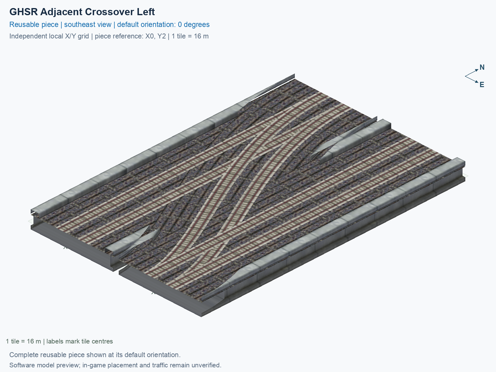

# GHSR Adjacent Crossover Left

Purpose: explain this reusable piece, its matching connections and current test coverage.

<!-- BEGIN PIECE OVERVIEW -->

Switches between two adjacent two-track lines, with no empty tile between them. Both through lines are retained. Choose a handed crossover or a scissors for transfers in both hands.

Exact reusable identifier: `rail-ghsr-adjacent-crossover-left`.

Footprint: **2 × 3 tiles**. Exact menu name: **GHSR Adjacent Crossover Left**.

Choose this exact name in Transportation → Rail. Press Home or End to rotate; use only the supported states listed below. Join each end to a matching port profile and direction.

- [Connections and journeys](#connections-and-journeys)
- [Test checklist](#test-checklist)



<!-- END PIECE OVERVIEW -->

<!-- BEGIN MANUAL SUMMARY -->

## Manual status

Generated from [the exact test cases](#test-checklist) and [authoritative observations](checks/manual-tests.json).

- [ ] Preview review: 0/1 applicable cases passed; 0 failed, 0 stale.
- [ ] In-game rendering: 0/4 applicable cases passed; 0 failed, 0 stale.
- [ ] Directed journeys: 0/24 applicable cases passed; 0 failed, 0 stale.

These observations cover only the named services, directions, poses, rotations, and recorded platforms.

<!-- END MANUAL SUMMARY -->

<!-- BEGIN CONNECTIONS -->

## Connections and journeys

Purpose: describe intrinsic directional interfaces and permitted service journeys.

Generated from [connections.json](connections.json). Coordinates are canonical east, north and height in metres. A connection class names an encoded route interface; it does not prove visible deck/wall fit or an in-game test.

Supported placement states: 0° CCW, 90° CCW, 180° CCW, 270° CCW. Each state has its own declared manual scope.

A **port** is one directional transport-path endpoint. **Service** identifies the intended network service (for example HSR, street, or tram); **engine** is its internal traffic-class number, separate from the construction network. **Role** distinguishes primary service from auxiliary paths; sharing a traffic class does not establish service compatibility.

A **tangent** is a unit travel-direction vector: `[0,1]` means north. **Grade** is height gained per horizontal metre. These measured facts describe this subject alone. Compatibility requires a separate comparison of the complete joining boundaries; physical seams and actual game operation require their own evidence. See the [class index](../../connection-classes.json) for shared route-interface membership.

| Port | Service / engine / role | Direction | Location; tangent; grade | Connection class |
| --- | --- | --- | --- | --- |
| `Sout` | ghsr / 7 / primary | out | [-2.0, -40.0, 1.0]; [0.0, -1.0]; 0.0 | `path-interface-c78c5ac4b558d84b46f2` |
| `Nin` | ghsr / 7 / primary | in | [-2.0, 8.0, 1.0]; [0.0, -1.0]; 0.0 | `path-interface-c78c5ac4b558d84b46f2` |
| `Sin` | ghsr / 7 / primary | in | [2.0, -40.0, 1.0]; [0.0, 1.0]; 0.0 | `path-interface-fab587419de6b5848d74` |
| `Nout` | ghsr / 7 / primary | out | [2.0, 8.0, 1.0]; [0.0, 1.0]; 0.0 | `path-interface-fab587419de6b5848d74` |
| `BSout` | ghsr / 7 / primary | out | [14.0, -40.0, 1.0]; [0.0, -1.0]; 0.0 | `path-interface-c78c5ac4b558d84b46f2` |
| `BNin` | ghsr / 7 / primary | in | [14.0, 8.0, 1.0]; [0.0, -1.0]; 0.0 | `path-interface-c78c5ac4b558d84b46f2` |
| `BSin` | ghsr / 7 / primary | in | [18.0, -40.0, 1.0]; [0.0, 1.0]; 0.0 | `path-interface-fab587419de6b5848d74` |
| `BNout` | ghsr / 7 / primary | out | [18.0, 8.0, 1.0]; [0.0, 1.0]; 0.0 | `path-interface-fab587419de6b5848d74` |

### Directed journeys

| Service | Entry → exit | Role |
| --- | --- | --- |
| ghsr | `Nin` → `BSout` | primary |
| ghsr | `Nin` → `Sout` | primary |
| ghsr | `Sin` → `Nout` | primary |
| ghsr | `BNin` → `BSout` | primary |
| ghsr | `BSin` → `BNout` | primary |
| ghsr | `BSin` → `Nout` | primary |

### Forbidden transfers

| From service / port | To service / port | Reason |
| --- | --- | --- |
| ghsr / `Nin` | ghsr / `Nout` | No directed route exists between these ports in the saved piece transport paths. In-game confirmation remains unverified. |
| ghsr / `Nin` | ghsr / `BNout` | No directed route exists between these ports in the saved piece transport paths. In-game confirmation remains unverified. |
| ghsr / `Sin` | ghsr / `Sout` | No directed route exists between these ports in the saved piece transport paths. In-game confirmation remains unverified. |
| ghsr / `Sin` | ghsr / `BSout` | No directed route exists between these ports in the saved piece transport paths. In-game confirmation remains unverified. |
| ghsr / `Sin` | ghsr / `BNout` | No directed route exists between these ports in the saved piece transport paths. In-game confirmation remains unverified. |
| ghsr / `BNin` | ghsr / `Sout` | No directed route exists between these ports in the saved piece transport paths. In-game confirmation remains unverified. |
| ghsr / `BNin` | ghsr / `Nout` | No directed route exists between these ports in the saved piece transport paths. In-game confirmation remains unverified. |
| ghsr / `BNin` | ghsr / `BNout` | No directed route exists between these ports in the saved piece transport paths. In-game confirmation remains unverified. |
| ghsr / `BSin` | ghsr / `Sout` | No directed route exists between these ports in the saved piece transport paths. In-game confirmation remains unverified. |
| ghsr / `BSin` | ghsr / `BSout` | No directed route exists between these ports in the saved piece transport paths. In-game confirmation remains unverified. |

Review the test checklist for the exact tested cases and environments.

<!-- END CONNECTIONS -->

<!-- BEGIN MANUAL CHECKS -->

## Test checklist

Generated from [the authoritative record](checks/manual-tests.json). Only explicit human observations create manual passes; software and preview checks remain separate. Expand a check/service group to see its rotation table, then expand the matching exact scope to copy a case ID and inspect its pose, reviewer, environment, and evidence. Grouping changes only this view; every declared case remains separate.

**States:** [x] passed; [ ] unverified, failed, or stale; N/A is an explicit inapplicable declaration. A dash means no case was declared in that column. Every pass covers only its recorded environment. T means a distinct construction-transposed state.

Four proper rotations are covered. No additional reflected state is established by this record; repeated construction aliases do not create new orientations.

Current totals: unverified: 83, passed: 0, failed: 0, stale: 0, not_applicable: 0.

### Record an observation

Follow the [shared testing guide](../../../../docs/TESTING.md); copy [the unconfirmed example](checks/observation.example.json) to `checks/observation.json`. Case identifiers are in the expandable sections below. Do not edit generated checkboxes.

From the repository folder containing `custom-pieces`, run after filling `checks/observation.json` and explicitly confirming the exact observation:

```sh
python3 -m scp.content record --record custom-pieces/domains/high-speed-rail/00_pieces/rail-ghsr-adjacent-crossover-left/checks/manual-tests.json --observation custom-pieces/domains/high-speed-rail/00_pieces/rail-ghsr-adjacent-crossover-left/checks/observation.json
```

### Detailed current checks

Each collapsed group shows exact case counts and states. Forbidden transfers are grouped by the directed service pair; the table inside retains every port pair and rotation.

<details>
<summary>Compiled resources — Whole subject — 1 case; unverified: 1</summary>

| Check / exact scope | General | 0° | 90° | 180° | 270° |
| --- | --- | --- | --- | --- | --- |
| **Compiled resources**<br>Whole subject | <a href="#case-software_resources-bd15714cbf9c80ca9cdc">[ ] unverified</a> | — | — | — | — |


<details>
<summary>Compiled resources — Whole subject</summary>

<a id="case-software_resources-bd15714cbf9c80ca9cdc"></a>

**General: unverified** — `software_resources-bd15714cbf9c80ca9cdc`.

Verify the actual compiled resources and construction rules.

Scope: Whole subject.

No observation recorded.

</details>

</details>

<details>
<summary>Directed routing graph — Whole subject — 1 case; unverified: 1</summary>

| Check / exact scope | General | 0° | 90° | 180° | 270° |
| --- | --- | --- | --- | --- | --- |
| **Directed routing graph**<br>Whole subject | <a href="#case-software_connectivity-bd15714cbf9c80ca9cdc">[ ] unverified</a> | — | — | — | — |


<details>
<summary>Directed routing graph — Whole subject</summary>

<a id="case-software_connectivity-bd15714cbf9c80ca9cdc"></a>

**General: unverified** — `software_connectivity-bd15714cbf9c80ca9cdc`.

Verify the declared directed journeys and forbidden transfers.

Scope: Whole subject.

No observation recorded.

</details>

</details>

<details>
<summary>Preview review — Images — 1 case; unverified: 1</summary>

| Check / exact scope | General | 0° | 90° | 180° | 270° |
| --- | --- | --- | --- | --- | --- |
| **Preview review**<br>Image: image:rail-ghsr-adjacent-crossover-left:canonical-southeast | <a href="#case-preview_review-a56abc7a19291ac1f901">[ ] unverified</a> | — | — | — | — |


<details>
<summary>Preview review — Image: image:rail-ghsr-adjacent-crossover-left:canonical-southeast</summary>

<a id="case-preview_review-a56abc7a19291ac1f901"></a>

**General: unverified** — `preview_review-a56abc7a19291ac1f901`.

Inspect this exact preview for tracks, walls, piers, seams and shadows.

Scope: Image: image:rail-ghsr-adjacent-crossover-left:canonical-southeast.

No observation recorded.

</details>

</details>

<details>
<summary>In-game rendering — Whole subject — 4 cases; unverified: 4</summary>

| Check / exact scope | General | 0° | 90° | 180° | 270° |
| --- | --- | --- | --- | --- | --- |
| **In-game rendering**<br>Whole subject | — | <a href="#case-in_game_render-a722c392de3fe34d4175">[ ] unverified</a> | <a href="#case-in_game_render-d99d9f57d65d510da703">[ ] unverified</a> | <a href="#case-in_game_render-d489f9d57cbe0298d7f8">[ ] unverified</a> | <a href="#case-in_game_render-4fed43454b1194433cd5">[ ] unverified</a> |


<details>
<summary>In-game rendering — Whole subject</summary>

<a id="case-in_game_render-a722c392de3fe34d4175"></a>

**0° CCW: unverified** — `in_game_render-a722c392de3fe34d4175`.

Inspect the placed tracks, walls, piers, seams and shadows in SimCity 4.

Scope: Whole subject.

No observation recorded.

<a id="case-in_game_render-d99d9f57d65d510da703"></a>

**90° CCW: unverified** — `in_game_render-d99d9f57d65d510da703`.

Inspect the placed tracks, walls, piers, seams and shadows in SimCity 4.

Scope: Whole subject.

No observation recorded.

<a id="case-in_game_render-d489f9d57cbe0298d7f8"></a>

**180° CCW: unverified** — `in_game_render-d489f9d57cbe0298d7f8`.

Inspect the placed tracks, walls, piers, seams and shadows in SimCity 4.

Scope: Whole subject.

No observation recorded.

<a id="case-in_game_render-4fed43454b1194433cd5"></a>

**270° CCW: unverified** — `in_game_render-4fed43454b1194433cd5`.

Inspect the placed tracks, walls, piers, seams and shadows in SimCity 4.

Scope: Whole subject.

No observation recorded.

</details>

</details>

<details>
<summary>Placement — Whole subject — 4 cases; unverified: 4</summary>

| Check / exact scope | General | 0° | 90° | 180° | 270° |
| --- | --- | --- | --- | --- | --- |
| **Placement**<br>Whole subject | — | <a href="#case-in_game_placement-a722c392de3fe34d4175">[ ] unverified</a> | <a href="#case-in_game_placement-d99d9f57d65d510da703">[ ] unverified</a> | <a href="#case-in_game_placement-d489f9d57cbe0298d7f8">[ ] unverified</a> | <a href="#case-in_game_placement-4fed43454b1194433cd5">[ ] unverified</a> |


<details>
<summary>Placement — Whole subject</summary>

<a id="case-in_game_placement-a722c392de3fe34d4175"></a>

**0° CCW: unverified** — `in_game_placement-a722c392de3fe34d4175`.

Place this piece or complete blueprint and inspect every occupied tile.

Scope: Whole subject.

No observation recorded.

<a id="case-in_game_placement-d99d9f57d65d510da703"></a>

**90° CCW: unverified** — `in_game_placement-d99d9f57d65d510da703`.

Place this piece or complete blueprint and inspect every occupied tile.

Scope: Whole subject.

No observation recorded.

<a id="case-in_game_placement-d489f9d57cbe0298d7f8"></a>

**180° CCW: unverified** — `in_game_placement-d489f9d57cbe0298d7f8`.

Place this piece or complete blueprint and inspect every occupied tile.

Scope: Whole subject.

No observation recorded.

<a id="case-in_game_placement-4fed43454b1194433cd5"></a>

**270° CCW: unverified** — `in_game_placement-4fed43454b1194433cd5`.

Place this piece or complete blueprint and inspect every occupied tile.

Scope: Whole subject.

No observation recorded.

</details>

</details>

<details>
<summary>Demolition — Whole subject — 4 cases; unverified: 4</summary>

| Check / exact scope | General | 0° | 90° | 180° | 270° |
| --- | --- | --- | --- | --- | --- |
| **Demolition**<br>Whole subject | — | <a href="#case-in_game_demolition-a722c392de3fe34d4175">[ ] unverified</a> | <a href="#case-in_game_demolition-d99d9f57d65d510da703">[ ] unverified</a> | <a href="#case-in_game_demolition-d489f9d57cbe0298d7f8">[ ] unverified</a> | <a href="#case-in_game_demolition-4fed43454b1194433cd5">[ ] unverified</a> |


<details>
<summary>Demolition — Whole subject</summary>

<a id="case-in_game_demolition-a722c392de3fe34d4175"></a>

**0° CCW: unverified** — `in_game_demolition-a722c392de3fe34d4175`.

Bulldoze the complete placement and inspect the cleared area.

Scope: Whole subject.

No observation recorded.

<a id="case-in_game_demolition-d99d9f57d65d510da703"></a>

**90° CCW: unverified** — `in_game_demolition-d99d9f57d65d510da703`.

Bulldoze the complete placement and inspect the cleared area.

Scope: Whole subject.

No observation recorded.

<a id="case-in_game_demolition-d489f9d57cbe0298d7f8"></a>

**180° CCW: unverified** — `in_game_demolition-d489f9d57cbe0298d7f8`.

Bulldoze the complete placement and inspect the cleared area.

Scope: Whole subject.

No observation recorded.

<a id="case-in_game_demolition-4fed43454b1194433cd5"></a>

**270° CCW: unverified** — `in_game_demolition-4fed43454b1194433cd5`.

Bulldoze the complete placement and inspect the cleared area.

Scope: Whole subject.

No observation recorded.

</details>

</details>

<details>
<summary>Save and reload — Whole subject — 4 cases; unverified: 4</summary>

| Check / exact scope | General | 0° | 90° | 180° | 270° |
| --- | --- | --- | --- | --- | --- |
| **Save and reload**<br>Whole subject | — | <a href="#case-in_game_save_reload-a722c392de3fe34d4175">[ ] unverified</a> | <a href="#case-in_game_save_reload-d99d9f57d65d510da703">[ ] unverified</a> | <a href="#case-in_game_save_reload-d489f9d57cbe0298d7f8">[ ] unverified</a> | <a href="#case-in_game_save_reload-4fed43454b1194433cd5">[ ] unverified</a> |


<details>
<summary>Save and reload — Whole subject</summary>

<a id="case-in_game_save_reload-a722c392de3fe34d4175"></a>

**0° CCW: unverified** — `in_game_save_reload-a722c392de3fe34d4175`.

Save, quit, reload and inspect the placement and its paths.

Scope: Whole subject.

No observation recorded.

<a id="case-in_game_save_reload-d99d9f57d65d510da703"></a>

**90° CCW: unverified** — `in_game_save_reload-d99d9f57d65d510da703`.

Save, quit, reload and inspect the placement and its paths.

Scope: Whole subject.

No observation recorded.

<a id="case-in_game_save_reload-d489f9d57cbe0298d7f8"></a>

**180° CCW: unverified** — `in_game_save_reload-d489f9d57cbe0298d7f8`.

Save, quit, reload and inspect the placement and its paths.

Scope: Whole subject.

No observation recorded.

<a id="case-in_game_save_reload-4fed43454b1194433cd5"></a>

**270° CCW: unverified** — `in_game_save_reload-4fed43454b1194433cd5`.

Save, quit, reload and inspect the placement and its paths.

Scope: Whole subject.

No observation recorded.

</details>

</details>

<details>
<summary>Journey — ghsr — 24 cases; unverified: 24</summary>

| Check / exact scope | General | 0° | 90° | 180° | 270° |
| --- | --- | --- | --- | --- | --- |
| **Journey**<br>Service: ghsr; role: primary; journey: 7:Nin>BSout; entry: Nin; exit: BSout | — | <a href="#case-in_game_journey-7ad35fae5608fd55f22f">[ ] unverified</a> | <a href="#case-in_game_journey-9c441e66e5656dae4e1a">[ ] unverified</a> | <a href="#case-in_game_journey-443d5e86cacca9a167b8">[ ] unverified</a> | <a href="#case-in_game_journey-0b5403c2bbf49c37f4da">[ ] unverified</a> |
| **Journey**<br>Service: ghsr; role: primary; journey: 7:Nin>Sout; entry: Nin; exit: Sout | — | <a href="#case-in_game_journey-4fd71bfd8b14d518635f">[ ] unverified</a> | <a href="#case-in_game_journey-2535b331299b637368f8">[ ] unverified</a> | <a href="#case-in_game_journey-c642ad8877b2ce2e757c">[ ] unverified</a> | <a href="#case-in_game_journey-344e4ecf5a7b6cbddfed">[ ] unverified</a> |
| **Journey**<br>Service: ghsr; role: primary; journey: 7:Sin>Nout; entry: Sin; exit: Nout | — | <a href="#case-in_game_journey-5985d992414a74b4f6c6">[ ] unverified</a> | <a href="#case-in_game_journey-68cbe6dfc3bbc78a7e91">[ ] unverified</a> | <a href="#case-in_game_journey-ba2172bf42cfe2850d38">[ ] unverified</a> | <a href="#case-in_game_journey-303624f571e0d284e508">[ ] unverified</a> |
| **Journey**<br>Service: ghsr; role: primary; journey: 7:BNin>BSout; entry: BNin; exit: BSout | — | <a href="#case-in_game_journey-ecb6cef5f00299e09bb2">[ ] unverified</a> | <a href="#case-in_game_journey-1b4d6c537d135198da1c">[ ] unverified</a> | <a href="#case-in_game_journey-0de0c062520f6d3fcf57">[ ] unverified</a> | <a href="#case-in_game_journey-d173f4ef7d48d858cb0c">[ ] unverified</a> |
| **Journey**<br>Service: ghsr; role: primary; journey: 7:BSin>BNout; entry: BSin; exit: BNout | — | <a href="#case-in_game_journey-65194e400c9d033b2e95">[ ] unverified</a> | <a href="#case-in_game_journey-3a2577739b2af98aecac">[ ] unverified</a> | <a href="#case-in_game_journey-725450578757d7ee1cb5">[ ] unverified</a> | <a href="#case-in_game_journey-8dc3c0588ab876a7da86">[ ] unverified</a> |
| **Journey**<br>Service: ghsr; role: primary; journey: 7:BSin>Nout; entry: BSin; exit: Nout | — | <a href="#case-in_game_journey-37f68f9d9d360f1aaa06">[ ] unverified</a> | <a href="#case-in_game_journey-59a260d992f2c75b098a">[ ] unverified</a> | <a href="#case-in_game_journey-74bf5b785aefff917d56">[ ] unverified</a> | <a href="#case-in_game_journey-6274bafcc544b37e1d71">[ ] unverified</a> |


<details>
<summary>Journey — Service: ghsr; role: primary; journey: 7:Nin>BSout; entry: Nin; exit: BSout</summary>

<a id="case-in_game_journey-7ad35fae5608fd55f22f"></a>

**0° CCW: unverified** — `in_game_journey-7ad35fae5608fd55f22f`.

Run the declared journey in this direction using its service network.

Scope: Service: ghsr; role: primary; journey: 7:Nin>BSout; entry: Nin; exit: BSout.

No observation recorded.

<a id="case-in_game_journey-9c441e66e5656dae4e1a"></a>

**90° CCW: unverified** — `in_game_journey-9c441e66e5656dae4e1a`.

Run the declared journey in this direction using its service network.

Scope: Service: ghsr; role: primary; journey: 7:Nin>BSout; entry: Nin; exit: BSout.

No observation recorded.

<a id="case-in_game_journey-443d5e86cacca9a167b8"></a>

**180° CCW: unverified** — `in_game_journey-443d5e86cacca9a167b8`.

Run the declared journey in this direction using its service network.

Scope: Service: ghsr; role: primary; journey: 7:Nin>BSout; entry: Nin; exit: BSout.

No observation recorded.

<a id="case-in_game_journey-0b5403c2bbf49c37f4da"></a>

**270° CCW: unverified** — `in_game_journey-0b5403c2bbf49c37f4da`.

Run the declared journey in this direction using its service network.

Scope: Service: ghsr; role: primary; journey: 7:Nin>BSout; entry: Nin; exit: BSout.

No observation recorded.

</details>


<details>
<summary>Journey — Service: ghsr; role: primary; journey: 7:Nin>Sout; entry: Nin; exit: Sout</summary>

<a id="case-in_game_journey-4fd71bfd8b14d518635f"></a>

**0° CCW: unverified** — `in_game_journey-4fd71bfd8b14d518635f`.

Run the declared journey in this direction using its service network.

Scope: Service: ghsr; role: primary; journey: 7:Nin>Sout; entry: Nin; exit: Sout.

No observation recorded.

<a id="case-in_game_journey-2535b331299b637368f8"></a>

**90° CCW: unverified** — `in_game_journey-2535b331299b637368f8`.

Run the declared journey in this direction using its service network.

Scope: Service: ghsr; role: primary; journey: 7:Nin>Sout; entry: Nin; exit: Sout.

No observation recorded.

<a id="case-in_game_journey-c642ad8877b2ce2e757c"></a>

**180° CCW: unverified** — `in_game_journey-c642ad8877b2ce2e757c`.

Run the declared journey in this direction using its service network.

Scope: Service: ghsr; role: primary; journey: 7:Nin>Sout; entry: Nin; exit: Sout.

No observation recorded.

<a id="case-in_game_journey-344e4ecf5a7b6cbddfed"></a>

**270° CCW: unverified** — `in_game_journey-344e4ecf5a7b6cbddfed`.

Run the declared journey in this direction using its service network.

Scope: Service: ghsr; role: primary; journey: 7:Nin>Sout; entry: Nin; exit: Sout.

No observation recorded.

</details>


<details>
<summary>Journey — Service: ghsr; role: primary; journey: 7:Sin>Nout; entry: Sin; exit: Nout</summary>

<a id="case-in_game_journey-5985d992414a74b4f6c6"></a>

**0° CCW: unverified** — `in_game_journey-5985d992414a74b4f6c6`.

Run the declared journey in this direction using its service network.

Scope: Service: ghsr; role: primary; journey: 7:Sin>Nout; entry: Sin; exit: Nout.

No observation recorded.

<a id="case-in_game_journey-68cbe6dfc3bbc78a7e91"></a>

**90° CCW: unverified** — `in_game_journey-68cbe6dfc3bbc78a7e91`.

Run the declared journey in this direction using its service network.

Scope: Service: ghsr; role: primary; journey: 7:Sin>Nout; entry: Sin; exit: Nout.

No observation recorded.

<a id="case-in_game_journey-ba2172bf42cfe2850d38"></a>

**180° CCW: unverified** — `in_game_journey-ba2172bf42cfe2850d38`.

Run the declared journey in this direction using its service network.

Scope: Service: ghsr; role: primary; journey: 7:Sin>Nout; entry: Sin; exit: Nout.

No observation recorded.

<a id="case-in_game_journey-303624f571e0d284e508"></a>

**270° CCW: unverified** — `in_game_journey-303624f571e0d284e508`.

Run the declared journey in this direction using its service network.

Scope: Service: ghsr; role: primary; journey: 7:Sin>Nout; entry: Sin; exit: Nout.

No observation recorded.

</details>


<details>
<summary>Journey — Service: ghsr; role: primary; journey: 7:BNin>BSout; entry: BNin; exit: BSout</summary>

<a id="case-in_game_journey-ecb6cef5f00299e09bb2"></a>

**0° CCW: unverified** — `in_game_journey-ecb6cef5f00299e09bb2`.

Run the declared journey in this direction using its service network.

Scope: Service: ghsr; role: primary; journey: 7:BNin>BSout; entry: BNin; exit: BSout.

No observation recorded.

<a id="case-in_game_journey-1b4d6c537d135198da1c"></a>

**90° CCW: unverified** — `in_game_journey-1b4d6c537d135198da1c`.

Run the declared journey in this direction using its service network.

Scope: Service: ghsr; role: primary; journey: 7:BNin>BSout; entry: BNin; exit: BSout.

No observation recorded.

<a id="case-in_game_journey-0de0c062520f6d3fcf57"></a>

**180° CCW: unverified** — `in_game_journey-0de0c062520f6d3fcf57`.

Run the declared journey in this direction using its service network.

Scope: Service: ghsr; role: primary; journey: 7:BNin>BSout; entry: BNin; exit: BSout.

No observation recorded.

<a id="case-in_game_journey-d173f4ef7d48d858cb0c"></a>

**270° CCW: unverified** — `in_game_journey-d173f4ef7d48d858cb0c`.

Run the declared journey in this direction using its service network.

Scope: Service: ghsr; role: primary; journey: 7:BNin>BSout; entry: BNin; exit: BSout.

No observation recorded.

</details>


<details>
<summary>Journey — Service: ghsr; role: primary; journey: 7:BSin>BNout; entry: BSin; exit: BNout</summary>

<a id="case-in_game_journey-65194e400c9d033b2e95"></a>

**0° CCW: unverified** — `in_game_journey-65194e400c9d033b2e95`.

Run the declared journey in this direction using its service network.

Scope: Service: ghsr; role: primary; journey: 7:BSin>BNout; entry: BSin; exit: BNout.

No observation recorded.

<a id="case-in_game_journey-3a2577739b2af98aecac"></a>

**90° CCW: unverified** — `in_game_journey-3a2577739b2af98aecac`.

Run the declared journey in this direction using its service network.

Scope: Service: ghsr; role: primary; journey: 7:BSin>BNout; entry: BSin; exit: BNout.

No observation recorded.

<a id="case-in_game_journey-725450578757d7ee1cb5"></a>

**180° CCW: unverified** — `in_game_journey-725450578757d7ee1cb5`.

Run the declared journey in this direction using its service network.

Scope: Service: ghsr; role: primary; journey: 7:BSin>BNout; entry: BSin; exit: BNout.

No observation recorded.

<a id="case-in_game_journey-8dc3c0588ab876a7da86"></a>

**270° CCW: unverified** — `in_game_journey-8dc3c0588ab876a7da86`.

Run the declared journey in this direction using its service network.

Scope: Service: ghsr; role: primary; journey: 7:BSin>BNout; entry: BSin; exit: BNout.

No observation recorded.

</details>


<details>
<summary>Journey — Service: ghsr; role: primary; journey: 7:BSin>Nout; entry: BSin; exit: Nout</summary>

<a id="case-in_game_journey-37f68f9d9d360f1aaa06"></a>

**0° CCW: unverified** — `in_game_journey-37f68f9d9d360f1aaa06`.

Run the declared journey in this direction using its service network.

Scope: Service: ghsr; role: primary; journey: 7:BSin>Nout; entry: BSin; exit: Nout.

No observation recorded.

<a id="case-in_game_journey-59a260d992f2c75b098a"></a>

**90° CCW: unverified** — `in_game_journey-59a260d992f2c75b098a`.

Run the declared journey in this direction using its service network.

Scope: Service: ghsr; role: primary; journey: 7:BSin>Nout; entry: BSin; exit: Nout.

No observation recorded.

<a id="case-in_game_journey-74bf5b785aefff917d56"></a>

**180° CCW: unverified** — `in_game_journey-74bf5b785aefff917d56`.

Run the declared journey in this direction using its service network.

Scope: Service: ghsr; role: primary; journey: 7:BSin>Nout; entry: BSin; exit: Nout.

No observation recorded.

<a id="case-in_game_journey-6274bafcc544b37e1d71"></a>

**270° CCW: unverified** — `in_game_journey-6274bafcc544b37e1d71`.

Run the declared journey in this direction using its service network.

Scope: Service: ghsr; role: primary; journey: 7:BSin>Nout; entry: BSin; exit: Nout.

No observation recorded.

</details>

</details>

<details>
<summary>Forbidden transfer — ghsr → ghsr — 40 cases; unverified: 40</summary>

| Check / exact scope | General | 0° | 90° | 180° | 270° |
| --- | --- | --- | --- | --- | --- |
| **Forbidden transfer**<br>from port: Nin; to port: Nout; from service: ghsr; to service: ghsr; basis: not reachable in actual saved PATH graph | — | <a href="#case-in_game_forbidden_transfer-44d3484a313bf5ad1ce4">[ ] unverified</a> | <a href="#case-in_game_forbidden_transfer-32245f7eb885286f1fa6">[ ] unverified</a> | <a href="#case-in_game_forbidden_transfer-49c1922b36073e12434c">[ ] unverified</a> | <a href="#case-in_game_forbidden_transfer-85dc1b41a7cdbf627dca">[ ] unverified</a> |
| **Forbidden transfer**<br>from port: Nin; to port: BNout; from service: ghsr; to service: ghsr; basis: not reachable in actual saved PATH graph | — | <a href="#case-in_game_forbidden_transfer-9d9e416805d9caf74464">[ ] unverified</a> | <a href="#case-in_game_forbidden_transfer-d3bd9fa73245ab327ebe">[ ] unverified</a> | <a href="#case-in_game_forbidden_transfer-e74c1ca1e753842037af">[ ] unverified</a> | <a href="#case-in_game_forbidden_transfer-c6f83dc79f4de851b537">[ ] unverified</a> |
| **Forbidden transfer**<br>from port: Sin; to port: Sout; from service: ghsr; to service: ghsr; basis: not reachable in actual saved PATH graph | — | <a href="#case-in_game_forbidden_transfer-34354e4f86eb70c194b8">[ ] unverified</a> | <a href="#case-in_game_forbidden_transfer-50bd33a0bf497d857dcb">[ ] unverified</a> | <a href="#case-in_game_forbidden_transfer-e2073d8de1df26ff20c4">[ ] unverified</a> | <a href="#case-in_game_forbidden_transfer-8cc3977d00f7eea6e13f">[ ] unverified</a> |
| **Forbidden transfer**<br>from port: Sin; to port: BSout; from service: ghsr; to service: ghsr; basis: not reachable in actual saved PATH graph | — | <a href="#case-in_game_forbidden_transfer-fd549c3b7d74018d6046">[ ] unverified</a> | <a href="#case-in_game_forbidden_transfer-0fbde0862dc0a61f3c37">[ ] unverified</a> | <a href="#case-in_game_forbidden_transfer-4cafd41accb3f069800e">[ ] unverified</a> | <a href="#case-in_game_forbidden_transfer-b0faa854a3a4c7a6e34b">[ ] unverified</a> |
| **Forbidden transfer**<br>from port: Sin; to port: BNout; from service: ghsr; to service: ghsr; basis: not reachable in actual saved PATH graph | — | <a href="#case-in_game_forbidden_transfer-6b7e4269ffa9505178de">[ ] unverified</a> | <a href="#case-in_game_forbidden_transfer-df35755e9d15efecabc9">[ ] unverified</a> | <a href="#case-in_game_forbidden_transfer-9567b66bf66e59f5c651">[ ] unverified</a> | <a href="#case-in_game_forbidden_transfer-f9ae97dd2c71249e5e5f">[ ] unverified</a> |
| **Forbidden transfer**<br>from port: BNin; to port: Sout; from service: ghsr; to service: ghsr; basis: not reachable in actual saved PATH graph | — | <a href="#case-in_game_forbidden_transfer-c90f65a27c42b92f7d4a">[ ] unverified</a> | <a href="#case-in_game_forbidden_transfer-e7d6c8dafcdc7579a69c">[ ] unverified</a> | <a href="#case-in_game_forbidden_transfer-a24ec02ed8d34fc28ad9">[ ] unverified</a> | <a href="#case-in_game_forbidden_transfer-9204549528926fadcf25">[ ] unverified</a> |
| **Forbidden transfer**<br>from port: BNin; to port: Nout; from service: ghsr; to service: ghsr; basis: not reachable in actual saved PATH graph | — | <a href="#case-in_game_forbidden_transfer-6c1d5e2bc0720e408d3b">[ ] unverified</a> | <a href="#case-in_game_forbidden_transfer-8f95ac5da37e07a3fb1f">[ ] unverified</a> | <a href="#case-in_game_forbidden_transfer-a9e618b7a60659a44625">[ ] unverified</a> | <a href="#case-in_game_forbidden_transfer-4b29c9bfcb2509f6d89a">[ ] unverified</a> |
| **Forbidden transfer**<br>from port: BNin; to port: BNout; from service: ghsr; to service: ghsr; basis: not reachable in actual saved PATH graph | — | <a href="#case-in_game_forbidden_transfer-975ec26c23ef77495308">[ ] unverified</a> | <a href="#case-in_game_forbidden_transfer-587409368fb5110c7495">[ ] unverified</a> | <a href="#case-in_game_forbidden_transfer-8ee60951314f05679b89">[ ] unverified</a> | <a href="#case-in_game_forbidden_transfer-5c63fbdc510785fbeaa6">[ ] unverified</a> |
| **Forbidden transfer**<br>from port: BSin; to port: Sout; from service: ghsr; to service: ghsr; basis: not reachable in actual saved PATH graph | — | <a href="#case-in_game_forbidden_transfer-4641a105a5a0ad78ad48">[ ] unverified</a> | <a href="#case-in_game_forbidden_transfer-298aef01399b70a439d8">[ ] unverified</a> | <a href="#case-in_game_forbidden_transfer-3f456847786f426f662b">[ ] unverified</a> | <a href="#case-in_game_forbidden_transfer-4e6a27b685e551d82c4a">[ ] unverified</a> |
| **Forbidden transfer**<br>from port: BSin; to port: BSout; from service: ghsr; to service: ghsr; basis: not reachable in actual saved PATH graph | — | <a href="#case-in_game_forbidden_transfer-8238bb3a1a1f87790236">[ ] unverified</a> | <a href="#case-in_game_forbidden_transfer-3d38f46e62ef78285cfc">[ ] unverified</a> | <a href="#case-in_game_forbidden_transfer-8036c082644b911963ac">[ ] unverified</a> | <a href="#case-in_game_forbidden_transfer-066f918c9f149671b9e4">[ ] unverified</a> |


<details>
<summary>Forbidden transfer — from port: Nin; to port: Nout; from service: ghsr; to service: ghsr; basis: not reachable in actual saved PATH graph</summary>

<a id="case-in_game_forbidden_transfer-44d3484a313bf5ad1ce4"></a>

**0° CCW: unverified** — `in_game_forbidden_transfer-44d3484a313bf5ad1ce4`.

Confirm this undeclared transfer is unavailable.

Scope: from port: Nin; to port: Nout; from service: ghsr; to service: ghsr; basis: not reachable in actual saved PATH graph.

No observation recorded.

<a id="case-in_game_forbidden_transfer-32245f7eb885286f1fa6"></a>

**90° CCW: unverified** — `in_game_forbidden_transfer-32245f7eb885286f1fa6`.

Confirm this undeclared transfer is unavailable.

Scope: from port: Nin; to port: Nout; from service: ghsr; to service: ghsr; basis: not reachable in actual saved PATH graph.

No observation recorded.

<a id="case-in_game_forbidden_transfer-49c1922b36073e12434c"></a>

**180° CCW: unverified** — `in_game_forbidden_transfer-49c1922b36073e12434c`.

Confirm this undeclared transfer is unavailable.

Scope: from port: Nin; to port: Nout; from service: ghsr; to service: ghsr; basis: not reachable in actual saved PATH graph.

No observation recorded.

<a id="case-in_game_forbidden_transfer-85dc1b41a7cdbf627dca"></a>

**270° CCW: unverified** — `in_game_forbidden_transfer-85dc1b41a7cdbf627dca`.

Confirm this undeclared transfer is unavailable.

Scope: from port: Nin; to port: Nout; from service: ghsr; to service: ghsr; basis: not reachable in actual saved PATH graph.

No observation recorded.

</details>


<details>
<summary>Forbidden transfer — from port: Nin; to port: BNout; from service: ghsr; to service: ghsr; basis: not reachable in actual saved PATH graph</summary>

<a id="case-in_game_forbidden_transfer-9d9e416805d9caf74464"></a>

**0° CCW: unverified** — `in_game_forbidden_transfer-9d9e416805d9caf74464`.

Confirm this undeclared transfer is unavailable.

Scope: from port: Nin; to port: BNout; from service: ghsr; to service: ghsr; basis: not reachable in actual saved PATH graph.

No observation recorded.

<a id="case-in_game_forbidden_transfer-d3bd9fa73245ab327ebe"></a>

**90° CCW: unverified** — `in_game_forbidden_transfer-d3bd9fa73245ab327ebe`.

Confirm this undeclared transfer is unavailable.

Scope: from port: Nin; to port: BNout; from service: ghsr; to service: ghsr; basis: not reachable in actual saved PATH graph.

No observation recorded.

<a id="case-in_game_forbidden_transfer-e74c1ca1e753842037af"></a>

**180° CCW: unverified** — `in_game_forbidden_transfer-e74c1ca1e753842037af`.

Confirm this undeclared transfer is unavailable.

Scope: from port: Nin; to port: BNout; from service: ghsr; to service: ghsr; basis: not reachable in actual saved PATH graph.

No observation recorded.

<a id="case-in_game_forbidden_transfer-c6f83dc79f4de851b537"></a>

**270° CCW: unverified** — `in_game_forbidden_transfer-c6f83dc79f4de851b537`.

Confirm this undeclared transfer is unavailable.

Scope: from port: Nin; to port: BNout; from service: ghsr; to service: ghsr; basis: not reachable in actual saved PATH graph.

No observation recorded.

</details>


<details>
<summary>Forbidden transfer — from port: Sin; to port: Sout; from service: ghsr; to service: ghsr; basis: not reachable in actual saved PATH graph</summary>

<a id="case-in_game_forbidden_transfer-34354e4f86eb70c194b8"></a>

**0° CCW: unverified** — `in_game_forbidden_transfer-34354e4f86eb70c194b8`.

Confirm this undeclared transfer is unavailable.

Scope: from port: Sin; to port: Sout; from service: ghsr; to service: ghsr; basis: not reachable in actual saved PATH graph.

No observation recorded.

<a id="case-in_game_forbidden_transfer-50bd33a0bf497d857dcb"></a>

**90° CCW: unverified** — `in_game_forbidden_transfer-50bd33a0bf497d857dcb`.

Confirm this undeclared transfer is unavailable.

Scope: from port: Sin; to port: Sout; from service: ghsr; to service: ghsr; basis: not reachable in actual saved PATH graph.

No observation recorded.

<a id="case-in_game_forbidden_transfer-e2073d8de1df26ff20c4"></a>

**180° CCW: unverified** — `in_game_forbidden_transfer-e2073d8de1df26ff20c4`.

Confirm this undeclared transfer is unavailable.

Scope: from port: Sin; to port: Sout; from service: ghsr; to service: ghsr; basis: not reachable in actual saved PATH graph.

No observation recorded.

<a id="case-in_game_forbidden_transfer-8cc3977d00f7eea6e13f"></a>

**270° CCW: unverified** — `in_game_forbidden_transfer-8cc3977d00f7eea6e13f`.

Confirm this undeclared transfer is unavailable.

Scope: from port: Sin; to port: Sout; from service: ghsr; to service: ghsr; basis: not reachable in actual saved PATH graph.

No observation recorded.

</details>


<details>
<summary>Forbidden transfer — from port: Sin; to port: BSout; from service: ghsr; to service: ghsr; basis: not reachable in actual saved PATH graph</summary>

<a id="case-in_game_forbidden_transfer-fd549c3b7d74018d6046"></a>

**0° CCW: unverified** — `in_game_forbidden_transfer-fd549c3b7d74018d6046`.

Confirm this undeclared transfer is unavailable.

Scope: from port: Sin; to port: BSout; from service: ghsr; to service: ghsr; basis: not reachable in actual saved PATH graph.

No observation recorded.

<a id="case-in_game_forbidden_transfer-0fbde0862dc0a61f3c37"></a>

**90° CCW: unverified** — `in_game_forbidden_transfer-0fbde0862dc0a61f3c37`.

Confirm this undeclared transfer is unavailable.

Scope: from port: Sin; to port: BSout; from service: ghsr; to service: ghsr; basis: not reachable in actual saved PATH graph.

No observation recorded.

<a id="case-in_game_forbidden_transfer-4cafd41accb3f069800e"></a>

**180° CCW: unverified** — `in_game_forbidden_transfer-4cafd41accb3f069800e`.

Confirm this undeclared transfer is unavailable.

Scope: from port: Sin; to port: BSout; from service: ghsr; to service: ghsr; basis: not reachable in actual saved PATH graph.

No observation recorded.

<a id="case-in_game_forbidden_transfer-b0faa854a3a4c7a6e34b"></a>

**270° CCW: unverified** — `in_game_forbidden_transfer-b0faa854a3a4c7a6e34b`.

Confirm this undeclared transfer is unavailable.

Scope: from port: Sin; to port: BSout; from service: ghsr; to service: ghsr; basis: not reachable in actual saved PATH graph.

No observation recorded.

</details>


<details>
<summary>Forbidden transfer — from port: Sin; to port: BNout; from service: ghsr; to service: ghsr; basis: not reachable in actual saved PATH graph</summary>

<a id="case-in_game_forbidden_transfer-6b7e4269ffa9505178de"></a>

**0° CCW: unverified** — `in_game_forbidden_transfer-6b7e4269ffa9505178de`.

Confirm this undeclared transfer is unavailable.

Scope: from port: Sin; to port: BNout; from service: ghsr; to service: ghsr; basis: not reachable in actual saved PATH graph.

No observation recorded.

<a id="case-in_game_forbidden_transfer-df35755e9d15efecabc9"></a>

**90° CCW: unverified** — `in_game_forbidden_transfer-df35755e9d15efecabc9`.

Confirm this undeclared transfer is unavailable.

Scope: from port: Sin; to port: BNout; from service: ghsr; to service: ghsr; basis: not reachable in actual saved PATH graph.

No observation recorded.

<a id="case-in_game_forbidden_transfer-9567b66bf66e59f5c651"></a>

**180° CCW: unverified** — `in_game_forbidden_transfer-9567b66bf66e59f5c651`.

Confirm this undeclared transfer is unavailable.

Scope: from port: Sin; to port: BNout; from service: ghsr; to service: ghsr; basis: not reachable in actual saved PATH graph.

No observation recorded.

<a id="case-in_game_forbidden_transfer-f9ae97dd2c71249e5e5f"></a>

**270° CCW: unverified** — `in_game_forbidden_transfer-f9ae97dd2c71249e5e5f`.

Confirm this undeclared transfer is unavailable.

Scope: from port: Sin; to port: BNout; from service: ghsr; to service: ghsr; basis: not reachable in actual saved PATH graph.

No observation recorded.

</details>


<details>
<summary>Forbidden transfer — from port: BNin; to port: Sout; from service: ghsr; to service: ghsr; basis: not reachable in actual saved PATH graph</summary>

<a id="case-in_game_forbidden_transfer-c90f65a27c42b92f7d4a"></a>

**0° CCW: unverified** — `in_game_forbidden_transfer-c90f65a27c42b92f7d4a`.

Confirm this undeclared transfer is unavailable.

Scope: from port: BNin; to port: Sout; from service: ghsr; to service: ghsr; basis: not reachable in actual saved PATH graph.

No observation recorded.

<a id="case-in_game_forbidden_transfer-e7d6c8dafcdc7579a69c"></a>

**90° CCW: unverified** — `in_game_forbidden_transfer-e7d6c8dafcdc7579a69c`.

Confirm this undeclared transfer is unavailable.

Scope: from port: BNin; to port: Sout; from service: ghsr; to service: ghsr; basis: not reachable in actual saved PATH graph.

No observation recorded.

<a id="case-in_game_forbidden_transfer-a24ec02ed8d34fc28ad9"></a>

**180° CCW: unverified** — `in_game_forbidden_transfer-a24ec02ed8d34fc28ad9`.

Confirm this undeclared transfer is unavailable.

Scope: from port: BNin; to port: Sout; from service: ghsr; to service: ghsr; basis: not reachable in actual saved PATH graph.

No observation recorded.

<a id="case-in_game_forbidden_transfer-9204549528926fadcf25"></a>

**270° CCW: unverified** — `in_game_forbidden_transfer-9204549528926fadcf25`.

Confirm this undeclared transfer is unavailable.

Scope: from port: BNin; to port: Sout; from service: ghsr; to service: ghsr; basis: not reachable in actual saved PATH graph.

No observation recorded.

</details>


<details>
<summary>Forbidden transfer — from port: BNin; to port: Nout; from service: ghsr; to service: ghsr; basis: not reachable in actual saved PATH graph</summary>

<a id="case-in_game_forbidden_transfer-6c1d5e2bc0720e408d3b"></a>

**0° CCW: unverified** — `in_game_forbidden_transfer-6c1d5e2bc0720e408d3b`.

Confirm this undeclared transfer is unavailable.

Scope: from port: BNin; to port: Nout; from service: ghsr; to service: ghsr; basis: not reachable in actual saved PATH graph.

No observation recorded.

<a id="case-in_game_forbidden_transfer-8f95ac5da37e07a3fb1f"></a>

**90° CCW: unverified** — `in_game_forbidden_transfer-8f95ac5da37e07a3fb1f`.

Confirm this undeclared transfer is unavailable.

Scope: from port: BNin; to port: Nout; from service: ghsr; to service: ghsr; basis: not reachable in actual saved PATH graph.

No observation recorded.

<a id="case-in_game_forbidden_transfer-a9e618b7a60659a44625"></a>

**180° CCW: unverified** — `in_game_forbidden_transfer-a9e618b7a60659a44625`.

Confirm this undeclared transfer is unavailable.

Scope: from port: BNin; to port: Nout; from service: ghsr; to service: ghsr; basis: not reachable in actual saved PATH graph.

No observation recorded.

<a id="case-in_game_forbidden_transfer-4b29c9bfcb2509f6d89a"></a>

**270° CCW: unverified** — `in_game_forbidden_transfer-4b29c9bfcb2509f6d89a`.

Confirm this undeclared transfer is unavailable.

Scope: from port: BNin; to port: Nout; from service: ghsr; to service: ghsr; basis: not reachable in actual saved PATH graph.

No observation recorded.

</details>


<details>
<summary>Forbidden transfer — from port: BNin; to port: BNout; from service: ghsr; to service: ghsr; basis: not reachable in actual saved PATH graph</summary>

<a id="case-in_game_forbidden_transfer-975ec26c23ef77495308"></a>

**0° CCW: unverified** — `in_game_forbidden_transfer-975ec26c23ef77495308`.

Confirm this undeclared transfer is unavailable.

Scope: from port: BNin; to port: BNout; from service: ghsr; to service: ghsr; basis: not reachable in actual saved PATH graph.

No observation recorded.

<a id="case-in_game_forbidden_transfer-587409368fb5110c7495"></a>

**90° CCW: unverified** — `in_game_forbidden_transfer-587409368fb5110c7495`.

Confirm this undeclared transfer is unavailable.

Scope: from port: BNin; to port: BNout; from service: ghsr; to service: ghsr; basis: not reachable in actual saved PATH graph.

No observation recorded.

<a id="case-in_game_forbidden_transfer-8ee60951314f05679b89"></a>

**180° CCW: unverified** — `in_game_forbidden_transfer-8ee60951314f05679b89`.

Confirm this undeclared transfer is unavailable.

Scope: from port: BNin; to port: BNout; from service: ghsr; to service: ghsr; basis: not reachable in actual saved PATH graph.

No observation recorded.

<a id="case-in_game_forbidden_transfer-5c63fbdc510785fbeaa6"></a>

**270° CCW: unverified** — `in_game_forbidden_transfer-5c63fbdc510785fbeaa6`.

Confirm this undeclared transfer is unavailable.

Scope: from port: BNin; to port: BNout; from service: ghsr; to service: ghsr; basis: not reachable in actual saved PATH graph.

No observation recorded.

</details>


<details>
<summary>Forbidden transfer — from port: BSin; to port: Sout; from service: ghsr; to service: ghsr; basis: not reachable in actual saved PATH graph</summary>

<a id="case-in_game_forbidden_transfer-4641a105a5a0ad78ad48"></a>

**0° CCW: unverified** — `in_game_forbidden_transfer-4641a105a5a0ad78ad48`.

Confirm this undeclared transfer is unavailable.

Scope: from port: BSin; to port: Sout; from service: ghsr; to service: ghsr; basis: not reachable in actual saved PATH graph.

No observation recorded.

<a id="case-in_game_forbidden_transfer-298aef01399b70a439d8"></a>

**90° CCW: unverified** — `in_game_forbidden_transfer-298aef01399b70a439d8`.

Confirm this undeclared transfer is unavailable.

Scope: from port: BSin; to port: Sout; from service: ghsr; to service: ghsr; basis: not reachable in actual saved PATH graph.

No observation recorded.

<a id="case-in_game_forbidden_transfer-3f456847786f426f662b"></a>

**180° CCW: unverified** — `in_game_forbidden_transfer-3f456847786f426f662b`.

Confirm this undeclared transfer is unavailable.

Scope: from port: BSin; to port: Sout; from service: ghsr; to service: ghsr; basis: not reachable in actual saved PATH graph.

No observation recorded.

<a id="case-in_game_forbidden_transfer-4e6a27b685e551d82c4a"></a>

**270° CCW: unverified** — `in_game_forbidden_transfer-4e6a27b685e551d82c4a`.

Confirm this undeclared transfer is unavailable.

Scope: from port: BSin; to port: Sout; from service: ghsr; to service: ghsr; basis: not reachable in actual saved PATH graph.

No observation recorded.

</details>


<details>
<summary>Forbidden transfer — from port: BSin; to port: BSout; from service: ghsr; to service: ghsr; basis: not reachable in actual saved PATH graph</summary>

<a id="case-in_game_forbidden_transfer-8238bb3a1a1f87790236"></a>

**0° CCW: unverified** — `in_game_forbidden_transfer-8238bb3a1a1f87790236`.

Confirm this undeclared transfer is unavailable.

Scope: from port: BSin; to port: BSout; from service: ghsr; to service: ghsr; basis: not reachable in actual saved PATH graph.

No observation recorded.

<a id="case-in_game_forbidden_transfer-3d38f46e62ef78285cfc"></a>

**90° CCW: unverified** — `in_game_forbidden_transfer-3d38f46e62ef78285cfc`.

Confirm this undeclared transfer is unavailable.

Scope: from port: BSin; to port: BSout; from service: ghsr; to service: ghsr; basis: not reachable in actual saved PATH graph.

No observation recorded.

<a id="case-in_game_forbidden_transfer-8036c082644b911963ac"></a>

**180° CCW: unverified** — `in_game_forbidden_transfer-8036c082644b911963ac`.

Confirm this undeclared transfer is unavailable.

Scope: from port: BSin; to port: BSout; from service: ghsr; to service: ghsr; basis: not reachable in actual saved PATH graph.

No observation recorded.

<a id="case-in_game_forbidden_transfer-066f918c9f149671b9e4"></a>

**270° CCW: unverified** — `in_game_forbidden_transfer-066f918c9f149671b9e4`.

Confirm this undeclared transfer is unavailable.

Scope: from port: BSin; to port: BSout; from service: ghsr; to service: ghsr; basis: not reachable in actual saved PATH graph.

No observation recorded.

</details>

</details>

<!-- END MANUAL CHECKS -->

## Engineering contract

This adjacent crossover has a 2 × 3 construction rectangle and six occupied cells. Its paired mainline centres are 16 m apart, with no empty column between them. Preserve both mainlines and their directed movements. A diagonal crossover or a switch between different heights is not established by this contract.

Use the [independent source contract](../../implementation/scp_hsr/rail_feature_verify.py) and this type's [definition](piece.json) for exact expectations. Shared HSR/GHSR facts remain in [NETWORK_SPEC.md](../../NETWORK_SPEC.md). These authored notes supplement generated source views; they do not change geometry, reset observations, or establish game operation.
