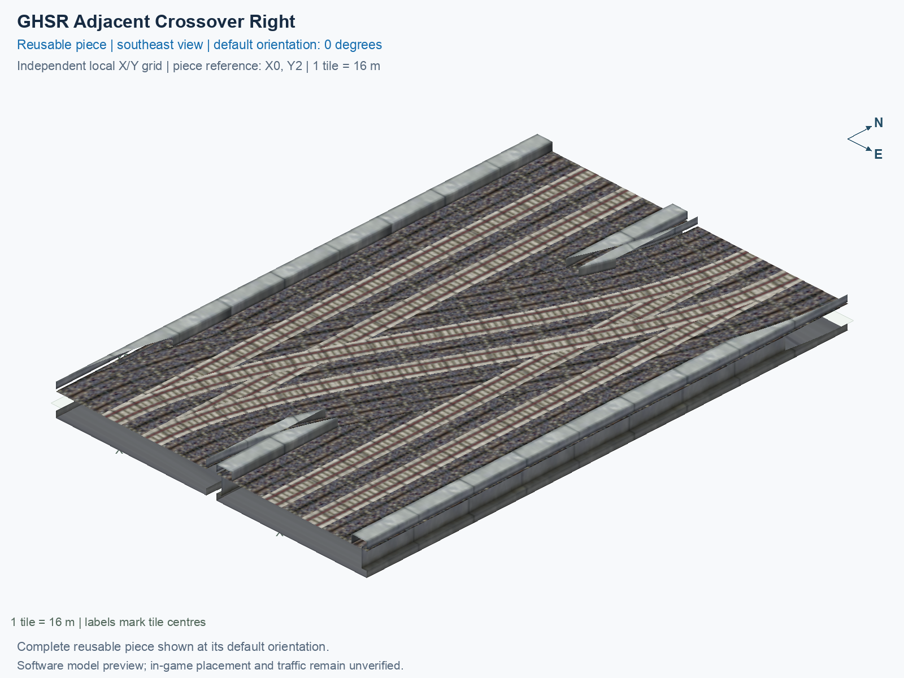

# GHSR Adjacent Crossover Right

Purpose: explain this reusable piece, its matching connections and current test coverage.

<!-- BEGIN PIECE OVERVIEW -->

Switches between two adjacent two-track lines, with no empty tile between them. Both through lines are retained. Choose a handed crossover or a scissors for transfers in both hands.

Exact reusable identifier: `rail-ghsr-adjacent-crossover-right`.

Footprint: **2 × 3 tiles**. Exact menu name: **GHSR Adjacent Crossover Right**.

Choose this exact name in Transportation → Rail. Press Home or End to rotate; use only the supported states listed below. Join each end to a matching port profile and direction.

- [Connections and journeys](#connections-and-journeys)
- [Test checklist](#test-checklist)



<!-- END PIECE OVERVIEW -->

<!-- BEGIN MANUAL SUMMARY -->

## Manual status

Generated from [the exact test cases](#test-checklist) and [authoritative observations](checks/manual-tests.json).

- [ ] Preview review: 0/1 applicable cases passed; 0 failed, 0 stale.
- [ ] In-game rendering: 0/4 applicable cases passed; 0 failed, 0 stale.
- [ ] Directed journeys: 0/24 applicable cases passed; 0 failed, 0 stale.

These observations cover only the named services, directions, poses, rotations, and recorded platforms.

<!-- END MANUAL SUMMARY -->

<!-- BEGIN CONNECTIONS -->

## Connections and journeys

Purpose: describe intrinsic directional interfaces and permitted service journeys.

Generated from [connections.json](connections.json). Coordinates are canonical east, north and height in metres. A connection class names an encoded route interface; it does not prove visible deck/wall fit or an in-game test.

Supported placement states: 0° CCW, 90° CCW, 180° CCW, 270° CCW. Each state has its own declared manual scope.

A **port** is one directional transport-path endpoint. **Service** identifies the intended network service (for example HSR, street, or tram); **engine** is its internal traffic-class number, separate from the construction network. **Role** distinguishes primary service from auxiliary paths; sharing a traffic class does not establish service compatibility.

A **tangent** is a unit travel-direction vector: `[0,1]` means north. **Grade** is height gained per horizontal metre. These measured facts describe this subject alone. Compatibility requires a separate comparison of the complete joining boundaries; physical seams and actual game operation require their own evidence. See the [class index](../../connection-classes.json) for shared route-interface membership.

| Port | Service / engine / role | Direction | Location; tangent; grade | Connection class |
| --- | --- | --- | --- | --- |
| `Sout` | ghsr / 7 / primary | out | [-2.0, -40.0, 1.0]; [0.0, -1.0]; 0.0 | `path-interface-c78c5ac4b558d84b46f2` |
| `Nin` | ghsr / 7 / primary | in | [-2.0, 8.0, 1.0]; [0.0, -1.0]; 0.0 | `path-interface-c78c5ac4b558d84b46f2` |
| `Sin` | ghsr / 7 / primary | in | [2.0, -40.0, 1.0]; [0.0, 1.0]; 0.0 | `path-interface-fab587419de6b5848d74` |
| `Nout` | ghsr / 7 / primary | out | [2.0, 8.0, 1.0]; [0.0, 1.0]; 0.0 | `path-interface-fab587419de6b5848d74` |
| `BSout` | ghsr / 7 / primary | out | [14.0, -40.0, 1.0]; [0.0, -1.0]; 0.0 | `path-interface-c78c5ac4b558d84b46f2` |
| `BNin` | ghsr / 7 / primary | in | [14.0, 8.0, 1.0]; [0.0, -1.0]; 0.0 | `path-interface-c78c5ac4b558d84b46f2` |
| `BSin` | ghsr / 7 / primary | in | [18.0, -40.0, 1.0]; [0.0, 1.0]; 0.0 | `path-interface-fab587419de6b5848d74` |
| `BNout` | ghsr / 7 / primary | out | [18.0, 8.0, 1.0]; [0.0, 1.0]; 0.0 | `path-interface-fab587419de6b5848d74` |

### Directed journeys

| Service | Entry → exit | Role |
| --- | --- | --- |
| ghsr | `Nin` → `Sout` | primary |
| ghsr | `Sin` → `BNout` | primary |
| ghsr | `Sin` → `Nout` | primary |
| ghsr | `BNin` → `Sout` | primary |
| ghsr | `BNin` → `BSout` | primary |
| ghsr | `BSin` → `BNout` | primary |

### Forbidden transfers

| From service / port | To service / port | Reason |
| --- | --- | --- |
| ghsr / `Nin` | ghsr / `Nout` | No directed route exists between these ports in the saved piece transport paths. In-game confirmation remains unverified. |
| ghsr / `Nin` | ghsr / `BSout` | No directed route exists between these ports in the saved piece transport paths. In-game confirmation remains unverified. |
| ghsr / `Nin` | ghsr / `BNout` | No directed route exists between these ports in the saved piece transport paths. In-game confirmation remains unverified. |
| ghsr / `Sin` | ghsr / `Sout` | No directed route exists between these ports in the saved piece transport paths. In-game confirmation remains unverified. |
| ghsr / `Sin` | ghsr / `BSout` | No directed route exists between these ports in the saved piece transport paths. In-game confirmation remains unverified. |
| ghsr / `BNin` | ghsr / `Nout` | No directed route exists between these ports in the saved piece transport paths. In-game confirmation remains unverified. |
| ghsr / `BNin` | ghsr / `BNout` | No directed route exists between these ports in the saved piece transport paths. In-game confirmation remains unverified. |
| ghsr / `BSin` | ghsr / `Sout` | No directed route exists between these ports in the saved piece transport paths. In-game confirmation remains unverified. |
| ghsr / `BSin` | ghsr / `Nout` | No directed route exists between these ports in the saved piece transport paths. In-game confirmation remains unverified. |
| ghsr / `BSin` | ghsr / `BSout` | No directed route exists between these ports in the saved piece transport paths. In-game confirmation remains unverified. |

Review the test checklist for the exact tested cases and environments.

<!-- END CONNECTIONS -->

<!-- BEGIN MANUAL CHECKS -->

## Test checklist

Generated from [the authoritative record](checks/manual-tests.json). Only explicit human observations create manual passes; software and preview checks remain separate. Expand a check/service group to see its rotation table, then expand the matching exact scope to copy a case ID and inspect its pose, reviewer, environment, and evidence. Grouping changes only this view; every declared case remains separate.

**States:** [x] passed; [ ] unverified, failed, or stale; N/A is an explicit inapplicable declaration. A dash means no case was declared in that column. Every pass covers only its recorded environment. T means a distinct construction-transposed state.

Four proper rotations are covered. No additional reflected state is established by this record; repeated construction aliases do not create new orientations.

Current totals: unverified: 83, passed: 0, failed: 0, stale: 0, not_applicable: 0.

### Record an observation

Follow the [shared testing guide](../../../../docs/TESTING.md); copy [the unconfirmed example](checks/observation.example.json) to `checks/observation.json`. Case identifiers are in the expandable sections below. Do not edit generated checkboxes.

From the repository folder containing `custom-pieces`, run after filling `checks/observation.json` and explicitly confirming the exact observation:

```sh
python3 -m scp.content record --record custom-pieces/domains/high-speed-rail/00_pieces/rail-ghsr-adjacent-crossover-right/checks/manual-tests.json --observation custom-pieces/domains/high-speed-rail/00_pieces/rail-ghsr-adjacent-crossover-right/checks/observation.json
```

### Detailed current checks

Each collapsed group shows exact case counts and states. Forbidden transfers are grouped by the directed service pair; the table inside retains every port pair and rotation.

<details>
<summary>Compiled resources — Whole subject — 1 case; unverified: 1</summary>

| Check / exact scope | General | 0° | 90° | 180° | 270° |
| --- | --- | --- | --- | --- | --- |
| **Compiled resources**<br>Whole subject | <a href="#case-software_resources-a7ca5c1e4b738315a21b">[ ] unverified</a> | — | — | — | — |


<details>
<summary>Compiled resources — Whole subject</summary>

<a id="case-software_resources-a7ca5c1e4b738315a21b"></a>

**General: unverified** — `software_resources-a7ca5c1e4b738315a21b`.

Verify the actual compiled resources and construction rules.

Scope: Whole subject.

No observation recorded.

</details>

</details>

<details>
<summary>Directed routing graph — Whole subject — 1 case; unverified: 1</summary>

| Check / exact scope | General | 0° | 90° | 180° | 270° |
| --- | --- | --- | --- | --- | --- |
| **Directed routing graph**<br>Whole subject | <a href="#case-software_connectivity-a7ca5c1e4b738315a21b">[ ] unverified</a> | — | — | — | — |


<details>
<summary>Directed routing graph — Whole subject</summary>

<a id="case-software_connectivity-a7ca5c1e4b738315a21b"></a>

**General: unverified** — `software_connectivity-a7ca5c1e4b738315a21b`.

Verify the declared directed journeys and forbidden transfers.

Scope: Whole subject.

No observation recorded.

</details>

</details>

<details>
<summary>Preview review — Images — 1 case; unverified: 1</summary>

| Check / exact scope | General | 0° | 90° | 180° | 270° |
| --- | --- | --- | --- | --- | --- |
| **Preview review**<br>Image: image:rail-ghsr-adjacent-crossover-right:canonical-southeast | <a href="#case-preview_review-4cccea5662c654cab8a5">[ ] unverified</a> | — | — | — | — |


<details>
<summary>Preview review — Image: image:rail-ghsr-adjacent-crossover-right:canonical-southeast</summary>

<a id="case-preview_review-4cccea5662c654cab8a5"></a>

**General: unverified** — `preview_review-4cccea5662c654cab8a5`.

Inspect this exact preview for tracks, walls, piers, seams and shadows.

Scope: Image: image:rail-ghsr-adjacent-crossover-right:canonical-southeast.

No observation recorded.

</details>

</details>

<details>
<summary>In-game rendering — Whole subject — 4 cases; unverified: 4</summary>

| Check / exact scope | General | 0° | 90° | 180° | 270° |
| --- | --- | --- | --- | --- | --- |
| **In-game rendering**<br>Whole subject | — | <a href="#case-in_game_render-a04ae3f195b68f3d9c6f">[ ] unverified</a> | <a href="#case-in_game_render-7a3314d75d005ec2c190">[ ] unverified</a> | <a href="#case-in_game_render-955249d14e5d9c27069d">[ ] unverified</a> | <a href="#case-in_game_render-103c7c4df106f1e3753f">[ ] unverified</a> |


<details>
<summary>In-game rendering — Whole subject</summary>

<a id="case-in_game_render-a04ae3f195b68f3d9c6f"></a>

**0° CCW: unverified** — `in_game_render-a04ae3f195b68f3d9c6f`.

Inspect the placed tracks, walls, piers, seams and shadows in SimCity 4.

Scope: Whole subject.

No observation recorded.

<a id="case-in_game_render-7a3314d75d005ec2c190"></a>

**90° CCW: unverified** — `in_game_render-7a3314d75d005ec2c190`.

Inspect the placed tracks, walls, piers, seams and shadows in SimCity 4.

Scope: Whole subject.

No observation recorded.

<a id="case-in_game_render-955249d14e5d9c27069d"></a>

**180° CCW: unverified** — `in_game_render-955249d14e5d9c27069d`.

Inspect the placed tracks, walls, piers, seams and shadows in SimCity 4.

Scope: Whole subject.

No observation recorded.

<a id="case-in_game_render-103c7c4df106f1e3753f"></a>

**270° CCW: unverified** — `in_game_render-103c7c4df106f1e3753f`.

Inspect the placed tracks, walls, piers, seams and shadows in SimCity 4.

Scope: Whole subject.

No observation recorded.

</details>

</details>

<details>
<summary>Placement — Whole subject — 4 cases; unverified: 4</summary>

| Check / exact scope | General | 0° | 90° | 180° | 270° |
| --- | --- | --- | --- | --- | --- |
| **Placement**<br>Whole subject | — | <a href="#case-in_game_placement-a04ae3f195b68f3d9c6f">[ ] unverified</a> | <a href="#case-in_game_placement-7a3314d75d005ec2c190">[ ] unverified</a> | <a href="#case-in_game_placement-955249d14e5d9c27069d">[ ] unverified</a> | <a href="#case-in_game_placement-103c7c4df106f1e3753f">[ ] unverified</a> |


<details>
<summary>Placement — Whole subject</summary>

<a id="case-in_game_placement-a04ae3f195b68f3d9c6f"></a>

**0° CCW: unverified** — `in_game_placement-a04ae3f195b68f3d9c6f`.

Place this piece or complete blueprint and inspect every occupied tile.

Scope: Whole subject.

No observation recorded.

<a id="case-in_game_placement-7a3314d75d005ec2c190"></a>

**90° CCW: unverified** — `in_game_placement-7a3314d75d005ec2c190`.

Place this piece or complete blueprint and inspect every occupied tile.

Scope: Whole subject.

No observation recorded.

<a id="case-in_game_placement-955249d14e5d9c27069d"></a>

**180° CCW: unverified** — `in_game_placement-955249d14e5d9c27069d`.

Place this piece or complete blueprint and inspect every occupied tile.

Scope: Whole subject.

No observation recorded.

<a id="case-in_game_placement-103c7c4df106f1e3753f"></a>

**270° CCW: unverified** — `in_game_placement-103c7c4df106f1e3753f`.

Place this piece or complete blueprint and inspect every occupied tile.

Scope: Whole subject.

No observation recorded.

</details>

</details>

<details>
<summary>Demolition — Whole subject — 4 cases; unverified: 4</summary>

| Check / exact scope | General | 0° | 90° | 180° | 270° |
| --- | --- | --- | --- | --- | --- |
| **Demolition**<br>Whole subject | — | <a href="#case-in_game_demolition-a04ae3f195b68f3d9c6f">[ ] unverified</a> | <a href="#case-in_game_demolition-7a3314d75d005ec2c190">[ ] unverified</a> | <a href="#case-in_game_demolition-955249d14e5d9c27069d">[ ] unverified</a> | <a href="#case-in_game_demolition-103c7c4df106f1e3753f">[ ] unverified</a> |


<details>
<summary>Demolition — Whole subject</summary>

<a id="case-in_game_demolition-a04ae3f195b68f3d9c6f"></a>

**0° CCW: unverified** — `in_game_demolition-a04ae3f195b68f3d9c6f`.

Bulldoze the complete placement and inspect the cleared area.

Scope: Whole subject.

No observation recorded.

<a id="case-in_game_demolition-7a3314d75d005ec2c190"></a>

**90° CCW: unverified** — `in_game_demolition-7a3314d75d005ec2c190`.

Bulldoze the complete placement and inspect the cleared area.

Scope: Whole subject.

No observation recorded.

<a id="case-in_game_demolition-955249d14e5d9c27069d"></a>

**180° CCW: unverified** — `in_game_demolition-955249d14e5d9c27069d`.

Bulldoze the complete placement and inspect the cleared area.

Scope: Whole subject.

No observation recorded.

<a id="case-in_game_demolition-103c7c4df106f1e3753f"></a>

**270° CCW: unverified** — `in_game_demolition-103c7c4df106f1e3753f`.

Bulldoze the complete placement and inspect the cleared area.

Scope: Whole subject.

No observation recorded.

</details>

</details>

<details>
<summary>Save and reload — Whole subject — 4 cases; unverified: 4</summary>

| Check / exact scope | General | 0° | 90° | 180° | 270° |
| --- | --- | --- | --- | --- | --- |
| **Save and reload**<br>Whole subject | — | <a href="#case-in_game_save_reload-a04ae3f195b68f3d9c6f">[ ] unverified</a> | <a href="#case-in_game_save_reload-7a3314d75d005ec2c190">[ ] unverified</a> | <a href="#case-in_game_save_reload-955249d14e5d9c27069d">[ ] unverified</a> | <a href="#case-in_game_save_reload-103c7c4df106f1e3753f">[ ] unverified</a> |


<details>
<summary>Save and reload — Whole subject</summary>

<a id="case-in_game_save_reload-a04ae3f195b68f3d9c6f"></a>

**0° CCW: unverified** — `in_game_save_reload-a04ae3f195b68f3d9c6f`.

Save, quit, reload and inspect the placement and its paths.

Scope: Whole subject.

No observation recorded.

<a id="case-in_game_save_reload-7a3314d75d005ec2c190"></a>

**90° CCW: unverified** — `in_game_save_reload-7a3314d75d005ec2c190`.

Save, quit, reload and inspect the placement and its paths.

Scope: Whole subject.

No observation recorded.

<a id="case-in_game_save_reload-955249d14e5d9c27069d"></a>

**180° CCW: unverified** — `in_game_save_reload-955249d14e5d9c27069d`.

Save, quit, reload and inspect the placement and its paths.

Scope: Whole subject.

No observation recorded.

<a id="case-in_game_save_reload-103c7c4df106f1e3753f"></a>

**270° CCW: unverified** — `in_game_save_reload-103c7c4df106f1e3753f`.

Save, quit, reload and inspect the placement and its paths.

Scope: Whole subject.

No observation recorded.

</details>

</details>

<details>
<summary>Journey — ghsr — 24 cases; unverified: 24</summary>

| Check / exact scope | General | 0° | 90° | 180° | 270° |
| --- | --- | --- | --- | --- | --- |
| **Journey**<br>Service: ghsr; role: primary; journey: 7:Nin>Sout; entry: Nin; exit: Sout | — | <a href="#case-in_game_journey-3a92fb96a72604212f72">[ ] unverified</a> | <a href="#case-in_game_journey-e48a40776617dd61af51">[ ] unverified</a> | <a href="#case-in_game_journey-488f3f9a11bd0c41ee9b">[ ] unverified</a> | <a href="#case-in_game_journey-c2de3098214a9701ca9b">[ ] unverified</a> |
| **Journey**<br>Service: ghsr; role: primary; journey: 7:Sin>BNout; entry: Sin; exit: BNout | — | <a href="#case-in_game_journey-5490303bcb76e69ee884">[ ] unverified</a> | <a href="#case-in_game_journey-824dbd51c211e4529066">[ ] unverified</a> | <a href="#case-in_game_journey-9231f2d4e03519ff1ffd">[ ] unverified</a> | <a href="#case-in_game_journey-610fc82d55a06b8a23f1">[ ] unverified</a> |
| **Journey**<br>Service: ghsr; role: primary; journey: 7:Sin>Nout; entry: Sin; exit: Nout | — | <a href="#case-in_game_journey-a58896c9369e64b3b1dd">[ ] unverified</a> | <a href="#case-in_game_journey-42a20db1ab3995a866ab">[ ] unverified</a> | <a href="#case-in_game_journey-7a90e306a861756243eb">[ ] unverified</a> | <a href="#case-in_game_journey-ea9e23ced7bc715cd196">[ ] unverified</a> |
| **Journey**<br>Service: ghsr; role: primary; journey: 7:BNin>Sout; entry: BNin; exit: Sout | — | <a href="#case-in_game_journey-67e591d108cc611b00d3">[ ] unverified</a> | <a href="#case-in_game_journey-71c9182de839881fbbf8">[ ] unverified</a> | <a href="#case-in_game_journey-1b614019f3823ddcbaf4">[ ] unverified</a> | <a href="#case-in_game_journey-e3a3dd9eef0698c1837e">[ ] unverified</a> |
| **Journey**<br>Service: ghsr; role: primary; journey: 7:BNin>BSout; entry: BNin; exit: BSout | — | <a href="#case-in_game_journey-ea3891d3e90977619078">[ ] unverified</a> | <a href="#case-in_game_journey-e9e18d1fc6aa84703408">[ ] unverified</a> | <a href="#case-in_game_journey-e0873bcd9ff4309ade41">[ ] unverified</a> | <a href="#case-in_game_journey-652bf763af8ec418c9ec">[ ] unverified</a> |
| **Journey**<br>Service: ghsr; role: primary; journey: 7:BSin>BNout; entry: BSin; exit: BNout | — | <a href="#case-in_game_journey-b1d35476a4f789372e4d">[ ] unverified</a> | <a href="#case-in_game_journey-d2ba659a0ebb60827a18">[ ] unverified</a> | <a href="#case-in_game_journey-d62a6c119b830fc4a668">[ ] unverified</a> | <a href="#case-in_game_journey-485d951b9aba3c382b5c">[ ] unverified</a> |


<details>
<summary>Journey — Service: ghsr; role: primary; journey: 7:Nin>Sout; entry: Nin; exit: Sout</summary>

<a id="case-in_game_journey-3a92fb96a72604212f72"></a>

**0° CCW: unverified** — `in_game_journey-3a92fb96a72604212f72`.

Run the declared journey in this direction using its service network.

Scope: Service: ghsr; role: primary; journey: 7:Nin>Sout; entry: Nin; exit: Sout.

No observation recorded.

<a id="case-in_game_journey-e48a40776617dd61af51"></a>

**90° CCW: unverified** — `in_game_journey-e48a40776617dd61af51`.

Run the declared journey in this direction using its service network.

Scope: Service: ghsr; role: primary; journey: 7:Nin>Sout; entry: Nin; exit: Sout.

No observation recorded.

<a id="case-in_game_journey-488f3f9a11bd0c41ee9b"></a>

**180° CCW: unverified** — `in_game_journey-488f3f9a11bd0c41ee9b`.

Run the declared journey in this direction using its service network.

Scope: Service: ghsr; role: primary; journey: 7:Nin>Sout; entry: Nin; exit: Sout.

No observation recorded.

<a id="case-in_game_journey-c2de3098214a9701ca9b"></a>

**270° CCW: unverified** — `in_game_journey-c2de3098214a9701ca9b`.

Run the declared journey in this direction using its service network.

Scope: Service: ghsr; role: primary; journey: 7:Nin>Sout; entry: Nin; exit: Sout.

No observation recorded.

</details>


<details>
<summary>Journey — Service: ghsr; role: primary; journey: 7:Sin>BNout; entry: Sin; exit: BNout</summary>

<a id="case-in_game_journey-5490303bcb76e69ee884"></a>

**0° CCW: unverified** — `in_game_journey-5490303bcb76e69ee884`.

Run the declared journey in this direction using its service network.

Scope: Service: ghsr; role: primary; journey: 7:Sin>BNout; entry: Sin; exit: BNout.

No observation recorded.

<a id="case-in_game_journey-824dbd51c211e4529066"></a>

**90° CCW: unverified** — `in_game_journey-824dbd51c211e4529066`.

Run the declared journey in this direction using its service network.

Scope: Service: ghsr; role: primary; journey: 7:Sin>BNout; entry: Sin; exit: BNout.

No observation recorded.

<a id="case-in_game_journey-9231f2d4e03519ff1ffd"></a>

**180° CCW: unverified** — `in_game_journey-9231f2d4e03519ff1ffd`.

Run the declared journey in this direction using its service network.

Scope: Service: ghsr; role: primary; journey: 7:Sin>BNout; entry: Sin; exit: BNout.

No observation recorded.

<a id="case-in_game_journey-610fc82d55a06b8a23f1"></a>

**270° CCW: unverified** — `in_game_journey-610fc82d55a06b8a23f1`.

Run the declared journey in this direction using its service network.

Scope: Service: ghsr; role: primary; journey: 7:Sin>BNout; entry: Sin; exit: BNout.

No observation recorded.

</details>


<details>
<summary>Journey — Service: ghsr; role: primary; journey: 7:Sin>Nout; entry: Sin; exit: Nout</summary>

<a id="case-in_game_journey-a58896c9369e64b3b1dd"></a>

**0° CCW: unverified** — `in_game_journey-a58896c9369e64b3b1dd`.

Run the declared journey in this direction using its service network.

Scope: Service: ghsr; role: primary; journey: 7:Sin>Nout; entry: Sin; exit: Nout.

No observation recorded.

<a id="case-in_game_journey-42a20db1ab3995a866ab"></a>

**90° CCW: unverified** — `in_game_journey-42a20db1ab3995a866ab`.

Run the declared journey in this direction using its service network.

Scope: Service: ghsr; role: primary; journey: 7:Sin>Nout; entry: Sin; exit: Nout.

No observation recorded.

<a id="case-in_game_journey-7a90e306a861756243eb"></a>

**180° CCW: unverified** — `in_game_journey-7a90e306a861756243eb`.

Run the declared journey in this direction using its service network.

Scope: Service: ghsr; role: primary; journey: 7:Sin>Nout; entry: Sin; exit: Nout.

No observation recorded.

<a id="case-in_game_journey-ea9e23ced7bc715cd196"></a>

**270° CCW: unverified** — `in_game_journey-ea9e23ced7bc715cd196`.

Run the declared journey in this direction using its service network.

Scope: Service: ghsr; role: primary; journey: 7:Sin>Nout; entry: Sin; exit: Nout.

No observation recorded.

</details>


<details>
<summary>Journey — Service: ghsr; role: primary; journey: 7:BNin>Sout; entry: BNin; exit: Sout</summary>

<a id="case-in_game_journey-67e591d108cc611b00d3"></a>

**0° CCW: unverified** — `in_game_journey-67e591d108cc611b00d3`.

Run the declared journey in this direction using its service network.

Scope: Service: ghsr; role: primary; journey: 7:BNin>Sout; entry: BNin; exit: Sout.

No observation recorded.

<a id="case-in_game_journey-71c9182de839881fbbf8"></a>

**90° CCW: unverified** — `in_game_journey-71c9182de839881fbbf8`.

Run the declared journey in this direction using its service network.

Scope: Service: ghsr; role: primary; journey: 7:BNin>Sout; entry: BNin; exit: Sout.

No observation recorded.

<a id="case-in_game_journey-1b614019f3823ddcbaf4"></a>

**180° CCW: unverified** — `in_game_journey-1b614019f3823ddcbaf4`.

Run the declared journey in this direction using its service network.

Scope: Service: ghsr; role: primary; journey: 7:BNin>Sout; entry: BNin; exit: Sout.

No observation recorded.

<a id="case-in_game_journey-e3a3dd9eef0698c1837e"></a>

**270° CCW: unverified** — `in_game_journey-e3a3dd9eef0698c1837e`.

Run the declared journey in this direction using its service network.

Scope: Service: ghsr; role: primary; journey: 7:BNin>Sout; entry: BNin; exit: Sout.

No observation recorded.

</details>


<details>
<summary>Journey — Service: ghsr; role: primary; journey: 7:BNin>BSout; entry: BNin; exit: BSout</summary>

<a id="case-in_game_journey-ea3891d3e90977619078"></a>

**0° CCW: unverified** — `in_game_journey-ea3891d3e90977619078`.

Run the declared journey in this direction using its service network.

Scope: Service: ghsr; role: primary; journey: 7:BNin>BSout; entry: BNin; exit: BSout.

No observation recorded.

<a id="case-in_game_journey-e9e18d1fc6aa84703408"></a>

**90° CCW: unverified** — `in_game_journey-e9e18d1fc6aa84703408`.

Run the declared journey in this direction using its service network.

Scope: Service: ghsr; role: primary; journey: 7:BNin>BSout; entry: BNin; exit: BSout.

No observation recorded.

<a id="case-in_game_journey-e0873bcd9ff4309ade41"></a>

**180° CCW: unverified** — `in_game_journey-e0873bcd9ff4309ade41`.

Run the declared journey in this direction using its service network.

Scope: Service: ghsr; role: primary; journey: 7:BNin>BSout; entry: BNin; exit: BSout.

No observation recorded.

<a id="case-in_game_journey-652bf763af8ec418c9ec"></a>

**270° CCW: unverified** — `in_game_journey-652bf763af8ec418c9ec`.

Run the declared journey in this direction using its service network.

Scope: Service: ghsr; role: primary; journey: 7:BNin>BSout; entry: BNin; exit: BSout.

No observation recorded.

</details>


<details>
<summary>Journey — Service: ghsr; role: primary; journey: 7:BSin>BNout; entry: BSin; exit: BNout</summary>

<a id="case-in_game_journey-b1d35476a4f789372e4d"></a>

**0° CCW: unverified** — `in_game_journey-b1d35476a4f789372e4d`.

Run the declared journey in this direction using its service network.

Scope: Service: ghsr; role: primary; journey: 7:BSin>BNout; entry: BSin; exit: BNout.

No observation recorded.

<a id="case-in_game_journey-d2ba659a0ebb60827a18"></a>

**90° CCW: unverified** — `in_game_journey-d2ba659a0ebb60827a18`.

Run the declared journey in this direction using its service network.

Scope: Service: ghsr; role: primary; journey: 7:BSin>BNout; entry: BSin; exit: BNout.

No observation recorded.

<a id="case-in_game_journey-d62a6c119b830fc4a668"></a>

**180° CCW: unverified** — `in_game_journey-d62a6c119b830fc4a668`.

Run the declared journey in this direction using its service network.

Scope: Service: ghsr; role: primary; journey: 7:BSin>BNout; entry: BSin; exit: BNout.

No observation recorded.

<a id="case-in_game_journey-485d951b9aba3c382b5c"></a>

**270° CCW: unverified** — `in_game_journey-485d951b9aba3c382b5c`.

Run the declared journey in this direction using its service network.

Scope: Service: ghsr; role: primary; journey: 7:BSin>BNout; entry: BSin; exit: BNout.

No observation recorded.

</details>

</details>

<details>
<summary>Forbidden transfer — ghsr → ghsr — 40 cases; unverified: 40</summary>

| Check / exact scope | General | 0° | 90° | 180° | 270° |
| --- | --- | --- | --- | --- | --- |
| **Forbidden transfer**<br>from port: Nin; to port: Nout; from service: ghsr; to service: ghsr; basis: not reachable in actual saved PATH graph | — | <a href="#case-in_game_forbidden_transfer-2a2f74bdc2b5154679e8">[ ] unverified</a> | <a href="#case-in_game_forbidden_transfer-e708bbfc5777914cbcae">[ ] unverified</a> | <a href="#case-in_game_forbidden_transfer-1b395f8f3421caf18b7c">[ ] unverified</a> | <a href="#case-in_game_forbidden_transfer-55a4dfa9024220b4497d">[ ] unverified</a> |
| **Forbidden transfer**<br>from port: Nin; to port: BSout; from service: ghsr; to service: ghsr; basis: not reachable in actual saved PATH graph | — | <a href="#case-in_game_forbidden_transfer-53b582ccb3d35adb3ce5">[ ] unverified</a> | <a href="#case-in_game_forbidden_transfer-320f4863af87bf92f197">[ ] unverified</a> | <a href="#case-in_game_forbidden_transfer-4107655a2ba22c87a0bf">[ ] unverified</a> | <a href="#case-in_game_forbidden_transfer-98d0a9e0af51d3f4bab9">[ ] unverified</a> |
| **Forbidden transfer**<br>from port: Nin; to port: BNout; from service: ghsr; to service: ghsr; basis: not reachable in actual saved PATH graph | — | <a href="#case-in_game_forbidden_transfer-9c295284d15f54461ca8">[ ] unverified</a> | <a href="#case-in_game_forbidden_transfer-204e4936427869a52f27">[ ] unverified</a> | <a href="#case-in_game_forbidden_transfer-863bbaf39bc95a809a76">[ ] unverified</a> | <a href="#case-in_game_forbidden_transfer-7d19b370ecb60a7112a3">[ ] unverified</a> |
| **Forbidden transfer**<br>from port: Sin; to port: Sout; from service: ghsr; to service: ghsr; basis: not reachable in actual saved PATH graph | — | <a href="#case-in_game_forbidden_transfer-df090bb490de7827a31d">[ ] unverified</a> | <a href="#case-in_game_forbidden_transfer-ce03e38d77aca9886bd3">[ ] unverified</a> | <a href="#case-in_game_forbidden_transfer-0f8e4c6c8c6beb3f034c">[ ] unverified</a> | <a href="#case-in_game_forbidden_transfer-b0a6af8eb3fbae92d7c2">[ ] unverified</a> |
| **Forbidden transfer**<br>from port: Sin; to port: BSout; from service: ghsr; to service: ghsr; basis: not reachable in actual saved PATH graph | — | <a href="#case-in_game_forbidden_transfer-b30071c9603ea7d89c2f">[ ] unverified</a> | <a href="#case-in_game_forbidden_transfer-e1cc30ee5bb24a9a3b35">[ ] unverified</a> | <a href="#case-in_game_forbidden_transfer-241dc5fb35bfa80ec551">[ ] unverified</a> | <a href="#case-in_game_forbidden_transfer-421239a8e57e68e9ca96">[ ] unverified</a> |
| **Forbidden transfer**<br>from port: BNin; to port: Nout; from service: ghsr; to service: ghsr; basis: not reachable in actual saved PATH graph | — | <a href="#case-in_game_forbidden_transfer-3ce01a1e5aa422cbd8a1">[ ] unverified</a> | <a href="#case-in_game_forbidden_transfer-e5ad12c129e84c922559">[ ] unverified</a> | <a href="#case-in_game_forbidden_transfer-be520b97d8193bbef5e3">[ ] unverified</a> | <a href="#case-in_game_forbidden_transfer-626ba1321475d6d98b20">[ ] unverified</a> |
| **Forbidden transfer**<br>from port: BNin; to port: BNout; from service: ghsr; to service: ghsr; basis: not reachable in actual saved PATH graph | — | <a href="#case-in_game_forbidden_transfer-ce053c18f88d3283ad3f">[ ] unverified</a> | <a href="#case-in_game_forbidden_transfer-71cbc8b8df6fa6d2172e">[ ] unverified</a> | <a href="#case-in_game_forbidden_transfer-aa88162672923a0d6439">[ ] unverified</a> | <a href="#case-in_game_forbidden_transfer-05e8fbff9d6e5f1b0590">[ ] unverified</a> |
| **Forbidden transfer**<br>from port: BSin; to port: Sout; from service: ghsr; to service: ghsr; basis: not reachable in actual saved PATH graph | — | <a href="#case-in_game_forbidden_transfer-e698e044c494d705f26c">[ ] unverified</a> | <a href="#case-in_game_forbidden_transfer-480d8b204a514c5ba3e8">[ ] unverified</a> | <a href="#case-in_game_forbidden_transfer-7c15a3f4d631e394d24f">[ ] unverified</a> | <a href="#case-in_game_forbidden_transfer-1389d42b724d9938bd82">[ ] unverified</a> |
| **Forbidden transfer**<br>from port: BSin; to port: Nout; from service: ghsr; to service: ghsr; basis: not reachable in actual saved PATH graph | — | <a href="#case-in_game_forbidden_transfer-931876a938cf801f3514">[ ] unverified</a> | <a href="#case-in_game_forbidden_transfer-607844577557d8d40c18">[ ] unverified</a> | <a href="#case-in_game_forbidden_transfer-c19ce4af9609b700bada">[ ] unverified</a> | <a href="#case-in_game_forbidden_transfer-49a1c19f334ddac7bb54">[ ] unverified</a> |
| **Forbidden transfer**<br>from port: BSin; to port: BSout; from service: ghsr; to service: ghsr; basis: not reachable in actual saved PATH graph | — | <a href="#case-in_game_forbidden_transfer-1e42fd605bac94e1ca64">[ ] unverified</a> | <a href="#case-in_game_forbidden_transfer-cca8d11097569e2b9870">[ ] unverified</a> | <a href="#case-in_game_forbidden_transfer-35ba6b1385c76bb4ebff">[ ] unverified</a> | <a href="#case-in_game_forbidden_transfer-280041e8b2b2b7ea20f2">[ ] unverified</a> |


<details>
<summary>Forbidden transfer — from port: Nin; to port: Nout; from service: ghsr; to service: ghsr; basis: not reachable in actual saved PATH graph</summary>

<a id="case-in_game_forbidden_transfer-2a2f74bdc2b5154679e8"></a>

**0° CCW: unverified** — `in_game_forbidden_transfer-2a2f74bdc2b5154679e8`.

Confirm this undeclared transfer is unavailable.

Scope: from port: Nin; to port: Nout; from service: ghsr; to service: ghsr; basis: not reachable in actual saved PATH graph.

No observation recorded.

<a id="case-in_game_forbidden_transfer-e708bbfc5777914cbcae"></a>

**90° CCW: unverified** — `in_game_forbidden_transfer-e708bbfc5777914cbcae`.

Confirm this undeclared transfer is unavailable.

Scope: from port: Nin; to port: Nout; from service: ghsr; to service: ghsr; basis: not reachable in actual saved PATH graph.

No observation recorded.

<a id="case-in_game_forbidden_transfer-1b395f8f3421caf18b7c"></a>

**180° CCW: unverified** — `in_game_forbidden_transfer-1b395f8f3421caf18b7c`.

Confirm this undeclared transfer is unavailable.

Scope: from port: Nin; to port: Nout; from service: ghsr; to service: ghsr; basis: not reachable in actual saved PATH graph.

No observation recorded.

<a id="case-in_game_forbidden_transfer-55a4dfa9024220b4497d"></a>

**270° CCW: unverified** — `in_game_forbidden_transfer-55a4dfa9024220b4497d`.

Confirm this undeclared transfer is unavailable.

Scope: from port: Nin; to port: Nout; from service: ghsr; to service: ghsr; basis: not reachable in actual saved PATH graph.

No observation recorded.

</details>


<details>
<summary>Forbidden transfer — from port: Nin; to port: BSout; from service: ghsr; to service: ghsr; basis: not reachable in actual saved PATH graph</summary>

<a id="case-in_game_forbidden_transfer-53b582ccb3d35adb3ce5"></a>

**0° CCW: unverified** — `in_game_forbidden_transfer-53b582ccb3d35adb3ce5`.

Confirm this undeclared transfer is unavailable.

Scope: from port: Nin; to port: BSout; from service: ghsr; to service: ghsr; basis: not reachable in actual saved PATH graph.

No observation recorded.

<a id="case-in_game_forbidden_transfer-320f4863af87bf92f197"></a>

**90° CCW: unverified** — `in_game_forbidden_transfer-320f4863af87bf92f197`.

Confirm this undeclared transfer is unavailable.

Scope: from port: Nin; to port: BSout; from service: ghsr; to service: ghsr; basis: not reachable in actual saved PATH graph.

No observation recorded.

<a id="case-in_game_forbidden_transfer-4107655a2ba22c87a0bf"></a>

**180° CCW: unverified** — `in_game_forbidden_transfer-4107655a2ba22c87a0bf`.

Confirm this undeclared transfer is unavailable.

Scope: from port: Nin; to port: BSout; from service: ghsr; to service: ghsr; basis: not reachable in actual saved PATH graph.

No observation recorded.

<a id="case-in_game_forbidden_transfer-98d0a9e0af51d3f4bab9"></a>

**270° CCW: unverified** — `in_game_forbidden_transfer-98d0a9e0af51d3f4bab9`.

Confirm this undeclared transfer is unavailable.

Scope: from port: Nin; to port: BSout; from service: ghsr; to service: ghsr; basis: not reachable in actual saved PATH graph.

No observation recorded.

</details>


<details>
<summary>Forbidden transfer — from port: Nin; to port: BNout; from service: ghsr; to service: ghsr; basis: not reachable in actual saved PATH graph</summary>

<a id="case-in_game_forbidden_transfer-9c295284d15f54461ca8"></a>

**0° CCW: unverified** — `in_game_forbidden_transfer-9c295284d15f54461ca8`.

Confirm this undeclared transfer is unavailable.

Scope: from port: Nin; to port: BNout; from service: ghsr; to service: ghsr; basis: not reachable in actual saved PATH graph.

No observation recorded.

<a id="case-in_game_forbidden_transfer-204e4936427869a52f27"></a>

**90° CCW: unverified** — `in_game_forbidden_transfer-204e4936427869a52f27`.

Confirm this undeclared transfer is unavailable.

Scope: from port: Nin; to port: BNout; from service: ghsr; to service: ghsr; basis: not reachable in actual saved PATH graph.

No observation recorded.

<a id="case-in_game_forbidden_transfer-863bbaf39bc95a809a76"></a>

**180° CCW: unverified** — `in_game_forbidden_transfer-863bbaf39bc95a809a76`.

Confirm this undeclared transfer is unavailable.

Scope: from port: Nin; to port: BNout; from service: ghsr; to service: ghsr; basis: not reachable in actual saved PATH graph.

No observation recorded.

<a id="case-in_game_forbidden_transfer-7d19b370ecb60a7112a3"></a>

**270° CCW: unverified** — `in_game_forbidden_transfer-7d19b370ecb60a7112a3`.

Confirm this undeclared transfer is unavailable.

Scope: from port: Nin; to port: BNout; from service: ghsr; to service: ghsr; basis: not reachable in actual saved PATH graph.

No observation recorded.

</details>


<details>
<summary>Forbidden transfer — from port: Sin; to port: Sout; from service: ghsr; to service: ghsr; basis: not reachable in actual saved PATH graph</summary>

<a id="case-in_game_forbidden_transfer-df090bb490de7827a31d"></a>

**0° CCW: unverified** — `in_game_forbidden_transfer-df090bb490de7827a31d`.

Confirm this undeclared transfer is unavailable.

Scope: from port: Sin; to port: Sout; from service: ghsr; to service: ghsr; basis: not reachable in actual saved PATH graph.

No observation recorded.

<a id="case-in_game_forbidden_transfer-ce03e38d77aca9886bd3"></a>

**90° CCW: unverified** — `in_game_forbidden_transfer-ce03e38d77aca9886bd3`.

Confirm this undeclared transfer is unavailable.

Scope: from port: Sin; to port: Sout; from service: ghsr; to service: ghsr; basis: not reachable in actual saved PATH graph.

No observation recorded.

<a id="case-in_game_forbidden_transfer-0f8e4c6c8c6beb3f034c"></a>

**180° CCW: unverified** — `in_game_forbidden_transfer-0f8e4c6c8c6beb3f034c`.

Confirm this undeclared transfer is unavailable.

Scope: from port: Sin; to port: Sout; from service: ghsr; to service: ghsr; basis: not reachable in actual saved PATH graph.

No observation recorded.

<a id="case-in_game_forbidden_transfer-b0a6af8eb3fbae92d7c2"></a>

**270° CCW: unverified** — `in_game_forbidden_transfer-b0a6af8eb3fbae92d7c2`.

Confirm this undeclared transfer is unavailable.

Scope: from port: Sin; to port: Sout; from service: ghsr; to service: ghsr; basis: not reachable in actual saved PATH graph.

No observation recorded.

</details>


<details>
<summary>Forbidden transfer — from port: Sin; to port: BSout; from service: ghsr; to service: ghsr; basis: not reachable in actual saved PATH graph</summary>

<a id="case-in_game_forbidden_transfer-b30071c9603ea7d89c2f"></a>

**0° CCW: unverified** — `in_game_forbidden_transfer-b30071c9603ea7d89c2f`.

Confirm this undeclared transfer is unavailable.

Scope: from port: Sin; to port: BSout; from service: ghsr; to service: ghsr; basis: not reachable in actual saved PATH graph.

No observation recorded.

<a id="case-in_game_forbidden_transfer-e1cc30ee5bb24a9a3b35"></a>

**90° CCW: unverified** — `in_game_forbidden_transfer-e1cc30ee5bb24a9a3b35`.

Confirm this undeclared transfer is unavailable.

Scope: from port: Sin; to port: BSout; from service: ghsr; to service: ghsr; basis: not reachable in actual saved PATH graph.

No observation recorded.

<a id="case-in_game_forbidden_transfer-241dc5fb35bfa80ec551"></a>

**180° CCW: unverified** — `in_game_forbidden_transfer-241dc5fb35bfa80ec551`.

Confirm this undeclared transfer is unavailable.

Scope: from port: Sin; to port: BSout; from service: ghsr; to service: ghsr; basis: not reachable in actual saved PATH graph.

No observation recorded.

<a id="case-in_game_forbidden_transfer-421239a8e57e68e9ca96"></a>

**270° CCW: unverified** — `in_game_forbidden_transfer-421239a8e57e68e9ca96`.

Confirm this undeclared transfer is unavailable.

Scope: from port: Sin; to port: BSout; from service: ghsr; to service: ghsr; basis: not reachable in actual saved PATH graph.

No observation recorded.

</details>


<details>
<summary>Forbidden transfer — from port: BNin; to port: Nout; from service: ghsr; to service: ghsr; basis: not reachable in actual saved PATH graph</summary>

<a id="case-in_game_forbidden_transfer-3ce01a1e5aa422cbd8a1"></a>

**0° CCW: unverified** — `in_game_forbidden_transfer-3ce01a1e5aa422cbd8a1`.

Confirm this undeclared transfer is unavailable.

Scope: from port: BNin; to port: Nout; from service: ghsr; to service: ghsr; basis: not reachable in actual saved PATH graph.

No observation recorded.

<a id="case-in_game_forbidden_transfer-e5ad12c129e84c922559"></a>

**90° CCW: unverified** — `in_game_forbidden_transfer-e5ad12c129e84c922559`.

Confirm this undeclared transfer is unavailable.

Scope: from port: BNin; to port: Nout; from service: ghsr; to service: ghsr; basis: not reachable in actual saved PATH graph.

No observation recorded.

<a id="case-in_game_forbidden_transfer-be520b97d8193bbef5e3"></a>

**180° CCW: unverified** — `in_game_forbidden_transfer-be520b97d8193bbef5e3`.

Confirm this undeclared transfer is unavailable.

Scope: from port: BNin; to port: Nout; from service: ghsr; to service: ghsr; basis: not reachable in actual saved PATH graph.

No observation recorded.

<a id="case-in_game_forbidden_transfer-626ba1321475d6d98b20"></a>

**270° CCW: unverified** — `in_game_forbidden_transfer-626ba1321475d6d98b20`.

Confirm this undeclared transfer is unavailable.

Scope: from port: BNin; to port: Nout; from service: ghsr; to service: ghsr; basis: not reachable in actual saved PATH graph.

No observation recorded.

</details>


<details>
<summary>Forbidden transfer — from port: BNin; to port: BNout; from service: ghsr; to service: ghsr; basis: not reachable in actual saved PATH graph</summary>

<a id="case-in_game_forbidden_transfer-ce053c18f88d3283ad3f"></a>

**0° CCW: unverified** — `in_game_forbidden_transfer-ce053c18f88d3283ad3f`.

Confirm this undeclared transfer is unavailable.

Scope: from port: BNin; to port: BNout; from service: ghsr; to service: ghsr; basis: not reachable in actual saved PATH graph.

No observation recorded.

<a id="case-in_game_forbidden_transfer-71cbc8b8df6fa6d2172e"></a>

**90° CCW: unverified** — `in_game_forbidden_transfer-71cbc8b8df6fa6d2172e`.

Confirm this undeclared transfer is unavailable.

Scope: from port: BNin; to port: BNout; from service: ghsr; to service: ghsr; basis: not reachable in actual saved PATH graph.

No observation recorded.

<a id="case-in_game_forbidden_transfer-aa88162672923a0d6439"></a>

**180° CCW: unverified** — `in_game_forbidden_transfer-aa88162672923a0d6439`.

Confirm this undeclared transfer is unavailable.

Scope: from port: BNin; to port: BNout; from service: ghsr; to service: ghsr; basis: not reachable in actual saved PATH graph.

No observation recorded.

<a id="case-in_game_forbidden_transfer-05e8fbff9d6e5f1b0590"></a>

**270° CCW: unverified** — `in_game_forbidden_transfer-05e8fbff9d6e5f1b0590`.

Confirm this undeclared transfer is unavailable.

Scope: from port: BNin; to port: BNout; from service: ghsr; to service: ghsr; basis: not reachable in actual saved PATH graph.

No observation recorded.

</details>


<details>
<summary>Forbidden transfer — from port: BSin; to port: Sout; from service: ghsr; to service: ghsr; basis: not reachable in actual saved PATH graph</summary>

<a id="case-in_game_forbidden_transfer-e698e044c494d705f26c"></a>

**0° CCW: unverified** — `in_game_forbidden_transfer-e698e044c494d705f26c`.

Confirm this undeclared transfer is unavailable.

Scope: from port: BSin; to port: Sout; from service: ghsr; to service: ghsr; basis: not reachable in actual saved PATH graph.

No observation recorded.

<a id="case-in_game_forbidden_transfer-480d8b204a514c5ba3e8"></a>

**90° CCW: unverified** — `in_game_forbidden_transfer-480d8b204a514c5ba3e8`.

Confirm this undeclared transfer is unavailable.

Scope: from port: BSin; to port: Sout; from service: ghsr; to service: ghsr; basis: not reachable in actual saved PATH graph.

No observation recorded.

<a id="case-in_game_forbidden_transfer-7c15a3f4d631e394d24f"></a>

**180° CCW: unverified** — `in_game_forbidden_transfer-7c15a3f4d631e394d24f`.

Confirm this undeclared transfer is unavailable.

Scope: from port: BSin; to port: Sout; from service: ghsr; to service: ghsr; basis: not reachable in actual saved PATH graph.

No observation recorded.

<a id="case-in_game_forbidden_transfer-1389d42b724d9938bd82"></a>

**270° CCW: unverified** — `in_game_forbidden_transfer-1389d42b724d9938bd82`.

Confirm this undeclared transfer is unavailable.

Scope: from port: BSin; to port: Sout; from service: ghsr; to service: ghsr; basis: not reachable in actual saved PATH graph.

No observation recorded.

</details>


<details>
<summary>Forbidden transfer — from port: BSin; to port: Nout; from service: ghsr; to service: ghsr; basis: not reachable in actual saved PATH graph</summary>

<a id="case-in_game_forbidden_transfer-931876a938cf801f3514"></a>

**0° CCW: unverified** — `in_game_forbidden_transfer-931876a938cf801f3514`.

Confirm this undeclared transfer is unavailable.

Scope: from port: BSin; to port: Nout; from service: ghsr; to service: ghsr; basis: not reachable in actual saved PATH graph.

No observation recorded.

<a id="case-in_game_forbidden_transfer-607844577557d8d40c18"></a>

**90° CCW: unverified** — `in_game_forbidden_transfer-607844577557d8d40c18`.

Confirm this undeclared transfer is unavailable.

Scope: from port: BSin; to port: Nout; from service: ghsr; to service: ghsr; basis: not reachable in actual saved PATH graph.

No observation recorded.

<a id="case-in_game_forbidden_transfer-c19ce4af9609b700bada"></a>

**180° CCW: unverified** — `in_game_forbidden_transfer-c19ce4af9609b700bada`.

Confirm this undeclared transfer is unavailable.

Scope: from port: BSin; to port: Nout; from service: ghsr; to service: ghsr; basis: not reachable in actual saved PATH graph.

No observation recorded.

<a id="case-in_game_forbidden_transfer-49a1c19f334ddac7bb54"></a>

**270° CCW: unverified** — `in_game_forbidden_transfer-49a1c19f334ddac7bb54`.

Confirm this undeclared transfer is unavailable.

Scope: from port: BSin; to port: Nout; from service: ghsr; to service: ghsr; basis: not reachable in actual saved PATH graph.

No observation recorded.

</details>


<details>
<summary>Forbidden transfer — from port: BSin; to port: BSout; from service: ghsr; to service: ghsr; basis: not reachable in actual saved PATH graph</summary>

<a id="case-in_game_forbidden_transfer-1e42fd605bac94e1ca64"></a>

**0° CCW: unverified** — `in_game_forbidden_transfer-1e42fd605bac94e1ca64`.

Confirm this undeclared transfer is unavailable.

Scope: from port: BSin; to port: BSout; from service: ghsr; to service: ghsr; basis: not reachable in actual saved PATH graph.

No observation recorded.

<a id="case-in_game_forbidden_transfer-cca8d11097569e2b9870"></a>

**90° CCW: unverified** — `in_game_forbidden_transfer-cca8d11097569e2b9870`.

Confirm this undeclared transfer is unavailable.

Scope: from port: BSin; to port: BSout; from service: ghsr; to service: ghsr; basis: not reachable in actual saved PATH graph.

No observation recorded.

<a id="case-in_game_forbidden_transfer-35ba6b1385c76bb4ebff"></a>

**180° CCW: unverified** — `in_game_forbidden_transfer-35ba6b1385c76bb4ebff`.

Confirm this undeclared transfer is unavailable.

Scope: from port: BSin; to port: BSout; from service: ghsr; to service: ghsr; basis: not reachable in actual saved PATH graph.

No observation recorded.

<a id="case-in_game_forbidden_transfer-280041e8b2b2b7ea20f2"></a>

**270° CCW: unverified** — `in_game_forbidden_transfer-280041e8b2b2b7ea20f2`.

Confirm this undeclared transfer is unavailable.

Scope: from port: BSin; to port: BSout; from service: ghsr; to service: ghsr; basis: not reachable in actual saved PATH graph.

No observation recorded.

</details>

</details>

<!-- END MANUAL CHECKS -->

## Engineering contract

This adjacent crossover has a 2 × 3 construction rectangle and six occupied cells. Its paired mainline centres are 16 m apart, with no empty column between them. Preserve both mainlines and their directed movements. A diagonal crossover or a switch between different heights is not established by this contract.

Use the [independent source contract](../../implementation/scp_hsr/rail_feature_verify.py) and this type's [definition](piece.json) for exact expectations. Shared HSR/GHSR facts remain in [NETWORK_SPEC.md](../../NETWORK_SPEC.md). These authored notes supplement generated source views; they do not change geometry, reset observations, or establish game operation.
