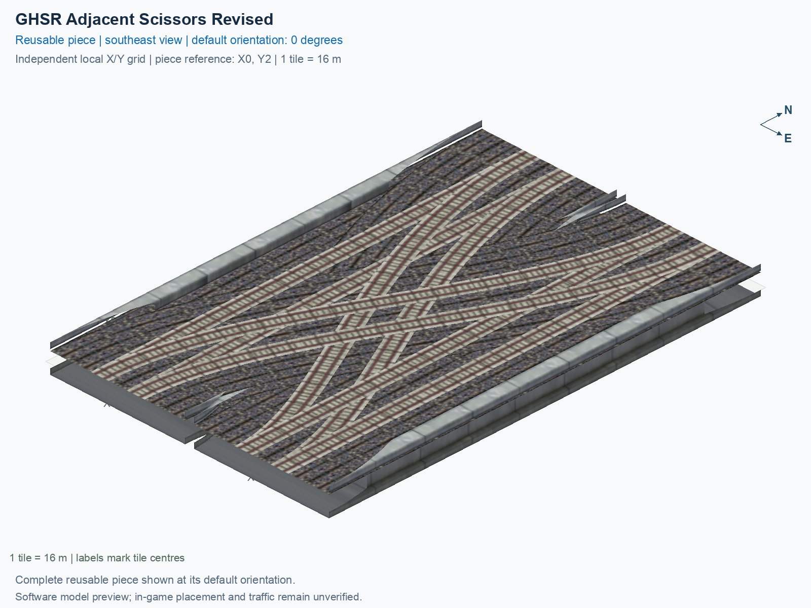

# GHSR Adjacent Scissors Revised

Purpose: explain this reusable piece, its matching connections and current test coverage.

<!-- BEGIN PIECE OVERVIEW -->

GHSR Adjacent Scissors Revised. Corrected rail deck union and branch openings; one shared support per occupied elevated tile, no ground-track pillars. Authored 5 m wide by 5 m high route clearance check. Experimental; actual game placement and train operation remain unverified.

Exact reusable identifier: `rail-ghsr-adjacent-scissors-revised`.

Footprint: **2 × 3 tiles**. Exact menu name: **GHSR Adjacent Scissors Revised**.

Choose this exact name in Transportation → Rail. Press Home or End to rotate; use only the supported states listed below. Join each end to a matching port profile and direction.

- [Connections and journeys](#connections-and-journeys)
- [Test checklist](#test-checklist)



<!-- END PIECE OVERVIEW -->

<!-- BEGIN MANUAL SUMMARY -->

## Manual status

Generated from [the exact test cases](#test-checklist) and [authoritative observations](checks/manual-tests.json).

- [ ] Preview review: 0/1 applicable cases passed; 0 failed, 0 stale.
- [ ] In-game rendering: 0/4 applicable cases passed; 0 failed, 0 stale.
- [ ] Directed journeys: 0/32 applicable cases passed; 0 failed, 0 stale.

These observations cover only the named services, directions, poses, rotations, and recorded platforms.

<!-- END MANUAL SUMMARY -->

<!-- BEGIN CONNECTIONS -->

## Connections and journeys

Purpose: describe intrinsic directional interfaces and permitted service journeys.

Generated from [connections.json](connections.json). Coordinates are canonical east, north and height in metres. A connection class names an encoded route interface; it does not prove visible deck/wall fit or an in-game test.

Supported placement states: 0° CCW, 90° CCW, 180° CCW, 270° CCW. Each state has its own declared manual scope.

A **port** is one directional transport-path endpoint. **Service** identifies the intended network service (for example HSR, street, or tram); **engine** is its internal traffic-class number, separate from the construction network. **Role** distinguishes primary service from auxiliary paths; sharing a traffic class does not establish service compatibility.

A **tangent** is a unit travel-direction vector: `[0,1]` means north. **Grade** is height gained per horizontal metre. These measured facts describe this subject alone. Compatibility requires a separate comparison of the complete joining boundaries; physical seams and actual game operation require their own evidence. See the [class index](../../connection-classes.json) for shared route-interface membership.

| Port | Service / engine / role | Direction | Location; tangent; grade | Connection class |
| --- | --- | --- | --- | --- |
| `Sout` | ghsr / 7 / primary | out | [-2.0, -40.0, 1.0]; [0.0, -1.0]; 0.0 | `path-interface-c78c5ac4b558d84b46f2` |
| `Nin` | ghsr / 7 / primary | in | [-2.0, 8.0, 1.0]; [0.0, -1.0]; 0.0 | `path-interface-c78c5ac4b558d84b46f2` |
| `Sin` | ghsr / 7 / primary | in | [2.0, -40.0, 1.0]; [0.0, 1.0]; 0.0 | `path-interface-fab587419de6b5848d74` |
| `Nout` | ghsr / 7 / primary | out | [2.0, 8.0, 1.0]; [0.0, 1.0]; 0.0 | `path-interface-fab587419de6b5848d74` |
| `BSout` | ghsr / 7 / primary | out | [14.0, -40.0, 1.0]; [0.0, -1.0]; 0.0 | `path-interface-c78c5ac4b558d84b46f2` |
| `BNin` | ghsr / 7 / primary | in | [14.0, 8.0, 1.0]; [0.0, -1.0]; 0.0 | `path-interface-c78c5ac4b558d84b46f2` |
| `BSin` | ghsr / 7 / primary | in | [18.0, -40.0, 1.0]; [0.0, 1.0]; 0.0 | `path-interface-fab587419de6b5848d74` |
| `BNout` | ghsr / 7 / primary | out | [18.0, 8.0, 1.0]; [0.0, 1.0]; 0.0 | `path-interface-fab587419de6b5848d74` |

### Directed journeys

| Service | Entry → exit | Role |
| --- | --- | --- |
| ghsr | `Nin` → `BSout` | primary |
| ghsr | `Nin` → `Sout` | primary |
| ghsr | `Sin` → `BNout` | primary |
| ghsr | `Sin` → `Nout` | primary |
| ghsr | `BNin` → `Sout` | primary |
| ghsr | `BNin` → `BSout` | primary |
| ghsr | `BSin` → `BNout` | primary |
| ghsr | `BSin` → `Nout` | primary |

### Forbidden transfers

| From service / port | To service / port | Reason |
| --- | --- | --- |
| ghsr / `Nin` | ghsr / `Nout` | No directed route exists between these ports in the saved piece transport paths. In-game confirmation remains unverified. |
| ghsr / `Nin` | ghsr / `BNout` | No directed route exists between these ports in the saved piece transport paths. In-game confirmation remains unverified. |
| ghsr / `Sin` | ghsr / `Sout` | No directed route exists between these ports in the saved piece transport paths. In-game confirmation remains unverified. |
| ghsr / `Sin` | ghsr / `BSout` | No directed route exists between these ports in the saved piece transport paths. In-game confirmation remains unverified. |
| ghsr / `BNin` | ghsr / `Nout` | No directed route exists between these ports in the saved piece transport paths. In-game confirmation remains unverified. |
| ghsr / `BNin` | ghsr / `BNout` | No directed route exists between these ports in the saved piece transport paths. In-game confirmation remains unverified. |
| ghsr / `BSin` | ghsr / `Sout` | No directed route exists between these ports in the saved piece transport paths. In-game confirmation remains unverified. |
| ghsr / `BSin` | ghsr / `BSout` | No directed route exists between these ports in the saved piece transport paths. In-game confirmation remains unverified. |

Review the test checklist for the exact tested cases and environments.

<!-- END CONNECTIONS -->

<!-- BEGIN MANUAL CHECKS -->

## Test checklist

Generated from [the authoritative record](checks/manual-tests.json). Only explicit human observations create manual passes; software and preview checks remain separate. Expand a check/service group to see its rotation table, then expand the matching exact scope to copy a case ID and inspect its pose, reviewer, environment, and evidence. Grouping changes only this view; every declared case remains separate.

**States:** [x] passed; [ ] unverified, failed, or stale; N/A is an explicit inapplicable declaration. A dash means no case was declared in that column. Every pass covers only its recorded environment. T means a distinct construction-transposed state.

Four proper rotations are covered. No additional reflected state is established by this record; repeated construction aliases do not create new orientations.

Current totals: unverified: 83, passed: 0, failed: 0, stale: 0, not_applicable: 0.

### Record an observation

Follow the [shared testing guide](../../../../docs/TESTING.md); copy [the unconfirmed example](checks/observation.example.json) to `checks/observation.json`. Case identifiers are in the expandable sections below. Do not edit generated checkboxes.

From the repository folder containing `custom-pieces`, run after filling `checks/observation.json` and explicitly confirming the exact observation:

```sh
python3 -m scp.content record --record custom-pieces/domains/high-speed-rail/00_pieces/rail-ghsr-adjacent-scissors-revised/checks/manual-tests.json --observation custom-pieces/domains/high-speed-rail/00_pieces/rail-ghsr-adjacent-scissors-revised/checks/observation.json
```

### Detailed current checks

Each collapsed group shows exact case counts and states. Forbidden transfers are grouped by the directed service pair; the table inside retains every port pair and rotation.

<details>
<summary>Compiled resources — Whole subject — 1 case; unverified: 1</summary>

| Check / exact scope | General | 0° | 90° | 180° | 270° |
| --- | --- | --- | --- | --- | --- |
| **Compiled resources**<br>Whole subject | <a href="#case-software_resources-67db61167ed3246520d4">[ ] unverified</a> | — | — | — | — |


<details>
<summary>Compiled resources — Whole subject</summary>

<a id="case-software_resources-67db61167ed3246520d4"></a>

**General: unverified** — `software_resources-67db61167ed3246520d4`.

Verify the actual compiled resources and construction rules.

Scope: Whole subject.

No observation recorded.

</details>

</details>

<details>
<summary>Directed routing graph — Whole subject — 1 case; unverified: 1</summary>

| Check / exact scope | General | 0° | 90° | 180° | 270° |
| --- | --- | --- | --- | --- | --- |
| **Directed routing graph**<br>Whole subject | <a href="#case-software_connectivity-67db61167ed3246520d4">[ ] unverified</a> | — | — | — | — |


<details>
<summary>Directed routing graph — Whole subject</summary>

<a id="case-software_connectivity-67db61167ed3246520d4"></a>

**General: unverified** — `software_connectivity-67db61167ed3246520d4`.

Verify the declared directed journeys and forbidden transfers.

Scope: Whole subject.

No observation recorded.

</details>

</details>

<details>
<summary>Preview review — Images — 1 case; unverified: 1</summary>

| Check / exact scope | General | 0° | 90° | 180° | 270° |
| --- | --- | --- | --- | --- | --- |
| **Preview review**<br>Image: image:rail-ghsr-adjacent-scissors-revised:canonical-southeast | <a href="#case-preview_review-815f1c3b47715b9979a3">[ ] unverified</a> | — | — | — | — |


<details>
<summary>Preview review — Image: image:rail-ghsr-adjacent-scissors-revised:canonical-southeast</summary>

<a id="case-preview_review-815f1c3b47715b9979a3"></a>

**General: unverified** — `preview_review-815f1c3b47715b9979a3`.

Inspect this exact preview for tracks, walls, piers, seams and shadows.

Scope: Image: image:rail-ghsr-adjacent-scissors-revised:canonical-southeast.

No observation recorded.

</details>

</details>

<details>
<summary>In-game rendering — Whole subject — 4 cases; unverified: 4</summary>

| Check / exact scope | General | 0° | 90° | 180° | 270° |
| --- | --- | --- | --- | --- | --- |
| **In-game rendering**<br>Whole subject | — | <a href="#case-in_game_render-f318cd50cae0ea000715">[ ] unverified</a> | <a href="#case-in_game_render-a8f9c55ed821251eed3d">[ ] unverified</a> | <a href="#case-in_game_render-e1b4ed480c5fa72ed794">[ ] unverified</a> | <a href="#case-in_game_render-9a2c1fede6d0bcb074ae">[ ] unverified</a> |


<details>
<summary>In-game rendering — Whole subject</summary>

<a id="case-in_game_render-f318cd50cae0ea000715"></a>

**0° CCW: unverified** — `in_game_render-f318cd50cae0ea000715`.

Inspect the placed tracks, walls, piers, seams and shadows in SimCity 4.

Scope: Whole subject.

No observation recorded.

<a id="case-in_game_render-a8f9c55ed821251eed3d"></a>

**90° CCW: unverified** — `in_game_render-a8f9c55ed821251eed3d`.

Inspect the placed tracks, walls, piers, seams and shadows in SimCity 4.

Scope: Whole subject.

No observation recorded.

<a id="case-in_game_render-e1b4ed480c5fa72ed794"></a>

**180° CCW: unverified** — `in_game_render-e1b4ed480c5fa72ed794`.

Inspect the placed tracks, walls, piers, seams and shadows in SimCity 4.

Scope: Whole subject.

No observation recorded.

<a id="case-in_game_render-9a2c1fede6d0bcb074ae"></a>

**270° CCW: unverified** — `in_game_render-9a2c1fede6d0bcb074ae`.

Inspect the placed tracks, walls, piers, seams and shadows in SimCity 4.

Scope: Whole subject.

No observation recorded.

</details>

</details>

<details>
<summary>Placement — Whole subject — 4 cases; unverified: 4</summary>

| Check / exact scope | General | 0° | 90° | 180° | 270° |
| --- | --- | --- | --- | --- | --- |
| **Placement**<br>Whole subject | — | <a href="#case-in_game_placement-f318cd50cae0ea000715">[ ] unverified</a> | <a href="#case-in_game_placement-a8f9c55ed821251eed3d">[ ] unverified</a> | <a href="#case-in_game_placement-e1b4ed480c5fa72ed794">[ ] unverified</a> | <a href="#case-in_game_placement-9a2c1fede6d0bcb074ae">[ ] unverified</a> |


<details>
<summary>Placement — Whole subject</summary>

<a id="case-in_game_placement-f318cd50cae0ea000715"></a>

**0° CCW: unverified** — `in_game_placement-f318cd50cae0ea000715`.

Place this piece or complete blueprint and inspect every occupied tile.

Scope: Whole subject.

No observation recorded.

<a id="case-in_game_placement-a8f9c55ed821251eed3d"></a>

**90° CCW: unverified** — `in_game_placement-a8f9c55ed821251eed3d`.

Place this piece or complete blueprint and inspect every occupied tile.

Scope: Whole subject.

No observation recorded.

<a id="case-in_game_placement-e1b4ed480c5fa72ed794"></a>

**180° CCW: unverified** — `in_game_placement-e1b4ed480c5fa72ed794`.

Place this piece or complete blueprint and inspect every occupied tile.

Scope: Whole subject.

No observation recorded.

<a id="case-in_game_placement-9a2c1fede6d0bcb074ae"></a>

**270° CCW: unverified** — `in_game_placement-9a2c1fede6d0bcb074ae`.

Place this piece or complete blueprint and inspect every occupied tile.

Scope: Whole subject.

No observation recorded.

</details>

</details>

<details>
<summary>Demolition — Whole subject — 4 cases; unverified: 4</summary>

| Check / exact scope | General | 0° | 90° | 180° | 270° |
| --- | --- | --- | --- | --- | --- |
| **Demolition**<br>Whole subject | — | <a href="#case-in_game_demolition-f318cd50cae0ea000715">[ ] unverified</a> | <a href="#case-in_game_demolition-a8f9c55ed821251eed3d">[ ] unverified</a> | <a href="#case-in_game_demolition-e1b4ed480c5fa72ed794">[ ] unverified</a> | <a href="#case-in_game_demolition-9a2c1fede6d0bcb074ae">[ ] unverified</a> |


<details>
<summary>Demolition — Whole subject</summary>

<a id="case-in_game_demolition-f318cd50cae0ea000715"></a>

**0° CCW: unverified** — `in_game_demolition-f318cd50cae0ea000715`.

Bulldoze the complete placement and inspect the cleared area.

Scope: Whole subject.

No observation recorded.

<a id="case-in_game_demolition-a8f9c55ed821251eed3d"></a>

**90° CCW: unverified** — `in_game_demolition-a8f9c55ed821251eed3d`.

Bulldoze the complete placement and inspect the cleared area.

Scope: Whole subject.

No observation recorded.

<a id="case-in_game_demolition-e1b4ed480c5fa72ed794"></a>

**180° CCW: unverified** — `in_game_demolition-e1b4ed480c5fa72ed794`.

Bulldoze the complete placement and inspect the cleared area.

Scope: Whole subject.

No observation recorded.

<a id="case-in_game_demolition-9a2c1fede6d0bcb074ae"></a>

**270° CCW: unverified** — `in_game_demolition-9a2c1fede6d0bcb074ae`.

Bulldoze the complete placement and inspect the cleared area.

Scope: Whole subject.

No observation recorded.

</details>

</details>

<details>
<summary>Save and reload — Whole subject — 4 cases; unverified: 4</summary>

| Check / exact scope | General | 0° | 90° | 180° | 270° |
| --- | --- | --- | --- | --- | --- |
| **Save and reload**<br>Whole subject | — | <a href="#case-in_game_save_reload-f318cd50cae0ea000715">[ ] unverified</a> | <a href="#case-in_game_save_reload-a8f9c55ed821251eed3d">[ ] unverified</a> | <a href="#case-in_game_save_reload-e1b4ed480c5fa72ed794">[ ] unverified</a> | <a href="#case-in_game_save_reload-9a2c1fede6d0bcb074ae">[ ] unverified</a> |


<details>
<summary>Save and reload — Whole subject</summary>

<a id="case-in_game_save_reload-f318cd50cae0ea000715"></a>

**0° CCW: unverified** — `in_game_save_reload-f318cd50cae0ea000715`.

Save, quit, reload and inspect the placement and its paths.

Scope: Whole subject.

No observation recorded.

<a id="case-in_game_save_reload-a8f9c55ed821251eed3d"></a>

**90° CCW: unverified** — `in_game_save_reload-a8f9c55ed821251eed3d`.

Save, quit, reload and inspect the placement and its paths.

Scope: Whole subject.

No observation recorded.

<a id="case-in_game_save_reload-e1b4ed480c5fa72ed794"></a>

**180° CCW: unverified** — `in_game_save_reload-e1b4ed480c5fa72ed794`.

Save, quit, reload and inspect the placement and its paths.

Scope: Whole subject.

No observation recorded.

<a id="case-in_game_save_reload-9a2c1fede6d0bcb074ae"></a>

**270° CCW: unverified** — `in_game_save_reload-9a2c1fede6d0bcb074ae`.

Save, quit, reload and inspect the placement and its paths.

Scope: Whole subject.

No observation recorded.

</details>

</details>

<details>
<summary>Journey — ghsr — 32 cases; unverified: 32</summary>

| Check / exact scope | General | 0° | 90° | 180° | 270° |
| --- | --- | --- | --- | --- | --- |
| **Journey**<br>Service: ghsr; role: primary; journey: 7:Nin>BSout; entry: Nin; exit: BSout | — | <a href="#case-in_game_journey-83aa57aef59ccffc2ac3">[ ] unverified</a> | <a href="#case-in_game_journey-aed65f6ff75ef2d1a8ce">[ ] unverified</a> | <a href="#case-in_game_journey-19b70ff5e1e765fd3234">[ ] unverified</a> | <a href="#case-in_game_journey-cca912aabe62c7c9469a">[ ] unverified</a> |
| **Journey**<br>Service: ghsr; role: primary; journey: 7:Nin>Sout; entry: Nin; exit: Sout | — | <a href="#case-in_game_journey-b3155ad3bbf1ba11d708">[ ] unverified</a> | <a href="#case-in_game_journey-881532af31c1703248a5">[ ] unverified</a> | <a href="#case-in_game_journey-40eac8e5c4c9f826bdec">[ ] unverified</a> | <a href="#case-in_game_journey-5278f7b0d94ce8e22317">[ ] unverified</a> |
| **Journey**<br>Service: ghsr; role: primary; journey: 7:Sin>BNout; entry: Sin; exit: BNout | — | <a href="#case-in_game_journey-c1a61e80a0301d6c9b86">[ ] unverified</a> | <a href="#case-in_game_journey-019d228c6e34dbb58849">[ ] unverified</a> | <a href="#case-in_game_journey-3db41f4a3e702d0c1130">[ ] unverified</a> | <a href="#case-in_game_journey-3684cef01862616e3054">[ ] unverified</a> |
| **Journey**<br>Service: ghsr; role: primary; journey: 7:Sin>Nout; entry: Sin; exit: Nout | — | <a href="#case-in_game_journey-9a4c549d49fd9c76c8cd">[ ] unverified</a> | <a href="#case-in_game_journey-4384ad1e9b1e6a2f0245">[ ] unverified</a> | <a href="#case-in_game_journey-0c001e78329a79092619">[ ] unverified</a> | <a href="#case-in_game_journey-e84ec01ee33be961e287">[ ] unverified</a> |
| **Journey**<br>Service: ghsr; role: primary; journey: 7:BNin>Sout; entry: BNin; exit: Sout | — | <a href="#case-in_game_journey-76998c87b00596552805">[ ] unverified</a> | <a href="#case-in_game_journey-1e9d823f32d563939b81">[ ] unverified</a> | <a href="#case-in_game_journey-37654ebca8915014e6b5">[ ] unverified</a> | <a href="#case-in_game_journey-dd701f4f5c20197ff57d">[ ] unverified</a> |
| **Journey**<br>Service: ghsr; role: primary; journey: 7:BNin>BSout; entry: BNin; exit: BSout | — | <a href="#case-in_game_journey-ec8e9bdf6ab1207b9521">[ ] unverified</a> | <a href="#case-in_game_journey-c4a9173fdaf745b18d36">[ ] unverified</a> | <a href="#case-in_game_journey-895ad688f1c27d33ea0d">[ ] unverified</a> | <a href="#case-in_game_journey-f745395080a809cdfd81">[ ] unverified</a> |
| **Journey**<br>Service: ghsr; role: primary; journey: 7:BSin>BNout; entry: BSin; exit: BNout | — | <a href="#case-in_game_journey-b4e0e9f20bb97ba048bc">[ ] unverified</a> | <a href="#case-in_game_journey-41c2daed66549d8a7702">[ ] unverified</a> | <a href="#case-in_game_journey-e758c85d69f18d151a31">[ ] unverified</a> | <a href="#case-in_game_journey-e9f97a4b013413c1cfe7">[ ] unverified</a> |
| **Journey**<br>Service: ghsr; role: primary; journey: 7:BSin>Nout; entry: BSin; exit: Nout | — | <a href="#case-in_game_journey-c6caa86763bf1118a3d1">[ ] unverified</a> | <a href="#case-in_game_journey-c79b2bf064f44293d1d8">[ ] unverified</a> | <a href="#case-in_game_journey-11453d0957a3a6b60042">[ ] unverified</a> | <a href="#case-in_game_journey-611f942936aeb8053b04">[ ] unverified</a> |


<details>
<summary>Journey — Service: ghsr; role: primary; journey: 7:Nin>BSout; entry: Nin; exit: BSout</summary>

<a id="case-in_game_journey-83aa57aef59ccffc2ac3"></a>

**0° CCW: unverified** — `in_game_journey-83aa57aef59ccffc2ac3`.

Run the declared journey in this direction using its service network.

Scope: Service: ghsr; role: primary; journey: 7:Nin>BSout; entry: Nin; exit: BSout.

No observation recorded.

<a id="case-in_game_journey-aed65f6ff75ef2d1a8ce"></a>

**90° CCW: unverified** — `in_game_journey-aed65f6ff75ef2d1a8ce`.

Run the declared journey in this direction using its service network.

Scope: Service: ghsr; role: primary; journey: 7:Nin>BSout; entry: Nin; exit: BSout.

No observation recorded.

<a id="case-in_game_journey-19b70ff5e1e765fd3234"></a>

**180° CCW: unverified** — `in_game_journey-19b70ff5e1e765fd3234`.

Run the declared journey in this direction using its service network.

Scope: Service: ghsr; role: primary; journey: 7:Nin>BSout; entry: Nin; exit: BSout.

No observation recorded.

<a id="case-in_game_journey-cca912aabe62c7c9469a"></a>

**270° CCW: unverified** — `in_game_journey-cca912aabe62c7c9469a`.

Run the declared journey in this direction using its service network.

Scope: Service: ghsr; role: primary; journey: 7:Nin>BSout; entry: Nin; exit: BSout.

No observation recorded.

</details>


<details>
<summary>Journey — Service: ghsr; role: primary; journey: 7:Nin>Sout; entry: Nin; exit: Sout</summary>

<a id="case-in_game_journey-b3155ad3bbf1ba11d708"></a>

**0° CCW: unverified** — `in_game_journey-b3155ad3bbf1ba11d708`.

Run the declared journey in this direction using its service network.

Scope: Service: ghsr; role: primary; journey: 7:Nin>Sout; entry: Nin; exit: Sout.

No observation recorded.

<a id="case-in_game_journey-881532af31c1703248a5"></a>

**90° CCW: unverified** — `in_game_journey-881532af31c1703248a5`.

Run the declared journey in this direction using its service network.

Scope: Service: ghsr; role: primary; journey: 7:Nin>Sout; entry: Nin; exit: Sout.

No observation recorded.

<a id="case-in_game_journey-40eac8e5c4c9f826bdec"></a>

**180° CCW: unverified** — `in_game_journey-40eac8e5c4c9f826bdec`.

Run the declared journey in this direction using its service network.

Scope: Service: ghsr; role: primary; journey: 7:Nin>Sout; entry: Nin; exit: Sout.

No observation recorded.

<a id="case-in_game_journey-5278f7b0d94ce8e22317"></a>

**270° CCW: unverified** — `in_game_journey-5278f7b0d94ce8e22317`.

Run the declared journey in this direction using its service network.

Scope: Service: ghsr; role: primary; journey: 7:Nin>Sout; entry: Nin; exit: Sout.

No observation recorded.

</details>


<details>
<summary>Journey — Service: ghsr; role: primary; journey: 7:Sin>BNout; entry: Sin; exit: BNout</summary>

<a id="case-in_game_journey-c1a61e80a0301d6c9b86"></a>

**0° CCW: unverified** — `in_game_journey-c1a61e80a0301d6c9b86`.

Run the declared journey in this direction using its service network.

Scope: Service: ghsr; role: primary; journey: 7:Sin>BNout; entry: Sin; exit: BNout.

No observation recorded.

<a id="case-in_game_journey-019d228c6e34dbb58849"></a>

**90° CCW: unverified** — `in_game_journey-019d228c6e34dbb58849`.

Run the declared journey in this direction using its service network.

Scope: Service: ghsr; role: primary; journey: 7:Sin>BNout; entry: Sin; exit: BNout.

No observation recorded.

<a id="case-in_game_journey-3db41f4a3e702d0c1130"></a>

**180° CCW: unverified** — `in_game_journey-3db41f4a3e702d0c1130`.

Run the declared journey in this direction using its service network.

Scope: Service: ghsr; role: primary; journey: 7:Sin>BNout; entry: Sin; exit: BNout.

No observation recorded.

<a id="case-in_game_journey-3684cef01862616e3054"></a>

**270° CCW: unverified** — `in_game_journey-3684cef01862616e3054`.

Run the declared journey in this direction using its service network.

Scope: Service: ghsr; role: primary; journey: 7:Sin>BNout; entry: Sin; exit: BNout.

No observation recorded.

</details>


<details>
<summary>Journey — Service: ghsr; role: primary; journey: 7:Sin>Nout; entry: Sin; exit: Nout</summary>

<a id="case-in_game_journey-9a4c549d49fd9c76c8cd"></a>

**0° CCW: unverified** — `in_game_journey-9a4c549d49fd9c76c8cd`.

Run the declared journey in this direction using its service network.

Scope: Service: ghsr; role: primary; journey: 7:Sin>Nout; entry: Sin; exit: Nout.

No observation recorded.

<a id="case-in_game_journey-4384ad1e9b1e6a2f0245"></a>

**90° CCW: unverified** — `in_game_journey-4384ad1e9b1e6a2f0245`.

Run the declared journey in this direction using its service network.

Scope: Service: ghsr; role: primary; journey: 7:Sin>Nout; entry: Sin; exit: Nout.

No observation recorded.

<a id="case-in_game_journey-0c001e78329a79092619"></a>

**180° CCW: unverified** — `in_game_journey-0c001e78329a79092619`.

Run the declared journey in this direction using its service network.

Scope: Service: ghsr; role: primary; journey: 7:Sin>Nout; entry: Sin; exit: Nout.

No observation recorded.

<a id="case-in_game_journey-e84ec01ee33be961e287"></a>

**270° CCW: unverified** — `in_game_journey-e84ec01ee33be961e287`.

Run the declared journey in this direction using its service network.

Scope: Service: ghsr; role: primary; journey: 7:Sin>Nout; entry: Sin; exit: Nout.

No observation recorded.

</details>


<details>
<summary>Journey — Service: ghsr; role: primary; journey: 7:BNin>Sout; entry: BNin; exit: Sout</summary>

<a id="case-in_game_journey-76998c87b00596552805"></a>

**0° CCW: unverified** — `in_game_journey-76998c87b00596552805`.

Run the declared journey in this direction using its service network.

Scope: Service: ghsr; role: primary; journey: 7:BNin>Sout; entry: BNin; exit: Sout.

No observation recorded.

<a id="case-in_game_journey-1e9d823f32d563939b81"></a>

**90° CCW: unverified** — `in_game_journey-1e9d823f32d563939b81`.

Run the declared journey in this direction using its service network.

Scope: Service: ghsr; role: primary; journey: 7:BNin>Sout; entry: BNin; exit: Sout.

No observation recorded.

<a id="case-in_game_journey-37654ebca8915014e6b5"></a>

**180° CCW: unverified** — `in_game_journey-37654ebca8915014e6b5`.

Run the declared journey in this direction using its service network.

Scope: Service: ghsr; role: primary; journey: 7:BNin>Sout; entry: BNin; exit: Sout.

No observation recorded.

<a id="case-in_game_journey-dd701f4f5c20197ff57d"></a>

**270° CCW: unverified** — `in_game_journey-dd701f4f5c20197ff57d`.

Run the declared journey in this direction using its service network.

Scope: Service: ghsr; role: primary; journey: 7:BNin>Sout; entry: BNin; exit: Sout.

No observation recorded.

</details>


<details>
<summary>Journey — Service: ghsr; role: primary; journey: 7:BNin>BSout; entry: BNin; exit: BSout</summary>

<a id="case-in_game_journey-ec8e9bdf6ab1207b9521"></a>

**0° CCW: unverified** — `in_game_journey-ec8e9bdf6ab1207b9521`.

Run the declared journey in this direction using its service network.

Scope: Service: ghsr; role: primary; journey: 7:BNin>BSout; entry: BNin; exit: BSout.

No observation recorded.

<a id="case-in_game_journey-c4a9173fdaf745b18d36"></a>

**90° CCW: unverified** — `in_game_journey-c4a9173fdaf745b18d36`.

Run the declared journey in this direction using its service network.

Scope: Service: ghsr; role: primary; journey: 7:BNin>BSout; entry: BNin; exit: BSout.

No observation recorded.

<a id="case-in_game_journey-895ad688f1c27d33ea0d"></a>

**180° CCW: unverified** — `in_game_journey-895ad688f1c27d33ea0d`.

Run the declared journey in this direction using its service network.

Scope: Service: ghsr; role: primary; journey: 7:BNin>BSout; entry: BNin; exit: BSout.

No observation recorded.

<a id="case-in_game_journey-f745395080a809cdfd81"></a>

**270° CCW: unverified** — `in_game_journey-f745395080a809cdfd81`.

Run the declared journey in this direction using its service network.

Scope: Service: ghsr; role: primary; journey: 7:BNin>BSout; entry: BNin; exit: BSout.

No observation recorded.

</details>


<details>
<summary>Journey — Service: ghsr; role: primary; journey: 7:BSin>BNout; entry: BSin; exit: BNout</summary>

<a id="case-in_game_journey-b4e0e9f20bb97ba048bc"></a>

**0° CCW: unverified** — `in_game_journey-b4e0e9f20bb97ba048bc`.

Run the declared journey in this direction using its service network.

Scope: Service: ghsr; role: primary; journey: 7:BSin>BNout; entry: BSin; exit: BNout.

No observation recorded.

<a id="case-in_game_journey-41c2daed66549d8a7702"></a>

**90° CCW: unverified** — `in_game_journey-41c2daed66549d8a7702`.

Run the declared journey in this direction using its service network.

Scope: Service: ghsr; role: primary; journey: 7:BSin>BNout; entry: BSin; exit: BNout.

No observation recorded.

<a id="case-in_game_journey-e758c85d69f18d151a31"></a>

**180° CCW: unverified** — `in_game_journey-e758c85d69f18d151a31`.

Run the declared journey in this direction using its service network.

Scope: Service: ghsr; role: primary; journey: 7:BSin>BNout; entry: BSin; exit: BNout.

No observation recorded.

<a id="case-in_game_journey-e9f97a4b013413c1cfe7"></a>

**270° CCW: unverified** — `in_game_journey-e9f97a4b013413c1cfe7`.

Run the declared journey in this direction using its service network.

Scope: Service: ghsr; role: primary; journey: 7:BSin>BNout; entry: BSin; exit: BNout.

No observation recorded.

</details>


<details>
<summary>Journey — Service: ghsr; role: primary; journey: 7:BSin>Nout; entry: BSin; exit: Nout</summary>

<a id="case-in_game_journey-c6caa86763bf1118a3d1"></a>

**0° CCW: unverified** — `in_game_journey-c6caa86763bf1118a3d1`.

Run the declared journey in this direction using its service network.

Scope: Service: ghsr; role: primary; journey: 7:BSin>Nout; entry: BSin; exit: Nout.

No observation recorded.

<a id="case-in_game_journey-c79b2bf064f44293d1d8"></a>

**90° CCW: unverified** — `in_game_journey-c79b2bf064f44293d1d8`.

Run the declared journey in this direction using its service network.

Scope: Service: ghsr; role: primary; journey: 7:BSin>Nout; entry: BSin; exit: Nout.

No observation recorded.

<a id="case-in_game_journey-11453d0957a3a6b60042"></a>

**180° CCW: unverified** — `in_game_journey-11453d0957a3a6b60042`.

Run the declared journey in this direction using its service network.

Scope: Service: ghsr; role: primary; journey: 7:BSin>Nout; entry: BSin; exit: Nout.

No observation recorded.

<a id="case-in_game_journey-611f942936aeb8053b04"></a>

**270° CCW: unverified** — `in_game_journey-611f942936aeb8053b04`.

Run the declared journey in this direction using its service network.

Scope: Service: ghsr; role: primary; journey: 7:BSin>Nout; entry: BSin; exit: Nout.

No observation recorded.

</details>

</details>

<details>
<summary>Forbidden transfer — ghsr → ghsr — 32 cases; unverified: 32</summary>

| Check / exact scope | General | 0° | 90° | 180° | 270° |
| --- | --- | --- | --- | --- | --- |
| **Forbidden transfer**<br>from port: Nin; to port: Nout; from service: ghsr; to service: ghsr; basis: not reachable in actual saved PATH graph | — | <a href="#case-in_game_forbidden_transfer-8d34fed498daaba24a53">[ ] unverified</a> | <a href="#case-in_game_forbidden_transfer-fe28bc6e2915e206df9f">[ ] unverified</a> | <a href="#case-in_game_forbidden_transfer-1561157b11ec16a17751">[ ] unverified</a> | <a href="#case-in_game_forbidden_transfer-13dc12d352e9a7cf7ddb">[ ] unverified</a> |
| **Forbidden transfer**<br>from port: Nin; to port: BNout; from service: ghsr; to service: ghsr; basis: not reachable in actual saved PATH graph | — | <a href="#case-in_game_forbidden_transfer-d86be25af3d14604e801">[ ] unverified</a> | <a href="#case-in_game_forbidden_transfer-d026044c5ea27f6ffbfd">[ ] unverified</a> | <a href="#case-in_game_forbidden_transfer-3b2a1a0b8caaa8300d95">[ ] unverified</a> | <a href="#case-in_game_forbidden_transfer-3e1113ce5538b631485b">[ ] unverified</a> |
| **Forbidden transfer**<br>from port: Sin; to port: Sout; from service: ghsr; to service: ghsr; basis: not reachable in actual saved PATH graph | — | <a href="#case-in_game_forbidden_transfer-97f42f9c4060abbb17c2">[ ] unverified</a> | <a href="#case-in_game_forbidden_transfer-aa9179562afeb461b0e2">[ ] unverified</a> | <a href="#case-in_game_forbidden_transfer-7a05500e5e0b617d305e">[ ] unverified</a> | <a href="#case-in_game_forbidden_transfer-e72397ac7a8cc43bbafa">[ ] unverified</a> |
| **Forbidden transfer**<br>from port: Sin; to port: BSout; from service: ghsr; to service: ghsr; basis: not reachable in actual saved PATH graph | — | <a href="#case-in_game_forbidden_transfer-c4acdb7c655cb2601693">[ ] unverified</a> | <a href="#case-in_game_forbidden_transfer-fad4d12ea0b8a7864192">[ ] unverified</a> | <a href="#case-in_game_forbidden_transfer-5a61c4af2343df9b746e">[ ] unverified</a> | <a href="#case-in_game_forbidden_transfer-1765aeb789c026fcee77">[ ] unverified</a> |
| **Forbidden transfer**<br>from port: BNin; to port: Nout; from service: ghsr; to service: ghsr; basis: not reachable in actual saved PATH graph | — | <a href="#case-in_game_forbidden_transfer-98721df565aa04b39549">[ ] unverified</a> | <a href="#case-in_game_forbidden_transfer-aadab73cb560fe362c76">[ ] unverified</a> | <a href="#case-in_game_forbidden_transfer-d19151cf4b3a9359d6fe">[ ] unverified</a> | <a href="#case-in_game_forbidden_transfer-6f9cf8f0784450cad319">[ ] unverified</a> |
| **Forbidden transfer**<br>from port: BNin; to port: BNout; from service: ghsr; to service: ghsr; basis: not reachable in actual saved PATH graph | — | <a href="#case-in_game_forbidden_transfer-84a815bbdcf3217ced51">[ ] unverified</a> | <a href="#case-in_game_forbidden_transfer-17a9abbfcf667e9c9608">[ ] unverified</a> | <a href="#case-in_game_forbidden_transfer-8887a5bc6dc247d4b0c2">[ ] unverified</a> | <a href="#case-in_game_forbidden_transfer-b33e9f67003b224be75a">[ ] unverified</a> |
| **Forbidden transfer**<br>from port: BSin; to port: Sout; from service: ghsr; to service: ghsr; basis: not reachable in actual saved PATH graph | — | <a href="#case-in_game_forbidden_transfer-2f2257cd65dc2b2c5dcf">[ ] unverified</a> | <a href="#case-in_game_forbidden_transfer-9ce45b846dbd3a0e60e1">[ ] unverified</a> | <a href="#case-in_game_forbidden_transfer-7b16332b3c9a732bfa44">[ ] unverified</a> | <a href="#case-in_game_forbidden_transfer-1836840a46680e71cac2">[ ] unverified</a> |
| **Forbidden transfer**<br>from port: BSin; to port: BSout; from service: ghsr; to service: ghsr; basis: not reachable in actual saved PATH graph | — | <a href="#case-in_game_forbidden_transfer-d71ba35200a4ffc53821">[ ] unverified</a> | <a href="#case-in_game_forbidden_transfer-216e97a1454d78ebc900">[ ] unverified</a> | <a href="#case-in_game_forbidden_transfer-7f818d76f011a490529c">[ ] unverified</a> | <a href="#case-in_game_forbidden_transfer-abd3748e113009d00559">[ ] unverified</a> |


<details>
<summary>Forbidden transfer — from port: Nin; to port: Nout; from service: ghsr; to service: ghsr; basis: not reachable in actual saved PATH graph</summary>

<a id="case-in_game_forbidden_transfer-8d34fed498daaba24a53"></a>

**0° CCW: unverified** — `in_game_forbidden_transfer-8d34fed498daaba24a53`.

Confirm this undeclared transfer is unavailable.

Scope: from port: Nin; to port: Nout; from service: ghsr; to service: ghsr; basis: not reachable in actual saved PATH graph.

No observation recorded.

<a id="case-in_game_forbidden_transfer-fe28bc6e2915e206df9f"></a>

**90° CCW: unverified** — `in_game_forbidden_transfer-fe28bc6e2915e206df9f`.

Confirm this undeclared transfer is unavailable.

Scope: from port: Nin; to port: Nout; from service: ghsr; to service: ghsr; basis: not reachable in actual saved PATH graph.

No observation recorded.

<a id="case-in_game_forbidden_transfer-1561157b11ec16a17751"></a>

**180° CCW: unverified** — `in_game_forbidden_transfer-1561157b11ec16a17751`.

Confirm this undeclared transfer is unavailable.

Scope: from port: Nin; to port: Nout; from service: ghsr; to service: ghsr; basis: not reachable in actual saved PATH graph.

No observation recorded.

<a id="case-in_game_forbidden_transfer-13dc12d352e9a7cf7ddb"></a>

**270° CCW: unverified** — `in_game_forbidden_transfer-13dc12d352e9a7cf7ddb`.

Confirm this undeclared transfer is unavailable.

Scope: from port: Nin; to port: Nout; from service: ghsr; to service: ghsr; basis: not reachable in actual saved PATH graph.

No observation recorded.

</details>


<details>
<summary>Forbidden transfer — from port: Nin; to port: BNout; from service: ghsr; to service: ghsr; basis: not reachable in actual saved PATH graph</summary>

<a id="case-in_game_forbidden_transfer-d86be25af3d14604e801"></a>

**0° CCW: unverified** — `in_game_forbidden_transfer-d86be25af3d14604e801`.

Confirm this undeclared transfer is unavailable.

Scope: from port: Nin; to port: BNout; from service: ghsr; to service: ghsr; basis: not reachable in actual saved PATH graph.

No observation recorded.

<a id="case-in_game_forbidden_transfer-d026044c5ea27f6ffbfd"></a>

**90° CCW: unverified** — `in_game_forbidden_transfer-d026044c5ea27f6ffbfd`.

Confirm this undeclared transfer is unavailable.

Scope: from port: Nin; to port: BNout; from service: ghsr; to service: ghsr; basis: not reachable in actual saved PATH graph.

No observation recorded.

<a id="case-in_game_forbidden_transfer-3b2a1a0b8caaa8300d95"></a>

**180° CCW: unverified** — `in_game_forbidden_transfer-3b2a1a0b8caaa8300d95`.

Confirm this undeclared transfer is unavailable.

Scope: from port: Nin; to port: BNout; from service: ghsr; to service: ghsr; basis: not reachable in actual saved PATH graph.

No observation recorded.

<a id="case-in_game_forbidden_transfer-3e1113ce5538b631485b"></a>

**270° CCW: unverified** — `in_game_forbidden_transfer-3e1113ce5538b631485b`.

Confirm this undeclared transfer is unavailable.

Scope: from port: Nin; to port: BNout; from service: ghsr; to service: ghsr; basis: not reachable in actual saved PATH graph.

No observation recorded.

</details>


<details>
<summary>Forbidden transfer — from port: Sin; to port: Sout; from service: ghsr; to service: ghsr; basis: not reachable in actual saved PATH graph</summary>

<a id="case-in_game_forbidden_transfer-97f42f9c4060abbb17c2"></a>

**0° CCW: unverified** — `in_game_forbidden_transfer-97f42f9c4060abbb17c2`.

Confirm this undeclared transfer is unavailable.

Scope: from port: Sin; to port: Sout; from service: ghsr; to service: ghsr; basis: not reachable in actual saved PATH graph.

No observation recorded.

<a id="case-in_game_forbidden_transfer-aa9179562afeb461b0e2"></a>

**90° CCW: unverified** — `in_game_forbidden_transfer-aa9179562afeb461b0e2`.

Confirm this undeclared transfer is unavailable.

Scope: from port: Sin; to port: Sout; from service: ghsr; to service: ghsr; basis: not reachable in actual saved PATH graph.

No observation recorded.

<a id="case-in_game_forbidden_transfer-7a05500e5e0b617d305e"></a>

**180° CCW: unverified** — `in_game_forbidden_transfer-7a05500e5e0b617d305e`.

Confirm this undeclared transfer is unavailable.

Scope: from port: Sin; to port: Sout; from service: ghsr; to service: ghsr; basis: not reachable in actual saved PATH graph.

No observation recorded.

<a id="case-in_game_forbidden_transfer-e72397ac7a8cc43bbafa"></a>

**270° CCW: unverified** — `in_game_forbidden_transfer-e72397ac7a8cc43bbafa`.

Confirm this undeclared transfer is unavailable.

Scope: from port: Sin; to port: Sout; from service: ghsr; to service: ghsr; basis: not reachable in actual saved PATH graph.

No observation recorded.

</details>


<details>
<summary>Forbidden transfer — from port: Sin; to port: BSout; from service: ghsr; to service: ghsr; basis: not reachable in actual saved PATH graph</summary>

<a id="case-in_game_forbidden_transfer-c4acdb7c655cb2601693"></a>

**0° CCW: unverified** — `in_game_forbidden_transfer-c4acdb7c655cb2601693`.

Confirm this undeclared transfer is unavailable.

Scope: from port: Sin; to port: BSout; from service: ghsr; to service: ghsr; basis: not reachable in actual saved PATH graph.

No observation recorded.

<a id="case-in_game_forbidden_transfer-fad4d12ea0b8a7864192"></a>

**90° CCW: unverified** — `in_game_forbidden_transfer-fad4d12ea0b8a7864192`.

Confirm this undeclared transfer is unavailable.

Scope: from port: Sin; to port: BSout; from service: ghsr; to service: ghsr; basis: not reachable in actual saved PATH graph.

No observation recorded.

<a id="case-in_game_forbidden_transfer-5a61c4af2343df9b746e"></a>

**180° CCW: unverified** — `in_game_forbidden_transfer-5a61c4af2343df9b746e`.

Confirm this undeclared transfer is unavailable.

Scope: from port: Sin; to port: BSout; from service: ghsr; to service: ghsr; basis: not reachable in actual saved PATH graph.

No observation recorded.

<a id="case-in_game_forbidden_transfer-1765aeb789c026fcee77"></a>

**270° CCW: unverified** — `in_game_forbidden_transfer-1765aeb789c026fcee77`.

Confirm this undeclared transfer is unavailable.

Scope: from port: Sin; to port: BSout; from service: ghsr; to service: ghsr; basis: not reachable in actual saved PATH graph.

No observation recorded.

</details>


<details>
<summary>Forbidden transfer — from port: BNin; to port: Nout; from service: ghsr; to service: ghsr; basis: not reachable in actual saved PATH graph</summary>

<a id="case-in_game_forbidden_transfer-98721df565aa04b39549"></a>

**0° CCW: unverified** — `in_game_forbidden_transfer-98721df565aa04b39549`.

Confirm this undeclared transfer is unavailable.

Scope: from port: BNin; to port: Nout; from service: ghsr; to service: ghsr; basis: not reachable in actual saved PATH graph.

No observation recorded.

<a id="case-in_game_forbidden_transfer-aadab73cb560fe362c76"></a>

**90° CCW: unverified** — `in_game_forbidden_transfer-aadab73cb560fe362c76`.

Confirm this undeclared transfer is unavailable.

Scope: from port: BNin; to port: Nout; from service: ghsr; to service: ghsr; basis: not reachable in actual saved PATH graph.

No observation recorded.

<a id="case-in_game_forbidden_transfer-d19151cf4b3a9359d6fe"></a>

**180° CCW: unverified** — `in_game_forbidden_transfer-d19151cf4b3a9359d6fe`.

Confirm this undeclared transfer is unavailable.

Scope: from port: BNin; to port: Nout; from service: ghsr; to service: ghsr; basis: not reachable in actual saved PATH graph.

No observation recorded.

<a id="case-in_game_forbidden_transfer-6f9cf8f0784450cad319"></a>

**270° CCW: unverified** — `in_game_forbidden_transfer-6f9cf8f0784450cad319`.

Confirm this undeclared transfer is unavailable.

Scope: from port: BNin; to port: Nout; from service: ghsr; to service: ghsr; basis: not reachable in actual saved PATH graph.

No observation recorded.

</details>


<details>
<summary>Forbidden transfer — from port: BNin; to port: BNout; from service: ghsr; to service: ghsr; basis: not reachable in actual saved PATH graph</summary>

<a id="case-in_game_forbidden_transfer-84a815bbdcf3217ced51"></a>

**0° CCW: unverified** — `in_game_forbidden_transfer-84a815bbdcf3217ced51`.

Confirm this undeclared transfer is unavailable.

Scope: from port: BNin; to port: BNout; from service: ghsr; to service: ghsr; basis: not reachable in actual saved PATH graph.

No observation recorded.

<a id="case-in_game_forbidden_transfer-17a9abbfcf667e9c9608"></a>

**90° CCW: unverified** — `in_game_forbidden_transfer-17a9abbfcf667e9c9608`.

Confirm this undeclared transfer is unavailable.

Scope: from port: BNin; to port: BNout; from service: ghsr; to service: ghsr; basis: not reachable in actual saved PATH graph.

No observation recorded.

<a id="case-in_game_forbidden_transfer-8887a5bc6dc247d4b0c2"></a>

**180° CCW: unverified** — `in_game_forbidden_transfer-8887a5bc6dc247d4b0c2`.

Confirm this undeclared transfer is unavailable.

Scope: from port: BNin; to port: BNout; from service: ghsr; to service: ghsr; basis: not reachable in actual saved PATH graph.

No observation recorded.

<a id="case-in_game_forbidden_transfer-b33e9f67003b224be75a"></a>

**270° CCW: unverified** — `in_game_forbidden_transfer-b33e9f67003b224be75a`.

Confirm this undeclared transfer is unavailable.

Scope: from port: BNin; to port: BNout; from service: ghsr; to service: ghsr; basis: not reachable in actual saved PATH graph.

No observation recorded.

</details>


<details>
<summary>Forbidden transfer — from port: BSin; to port: Sout; from service: ghsr; to service: ghsr; basis: not reachable in actual saved PATH graph</summary>

<a id="case-in_game_forbidden_transfer-2f2257cd65dc2b2c5dcf"></a>

**0° CCW: unverified** — `in_game_forbidden_transfer-2f2257cd65dc2b2c5dcf`.

Confirm this undeclared transfer is unavailable.

Scope: from port: BSin; to port: Sout; from service: ghsr; to service: ghsr; basis: not reachable in actual saved PATH graph.

No observation recorded.

<a id="case-in_game_forbidden_transfer-9ce45b846dbd3a0e60e1"></a>

**90° CCW: unverified** — `in_game_forbidden_transfer-9ce45b846dbd3a0e60e1`.

Confirm this undeclared transfer is unavailable.

Scope: from port: BSin; to port: Sout; from service: ghsr; to service: ghsr; basis: not reachable in actual saved PATH graph.

No observation recorded.

<a id="case-in_game_forbidden_transfer-7b16332b3c9a732bfa44"></a>

**180° CCW: unverified** — `in_game_forbidden_transfer-7b16332b3c9a732bfa44`.

Confirm this undeclared transfer is unavailable.

Scope: from port: BSin; to port: Sout; from service: ghsr; to service: ghsr; basis: not reachable in actual saved PATH graph.

No observation recorded.

<a id="case-in_game_forbidden_transfer-1836840a46680e71cac2"></a>

**270° CCW: unverified** — `in_game_forbidden_transfer-1836840a46680e71cac2`.

Confirm this undeclared transfer is unavailable.

Scope: from port: BSin; to port: Sout; from service: ghsr; to service: ghsr; basis: not reachable in actual saved PATH graph.

No observation recorded.

</details>


<details>
<summary>Forbidden transfer — from port: BSin; to port: BSout; from service: ghsr; to service: ghsr; basis: not reachable in actual saved PATH graph</summary>

<a id="case-in_game_forbidden_transfer-d71ba35200a4ffc53821"></a>

**0° CCW: unverified** — `in_game_forbidden_transfer-d71ba35200a4ffc53821`.

Confirm this undeclared transfer is unavailable.

Scope: from port: BSin; to port: BSout; from service: ghsr; to service: ghsr; basis: not reachable in actual saved PATH graph.

No observation recorded.

<a id="case-in_game_forbidden_transfer-216e97a1454d78ebc900"></a>

**90° CCW: unverified** — `in_game_forbidden_transfer-216e97a1454d78ebc900`.

Confirm this undeclared transfer is unavailable.

Scope: from port: BSin; to port: BSout; from service: ghsr; to service: ghsr; basis: not reachable in actual saved PATH graph.

No observation recorded.

<a id="case-in_game_forbidden_transfer-7f818d76f011a490529c"></a>

**180° CCW: unverified** — `in_game_forbidden_transfer-7f818d76f011a490529c`.

Confirm this undeclared transfer is unavailable.

Scope: from port: BSin; to port: BSout; from service: ghsr; to service: ghsr; basis: not reachable in actual saved PATH graph.

No observation recorded.

<a id="case-in_game_forbidden_transfer-abd3748e113009d00559"></a>

**270° CCW: unverified** — `in_game_forbidden_transfer-abd3748e113009d00559`.

Confirm this undeclared transfer is unavailable.

Scope: from port: BSin; to port: BSout; from service: ghsr; to service: ghsr; basis: not reachable in actual saved PATH graph.

No observation recorded.

</details>

</details>

<!-- END MANUAL CHECKS -->

## Engineering contract

This revised ground scissors switch occupies six cells in a 2 × 3 rectangle and joins adjacent paired mainlines 16 m apart. Its decks join globally, and branch walls are cut with the reviewed corridor. The ground version has no pillars. The [elevated counterpart](../rail-hsr-adjacent-scissors-revised/README.md#engineering-contract) has its own six-pier, 54-contact support contract; do not transfer that support count to this ground type.

These switches use a 5 m wide and 5 m high authored clearance corridor. Modular interchange checks retain their 3 m width. These are model criteria; actual long-car overhang, train scaling, and moving-train clearance remain unverified.

Use the [independent source contract](../../implementation/scp_hsr/rail_repair_verify.py) and this type's [definition](piece.json) for exact expectations. Shared HSR/GHSR facts remain in [NETWORK_SPEC.md](../../NETWORK_SPEC.md). These authored notes supplement generated source views; they do not change geometry, reset observations, or establish game operation.
