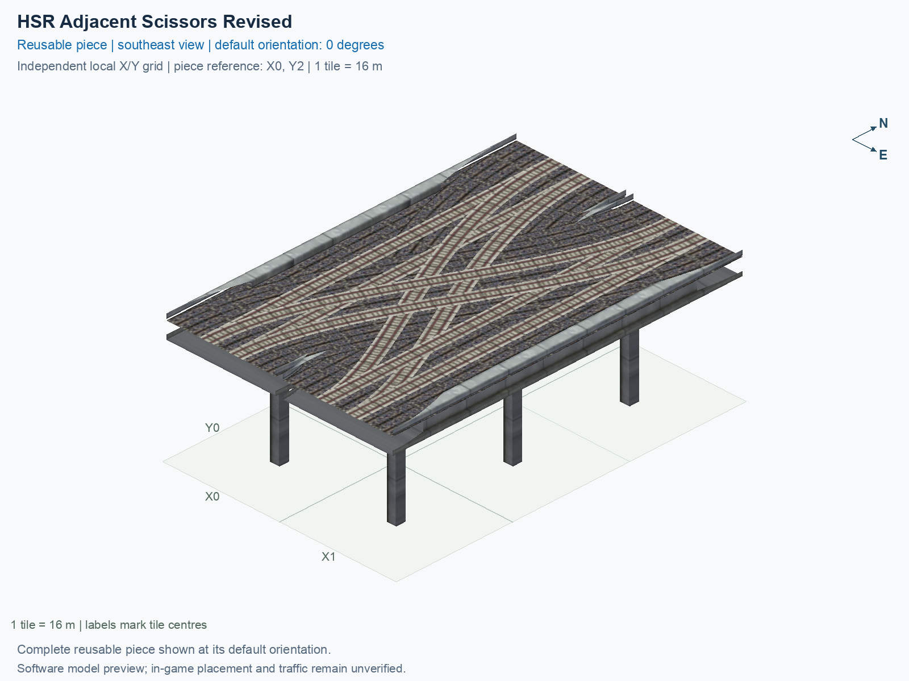

# HSR Adjacent Scissors Revised

Purpose: explain this reusable piece, its matching connections and current test coverage.

<!-- BEGIN PIECE OVERVIEW -->

HSR Adjacent Scissors Revised. Corrected rail deck union and branch openings; one shared support per occupied elevated tile, no ground-track pillars. Authored 5 m wide by 5 m high route clearance check. Experimental; actual game placement and train operation remain unverified.

Exact reusable identifier: `rail-hsr-adjacent-scissors-revised`.

Footprint: **2 × 3 tiles**. Exact menu name: **HSR Adjacent Scissors Revised**.

Choose this exact name in Transportation → Rail. Press Home or End to rotate; use only the supported states listed below. Join each end to a matching port profile and direction.

- [Connections and journeys](#connections-and-journeys)
- [Test checklist](#test-checklist)



<!-- END PIECE OVERVIEW -->

<!-- BEGIN MANUAL SUMMARY -->

## Manual status

Generated from [the exact test cases](#test-checklist) and [authoritative observations](checks/manual-tests.json).

- [ ] Preview review: 0/1 applicable cases passed; 0 failed, 0 stale.
- [ ] In-game rendering: 0/4 applicable cases passed; 0 failed, 0 stale.
- [ ] Directed journeys: 0/32 applicable cases passed; 0 failed, 0 stale.

These observations cover only the named services, directions, poses, rotations, and recorded platforms.

<!-- END MANUAL SUMMARY -->

<!-- BEGIN CONNECTIONS -->

## Connections and journeys

Purpose: describe intrinsic directional interfaces and permitted service journeys.

Generated from [connections.json](connections.json). Coordinates are canonical east, north and height in metres. A connection class names an encoded route interface; it does not prove visible deck/wall fit or an in-game test.

Supported placement states: 0° CCW, 90° CCW, 180° CCW, 270° CCW. Each state has its own declared manual scope.

A **port** is one directional transport-path endpoint. **Service** identifies the intended network service (for example HSR, street, or tram); **engine** is its internal traffic-class number, separate from the construction network. **Role** distinguishes primary service from auxiliary paths; sharing a traffic class does not establish service compatibility.

A **tangent** is a unit travel-direction vector: `[0,1]` means north. **Grade** is height gained per horizontal metre. These measured facts describe this subject alone. Compatibility requires a separate comparison of the complete joining boundaries; physical seams and actual game operation require their own evidence. See the [class index](../../connection-classes.json) for shared route-interface membership.

| Port | Service / engine / role | Direction | Location; tangent; grade | Connection class |
| --- | --- | --- | --- | --- |
| `Sout` | hsr / 7 / primary | out | [-2.0, -40.0, 15.5]; [0.0, -1.0]; 0.0 | `path-interface-12d12be31d2057c5763d` |
| `Nin` | hsr / 7 / primary | in | [-2.0, 8.0, 15.5]; [0.0, -1.0]; 0.0 | `path-interface-12d12be31d2057c5763d` |
| `Sin` | hsr / 7 / primary | in | [2.0, -40.0, 15.5]; [0.0, 1.0]; 0.0 | `path-interface-fba09fbeb87ad95c667a` |
| `Nout` | hsr / 7 / primary | out | [2.0, 8.0, 15.5]; [0.0, 1.0]; 0.0 | `path-interface-fba09fbeb87ad95c667a` |
| `BSout` | hsr / 7 / primary | out | [14.0, -40.0, 15.5]; [0.0, -1.0]; 0.0 | `path-interface-12d12be31d2057c5763d` |
| `BNin` | hsr / 7 / primary | in | [14.0, 8.0, 15.5]; [0.0, -1.0]; 0.0 | `path-interface-12d12be31d2057c5763d` |
| `BSin` | hsr / 7 / primary | in | [18.0, -40.0, 15.5]; [0.0, 1.0]; 0.0 | `path-interface-fba09fbeb87ad95c667a` |
| `BNout` | hsr / 7 / primary | out | [18.0, 8.0, 15.5]; [0.0, 1.0]; 0.0 | `path-interface-fba09fbeb87ad95c667a` |

### Directed journeys

| Service | Entry → exit | Role |
| --- | --- | --- |
| hsr | `Nin` → `BSout` | primary |
| hsr | `Nin` → `Sout` | primary |
| hsr | `Sin` → `Nout` | primary |
| hsr | `Sin` → `BNout` | primary |
| hsr | `BNin` → `BSout` | primary |
| hsr | `BNin` → `Sout` | primary |
| hsr | `BSin` → `BNout` | primary |
| hsr | `BSin` → `Nout` | primary |

### Forbidden transfers

| From service / port | To service / port | Reason |
| --- | --- | --- |
| hsr / `Nin` | hsr / `Nout` | No directed route exists between these ports in the saved piece transport paths. In-game confirmation remains unverified. |
| hsr / `Nin` | hsr / `BNout` | No directed route exists between these ports in the saved piece transport paths. In-game confirmation remains unverified. |
| hsr / `Sin` | hsr / `Sout` | No directed route exists between these ports in the saved piece transport paths. In-game confirmation remains unverified. |
| hsr / `Sin` | hsr / `BSout` | No directed route exists between these ports in the saved piece transport paths. In-game confirmation remains unverified. |
| hsr / `BNin` | hsr / `Nout` | No directed route exists between these ports in the saved piece transport paths. In-game confirmation remains unverified. |
| hsr / `BNin` | hsr / `BNout` | No directed route exists between these ports in the saved piece transport paths. In-game confirmation remains unverified. |
| hsr / `BSin` | hsr / `Sout` | No directed route exists between these ports in the saved piece transport paths. In-game confirmation remains unverified. |
| hsr / `BSin` | hsr / `BSout` | No directed route exists between these ports in the saved piece transport paths. In-game confirmation remains unverified. |

Review the test checklist for the exact tested cases and environments.

<!-- END CONNECTIONS -->

<!-- BEGIN MANUAL CHECKS -->

## Test checklist

Generated from [the authoritative record](checks/manual-tests.json). Only explicit human observations create manual passes; software and preview checks remain separate. Expand a check/service group to see its rotation table, then expand the matching exact scope to copy a case ID and inspect its pose, reviewer, environment, and evidence. Grouping changes only this view; every declared case remains separate.

**States:** [x] passed; [ ] unverified, failed, or stale; N/A is an explicit inapplicable declaration. A dash means no case was declared in that column. Every pass covers only its recorded environment. T means a distinct construction-transposed state.

Four proper rotations are covered. No additional reflected state is established by this record; repeated construction aliases do not create new orientations.

Current totals: unverified: 83, passed: 0, failed: 0, stale: 0, not_applicable: 0.

### Record an observation

Follow the [shared testing guide](../../../../docs/TESTING.md); copy [the unconfirmed example](checks/observation.example.json) to `checks/observation.json`. Case identifiers are in the expandable sections below. Do not edit generated checkboxes.

From the repository folder containing `custom-pieces`, run after filling `checks/observation.json` and explicitly confirming the exact observation:

```sh
python3 -m scp.content record --record custom-pieces/domains/high-speed-rail/00_pieces/rail-hsr-adjacent-scissors-revised/checks/manual-tests.json --observation custom-pieces/domains/high-speed-rail/00_pieces/rail-hsr-adjacent-scissors-revised/checks/observation.json
```

### Detailed current checks

Each collapsed group shows exact case counts and states. Forbidden transfers are grouped by the directed service pair; the table inside retains every port pair and rotation.

<details>
<summary>Compiled resources — Whole subject — 1 case; unverified: 1</summary>

| Check / exact scope | General | 0° | 90° | 180° | 270° |
| --- | --- | --- | --- | --- | --- |
| **Compiled resources**<br>Whole subject | <a href="#case-software_resources-a3d9b34e0880864c2a93">[ ] unverified</a> | — | — | — | — |


<details>
<summary>Compiled resources — Whole subject</summary>

<a id="case-software_resources-a3d9b34e0880864c2a93"></a>

**General: unverified** — `software_resources-a3d9b34e0880864c2a93`.

Verify the actual compiled resources and construction rules.

Scope: Whole subject.

No observation recorded.

</details>

</details>

<details>
<summary>Directed routing graph — Whole subject — 1 case; unverified: 1</summary>

| Check / exact scope | General | 0° | 90° | 180° | 270° |
| --- | --- | --- | --- | --- | --- |
| **Directed routing graph**<br>Whole subject | <a href="#case-software_connectivity-a3d9b34e0880864c2a93">[ ] unverified</a> | — | — | — | — |


<details>
<summary>Directed routing graph — Whole subject</summary>

<a id="case-software_connectivity-a3d9b34e0880864c2a93"></a>

**General: unverified** — `software_connectivity-a3d9b34e0880864c2a93`.

Verify the declared directed journeys and forbidden transfers.

Scope: Whole subject.

No observation recorded.

</details>

</details>

<details>
<summary>Preview review — Images — 1 case; unverified: 1</summary>

| Check / exact scope | General | 0° | 90° | 180° | 270° |
| --- | --- | --- | --- | --- | --- |
| **Preview review**<br>Image: image:rail-hsr-adjacent-scissors-revised:canonical-southeast | <a href="#case-preview_review-82ce9a2338409f39d09e">[ ] unverified</a> | — | — | — | — |


<details>
<summary>Preview review — Image: image:rail-hsr-adjacent-scissors-revised:canonical-southeast</summary>

<a id="case-preview_review-82ce9a2338409f39d09e"></a>

**General: unverified** — `preview_review-82ce9a2338409f39d09e`.

Inspect this exact preview for tracks, walls, piers, seams and shadows.

Scope: Image: image:rail-hsr-adjacent-scissors-revised:canonical-southeast.

No observation recorded.

</details>

</details>

<details>
<summary>In-game rendering — Whole subject — 4 cases; unverified: 4</summary>

| Check / exact scope | General | 0° | 90° | 180° | 270° |
| --- | --- | --- | --- | --- | --- |
| **In-game rendering**<br>Whole subject | — | <a href="#case-in_game_render-185c1226f599d96f2e66">[ ] unverified</a> | <a href="#case-in_game_render-21d88859596c7af2b659">[ ] unverified</a> | <a href="#case-in_game_render-f8f383dfecd6ad4f9087">[ ] unverified</a> | <a href="#case-in_game_render-249fb6dfc35c8bbfd9d8">[ ] unverified</a> |


<details>
<summary>In-game rendering — Whole subject</summary>

<a id="case-in_game_render-185c1226f599d96f2e66"></a>

**0° CCW: unverified** — `in_game_render-185c1226f599d96f2e66`.

Inspect the placed tracks, walls, piers, seams and shadows in SimCity 4.

Scope: Whole subject.

No observation recorded.

<a id="case-in_game_render-21d88859596c7af2b659"></a>

**90° CCW: unverified** — `in_game_render-21d88859596c7af2b659`.

Inspect the placed tracks, walls, piers, seams and shadows in SimCity 4.

Scope: Whole subject.

No observation recorded.

<a id="case-in_game_render-f8f383dfecd6ad4f9087"></a>

**180° CCW: unverified** — `in_game_render-f8f383dfecd6ad4f9087`.

Inspect the placed tracks, walls, piers, seams and shadows in SimCity 4.

Scope: Whole subject.

No observation recorded.

<a id="case-in_game_render-249fb6dfc35c8bbfd9d8"></a>

**270° CCW: unverified** — `in_game_render-249fb6dfc35c8bbfd9d8`.

Inspect the placed tracks, walls, piers, seams and shadows in SimCity 4.

Scope: Whole subject.

No observation recorded.

</details>

</details>

<details>
<summary>Placement — Whole subject — 4 cases; unverified: 4</summary>

| Check / exact scope | General | 0° | 90° | 180° | 270° |
| --- | --- | --- | --- | --- | --- |
| **Placement**<br>Whole subject | — | <a href="#case-in_game_placement-185c1226f599d96f2e66">[ ] unverified</a> | <a href="#case-in_game_placement-21d88859596c7af2b659">[ ] unverified</a> | <a href="#case-in_game_placement-f8f383dfecd6ad4f9087">[ ] unverified</a> | <a href="#case-in_game_placement-249fb6dfc35c8bbfd9d8">[ ] unverified</a> |


<details>
<summary>Placement — Whole subject</summary>

<a id="case-in_game_placement-185c1226f599d96f2e66"></a>

**0° CCW: unverified** — `in_game_placement-185c1226f599d96f2e66`.

Place this piece or complete blueprint and inspect every occupied tile.

Scope: Whole subject.

No observation recorded.

<a id="case-in_game_placement-21d88859596c7af2b659"></a>

**90° CCW: unverified** — `in_game_placement-21d88859596c7af2b659`.

Place this piece or complete blueprint and inspect every occupied tile.

Scope: Whole subject.

No observation recorded.

<a id="case-in_game_placement-f8f383dfecd6ad4f9087"></a>

**180° CCW: unverified** — `in_game_placement-f8f383dfecd6ad4f9087`.

Place this piece or complete blueprint and inspect every occupied tile.

Scope: Whole subject.

No observation recorded.

<a id="case-in_game_placement-249fb6dfc35c8bbfd9d8"></a>

**270° CCW: unverified** — `in_game_placement-249fb6dfc35c8bbfd9d8`.

Place this piece or complete blueprint and inspect every occupied tile.

Scope: Whole subject.

No observation recorded.

</details>

</details>

<details>
<summary>Demolition — Whole subject — 4 cases; unverified: 4</summary>

| Check / exact scope | General | 0° | 90° | 180° | 270° |
| --- | --- | --- | --- | --- | --- |
| **Demolition**<br>Whole subject | — | <a href="#case-in_game_demolition-185c1226f599d96f2e66">[ ] unverified</a> | <a href="#case-in_game_demolition-21d88859596c7af2b659">[ ] unverified</a> | <a href="#case-in_game_demolition-f8f383dfecd6ad4f9087">[ ] unverified</a> | <a href="#case-in_game_demolition-249fb6dfc35c8bbfd9d8">[ ] unverified</a> |


<details>
<summary>Demolition — Whole subject</summary>

<a id="case-in_game_demolition-185c1226f599d96f2e66"></a>

**0° CCW: unverified** — `in_game_demolition-185c1226f599d96f2e66`.

Bulldoze the complete placement and inspect the cleared area.

Scope: Whole subject.

No observation recorded.

<a id="case-in_game_demolition-21d88859596c7af2b659"></a>

**90° CCW: unverified** — `in_game_demolition-21d88859596c7af2b659`.

Bulldoze the complete placement and inspect the cleared area.

Scope: Whole subject.

No observation recorded.

<a id="case-in_game_demolition-f8f383dfecd6ad4f9087"></a>

**180° CCW: unverified** — `in_game_demolition-f8f383dfecd6ad4f9087`.

Bulldoze the complete placement and inspect the cleared area.

Scope: Whole subject.

No observation recorded.

<a id="case-in_game_demolition-249fb6dfc35c8bbfd9d8"></a>

**270° CCW: unverified** — `in_game_demolition-249fb6dfc35c8bbfd9d8`.

Bulldoze the complete placement and inspect the cleared area.

Scope: Whole subject.

No observation recorded.

</details>

</details>

<details>
<summary>Save and reload — Whole subject — 4 cases; unverified: 4</summary>

| Check / exact scope | General | 0° | 90° | 180° | 270° |
| --- | --- | --- | --- | --- | --- |
| **Save and reload**<br>Whole subject | — | <a href="#case-in_game_save_reload-185c1226f599d96f2e66">[ ] unverified</a> | <a href="#case-in_game_save_reload-21d88859596c7af2b659">[ ] unverified</a> | <a href="#case-in_game_save_reload-f8f383dfecd6ad4f9087">[ ] unverified</a> | <a href="#case-in_game_save_reload-249fb6dfc35c8bbfd9d8">[ ] unverified</a> |


<details>
<summary>Save and reload — Whole subject</summary>

<a id="case-in_game_save_reload-185c1226f599d96f2e66"></a>

**0° CCW: unverified** — `in_game_save_reload-185c1226f599d96f2e66`.

Save, quit, reload and inspect the placement and its paths.

Scope: Whole subject.

No observation recorded.

<a id="case-in_game_save_reload-21d88859596c7af2b659"></a>

**90° CCW: unverified** — `in_game_save_reload-21d88859596c7af2b659`.

Save, quit, reload and inspect the placement and its paths.

Scope: Whole subject.

No observation recorded.

<a id="case-in_game_save_reload-f8f383dfecd6ad4f9087"></a>

**180° CCW: unverified** — `in_game_save_reload-f8f383dfecd6ad4f9087`.

Save, quit, reload and inspect the placement and its paths.

Scope: Whole subject.

No observation recorded.

<a id="case-in_game_save_reload-249fb6dfc35c8bbfd9d8"></a>

**270° CCW: unverified** — `in_game_save_reload-249fb6dfc35c8bbfd9d8`.

Save, quit, reload and inspect the placement and its paths.

Scope: Whole subject.

No observation recorded.

</details>

</details>

<details>
<summary>Journey — hsr — 32 cases; unverified: 32</summary>

| Check / exact scope | General | 0° | 90° | 180° | 270° |
| --- | --- | --- | --- | --- | --- |
| **Journey**<br>Service: hsr; role: primary; journey: 7:Nin>BSout; entry: Nin; exit: BSout | — | <a href="#case-in_game_journey-09b32c63f1f6076af15b">[ ] unverified</a> | <a href="#case-in_game_journey-71c4973ef01016c9ddb7">[ ] unverified</a> | <a href="#case-in_game_journey-57a2940a5a2c9a69ae1d">[ ] unverified</a> | <a href="#case-in_game_journey-81b2ef5785ea0a71c4ec">[ ] unverified</a> |
| **Journey**<br>Service: hsr; role: primary; journey: 7:Nin>Sout; entry: Nin; exit: Sout | — | <a href="#case-in_game_journey-01d9f1958b633ec8ca98">[ ] unverified</a> | <a href="#case-in_game_journey-a6b8449f917f1c1c8221">[ ] unverified</a> | <a href="#case-in_game_journey-bfc72742d22377cd932e">[ ] unverified</a> | <a href="#case-in_game_journey-c122a2c909acba098faf">[ ] unverified</a> |
| **Journey**<br>Service: hsr; role: primary; journey: 7:Sin>Nout; entry: Sin; exit: Nout | — | <a href="#case-in_game_journey-f1b4389cf4121c8c102a">[ ] unverified</a> | <a href="#case-in_game_journey-0ea02228835ff96e8229">[ ] unverified</a> | <a href="#case-in_game_journey-9ae75646672c60987a7f">[ ] unverified</a> | <a href="#case-in_game_journey-f21c09d31602f1a59353">[ ] unverified</a> |
| **Journey**<br>Service: hsr; role: primary; journey: 7:Sin>BNout; entry: Sin; exit: BNout | — | <a href="#case-in_game_journey-14e4e942c91c9f186d5e">[ ] unverified</a> | <a href="#case-in_game_journey-9e9356e1c7aa6d7d2c38">[ ] unverified</a> | <a href="#case-in_game_journey-3e326ddb814ac46c049f">[ ] unverified</a> | <a href="#case-in_game_journey-dd92a5333620facf9e5d">[ ] unverified</a> |
| **Journey**<br>Service: hsr; role: primary; journey: 7:BNin>BSout; entry: BNin; exit: BSout | — | <a href="#case-in_game_journey-12549040a349c84a532c">[ ] unverified</a> | <a href="#case-in_game_journey-64aab386cd87cf48c7b7">[ ] unverified</a> | <a href="#case-in_game_journey-29b177488ccef36c4a35">[ ] unverified</a> | <a href="#case-in_game_journey-3c62e4e9fd2852090d51">[ ] unverified</a> |
| **Journey**<br>Service: hsr; role: primary; journey: 7:BNin>Sout; entry: BNin; exit: Sout | — | <a href="#case-in_game_journey-0fe0fd2d62a829ca6700">[ ] unverified</a> | <a href="#case-in_game_journey-9e58bde0a44860ebbea2">[ ] unverified</a> | <a href="#case-in_game_journey-46625e20dec9bd990aef">[ ] unverified</a> | <a href="#case-in_game_journey-49b9fa5ac6b652ee9365">[ ] unverified</a> |
| **Journey**<br>Service: hsr; role: primary; journey: 7:BSin>BNout; entry: BSin; exit: BNout | — | <a href="#case-in_game_journey-2bf474cbd8bf6d760fae">[ ] unverified</a> | <a href="#case-in_game_journey-80c9848e6123ea73aba1">[ ] unverified</a> | <a href="#case-in_game_journey-30ea9bf5723bc701e31b">[ ] unverified</a> | <a href="#case-in_game_journey-5ffb19019db573a3203e">[ ] unverified</a> |
| **Journey**<br>Service: hsr; role: primary; journey: 7:BSin>Nout; entry: BSin; exit: Nout | — | <a href="#case-in_game_journey-25dccddb358b79aca255">[ ] unverified</a> | <a href="#case-in_game_journey-c57448644bb44cbe0a97">[ ] unverified</a> | <a href="#case-in_game_journey-c324432ef4808038b78c">[ ] unverified</a> | <a href="#case-in_game_journey-df57e3b4610ac662ae16">[ ] unverified</a> |


<details>
<summary>Journey — Service: hsr; role: primary; journey: 7:Nin>BSout; entry: Nin; exit: BSout</summary>

<a id="case-in_game_journey-09b32c63f1f6076af15b"></a>

**0° CCW: unverified** — `in_game_journey-09b32c63f1f6076af15b`.

Run the declared journey in this direction using its service network.

Scope: Service: hsr; role: primary; journey: 7:Nin>BSout; entry: Nin; exit: BSout.

No observation recorded.

<a id="case-in_game_journey-71c4973ef01016c9ddb7"></a>

**90° CCW: unverified** — `in_game_journey-71c4973ef01016c9ddb7`.

Run the declared journey in this direction using its service network.

Scope: Service: hsr; role: primary; journey: 7:Nin>BSout; entry: Nin; exit: BSout.

No observation recorded.

<a id="case-in_game_journey-57a2940a5a2c9a69ae1d"></a>

**180° CCW: unverified** — `in_game_journey-57a2940a5a2c9a69ae1d`.

Run the declared journey in this direction using its service network.

Scope: Service: hsr; role: primary; journey: 7:Nin>BSout; entry: Nin; exit: BSout.

No observation recorded.

<a id="case-in_game_journey-81b2ef5785ea0a71c4ec"></a>

**270° CCW: unverified** — `in_game_journey-81b2ef5785ea0a71c4ec`.

Run the declared journey in this direction using its service network.

Scope: Service: hsr; role: primary; journey: 7:Nin>BSout; entry: Nin; exit: BSout.

No observation recorded.

</details>


<details>
<summary>Journey — Service: hsr; role: primary; journey: 7:Nin>Sout; entry: Nin; exit: Sout</summary>

<a id="case-in_game_journey-01d9f1958b633ec8ca98"></a>

**0° CCW: unverified** — `in_game_journey-01d9f1958b633ec8ca98`.

Run the declared journey in this direction using its service network.

Scope: Service: hsr; role: primary; journey: 7:Nin>Sout; entry: Nin; exit: Sout.

No observation recorded.

<a id="case-in_game_journey-a6b8449f917f1c1c8221"></a>

**90° CCW: unverified** — `in_game_journey-a6b8449f917f1c1c8221`.

Run the declared journey in this direction using its service network.

Scope: Service: hsr; role: primary; journey: 7:Nin>Sout; entry: Nin; exit: Sout.

No observation recorded.

<a id="case-in_game_journey-bfc72742d22377cd932e"></a>

**180° CCW: unverified** — `in_game_journey-bfc72742d22377cd932e`.

Run the declared journey in this direction using its service network.

Scope: Service: hsr; role: primary; journey: 7:Nin>Sout; entry: Nin; exit: Sout.

No observation recorded.

<a id="case-in_game_journey-c122a2c909acba098faf"></a>

**270° CCW: unverified** — `in_game_journey-c122a2c909acba098faf`.

Run the declared journey in this direction using its service network.

Scope: Service: hsr; role: primary; journey: 7:Nin>Sout; entry: Nin; exit: Sout.

No observation recorded.

</details>


<details>
<summary>Journey — Service: hsr; role: primary; journey: 7:Sin>Nout; entry: Sin; exit: Nout</summary>

<a id="case-in_game_journey-f1b4389cf4121c8c102a"></a>

**0° CCW: unverified** — `in_game_journey-f1b4389cf4121c8c102a`.

Run the declared journey in this direction using its service network.

Scope: Service: hsr; role: primary; journey: 7:Sin>Nout; entry: Sin; exit: Nout.

No observation recorded.

<a id="case-in_game_journey-0ea02228835ff96e8229"></a>

**90° CCW: unverified** — `in_game_journey-0ea02228835ff96e8229`.

Run the declared journey in this direction using its service network.

Scope: Service: hsr; role: primary; journey: 7:Sin>Nout; entry: Sin; exit: Nout.

No observation recorded.

<a id="case-in_game_journey-9ae75646672c60987a7f"></a>

**180° CCW: unverified** — `in_game_journey-9ae75646672c60987a7f`.

Run the declared journey in this direction using its service network.

Scope: Service: hsr; role: primary; journey: 7:Sin>Nout; entry: Sin; exit: Nout.

No observation recorded.

<a id="case-in_game_journey-f21c09d31602f1a59353"></a>

**270° CCW: unverified** — `in_game_journey-f21c09d31602f1a59353`.

Run the declared journey in this direction using its service network.

Scope: Service: hsr; role: primary; journey: 7:Sin>Nout; entry: Sin; exit: Nout.

No observation recorded.

</details>


<details>
<summary>Journey — Service: hsr; role: primary; journey: 7:Sin>BNout; entry: Sin; exit: BNout</summary>

<a id="case-in_game_journey-14e4e942c91c9f186d5e"></a>

**0° CCW: unverified** — `in_game_journey-14e4e942c91c9f186d5e`.

Run the declared journey in this direction using its service network.

Scope: Service: hsr; role: primary; journey: 7:Sin>BNout; entry: Sin; exit: BNout.

No observation recorded.

<a id="case-in_game_journey-9e9356e1c7aa6d7d2c38"></a>

**90° CCW: unverified** — `in_game_journey-9e9356e1c7aa6d7d2c38`.

Run the declared journey in this direction using its service network.

Scope: Service: hsr; role: primary; journey: 7:Sin>BNout; entry: Sin; exit: BNout.

No observation recorded.

<a id="case-in_game_journey-3e326ddb814ac46c049f"></a>

**180° CCW: unverified** — `in_game_journey-3e326ddb814ac46c049f`.

Run the declared journey in this direction using its service network.

Scope: Service: hsr; role: primary; journey: 7:Sin>BNout; entry: Sin; exit: BNout.

No observation recorded.

<a id="case-in_game_journey-dd92a5333620facf9e5d"></a>

**270° CCW: unverified** — `in_game_journey-dd92a5333620facf9e5d`.

Run the declared journey in this direction using its service network.

Scope: Service: hsr; role: primary; journey: 7:Sin>BNout; entry: Sin; exit: BNout.

No observation recorded.

</details>


<details>
<summary>Journey — Service: hsr; role: primary; journey: 7:BNin>BSout; entry: BNin; exit: BSout</summary>

<a id="case-in_game_journey-12549040a349c84a532c"></a>

**0° CCW: unverified** — `in_game_journey-12549040a349c84a532c`.

Run the declared journey in this direction using its service network.

Scope: Service: hsr; role: primary; journey: 7:BNin>BSout; entry: BNin; exit: BSout.

No observation recorded.

<a id="case-in_game_journey-64aab386cd87cf48c7b7"></a>

**90° CCW: unverified** — `in_game_journey-64aab386cd87cf48c7b7`.

Run the declared journey in this direction using its service network.

Scope: Service: hsr; role: primary; journey: 7:BNin>BSout; entry: BNin; exit: BSout.

No observation recorded.

<a id="case-in_game_journey-29b177488ccef36c4a35"></a>

**180° CCW: unverified** — `in_game_journey-29b177488ccef36c4a35`.

Run the declared journey in this direction using its service network.

Scope: Service: hsr; role: primary; journey: 7:BNin>BSout; entry: BNin; exit: BSout.

No observation recorded.

<a id="case-in_game_journey-3c62e4e9fd2852090d51"></a>

**270° CCW: unverified** — `in_game_journey-3c62e4e9fd2852090d51`.

Run the declared journey in this direction using its service network.

Scope: Service: hsr; role: primary; journey: 7:BNin>BSout; entry: BNin; exit: BSout.

No observation recorded.

</details>


<details>
<summary>Journey — Service: hsr; role: primary; journey: 7:BNin>Sout; entry: BNin; exit: Sout</summary>

<a id="case-in_game_journey-0fe0fd2d62a829ca6700"></a>

**0° CCW: unverified** — `in_game_journey-0fe0fd2d62a829ca6700`.

Run the declared journey in this direction using its service network.

Scope: Service: hsr; role: primary; journey: 7:BNin>Sout; entry: BNin; exit: Sout.

No observation recorded.

<a id="case-in_game_journey-9e58bde0a44860ebbea2"></a>

**90° CCW: unverified** — `in_game_journey-9e58bde0a44860ebbea2`.

Run the declared journey in this direction using its service network.

Scope: Service: hsr; role: primary; journey: 7:BNin>Sout; entry: BNin; exit: Sout.

No observation recorded.

<a id="case-in_game_journey-46625e20dec9bd990aef"></a>

**180° CCW: unverified** — `in_game_journey-46625e20dec9bd990aef`.

Run the declared journey in this direction using its service network.

Scope: Service: hsr; role: primary; journey: 7:BNin>Sout; entry: BNin; exit: Sout.

No observation recorded.

<a id="case-in_game_journey-49b9fa5ac6b652ee9365"></a>

**270° CCW: unverified** — `in_game_journey-49b9fa5ac6b652ee9365`.

Run the declared journey in this direction using its service network.

Scope: Service: hsr; role: primary; journey: 7:BNin>Sout; entry: BNin; exit: Sout.

No observation recorded.

</details>


<details>
<summary>Journey — Service: hsr; role: primary; journey: 7:BSin>BNout; entry: BSin; exit: BNout</summary>

<a id="case-in_game_journey-2bf474cbd8bf6d760fae"></a>

**0° CCW: unverified** — `in_game_journey-2bf474cbd8bf6d760fae`.

Run the declared journey in this direction using its service network.

Scope: Service: hsr; role: primary; journey: 7:BSin>BNout; entry: BSin; exit: BNout.

No observation recorded.

<a id="case-in_game_journey-80c9848e6123ea73aba1"></a>

**90° CCW: unverified** — `in_game_journey-80c9848e6123ea73aba1`.

Run the declared journey in this direction using its service network.

Scope: Service: hsr; role: primary; journey: 7:BSin>BNout; entry: BSin; exit: BNout.

No observation recorded.

<a id="case-in_game_journey-30ea9bf5723bc701e31b"></a>

**180° CCW: unverified** — `in_game_journey-30ea9bf5723bc701e31b`.

Run the declared journey in this direction using its service network.

Scope: Service: hsr; role: primary; journey: 7:BSin>BNout; entry: BSin; exit: BNout.

No observation recorded.

<a id="case-in_game_journey-5ffb19019db573a3203e"></a>

**270° CCW: unverified** — `in_game_journey-5ffb19019db573a3203e`.

Run the declared journey in this direction using its service network.

Scope: Service: hsr; role: primary; journey: 7:BSin>BNout; entry: BSin; exit: BNout.

No observation recorded.

</details>


<details>
<summary>Journey — Service: hsr; role: primary; journey: 7:BSin>Nout; entry: BSin; exit: Nout</summary>

<a id="case-in_game_journey-25dccddb358b79aca255"></a>

**0° CCW: unverified** — `in_game_journey-25dccddb358b79aca255`.

Run the declared journey in this direction using its service network.

Scope: Service: hsr; role: primary; journey: 7:BSin>Nout; entry: BSin; exit: Nout.

No observation recorded.

<a id="case-in_game_journey-c57448644bb44cbe0a97"></a>

**90° CCW: unverified** — `in_game_journey-c57448644bb44cbe0a97`.

Run the declared journey in this direction using its service network.

Scope: Service: hsr; role: primary; journey: 7:BSin>Nout; entry: BSin; exit: Nout.

No observation recorded.

<a id="case-in_game_journey-c324432ef4808038b78c"></a>

**180° CCW: unverified** — `in_game_journey-c324432ef4808038b78c`.

Run the declared journey in this direction using its service network.

Scope: Service: hsr; role: primary; journey: 7:BSin>Nout; entry: BSin; exit: Nout.

No observation recorded.

<a id="case-in_game_journey-df57e3b4610ac662ae16"></a>

**270° CCW: unverified** — `in_game_journey-df57e3b4610ac662ae16`.

Run the declared journey in this direction using its service network.

Scope: Service: hsr; role: primary; journey: 7:BSin>Nout; entry: BSin; exit: Nout.

No observation recorded.

</details>

</details>

<details>
<summary>Forbidden transfer — hsr → hsr — 32 cases; unverified: 32</summary>

| Check / exact scope | General | 0° | 90° | 180° | 270° |
| --- | --- | --- | --- | --- | --- |
| **Forbidden transfer**<br>from port: Nin; to port: Nout; from service: hsr; to service: hsr; basis: not reachable in actual saved PATH graph | — | <a href="#case-in_game_forbidden_transfer-610ade1c25e9b35f3cbf">[ ] unverified</a> | <a href="#case-in_game_forbidden_transfer-f90a98c4325776c8c2c6">[ ] unverified</a> | <a href="#case-in_game_forbidden_transfer-c3e467d73715b2f2e38d">[ ] unverified</a> | <a href="#case-in_game_forbidden_transfer-83047838050fded7d040">[ ] unverified</a> |
| **Forbidden transfer**<br>from port: Nin; to port: BNout; from service: hsr; to service: hsr; basis: not reachable in actual saved PATH graph | — | <a href="#case-in_game_forbidden_transfer-6dab14d4281fb5521313">[ ] unverified</a> | <a href="#case-in_game_forbidden_transfer-d3e9f2a4a7263ad69137">[ ] unverified</a> | <a href="#case-in_game_forbidden_transfer-33a6882bade7d46a93dc">[ ] unverified</a> | <a href="#case-in_game_forbidden_transfer-4698e748e3076e353e94">[ ] unverified</a> |
| **Forbidden transfer**<br>from port: Sin; to port: Sout; from service: hsr; to service: hsr; basis: not reachable in actual saved PATH graph | — | <a href="#case-in_game_forbidden_transfer-e5045b46870427646a83">[ ] unverified</a> | <a href="#case-in_game_forbidden_transfer-2ecd9010a4ffc44c244d">[ ] unverified</a> | <a href="#case-in_game_forbidden_transfer-2cdb898636541db7fa53">[ ] unverified</a> | <a href="#case-in_game_forbidden_transfer-31a25ef1a850279c0b93">[ ] unverified</a> |
| **Forbidden transfer**<br>from port: Sin; to port: BSout; from service: hsr; to service: hsr; basis: not reachable in actual saved PATH graph | — | <a href="#case-in_game_forbidden_transfer-45e263b3990b61669f5b">[ ] unverified</a> | <a href="#case-in_game_forbidden_transfer-981ac67dd96e08bcc9bf">[ ] unverified</a> | <a href="#case-in_game_forbidden_transfer-419bc1fb513667e8c14d">[ ] unverified</a> | <a href="#case-in_game_forbidden_transfer-802a88eb772a5f121c4b">[ ] unverified</a> |
| **Forbidden transfer**<br>from port: BNin; to port: Nout; from service: hsr; to service: hsr; basis: not reachable in actual saved PATH graph | — | <a href="#case-in_game_forbidden_transfer-fbdb049a735c14d0d47e">[ ] unverified</a> | <a href="#case-in_game_forbidden_transfer-181a0e64712ae963d752">[ ] unverified</a> | <a href="#case-in_game_forbidden_transfer-63a4141a404f5d4b46ef">[ ] unverified</a> | <a href="#case-in_game_forbidden_transfer-a2f159bd4c49c0ab45ea">[ ] unverified</a> |
| **Forbidden transfer**<br>from port: BNin; to port: BNout; from service: hsr; to service: hsr; basis: not reachable in actual saved PATH graph | — | <a href="#case-in_game_forbidden_transfer-3f38796d371bdf18a8da">[ ] unverified</a> | <a href="#case-in_game_forbidden_transfer-f000f8a7408b954e8294">[ ] unverified</a> | <a href="#case-in_game_forbidden_transfer-91698fa5ed688457bb0a">[ ] unverified</a> | <a href="#case-in_game_forbidden_transfer-b9355d2cf6b0bd7b27b4">[ ] unverified</a> |
| **Forbidden transfer**<br>from port: BSin; to port: Sout; from service: hsr; to service: hsr; basis: not reachable in actual saved PATH graph | — | <a href="#case-in_game_forbidden_transfer-9dd63ced5f3db1a64229">[ ] unverified</a> | <a href="#case-in_game_forbidden_transfer-326158d38630fe508e34">[ ] unverified</a> | <a href="#case-in_game_forbidden_transfer-7a1217dd922b91837039">[ ] unverified</a> | <a href="#case-in_game_forbidden_transfer-f430fc622d3ad37ce796">[ ] unverified</a> |
| **Forbidden transfer**<br>from port: BSin; to port: BSout; from service: hsr; to service: hsr; basis: not reachable in actual saved PATH graph | — | <a href="#case-in_game_forbidden_transfer-1b1636944c225752677b">[ ] unverified</a> | <a href="#case-in_game_forbidden_transfer-3eb3ac01be65dfd7080f">[ ] unverified</a> | <a href="#case-in_game_forbidden_transfer-50428193adfdfc2a70c3">[ ] unverified</a> | <a href="#case-in_game_forbidden_transfer-5fd19fa02e878c29f576">[ ] unverified</a> |


<details>
<summary>Forbidden transfer — from port: Nin; to port: Nout; from service: hsr; to service: hsr; basis: not reachable in actual saved PATH graph</summary>

<a id="case-in_game_forbidden_transfer-610ade1c25e9b35f3cbf"></a>

**0° CCW: unverified** — `in_game_forbidden_transfer-610ade1c25e9b35f3cbf`.

Confirm this undeclared transfer is unavailable.

Scope: from port: Nin; to port: Nout; from service: hsr; to service: hsr; basis: not reachable in actual saved PATH graph.

No observation recorded.

<a id="case-in_game_forbidden_transfer-f90a98c4325776c8c2c6"></a>

**90° CCW: unverified** — `in_game_forbidden_transfer-f90a98c4325776c8c2c6`.

Confirm this undeclared transfer is unavailable.

Scope: from port: Nin; to port: Nout; from service: hsr; to service: hsr; basis: not reachable in actual saved PATH graph.

No observation recorded.

<a id="case-in_game_forbidden_transfer-c3e467d73715b2f2e38d"></a>

**180° CCW: unverified** — `in_game_forbidden_transfer-c3e467d73715b2f2e38d`.

Confirm this undeclared transfer is unavailable.

Scope: from port: Nin; to port: Nout; from service: hsr; to service: hsr; basis: not reachable in actual saved PATH graph.

No observation recorded.

<a id="case-in_game_forbidden_transfer-83047838050fded7d040"></a>

**270° CCW: unverified** — `in_game_forbidden_transfer-83047838050fded7d040`.

Confirm this undeclared transfer is unavailable.

Scope: from port: Nin; to port: Nout; from service: hsr; to service: hsr; basis: not reachable in actual saved PATH graph.

No observation recorded.

</details>


<details>
<summary>Forbidden transfer — from port: Nin; to port: BNout; from service: hsr; to service: hsr; basis: not reachable in actual saved PATH graph</summary>

<a id="case-in_game_forbidden_transfer-6dab14d4281fb5521313"></a>

**0° CCW: unverified** — `in_game_forbidden_transfer-6dab14d4281fb5521313`.

Confirm this undeclared transfer is unavailable.

Scope: from port: Nin; to port: BNout; from service: hsr; to service: hsr; basis: not reachable in actual saved PATH graph.

No observation recorded.

<a id="case-in_game_forbidden_transfer-d3e9f2a4a7263ad69137"></a>

**90° CCW: unverified** — `in_game_forbidden_transfer-d3e9f2a4a7263ad69137`.

Confirm this undeclared transfer is unavailable.

Scope: from port: Nin; to port: BNout; from service: hsr; to service: hsr; basis: not reachable in actual saved PATH graph.

No observation recorded.

<a id="case-in_game_forbidden_transfer-33a6882bade7d46a93dc"></a>

**180° CCW: unverified** — `in_game_forbidden_transfer-33a6882bade7d46a93dc`.

Confirm this undeclared transfer is unavailable.

Scope: from port: Nin; to port: BNout; from service: hsr; to service: hsr; basis: not reachable in actual saved PATH graph.

No observation recorded.

<a id="case-in_game_forbidden_transfer-4698e748e3076e353e94"></a>

**270° CCW: unverified** — `in_game_forbidden_transfer-4698e748e3076e353e94`.

Confirm this undeclared transfer is unavailable.

Scope: from port: Nin; to port: BNout; from service: hsr; to service: hsr; basis: not reachable in actual saved PATH graph.

No observation recorded.

</details>


<details>
<summary>Forbidden transfer — from port: Sin; to port: Sout; from service: hsr; to service: hsr; basis: not reachable in actual saved PATH graph</summary>

<a id="case-in_game_forbidden_transfer-e5045b46870427646a83"></a>

**0° CCW: unverified** — `in_game_forbidden_transfer-e5045b46870427646a83`.

Confirm this undeclared transfer is unavailable.

Scope: from port: Sin; to port: Sout; from service: hsr; to service: hsr; basis: not reachable in actual saved PATH graph.

No observation recorded.

<a id="case-in_game_forbidden_transfer-2ecd9010a4ffc44c244d"></a>

**90° CCW: unverified** — `in_game_forbidden_transfer-2ecd9010a4ffc44c244d`.

Confirm this undeclared transfer is unavailable.

Scope: from port: Sin; to port: Sout; from service: hsr; to service: hsr; basis: not reachable in actual saved PATH graph.

No observation recorded.

<a id="case-in_game_forbidden_transfer-2cdb898636541db7fa53"></a>

**180° CCW: unverified** — `in_game_forbidden_transfer-2cdb898636541db7fa53`.

Confirm this undeclared transfer is unavailable.

Scope: from port: Sin; to port: Sout; from service: hsr; to service: hsr; basis: not reachable in actual saved PATH graph.

No observation recorded.

<a id="case-in_game_forbidden_transfer-31a25ef1a850279c0b93"></a>

**270° CCW: unverified** — `in_game_forbidden_transfer-31a25ef1a850279c0b93`.

Confirm this undeclared transfer is unavailable.

Scope: from port: Sin; to port: Sout; from service: hsr; to service: hsr; basis: not reachable in actual saved PATH graph.

No observation recorded.

</details>


<details>
<summary>Forbidden transfer — from port: Sin; to port: BSout; from service: hsr; to service: hsr; basis: not reachable in actual saved PATH graph</summary>

<a id="case-in_game_forbidden_transfer-45e263b3990b61669f5b"></a>

**0° CCW: unverified** — `in_game_forbidden_transfer-45e263b3990b61669f5b`.

Confirm this undeclared transfer is unavailable.

Scope: from port: Sin; to port: BSout; from service: hsr; to service: hsr; basis: not reachable in actual saved PATH graph.

No observation recorded.

<a id="case-in_game_forbidden_transfer-981ac67dd96e08bcc9bf"></a>

**90° CCW: unverified** — `in_game_forbidden_transfer-981ac67dd96e08bcc9bf`.

Confirm this undeclared transfer is unavailable.

Scope: from port: Sin; to port: BSout; from service: hsr; to service: hsr; basis: not reachable in actual saved PATH graph.

No observation recorded.

<a id="case-in_game_forbidden_transfer-419bc1fb513667e8c14d"></a>

**180° CCW: unverified** — `in_game_forbidden_transfer-419bc1fb513667e8c14d`.

Confirm this undeclared transfer is unavailable.

Scope: from port: Sin; to port: BSout; from service: hsr; to service: hsr; basis: not reachable in actual saved PATH graph.

No observation recorded.

<a id="case-in_game_forbidden_transfer-802a88eb772a5f121c4b"></a>

**270° CCW: unverified** — `in_game_forbidden_transfer-802a88eb772a5f121c4b`.

Confirm this undeclared transfer is unavailable.

Scope: from port: Sin; to port: BSout; from service: hsr; to service: hsr; basis: not reachable in actual saved PATH graph.

No observation recorded.

</details>


<details>
<summary>Forbidden transfer — from port: BNin; to port: Nout; from service: hsr; to service: hsr; basis: not reachable in actual saved PATH graph</summary>

<a id="case-in_game_forbidden_transfer-fbdb049a735c14d0d47e"></a>

**0° CCW: unverified** — `in_game_forbidden_transfer-fbdb049a735c14d0d47e`.

Confirm this undeclared transfer is unavailable.

Scope: from port: BNin; to port: Nout; from service: hsr; to service: hsr; basis: not reachable in actual saved PATH graph.

No observation recorded.

<a id="case-in_game_forbidden_transfer-181a0e64712ae963d752"></a>

**90° CCW: unverified** — `in_game_forbidden_transfer-181a0e64712ae963d752`.

Confirm this undeclared transfer is unavailable.

Scope: from port: BNin; to port: Nout; from service: hsr; to service: hsr; basis: not reachable in actual saved PATH graph.

No observation recorded.

<a id="case-in_game_forbidden_transfer-63a4141a404f5d4b46ef"></a>

**180° CCW: unverified** — `in_game_forbidden_transfer-63a4141a404f5d4b46ef`.

Confirm this undeclared transfer is unavailable.

Scope: from port: BNin; to port: Nout; from service: hsr; to service: hsr; basis: not reachable in actual saved PATH graph.

No observation recorded.

<a id="case-in_game_forbidden_transfer-a2f159bd4c49c0ab45ea"></a>

**270° CCW: unverified** — `in_game_forbidden_transfer-a2f159bd4c49c0ab45ea`.

Confirm this undeclared transfer is unavailable.

Scope: from port: BNin; to port: Nout; from service: hsr; to service: hsr; basis: not reachable in actual saved PATH graph.

No observation recorded.

</details>


<details>
<summary>Forbidden transfer — from port: BNin; to port: BNout; from service: hsr; to service: hsr; basis: not reachable in actual saved PATH graph</summary>

<a id="case-in_game_forbidden_transfer-3f38796d371bdf18a8da"></a>

**0° CCW: unverified** — `in_game_forbidden_transfer-3f38796d371bdf18a8da`.

Confirm this undeclared transfer is unavailable.

Scope: from port: BNin; to port: BNout; from service: hsr; to service: hsr; basis: not reachable in actual saved PATH graph.

No observation recorded.

<a id="case-in_game_forbidden_transfer-f000f8a7408b954e8294"></a>

**90° CCW: unverified** — `in_game_forbidden_transfer-f000f8a7408b954e8294`.

Confirm this undeclared transfer is unavailable.

Scope: from port: BNin; to port: BNout; from service: hsr; to service: hsr; basis: not reachable in actual saved PATH graph.

No observation recorded.

<a id="case-in_game_forbidden_transfer-91698fa5ed688457bb0a"></a>

**180° CCW: unverified** — `in_game_forbidden_transfer-91698fa5ed688457bb0a`.

Confirm this undeclared transfer is unavailable.

Scope: from port: BNin; to port: BNout; from service: hsr; to service: hsr; basis: not reachable in actual saved PATH graph.

No observation recorded.

<a id="case-in_game_forbidden_transfer-b9355d2cf6b0bd7b27b4"></a>

**270° CCW: unverified** — `in_game_forbidden_transfer-b9355d2cf6b0bd7b27b4`.

Confirm this undeclared transfer is unavailable.

Scope: from port: BNin; to port: BNout; from service: hsr; to service: hsr; basis: not reachable in actual saved PATH graph.

No observation recorded.

</details>


<details>
<summary>Forbidden transfer — from port: BSin; to port: Sout; from service: hsr; to service: hsr; basis: not reachable in actual saved PATH graph</summary>

<a id="case-in_game_forbidden_transfer-9dd63ced5f3db1a64229"></a>

**0° CCW: unverified** — `in_game_forbidden_transfer-9dd63ced5f3db1a64229`.

Confirm this undeclared transfer is unavailable.

Scope: from port: BSin; to port: Sout; from service: hsr; to service: hsr; basis: not reachable in actual saved PATH graph.

No observation recorded.

<a id="case-in_game_forbidden_transfer-326158d38630fe508e34"></a>

**90° CCW: unverified** — `in_game_forbidden_transfer-326158d38630fe508e34`.

Confirm this undeclared transfer is unavailable.

Scope: from port: BSin; to port: Sout; from service: hsr; to service: hsr; basis: not reachable in actual saved PATH graph.

No observation recorded.

<a id="case-in_game_forbidden_transfer-7a1217dd922b91837039"></a>

**180° CCW: unverified** — `in_game_forbidden_transfer-7a1217dd922b91837039`.

Confirm this undeclared transfer is unavailable.

Scope: from port: BSin; to port: Sout; from service: hsr; to service: hsr; basis: not reachable in actual saved PATH graph.

No observation recorded.

<a id="case-in_game_forbidden_transfer-f430fc622d3ad37ce796"></a>

**270° CCW: unverified** — `in_game_forbidden_transfer-f430fc622d3ad37ce796`.

Confirm this undeclared transfer is unavailable.

Scope: from port: BSin; to port: Sout; from service: hsr; to service: hsr; basis: not reachable in actual saved PATH graph.

No observation recorded.

</details>


<details>
<summary>Forbidden transfer — from port: BSin; to port: BSout; from service: hsr; to service: hsr; basis: not reachable in actual saved PATH graph</summary>

<a id="case-in_game_forbidden_transfer-1b1636944c225752677b"></a>

**0° CCW: unverified** — `in_game_forbidden_transfer-1b1636944c225752677b`.

Confirm this undeclared transfer is unavailable.

Scope: from port: BSin; to port: BSout; from service: hsr; to service: hsr; basis: not reachable in actual saved PATH graph.

No observation recorded.

<a id="case-in_game_forbidden_transfer-3eb3ac01be65dfd7080f"></a>

**90° CCW: unverified** — `in_game_forbidden_transfer-3eb3ac01be65dfd7080f`.

Confirm this undeclared transfer is unavailable.

Scope: from port: BSin; to port: BSout; from service: hsr; to service: hsr; basis: not reachable in actual saved PATH graph.

No observation recorded.

<a id="case-in_game_forbidden_transfer-50428193adfdfc2a70c3"></a>

**180° CCW: unverified** — `in_game_forbidden_transfer-50428193adfdfc2a70c3`.

Confirm this undeclared transfer is unavailable.

Scope: from port: BSin; to port: BSout; from service: hsr; to service: hsr; basis: not reachable in actual saved PATH graph.

No observation recorded.

<a id="case-in_game_forbidden_transfer-5fd19fa02e878c29f576"></a>

**270° CCW: unverified** — `in_game_forbidden_transfer-5fd19fa02e878c29f576`.

Confirm this undeclared transfer is unavailable.

Scope: from port: BSin; to port: BSout; from service: hsr; to service: hsr; basis: not reachable in actual saved PATH graph.

No observation recorded.

</details>

</details>

<!-- END MANUAL CHECKS -->

## Engineering contract

This revised elevated scissors switch occupies six cells in a 2 × 3 rectangle and joins adjacent paired mainlines 16 m apart. Its decks join globally, and branch walls are cut with the reviewed corridor. It uses six 1.3 m square piers with 16 m centre spacing. Check duplicates, overlapping foundations, reserved land, and nine underside contacts per pier: 54 contacts in total. Pillar counts alone are insufficient; negative controls include a duplicate pillar placed into another cell model with a matching preview and a shortened floating pillar.

These switches use a 5 m wide and 5 m high authored clearance corridor. Modular interchange checks retain their 3 m width. These are model criteria; actual long-car overhang, train scaling, and moving-train clearance remain unverified.

Use the [independent source contract](../../implementation/scp_hsr/rail_repair_verify.py) and this type's [definition](piece.json) for exact expectations. Shared HSR/GHSR facts remain in [NETWORK_SPEC.md](../../NETWORK_SPEC.md). These authored notes supplement generated source views; they do not change geometry, reset observations, or establish game operation.
