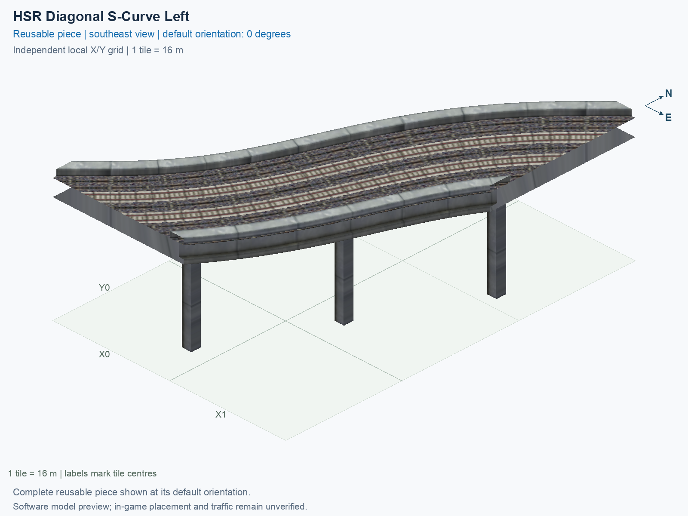

# HSR Diagonal S-Curve Left

Purpose: explain this reusable piece, its matching connections and current test coverage.

<!-- BEGIN PIECE OVERVIEW -->

A two-way diagonal S-curve shifts a diagonal line sideways while preserving its entry and exit heading. Native HSR or GHSR track ends; select the matching height and handedness.

Exact reusable identifier: `rail-hsr-diagonal-s-left`.

Footprint: **3 × 3 tiles**. Exact menu name: **HSR Diagonal S-Curve Left**.

Choose this exact name in Transportation → Rail. Press Home or End to rotate; use only the supported states listed below. Join each end to a matching port profile and direction.

- [Connections and journeys](#connections-and-journeys)
- [Test checklist](#test-checklist)



<!-- END PIECE OVERVIEW -->

<!-- BEGIN MANUAL SUMMARY -->

## Manual status

Generated from [the exact test cases](#test-checklist) and [authoritative observations](checks/manual-tests.json).

- [ ] Preview review: 0/1 applicable cases passed; 0 failed, 0 stale.
- [ ] In-game rendering: 0/4 applicable cases passed; 0 failed, 0 stale.
- [ ] Directed journeys: 0/8 applicable cases passed; 0 failed, 0 stale.

These observations cover only the named services, directions, poses, rotations, and recorded platforms.

<!-- END MANUAL SUMMARY -->

<!-- BEGIN CONNECTIONS -->

## Connections and journeys

Purpose: describe intrinsic directional interfaces and permitted service journeys.

Generated from [connections.json](connections.json). Coordinates are canonical east, north and height in metres. A connection class names an encoded route interface; it does not prove visible deck/wall fit or an in-game test.

Supported placement states: 0° CCW, 90° CCW, 180° CCW, 270° CCW. Each state has its own declared manual scope.

A **port** is one directional transport-path endpoint. **Service** identifies the intended network service (for example HSR, street, or tram); **engine** is its internal traffic-class number, separate from the construction network. **Role** distinguishes primary service from auxiliary paths; sharing a traffic class does not establish service compatibility.

A **tangent** is a unit travel-direction vector: `[0,1]` means north. **Grade** is height gained per horizontal metre. These measured facts describe this subject alone. Compatibility requires a separate comparison of the complete joining boundaries; physical seams and actual game operation require their own evidence. See the [class index](../../connection-classes.json) for shared route-interface membership.

| Port | Service / engine / role | Direction | Location; tangent; grade | Connection class |
| --- | --- | --- | --- | --- |
| `Sout` | hsr / 7 / primary | out | [13.1, -40.0, 15.5]; [-0.7071067811865471, -0.707106781186548]; 0.0 | `path-interface-41ca57fd348f78610e6e` |
| `Sin` | hsr / 7 / primary | in | [18.9, -40.0, 15.5]; [0.6334396472647336, 0.7737920995158389]; 0.0 | `path-interface-6d225b8f2247ccfd31a3` |
| `Eout` | hsr / 7 / primary | out | [40.0, -2.8, 15.5]; [0.6045105171867364, 0.7965971595547052]; 0.0 | `path-interface-a12d73f59cac722c57ae` |
| `Ein` | hsr / 7 / primary | in | [40.0, 2.9, 15.5]; [-0.7071067811865482, -0.7071067811865469]; 0.0 | `path-interface-81a020999d3346a1c961` |

### Directed journeys

| Service | Entry → exit | Role |
| --- | --- | --- |
| hsr | `Sin` → `Eout` | primary |
| hsr | `Ein` → `Sout` | primary |

### Forbidden transfers

| From service / port | To service / port | Reason |
| --- | --- | --- |
| hsr / `Sin` | hsr / `Sout` | No directed route exists between these ports in the saved piece transport paths. In-game confirmation remains unverified. |
| hsr / `Ein` | hsr / `Eout` | No directed route exists between these ports in the saved piece transport paths. In-game confirmation remains unverified. |

Review the test checklist for the exact tested cases and environments.

<!-- END CONNECTIONS -->

<!-- BEGIN MANUAL CHECKS -->

## Test checklist

Generated from [the authoritative record](checks/manual-tests.json). Only explicit human observations create manual passes; software and preview checks remain separate. Expand a check/service group to see its rotation table, then expand the matching exact scope to copy a case ID and inspect its pose, reviewer, environment, and evidence. Grouping changes only this view; every declared case remains separate.

**States:** [x] passed; [ ] unverified, failed, or stale; N/A is an explicit inapplicable declaration. A dash means no case was declared in that column. Every pass covers only its recorded environment. T means a distinct construction-transposed state.

Four proper rotations are covered. No additional reflected state is established by this record; repeated construction aliases do not create new orientations.

Current totals: unverified: 35, passed: 0, failed: 0, stale: 0, not_applicable: 0.

### Record an observation

Follow the [shared testing guide](../../../../docs/TESTING.md); copy [the unconfirmed example](checks/observation.example.json) to `checks/observation.json`. Case identifiers are in the expandable sections below. Do not edit generated checkboxes.

From the repository folder containing `custom-pieces`, run after filling `checks/observation.json` and explicitly confirming the exact observation:

```sh
python3 -m scp.content record --record custom-pieces/domains/high-speed-rail/00_pieces/rail-hsr-diagonal-s-left/checks/manual-tests.json --observation custom-pieces/domains/high-speed-rail/00_pieces/rail-hsr-diagonal-s-left/checks/observation.json
```

### Detailed current checks

Each collapsed group shows exact case counts and states. Forbidden transfers are grouped by the directed service pair; the table inside retains every port pair and rotation.

<details>
<summary>Compiled resources — Whole subject — 1 case; unverified: 1</summary>

| Check / exact scope | General | 0° | 90° | 180° | 270° |
| --- | --- | --- | --- | --- | --- |
| **Compiled resources**<br>Whole subject | <a href="#case-software_resources-b872ee89e66b9285d22d">[ ] unverified</a> | — | — | — | — |


<details>
<summary>Compiled resources — Whole subject</summary>

<a id="case-software_resources-b872ee89e66b9285d22d"></a>

**General: unverified** — `software_resources-b872ee89e66b9285d22d`.

Verify the actual compiled resources and construction rules.

Scope: Whole subject.

No observation recorded.

</details>

</details>

<details>
<summary>Directed routing graph — Whole subject — 1 case; unverified: 1</summary>

| Check / exact scope | General | 0° | 90° | 180° | 270° |
| --- | --- | --- | --- | --- | --- |
| **Directed routing graph**<br>Whole subject | <a href="#case-software_connectivity-b872ee89e66b9285d22d">[ ] unverified</a> | — | — | — | — |


<details>
<summary>Directed routing graph — Whole subject</summary>

<a id="case-software_connectivity-b872ee89e66b9285d22d"></a>

**General: unverified** — `software_connectivity-b872ee89e66b9285d22d`.

Verify the declared directed journeys and forbidden transfers.

Scope: Whole subject.

No observation recorded.

</details>

</details>

<details>
<summary>Preview review — Images — 1 case; unverified: 1</summary>

| Check / exact scope | General | 0° | 90° | 180° | 270° |
| --- | --- | --- | --- | --- | --- |
| **Preview review**<br>Image: image:rail-hsr-diagonal-s-left:canonical-southeast | <a href="#case-preview_review-4f86cc97079dd2abc52e">[ ] unverified</a> | — | — | — | — |


<details>
<summary>Preview review — Image: image:rail-hsr-diagonal-s-left:canonical-southeast</summary>

<a id="case-preview_review-4f86cc97079dd2abc52e"></a>

**General: unverified** — `preview_review-4f86cc97079dd2abc52e`.

Inspect this exact preview for tracks, walls, piers, seams and shadows.

Scope: Image: image:rail-hsr-diagonal-s-left:canonical-southeast.

No observation recorded.

</details>

</details>

<details>
<summary>In-game rendering — Whole subject — 4 cases; unverified: 4</summary>

| Check / exact scope | General | 0° | 90° | 180° | 270° |
| --- | --- | --- | --- | --- | --- |
| **In-game rendering**<br>Whole subject | — | <a href="#case-in_game_render-c3a3b6726234ceede371">[ ] unverified</a> | <a href="#case-in_game_render-df1d5895ff7a6cac1918">[ ] unverified</a> | <a href="#case-in_game_render-91448154d0d33dc5a361">[ ] unverified</a> | <a href="#case-in_game_render-6e43db371079172a4d33">[ ] unverified</a> |


<details>
<summary>In-game rendering — Whole subject</summary>

<a id="case-in_game_render-c3a3b6726234ceede371"></a>

**0° CCW: unverified** — `in_game_render-c3a3b6726234ceede371`.

Inspect the placed tracks, walls, piers, seams and shadows in SimCity 4.

Scope: Whole subject.

No observation recorded.

<a id="case-in_game_render-df1d5895ff7a6cac1918"></a>

**90° CCW: unverified** — `in_game_render-df1d5895ff7a6cac1918`.

Inspect the placed tracks, walls, piers, seams and shadows in SimCity 4.

Scope: Whole subject.

No observation recorded.

<a id="case-in_game_render-91448154d0d33dc5a361"></a>

**180° CCW: unverified** — `in_game_render-91448154d0d33dc5a361`.

Inspect the placed tracks, walls, piers, seams and shadows in SimCity 4.

Scope: Whole subject.

No observation recorded.

<a id="case-in_game_render-6e43db371079172a4d33"></a>

**270° CCW: unverified** — `in_game_render-6e43db371079172a4d33`.

Inspect the placed tracks, walls, piers, seams and shadows in SimCity 4.

Scope: Whole subject.

No observation recorded.

</details>

</details>

<details>
<summary>Placement — Whole subject — 4 cases; unverified: 4</summary>

| Check / exact scope | General | 0° | 90° | 180° | 270° |
| --- | --- | --- | --- | --- | --- |
| **Placement**<br>Whole subject | — | <a href="#case-in_game_placement-c3a3b6726234ceede371">[ ] unverified</a> | <a href="#case-in_game_placement-df1d5895ff7a6cac1918">[ ] unverified</a> | <a href="#case-in_game_placement-91448154d0d33dc5a361">[ ] unverified</a> | <a href="#case-in_game_placement-6e43db371079172a4d33">[ ] unverified</a> |


<details>
<summary>Placement — Whole subject</summary>

<a id="case-in_game_placement-c3a3b6726234ceede371"></a>

**0° CCW: unverified** — `in_game_placement-c3a3b6726234ceede371`.

Place this piece or complete blueprint and inspect every occupied tile.

Scope: Whole subject.

No observation recorded.

<a id="case-in_game_placement-df1d5895ff7a6cac1918"></a>

**90° CCW: unverified** — `in_game_placement-df1d5895ff7a6cac1918`.

Place this piece or complete blueprint and inspect every occupied tile.

Scope: Whole subject.

No observation recorded.

<a id="case-in_game_placement-91448154d0d33dc5a361"></a>

**180° CCW: unverified** — `in_game_placement-91448154d0d33dc5a361`.

Place this piece or complete blueprint and inspect every occupied tile.

Scope: Whole subject.

No observation recorded.

<a id="case-in_game_placement-6e43db371079172a4d33"></a>

**270° CCW: unverified** — `in_game_placement-6e43db371079172a4d33`.

Place this piece or complete blueprint and inspect every occupied tile.

Scope: Whole subject.

No observation recorded.

</details>

</details>

<details>
<summary>Demolition — Whole subject — 4 cases; unverified: 4</summary>

| Check / exact scope | General | 0° | 90° | 180° | 270° |
| --- | --- | --- | --- | --- | --- |
| **Demolition**<br>Whole subject | — | <a href="#case-in_game_demolition-c3a3b6726234ceede371">[ ] unverified</a> | <a href="#case-in_game_demolition-df1d5895ff7a6cac1918">[ ] unverified</a> | <a href="#case-in_game_demolition-91448154d0d33dc5a361">[ ] unverified</a> | <a href="#case-in_game_demolition-6e43db371079172a4d33">[ ] unverified</a> |


<details>
<summary>Demolition — Whole subject</summary>

<a id="case-in_game_demolition-c3a3b6726234ceede371"></a>

**0° CCW: unverified** — `in_game_demolition-c3a3b6726234ceede371`.

Bulldoze the complete placement and inspect the cleared area.

Scope: Whole subject.

No observation recorded.

<a id="case-in_game_demolition-df1d5895ff7a6cac1918"></a>

**90° CCW: unverified** — `in_game_demolition-df1d5895ff7a6cac1918`.

Bulldoze the complete placement and inspect the cleared area.

Scope: Whole subject.

No observation recorded.

<a id="case-in_game_demolition-91448154d0d33dc5a361"></a>

**180° CCW: unverified** — `in_game_demolition-91448154d0d33dc5a361`.

Bulldoze the complete placement and inspect the cleared area.

Scope: Whole subject.

No observation recorded.

<a id="case-in_game_demolition-6e43db371079172a4d33"></a>

**270° CCW: unverified** — `in_game_demolition-6e43db371079172a4d33`.

Bulldoze the complete placement and inspect the cleared area.

Scope: Whole subject.

No observation recorded.

</details>

</details>

<details>
<summary>Save and reload — Whole subject — 4 cases; unverified: 4</summary>

| Check / exact scope | General | 0° | 90° | 180° | 270° |
| --- | --- | --- | --- | --- | --- |
| **Save and reload**<br>Whole subject | — | <a href="#case-in_game_save_reload-c3a3b6726234ceede371">[ ] unverified</a> | <a href="#case-in_game_save_reload-df1d5895ff7a6cac1918">[ ] unverified</a> | <a href="#case-in_game_save_reload-91448154d0d33dc5a361">[ ] unverified</a> | <a href="#case-in_game_save_reload-6e43db371079172a4d33">[ ] unverified</a> |


<details>
<summary>Save and reload — Whole subject</summary>

<a id="case-in_game_save_reload-c3a3b6726234ceede371"></a>

**0° CCW: unverified** — `in_game_save_reload-c3a3b6726234ceede371`.

Save, quit, reload and inspect the placement and its paths.

Scope: Whole subject.

No observation recorded.

<a id="case-in_game_save_reload-df1d5895ff7a6cac1918"></a>

**90° CCW: unverified** — `in_game_save_reload-df1d5895ff7a6cac1918`.

Save, quit, reload and inspect the placement and its paths.

Scope: Whole subject.

No observation recorded.

<a id="case-in_game_save_reload-91448154d0d33dc5a361"></a>

**180° CCW: unverified** — `in_game_save_reload-91448154d0d33dc5a361`.

Save, quit, reload and inspect the placement and its paths.

Scope: Whole subject.

No observation recorded.

<a id="case-in_game_save_reload-6e43db371079172a4d33"></a>

**270° CCW: unverified** — `in_game_save_reload-6e43db371079172a4d33`.

Save, quit, reload and inspect the placement and its paths.

Scope: Whole subject.

No observation recorded.

</details>

</details>

<details>
<summary>Journey — hsr — 8 cases; unverified: 8</summary>

| Check / exact scope | General | 0° | 90° | 180° | 270° |
| --- | --- | --- | --- | --- | --- |
| **Journey**<br>Service: hsr; role: primary; journey: 7:Sin>Eout; entry: Sin; exit: Eout | — | <a href="#case-in_game_journey-d3ab04e22f508ad70f29">[ ] unverified</a> | <a href="#case-in_game_journey-4cb39822e7f4e7c778c6">[ ] unverified</a> | <a href="#case-in_game_journey-12f354b67da2e4a2ba7e">[ ] unverified</a> | <a href="#case-in_game_journey-99b45068b33d821b6bde">[ ] unverified</a> |
| **Journey**<br>Service: hsr; role: primary; journey: 7:Ein>Sout; entry: Ein; exit: Sout | — | <a href="#case-in_game_journey-f774a9967fde44e911ce">[ ] unverified</a> | <a href="#case-in_game_journey-e0ca46960023a2ffe1f5">[ ] unverified</a> | <a href="#case-in_game_journey-6b8bb907f2d6d84c7b18">[ ] unverified</a> | <a href="#case-in_game_journey-2bd5c9460cf4ff45deb1">[ ] unverified</a> |


<details>
<summary>Journey — Service: hsr; role: primary; journey: 7:Sin>Eout; entry: Sin; exit: Eout</summary>

<a id="case-in_game_journey-d3ab04e22f508ad70f29"></a>

**0° CCW: unverified** — `in_game_journey-d3ab04e22f508ad70f29`.

Run the declared journey in this direction using its service network.

Scope: Service: hsr; role: primary; journey: 7:Sin>Eout; entry: Sin; exit: Eout.

No observation recorded.

<a id="case-in_game_journey-4cb39822e7f4e7c778c6"></a>

**90° CCW: unverified** — `in_game_journey-4cb39822e7f4e7c778c6`.

Run the declared journey in this direction using its service network.

Scope: Service: hsr; role: primary; journey: 7:Sin>Eout; entry: Sin; exit: Eout.

No observation recorded.

<a id="case-in_game_journey-12f354b67da2e4a2ba7e"></a>

**180° CCW: unverified** — `in_game_journey-12f354b67da2e4a2ba7e`.

Run the declared journey in this direction using its service network.

Scope: Service: hsr; role: primary; journey: 7:Sin>Eout; entry: Sin; exit: Eout.

No observation recorded.

<a id="case-in_game_journey-99b45068b33d821b6bde"></a>

**270° CCW: unverified** — `in_game_journey-99b45068b33d821b6bde`.

Run the declared journey in this direction using its service network.

Scope: Service: hsr; role: primary; journey: 7:Sin>Eout; entry: Sin; exit: Eout.

No observation recorded.

</details>


<details>
<summary>Journey — Service: hsr; role: primary; journey: 7:Ein>Sout; entry: Ein; exit: Sout</summary>

<a id="case-in_game_journey-f774a9967fde44e911ce"></a>

**0° CCW: unverified** — `in_game_journey-f774a9967fde44e911ce`.

Run the declared journey in this direction using its service network.

Scope: Service: hsr; role: primary; journey: 7:Ein>Sout; entry: Ein; exit: Sout.

No observation recorded.

<a id="case-in_game_journey-e0ca46960023a2ffe1f5"></a>

**90° CCW: unverified** — `in_game_journey-e0ca46960023a2ffe1f5`.

Run the declared journey in this direction using its service network.

Scope: Service: hsr; role: primary; journey: 7:Ein>Sout; entry: Ein; exit: Sout.

No observation recorded.

<a id="case-in_game_journey-6b8bb907f2d6d84c7b18"></a>

**180° CCW: unverified** — `in_game_journey-6b8bb907f2d6d84c7b18`.

Run the declared journey in this direction using its service network.

Scope: Service: hsr; role: primary; journey: 7:Ein>Sout; entry: Ein; exit: Sout.

No observation recorded.

<a id="case-in_game_journey-2bd5c9460cf4ff45deb1"></a>

**270° CCW: unverified** — `in_game_journey-2bd5c9460cf4ff45deb1`.

Run the declared journey in this direction using its service network.

Scope: Service: hsr; role: primary; journey: 7:Ein>Sout; entry: Ein; exit: Sout.

No observation recorded.

</details>

</details>

<details>
<summary>Forbidden transfer — hsr → hsr — 8 cases; unverified: 8</summary>

| Check / exact scope | General | 0° | 90° | 180° | 270° |
| --- | --- | --- | --- | --- | --- |
| **Forbidden transfer**<br>from port: Sin; to port: Sout; from service: hsr; to service: hsr; basis: not reachable in actual saved PATH graph | — | <a href="#case-in_game_forbidden_transfer-9aa9654a3039a6b4cb7f">[ ] unverified</a> | <a href="#case-in_game_forbidden_transfer-734b0e875885f002a8ee">[ ] unverified</a> | <a href="#case-in_game_forbidden_transfer-c3538f02fae56d344f5c">[ ] unverified</a> | <a href="#case-in_game_forbidden_transfer-e1de7af1694298ed159f">[ ] unverified</a> |
| **Forbidden transfer**<br>from port: Ein; to port: Eout; from service: hsr; to service: hsr; basis: not reachable in actual saved PATH graph | — | <a href="#case-in_game_forbidden_transfer-0950c5b99967b9daa28a">[ ] unverified</a> | <a href="#case-in_game_forbidden_transfer-8b60331f677a92287bd5">[ ] unverified</a> | <a href="#case-in_game_forbidden_transfer-b06520e7c34dd9cd2641">[ ] unverified</a> | <a href="#case-in_game_forbidden_transfer-4170cf7bdd205df7b108">[ ] unverified</a> |


<details>
<summary>Forbidden transfer — from port: Sin; to port: Sout; from service: hsr; to service: hsr; basis: not reachable in actual saved PATH graph</summary>

<a id="case-in_game_forbidden_transfer-9aa9654a3039a6b4cb7f"></a>

**0° CCW: unverified** — `in_game_forbidden_transfer-9aa9654a3039a6b4cb7f`.

Confirm this undeclared transfer is unavailable.

Scope: from port: Sin; to port: Sout; from service: hsr; to service: hsr; basis: not reachable in actual saved PATH graph.

No observation recorded.

<a id="case-in_game_forbidden_transfer-734b0e875885f002a8ee"></a>

**90° CCW: unverified** — `in_game_forbidden_transfer-734b0e875885f002a8ee`.

Confirm this undeclared transfer is unavailable.

Scope: from port: Sin; to port: Sout; from service: hsr; to service: hsr; basis: not reachable in actual saved PATH graph.

No observation recorded.

<a id="case-in_game_forbidden_transfer-c3538f02fae56d344f5c"></a>

**180° CCW: unverified** — `in_game_forbidden_transfer-c3538f02fae56d344f5c`.

Confirm this undeclared transfer is unavailable.

Scope: from port: Sin; to port: Sout; from service: hsr; to service: hsr; basis: not reachable in actual saved PATH graph.

No observation recorded.

<a id="case-in_game_forbidden_transfer-e1de7af1694298ed159f"></a>

**270° CCW: unverified** — `in_game_forbidden_transfer-e1de7af1694298ed159f`.

Confirm this undeclared transfer is unavailable.

Scope: from port: Sin; to port: Sout; from service: hsr; to service: hsr; basis: not reachable in actual saved PATH graph.

No observation recorded.

</details>


<details>
<summary>Forbidden transfer — from port: Ein; to port: Eout; from service: hsr; to service: hsr; basis: not reachable in actual saved PATH graph</summary>

<a id="case-in_game_forbidden_transfer-0950c5b99967b9daa28a"></a>

**0° CCW: unverified** — `in_game_forbidden_transfer-0950c5b99967b9daa28a`.

Confirm this undeclared transfer is unavailable.

Scope: from port: Ein; to port: Eout; from service: hsr; to service: hsr; basis: not reachable in actual saved PATH graph.

No observation recorded.

<a id="case-in_game_forbidden_transfer-8b60331f677a92287bd5"></a>

**90° CCW: unverified** — `in_game_forbidden_transfer-8b60331f677a92287bd5`.

Confirm this undeclared transfer is unavailable.

Scope: from port: Ein; to port: Eout; from service: hsr; to service: hsr; basis: not reachable in actual saved PATH graph.

No observation recorded.

<a id="case-in_game_forbidden_transfer-b06520e7c34dd9cd2641"></a>

**180° CCW: unverified** — `in_game_forbidden_transfer-b06520e7c34dd9cd2641`.

Confirm this undeclared transfer is unavailable.

Scope: from port: Ein; to port: Eout; from service: hsr; to service: hsr; basis: not reachable in actual saved PATH graph.

No observation recorded.

<a id="case-in_game_forbidden_transfer-4170cf7bdd205df7b108"></a>

**270° CCW: unverified** — `in_game_forbidden_transfer-4170cf7bdd205df7b108`.

Confirm this undeclared transfer is unavailable.

Scope: from port: Ein; to port: Eout; from service: hsr; to service: hsr; basis: not reachable in actual saved PATH graph.

No observation recorded.

</details>

</details>

<!-- END MANUAL CHECKS -->

## Engineering contract

This diagonal S-curve has a 3 × 3 construction rectangle, four occupied cells, and an empty construction reference cell. The Left and Right geometries are separate authored types, rather than reflections inferred from a name. Empty cells do not establish construction clearance.

Use the [independent source contract](../../implementation/scp_hsr/rail_feature_verify.py) and this type's [definition](piece.json) for exact expectations. Shared HSR/GHSR facts remain in [NETWORK_SPEC.md](../../NETWORK_SPEC.md). These authored notes supplement generated source views; they do not change geometry, reset observations, or establish game operation.
