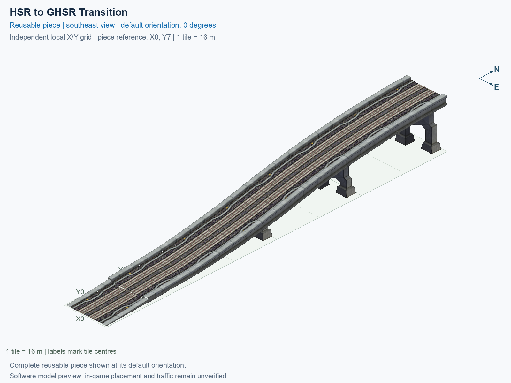

# HSR to GHSR Transition

Purpose: explain this reusable piece, its matching connections and current test coverage.

<!-- BEGIN PIECE OVERVIEW -->

An eight-tile two-way height transition using the audited native HSR-to-GHSR model and train paths. Elevated end 15.5 m; ground end 1 m.

Exact reusable identifier: `rail-hsr-ghsr-transition`.

Footprint: **1 × 8 tiles**. Exact menu name: **HSR to GHSR Transition**.

Choose this exact name in Transportation → Rail. Press Home or End to rotate; use only the supported states listed below. Join each end to a matching port profile and direction.

- [Connections and journeys](#connections-and-journeys)
- [Test checklist](#test-checklist)



<!-- END PIECE OVERVIEW -->

<!-- BEGIN MANUAL SUMMARY -->

## Manual status

Generated from [the exact test cases](#test-checklist) and [authoritative observations](checks/manual-tests.json).

- [ ] Preview review: 0/1 applicable cases passed; 0 failed, 0 stale.
- [ ] In-game rendering: 0/4 applicable cases passed; 0 failed, 0 stale.
- [ ] Directed journeys: 0/8 applicable cases passed; 0 failed, 0 stale.

These observations cover only the named services, directions, poses, rotations, and recorded platforms.

<!-- END MANUAL SUMMARY -->

<!-- BEGIN CONNECTIONS -->

## Connections and journeys

Purpose: describe intrinsic directional interfaces and permitted service journeys.

Generated from [connections.json](connections.json). Coordinates are canonical east, north and height in metres. A connection class names an encoded route interface; it does not prove visible deck/wall fit or an in-game test.

Supported placement states: 0° CCW, 90° CCW, 180° CCW, 270° CCW. Each state has its own declared manual scope.

A **port** is one directional transport-path endpoint. **Service** identifies the intended network service (for example HSR, street, or tram); **engine** is its internal traffic-class number, separate from the construction network. **Role** distinguishes primary service from auxiliary paths; sharing a traffic class does not establish service compatibility.

A **tangent** is a unit travel-direction vector: `[0,1]` means north. **Grade** is height gained per horizontal metre. These measured facts describe this subject alone. Compatibility requires a separate comparison of the complete joining boundaries; physical seams and actual game operation require their own evidence. See the [class index](../../connection-classes.json) for shared route-interface membership.

| Port | Service / engine / role | Direction | Location; tangent; grade | Connection class |
| --- | --- | --- | --- | --- |
| `Sout` | ghsr / 7 / primary | out | [-2.0, -120.0, 1.0]; [0.0, -1.0]; 0.0 | `path-interface-c78c5ac4b558d84b46f2` |
| `Nin` | hsr / 7 / primary | in | [-2.0, 8.0, 15.5]; [0.0, -1.0]; 0.0 | `path-interface-12d12be31d2057c5763d` |
| `Sin` | ghsr / 7 / primary | in | [2.0, -120.0, 1.0]; [0.0, 1.0]; 0.0 | `path-interface-fab587419de6b5848d74` |
| `Nout` | hsr / 7 / primary | out | [2.0, 8.0, 15.5]; [0.0, 1.0]; 0.0 | `path-interface-fba09fbeb87ad95c667a` |

### Directed journeys

| Service | Entry → exit | Role |
| --- | --- | --- |
| ghsr+hsr | `Nin` → `Sout` | primary |
| ghsr+hsr | `Sin` → `Nout` | primary |

### Forbidden transfers

| From service / port | To service / port | Reason |
| --- | --- | --- |
| hsr / `Nin` | hsr / `Nout` | No directed route exists between these ports in the saved piece transport paths. In-game confirmation remains unverified. |
| ghsr / `Sin` | ghsr / `Sout` | No directed route exists between these ports in the saved piece transport paths. In-game confirmation remains unverified. |

Review the test checklist for the exact tested cases and environments.

<!-- END CONNECTIONS -->

<!-- BEGIN MANUAL CHECKS -->

## Test checklist

Generated from [the authoritative record](checks/manual-tests.json). Only explicit human observations create manual passes; software and preview checks remain separate. Expand a check/service group to see its rotation table, then expand the matching exact scope to copy a case ID and inspect its pose, reviewer, environment, and evidence. Grouping changes only this view; every declared case remains separate.

**States:** [x] passed; [ ] unverified, failed, or stale; N/A is an explicit inapplicable declaration. A dash means no case was declared in that column. Every pass covers only its recorded environment. T means a distinct construction-transposed state.

Four proper rotations are covered. No additional reflected state is established by this record; repeated construction aliases do not create new orientations.

Current totals: unverified: 35, passed: 0, failed: 0, stale: 0, not_applicable: 0.

### Record an observation

Follow the [shared testing guide](../../../../docs/TESTING.md); copy [the unconfirmed example](checks/observation.example.json) to `checks/observation.json`. Case identifiers are in the expandable sections below. Do not edit generated checkboxes.

From the repository folder containing `custom-pieces`, run after filling `checks/observation.json` and explicitly confirming the exact observation:

```sh
python3 -m scp.content record --record custom-pieces/domains/high-speed-rail/00_pieces/rail-hsr-ghsr-transition/checks/manual-tests.json --observation custom-pieces/domains/high-speed-rail/00_pieces/rail-hsr-ghsr-transition/checks/observation.json
```

### Detailed current checks

Each collapsed group shows exact case counts and states. Forbidden transfers are grouped by the directed service pair; the table inside retains every port pair and rotation.

<details>
<summary>Compiled resources — Whole subject — 1 case; unverified: 1</summary>

| Check / exact scope | General | 0° | 90° | 180° | 270° |
| --- | --- | --- | --- | --- | --- |
| **Compiled resources**<br>Whole subject | <a href="#case-software_resources-0abc3eadec7c2a15ebc2">[ ] unverified</a> | — | — | — | — |


<details>
<summary>Compiled resources — Whole subject</summary>

<a id="case-software_resources-0abc3eadec7c2a15ebc2"></a>

**General: unverified** — `software_resources-0abc3eadec7c2a15ebc2`.

Verify the actual compiled resources and construction rules.

Scope: Whole subject.

No observation recorded.

</details>

</details>

<details>
<summary>Directed routing graph — Whole subject — 1 case; unverified: 1</summary>

| Check / exact scope | General | 0° | 90° | 180° | 270° |
| --- | --- | --- | --- | --- | --- |
| **Directed routing graph**<br>Whole subject | <a href="#case-software_connectivity-0abc3eadec7c2a15ebc2">[ ] unverified</a> | — | — | — | — |


<details>
<summary>Directed routing graph — Whole subject</summary>

<a id="case-software_connectivity-0abc3eadec7c2a15ebc2"></a>

**General: unverified** — `software_connectivity-0abc3eadec7c2a15ebc2`.

Verify the declared directed journeys and forbidden transfers.

Scope: Whole subject.

No observation recorded.

</details>

</details>

<details>
<summary>Preview review — Images — 1 case; unverified: 1</summary>

| Check / exact scope | General | 0° | 90° | 180° | 270° |
| --- | --- | --- | --- | --- | --- |
| **Preview review**<br>Image: image:rail-hsr-ghsr-transition:canonical-southeast | <a href="#case-preview_review-f5301b63a6099689f031">[ ] unverified</a> | — | — | — | — |


<details>
<summary>Preview review — Image: image:rail-hsr-ghsr-transition:canonical-southeast</summary>

<a id="case-preview_review-f5301b63a6099689f031"></a>

**General: unverified** — `preview_review-f5301b63a6099689f031`.

Inspect this exact preview for tracks, walls, piers, seams and shadows.

Scope: Image: image:rail-hsr-ghsr-transition:canonical-southeast.

No observation recorded.

</details>

</details>

<details>
<summary>In-game rendering — Whole subject — 4 cases; unverified: 4</summary>

| Check / exact scope | General | 0° | 90° | 180° | 270° |
| --- | --- | --- | --- | --- | --- |
| **In-game rendering**<br>Whole subject | — | <a href="#case-in_game_render-1d1a1dac2709824d0ace">[ ] unverified</a> | <a href="#case-in_game_render-2f23e5b427ff11856d29">[ ] unverified</a> | <a href="#case-in_game_render-2e63e5ddbb7981b3960f">[ ] unverified</a> | <a href="#case-in_game_render-a6c4752d5ac536325dc5">[ ] unverified</a> |


<details>
<summary>In-game rendering — Whole subject</summary>

<a id="case-in_game_render-1d1a1dac2709824d0ace"></a>

**0° CCW: unverified** — `in_game_render-1d1a1dac2709824d0ace`.

Inspect the placed tracks, walls, piers, seams and shadows in SimCity 4.

Scope: Whole subject.

No observation recorded.

<a id="case-in_game_render-2f23e5b427ff11856d29"></a>

**90° CCW: unverified** — `in_game_render-2f23e5b427ff11856d29`.

Inspect the placed tracks, walls, piers, seams and shadows in SimCity 4.

Scope: Whole subject.

No observation recorded.

<a id="case-in_game_render-2e63e5ddbb7981b3960f"></a>

**180° CCW: unverified** — `in_game_render-2e63e5ddbb7981b3960f`.

Inspect the placed tracks, walls, piers, seams and shadows in SimCity 4.

Scope: Whole subject.

No observation recorded.

<a id="case-in_game_render-a6c4752d5ac536325dc5"></a>

**270° CCW: unverified** — `in_game_render-a6c4752d5ac536325dc5`.

Inspect the placed tracks, walls, piers, seams and shadows in SimCity 4.

Scope: Whole subject.

No observation recorded.

</details>

</details>

<details>
<summary>Placement — Whole subject — 4 cases; unverified: 4</summary>

| Check / exact scope | General | 0° | 90° | 180° | 270° |
| --- | --- | --- | --- | --- | --- |
| **Placement**<br>Whole subject | — | <a href="#case-in_game_placement-1d1a1dac2709824d0ace">[ ] unverified</a> | <a href="#case-in_game_placement-2f23e5b427ff11856d29">[ ] unverified</a> | <a href="#case-in_game_placement-2e63e5ddbb7981b3960f">[ ] unverified</a> | <a href="#case-in_game_placement-a6c4752d5ac536325dc5">[ ] unverified</a> |


<details>
<summary>Placement — Whole subject</summary>

<a id="case-in_game_placement-1d1a1dac2709824d0ace"></a>

**0° CCW: unverified** — `in_game_placement-1d1a1dac2709824d0ace`.

Place this piece or complete blueprint and inspect every occupied tile.

Scope: Whole subject.

No observation recorded.

<a id="case-in_game_placement-2f23e5b427ff11856d29"></a>

**90° CCW: unverified** — `in_game_placement-2f23e5b427ff11856d29`.

Place this piece or complete blueprint and inspect every occupied tile.

Scope: Whole subject.

No observation recorded.

<a id="case-in_game_placement-2e63e5ddbb7981b3960f"></a>

**180° CCW: unverified** — `in_game_placement-2e63e5ddbb7981b3960f`.

Place this piece or complete blueprint and inspect every occupied tile.

Scope: Whole subject.

No observation recorded.

<a id="case-in_game_placement-a6c4752d5ac536325dc5"></a>

**270° CCW: unverified** — `in_game_placement-a6c4752d5ac536325dc5`.

Place this piece or complete blueprint and inspect every occupied tile.

Scope: Whole subject.

No observation recorded.

</details>

</details>

<details>
<summary>Demolition — Whole subject — 4 cases; unverified: 4</summary>

| Check / exact scope | General | 0° | 90° | 180° | 270° |
| --- | --- | --- | --- | --- | --- |
| **Demolition**<br>Whole subject | — | <a href="#case-in_game_demolition-1d1a1dac2709824d0ace">[ ] unverified</a> | <a href="#case-in_game_demolition-2f23e5b427ff11856d29">[ ] unverified</a> | <a href="#case-in_game_demolition-2e63e5ddbb7981b3960f">[ ] unverified</a> | <a href="#case-in_game_demolition-a6c4752d5ac536325dc5">[ ] unverified</a> |


<details>
<summary>Demolition — Whole subject</summary>

<a id="case-in_game_demolition-1d1a1dac2709824d0ace"></a>

**0° CCW: unverified** — `in_game_demolition-1d1a1dac2709824d0ace`.

Bulldoze the complete placement and inspect the cleared area.

Scope: Whole subject.

No observation recorded.

<a id="case-in_game_demolition-2f23e5b427ff11856d29"></a>

**90° CCW: unverified** — `in_game_demolition-2f23e5b427ff11856d29`.

Bulldoze the complete placement and inspect the cleared area.

Scope: Whole subject.

No observation recorded.

<a id="case-in_game_demolition-2e63e5ddbb7981b3960f"></a>

**180° CCW: unverified** — `in_game_demolition-2e63e5ddbb7981b3960f`.

Bulldoze the complete placement and inspect the cleared area.

Scope: Whole subject.

No observation recorded.

<a id="case-in_game_demolition-a6c4752d5ac536325dc5"></a>

**270° CCW: unverified** — `in_game_demolition-a6c4752d5ac536325dc5`.

Bulldoze the complete placement and inspect the cleared area.

Scope: Whole subject.

No observation recorded.

</details>

</details>

<details>
<summary>Save and reload — Whole subject — 4 cases; unverified: 4</summary>

| Check / exact scope | General | 0° | 90° | 180° | 270° |
| --- | --- | --- | --- | --- | --- |
| **Save and reload**<br>Whole subject | — | <a href="#case-in_game_save_reload-1d1a1dac2709824d0ace">[ ] unverified</a> | <a href="#case-in_game_save_reload-2f23e5b427ff11856d29">[ ] unverified</a> | <a href="#case-in_game_save_reload-2e63e5ddbb7981b3960f">[ ] unverified</a> | <a href="#case-in_game_save_reload-a6c4752d5ac536325dc5">[ ] unverified</a> |


<details>
<summary>Save and reload — Whole subject</summary>

<a id="case-in_game_save_reload-1d1a1dac2709824d0ace"></a>

**0° CCW: unverified** — `in_game_save_reload-1d1a1dac2709824d0ace`.

Save, quit, reload and inspect the placement and its paths.

Scope: Whole subject.

No observation recorded.

<a id="case-in_game_save_reload-2f23e5b427ff11856d29"></a>

**90° CCW: unverified** — `in_game_save_reload-2f23e5b427ff11856d29`.

Save, quit, reload and inspect the placement and its paths.

Scope: Whole subject.

No observation recorded.

<a id="case-in_game_save_reload-2e63e5ddbb7981b3960f"></a>

**180° CCW: unverified** — `in_game_save_reload-2e63e5ddbb7981b3960f`.

Save, quit, reload and inspect the placement and its paths.

Scope: Whole subject.

No observation recorded.

<a id="case-in_game_save_reload-a6c4752d5ac536325dc5"></a>

**270° CCW: unverified** — `in_game_save_reload-a6c4752d5ac536325dc5`.

Save, quit, reload and inspect the placement and its paths.

Scope: Whole subject.

No observation recorded.

</details>

</details>

<details>
<summary>Journey — ghsr+hsr — 8 cases; unverified: 8</summary>

| Check / exact scope | General | 0° | 90° | 180° | 270° |
| --- | --- | --- | --- | --- | --- |
| **Journey**<br>Service: ghsr+hsr; role: primary; journey: 7:Nin>Sout; entry: Nin; exit: Sout | — | <a href="#case-in_game_journey-5ef1cc996459ff9120b8">[ ] unverified</a> | <a href="#case-in_game_journey-61d33f20ee7ec0f145f3">[ ] unverified</a> | <a href="#case-in_game_journey-32cbeaade26cfe6e532c">[ ] unverified</a> | <a href="#case-in_game_journey-111d63c1d96a66ffa3f2">[ ] unverified</a> |
| **Journey**<br>Service: ghsr+hsr; role: primary; journey: 7:Sin>Nout; entry: Sin; exit: Nout | — | <a href="#case-in_game_journey-222b990e64994d7bdd7c">[ ] unverified</a> | <a href="#case-in_game_journey-2b2d0d3809a84c9b4b3d">[ ] unverified</a> | <a href="#case-in_game_journey-43ba0102f3e6ab54f8ac">[ ] unverified</a> | <a href="#case-in_game_journey-f893c71386f0dcc7cd3c">[ ] unverified</a> |


<details>
<summary>Journey — Service: ghsr+hsr; role: primary; journey: 7:Nin>Sout; entry: Nin; exit: Sout</summary>

<a id="case-in_game_journey-5ef1cc996459ff9120b8"></a>

**0° CCW: unverified** — `in_game_journey-5ef1cc996459ff9120b8`.

Run the declared journey in this direction using its service network.

Scope: Service: ghsr+hsr; role: primary; journey: 7:Nin>Sout; entry: Nin; exit: Sout.

No observation recorded.

<a id="case-in_game_journey-61d33f20ee7ec0f145f3"></a>

**90° CCW: unverified** — `in_game_journey-61d33f20ee7ec0f145f3`.

Run the declared journey in this direction using its service network.

Scope: Service: ghsr+hsr; role: primary; journey: 7:Nin>Sout; entry: Nin; exit: Sout.

No observation recorded.

<a id="case-in_game_journey-32cbeaade26cfe6e532c"></a>

**180° CCW: unverified** — `in_game_journey-32cbeaade26cfe6e532c`.

Run the declared journey in this direction using its service network.

Scope: Service: ghsr+hsr; role: primary; journey: 7:Nin>Sout; entry: Nin; exit: Sout.

No observation recorded.

<a id="case-in_game_journey-111d63c1d96a66ffa3f2"></a>

**270° CCW: unverified** — `in_game_journey-111d63c1d96a66ffa3f2`.

Run the declared journey in this direction using its service network.

Scope: Service: ghsr+hsr; role: primary; journey: 7:Nin>Sout; entry: Nin; exit: Sout.

No observation recorded.

</details>


<details>
<summary>Journey — Service: ghsr+hsr; role: primary; journey: 7:Sin>Nout; entry: Sin; exit: Nout</summary>

<a id="case-in_game_journey-222b990e64994d7bdd7c"></a>

**0° CCW: unverified** — `in_game_journey-222b990e64994d7bdd7c`.

Run the declared journey in this direction using its service network.

Scope: Service: ghsr+hsr; role: primary; journey: 7:Sin>Nout; entry: Sin; exit: Nout.

No observation recorded.

<a id="case-in_game_journey-2b2d0d3809a84c9b4b3d"></a>

**90° CCW: unverified** — `in_game_journey-2b2d0d3809a84c9b4b3d`.

Run the declared journey in this direction using its service network.

Scope: Service: ghsr+hsr; role: primary; journey: 7:Sin>Nout; entry: Sin; exit: Nout.

No observation recorded.

<a id="case-in_game_journey-43ba0102f3e6ab54f8ac"></a>

**180° CCW: unverified** — `in_game_journey-43ba0102f3e6ab54f8ac`.

Run the declared journey in this direction using its service network.

Scope: Service: ghsr+hsr; role: primary; journey: 7:Sin>Nout; entry: Sin; exit: Nout.

No observation recorded.

<a id="case-in_game_journey-f893c71386f0dcc7cd3c"></a>

**270° CCW: unverified** — `in_game_journey-f893c71386f0dcc7cd3c`.

Run the declared journey in this direction using its service network.

Scope: Service: ghsr+hsr; role: primary; journey: 7:Sin>Nout; entry: Sin; exit: Nout.

No observation recorded.

</details>

</details>

<details>
<summary>Forbidden transfer — hsr → hsr — 4 cases; unverified: 4</summary>

| Check / exact scope | General | 0° | 90° | 180° | 270° |
| --- | --- | --- | --- | --- | --- |
| **Forbidden transfer**<br>from port: Nin; to port: Nout; from service: hsr; to service: hsr; basis: not reachable in actual saved PATH graph | — | <a href="#case-in_game_forbidden_transfer-05fe13da683dd8ac4b41">[ ] unverified</a> | <a href="#case-in_game_forbidden_transfer-d308e69b71d8273fd2c6">[ ] unverified</a> | <a href="#case-in_game_forbidden_transfer-f531b5ddfeb9a479769a">[ ] unverified</a> | <a href="#case-in_game_forbidden_transfer-0c4996afa7a64c859051">[ ] unverified</a> |


<details>
<summary>Forbidden transfer — from port: Nin; to port: Nout; from service: hsr; to service: hsr; basis: not reachable in actual saved PATH graph</summary>

<a id="case-in_game_forbidden_transfer-05fe13da683dd8ac4b41"></a>

**0° CCW: unverified** — `in_game_forbidden_transfer-05fe13da683dd8ac4b41`.

Confirm this undeclared transfer is unavailable.

Scope: from port: Nin; to port: Nout; from service: hsr; to service: hsr; basis: not reachable in actual saved PATH graph.

No observation recorded.

<a id="case-in_game_forbidden_transfer-d308e69b71d8273fd2c6"></a>

**90° CCW: unverified** — `in_game_forbidden_transfer-d308e69b71d8273fd2c6`.

Confirm this undeclared transfer is unavailable.

Scope: from port: Nin; to port: Nout; from service: hsr; to service: hsr; basis: not reachable in actual saved PATH graph.

No observation recorded.

<a id="case-in_game_forbidden_transfer-f531b5ddfeb9a479769a"></a>

**180° CCW: unverified** — `in_game_forbidden_transfer-f531b5ddfeb9a479769a`.

Confirm this undeclared transfer is unavailable.

Scope: from port: Nin; to port: Nout; from service: hsr; to service: hsr; basis: not reachable in actual saved PATH graph.

No observation recorded.

<a id="case-in_game_forbidden_transfer-0c4996afa7a64c859051"></a>

**270° CCW: unverified** — `in_game_forbidden_transfer-0c4996afa7a64c859051`.

Confirm this undeclared transfer is unavailable.

Scope: from port: Nin; to port: Nout; from service: hsr; to service: hsr; basis: not reachable in actual saved PATH graph.

No observation recorded.

</details>

</details>

<details>
<summary>Forbidden transfer — ghsr → ghsr — 4 cases; unverified: 4</summary>

| Check / exact scope | General | 0° | 90° | 180° | 270° |
| --- | --- | --- | --- | --- | --- |
| **Forbidden transfer**<br>from port: Sin; to port: Sout; from service: ghsr; to service: ghsr; basis: not reachable in actual saved PATH graph | — | <a href="#case-in_game_forbidden_transfer-dc5a7ce4c5c8d9c43836">[ ] unverified</a> | <a href="#case-in_game_forbidden_transfer-df605f8fa8992edb297c">[ ] unverified</a> | <a href="#case-in_game_forbidden_transfer-682cf3993276ac372ae8">[ ] unverified</a> | <a href="#case-in_game_forbidden_transfer-58660f11ebc1b57b665a">[ ] unverified</a> |


<details>
<summary>Forbidden transfer — from port: Sin; to port: Sout; from service: ghsr; to service: ghsr; basis: not reachable in actual saved PATH graph</summary>

<a id="case-in_game_forbidden_transfer-dc5a7ce4c5c8d9c43836"></a>

**0° CCW: unverified** — `in_game_forbidden_transfer-dc5a7ce4c5c8d9c43836`.

Confirm this undeclared transfer is unavailable.

Scope: from port: Sin; to port: Sout; from service: ghsr; to service: ghsr; basis: not reachable in actual saved PATH graph.

No observation recorded.

<a id="case-in_game_forbidden_transfer-df605f8fa8992edb297c"></a>

**90° CCW: unverified** — `in_game_forbidden_transfer-df605f8fa8992edb297c`.

Confirm this undeclared transfer is unavailable.

Scope: from port: Sin; to port: Sout; from service: ghsr; to service: ghsr; basis: not reachable in actual saved PATH graph.

No observation recorded.

<a id="case-in_game_forbidden_transfer-682cf3993276ac372ae8"></a>

**180° CCW: unverified** — `in_game_forbidden_transfer-682cf3993276ac372ae8`.

Confirm this undeclared transfer is unavailable.

Scope: from port: Sin; to port: Sout; from service: ghsr; to service: ghsr; basis: not reachable in actual saved PATH graph.

No observation recorded.

<a id="case-in_game_forbidden_transfer-58660f11ebc1b57b665a"></a>

**270° CCW: unverified** — `in_game_forbidden_transfer-58660f11ebc1b57b665a`.

Confirm this undeclared transfer is unavailable.

Scope: from port: Sin; to port: Sout; from service: ghsr; to service: ghsr; basis: not reachable in actual saved PATH graph.

No observation recorded.

</details>

</details>

<!-- END MANUAL CHECKS -->

## Engineering contract

This two-way HSR/GHSR height transition has a 1 × 8 construction rectangle and eight occupied cells: seven sloped cells and one flat GHSR end. Its source family carries both directions between the 15.5 m HSR and 1 m GHSR interfaces. Use the matching native profiles; the connection names do not create compatibility with another height or width.

Use the [independent source contract](../../implementation/scp_hsr/rail_feature_verify.py) and this type's [definition](piece.json) for exact expectations. Shared HSR/GHSR facts remain in [NETWORK_SPEC.md](../../NETWORK_SPEC.md). These authored notes supplement generated source views; they do not change geometry, reset observations, or establish game operation.
