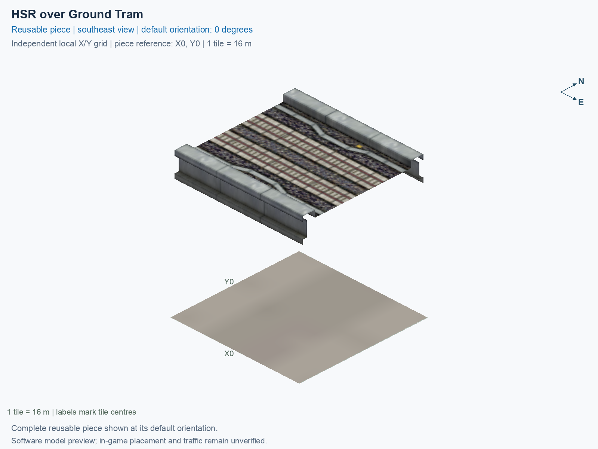

# HSR over Ground Tram

Purpose: explain this reusable piece, its matching connections and current test coverage.

<!-- BEGIN PIECE OVERVIEW -->

Visible ground tram crosses under straight elevated HSR at a right angle. One tile.

Exact reusable identifier: `tram-under-hsr`.

Footprint: **1 × 1 tiles**. Exact menu name: **HSR over Ground Tram**.

Choose this exact name in Transportation → Rail. Press Home or End to rotate; use only the supported states listed below. Join each end to a matching port profile and direction.

- [Connections and journeys](#connections-and-journeys)
- [Test checklist](#test-checklist)



<!-- END PIECE OVERVIEW -->

<!-- BEGIN MANUAL SUMMARY -->

## Manual status

Generated from [the exact test cases](#test-checklist) and [authoritative observations](checks/manual-tests.json).

- [ ] Preview review: 0/1 applicable cases passed; 0 failed, 0 stale.
- [ ] In-game rendering: 0/4 applicable cases passed; 0 failed, 0 stale.
- [ ] Directed journeys: 0/24 applicable cases passed; 0 failed, 0 stale.

These observations cover only the named services, directions, poses, rotations, and recorded platforms.

<!-- END MANUAL SUMMARY -->

<!-- BEGIN CONNECTIONS -->

## Connections and journeys

Purpose: describe intrinsic directional interfaces and permitted service journeys.

Generated from [connections.json](connections.json). Coordinates are canonical east, north and height in metres. A connection class names an encoded route interface; it does not prove visible deck/wall fit or an in-game test.

Supported placement states: 0° CCW, 90° CCW, 180° CCW, 270° CCW. Each state has its own declared manual scope.

A **port** is one directional transport-path endpoint. **Service** identifies the intended network service (for example HSR, street, or tram); **engine** is its internal traffic-class number, separate from the construction network. **Role** distinguishes primary service from auxiliary paths; sharing a traffic class does not establish service compatibility.

A **tangent** is a unit travel-direction vector: `[0,1]` means north. **Grade** is height gained per horizontal metre. These measured facts describe this subject alone. Compatibility requires a separate comparison of the complete joining boundaries; physical seams and actual game operation require their own evidence. See the [class index](../../connection-classes.json) for shared route-interface membership.

| Port | Service / engine / role | Direction | Location; tangent; grade | Connection class |
| --- | --- | --- | --- | --- |
| `3-S-out-1` | tram-udi / 3 / auxiliary | out | [-2.0, -8.0, 0.0]; [0.0, -1.0]; 0.0 | `path-interface-d959025f3a5761d5e1c2` |
| `3-N-in-2` | tram-udi / 3 / auxiliary | in | [-2.0, 8.0, 0.0]; [0.0, -1.0]; 0.0 | `path-interface-d959025f3a5761d5e1c2` |
| `3-S-in-3` | tram-udi / 3 / auxiliary | in | [2.0, -8.0, 0.0]; [0.0, 1.0]; 0.0 | `path-interface-fe76ecf95961c35924b9` |
| `3-N-out-4` | tram-udi / 3 / auxiliary | out | [2.0, 8.0, 0.0]; [0.0, 1.0]; 0.0 | `path-interface-fe76ecf95961c35924b9` |
| `6-S-out-1` | tram / 6 / primary | out | [-2.0, -8.0, 0.0]; [0.0, -1.0]; 0.0 | `path-interface-24634d6e5bf400b21233` |
| `6-N-in-2` | tram / 6 / primary | in | [-2.0, 8.0, 0.0]; [0.0, -1.0]; 0.0 | `path-interface-24634d6e5bf400b21233` |
| `6-S-in-3` | tram / 6 / primary | in | [2.0, -8.0, 0.0]; [0.0, 1.0]; 0.0 | `path-interface-3e608bdf4ab61431be91` |
| `6-N-out-4` | tram / 6 / primary | out | [2.0, 8.0, 0.0]; [0.0, 1.0]; 0.0 | `path-interface-3e608bdf4ab61431be91` |
| `7-W-in-1` | hsr / 7 / primary | in | [-8.0, -2.0, 15.5]; [1.0, 0.0]; 0.0 | `path-interface-12d12be31d2057c5763d` |
| `7-W-out-2` | hsr / 7 / primary | out | [-8.0, 2.0, 15.5]; [-1.0, 0.0]; 0.0 | `path-interface-fba09fbeb87ad95c667a` |
| `7-E-out-3` | hsr / 7 / primary | out | [8.0, -2.0, 15.5]; [1.0, 0.0]; 0.0 | `path-interface-12d12be31d2057c5763d` |
| `7-E-in-4` | hsr / 7 / primary | in | [8.0, 2.0, 15.5]; [-1.0, 0.0]; 0.0 | `path-interface-fba09fbeb87ad95c667a` |

### Directed journeys

| Service | Entry → exit | Role |
| --- | --- | --- |
| tram-udi | `3-N-in-2` → `3-S-out-1` | auxiliary |
| tram-udi | `3-S-in-3` → `3-N-out-4` | auxiliary |
| tram | `6-N-in-2` → `6-S-out-1` | primary |
| tram | `6-S-in-3` → `6-N-out-4` | primary |
| hsr | `7-W-in-1` → `7-E-out-3` | primary |
| hsr | `7-E-in-4` → `7-W-out-2` | primary |

### Forbidden transfers

| From service / port | To service / port | Reason |
| --- | --- | --- |
| tram-udi / `3-N-in-2` | tram-udi / `3-N-out-4` | No directed route exists between these ports in the saved piece transport paths. In-game confirmation remains unverified. |
| tram-udi / `3-N-in-2` | tram / `6-S-out-1` | No directed route exists between these ports in the saved piece transport paths. In-game confirmation remains unverified. |
| tram-udi / `3-N-in-2` | tram / `6-N-out-4` | No directed route exists between these ports in the saved piece transport paths. In-game confirmation remains unverified. |
| tram-udi / `3-N-in-2` | hsr / `7-W-out-2` | No directed route exists between these ports in the saved piece transport paths. In-game confirmation remains unverified. |
| tram-udi / `3-N-in-2` | hsr / `7-E-out-3` | No directed route exists between these ports in the saved piece transport paths. In-game confirmation remains unverified. |
| tram-udi / `3-S-in-3` | tram-udi / `3-S-out-1` | No directed route exists between these ports in the saved piece transport paths. In-game confirmation remains unverified. |
| tram-udi / `3-S-in-3` | tram / `6-S-out-1` | No directed route exists between these ports in the saved piece transport paths. In-game confirmation remains unverified. |
| tram-udi / `3-S-in-3` | tram / `6-N-out-4` | No directed route exists between these ports in the saved piece transport paths. In-game confirmation remains unverified. |
| tram-udi / `3-S-in-3` | hsr / `7-W-out-2` | No directed route exists between these ports in the saved piece transport paths. In-game confirmation remains unverified. |
| tram-udi / `3-S-in-3` | hsr / `7-E-out-3` | No directed route exists between these ports in the saved piece transport paths. In-game confirmation remains unverified. |
| tram / `6-N-in-2` | tram-udi / `3-S-out-1` | No directed route exists between these ports in the saved piece transport paths. In-game confirmation remains unverified. |
| tram / `6-N-in-2` | tram-udi / `3-N-out-4` | No directed route exists between these ports in the saved piece transport paths. In-game confirmation remains unverified. |
| tram / `6-N-in-2` | tram / `6-N-out-4` | No directed route exists between these ports in the saved piece transport paths. In-game confirmation remains unverified. |
| tram / `6-N-in-2` | hsr / `7-W-out-2` | No directed route exists between these ports in the saved piece transport paths. In-game confirmation remains unverified. |
| tram / `6-N-in-2` | hsr / `7-E-out-3` | No directed route exists between these ports in the saved piece transport paths. In-game confirmation remains unverified. |
| tram / `6-S-in-3` | tram-udi / `3-S-out-1` | No directed route exists between these ports in the saved piece transport paths. In-game confirmation remains unverified. |
| tram / `6-S-in-3` | tram-udi / `3-N-out-4` | No directed route exists between these ports in the saved piece transport paths. In-game confirmation remains unverified. |
| tram / `6-S-in-3` | tram / `6-S-out-1` | No directed route exists between these ports in the saved piece transport paths. In-game confirmation remains unverified. |
| tram / `6-S-in-3` | hsr / `7-W-out-2` | No directed route exists between these ports in the saved piece transport paths. In-game confirmation remains unverified. |
| tram / `6-S-in-3` | hsr / `7-E-out-3` | No directed route exists between these ports in the saved piece transport paths. In-game confirmation remains unverified. |
| hsr / `7-W-in-1` | tram-udi / `3-S-out-1` | No directed route exists between these ports in the saved piece transport paths. In-game confirmation remains unverified. |
| hsr / `7-W-in-1` | tram-udi / `3-N-out-4` | No directed route exists between these ports in the saved piece transport paths. In-game confirmation remains unverified. |
| hsr / `7-W-in-1` | tram / `6-S-out-1` | No directed route exists between these ports in the saved piece transport paths. In-game confirmation remains unverified. |
| hsr / `7-W-in-1` | tram / `6-N-out-4` | No directed route exists between these ports in the saved piece transport paths. In-game confirmation remains unverified. |
| hsr / `7-W-in-1` | hsr / `7-W-out-2` | No directed route exists between these ports in the saved piece transport paths. In-game confirmation remains unverified. |
| hsr / `7-E-in-4` | tram-udi / `3-S-out-1` | No directed route exists between these ports in the saved piece transport paths. In-game confirmation remains unverified. |
| hsr / `7-E-in-4` | tram-udi / `3-N-out-4` | No directed route exists between these ports in the saved piece transport paths. In-game confirmation remains unverified. |
| hsr / `7-E-in-4` | tram / `6-S-out-1` | No directed route exists between these ports in the saved piece transport paths. In-game confirmation remains unverified. |
| hsr / `7-E-in-4` | tram / `6-N-out-4` | No directed route exists between these ports in the saved piece transport paths. In-game confirmation remains unverified. |
| hsr / `7-E-in-4` | hsr / `7-E-out-3` | No directed route exists between these ports in the saved piece transport paths. In-game confirmation remains unverified. |

Review the test checklist for the exact tested cases and environments.

<!-- END CONNECTIONS -->

<!-- BEGIN MANUAL CHECKS -->

## Test checklist

Generated from [the authoritative record](checks/manual-tests.json). Only explicit human observations create manual passes; software and preview checks remain separate. Expand a check/service group to see its rotation table, then expand the matching exact scope to copy a case ID and inspect its pose, reviewer, environment, and evidence. Grouping changes only this view; every declared case remains separate.

**States:** [x] passed; [ ] unverified, failed, or stale; N/A is an explicit inapplicable declaration. A dash means no case was declared in that column. Every pass covers only its recorded environment. T means a distinct construction-transposed state.

Four proper rotations are covered. No additional reflected state is established by this record; repeated construction aliases do not create new orientations.

Current totals: unverified: 163, passed: 0, failed: 0, stale: 0, not_applicable: 0.

### Record an observation

Follow the [shared testing guide](../../../../docs/TESTING.md); copy [the unconfirmed example](checks/observation.example.json) to `checks/observation.json`. Case identifiers are in the expandable sections below. Do not edit generated checkboxes.

From the repository folder containing `custom-pieces`, run after filling `checks/observation.json` and explicitly confirming the exact observation:

```sh
python3 -m scp.content record --record custom-pieces/domains/high-speed-rail/00_pieces/tram-under-hsr/checks/manual-tests.json --observation custom-pieces/domains/high-speed-rail/00_pieces/tram-under-hsr/checks/observation.json
```

### Detailed current checks

Each collapsed group shows exact case counts and states. Forbidden transfers are grouped by the directed service pair; the table inside retains every port pair and rotation.

<details>
<summary>Compiled resources — Whole subject — 1 case; unverified: 1</summary>

| Check / exact scope | General | 0° | 90° | 180° | 270° |
| --- | --- | --- | --- | --- | --- |
| **Compiled resources**<br>Whole subject | <a href="#case-software_resources-0c177969f0d9c89e082d">[ ] unverified</a> | — | — | — | — |


<details>
<summary>Compiled resources — Whole subject</summary>

<a id="case-software_resources-0c177969f0d9c89e082d"></a>

**General: unverified** — `software_resources-0c177969f0d9c89e082d`.

Verify the actual compiled resources and construction rules.

Scope: Whole subject.

No observation recorded.

</details>

</details>

<details>
<summary>Directed routing graph — Whole subject — 1 case; unverified: 1</summary>

| Check / exact scope | General | 0° | 90° | 180° | 270° |
| --- | --- | --- | --- | --- | --- |
| **Directed routing graph**<br>Whole subject | <a href="#case-software_connectivity-0c177969f0d9c89e082d">[ ] unverified</a> | — | — | — | — |


<details>
<summary>Directed routing graph — Whole subject</summary>

<a id="case-software_connectivity-0c177969f0d9c89e082d"></a>

**General: unverified** — `software_connectivity-0c177969f0d9c89e082d`.

Verify the declared directed journeys and forbidden transfers.

Scope: Whole subject.

No observation recorded.

</details>

</details>

<details>
<summary>Preview review — Images — 1 case; unverified: 1</summary>

| Check / exact scope | General | 0° | 90° | 180° | 270° |
| --- | --- | --- | --- | --- | --- |
| **Preview review**<br>Image: image:tram-under-hsr:canonical-southeast | <a href="#case-preview_review-5455779a5d980665007b">[ ] unverified</a> | — | — | — | — |


<details>
<summary>Preview review — Image: image:tram-under-hsr:canonical-southeast</summary>

<a id="case-preview_review-5455779a5d980665007b"></a>

**General: unverified** — `preview_review-5455779a5d980665007b`.

Inspect this exact preview for tracks, walls, piers, seams and shadows.

Scope: Image: image:tram-under-hsr:canonical-southeast.

No observation recorded.

</details>

</details>

<details>
<summary>In-game rendering — Whole subject — 4 cases; unverified: 4</summary>

| Check / exact scope | General | 0° | 90° | 180° | 270° |
| --- | --- | --- | --- | --- | --- |
| **In-game rendering**<br>Whole subject | — | <a href="#case-in_game_render-670a8b6fb4bd70848865">[ ] unverified</a> | <a href="#case-in_game_render-5cf8542162dea802ae93">[ ] unverified</a> | <a href="#case-in_game_render-cf5b16af90d3495a3e2a">[ ] unverified</a> | <a href="#case-in_game_render-6991cb6819357cc06dd2">[ ] unverified</a> |


<details>
<summary>In-game rendering — Whole subject</summary>

<a id="case-in_game_render-670a8b6fb4bd70848865"></a>

**0° CCW: unverified** — `in_game_render-670a8b6fb4bd70848865`.

Inspect the placed tracks, walls, piers, seams and shadows in SimCity 4.

Scope: Whole subject.

No observation recorded.

<a id="case-in_game_render-5cf8542162dea802ae93"></a>

**90° CCW: unverified** — `in_game_render-5cf8542162dea802ae93`.

Inspect the placed tracks, walls, piers, seams and shadows in SimCity 4.

Scope: Whole subject.

No observation recorded.

<a id="case-in_game_render-cf5b16af90d3495a3e2a"></a>

**180° CCW: unverified** — `in_game_render-cf5b16af90d3495a3e2a`.

Inspect the placed tracks, walls, piers, seams and shadows in SimCity 4.

Scope: Whole subject.

No observation recorded.

<a id="case-in_game_render-6991cb6819357cc06dd2"></a>

**270° CCW: unverified** — `in_game_render-6991cb6819357cc06dd2`.

Inspect the placed tracks, walls, piers, seams and shadows in SimCity 4.

Scope: Whole subject.

No observation recorded.

</details>

</details>

<details>
<summary>Placement — Whole subject — 4 cases; unverified: 4</summary>

| Check / exact scope | General | 0° | 90° | 180° | 270° |
| --- | --- | --- | --- | --- | --- |
| **Placement**<br>Whole subject | — | <a href="#case-in_game_placement-670a8b6fb4bd70848865">[ ] unverified</a> | <a href="#case-in_game_placement-5cf8542162dea802ae93">[ ] unverified</a> | <a href="#case-in_game_placement-cf5b16af90d3495a3e2a">[ ] unverified</a> | <a href="#case-in_game_placement-6991cb6819357cc06dd2">[ ] unverified</a> |


<details>
<summary>Placement — Whole subject</summary>

<a id="case-in_game_placement-670a8b6fb4bd70848865"></a>

**0° CCW: unverified** — `in_game_placement-670a8b6fb4bd70848865`.

Place this piece or complete blueprint and inspect every occupied tile.

Scope: Whole subject.

No observation recorded.

<a id="case-in_game_placement-5cf8542162dea802ae93"></a>

**90° CCW: unverified** — `in_game_placement-5cf8542162dea802ae93`.

Place this piece or complete blueprint and inspect every occupied tile.

Scope: Whole subject.

No observation recorded.

<a id="case-in_game_placement-cf5b16af90d3495a3e2a"></a>

**180° CCW: unverified** — `in_game_placement-cf5b16af90d3495a3e2a`.

Place this piece or complete blueprint and inspect every occupied tile.

Scope: Whole subject.

No observation recorded.

<a id="case-in_game_placement-6991cb6819357cc06dd2"></a>

**270° CCW: unverified** — `in_game_placement-6991cb6819357cc06dd2`.

Place this piece or complete blueprint and inspect every occupied tile.

Scope: Whole subject.

No observation recorded.

</details>

</details>

<details>
<summary>Demolition — Whole subject — 4 cases; unverified: 4</summary>

| Check / exact scope | General | 0° | 90° | 180° | 270° |
| --- | --- | --- | --- | --- | --- |
| **Demolition**<br>Whole subject | — | <a href="#case-in_game_demolition-670a8b6fb4bd70848865">[ ] unverified</a> | <a href="#case-in_game_demolition-5cf8542162dea802ae93">[ ] unverified</a> | <a href="#case-in_game_demolition-cf5b16af90d3495a3e2a">[ ] unverified</a> | <a href="#case-in_game_demolition-6991cb6819357cc06dd2">[ ] unverified</a> |


<details>
<summary>Demolition — Whole subject</summary>

<a id="case-in_game_demolition-670a8b6fb4bd70848865"></a>

**0° CCW: unverified** — `in_game_demolition-670a8b6fb4bd70848865`.

Bulldoze the complete placement and inspect the cleared area.

Scope: Whole subject.

No observation recorded.

<a id="case-in_game_demolition-5cf8542162dea802ae93"></a>

**90° CCW: unverified** — `in_game_demolition-5cf8542162dea802ae93`.

Bulldoze the complete placement and inspect the cleared area.

Scope: Whole subject.

No observation recorded.

<a id="case-in_game_demolition-cf5b16af90d3495a3e2a"></a>

**180° CCW: unverified** — `in_game_demolition-cf5b16af90d3495a3e2a`.

Bulldoze the complete placement and inspect the cleared area.

Scope: Whole subject.

No observation recorded.

<a id="case-in_game_demolition-6991cb6819357cc06dd2"></a>

**270° CCW: unverified** — `in_game_demolition-6991cb6819357cc06dd2`.

Bulldoze the complete placement and inspect the cleared area.

Scope: Whole subject.

No observation recorded.

</details>

</details>

<details>
<summary>Save and reload — Whole subject — 4 cases; unverified: 4</summary>

| Check / exact scope | General | 0° | 90° | 180° | 270° |
| --- | --- | --- | --- | --- | --- |
| **Save and reload**<br>Whole subject | — | <a href="#case-in_game_save_reload-670a8b6fb4bd70848865">[ ] unverified</a> | <a href="#case-in_game_save_reload-5cf8542162dea802ae93">[ ] unverified</a> | <a href="#case-in_game_save_reload-cf5b16af90d3495a3e2a">[ ] unverified</a> | <a href="#case-in_game_save_reload-6991cb6819357cc06dd2">[ ] unverified</a> |


<details>
<summary>Save and reload — Whole subject</summary>

<a id="case-in_game_save_reload-670a8b6fb4bd70848865"></a>

**0° CCW: unverified** — `in_game_save_reload-670a8b6fb4bd70848865`.

Save, quit, reload and inspect the placement and its paths.

Scope: Whole subject.

No observation recorded.

<a id="case-in_game_save_reload-5cf8542162dea802ae93"></a>

**90° CCW: unverified** — `in_game_save_reload-5cf8542162dea802ae93`.

Save, quit, reload and inspect the placement and its paths.

Scope: Whole subject.

No observation recorded.

<a id="case-in_game_save_reload-cf5b16af90d3495a3e2a"></a>

**180° CCW: unverified** — `in_game_save_reload-cf5b16af90d3495a3e2a`.

Save, quit, reload and inspect the placement and its paths.

Scope: Whole subject.

No observation recorded.

<a id="case-in_game_save_reload-6991cb6819357cc06dd2"></a>

**270° CCW: unverified** — `in_game_save_reload-6991cb6819357cc06dd2`.

Save, quit, reload and inspect the placement and its paths.

Scope: Whole subject.

No observation recorded.

</details>

</details>

<details>
<summary>Journey — tram-udi — 8 cases; unverified: 8</summary>

| Check / exact scope | General | 0° | 90° | 180° | 270° |
| --- | --- | --- | --- | --- | --- |
| **Journey**<br>Service: tram-udi; role: auxiliary; journey: 3:3-N-in-2>3-S-out-1; entry: 3-N-in-2; exit: 3-S-out-1 | — | <a href="#case-in_game_journey-47ce5f6f8485a7cec74e">[ ] unverified</a> | <a href="#case-in_game_journey-4b3a3635903bc3173391">[ ] unverified</a> | <a href="#case-in_game_journey-ce0d389d3d2f207b4e77">[ ] unverified</a> | <a href="#case-in_game_journey-1569e5a145bdd8daf557">[ ] unverified</a> |
| **Journey**<br>Service: tram-udi; role: auxiliary; journey: 3:3-S-in-3>3-N-out-4; entry: 3-S-in-3; exit: 3-N-out-4 | — | <a href="#case-in_game_journey-781c889e6f4e0ffed6c0">[ ] unverified</a> | <a href="#case-in_game_journey-fb0e5e9d765f06abd52e">[ ] unverified</a> | <a href="#case-in_game_journey-3dddc48aada3f895fc68">[ ] unverified</a> | <a href="#case-in_game_journey-8a7ea957692380859693">[ ] unverified</a> |


<details>
<summary>Journey — Service: tram-udi; role: auxiliary; journey: 3:3-N-in-2>3-S-out-1; entry: 3-N-in-2; exit: 3-S-out-1</summary>

<a id="case-in_game_journey-47ce5f6f8485a7cec74e"></a>

**0° CCW: unverified** — `in_game_journey-47ce5f6f8485a7cec74e`.

Run the declared journey in this direction using its service network.

Scope: Service: tram-udi; role: auxiliary; journey: 3:3-N-in-2>3-S-out-1; entry: 3-N-in-2; exit: 3-S-out-1.

No observation recorded.

<a id="case-in_game_journey-4b3a3635903bc3173391"></a>

**90° CCW: unverified** — `in_game_journey-4b3a3635903bc3173391`.

Run the declared journey in this direction using its service network.

Scope: Service: tram-udi; role: auxiliary; journey: 3:3-N-in-2>3-S-out-1; entry: 3-N-in-2; exit: 3-S-out-1.

No observation recorded.

<a id="case-in_game_journey-ce0d389d3d2f207b4e77"></a>

**180° CCW: unverified** — `in_game_journey-ce0d389d3d2f207b4e77`.

Run the declared journey in this direction using its service network.

Scope: Service: tram-udi; role: auxiliary; journey: 3:3-N-in-2>3-S-out-1; entry: 3-N-in-2; exit: 3-S-out-1.

No observation recorded.

<a id="case-in_game_journey-1569e5a145bdd8daf557"></a>

**270° CCW: unverified** — `in_game_journey-1569e5a145bdd8daf557`.

Run the declared journey in this direction using its service network.

Scope: Service: tram-udi; role: auxiliary; journey: 3:3-N-in-2>3-S-out-1; entry: 3-N-in-2; exit: 3-S-out-1.

No observation recorded.

</details>


<details>
<summary>Journey — Service: tram-udi; role: auxiliary; journey: 3:3-S-in-3>3-N-out-4; entry: 3-S-in-3; exit: 3-N-out-4</summary>

<a id="case-in_game_journey-781c889e6f4e0ffed6c0"></a>

**0° CCW: unverified** — `in_game_journey-781c889e6f4e0ffed6c0`.

Run the declared journey in this direction using its service network.

Scope: Service: tram-udi; role: auxiliary; journey: 3:3-S-in-3>3-N-out-4; entry: 3-S-in-3; exit: 3-N-out-4.

No observation recorded.

<a id="case-in_game_journey-fb0e5e9d765f06abd52e"></a>

**90° CCW: unverified** — `in_game_journey-fb0e5e9d765f06abd52e`.

Run the declared journey in this direction using its service network.

Scope: Service: tram-udi; role: auxiliary; journey: 3:3-S-in-3>3-N-out-4; entry: 3-S-in-3; exit: 3-N-out-4.

No observation recorded.

<a id="case-in_game_journey-3dddc48aada3f895fc68"></a>

**180° CCW: unverified** — `in_game_journey-3dddc48aada3f895fc68`.

Run the declared journey in this direction using its service network.

Scope: Service: tram-udi; role: auxiliary; journey: 3:3-S-in-3>3-N-out-4; entry: 3-S-in-3; exit: 3-N-out-4.

No observation recorded.

<a id="case-in_game_journey-8a7ea957692380859693"></a>

**270° CCW: unverified** — `in_game_journey-8a7ea957692380859693`.

Run the declared journey in this direction using its service network.

Scope: Service: tram-udi; role: auxiliary; journey: 3:3-S-in-3>3-N-out-4; entry: 3-S-in-3; exit: 3-N-out-4.

No observation recorded.

</details>

</details>

<details>
<summary>Journey — tram — 8 cases; unverified: 8</summary>

| Check / exact scope | General | 0° | 90° | 180° | 270° |
| --- | --- | --- | --- | --- | --- |
| **Journey**<br>Service: tram; role: primary; journey: 6:6-N-in-2>6-S-out-1; entry: 6-N-in-2; exit: 6-S-out-1 | — | <a href="#case-in_game_journey-7446a0d72a7d1f794777">[ ] unverified</a> | <a href="#case-in_game_journey-e2e856327f2b892a1d3e">[ ] unverified</a> | <a href="#case-in_game_journey-553e584864851ef10b13">[ ] unverified</a> | <a href="#case-in_game_journey-8dafc1f9296da6f5368b">[ ] unverified</a> |
| **Journey**<br>Service: tram; role: primary; journey: 6:6-S-in-3>6-N-out-4; entry: 6-S-in-3; exit: 6-N-out-4 | — | <a href="#case-in_game_journey-fd57574d10611624066b">[ ] unverified</a> | <a href="#case-in_game_journey-82c4f930927c53cd87e8">[ ] unverified</a> | <a href="#case-in_game_journey-8cef3ca0e5d1be0d0bb9">[ ] unverified</a> | <a href="#case-in_game_journey-0ddef7460ea4adc40446">[ ] unverified</a> |


<details>
<summary>Journey — Service: tram; role: primary; journey: 6:6-N-in-2>6-S-out-1; entry: 6-N-in-2; exit: 6-S-out-1</summary>

<a id="case-in_game_journey-7446a0d72a7d1f794777"></a>

**0° CCW: unverified** — `in_game_journey-7446a0d72a7d1f794777`.

Run the declared journey in this direction using its service network.

Scope: Service: tram; role: primary; journey: 6:6-N-in-2>6-S-out-1; entry: 6-N-in-2; exit: 6-S-out-1.

No observation recorded.

<a id="case-in_game_journey-e2e856327f2b892a1d3e"></a>

**90° CCW: unverified** — `in_game_journey-e2e856327f2b892a1d3e`.

Run the declared journey in this direction using its service network.

Scope: Service: tram; role: primary; journey: 6:6-N-in-2>6-S-out-1; entry: 6-N-in-2; exit: 6-S-out-1.

No observation recorded.

<a id="case-in_game_journey-553e584864851ef10b13"></a>

**180° CCW: unverified** — `in_game_journey-553e584864851ef10b13`.

Run the declared journey in this direction using its service network.

Scope: Service: tram; role: primary; journey: 6:6-N-in-2>6-S-out-1; entry: 6-N-in-2; exit: 6-S-out-1.

No observation recorded.

<a id="case-in_game_journey-8dafc1f9296da6f5368b"></a>

**270° CCW: unverified** — `in_game_journey-8dafc1f9296da6f5368b`.

Run the declared journey in this direction using its service network.

Scope: Service: tram; role: primary; journey: 6:6-N-in-2>6-S-out-1; entry: 6-N-in-2; exit: 6-S-out-1.

No observation recorded.

</details>


<details>
<summary>Journey — Service: tram; role: primary; journey: 6:6-S-in-3>6-N-out-4; entry: 6-S-in-3; exit: 6-N-out-4</summary>

<a id="case-in_game_journey-fd57574d10611624066b"></a>

**0° CCW: unverified** — `in_game_journey-fd57574d10611624066b`.

Run the declared journey in this direction using its service network.

Scope: Service: tram; role: primary; journey: 6:6-S-in-3>6-N-out-4; entry: 6-S-in-3; exit: 6-N-out-4.

No observation recorded.

<a id="case-in_game_journey-82c4f930927c53cd87e8"></a>

**90° CCW: unverified** — `in_game_journey-82c4f930927c53cd87e8`.

Run the declared journey in this direction using its service network.

Scope: Service: tram; role: primary; journey: 6:6-S-in-3>6-N-out-4; entry: 6-S-in-3; exit: 6-N-out-4.

No observation recorded.

<a id="case-in_game_journey-8cef3ca0e5d1be0d0bb9"></a>

**180° CCW: unverified** — `in_game_journey-8cef3ca0e5d1be0d0bb9`.

Run the declared journey in this direction using its service network.

Scope: Service: tram; role: primary; journey: 6:6-S-in-3>6-N-out-4; entry: 6-S-in-3; exit: 6-N-out-4.

No observation recorded.

<a id="case-in_game_journey-0ddef7460ea4adc40446"></a>

**270° CCW: unverified** — `in_game_journey-0ddef7460ea4adc40446`.

Run the declared journey in this direction using its service network.

Scope: Service: tram; role: primary; journey: 6:6-S-in-3>6-N-out-4; entry: 6-S-in-3; exit: 6-N-out-4.

No observation recorded.

</details>

</details>

<details>
<summary>Journey — hsr — 8 cases; unverified: 8</summary>

| Check / exact scope | General | 0° | 90° | 180° | 270° |
| --- | --- | --- | --- | --- | --- |
| **Journey**<br>Service: hsr; role: primary; journey: 7:7-W-in-1>7-E-out-3; entry: 7-W-in-1; exit: 7-E-out-3 | — | <a href="#case-in_game_journey-47adf514c8f2f95ef4d9">[ ] unverified</a> | <a href="#case-in_game_journey-00bb81c98035eed8c6ca">[ ] unverified</a> | <a href="#case-in_game_journey-8309f4485a1ba9891bf8">[ ] unverified</a> | <a href="#case-in_game_journey-27de451f502d8eb1c89f">[ ] unverified</a> |
| **Journey**<br>Service: hsr; role: primary; journey: 7:7-E-in-4>7-W-out-2; entry: 7-E-in-4; exit: 7-W-out-2 | — | <a href="#case-in_game_journey-42a469e05dda1734eebe">[ ] unverified</a> | <a href="#case-in_game_journey-b58595d752519056be9d">[ ] unverified</a> | <a href="#case-in_game_journey-ca536ab5a0b33a47ae2b">[ ] unverified</a> | <a href="#case-in_game_journey-04ef2e5ed039e045bb85">[ ] unverified</a> |


<details>
<summary>Journey — Service: hsr; role: primary; journey: 7:7-W-in-1>7-E-out-3; entry: 7-W-in-1; exit: 7-E-out-3</summary>

<a id="case-in_game_journey-47adf514c8f2f95ef4d9"></a>

**0° CCW: unverified** — `in_game_journey-47adf514c8f2f95ef4d9`.

Run the declared journey in this direction using its service network.

Scope: Service: hsr; role: primary; journey: 7:7-W-in-1>7-E-out-3; entry: 7-W-in-1; exit: 7-E-out-3.

No observation recorded.

<a id="case-in_game_journey-00bb81c98035eed8c6ca"></a>

**90° CCW: unverified** — `in_game_journey-00bb81c98035eed8c6ca`.

Run the declared journey in this direction using its service network.

Scope: Service: hsr; role: primary; journey: 7:7-W-in-1>7-E-out-3; entry: 7-W-in-1; exit: 7-E-out-3.

No observation recorded.

<a id="case-in_game_journey-8309f4485a1ba9891bf8"></a>

**180° CCW: unverified** — `in_game_journey-8309f4485a1ba9891bf8`.

Run the declared journey in this direction using its service network.

Scope: Service: hsr; role: primary; journey: 7:7-W-in-1>7-E-out-3; entry: 7-W-in-1; exit: 7-E-out-3.

No observation recorded.

<a id="case-in_game_journey-27de451f502d8eb1c89f"></a>

**270° CCW: unverified** — `in_game_journey-27de451f502d8eb1c89f`.

Run the declared journey in this direction using its service network.

Scope: Service: hsr; role: primary; journey: 7:7-W-in-1>7-E-out-3; entry: 7-W-in-1; exit: 7-E-out-3.

No observation recorded.

</details>


<details>
<summary>Journey — Service: hsr; role: primary; journey: 7:7-E-in-4>7-W-out-2; entry: 7-E-in-4; exit: 7-W-out-2</summary>

<a id="case-in_game_journey-42a469e05dda1734eebe"></a>

**0° CCW: unverified** — `in_game_journey-42a469e05dda1734eebe`.

Run the declared journey in this direction using its service network.

Scope: Service: hsr; role: primary; journey: 7:7-E-in-4>7-W-out-2; entry: 7-E-in-4; exit: 7-W-out-2.

No observation recorded.

<a id="case-in_game_journey-b58595d752519056be9d"></a>

**90° CCW: unverified** — `in_game_journey-b58595d752519056be9d`.

Run the declared journey in this direction using its service network.

Scope: Service: hsr; role: primary; journey: 7:7-E-in-4>7-W-out-2; entry: 7-E-in-4; exit: 7-W-out-2.

No observation recorded.

<a id="case-in_game_journey-ca536ab5a0b33a47ae2b"></a>

**180° CCW: unverified** — `in_game_journey-ca536ab5a0b33a47ae2b`.

Run the declared journey in this direction using its service network.

Scope: Service: hsr; role: primary; journey: 7:7-E-in-4>7-W-out-2; entry: 7-E-in-4; exit: 7-W-out-2.

No observation recorded.

<a id="case-in_game_journey-04ef2e5ed039e045bb85"></a>

**270° CCW: unverified** — `in_game_journey-04ef2e5ed039e045bb85`.

Run the declared journey in this direction using its service network.

Scope: Service: hsr; role: primary; journey: 7:7-E-in-4>7-W-out-2; entry: 7-E-in-4; exit: 7-W-out-2.

No observation recorded.

</details>

</details>

<details>
<summary>Forbidden transfer — tram-udi → tram-udi — 8 cases; unverified: 8</summary>

| Check / exact scope | General | 0° | 90° | 180° | 270° |
| --- | --- | --- | --- | --- | --- |
| **Forbidden transfer**<br>from port: 3-N-in-2; to port: 3-N-out-4; from service: tram-udi; to service: tram-udi; basis: not reachable in actual saved PATH graph | — | <a href="#case-in_game_forbidden_transfer-5bff1086859d72e08428">[ ] unverified</a> | <a href="#case-in_game_forbidden_transfer-ea51e430f8e2ee5fd140">[ ] unverified</a> | <a href="#case-in_game_forbidden_transfer-dc6bbd92d9cd59c9d1b4">[ ] unverified</a> | <a href="#case-in_game_forbidden_transfer-3a2dc066978e2a32decc">[ ] unverified</a> |
| **Forbidden transfer**<br>from port: 3-S-in-3; to port: 3-S-out-1; from service: tram-udi; to service: tram-udi; basis: not reachable in actual saved PATH graph | — | <a href="#case-in_game_forbidden_transfer-ec4d0d1284db65b9ba39">[ ] unverified</a> | <a href="#case-in_game_forbidden_transfer-8f9e97049e64bde4b8b6">[ ] unverified</a> | <a href="#case-in_game_forbidden_transfer-ea774963edf20de6dfcc">[ ] unverified</a> | <a href="#case-in_game_forbidden_transfer-ae9a3aa14396c72106c5">[ ] unverified</a> |


<details>
<summary>Forbidden transfer — from port: 3-N-in-2; to port: 3-N-out-4; from service: tram-udi; to service: tram-udi; basis: not reachable in actual saved PATH graph</summary>

<a id="case-in_game_forbidden_transfer-5bff1086859d72e08428"></a>

**0° CCW: unverified** — `in_game_forbidden_transfer-5bff1086859d72e08428`.

Confirm this undeclared transfer is unavailable.

Scope: from port: 3-N-in-2; to port: 3-N-out-4; from service: tram-udi; to service: tram-udi; basis: not reachable in actual saved PATH graph.

No observation recorded.

<a id="case-in_game_forbidden_transfer-ea51e430f8e2ee5fd140"></a>

**90° CCW: unverified** — `in_game_forbidden_transfer-ea51e430f8e2ee5fd140`.

Confirm this undeclared transfer is unavailable.

Scope: from port: 3-N-in-2; to port: 3-N-out-4; from service: tram-udi; to service: tram-udi; basis: not reachable in actual saved PATH graph.

No observation recorded.

<a id="case-in_game_forbidden_transfer-dc6bbd92d9cd59c9d1b4"></a>

**180° CCW: unverified** — `in_game_forbidden_transfer-dc6bbd92d9cd59c9d1b4`.

Confirm this undeclared transfer is unavailable.

Scope: from port: 3-N-in-2; to port: 3-N-out-4; from service: tram-udi; to service: tram-udi; basis: not reachable in actual saved PATH graph.

No observation recorded.

<a id="case-in_game_forbidden_transfer-3a2dc066978e2a32decc"></a>

**270° CCW: unverified** — `in_game_forbidden_transfer-3a2dc066978e2a32decc`.

Confirm this undeclared transfer is unavailable.

Scope: from port: 3-N-in-2; to port: 3-N-out-4; from service: tram-udi; to service: tram-udi; basis: not reachable in actual saved PATH graph.

No observation recorded.

</details>


<details>
<summary>Forbidden transfer — from port: 3-S-in-3; to port: 3-S-out-1; from service: tram-udi; to service: tram-udi; basis: not reachable in actual saved PATH graph</summary>

<a id="case-in_game_forbidden_transfer-ec4d0d1284db65b9ba39"></a>

**0° CCW: unverified** — `in_game_forbidden_transfer-ec4d0d1284db65b9ba39`.

Confirm this undeclared transfer is unavailable.

Scope: from port: 3-S-in-3; to port: 3-S-out-1; from service: tram-udi; to service: tram-udi; basis: not reachable in actual saved PATH graph.

No observation recorded.

<a id="case-in_game_forbidden_transfer-8f9e97049e64bde4b8b6"></a>

**90° CCW: unverified** — `in_game_forbidden_transfer-8f9e97049e64bde4b8b6`.

Confirm this undeclared transfer is unavailable.

Scope: from port: 3-S-in-3; to port: 3-S-out-1; from service: tram-udi; to service: tram-udi; basis: not reachable in actual saved PATH graph.

No observation recorded.

<a id="case-in_game_forbidden_transfer-ea774963edf20de6dfcc"></a>

**180° CCW: unverified** — `in_game_forbidden_transfer-ea774963edf20de6dfcc`.

Confirm this undeclared transfer is unavailable.

Scope: from port: 3-S-in-3; to port: 3-S-out-1; from service: tram-udi; to service: tram-udi; basis: not reachable in actual saved PATH graph.

No observation recorded.

<a id="case-in_game_forbidden_transfer-ae9a3aa14396c72106c5"></a>

**270° CCW: unverified** — `in_game_forbidden_transfer-ae9a3aa14396c72106c5`.

Confirm this undeclared transfer is unavailable.

Scope: from port: 3-S-in-3; to port: 3-S-out-1; from service: tram-udi; to service: tram-udi; basis: not reachable in actual saved PATH graph.

No observation recorded.

</details>

</details>

<details>
<summary>Forbidden transfer — tram-udi → tram — 16 cases; unverified: 16</summary>

| Check / exact scope | General | 0° | 90° | 180° | 270° |
| --- | --- | --- | --- | --- | --- |
| **Forbidden transfer**<br>from port: 3-N-in-2; to port: 6-S-out-1; from service: tram-udi; to service: tram; basis: not reachable in actual saved PATH graph | — | <a href="#case-in_game_forbidden_transfer-cb9ee361beea80a15165">[ ] unverified</a> | <a href="#case-in_game_forbidden_transfer-8f4977b28b16cb870c52">[ ] unverified</a> | <a href="#case-in_game_forbidden_transfer-7629fbc197f3673cd910">[ ] unverified</a> | <a href="#case-in_game_forbidden_transfer-3d9daa1718c12f0528c4">[ ] unverified</a> |
| **Forbidden transfer**<br>from port: 3-N-in-2; to port: 6-N-out-4; from service: tram-udi; to service: tram; basis: not reachable in actual saved PATH graph | — | <a href="#case-in_game_forbidden_transfer-1a9d03ac8707330d5b6c">[ ] unverified</a> | <a href="#case-in_game_forbidden_transfer-a53bcda8329d5546d38d">[ ] unverified</a> | <a href="#case-in_game_forbidden_transfer-e6d3355dbd18e8296e7d">[ ] unverified</a> | <a href="#case-in_game_forbidden_transfer-ebc3e9df53b4f97dbf10">[ ] unverified</a> |
| **Forbidden transfer**<br>from port: 3-S-in-3; to port: 6-S-out-1; from service: tram-udi; to service: tram; basis: not reachable in actual saved PATH graph | — | <a href="#case-in_game_forbidden_transfer-5219436aa61f7e733cfa">[ ] unverified</a> | <a href="#case-in_game_forbidden_transfer-c2e14a510ca68a4c60cc">[ ] unverified</a> | <a href="#case-in_game_forbidden_transfer-f9ca09f0eb21f6f45f31">[ ] unverified</a> | <a href="#case-in_game_forbidden_transfer-9c6eaf58a27e005dce5e">[ ] unverified</a> |
| **Forbidden transfer**<br>from port: 3-S-in-3; to port: 6-N-out-4; from service: tram-udi; to service: tram; basis: not reachable in actual saved PATH graph | — | <a href="#case-in_game_forbidden_transfer-00f76af37b928367ac70">[ ] unverified</a> | <a href="#case-in_game_forbidden_transfer-f329b4ecca9cb1880e12">[ ] unverified</a> | <a href="#case-in_game_forbidden_transfer-dc75c3c6e2c45ecc22af">[ ] unverified</a> | <a href="#case-in_game_forbidden_transfer-e0890e322e8a449a0a0f">[ ] unverified</a> |


<details>
<summary>Forbidden transfer — from port: 3-N-in-2; to port: 6-S-out-1; from service: tram-udi; to service: tram; basis: not reachable in actual saved PATH graph</summary>

<a id="case-in_game_forbidden_transfer-cb9ee361beea80a15165"></a>

**0° CCW: unverified** — `in_game_forbidden_transfer-cb9ee361beea80a15165`.

Confirm this undeclared transfer is unavailable.

Scope: from port: 3-N-in-2; to port: 6-S-out-1; from service: tram-udi; to service: tram; basis: not reachable in actual saved PATH graph.

No observation recorded.

<a id="case-in_game_forbidden_transfer-8f4977b28b16cb870c52"></a>

**90° CCW: unverified** — `in_game_forbidden_transfer-8f4977b28b16cb870c52`.

Confirm this undeclared transfer is unavailable.

Scope: from port: 3-N-in-2; to port: 6-S-out-1; from service: tram-udi; to service: tram; basis: not reachable in actual saved PATH graph.

No observation recorded.

<a id="case-in_game_forbidden_transfer-7629fbc197f3673cd910"></a>

**180° CCW: unverified** — `in_game_forbidden_transfer-7629fbc197f3673cd910`.

Confirm this undeclared transfer is unavailable.

Scope: from port: 3-N-in-2; to port: 6-S-out-1; from service: tram-udi; to service: tram; basis: not reachable in actual saved PATH graph.

No observation recorded.

<a id="case-in_game_forbidden_transfer-3d9daa1718c12f0528c4"></a>

**270° CCW: unverified** — `in_game_forbidden_transfer-3d9daa1718c12f0528c4`.

Confirm this undeclared transfer is unavailable.

Scope: from port: 3-N-in-2; to port: 6-S-out-1; from service: tram-udi; to service: tram; basis: not reachable in actual saved PATH graph.

No observation recorded.

</details>


<details>
<summary>Forbidden transfer — from port: 3-N-in-2; to port: 6-N-out-4; from service: tram-udi; to service: tram; basis: not reachable in actual saved PATH graph</summary>

<a id="case-in_game_forbidden_transfer-1a9d03ac8707330d5b6c"></a>

**0° CCW: unverified** — `in_game_forbidden_transfer-1a9d03ac8707330d5b6c`.

Confirm this undeclared transfer is unavailable.

Scope: from port: 3-N-in-2; to port: 6-N-out-4; from service: tram-udi; to service: tram; basis: not reachable in actual saved PATH graph.

No observation recorded.

<a id="case-in_game_forbidden_transfer-a53bcda8329d5546d38d"></a>

**90° CCW: unverified** — `in_game_forbidden_transfer-a53bcda8329d5546d38d`.

Confirm this undeclared transfer is unavailable.

Scope: from port: 3-N-in-2; to port: 6-N-out-4; from service: tram-udi; to service: tram; basis: not reachable in actual saved PATH graph.

No observation recorded.

<a id="case-in_game_forbidden_transfer-e6d3355dbd18e8296e7d"></a>

**180° CCW: unverified** — `in_game_forbidden_transfer-e6d3355dbd18e8296e7d`.

Confirm this undeclared transfer is unavailable.

Scope: from port: 3-N-in-2; to port: 6-N-out-4; from service: tram-udi; to service: tram; basis: not reachable in actual saved PATH graph.

No observation recorded.

<a id="case-in_game_forbidden_transfer-ebc3e9df53b4f97dbf10"></a>

**270° CCW: unverified** — `in_game_forbidden_transfer-ebc3e9df53b4f97dbf10`.

Confirm this undeclared transfer is unavailable.

Scope: from port: 3-N-in-2; to port: 6-N-out-4; from service: tram-udi; to service: tram; basis: not reachable in actual saved PATH graph.

No observation recorded.

</details>


<details>
<summary>Forbidden transfer — from port: 3-S-in-3; to port: 6-S-out-1; from service: tram-udi; to service: tram; basis: not reachable in actual saved PATH graph</summary>

<a id="case-in_game_forbidden_transfer-5219436aa61f7e733cfa"></a>

**0° CCW: unverified** — `in_game_forbidden_transfer-5219436aa61f7e733cfa`.

Confirm this undeclared transfer is unavailable.

Scope: from port: 3-S-in-3; to port: 6-S-out-1; from service: tram-udi; to service: tram; basis: not reachable in actual saved PATH graph.

No observation recorded.

<a id="case-in_game_forbidden_transfer-c2e14a510ca68a4c60cc"></a>

**90° CCW: unverified** — `in_game_forbidden_transfer-c2e14a510ca68a4c60cc`.

Confirm this undeclared transfer is unavailable.

Scope: from port: 3-S-in-3; to port: 6-S-out-1; from service: tram-udi; to service: tram; basis: not reachable in actual saved PATH graph.

No observation recorded.

<a id="case-in_game_forbidden_transfer-f9ca09f0eb21f6f45f31"></a>

**180° CCW: unverified** — `in_game_forbidden_transfer-f9ca09f0eb21f6f45f31`.

Confirm this undeclared transfer is unavailable.

Scope: from port: 3-S-in-3; to port: 6-S-out-1; from service: tram-udi; to service: tram; basis: not reachable in actual saved PATH graph.

No observation recorded.

<a id="case-in_game_forbidden_transfer-9c6eaf58a27e005dce5e"></a>

**270° CCW: unverified** — `in_game_forbidden_transfer-9c6eaf58a27e005dce5e`.

Confirm this undeclared transfer is unavailable.

Scope: from port: 3-S-in-3; to port: 6-S-out-1; from service: tram-udi; to service: tram; basis: not reachable in actual saved PATH graph.

No observation recorded.

</details>


<details>
<summary>Forbidden transfer — from port: 3-S-in-3; to port: 6-N-out-4; from service: tram-udi; to service: tram; basis: not reachable in actual saved PATH graph</summary>

<a id="case-in_game_forbidden_transfer-00f76af37b928367ac70"></a>

**0° CCW: unverified** — `in_game_forbidden_transfer-00f76af37b928367ac70`.

Confirm this undeclared transfer is unavailable.

Scope: from port: 3-S-in-3; to port: 6-N-out-4; from service: tram-udi; to service: tram; basis: not reachable in actual saved PATH graph.

No observation recorded.

<a id="case-in_game_forbidden_transfer-f329b4ecca9cb1880e12"></a>

**90° CCW: unverified** — `in_game_forbidden_transfer-f329b4ecca9cb1880e12`.

Confirm this undeclared transfer is unavailable.

Scope: from port: 3-S-in-3; to port: 6-N-out-4; from service: tram-udi; to service: tram; basis: not reachable in actual saved PATH graph.

No observation recorded.

<a id="case-in_game_forbidden_transfer-dc75c3c6e2c45ecc22af"></a>

**180° CCW: unverified** — `in_game_forbidden_transfer-dc75c3c6e2c45ecc22af`.

Confirm this undeclared transfer is unavailable.

Scope: from port: 3-S-in-3; to port: 6-N-out-4; from service: tram-udi; to service: tram; basis: not reachable in actual saved PATH graph.

No observation recorded.

<a id="case-in_game_forbidden_transfer-e0890e322e8a449a0a0f"></a>

**270° CCW: unverified** — `in_game_forbidden_transfer-e0890e322e8a449a0a0f`.

Confirm this undeclared transfer is unavailable.

Scope: from port: 3-S-in-3; to port: 6-N-out-4; from service: tram-udi; to service: tram; basis: not reachable in actual saved PATH graph.

No observation recorded.

</details>

</details>

<details>
<summary>Forbidden transfer — tram-udi → hsr — 16 cases; unverified: 16</summary>

| Check / exact scope | General | 0° | 90° | 180° | 270° |
| --- | --- | --- | --- | --- | --- |
| **Forbidden transfer**<br>from port: 3-N-in-2; to port: 7-W-out-2; from service: tram-udi; to service: hsr; basis: not reachable in actual saved PATH graph | — | <a href="#case-in_game_forbidden_transfer-9f0ff5a6c7eb936395d7">[ ] unverified</a> | <a href="#case-in_game_forbidden_transfer-a27d1299666fb7be07c5">[ ] unverified</a> | <a href="#case-in_game_forbidden_transfer-176835ed5c65189e37fa">[ ] unverified</a> | <a href="#case-in_game_forbidden_transfer-9bbc724532807ad958e6">[ ] unverified</a> |
| **Forbidden transfer**<br>from port: 3-N-in-2; to port: 7-E-out-3; from service: tram-udi; to service: hsr; basis: not reachable in actual saved PATH graph | — | <a href="#case-in_game_forbidden_transfer-5973768d518b03d27823">[ ] unverified</a> | <a href="#case-in_game_forbidden_transfer-056b96921434f12817a5">[ ] unverified</a> | <a href="#case-in_game_forbidden_transfer-cbe399d883a4f6cc975d">[ ] unverified</a> | <a href="#case-in_game_forbidden_transfer-7a9536b3cdc42af184ca">[ ] unverified</a> |
| **Forbidden transfer**<br>from port: 3-S-in-3; to port: 7-W-out-2; from service: tram-udi; to service: hsr; basis: not reachable in actual saved PATH graph | — | <a href="#case-in_game_forbidden_transfer-9f2330b37683c4076947">[ ] unverified</a> | <a href="#case-in_game_forbidden_transfer-cc4aff243b390847ab4d">[ ] unverified</a> | <a href="#case-in_game_forbidden_transfer-6174f3607c0613bb19d7">[ ] unverified</a> | <a href="#case-in_game_forbidden_transfer-d24b93f49195737dac18">[ ] unverified</a> |
| **Forbidden transfer**<br>from port: 3-S-in-3; to port: 7-E-out-3; from service: tram-udi; to service: hsr; basis: not reachable in actual saved PATH graph | — | <a href="#case-in_game_forbidden_transfer-52e30074be7411c0ba5a">[ ] unverified</a> | <a href="#case-in_game_forbidden_transfer-ab8b07c11b78f4bc7997">[ ] unverified</a> | <a href="#case-in_game_forbidden_transfer-c79f44ffea2ce25d9894">[ ] unverified</a> | <a href="#case-in_game_forbidden_transfer-eab997b1a229566fa6e4">[ ] unverified</a> |


<details>
<summary>Forbidden transfer — from port: 3-N-in-2; to port: 7-W-out-2; from service: tram-udi; to service: hsr; basis: not reachable in actual saved PATH graph</summary>

<a id="case-in_game_forbidden_transfer-9f0ff5a6c7eb936395d7"></a>

**0° CCW: unverified** — `in_game_forbidden_transfer-9f0ff5a6c7eb936395d7`.

Confirm this undeclared transfer is unavailable.

Scope: from port: 3-N-in-2; to port: 7-W-out-2; from service: tram-udi; to service: hsr; basis: not reachable in actual saved PATH graph.

No observation recorded.

<a id="case-in_game_forbidden_transfer-a27d1299666fb7be07c5"></a>

**90° CCW: unverified** — `in_game_forbidden_transfer-a27d1299666fb7be07c5`.

Confirm this undeclared transfer is unavailable.

Scope: from port: 3-N-in-2; to port: 7-W-out-2; from service: tram-udi; to service: hsr; basis: not reachable in actual saved PATH graph.

No observation recorded.

<a id="case-in_game_forbidden_transfer-176835ed5c65189e37fa"></a>

**180° CCW: unverified** — `in_game_forbidden_transfer-176835ed5c65189e37fa`.

Confirm this undeclared transfer is unavailable.

Scope: from port: 3-N-in-2; to port: 7-W-out-2; from service: tram-udi; to service: hsr; basis: not reachable in actual saved PATH graph.

No observation recorded.

<a id="case-in_game_forbidden_transfer-9bbc724532807ad958e6"></a>

**270° CCW: unverified** — `in_game_forbidden_transfer-9bbc724532807ad958e6`.

Confirm this undeclared transfer is unavailable.

Scope: from port: 3-N-in-2; to port: 7-W-out-2; from service: tram-udi; to service: hsr; basis: not reachable in actual saved PATH graph.

No observation recorded.

</details>


<details>
<summary>Forbidden transfer — from port: 3-N-in-2; to port: 7-E-out-3; from service: tram-udi; to service: hsr; basis: not reachable in actual saved PATH graph</summary>

<a id="case-in_game_forbidden_transfer-5973768d518b03d27823"></a>

**0° CCW: unverified** — `in_game_forbidden_transfer-5973768d518b03d27823`.

Confirm this undeclared transfer is unavailable.

Scope: from port: 3-N-in-2; to port: 7-E-out-3; from service: tram-udi; to service: hsr; basis: not reachable in actual saved PATH graph.

No observation recorded.

<a id="case-in_game_forbidden_transfer-056b96921434f12817a5"></a>

**90° CCW: unverified** — `in_game_forbidden_transfer-056b96921434f12817a5`.

Confirm this undeclared transfer is unavailable.

Scope: from port: 3-N-in-2; to port: 7-E-out-3; from service: tram-udi; to service: hsr; basis: not reachable in actual saved PATH graph.

No observation recorded.

<a id="case-in_game_forbidden_transfer-cbe399d883a4f6cc975d"></a>

**180° CCW: unverified** — `in_game_forbidden_transfer-cbe399d883a4f6cc975d`.

Confirm this undeclared transfer is unavailable.

Scope: from port: 3-N-in-2; to port: 7-E-out-3; from service: tram-udi; to service: hsr; basis: not reachable in actual saved PATH graph.

No observation recorded.

<a id="case-in_game_forbidden_transfer-7a9536b3cdc42af184ca"></a>

**270° CCW: unverified** — `in_game_forbidden_transfer-7a9536b3cdc42af184ca`.

Confirm this undeclared transfer is unavailable.

Scope: from port: 3-N-in-2; to port: 7-E-out-3; from service: tram-udi; to service: hsr; basis: not reachable in actual saved PATH graph.

No observation recorded.

</details>


<details>
<summary>Forbidden transfer — from port: 3-S-in-3; to port: 7-W-out-2; from service: tram-udi; to service: hsr; basis: not reachable in actual saved PATH graph</summary>

<a id="case-in_game_forbidden_transfer-9f2330b37683c4076947"></a>

**0° CCW: unverified** — `in_game_forbidden_transfer-9f2330b37683c4076947`.

Confirm this undeclared transfer is unavailable.

Scope: from port: 3-S-in-3; to port: 7-W-out-2; from service: tram-udi; to service: hsr; basis: not reachable in actual saved PATH graph.

No observation recorded.

<a id="case-in_game_forbidden_transfer-cc4aff243b390847ab4d"></a>

**90° CCW: unverified** — `in_game_forbidden_transfer-cc4aff243b390847ab4d`.

Confirm this undeclared transfer is unavailable.

Scope: from port: 3-S-in-3; to port: 7-W-out-2; from service: tram-udi; to service: hsr; basis: not reachable in actual saved PATH graph.

No observation recorded.

<a id="case-in_game_forbidden_transfer-6174f3607c0613bb19d7"></a>

**180° CCW: unverified** — `in_game_forbidden_transfer-6174f3607c0613bb19d7`.

Confirm this undeclared transfer is unavailable.

Scope: from port: 3-S-in-3; to port: 7-W-out-2; from service: tram-udi; to service: hsr; basis: not reachable in actual saved PATH graph.

No observation recorded.

<a id="case-in_game_forbidden_transfer-d24b93f49195737dac18"></a>

**270° CCW: unverified** — `in_game_forbidden_transfer-d24b93f49195737dac18`.

Confirm this undeclared transfer is unavailable.

Scope: from port: 3-S-in-3; to port: 7-W-out-2; from service: tram-udi; to service: hsr; basis: not reachable in actual saved PATH graph.

No observation recorded.

</details>


<details>
<summary>Forbidden transfer — from port: 3-S-in-3; to port: 7-E-out-3; from service: tram-udi; to service: hsr; basis: not reachable in actual saved PATH graph</summary>

<a id="case-in_game_forbidden_transfer-52e30074be7411c0ba5a"></a>

**0° CCW: unverified** — `in_game_forbidden_transfer-52e30074be7411c0ba5a`.

Confirm this undeclared transfer is unavailable.

Scope: from port: 3-S-in-3; to port: 7-E-out-3; from service: tram-udi; to service: hsr; basis: not reachable in actual saved PATH graph.

No observation recorded.

<a id="case-in_game_forbidden_transfer-ab8b07c11b78f4bc7997"></a>

**90° CCW: unverified** — `in_game_forbidden_transfer-ab8b07c11b78f4bc7997`.

Confirm this undeclared transfer is unavailable.

Scope: from port: 3-S-in-3; to port: 7-E-out-3; from service: tram-udi; to service: hsr; basis: not reachable in actual saved PATH graph.

No observation recorded.

<a id="case-in_game_forbidden_transfer-c79f44ffea2ce25d9894"></a>

**180° CCW: unverified** — `in_game_forbidden_transfer-c79f44ffea2ce25d9894`.

Confirm this undeclared transfer is unavailable.

Scope: from port: 3-S-in-3; to port: 7-E-out-3; from service: tram-udi; to service: hsr; basis: not reachable in actual saved PATH graph.

No observation recorded.

<a id="case-in_game_forbidden_transfer-eab997b1a229566fa6e4"></a>

**270° CCW: unverified** — `in_game_forbidden_transfer-eab997b1a229566fa6e4`.

Confirm this undeclared transfer is unavailable.

Scope: from port: 3-S-in-3; to port: 7-E-out-3; from service: tram-udi; to service: hsr; basis: not reachable in actual saved PATH graph.

No observation recorded.

</details>

</details>

<details>
<summary>Forbidden transfer — tram → tram-udi — 16 cases; unverified: 16</summary>

| Check / exact scope | General | 0° | 90° | 180° | 270° |
| --- | --- | --- | --- | --- | --- |
| **Forbidden transfer**<br>from port: 6-N-in-2; to port: 3-S-out-1; from service: tram; to service: tram-udi; basis: not reachable in actual saved PATH graph | — | <a href="#case-in_game_forbidden_transfer-16ab7817c89735830ec4">[ ] unverified</a> | <a href="#case-in_game_forbidden_transfer-70df29df19666f6a3113">[ ] unverified</a> | <a href="#case-in_game_forbidden_transfer-8434e452fec97061b758">[ ] unverified</a> | <a href="#case-in_game_forbidden_transfer-23ed10e1825b28abd005">[ ] unverified</a> |
| **Forbidden transfer**<br>from port: 6-N-in-2; to port: 3-N-out-4; from service: tram; to service: tram-udi; basis: not reachable in actual saved PATH graph | — | <a href="#case-in_game_forbidden_transfer-e0ba0c7b62f115e70ef4">[ ] unverified</a> | <a href="#case-in_game_forbidden_transfer-8cd03b5bc734d028d535">[ ] unverified</a> | <a href="#case-in_game_forbidden_transfer-bc9a58f9c6a3f10089d8">[ ] unverified</a> | <a href="#case-in_game_forbidden_transfer-3aa9b6ec446905fa2570">[ ] unverified</a> |
| **Forbidden transfer**<br>from port: 6-S-in-3; to port: 3-S-out-1; from service: tram; to service: tram-udi; basis: not reachable in actual saved PATH graph | — | <a href="#case-in_game_forbidden_transfer-9991a81801873cfb9e14">[ ] unverified</a> | <a href="#case-in_game_forbidden_transfer-80f8cb4c2c09809907dd">[ ] unverified</a> | <a href="#case-in_game_forbidden_transfer-406c010bea1116ea77de">[ ] unverified</a> | <a href="#case-in_game_forbidden_transfer-edb86bc9ae6a7fb3dbc5">[ ] unverified</a> |
| **Forbidden transfer**<br>from port: 6-S-in-3; to port: 3-N-out-4; from service: tram; to service: tram-udi; basis: not reachable in actual saved PATH graph | — | <a href="#case-in_game_forbidden_transfer-b74b1f383d0edfd212ac">[ ] unverified</a> | <a href="#case-in_game_forbidden_transfer-e4e0d3323a401163b964">[ ] unverified</a> | <a href="#case-in_game_forbidden_transfer-b7ca479fa54f6bd40646">[ ] unverified</a> | <a href="#case-in_game_forbidden_transfer-0cc7dfeb1b95e42cd5bf">[ ] unverified</a> |


<details>
<summary>Forbidden transfer — from port: 6-N-in-2; to port: 3-S-out-1; from service: tram; to service: tram-udi; basis: not reachable in actual saved PATH graph</summary>

<a id="case-in_game_forbidden_transfer-16ab7817c89735830ec4"></a>

**0° CCW: unverified** — `in_game_forbidden_transfer-16ab7817c89735830ec4`.

Confirm this undeclared transfer is unavailable.

Scope: from port: 6-N-in-2; to port: 3-S-out-1; from service: tram; to service: tram-udi; basis: not reachable in actual saved PATH graph.

No observation recorded.

<a id="case-in_game_forbidden_transfer-70df29df19666f6a3113"></a>

**90° CCW: unverified** — `in_game_forbidden_transfer-70df29df19666f6a3113`.

Confirm this undeclared transfer is unavailable.

Scope: from port: 6-N-in-2; to port: 3-S-out-1; from service: tram; to service: tram-udi; basis: not reachable in actual saved PATH graph.

No observation recorded.

<a id="case-in_game_forbidden_transfer-8434e452fec97061b758"></a>

**180° CCW: unverified** — `in_game_forbidden_transfer-8434e452fec97061b758`.

Confirm this undeclared transfer is unavailable.

Scope: from port: 6-N-in-2; to port: 3-S-out-1; from service: tram; to service: tram-udi; basis: not reachable in actual saved PATH graph.

No observation recorded.

<a id="case-in_game_forbidden_transfer-23ed10e1825b28abd005"></a>

**270° CCW: unverified** — `in_game_forbidden_transfer-23ed10e1825b28abd005`.

Confirm this undeclared transfer is unavailable.

Scope: from port: 6-N-in-2; to port: 3-S-out-1; from service: tram; to service: tram-udi; basis: not reachable in actual saved PATH graph.

No observation recorded.

</details>


<details>
<summary>Forbidden transfer — from port: 6-N-in-2; to port: 3-N-out-4; from service: tram; to service: tram-udi; basis: not reachable in actual saved PATH graph</summary>

<a id="case-in_game_forbidden_transfer-e0ba0c7b62f115e70ef4"></a>

**0° CCW: unverified** — `in_game_forbidden_transfer-e0ba0c7b62f115e70ef4`.

Confirm this undeclared transfer is unavailable.

Scope: from port: 6-N-in-2; to port: 3-N-out-4; from service: tram; to service: tram-udi; basis: not reachable in actual saved PATH graph.

No observation recorded.

<a id="case-in_game_forbidden_transfer-8cd03b5bc734d028d535"></a>

**90° CCW: unverified** — `in_game_forbidden_transfer-8cd03b5bc734d028d535`.

Confirm this undeclared transfer is unavailable.

Scope: from port: 6-N-in-2; to port: 3-N-out-4; from service: tram; to service: tram-udi; basis: not reachable in actual saved PATH graph.

No observation recorded.

<a id="case-in_game_forbidden_transfer-bc9a58f9c6a3f10089d8"></a>

**180° CCW: unverified** — `in_game_forbidden_transfer-bc9a58f9c6a3f10089d8`.

Confirm this undeclared transfer is unavailable.

Scope: from port: 6-N-in-2; to port: 3-N-out-4; from service: tram; to service: tram-udi; basis: not reachable in actual saved PATH graph.

No observation recorded.

<a id="case-in_game_forbidden_transfer-3aa9b6ec446905fa2570"></a>

**270° CCW: unverified** — `in_game_forbidden_transfer-3aa9b6ec446905fa2570`.

Confirm this undeclared transfer is unavailable.

Scope: from port: 6-N-in-2; to port: 3-N-out-4; from service: tram; to service: tram-udi; basis: not reachable in actual saved PATH graph.

No observation recorded.

</details>


<details>
<summary>Forbidden transfer — from port: 6-S-in-3; to port: 3-S-out-1; from service: tram; to service: tram-udi; basis: not reachable in actual saved PATH graph</summary>

<a id="case-in_game_forbidden_transfer-9991a81801873cfb9e14"></a>

**0° CCW: unverified** — `in_game_forbidden_transfer-9991a81801873cfb9e14`.

Confirm this undeclared transfer is unavailable.

Scope: from port: 6-S-in-3; to port: 3-S-out-1; from service: tram; to service: tram-udi; basis: not reachable in actual saved PATH graph.

No observation recorded.

<a id="case-in_game_forbidden_transfer-80f8cb4c2c09809907dd"></a>

**90° CCW: unverified** — `in_game_forbidden_transfer-80f8cb4c2c09809907dd`.

Confirm this undeclared transfer is unavailable.

Scope: from port: 6-S-in-3; to port: 3-S-out-1; from service: tram; to service: tram-udi; basis: not reachable in actual saved PATH graph.

No observation recorded.

<a id="case-in_game_forbidden_transfer-406c010bea1116ea77de"></a>

**180° CCW: unverified** — `in_game_forbidden_transfer-406c010bea1116ea77de`.

Confirm this undeclared transfer is unavailable.

Scope: from port: 6-S-in-3; to port: 3-S-out-1; from service: tram; to service: tram-udi; basis: not reachable in actual saved PATH graph.

No observation recorded.

<a id="case-in_game_forbidden_transfer-edb86bc9ae6a7fb3dbc5"></a>

**270° CCW: unverified** — `in_game_forbidden_transfer-edb86bc9ae6a7fb3dbc5`.

Confirm this undeclared transfer is unavailable.

Scope: from port: 6-S-in-3; to port: 3-S-out-1; from service: tram; to service: tram-udi; basis: not reachable in actual saved PATH graph.

No observation recorded.

</details>


<details>
<summary>Forbidden transfer — from port: 6-S-in-3; to port: 3-N-out-4; from service: tram; to service: tram-udi; basis: not reachable in actual saved PATH graph</summary>

<a id="case-in_game_forbidden_transfer-b74b1f383d0edfd212ac"></a>

**0° CCW: unverified** — `in_game_forbidden_transfer-b74b1f383d0edfd212ac`.

Confirm this undeclared transfer is unavailable.

Scope: from port: 6-S-in-3; to port: 3-N-out-4; from service: tram; to service: tram-udi; basis: not reachable in actual saved PATH graph.

No observation recorded.

<a id="case-in_game_forbidden_transfer-e4e0d3323a401163b964"></a>

**90° CCW: unverified** — `in_game_forbidden_transfer-e4e0d3323a401163b964`.

Confirm this undeclared transfer is unavailable.

Scope: from port: 6-S-in-3; to port: 3-N-out-4; from service: tram; to service: tram-udi; basis: not reachable in actual saved PATH graph.

No observation recorded.

<a id="case-in_game_forbidden_transfer-b7ca479fa54f6bd40646"></a>

**180° CCW: unverified** — `in_game_forbidden_transfer-b7ca479fa54f6bd40646`.

Confirm this undeclared transfer is unavailable.

Scope: from port: 6-S-in-3; to port: 3-N-out-4; from service: tram; to service: tram-udi; basis: not reachable in actual saved PATH graph.

No observation recorded.

<a id="case-in_game_forbidden_transfer-0cc7dfeb1b95e42cd5bf"></a>

**270° CCW: unverified** — `in_game_forbidden_transfer-0cc7dfeb1b95e42cd5bf`.

Confirm this undeclared transfer is unavailable.

Scope: from port: 6-S-in-3; to port: 3-N-out-4; from service: tram; to service: tram-udi; basis: not reachable in actual saved PATH graph.

No observation recorded.

</details>

</details>

<details>
<summary>Forbidden transfer — tram → tram — 8 cases; unverified: 8</summary>

| Check / exact scope | General | 0° | 90° | 180° | 270° |
| --- | --- | --- | --- | --- | --- |
| **Forbidden transfer**<br>from port: 6-N-in-2; to port: 6-N-out-4; from service: tram; to service: tram; basis: not reachable in actual saved PATH graph | — | <a href="#case-in_game_forbidden_transfer-76e2dc325b7931040b2b">[ ] unverified</a> | <a href="#case-in_game_forbidden_transfer-aa66d7bd55f7bcfc15f3">[ ] unverified</a> | <a href="#case-in_game_forbidden_transfer-00fa0843cab27eb6f2c6">[ ] unverified</a> | <a href="#case-in_game_forbidden_transfer-359d59f86d9b60fff47b">[ ] unverified</a> |
| **Forbidden transfer**<br>from port: 6-S-in-3; to port: 6-S-out-1; from service: tram; to service: tram; basis: not reachable in actual saved PATH graph | — | <a href="#case-in_game_forbidden_transfer-7dfe9fa014c87e472d9a">[ ] unverified</a> | <a href="#case-in_game_forbidden_transfer-ed3438d5ccb3f8b7ee4e">[ ] unverified</a> | <a href="#case-in_game_forbidden_transfer-6837c4d8a991592d6cc8">[ ] unverified</a> | <a href="#case-in_game_forbidden_transfer-269ce490c6c7d935e7c1">[ ] unverified</a> |


<details>
<summary>Forbidden transfer — from port: 6-N-in-2; to port: 6-N-out-4; from service: tram; to service: tram; basis: not reachable in actual saved PATH graph</summary>

<a id="case-in_game_forbidden_transfer-76e2dc325b7931040b2b"></a>

**0° CCW: unverified** — `in_game_forbidden_transfer-76e2dc325b7931040b2b`.

Confirm this undeclared transfer is unavailable.

Scope: from port: 6-N-in-2; to port: 6-N-out-4; from service: tram; to service: tram; basis: not reachable in actual saved PATH graph.

No observation recorded.

<a id="case-in_game_forbidden_transfer-aa66d7bd55f7bcfc15f3"></a>

**90° CCW: unverified** — `in_game_forbidden_transfer-aa66d7bd55f7bcfc15f3`.

Confirm this undeclared transfer is unavailable.

Scope: from port: 6-N-in-2; to port: 6-N-out-4; from service: tram; to service: tram; basis: not reachable in actual saved PATH graph.

No observation recorded.

<a id="case-in_game_forbidden_transfer-00fa0843cab27eb6f2c6"></a>

**180° CCW: unverified** — `in_game_forbidden_transfer-00fa0843cab27eb6f2c6`.

Confirm this undeclared transfer is unavailable.

Scope: from port: 6-N-in-2; to port: 6-N-out-4; from service: tram; to service: tram; basis: not reachable in actual saved PATH graph.

No observation recorded.

<a id="case-in_game_forbidden_transfer-359d59f86d9b60fff47b"></a>

**270° CCW: unverified** — `in_game_forbidden_transfer-359d59f86d9b60fff47b`.

Confirm this undeclared transfer is unavailable.

Scope: from port: 6-N-in-2; to port: 6-N-out-4; from service: tram; to service: tram; basis: not reachable in actual saved PATH graph.

No observation recorded.

</details>


<details>
<summary>Forbidden transfer — from port: 6-S-in-3; to port: 6-S-out-1; from service: tram; to service: tram; basis: not reachable in actual saved PATH graph</summary>

<a id="case-in_game_forbidden_transfer-7dfe9fa014c87e472d9a"></a>

**0° CCW: unverified** — `in_game_forbidden_transfer-7dfe9fa014c87e472d9a`.

Confirm this undeclared transfer is unavailable.

Scope: from port: 6-S-in-3; to port: 6-S-out-1; from service: tram; to service: tram; basis: not reachable in actual saved PATH graph.

No observation recorded.

<a id="case-in_game_forbidden_transfer-ed3438d5ccb3f8b7ee4e"></a>

**90° CCW: unverified** — `in_game_forbidden_transfer-ed3438d5ccb3f8b7ee4e`.

Confirm this undeclared transfer is unavailable.

Scope: from port: 6-S-in-3; to port: 6-S-out-1; from service: tram; to service: tram; basis: not reachable in actual saved PATH graph.

No observation recorded.

<a id="case-in_game_forbidden_transfer-6837c4d8a991592d6cc8"></a>

**180° CCW: unverified** — `in_game_forbidden_transfer-6837c4d8a991592d6cc8`.

Confirm this undeclared transfer is unavailable.

Scope: from port: 6-S-in-3; to port: 6-S-out-1; from service: tram; to service: tram; basis: not reachable in actual saved PATH graph.

No observation recorded.

<a id="case-in_game_forbidden_transfer-269ce490c6c7d935e7c1"></a>

**270° CCW: unverified** — `in_game_forbidden_transfer-269ce490c6c7d935e7c1`.

Confirm this undeclared transfer is unavailable.

Scope: from port: 6-S-in-3; to port: 6-S-out-1; from service: tram; to service: tram; basis: not reachable in actual saved PATH graph.

No observation recorded.

</details>

</details>

<details>
<summary>Forbidden transfer — tram → hsr — 16 cases; unverified: 16</summary>

| Check / exact scope | General | 0° | 90° | 180° | 270° |
| --- | --- | --- | --- | --- | --- |
| **Forbidden transfer**<br>from port: 6-N-in-2; to port: 7-W-out-2; from service: tram; to service: hsr; basis: not reachable in actual saved PATH graph | — | <a href="#case-in_game_forbidden_transfer-0fe642fb10aec0812c25">[ ] unverified</a> | <a href="#case-in_game_forbidden_transfer-dfb1268b2a86bd9e97d3">[ ] unverified</a> | <a href="#case-in_game_forbidden_transfer-9d5a1667cc0f11fc0928">[ ] unverified</a> | <a href="#case-in_game_forbidden_transfer-7339655bd088272ee20e">[ ] unverified</a> |
| **Forbidden transfer**<br>from port: 6-N-in-2; to port: 7-E-out-3; from service: tram; to service: hsr; basis: not reachable in actual saved PATH graph | — | <a href="#case-in_game_forbidden_transfer-7f4d3df078a4c92b6bd3">[ ] unverified</a> | <a href="#case-in_game_forbidden_transfer-3700e0115f96236d1e22">[ ] unverified</a> | <a href="#case-in_game_forbidden_transfer-00ee7232a5f136a3a1cd">[ ] unverified</a> | <a href="#case-in_game_forbidden_transfer-8501445a3c72232c1c24">[ ] unverified</a> |
| **Forbidden transfer**<br>from port: 6-S-in-3; to port: 7-W-out-2; from service: tram; to service: hsr; basis: not reachable in actual saved PATH graph | — | <a href="#case-in_game_forbidden_transfer-1c411c6797081475f350">[ ] unverified</a> | <a href="#case-in_game_forbidden_transfer-15f3d9c5e8a7f1e887ec">[ ] unverified</a> | <a href="#case-in_game_forbidden_transfer-4f1ae471f6d7357b0c36">[ ] unverified</a> | <a href="#case-in_game_forbidden_transfer-265d4265726da46d5490">[ ] unverified</a> |
| **Forbidden transfer**<br>from port: 6-S-in-3; to port: 7-E-out-3; from service: tram; to service: hsr; basis: not reachable in actual saved PATH graph | — | <a href="#case-in_game_forbidden_transfer-e9f9fa36475405051853">[ ] unverified</a> | <a href="#case-in_game_forbidden_transfer-74a3eb890cd2a37bbe6f">[ ] unverified</a> | <a href="#case-in_game_forbidden_transfer-f0329d06c91c4708e72f">[ ] unverified</a> | <a href="#case-in_game_forbidden_transfer-fb7200e5e3962421210d">[ ] unverified</a> |


<details>
<summary>Forbidden transfer — from port: 6-N-in-2; to port: 7-W-out-2; from service: tram; to service: hsr; basis: not reachable in actual saved PATH graph</summary>

<a id="case-in_game_forbidden_transfer-0fe642fb10aec0812c25"></a>

**0° CCW: unverified** — `in_game_forbidden_transfer-0fe642fb10aec0812c25`.

Confirm this undeclared transfer is unavailable.

Scope: from port: 6-N-in-2; to port: 7-W-out-2; from service: tram; to service: hsr; basis: not reachable in actual saved PATH graph.

No observation recorded.

<a id="case-in_game_forbidden_transfer-dfb1268b2a86bd9e97d3"></a>

**90° CCW: unverified** — `in_game_forbidden_transfer-dfb1268b2a86bd9e97d3`.

Confirm this undeclared transfer is unavailable.

Scope: from port: 6-N-in-2; to port: 7-W-out-2; from service: tram; to service: hsr; basis: not reachable in actual saved PATH graph.

No observation recorded.

<a id="case-in_game_forbidden_transfer-9d5a1667cc0f11fc0928"></a>

**180° CCW: unverified** — `in_game_forbidden_transfer-9d5a1667cc0f11fc0928`.

Confirm this undeclared transfer is unavailable.

Scope: from port: 6-N-in-2; to port: 7-W-out-2; from service: tram; to service: hsr; basis: not reachable in actual saved PATH graph.

No observation recorded.

<a id="case-in_game_forbidden_transfer-7339655bd088272ee20e"></a>

**270° CCW: unverified** — `in_game_forbidden_transfer-7339655bd088272ee20e`.

Confirm this undeclared transfer is unavailable.

Scope: from port: 6-N-in-2; to port: 7-W-out-2; from service: tram; to service: hsr; basis: not reachable in actual saved PATH graph.

No observation recorded.

</details>


<details>
<summary>Forbidden transfer — from port: 6-N-in-2; to port: 7-E-out-3; from service: tram; to service: hsr; basis: not reachable in actual saved PATH graph</summary>

<a id="case-in_game_forbidden_transfer-7f4d3df078a4c92b6bd3"></a>

**0° CCW: unverified** — `in_game_forbidden_transfer-7f4d3df078a4c92b6bd3`.

Confirm this undeclared transfer is unavailable.

Scope: from port: 6-N-in-2; to port: 7-E-out-3; from service: tram; to service: hsr; basis: not reachable in actual saved PATH graph.

No observation recorded.

<a id="case-in_game_forbidden_transfer-3700e0115f96236d1e22"></a>

**90° CCW: unverified** — `in_game_forbidden_transfer-3700e0115f96236d1e22`.

Confirm this undeclared transfer is unavailable.

Scope: from port: 6-N-in-2; to port: 7-E-out-3; from service: tram; to service: hsr; basis: not reachable in actual saved PATH graph.

No observation recorded.

<a id="case-in_game_forbidden_transfer-00ee7232a5f136a3a1cd"></a>

**180° CCW: unverified** — `in_game_forbidden_transfer-00ee7232a5f136a3a1cd`.

Confirm this undeclared transfer is unavailable.

Scope: from port: 6-N-in-2; to port: 7-E-out-3; from service: tram; to service: hsr; basis: not reachable in actual saved PATH graph.

No observation recorded.

<a id="case-in_game_forbidden_transfer-8501445a3c72232c1c24"></a>

**270° CCW: unverified** — `in_game_forbidden_transfer-8501445a3c72232c1c24`.

Confirm this undeclared transfer is unavailable.

Scope: from port: 6-N-in-2; to port: 7-E-out-3; from service: tram; to service: hsr; basis: not reachable in actual saved PATH graph.

No observation recorded.

</details>


<details>
<summary>Forbidden transfer — from port: 6-S-in-3; to port: 7-W-out-2; from service: tram; to service: hsr; basis: not reachable in actual saved PATH graph</summary>

<a id="case-in_game_forbidden_transfer-1c411c6797081475f350"></a>

**0° CCW: unverified** — `in_game_forbidden_transfer-1c411c6797081475f350`.

Confirm this undeclared transfer is unavailable.

Scope: from port: 6-S-in-3; to port: 7-W-out-2; from service: tram; to service: hsr; basis: not reachable in actual saved PATH graph.

No observation recorded.

<a id="case-in_game_forbidden_transfer-15f3d9c5e8a7f1e887ec"></a>

**90° CCW: unverified** — `in_game_forbidden_transfer-15f3d9c5e8a7f1e887ec`.

Confirm this undeclared transfer is unavailable.

Scope: from port: 6-S-in-3; to port: 7-W-out-2; from service: tram; to service: hsr; basis: not reachable in actual saved PATH graph.

No observation recorded.

<a id="case-in_game_forbidden_transfer-4f1ae471f6d7357b0c36"></a>

**180° CCW: unverified** — `in_game_forbidden_transfer-4f1ae471f6d7357b0c36`.

Confirm this undeclared transfer is unavailable.

Scope: from port: 6-S-in-3; to port: 7-W-out-2; from service: tram; to service: hsr; basis: not reachable in actual saved PATH graph.

No observation recorded.

<a id="case-in_game_forbidden_transfer-265d4265726da46d5490"></a>

**270° CCW: unverified** — `in_game_forbidden_transfer-265d4265726da46d5490`.

Confirm this undeclared transfer is unavailable.

Scope: from port: 6-S-in-3; to port: 7-W-out-2; from service: tram; to service: hsr; basis: not reachable in actual saved PATH graph.

No observation recorded.

</details>


<details>
<summary>Forbidden transfer — from port: 6-S-in-3; to port: 7-E-out-3; from service: tram; to service: hsr; basis: not reachable in actual saved PATH graph</summary>

<a id="case-in_game_forbidden_transfer-e9f9fa36475405051853"></a>

**0° CCW: unverified** — `in_game_forbidden_transfer-e9f9fa36475405051853`.

Confirm this undeclared transfer is unavailable.

Scope: from port: 6-S-in-3; to port: 7-E-out-3; from service: tram; to service: hsr; basis: not reachable in actual saved PATH graph.

No observation recorded.

<a id="case-in_game_forbidden_transfer-74a3eb890cd2a37bbe6f"></a>

**90° CCW: unverified** — `in_game_forbidden_transfer-74a3eb890cd2a37bbe6f`.

Confirm this undeclared transfer is unavailable.

Scope: from port: 6-S-in-3; to port: 7-E-out-3; from service: tram; to service: hsr; basis: not reachable in actual saved PATH graph.

No observation recorded.

<a id="case-in_game_forbidden_transfer-f0329d06c91c4708e72f"></a>

**180° CCW: unverified** — `in_game_forbidden_transfer-f0329d06c91c4708e72f`.

Confirm this undeclared transfer is unavailable.

Scope: from port: 6-S-in-3; to port: 7-E-out-3; from service: tram; to service: hsr; basis: not reachable in actual saved PATH graph.

No observation recorded.

<a id="case-in_game_forbidden_transfer-fb7200e5e3962421210d"></a>

**270° CCW: unverified** — `in_game_forbidden_transfer-fb7200e5e3962421210d`.

Confirm this undeclared transfer is unavailable.

Scope: from port: 6-S-in-3; to port: 7-E-out-3; from service: tram; to service: hsr; basis: not reachable in actual saved PATH graph.

No observation recorded.

</details>

</details>

<details>
<summary>Forbidden transfer — hsr → tram-udi — 16 cases; unverified: 16</summary>

| Check / exact scope | General | 0° | 90° | 180° | 270° |
| --- | --- | --- | --- | --- | --- |
| **Forbidden transfer**<br>from port: 7-W-in-1; to port: 3-S-out-1; from service: hsr; to service: tram-udi; basis: not reachable in actual saved PATH graph | — | <a href="#case-in_game_forbidden_transfer-4937a979241576b7df1e">[ ] unverified</a> | <a href="#case-in_game_forbidden_transfer-181cde60426804f7d5a8">[ ] unverified</a> | <a href="#case-in_game_forbidden_transfer-88adbe89ab205ceccb4e">[ ] unverified</a> | <a href="#case-in_game_forbidden_transfer-44426e4fbee43b1b6739">[ ] unverified</a> |
| **Forbidden transfer**<br>from port: 7-W-in-1; to port: 3-N-out-4; from service: hsr; to service: tram-udi; basis: not reachable in actual saved PATH graph | — | <a href="#case-in_game_forbidden_transfer-8238d11d4ea5473e85dd">[ ] unverified</a> | <a href="#case-in_game_forbidden_transfer-35034cc6921214fc492f">[ ] unverified</a> | <a href="#case-in_game_forbidden_transfer-86e40a773c5be7544ca4">[ ] unverified</a> | <a href="#case-in_game_forbidden_transfer-0886334cbdaeb9534409">[ ] unverified</a> |
| **Forbidden transfer**<br>from port: 7-E-in-4; to port: 3-S-out-1; from service: hsr; to service: tram-udi; basis: not reachable in actual saved PATH graph | — | <a href="#case-in_game_forbidden_transfer-d062e34f8a124c407e85">[ ] unverified</a> | <a href="#case-in_game_forbidden_transfer-75565cce93a25a8ed52c">[ ] unverified</a> | <a href="#case-in_game_forbidden_transfer-527fa2adf1ca63b3e4c2">[ ] unverified</a> | <a href="#case-in_game_forbidden_transfer-18995b2be48cf2b63ccb">[ ] unverified</a> |
| **Forbidden transfer**<br>from port: 7-E-in-4; to port: 3-N-out-4; from service: hsr; to service: tram-udi; basis: not reachable in actual saved PATH graph | — | <a href="#case-in_game_forbidden_transfer-d39d39a2f7faf3a46a6c">[ ] unverified</a> | <a href="#case-in_game_forbidden_transfer-98ef376ed808d82027e9">[ ] unverified</a> | <a href="#case-in_game_forbidden_transfer-3750d05a32001c6ba7d3">[ ] unverified</a> | <a href="#case-in_game_forbidden_transfer-2801ef03e034167fc650">[ ] unverified</a> |


<details>
<summary>Forbidden transfer — from port: 7-W-in-1; to port: 3-S-out-1; from service: hsr; to service: tram-udi; basis: not reachable in actual saved PATH graph</summary>

<a id="case-in_game_forbidden_transfer-4937a979241576b7df1e"></a>

**0° CCW: unverified** — `in_game_forbidden_transfer-4937a979241576b7df1e`.

Confirm this undeclared transfer is unavailable.

Scope: from port: 7-W-in-1; to port: 3-S-out-1; from service: hsr; to service: tram-udi; basis: not reachable in actual saved PATH graph.

No observation recorded.

<a id="case-in_game_forbidden_transfer-181cde60426804f7d5a8"></a>

**90° CCW: unverified** — `in_game_forbidden_transfer-181cde60426804f7d5a8`.

Confirm this undeclared transfer is unavailable.

Scope: from port: 7-W-in-1; to port: 3-S-out-1; from service: hsr; to service: tram-udi; basis: not reachable in actual saved PATH graph.

No observation recorded.

<a id="case-in_game_forbidden_transfer-88adbe89ab205ceccb4e"></a>

**180° CCW: unverified** — `in_game_forbidden_transfer-88adbe89ab205ceccb4e`.

Confirm this undeclared transfer is unavailable.

Scope: from port: 7-W-in-1; to port: 3-S-out-1; from service: hsr; to service: tram-udi; basis: not reachable in actual saved PATH graph.

No observation recorded.

<a id="case-in_game_forbidden_transfer-44426e4fbee43b1b6739"></a>

**270° CCW: unverified** — `in_game_forbidden_transfer-44426e4fbee43b1b6739`.

Confirm this undeclared transfer is unavailable.

Scope: from port: 7-W-in-1; to port: 3-S-out-1; from service: hsr; to service: tram-udi; basis: not reachable in actual saved PATH graph.

No observation recorded.

</details>


<details>
<summary>Forbidden transfer — from port: 7-W-in-1; to port: 3-N-out-4; from service: hsr; to service: tram-udi; basis: not reachable in actual saved PATH graph</summary>

<a id="case-in_game_forbidden_transfer-8238d11d4ea5473e85dd"></a>

**0° CCW: unverified** — `in_game_forbidden_transfer-8238d11d4ea5473e85dd`.

Confirm this undeclared transfer is unavailable.

Scope: from port: 7-W-in-1; to port: 3-N-out-4; from service: hsr; to service: tram-udi; basis: not reachable in actual saved PATH graph.

No observation recorded.

<a id="case-in_game_forbidden_transfer-35034cc6921214fc492f"></a>

**90° CCW: unverified** — `in_game_forbidden_transfer-35034cc6921214fc492f`.

Confirm this undeclared transfer is unavailable.

Scope: from port: 7-W-in-1; to port: 3-N-out-4; from service: hsr; to service: tram-udi; basis: not reachable in actual saved PATH graph.

No observation recorded.

<a id="case-in_game_forbidden_transfer-86e40a773c5be7544ca4"></a>

**180° CCW: unverified** — `in_game_forbidden_transfer-86e40a773c5be7544ca4`.

Confirm this undeclared transfer is unavailable.

Scope: from port: 7-W-in-1; to port: 3-N-out-4; from service: hsr; to service: tram-udi; basis: not reachable in actual saved PATH graph.

No observation recorded.

<a id="case-in_game_forbidden_transfer-0886334cbdaeb9534409"></a>

**270° CCW: unverified** — `in_game_forbidden_transfer-0886334cbdaeb9534409`.

Confirm this undeclared transfer is unavailable.

Scope: from port: 7-W-in-1; to port: 3-N-out-4; from service: hsr; to service: tram-udi; basis: not reachable in actual saved PATH graph.

No observation recorded.

</details>


<details>
<summary>Forbidden transfer — from port: 7-E-in-4; to port: 3-S-out-1; from service: hsr; to service: tram-udi; basis: not reachable in actual saved PATH graph</summary>

<a id="case-in_game_forbidden_transfer-d062e34f8a124c407e85"></a>

**0° CCW: unverified** — `in_game_forbidden_transfer-d062e34f8a124c407e85`.

Confirm this undeclared transfer is unavailable.

Scope: from port: 7-E-in-4; to port: 3-S-out-1; from service: hsr; to service: tram-udi; basis: not reachable in actual saved PATH graph.

No observation recorded.

<a id="case-in_game_forbidden_transfer-75565cce93a25a8ed52c"></a>

**90° CCW: unverified** — `in_game_forbidden_transfer-75565cce93a25a8ed52c`.

Confirm this undeclared transfer is unavailable.

Scope: from port: 7-E-in-4; to port: 3-S-out-1; from service: hsr; to service: tram-udi; basis: not reachable in actual saved PATH graph.

No observation recorded.

<a id="case-in_game_forbidden_transfer-527fa2adf1ca63b3e4c2"></a>

**180° CCW: unverified** — `in_game_forbidden_transfer-527fa2adf1ca63b3e4c2`.

Confirm this undeclared transfer is unavailable.

Scope: from port: 7-E-in-4; to port: 3-S-out-1; from service: hsr; to service: tram-udi; basis: not reachable in actual saved PATH graph.

No observation recorded.

<a id="case-in_game_forbidden_transfer-18995b2be48cf2b63ccb"></a>

**270° CCW: unverified** — `in_game_forbidden_transfer-18995b2be48cf2b63ccb`.

Confirm this undeclared transfer is unavailable.

Scope: from port: 7-E-in-4; to port: 3-S-out-1; from service: hsr; to service: tram-udi; basis: not reachable in actual saved PATH graph.

No observation recorded.

</details>


<details>
<summary>Forbidden transfer — from port: 7-E-in-4; to port: 3-N-out-4; from service: hsr; to service: tram-udi; basis: not reachable in actual saved PATH graph</summary>

<a id="case-in_game_forbidden_transfer-d39d39a2f7faf3a46a6c"></a>

**0° CCW: unverified** — `in_game_forbidden_transfer-d39d39a2f7faf3a46a6c`.

Confirm this undeclared transfer is unavailable.

Scope: from port: 7-E-in-4; to port: 3-N-out-4; from service: hsr; to service: tram-udi; basis: not reachable in actual saved PATH graph.

No observation recorded.

<a id="case-in_game_forbidden_transfer-98ef376ed808d82027e9"></a>

**90° CCW: unverified** — `in_game_forbidden_transfer-98ef376ed808d82027e9`.

Confirm this undeclared transfer is unavailable.

Scope: from port: 7-E-in-4; to port: 3-N-out-4; from service: hsr; to service: tram-udi; basis: not reachable in actual saved PATH graph.

No observation recorded.

<a id="case-in_game_forbidden_transfer-3750d05a32001c6ba7d3"></a>

**180° CCW: unverified** — `in_game_forbidden_transfer-3750d05a32001c6ba7d3`.

Confirm this undeclared transfer is unavailable.

Scope: from port: 7-E-in-4; to port: 3-N-out-4; from service: hsr; to service: tram-udi; basis: not reachable in actual saved PATH graph.

No observation recorded.

<a id="case-in_game_forbidden_transfer-2801ef03e034167fc650"></a>

**270° CCW: unverified** — `in_game_forbidden_transfer-2801ef03e034167fc650`.

Confirm this undeclared transfer is unavailable.

Scope: from port: 7-E-in-4; to port: 3-N-out-4; from service: hsr; to service: tram-udi; basis: not reachable in actual saved PATH graph.

No observation recorded.

</details>

</details>

<details>
<summary>Forbidden transfer — hsr → tram — 16 cases; unverified: 16</summary>

| Check / exact scope | General | 0° | 90° | 180° | 270° |
| --- | --- | --- | --- | --- | --- |
| **Forbidden transfer**<br>from port: 7-W-in-1; to port: 6-S-out-1; from service: hsr; to service: tram; basis: not reachable in actual saved PATH graph | — | <a href="#case-in_game_forbidden_transfer-4a27756164c17eeeccb8">[ ] unverified</a> | <a href="#case-in_game_forbidden_transfer-087f33d922607a49f54e">[ ] unverified</a> | <a href="#case-in_game_forbidden_transfer-433d84308629689c173b">[ ] unverified</a> | <a href="#case-in_game_forbidden_transfer-4a4659d6aedc7a60334b">[ ] unverified</a> |
| **Forbidden transfer**<br>from port: 7-W-in-1; to port: 6-N-out-4; from service: hsr; to service: tram; basis: not reachable in actual saved PATH graph | — | <a href="#case-in_game_forbidden_transfer-b69ee13e420efcb13d7b">[ ] unverified</a> | <a href="#case-in_game_forbidden_transfer-70a26dd5b659ed5cc274">[ ] unverified</a> | <a href="#case-in_game_forbidden_transfer-b27997f64b1be09f3834">[ ] unverified</a> | <a href="#case-in_game_forbidden_transfer-2b1dd9a2440682225946">[ ] unverified</a> |
| **Forbidden transfer**<br>from port: 7-E-in-4; to port: 6-S-out-1; from service: hsr; to service: tram; basis: not reachable in actual saved PATH graph | — | <a href="#case-in_game_forbidden_transfer-4c27604d8f51b0b030c7">[ ] unverified</a> | <a href="#case-in_game_forbidden_transfer-d0abf10822db70ffc029">[ ] unverified</a> | <a href="#case-in_game_forbidden_transfer-5d0a1d91d60734b7d7e7">[ ] unverified</a> | <a href="#case-in_game_forbidden_transfer-946bea3e6f6968c4bccb">[ ] unverified</a> |
| **Forbidden transfer**<br>from port: 7-E-in-4; to port: 6-N-out-4; from service: hsr; to service: tram; basis: not reachable in actual saved PATH graph | — | <a href="#case-in_game_forbidden_transfer-5cd4b7b3ab9b3f5d3766">[ ] unverified</a> | <a href="#case-in_game_forbidden_transfer-045ed8242374caefe6ad">[ ] unverified</a> | <a href="#case-in_game_forbidden_transfer-044ea6c7e87f4d9de594">[ ] unverified</a> | <a href="#case-in_game_forbidden_transfer-a84f663d23a8032f2469">[ ] unverified</a> |


<details>
<summary>Forbidden transfer — from port: 7-W-in-1; to port: 6-S-out-1; from service: hsr; to service: tram; basis: not reachable in actual saved PATH graph</summary>

<a id="case-in_game_forbidden_transfer-4a27756164c17eeeccb8"></a>

**0° CCW: unverified** — `in_game_forbidden_transfer-4a27756164c17eeeccb8`.

Confirm this undeclared transfer is unavailable.

Scope: from port: 7-W-in-1; to port: 6-S-out-1; from service: hsr; to service: tram; basis: not reachable in actual saved PATH graph.

No observation recorded.

<a id="case-in_game_forbidden_transfer-087f33d922607a49f54e"></a>

**90° CCW: unverified** — `in_game_forbidden_transfer-087f33d922607a49f54e`.

Confirm this undeclared transfer is unavailable.

Scope: from port: 7-W-in-1; to port: 6-S-out-1; from service: hsr; to service: tram; basis: not reachable in actual saved PATH graph.

No observation recorded.

<a id="case-in_game_forbidden_transfer-433d84308629689c173b"></a>

**180° CCW: unverified** — `in_game_forbidden_transfer-433d84308629689c173b`.

Confirm this undeclared transfer is unavailable.

Scope: from port: 7-W-in-1; to port: 6-S-out-1; from service: hsr; to service: tram; basis: not reachable in actual saved PATH graph.

No observation recorded.

<a id="case-in_game_forbidden_transfer-4a4659d6aedc7a60334b"></a>

**270° CCW: unverified** — `in_game_forbidden_transfer-4a4659d6aedc7a60334b`.

Confirm this undeclared transfer is unavailable.

Scope: from port: 7-W-in-1; to port: 6-S-out-1; from service: hsr; to service: tram; basis: not reachable in actual saved PATH graph.

No observation recorded.

</details>


<details>
<summary>Forbidden transfer — from port: 7-W-in-1; to port: 6-N-out-4; from service: hsr; to service: tram; basis: not reachable in actual saved PATH graph</summary>

<a id="case-in_game_forbidden_transfer-b69ee13e420efcb13d7b"></a>

**0° CCW: unverified** — `in_game_forbidden_transfer-b69ee13e420efcb13d7b`.

Confirm this undeclared transfer is unavailable.

Scope: from port: 7-W-in-1; to port: 6-N-out-4; from service: hsr; to service: tram; basis: not reachable in actual saved PATH graph.

No observation recorded.

<a id="case-in_game_forbidden_transfer-70a26dd5b659ed5cc274"></a>

**90° CCW: unverified** — `in_game_forbidden_transfer-70a26dd5b659ed5cc274`.

Confirm this undeclared transfer is unavailable.

Scope: from port: 7-W-in-1; to port: 6-N-out-4; from service: hsr; to service: tram; basis: not reachable in actual saved PATH graph.

No observation recorded.

<a id="case-in_game_forbidden_transfer-b27997f64b1be09f3834"></a>

**180° CCW: unverified** — `in_game_forbidden_transfer-b27997f64b1be09f3834`.

Confirm this undeclared transfer is unavailable.

Scope: from port: 7-W-in-1; to port: 6-N-out-4; from service: hsr; to service: tram; basis: not reachable in actual saved PATH graph.

No observation recorded.

<a id="case-in_game_forbidden_transfer-2b1dd9a2440682225946"></a>

**270° CCW: unverified** — `in_game_forbidden_transfer-2b1dd9a2440682225946`.

Confirm this undeclared transfer is unavailable.

Scope: from port: 7-W-in-1; to port: 6-N-out-4; from service: hsr; to service: tram; basis: not reachable in actual saved PATH graph.

No observation recorded.

</details>


<details>
<summary>Forbidden transfer — from port: 7-E-in-4; to port: 6-S-out-1; from service: hsr; to service: tram; basis: not reachable in actual saved PATH graph</summary>

<a id="case-in_game_forbidden_transfer-4c27604d8f51b0b030c7"></a>

**0° CCW: unverified** — `in_game_forbidden_transfer-4c27604d8f51b0b030c7`.

Confirm this undeclared transfer is unavailable.

Scope: from port: 7-E-in-4; to port: 6-S-out-1; from service: hsr; to service: tram; basis: not reachable in actual saved PATH graph.

No observation recorded.

<a id="case-in_game_forbidden_transfer-d0abf10822db70ffc029"></a>

**90° CCW: unverified** — `in_game_forbidden_transfer-d0abf10822db70ffc029`.

Confirm this undeclared transfer is unavailable.

Scope: from port: 7-E-in-4; to port: 6-S-out-1; from service: hsr; to service: tram; basis: not reachable in actual saved PATH graph.

No observation recorded.

<a id="case-in_game_forbidden_transfer-5d0a1d91d60734b7d7e7"></a>

**180° CCW: unverified** — `in_game_forbidden_transfer-5d0a1d91d60734b7d7e7`.

Confirm this undeclared transfer is unavailable.

Scope: from port: 7-E-in-4; to port: 6-S-out-1; from service: hsr; to service: tram; basis: not reachable in actual saved PATH graph.

No observation recorded.

<a id="case-in_game_forbidden_transfer-946bea3e6f6968c4bccb"></a>

**270° CCW: unverified** — `in_game_forbidden_transfer-946bea3e6f6968c4bccb`.

Confirm this undeclared transfer is unavailable.

Scope: from port: 7-E-in-4; to port: 6-S-out-1; from service: hsr; to service: tram; basis: not reachable in actual saved PATH graph.

No observation recorded.

</details>


<details>
<summary>Forbidden transfer — from port: 7-E-in-4; to port: 6-N-out-4; from service: hsr; to service: tram; basis: not reachable in actual saved PATH graph</summary>

<a id="case-in_game_forbidden_transfer-5cd4b7b3ab9b3f5d3766"></a>

**0° CCW: unverified** — `in_game_forbidden_transfer-5cd4b7b3ab9b3f5d3766`.

Confirm this undeclared transfer is unavailable.

Scope: from port: 7-E-in-4; to port: 6-N-out-4; from service: hsr; to service: tram; basis: not reachable in actual saved PATH graph.

No observation recorded.

<a id="case-in_game_forbidden_transfer-045ed8242374caefe6ad"></a>

**90° CCW: unverified** — `in_game_forbidden_transfer-045ed8242374caefe6ad`.

Confirm this undeclared transfer is unavailable.

Scope: from port: 7-E-in-4; to port: 6-N-out-4; from service: hsr; to service: tram; basis: not reachable in actual saved PATH graph.

No observation recorded.

<a id="case-in_game_forbidden_transfer-044ea6c7e87f4d9de594"></a>

**180° CCW: unverified** — `in_game_forbidden_transfer-044ea6c7e87f4d9de594`.

Confirm this undeclared transfer is unavailable.

Scope: from port: 7-E-in-4; to port: 6-N-out-4; from service: hsr; to service: tram; basis: not reachable in actual saved PATH graph.

No observation recorded.

<a id="case-in_game_forbidden_transfer-a84f663d23a8032f2469"></a>

**270° CCW: unverified** — `in_game_forbidden_transfer-a84f663d23a8032f2469`.

Confirm this undeclared transfer is unavailable.

Scope: from port: 7-E-in-4; to port: 6-N-out-4; from service: hsr; to service: tram; basis: not reachable in actual saved PATH graph.

No observation recorded.

</details>

</details>

<details>
<summary>Forbidden transfer — hsr → hsr — 8 cases; unverified: 8</summary>

| Check / exact scope | General | 0° | 90° | 180° | 270° |
| --- | --- | --- | --- | --- | --- |
| **Forbidden transfer**<br>from port: 7-W-in-1; to port: 7-W-out-2; from service: hsr; to service: hsr; basis: not reachable in actual saved PATH graph | — | <a href="#case-in_game_forbidden_transfer-3788bd14f74596e89800">[ ] unverified</a> | <a href="#case-in_game_forbidden_transfer-f56b08ae1fb257bcb03d">[ ] unverified</a> | <a href="#case-in_game_forbidden_transfer-95f39b36554e161e4dbb">[ ] unverified</a> | <a href="#case-in_game_forbidden_transfer-2bdd6e9aad2e61e43ca2">[ ] unverified</a> |
| **Forbidden transfer**<br>from port: 7-E-in-4; to port: 7-E-out-3; from service: hsr; to service: hsr; basis: not reachable in actual saved PATH graph | — | <a href="#case-in_game_forbidden_transfer-a6f6fad1929719b4f256">[ ] unverified</a> | <a href="#case-in_game_forbidden_transfer-7aab5694fc673ea8ad26">[ ] unverified</a> | <a href="#case-in_game_forbidden_transfer-ee7fe93e3c9f01645015">[ ] unverified</a> | <a href="#case-in_game_forbidden_transfer-17fc9d8e67aceaff1312">[ ] unverified</a> |


<details>
<summary>Forbidden transfer — from port: 7-W-in-1; to port: 7-W-out-2; from service: hsr; to service: hsr; basis: not reachable in actual saved PATH graph</summary>

<a id="case-in_game_forbidden_transfer-3788bd14f74596e89800"></a>

**0° CCW: unverified** — `in_game_forbidden_transfer-3788bd14f74596e89800`.

Confirm this undeclared transfer is unavailable.

Scope: from port: 7-W-in-1; to port: 7-W-out-2; from service: hsr; to service: hsr; basis: not reachable in actual saved PATH graph.

No observation recorded.

<a id="case-in_game_forbidden_transfer-f56b08ae1fb257bcb03d"></a>

**90° CCW: unverified** — `in_game_forbidden_transfer-f56b08ae1fb257bcb03d`.

Confirm this undeclared transfer is unavailable.

Scope: from port: 7-W-in-1; to port: 7-W-out-2; from service: hsr; to service: hsr; basis: not reachable in actual saved PATH graph.

No observation recorded.

<a id="case-in_game_forbidden_transfer-95f39b36554e161e4dbb"></a>

**180° CCW: unverified** — `in_game_forbidden_transfer-95f39b36554e161e4dbb`.

Confirm this undeclared transfer is unavailable.

Scope: from port: 7-W-in-1; to port: 7-W-out-2; from service: hsr; to service: hsr; basis: not reachable in actual saved PATH graph.

No observation recorded.

<a id="case-in_game_forbidden_transfer-2bdd6e9aad2e61e43ca2"></a>

**270° CCW: unverified** — `in_game_forbidden_transfer-2bdd6e9aad2e61e43ca2`.

Confirm this undeclared transfer is unavailable.

Scope: from port: 7-W-in-1; to port: 7-W-out-2; from service: hsr; to service: hsr; basis: not reachable in actual saved PATH graph.

No observation recorded.

</details>


<details>
<summary>Forbidden transfer — from port: 7-E-in-4; to port: 7-E-out-3; from service: hsr; to service: hsr; basis: not reachable in actual saved PATH graph</summary>

<a id="case-in_game_forbidden_transfer-a6f6fad1929719b4f256"></a>

**0° CCW: unverified** — `in_game_forbidden_transfer-a6f6fad1929719b4f256`.

Confirm this undeclared transfer is unavailable.

Scope: from port: 7-E-in-4; to port: 7-E-out-3; from service: hsr; to service: hsr; basis: not reachable in actual saved PATH graph.

No observation recorded.

<a id="case-in_game_forbidden_transfer-7aab5694fc673ea8ad26"></a>

**90° CCW: unverified** — `in_game_forbidden_transfer-7aab5694fc673ea8ad26`.

Confirm this undeclared transfer is unavailable.

Scope: from port: 7-E-in-4; to port: 7-E-out-3; from service: hsr; to service: hsr; basis: not reachable in actual saved PATH graph.

No observation recorded.

<a id="case-in_game_forbidden_transfer-ee7fe93e3c9f01645015"></a>

**180° CCW: unverified** — `in_game_forbidden_transfer-ee7fe93e3c9f01645015`.

Confirm this undeclared transfer is unavailable.

Scope: from port: 7-E-in-4; to port: 7-E-out-3; from service: hsr; to service: hsr; basis: not reachable in actual saved PATH graph.

No observation recorded.

<a id="case-in_game_forbidden_transfer-17fc9d8e67aceaff1312"></a>

**270° CCW: unverified** — `in_game_forbidden_transfer-17fc9d8e67aceaff1312`.

Confirm this undeclared transfer is unavailable.

Scope: from port: 7-E-in-4; to port: 7-E-out-3; from service: hsr; to service: hsr; basis: not reachable in actual saved PATH graph.

No observation recorded.

</details>

</details>

<!-- END MANUAL CHECKS -->
