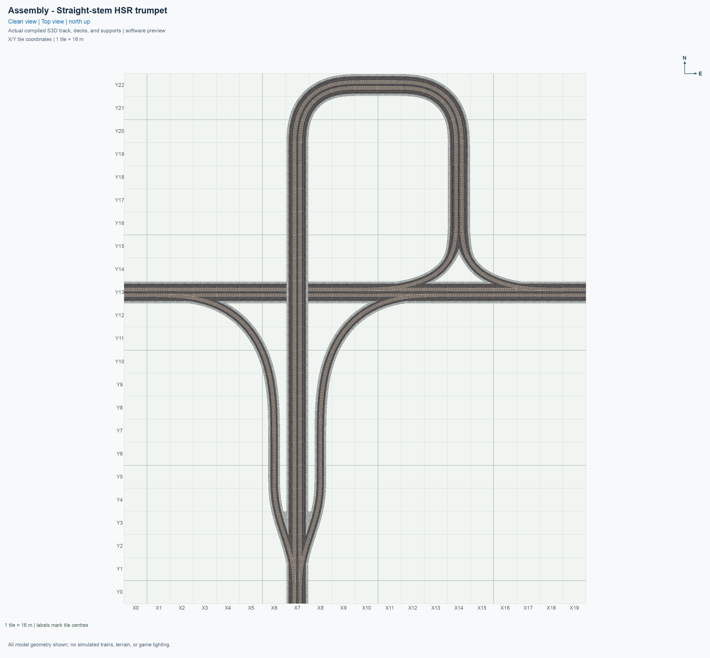
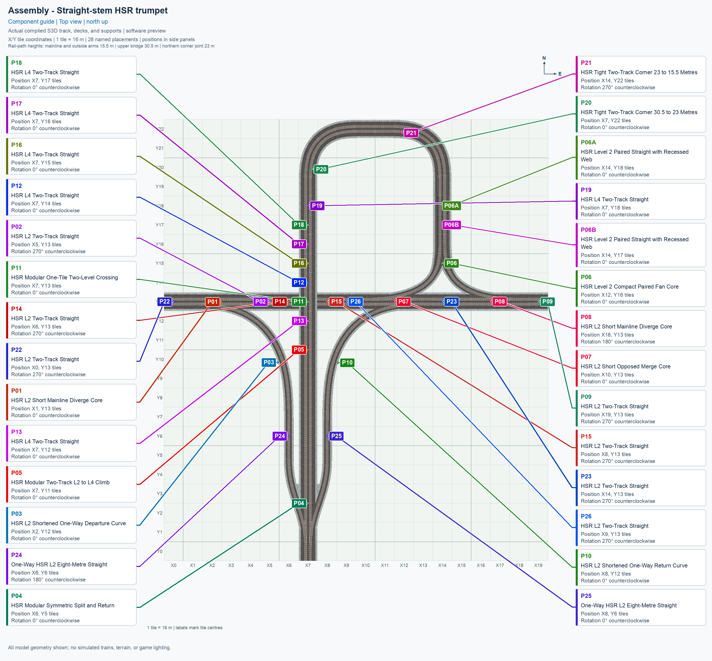
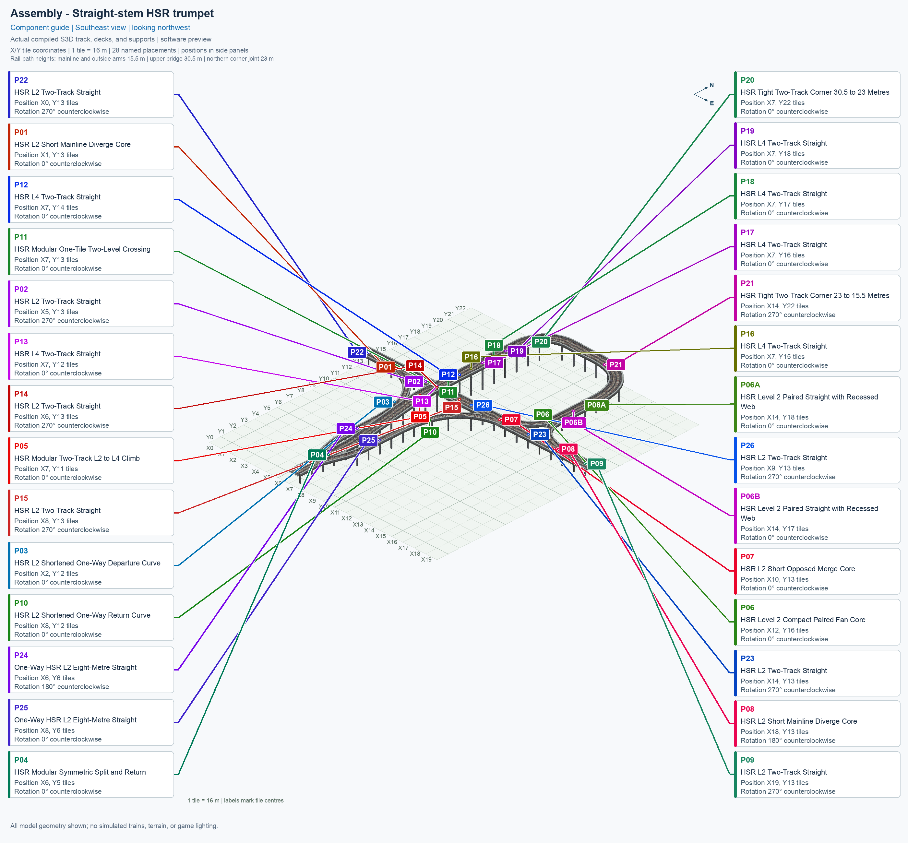
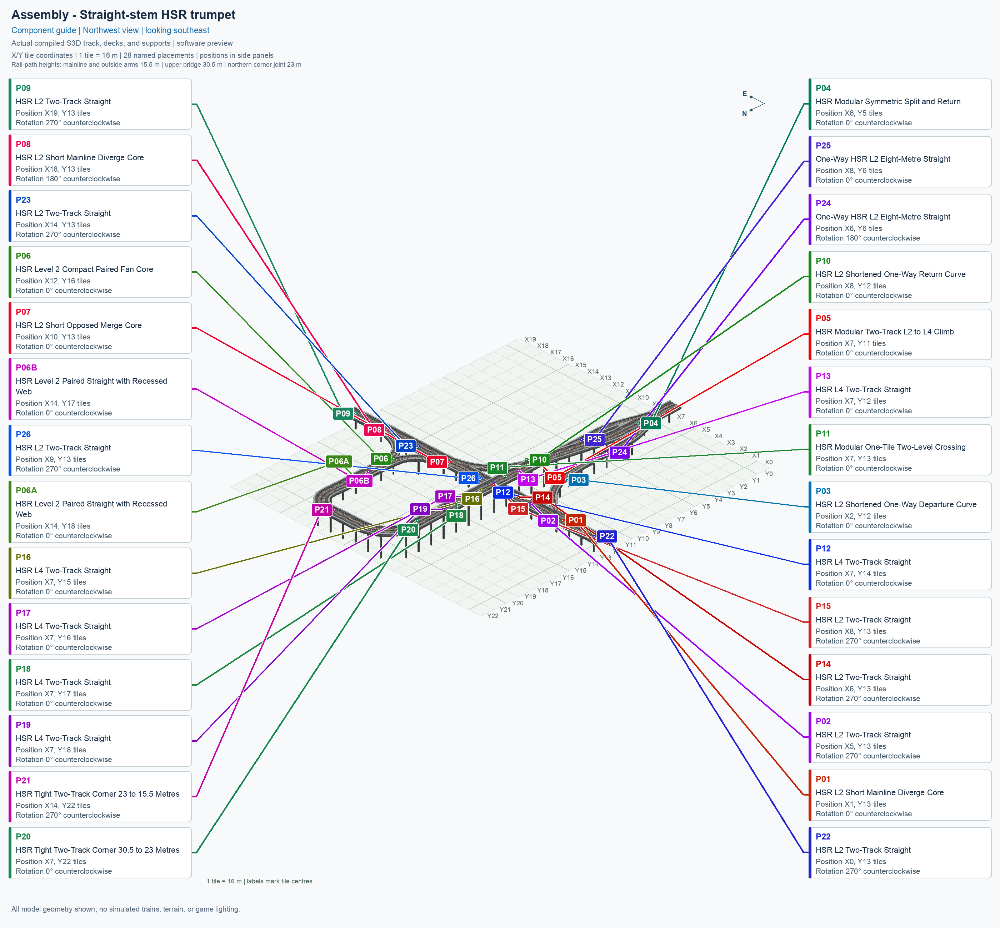
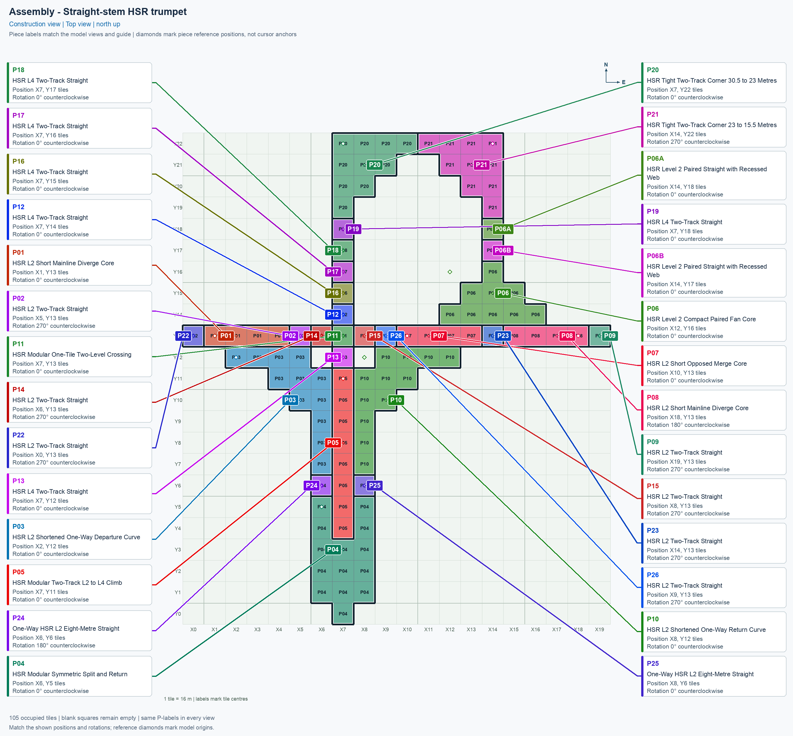

# HSR — Trumpet — Straight Stem

<!-- SUBJECT IDENTITY MIGRATION -->

Identity migration: `straight-stem-trumpet` → `hsr-trumpet-straight-stem`. Earlier measurements, observations, and pictures retain their recorded names and fingerprints; they do not establish verification of the renamed build. See the [identity migration rules](../../../../docs/NAMING_CONVENTIONS.md#10-choosing-and-changing-names).

[1. Views](#1-views) · [2. Pieces](#2-pieces) · [3. Placements](#3-placements) · [4. Connection matrix](#4-connection-matrix) · [Testing ↗ (separate document)](TESTING.md)

This **modular blueprint** is an arrangement built from reusable component types. A **placement** is one copy of a component in the city. The trumpet uses **28 placements of 14 types**, within a **20 × 23 tile** rectangle, with **105 occupied tiles** and **74 support positions**.

Open **Transportation → Rail**, select the **SCP | ASSEMBLY | HSR — Trumpet — Straight Stem** button, and press **Tab** to cycle forward through its components or **Shift+Tab** to cycle backward. Each click places the selected component. Use the placement table to complete the arrangement. [Build and install the assembly menu](../../../../docs/BUILD_AND_INSTALL.md#prepare-the-assembly-menu) before following these menu instructions.

**HSR** means elevated High Speed Rail. **L2** has its train path at 15.5 m, and **L4** at 30.5 m; the northern loop also uses a 23 m intermediate connection. Current software and game-check results appear in the connection matrix. The reported [demolition defect](TESTING.md#known-issues) remains open.

## 1. Views

Every image is titled **Assembly - HSR — Trumpet — Straight Stem** and uses the same city grid. Its second row identifies its purpose and camera direction. The first two are **Clean view** images without part names. The next three are **Component guide** images with exact component names and placement labels in the side legend. The final **Construction view** shows tile ownership: adjacent placements have clearly different colours and thick boundaries, even when they reuse the same button. The [render report](evidence/render.json) identifies the actual saved models and image hashes.

The current pictures show the accepted grey-border corrections and the three-piece fan approach: nine-cell core P06, matching straight P06A, and another copy P06B. All 28 placement labels use the fixed city grid and current tile ownership. Their actual-model evidence is separate from human picture approval and game-test results; visible captions contain fixed source and layout facts only.

## 2. Pieces

Use **Tab** or **Shift+Tab** on the assembly button to select the component named in the table. Repeated placements reuse that component in the same cycle. Click a thumbnail to open its full standalone picture; each picture shows the component at 0°.

| Standalone angled picture | Component name and permanent piece ID | Placements | Quantity |
| --- | --- | --- | ---: |
|  [Top view](../../00_pieces/hsr-l2-two-track-mainline-split-oblique-cut/previews/preview-top.png) | **[HSR Level 2 (15.5 m) — Split from Two-Track Mainline — Oblique Branch Cut](../../00_pieces/hsr-l2-two-track-mainline-split-oblique-cut/README.md)** `hsr-l2-two-track-mainline-split-oblique-cut` | P01, P08 | 2 |
|  [Top view](../../00_pieces/hsr-l2-two-track-straight/previews/preview-top.png) | **[HSR Level 2 (15.5 m) — Two-Track Straight](../../00_pieces/hsr-l2-two-track-straight/README.md)** `hsr-l2-two-track-straight` | P02, P09, P14, P15, P22, P23, P26 | 7 |
|  [Top view](../../00_pieces/hsr-l2-single-track-oneway-curve-oblique-entry/previews/preview-top.png) | **[HSR Level 2 (15.5 m) — Single-Track One-Way Curve — Oblique Entry](../../00_pieces/hsr-l2-single-track-oneway-curve-oblique-entry/README.md)** `hsr-l2-single-track-oneway-curve-oblique-entry` | P03 | 1 |
|  [Top view](../../00_pieces/hsr-l2-two-track-mainline-split-merge-parallel-recessed-end/previews/preview-top.png) | **[HSR Level 2 (15.5 m) — Parallel Split and Return Merge with Two-Track Mainline \u2014 Recessed Mainline End](../../00_pieces/hsr-l2-two-track-mainline-split-merge-parallel-recessed-end/README.md)** `hsr-l2-two-track-mainline-split-merge-parallel-recessed-end` | P04 | 1 |
|  [Top view](../../00_pieces/hsr-l2-and-l4-two-track-ramp/previews/preview-top.png) | **[HSR Level 2 (15.5 m) ↔ Level 4 (30.5 m) — Two-Track Ramp](../../00_pieces/hsr-l2-and-l4-two-track-ramp/README.md)** `hsr-l2-and-l4-two-track-ramp` | P05 | 1 |
|  [Top view](../../00_pieces/hsr-l2-mixed-fan-compact-recessed-web/previews/preview-top.png) | **[HSR Level 2 (15.5 m) — Fan with Two-Track Stem — Compact, Recessed Web](../../00_pieces/hsr-l2-mixed-fan-compact-recessed-web/README.md)** `hsr-l2-mixed-fan-compact-recessed-web` | P06 | 1 |
|  [Top view](../../00_pieces/hsr-l2-two-track-straight-recessed-web/previews/preview-top.png) | **[HSR Level 2 (15.5 m) — Two-Track Straight — Recessed Web](../../00_pieces/hsr-l2-two-track-straight-recessed-web/README.md)** `hsr-l2-two-track-straight-recessed-web` | P06A, P06B | 2 |
|  [Top view](../../00_pieces/hsr-l2-two-track-mainline-opposed-merges-oblique-cuts/previews/preview-top.png) | **[HSR Level 2 (15.5 m) — Opposed Merges to Two-Track Mainline — Oblique Branch Cuts](../../00_pieces/hsr-l2-two-track-mainline-opposed-merges-oblique-cuts/README.md)** `hsr-l2-two-track-mainline-opposed-merges-oblique-cuts` | P07 | 1 |
|  [Top view](../../00_pieces/hsr-l2-single-track-oneway-curve-oblique-exit/previews/preview-top.png) | **[HSR Level 2 (15.5 m) — Single-Track One-Way Curve — Oblique Exit](../../00_pieces/hsr-l2-single-track-oneway-curve-oblique-exit/README.md)** `hsr-l2-single-track-oneway-curve-oblique-exit` | P10 | 1 |
|  [Top view](../../00_pieces/hsr-l4-over-hsr-l2-two-track-crossing-90deg/previews/preview-top.png) | **[HSR Level 4 (30.5 m) over HSR Level 2 (15.5 m) — Two-Track Crossing 90°](../../00_pieces/hsr-l4-over-hsr-l2-two-track-crossing-90deg/README.md)** `hsr-l4-over-hsr-l2-two-track-crossing-90deg` | P11 | 1 |
|  [Top view](../../00_pieces/hsr-l4-two-track-straight/previews/preview-top.png) | **[HSR Level 4 (30.5 m) — Two-Track Straight](../../00_pieces/hsr-l4-two-track-straight/README.md)** `hsr-l4-two-track-straight` | P12, P13, P16, P17, P18, P19 | 6 |
|  [Top view](../../00_pieces/hsr-h23000mm-and-l4-two-track-curve-ramp-90deg-tight/previews/preview-top.png) | **[HSR Custom (23 m) ↔ Level 4 (30.5 m) — Two-Track Curve 90° Ramp — Tight](../../00_pieces/hsr-h23000mm-and-l4-two-track-curve-ramp-90deg-tight/README.md)** `hsr-h23000mm-and-l4-two-track-curve-ramp-90deg-tight` | P20 | 1 |
|  [Top view](../../00_pieces/hsr-l2-and-h23000mm-two-track-curve-ramp-90deg-tight/previews/preview-top.png) | **[HSR Level 2 (15.5 m) ↔ Custom (23 m) — Two-Track Curve 90° Ramp — Tight](../../00_pieces/hsr-l2-and-h23000mm-two-track-curve-ramp-90deg-tight/README.md)** `hsr-l2-and-h23000mm-two-track-curve-ramp-90deg-tight` | P21 | 1 |
|  [Top view](../../00_pieces/hsr-l2-single-track-oneway-straight-width8m/previews/preview-top.png) | **[HSR Level 2 (15.5 m) — Single-Track One-Way Straight — 8 m Deck Width](../../00_pieces/hsr-l2-single-track-oneway-straight-width8m/README.md)** `hsr-l2-single-track-oneway-straight-width8m` | P24, P25 | 2 |

The [standalone-picture report](evidence/piece-previews.json) records the current component images, their saved-model sources, and all 28 placements. Each canonical picture shows 0°; use the rotation in the placement table when building. Quantities count placements, so the same component can appear several times in the arrangement.

## 3. Placements

Use each position and rotation together; standalone component pictures show 0°. The [layout reference in TESTING.md](TESTING.md#layout-reference) defines the grid and rotation convention. Follow the [numbered placement sequence](TESTING.md#placement-sequence) to select and place the components in order. Occupied tiles count only the tiles belonging to that placement.

| Placement | Exact descriptive menu name | Reference position | Rotation | Occupied tiles |
| --- | --- | --- | --- | ---: |
| P01 | HSR Level 2 (15.5 m) — Split from Two-Track Mainline — Oblique Branch Cut | (X1, Y13) | 0° | 4 |
| P02 | HSR Level 2 (15.5 m) — Two-Track Straight | (X5, Y13) | 270° | 1 |
| P03 | HSR Level 2 (15.5 m) — Single-Track One-Way Curve — Oblique Entry | (X2, Y12) | 0° | 12 |
| P04 | HSR Level 2 (15.5 m) — Parallel Split and Return Merge with Two-Track Mainline \u2014 Recessed Mainline End | (X6, Y5) | 0° | 14 |
| P05 | HSR Level 2 (15.5 m) ↔ Level 4 (30.5 m) — Two-Track Ramp | (X7, Y11) | 0° | 8 |
| P06 | HSR Level 2 (15.5 m) — Fan with Two-Track Stem — Compact, Recessed Web | (X12, Y16) | 0° | 9 |
| P06A | HSR Level 2 (15.5 m) — Two-Track Straight — Recessed Web | (X14, Y18) | 0° | 1 |
| P06B | HSR Level 2 (15.5 m) — Two-Track Straight — Recessed Web | (X14, Y17) | 0° | 1 |
| P07 | HSR Level 2 (15.5 m) — Opposed Merges to Two-Track Mainline — Oblique Branch Cuts | (X10, Y13) | 0° | 4 |
| P08 | HSR Level 2 (15.5 m) — Split from Two-Track Mainline — Oblique Branch Cut | (X18, Y13) | 180° | 4 |
| P09 | HSR Level 2 (15.5 m) — Two-Track Straight | (X19, Y13) | 270° | 1 |
| P10 | HSR Level 2 (15.5 m) — Single-Track One-Way Curve — Oblique Exit | (X8, Y12) | 0° | 12 |
| P11 | HSR Level 4 (30.5 m) over HSR Level 2 (15.5 m) — Two-Track Crossing 90° | (X7, Y13) | 0° | 1 |
| P12 | HSR Level 4 (30.5 m) — Two-Track Straight | (X7, Y14) | 0° | 1 |
| P13 | HSR Level 4 (30.5 m) — Two-Track Straight | (X7, Y12) | 0° | 1 |
| P14 | HSR Level 2 (15.5 m) — Two-Track Straight | (X6, Y13) | 270° | 1 |
| P15 | HSR Level 2 (15.5 m) — Two-Track Straight | (X8, Y13) | 270° | 1 |
| P16 | HSR Level 4 (30.5 m) — Two-Track Straight | (X7, Y15) | 0° | 1 |
| P17 | HSR Level 4 (30.5 m) — Two-Track Straight | (X7, Y16) | 0° | 1 |
| P18 | HSR Level 4 (30.5 m) — Two-Track Straight | (X7, Y17) | 0° | 1 |
| P19 | HSR Level 4 (30.5 m) — Two-Track Straight | (X7, Y18) | 0° | 1 |
| P20 | HSR Custom (23 m) ↔ Level 4 (30.5 m) — Two-Track Curve 90° Ramp — Tight | (X7, Y22) | 0° | 10 |
| P21 | HSR Level 2 (15.5 m) ↔ Custom (23 m) — Two-Track Curve 90° Ramp — Tight | (X14, Y22) | 270° | 10 |
| P22 | HSR Level 2 (15.5 m) — Two-Track Straight | (X0, Y13) | 270° | 1 |
| P23 | HSR Level 2 (15.5 m) — Two-Track Straight | (X14, Y13) | 270° | 1 |
| P24 | HSR Level 2 (15.5 m) — Single-Track One-Way Straight — 8 m Deck Width | (X6, Y6) | 180° | 1 |
| P25 | HSR Level 2 (15.5 m) — Single-Track One-Way Straight — 8 m Deck Width | (X8, Y6) | 0° | 1 |
| P26 | HSR Level 2 (15.5 m) — Two-Track Straight | (X9, Y13) | 270° | 1 |

The [machine-readable plan](assembly.json) is authoritative for identities and model translations. P01's reference is **(X1, Y13)** because P22 owns the western approach tile at **(X0, Y13)**. P26 similarly owns the ordinary tile at **(X9, Y13)**, and P07's four-tile core starts at **(X10, Y13)**. Every occupied tile has exactly one owner. P01 and P08 reuse the same Short Mainline Diverge Core: P01 is at 0°, and P08 is at 180°. P08 replaces the earlier separate eastern diverge and its western straight; the fan and opposed merge have matching revised branch angles. The retained component types keep their permanent game identifiers.

P06 retains every saved model of the accepted nine-cell fan fork. P06A and P06B reuse one new straight type with the same recessed structural web; an ordinary paired straight has a different complete concrete profile despite matching track height and outer slab width. The [coordinate-labelled extraction drawing and audit](evidence/fan-atomization-review.json) explain both cuts, the fourteen redundant end faces removed from the outer tile, the unchanged native neighbour's closing faces, and its inherited small web-width transition. The superseded complete Compact Paired Fan Join has been removed from the active library. The [retirement record](checks/fan-parent-retirement.json) binds the retained core and matching straight to the original accepted source and saved models. The earlier [P07/P26 extraction audit](evidence/merge-west-tail-extraction.json) retains its original four-tile merge scope; current assembly acceptance belongs to the [current validation](evidence/validation.json), with historical details in [TESTING](TESTING.md#western-merge-approach-extraction).

<!-- BEGIN ASSEMBLY CONNECTION MATRIX -->

## 4. Connection matrix

Read **from an entrance row to an exit column**. **Saved PATH** checks the saved traffic route; **Route Query** checks the route shown by the game; **Visible travel** checks a vehicle completing that journey. For HSR, visible travel means a moving train.

**Game appearance:** [?](TESTING.md#case-in_game_render-4b8e61d1c512b7c578e8) — the complete assembly’s appearance in the game, checked separately from its journeys.

**Legend:** ✅ confirmed; ❌ failed; ? not established. **Forbidden** means the movement is unavailable; its in-game check confirms that it stays unavailable. Click a result for its exact test case. Scope, evidence, and limitations remain in [TESTING](TESTING.md#test-checklist).

| Entrance ↓ / Exit → | **HSR · West exit** `W.out` | **HSR · South exit** `S.out` | **HSR · East exit** `E.out` |
| --- | --- | --- | --- |
| **HSR · West entrance** `W.in` | **Forbidden** **Saved PATH:** [✅](TESTING.md#case-software_connectivity-fe740c153144a3695751) In-game check: [?](TESTING.md#case-in_game_forbidden_transfer-92b725456842f93c47ca) | **Saved PATH:** [✅](TESTING.md#case-software_connectivity-fe740c153144a3695751) **Route Query:** [?](TESTING.md#case-in_game_route_query-aea09525a3e21f949d2b) **Visible train travel:** [?](TESTING.md#case-in_game_visible_travel-aea09525a3e21f949d2b) | **Saved PATH:** [✅](TESTING.md#case-software_connectivity-fe740c153144a3695751) **Route Query:** [?](TESTING.md#case-in_game_route_query-87f3cb5204e2970d80c1) **Visible train travel:** [?](TESTING.md#case-in_game_visible_travel-87f3cb5204e2970d80c1) |
| **HSR · South entrance** `S.in` | **Saved PATH:** [✅](TESTING.md#case-software_connectivity-fe740c153144a3695751) **Route Query:** [?](TESTING.md#case-in_game_route_query-2572758d9ad9c64a40fd) **Visible train travel:** [?](TESTING.md#case-in_game_visible_travel-2572758d9ad9c64a40fd) | **Forbidden** **Saved PATH:** [✅](TESTING.md#case-software_connectivity-fe740c153144a3695751) In-game check: [?](TESTING.md#case-in_game_forbidden_transfer-dfbdc4123044e5fb53fe) | **Saved PATH:** [✅](TESTING.md#case-software_connectivity-fe740c153144a3695751) **Route Query:** [?](TESTING.md#case-in_game_route_query-336582ad6132a64a36f8) **Visible train travel:** [?](TESTING.md#case-in_game_visible_travel-336582ad6132a64a36f8) |
| **HSR · East entrance** `E.in` | **Saved PATH:** [✅](TESTING.md#case-software_connectivity-fe740c153144a3695751) **Route Query:** [?](TESTING.md#case-in_game_route_query-76bf51a0e3b87a77ead7) **Visible train travel:** [?](TESTING.md#case-in_game_visible_travel-76bf51a0e3b87a77ead7) | **Saved PATH:** [✅](TESTING.md#case-software_connectivity-fe740c153144a3695751) **Route Query:** [?](TESTING.md#case-in_game_route_query-8b08022118fd9f445d85) **Visible train travel:** [?](TESTING.md#case-in_game_visible_travel-8b08022118fd9f445d85) | **Forbidden** **Saved PATH:** [✅](TESTING.md#case-software_connectivity-fe740c153144a3695751) In-game check: [?](TESTING.md#case-in_game_forbidden_transfer-9f7a461fa713c7413977) |

Source: [connections.json](connections.json).

<!-- END ASSEMBLY CONNECTION MATRIX -->
