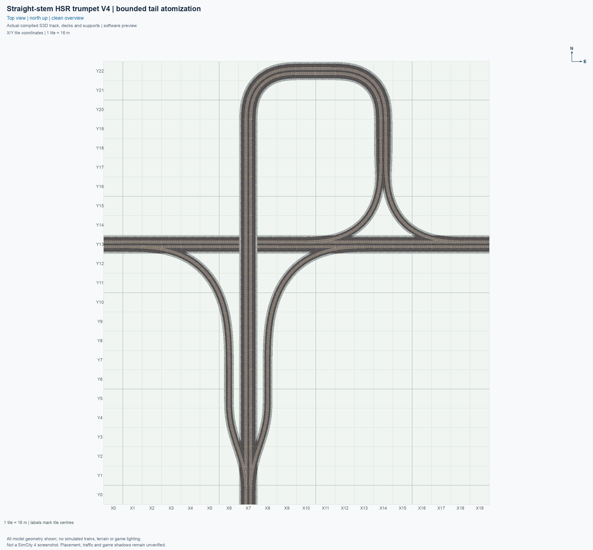
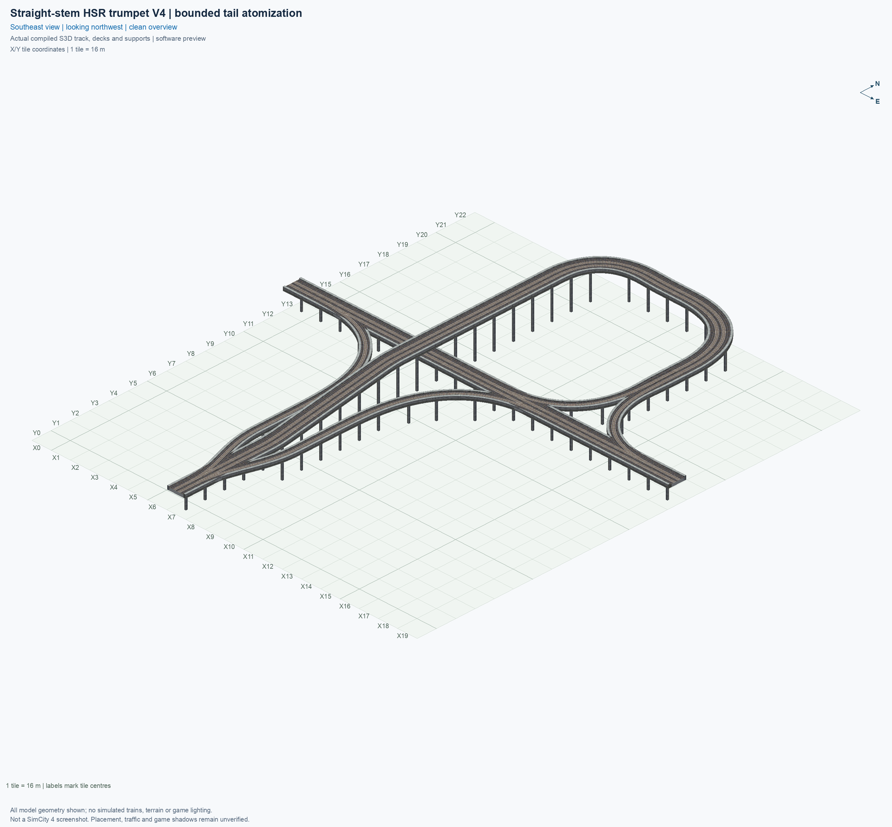
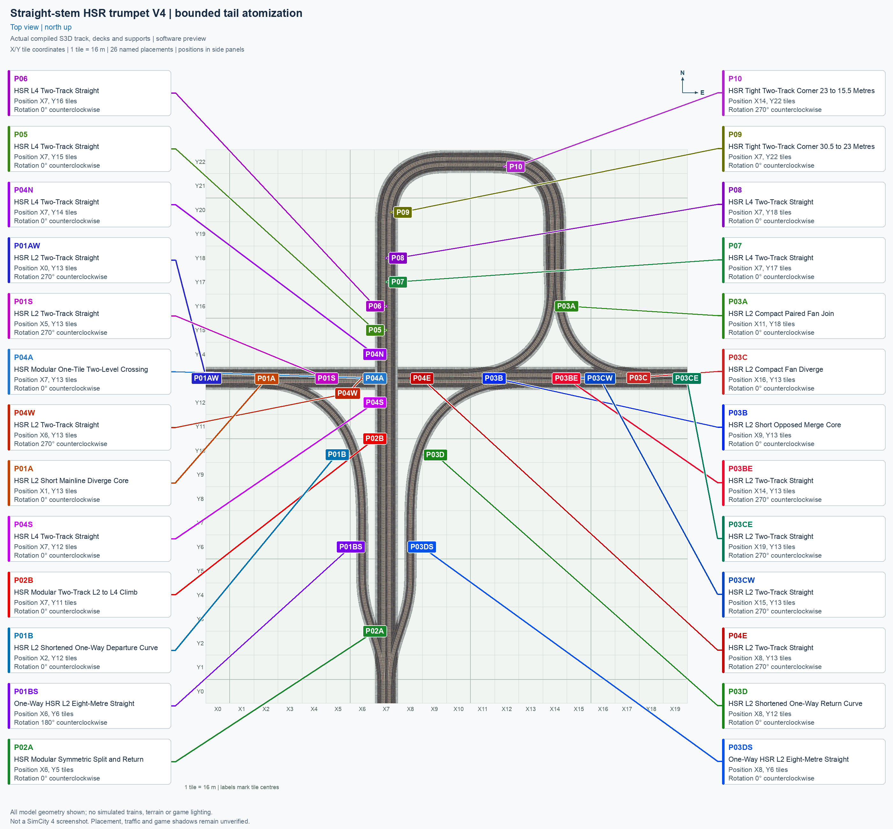
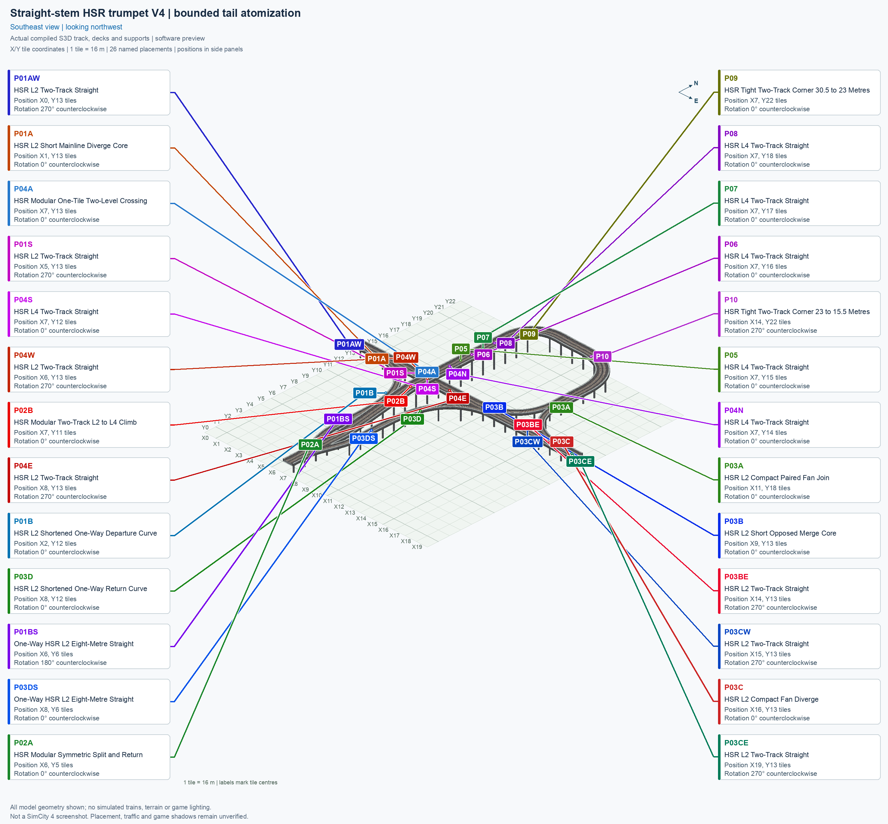
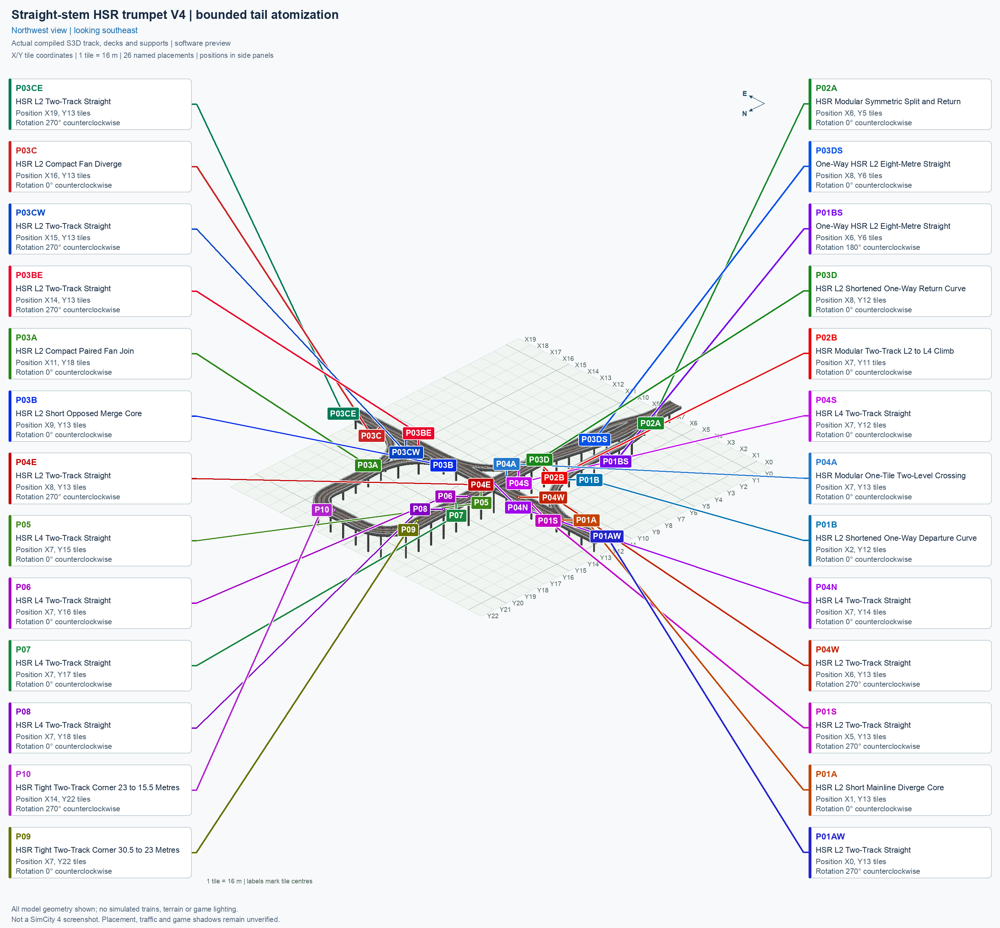
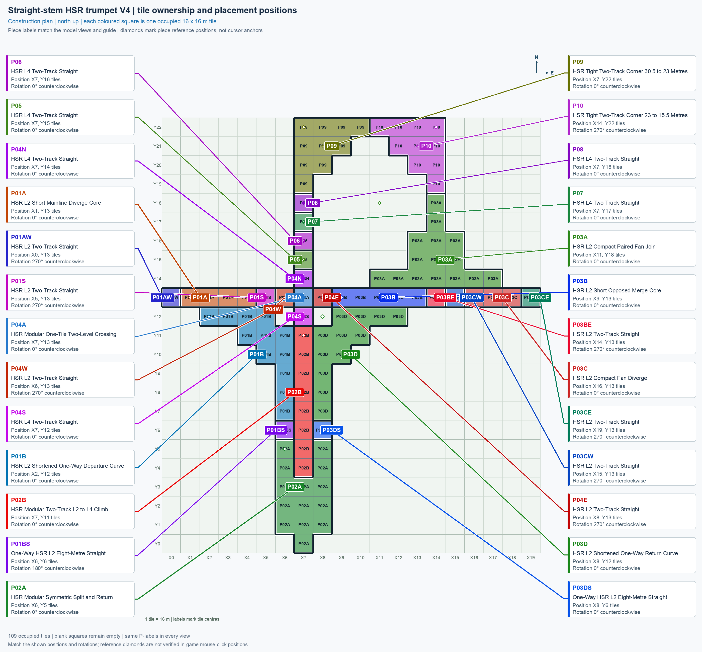

# Straight-stem HSR trumpet V4

[Views](#complete-assembly-views) · [Pieces](#fourteen-reusable-menu-types) · [Placements](#twenty-six-placements) · [Connection matrix](#connection-matrix) · [Testing](TESTING.md)

V4 is a **modular blueprint**: an arrangement built from several separately selectable pieces. A **piece type** is one menu button; a **placement** is one copy of that type in the city. This current blueprint uses **26 placements of 14 types**, within a **20 × 23 tile** rectangle, with **109 occupied tiles** and **75 support positions**. Its approved layout and pictures remain fixed. Earlier trumpet blueprints and their exclusive pieces have been removed; V4 has no whole-interchange one-click button.

The optional [trumpet menu experiment](../../../../docs/BUILD_AND_INSTALL.md#try-the-trumpet-menu-experiment) gives these same fourteen types a shared Tab/Shift+Tab cycle and a test submenu with individual buttons. It changes browsing only: each click still places one component, and the complete blueprint still requires the placements below. Both entry points share the same type family; Home/End rotate the current component. Actual menu visibility, selection, and cycling remain unverified until tested in SimCity 4.

**HSR** means elevated High Speed Rail. **L2** here has its train path at 15.5 m and **L4** at 30.5 m; the northern loop also uses a 23 m intermediate connection. Software verification, installation, and observed train operation are separate states. V4’s actual saved resources pass software checks. An installation receipt confirms the installed files; correct rendering and train operation still require the separate human checks in [TESTING.md](TESTING.md). The reported [demolition defect](TESTING.md#game-testing) remains open.

## Complete assembly views

Every image uses the same city grid. The first two omit part names. The next three show exact menu names and placement labels. The final plan shows tile ownership: adjacent placements have clearly different colours and thick boundaries, even when they reuse the same button. The [render report](evidence/render.json) identifies the actual saved models and image hashes.

## Coordinates and rotations

Each city tile measures **16 × 16 m**. On the north-up plan, **X0–X19** increase east/right and **Y0–Y22** increase north/up. The central crossing stays at **(X7, Y13)**. The southwest tile centre is implicitly **(X0, Y0)**; no global origin marker appears. Standalone piece previews use their own local zero-based grid and authored 0° orientation.

A **reference position** is a piece's software reference tile, which can be empty in a sparse piece. The table therefore describes exact model positions rather than certified mouse-click anchors. Align the entire cursor preview with the ownership plan. A rotation is **counterclockwise from the standalone 0° picture**: 270° counterclockwise equals 90° clockwise. Proper rotations turn the route and its direction together; they do not reverse a one-way track.

## Fourteen reusable menu types

Open **Transportation → Rail** and hover over a teal **PART HSR** icon. Its title begins **SCP | [PART]**. The table lists the exact descriptive name after that prefix. Click a thumbnail for the full angled view. Every new type also has a top view of the same saved model. Repeated placements share one button and one canonical picture.

| Standalone angled picture | Exact descriptive menu name and permanent piece ID | Placements | Quantity |
| --- | --- | --- | ---: |
|  [Top view](../../00_pieces/hsr-component-l2-short-mainline-diverge-core/preview-top.png) | **[HSR L2 Short Mainline Diverge Core](../../00_pieces/hsr-component-l2-short-mainline-diverge-core/README.md)** `hsr-component-l2-short-mainline-diverge-core` | P01A | 1 |
|  | **[HSR L2 Two-Track Straight](../../00_pieces/hsr-component-lower-paired-straight/README.md)** `hsr-component-lower-paired-straight` | P01S, P03CW, P03CE, P04W, P04E, P01AW, P03BE | 7 |
|  [Top view](../../00_pieces/hsr-component-l2-shortened-departure-curve/preview-top.png) | **[HSR L2 Shortened One-Way Departure Curve](../../00_pieces/hsr-component-l2-shortened-departure-curve/README.md)** `hsr-component-l2-shortened-departure-curve` | P01B | 1 |
|  | **[HSR Modular Symmetric Split and Return](../../00_pieces/hsr-component-modular-south-junction/README.md)** `hsr-component-modular-south-junction` | P02A | 1 |
|  | **[HSR Modular Two-Track L2 to L4 Climb](../../00_pieces/hsr-component-modular-paired-climb/README.md)** `hsr-component-modular-paired-climb` | P02B | 1 |
|  [Top view](../../00_pieces/hsr-component-l2-paired-fan-compact-join/preview-top.png) | **[HSR L2 Compact Paired Fan Join](../../00_pieces/hsr-component-l2-paired-fan-compact-join/README.md)** `hsr-component-l2-paired-fan-compact-join` | P03A | 1 |
|  [Top view](../../00_pieces/hsr-component-l2-short-opposed-merge-core/preview-top.png) | **[HSR L2 Short Opposed Merge Core](../../00_pieces/hsr-component-l2-short-opposed-merge-core/README.md)** `hsr-component-l2-short-opposed-merge-core` | P03B | 1 |
|  [Top view](../../00_pieces/hsr-component-l2-compact-fan-diverge/preview-top.png) | **[HSR L2 Compact Fan Diverge](../../00_pieces/hsr-component-l2-compact-fan-diverge/README.md)** `hsr-component-l2-compact-fan-diverge` | P03C | 1 |
|  [Top view](../../00_pieces/hsr-component-l2-shortened-return-curve/preview-top.png) | **[HSR L2 Shortened One-Way Return Curve](../../00_pieces/hsr-component-l2-shortened-return-curve/README.md)** `hsr-component-l2-shortened-return-curve` | P03D | 1 |
|  | **[HSR Modular One-Tile Two-Level Crossing](../../00_pieces/hsr-component-modular-crossing-core/README.md)** `hsr-component-modular-crossing-core` | P04A | 1 |
|  | **[HSR L4 Two-Track Straight](../../00_pieces/hsr-component-upper-paired-straight/README.md)** `hsr-component-upper-paired-straight` | P04N, P04S, P05, P06, P07, P08 | 6 |
|  | **[HSR Tight Two-Track Corner 30.5 to 23 Metres](../../00_pieces/hsr-component-tight-paired-curve90-l4-to-mid/README.md)** `hsr-component-tight-paired-curve90-l4-to-mid` | P09 | 1 |
|  | **[HSR Tight Two-Track Corner 23 to 15.5 Metres](../../00_pieces/hsr-component-tight-paired-curve90-mid-to-l2/README.md)** `hsr-component-tight-paired-curve90-mid-to-l2` | P10 | 1 |
|  | **[One-Way HSR L2 Eight-Metre Straight](../../00_pieces/hsr-component-lower-oneway-straight/README.md)** `hsr-component-lower-oneway-straight` | P01BS, P03DS | 2 |

The [standalone-picture report](evidence/piece-previews.json) records canonical orientation, local grid, model hashes, and visible captions. P01AW/P01S/P03BE/P03CW/P03CE/P04W/P04E share one lower paired-straight button. P01BS/P03DS share one centred one-way-straight button. P04N/P04S/P05–P08 share one upper paired-straight button.

## Twenty-six placements

Use the position and rotation together; the standalone image always shows 0°. Occupied tile count describes the actual sparse footprint, not its bounding rectangle.

| Placement | Exact descriptive menu name | Reference position | Rotation | Occupied tiles |
| --- | --- | --- | --- | ---: |
| P01A | HSR L2 Short Mainline Diverge Core | (X1, Y13) | 0° | 4 |
| P01S | HSR L2 Two-Track Straight | (X5, Y13) | 270° | 1 |
| P01B | HSR L2 Shortened One-Way Departure Curve | (X2, Y12) | 0° | 12 |
| P02A | HSR Modular Symmetric Split and Return | (X6, Y5) | 0° | 14 |
| P02B | HSR Modular Two-Track L2 to L4 Climb | (X7, Y11) | 0° | 8 |
| P03A | HSR L2 Compact Paired Fan Join | (X11, Y18) | 0° | 15 |
| P03B | HSR L2 Short Opposed Merge Core | (X9, Y13) | 0° | 5 |
| P03CW | HSR L2 Two-Track Straight | (X15, Y13) | 270° | 1 |
| P03C | HSR L2 Compact Fan Diverge | (X16, Y13) | 0° | 3 |
| P03CE | HSR L2 Two-Track Straight | (X19, Y13) | 270° | 1 |
| P03D | HSR L2 Shortened One-Way Return Curve | (X8, Y12) | 0° | 12 |
| P04A | HSR Modular One-Tile Two-Level Crossing | (X7, Y13) | 0° | 1 |
| P04N | HSR L4 Two-Track Straight | (X7, Y14) | 0° | 1 |
| P04S | HSR L4 Two-Track Straight | (X7, Y12) | 0° | 1 |
| P04W | HSR L2 Two-Track Straight | (X6, Y13) | 270° | 1 |
| P04E | HSR L2 Two-Track Straight | (X8, Y13) | 270° | 1 |
| P05 | HSR L4 Two-Track Straight | (X7, Y15) | 0° | 1 |
| P06 | HSR L4 Two-Track Straight | (X7, Y16) | 0° | 1 |
| P07 | HSR L4 Two-Track Straight | (X7, Y17) | 0° | 1 |
| P08 | HSR L4 Two-Track Straight | (X7, Y18) | 0° | 1 |
| P09 | HSR Tight Two-Track Corner 30.5 to 23 Metres | (X7, Y22) | 0° | 10 |
| P10 | HSR Tight Two-Track Corner 23 to 15.5 Metres | (X14, Y22) | 270° | 10 |
| P01AW | HSR L2 Two-Track Straight | (X0, Y13) | 270° | 1 |
| P03BE | HSR L2 Two-Track Straight | (X14, Y13) | 270° | 1 |
| P01BS | One-Way HSR L2 Eight-Metre Straight | (X6, Y6) | 180° | 1 |
| P03DS | One-Way HSR L2 Eight-Metre Straight | (X8, Y6) | 0° | 1 |

The [machine-readable plan](assembly.json) is authoritative for identities and model translations. P01A's reference is **(X1, Y13)** because P01AW owns the western approach tile at **(X0, Y13)**. The table gives the current reference positions of the other three shortened cores. Every occupied tile has exactly one owner.

<!-- BEGIN ASSEMBLY CONNECTION MATRIX -->

## Connection matrix

Read **from an entrance row to an exit column**. A port is one directional entrance or exit of the complete assembly. Network, variant, and role labels are explicit source declarations; sharing an internal game traffic class does not merge services.

**Saved PATH** checks the encoded traffic route in the saved resources. **Game appearance†** checks the complete assembly inside the game. **Route Query** checks the game’s displayed route for this directed movement. **Visible travel** checks a vehicle visibly completing it; for HSR, this means a moving train. These four results establish different facts.

**Legend:** ✓ means every required current case passed; ✗ means a recorded failure; ↻ means stale evidence; ? means unverified or missing evidence. Partial coverage, failed, stale, unverified, missing, and explicit N/A counts stay visible. Manual counts cover the declared construction states; click a result to inspect a matching exact case in TESTING. Every observation keeps its recorded environment, so combined counts do not establish one shared tested platform.

**† Shared appearance scope:** the same whole-assembly rendering result appears in every cell. It is not a separate inspection of each journey. “Forbidden” is a declared unavailable movement, not a failed test; its linked negative game check tests that the movement stays unavailable, and does not substitute for Route Query or visible-travel evidence. An undeclared pair remains unknown. This matrix does not discover neighbouring-piece compatibility.

| Entrance ↓ / Exit → | **HSR · West exit** `W.out` Network: **hsr** Variant: hsr Role: primary | **HSR · South exit** `S.out` Network: **hsr** Variant: hsr Role: primary | **HSR · East exit** `E.out` Network: **hsr** Variant: hsr Role: primary |
| --- | --- | --- | --- |
| **HSR · West entrance** `W.in` Network: **hsr** Variant: hsr Role: primary | **Saved PATH:** Forbidden (saved PATH); negative game check: [? 0/4 passed; unverified: 4](TESTING.md#case-in_game_forbidden_transfer-5e7720c782995408fbd3) **Game appearance†:** [? 0/4 passed; unverified: 4](TESTING.md#case-in_game_render-1e76dcd30aba7445f7fc) **Route Query:** — forbidden movement **Visible travel:** — forbidden movement | **Saved PATH:** [✓](TESTING.md#case-software_connectivity-fb989639955077c49383) **Game appearance†:** [? 0/4 passed; unverified: 4](TESTING.md#case-in_game_render-1e76dcd30aba7445f7fc) **Route Query:** [? 0/4 passed; unverified: 4](TESTING.md#case-in_game_route_query-cb6c5202c8347ebf1286) **Visible travel:** [? 0/4 passed; unverified: 4](TESTING.md#case-in_game_visible_travel-cb6c5202c8347ebf1286) | **Saved PATH:** [✓](TESTING.md#case-software_connectivity-fb989639955077c49383) **Game appearance†:** [? 0/4 passed; unverified: 4](TESTING.md#case-in_game_render-1e76dcd30aba7445f7fc) **Route Query:** [? 0/4 passed; unverified: 4](TESTING.md#case-in_game_route_query-935025a1afa3ba78033c) **Visible travel:** [? 0/4 passed; unverified: 4](TESTING.md#case-in_game_visible_travel-935025a1afa3ba78033c) |
| **HSR · South entrance** `S.in` Network: **hsr** Variant: hsr Role: primary | **Saved PATH:** [✓](TESTING.md#case-software_connectivity-fb989639955077c49383) **Game appearance†:** [? 0/4 passed; unverified: 4](TESTING.md#case-in_game_render-1e76dcd30aba7445f7fc) **Route Query:** [? 0/4 passed; unverified: 4](TESTING.md#case-in_game_route_query-335c3ad51bc94699c104) **Visible travel:** [? 0/4 passed; unverified: 4](TESTING.md#case-in_game_visible_travel-335c3ad51bc94699c104) | **Saved PATH:** Forbidden (saved PATH); negative game check: [? 0/4 passed; unverified: 4](TESTING.md#case-in_game_forbidden_transfer-0e614229b03bfe5c1e73) **Game appearance†:** [? 0/4 passed; unverified: 4](TESTING.md#case-in_game_render-1e76dcd30aba7445f7fc) **Route Query:** — forbidden movement **Visible travel:** — forbidden movement | **Saved PATH:** [✓](TESTING.md#case-software_connectivity-fb989639955077c49383) **Game appearance†:** [? 0/4 passed; unverified: 4](TESTING.md#case-in_game_render-1e76dcd30aba7445f7fc) **Route Query:** [? 0/4 passed; unverified: 4](TESTING.md#case-in_game_route_query-a1374cdd8955a931ef39) **Visible travel:** [? 0/4 passed; unverified: 4](TESTING.md#case-in_game_visible_travel-a1374cdd8955a931ef39) |
| **HSR · East entrance** `E.in` Network: **hsr** Variant: hsr Role: primary | **Saved PATH:** [✓](TESTING.md#case-software_connectivity-fb989639955077c49383) **Game appearance†:** [? 0/4 passed; unverified: 4](TESTING.md#case-in_game_render-1e76dcd30aba7445f7fc) **Route Query:** [? 0/4 passed; unverified: 4](TESTING.md#case-in_game_route_query-9e719d3640b74327466a) **Visible travel:** [? 0/4 passed; unverified: 4](TESTING.md#case-in_game_visible_travel-9e719d3640b74327466a) | **Saved PATH:** [✓](TESTING.md#case-software_connectivity-fb989639955077c49383) **Game appearance†:** [? 0/4 passed; unverified: 4](TESTING.md#case-in_game_render-1e76dcd30aba7445f7fc) **Route Query:** [? 0/4 passed; unverified: 4](TESTING.md#case-in_game_route_query-897ffbf0df74d5c6e5a4) **Visible travel:** [? 0/4 passed; unverified: 4](TESTING.md#case-in_game_visible_travel-897ffbf0df74d5c6e5a4) | **Saved PATH:** Forbidden (saved PATH); negative game check: [? 0/4 passed; unverified: 4](TESTING.md#case-in_game_forbidden_transfer-6f8a97ec7efb05be09c5) **Game appearance†:** [? 0/4 passed; unverified: 4](TESTING.md#case-in_game_render-1e76dcd30aba7445f7fc) **Route Query:** — forbidden movement **Visible travel:** — forbidden movement |

The source declarations are in [connections.json](connections.json). Exact cases, rotations, limitations, and recorded evidence remain in [TESTING](TESTING.md#test-checklist).

<!-- END ASSEMBLY CONNECTION MATRIX -->
