# Straight-stem HSR trumpet

[1. Views](#1-views) · [2. Pieces](#2-pieces) · [3. Placements](#3-placements) · [4. Connection matrix](#4-connection-matrix) · [Testing ↗ (separate document)](TESTING.md)

This **modular blueprint** is an arrangement built from reusable component types. A **placement** is one copy of a component in the city. The trumpet uses **26 placements of 14 types**, within a **20 × 23 tile** rectangle, with **109 occupied tiles** and **75 support positions**.

Open **Transportation → Rail**, select the **SCP | ASSEMBLY | HSR Trumpet** button, and press **Tab** to cycle forward through its components or **Shift+Tab** to cycle backward. Each click places the selected component. Use the placement table to complete the arrangement. [Build and install the assembly menu](../../../../docs/BUILD_AND_INSTALL.md#prepare-the-assembly-menu) before following these menu instructions.

**HSR** means elevated High Speed Rail. **L2** has its train path at 15.5 m, and **L4** at 30.5 m; the northern loop also uses a 23 m intermediate connection. Current software and game-check results appear in the connection matrix. The reported [demolition defect](TESTING.md#known-issues) remains open.

## 1. Views

Every image is titled **Assembly - Straight-stem HSR trumpet** and uses the same city grid. Its second row identifies its purpose and camera direction. The first two are **Clean view** images without part names. The next three are **Component guide** images with exact component names and placement labels in the side legend. The final **Construction view** shows tile ownership: adjacent placements have clearly different colours and thick boundaries, even when they reuse the same button. The [render report](evidence/render.json) identifies the actual saved models and image hashes.

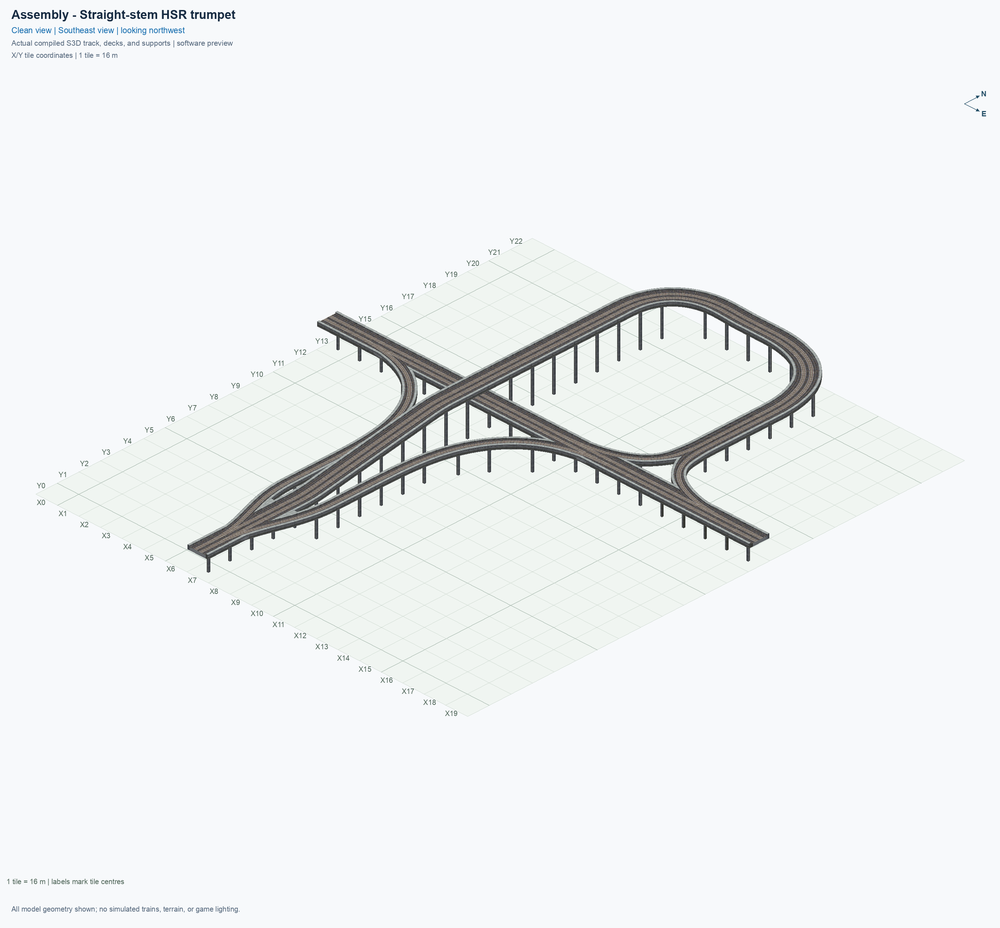

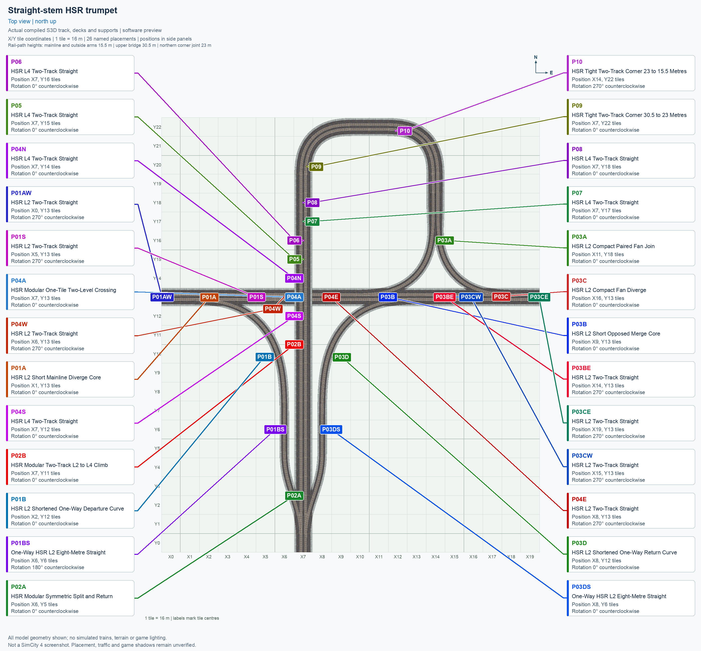

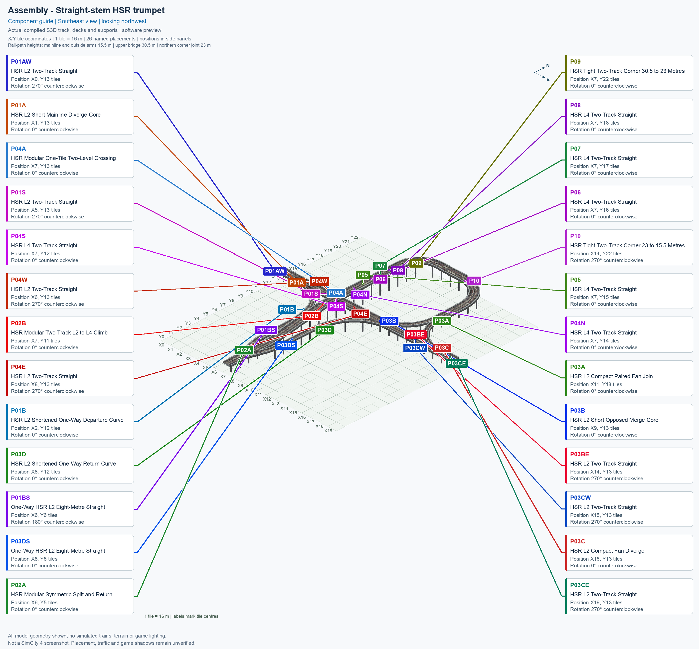

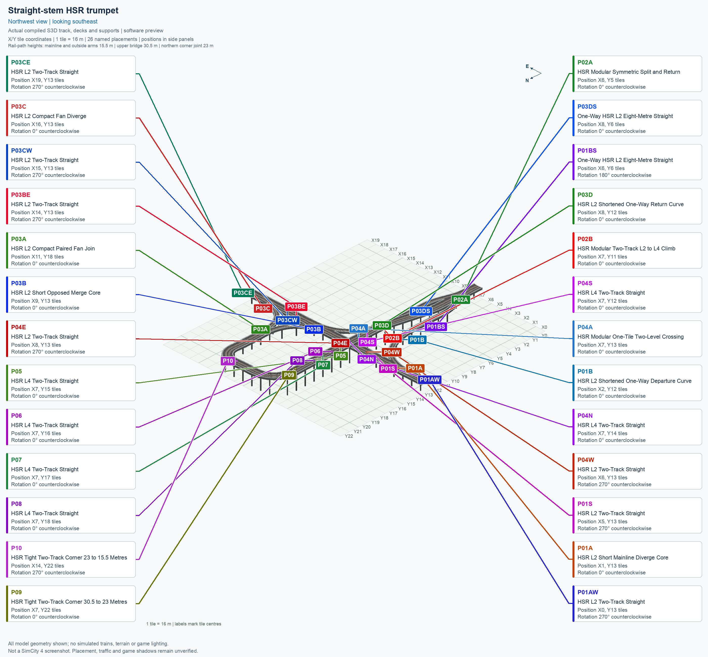

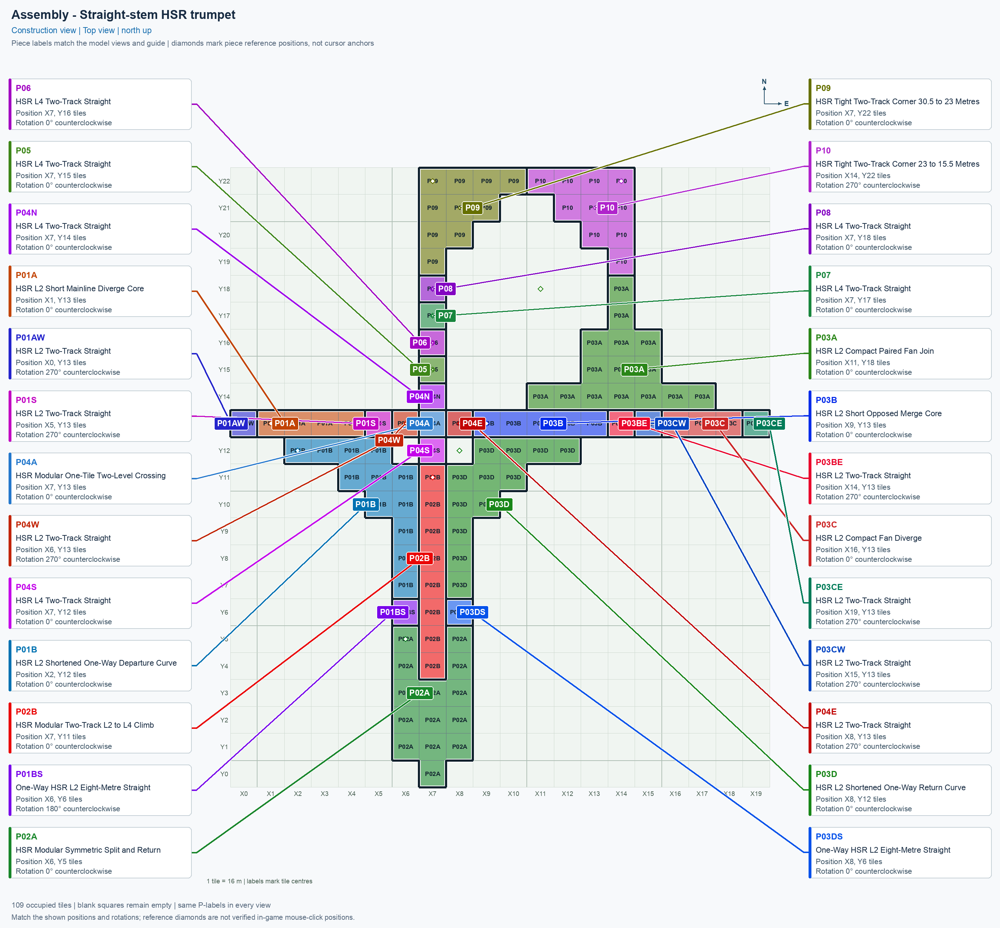

## 2. Pieces

Use **Tab** or **Shift+Tab** on the assembly button to select the component named in the table. Repeated placements reuse that component in the same cycle. Click a thumbnail to open its full standalone picture; each picture shows the component at 0°.

| Standalone angled picture | Component name and permanent piece ID | Placements | Quantity |
| --- | --- | --- | ---: |
| [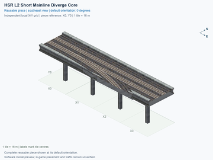](../../00_pieces/hsr-component-l2-short-mainline-diverge-core/preview.png) [Top view](../../00_pieces/hsr-component-l2-short-mainline-diverge-core/preview-top.png) | **[HSR L2 Short Mainline Diverge Core](../../00_pieces/hsr-component-l2-short-mainline-diverge-core/README.md)** `hsr-component-l2-short-mainline-diverge-core` | P01A | 1 |
| [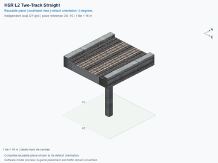](../../00_pieces/hsr-component-lower-paired-straight/preview.png) | **[HSR L2 Two-Track Straight](../../00_pieces/hsr-component-lower-paired-straight/README.md)** `hsr-component-lower-paired-straight` | P01S, P03CW, P03CE, P04W, P04E, P01AW, P03BE | 7 |
| [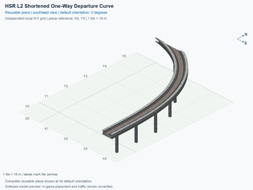](../../00_pieces/hsr-component-l2-shortened-departure-curve/preview.png) [Top view](../../00_pieces/hsr-component-l2-shortened-departure-curve/preview-top.png) | **[HSR L2 Shortened One-Way Departure Curve](../../00_pieces/hsr-component-l2-shortened-departure-curve/README.md)** `hsr-component-l2-shortened-departure-curve` | P01B | 1 |
| [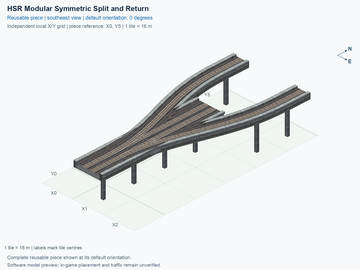](../../00_pieces/hsr-component-modular-south-junction/preview.png) | **[HSR Modular Symmetric Split and Return](../../00_pieces/hsr-component-modular-south-junction/README.md)** `hsr-component-modular-south-junction` | P02A | 1 |
| [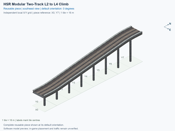](../../00_pieces/hsr-component-modular-paired-climb/preview.png) | **[HSR Modular Two-Track L2 to L4 Climb](../../00_pieces/hsr-component-modular-paired-climb/README.md)** `hsr-component-modular-paired-climb` | P02B | 1 |
| [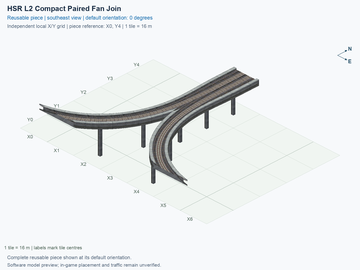](../../00_pieces/hsr-component-l2-paired-fan-compact-join/preview.png) [Top view](../../00_pieces/hsr-component-l2-paired-fan-compact-join/preview-top.png) | **[HSR L2 Compact Paired Fan Join](../../00_pieces/hsr-component-l2-paired-fan-compact-join/README.md)** `hsr-component-l2-paired-fan-compact-join` | P03A | 1 |
| [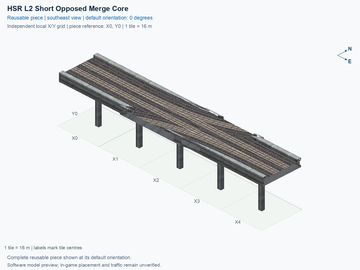](../../00_pieces/hsr-component-l2-short-opposed-merge-core/preview.png) [Top view](../../00_pieces/hsr-component-l2-short-opposed-merge-core/preview-top.png) | **[HSR L2 Short Opposed Merge Core](../../00_pieces/hsr-component-l2-short-opposed-merge-core/README.md)** `hsr-component-l2-short-opposed-merge-core` | P03B | 1 |
| [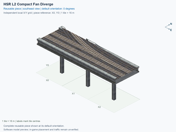](../../00_pieces/hsr-component-l2-compact-fan-diverge/preview.png) [Top view](../../00_pieces/hsr-component-l2-compact-fan-diverge/preview-top.png) | **[HSR L2 Compact Fan Diverge](../../00_pieces/hsr-component-l2-compact-fan-diverge/README.md)** `hsr-component-l2-compact-fan-diverge` | P03C | 1 |
| [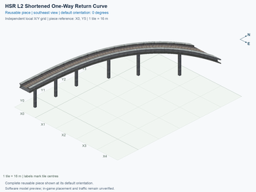](../../00_pieces/hsr-component-l2-shortened-return-curve/preview.png) [Top view](../../00_pieces/hsr-component-l2-shortened-return-curve/preview-top.png) | **[HSR L2 Shortened One-Way Return Curve](../../00_pieces/hsr-component-l2-shortened-return-curve/README.md)** `hsr-component-l2-shortened-return-curve` | P03D | 1 |
| [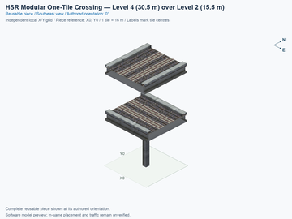](../../00_pieces/hsr-component-modular-crossing-core/preview.png) | **[HSR Modular One-Tile Two-Level Crossing](../../00_pieces/hsr-component-modular-crossing-core/README.md)** `hsr-component-modular-crossing-core` | P04A | 1 |
| [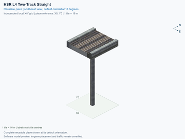](../../00_pieces/hsr-component-upper-paired-straight/preview.png) | **[HSR L4 Two-Track Straight](../../00_pieces/hsr-component-upper-paired-straight/README.md)** `hsr-component-upper-paired-straight` | P04N, P04S, P05, P06, P07, P08 | 6 |
| [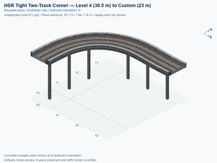](../../00_pieces/hsr-component-tight-paired-curve90-l4-to-mid/preview.png) | **[HSR Tight Two-Track Corner 30.5 to 23 Metres](../../00_pieces/hsr-component-tight-paired-curve90-l4-to-mid/README.md)** `hsr-component-tight-paired-curve90-l4-to-mid` | P09 | 1 |
| [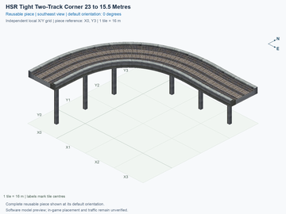](../../00_pieces/hsr-component-tight-paired-curve90-mid-to-l2/preview.png) | **[HSR Tight Two-Track Corner 23 to 15.5 Metres](../../00_pieces/hsr-component-tight-paired-curve90-mid-to-l2/README.md)** `hsr-component-tight-paired-curve90-mid-to-l2` | P10 | 1 |
| [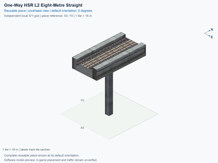](../../00_pieces/hsr-component-lower-oneway-straight/preview.png) | **[One-Way HSR L2 Eight-Metre Straight](../../00_pieces/hsr-component-lower-oneway-straight/README.md)** `hsr-component-lower-oneway-straight` | P01BS, P03DS | 2 |

The [standalone-picture report](evidence/piece-previews.json) records the component images and their saved-model sources. Quantities count placements, so the same component can appear several times in the arrangement.

## 3. Placements

Use each position and rotation together; standalone component pictures show 0°. The [layout reference in TESTING.md](TESTING.md#layout-reference) defines the grid and rotation convention. Occupied tiles count only the tiles belonging to that placement.

| Placement | Exact descriptive menu name | Reference position | Rotation | Occupied tiles |
| --- | --- | --- | --- | ---: |
| P01A | HSR L2 Short Mainline Diverge Core | (X1, Y13) | 0° | 4 |
| P01S | HSR L2 Two-Track Straight | (X5, Y13) | 270° | 1 |
| P01B | HSR L2 Shortened One-Way Departure Curve | (X2, Y12) | 0° | 12 |
| P02A | HSR Modular Symmetric Split and Return | (X6, Y5) | 0° | 14 |
| P02B | HSR Modular Two-Track L2 to L4 Climb | (X7, Y11) | 0° | 8 |
| P03A | HSR L2 Compact Paired Fan Join | (X11, Y18) | 0° | 15 |
| P03B | HSR L2 Short Opposed Merge Core | (X9, Y13) | 0° | 5 |
| P03CW | HSR L2 Two-Track Straight | (X15, Y13) | 270° | 1 |
| P03C | HSR L2 Compact Fan Diverge | (X16, Y13) | 0° | 3 |
| P03CE | HSR L2 Two-Track Straight | (X19, Y13) | 270° | 1 |
| P03D | HSR L2 Shortened One-Way Return Curve | (X8, Y12) | 0° | 12 |
| P04A | HSR Modular One-Tile Two-Level Crossing | (X7, Y13) | 0° | 1 |
| P04N | HSR L4 Two-Track Straight | (X7, Y14) | 0° | 1 |
| P04S | HSR L4 Two-Track Straight | (X7, Y12) | 0° | 1 |
| P04W | HSR L2 Two-Track Straight | (X6, Y13) | 270° | 1 |
| P04E | HSR L2 Two-Track Straight | (X8, Y13) | 270° | 1 |
| P05 | HSR L4 Two-Track Straight | (X7, Y15) | 0° | 1 |
| P06 | HSR L4 Two-Track Straight | (X7, Y16) | 0° | 1 |
| P07 | HSR L4 Two-Track Straight | (X7, Y17) | 0° | 1 |
| P08 | HSR L4 Two-Track Straight | (X7, Y18) | 0° | 1 |
| P09 | HSR Tight Two-Track Corner 30.5 to 23 Metres | (X7, Y22) | 0° | 10 |
| P10 | HSR Tight Two-Track Corner 23 to 15.5 Metres | (X14, Y22) | 270° | 10 |
| P01AW | HSR L2 Two-Track Straight | (X0, Y13) | 270° | 1 |
| P03BE | HSR L2 Two-Track Straight | (X14, Y13) | 270° | 1 |
| P01BS | One-Way HSR L2 Eight-Metre Straight | (X6, Y6) | 180° | 1 |
| P03DS | One-Way HSR L2 Eight-Metre Straight | (X8, Y6) | 0° | 1 |

The [machine-readable plan](assembly.json) is authoritative for identities and model translations. P01A's reference is **(X1, Y13)** because P01AW owns the western approach tile at **(X0, Y13)**. Every occupied tile has exactly one owner.

<!-- BEGIN ASSEMBLY CONNECTION MATRIX -->

## 4. Connection matrix

Read **from an entrance row to an exit column**. **Saved PATH** checks the saved traffic route; **Route Query** checks the route shown by the game; **Visible travel** checks a vehicle completing that journey. For HSR, visible travel means a moving train.

**Game appearance:** [?](TESTING.md#case-in_game_render-4b8e61d1c512b7c578e8) — the complete assembly’s appearance in the game, checked separately from its journeys.

**Legend:** ✅ confirmed; ❌ failed; ? not established. **Forbidden** means the movement is unavailable; its in-game check confirms that it stays unavailable. Click a result for its exact test case. Scope, evidence, and limitations remain in [TESTING](TESTING.md#test-checklist).

| Entrance ↓ / Exit → | **HSR · West exit** `W.out` | **HSR · South exit** `S.out` | **HSR · East exit** `E.out` |
| --- | --- | --- | --- |
| **HSR · West entrance** `W.in` | **Forbidden** **Saved PATH:** [✅](TESTING.md#case-software_connectivity-fe740c153144a3695751) In-game check: [?](TESTING.md#case-in_game_forbidden_transfer-92b725456842f93c47ca) | **Saved PATH:** [✅](TESTING.md#case-software_connectivity-fe740c153144a3695751) **Route Query:** [?](TESTING.md#case-in_game_route_query-aea09525a3e21f949d2b) **Visible train travel:** [?](TESTING.md#case-in_game_visible_travel-aea09525a3e21f949d2b) | **Saved PATH:** [✅](TESTING.md#case-software_connectivity-fe740c153144a3695751) **Route Query:** [?](TESTING.md#case-in_game_route_query-87f3cb5204e2970d80c1) **Visible train travel:** [?](TESTING.md#case-in_game_visible_travel-87f3cb5204e2970d80c1) |
| **HSR · South entrance** `S.in` | **Saved PATH:** [✅](TESTING.md#case-software_connectivity-fe740c153144a3695751) **Route Query:** [?](TESTING.md#case-in_game_route_query-2572758d9ad9c64a40fd) **Visible train travel:** [?](TESTING.md#case-in_game_visible_travel-2572758d9ad9c64a40fd) | **Forbidden** **Saved PATH:** [✅](TESTING.md#case-software_connectivity-fe740c153144a3695751) In-game check: [?](TESTING.md#case-in_game_forbidden_transfer-dfbdc4123044e5fb53fe) | **Saved PATH:** [✅](TESTING.md#case-software_connectivity-fe740c153144a3695751) **Route Query:** [?](TESTING.md#case-in_game_route_query-336582ad6132a64a36f8) **Visible train travel:** [?](TESTING.md#case-in_game_visible_travel-336582ad6132a64a36f8) |
| **HSR · East entrance** `E.in` | **Saved PATH:** [✅](TESTING.md#case-software_connectivity-fe740c153144a3695751) **Route Query:** [?](TESTING.md#case-in_game_route_query-76bf51a0e3b87a77ead7) **Visible train travel:** [?](TESTING.md#case-in_game_visible_travel-76bf51a0e3b87a77ead7) | **Saved PATH:** [✅](TESTING.md#case-software_connectivity-fe740c153144a3695751) **Route Query:** [?](TESTING.md#case-in_game_route_query-8b08022118fd9f445d85) **Visible train travel:** [?](TESTING.md#case-in_game_visible_travel-8b08022118fd9f445d85) | **Forbidden** **Saved PATH:** [✅](TESTING.md#case-software_connectivity-fe740c153144a3695751) In-game check: [?](TESTING.md#case-in_game_forbidden_transfer-9f7a461fa713c7413977) |

Source: [connections.json](connections.json).

<!-- END ASSEMBLY CONNECTION MATRIX -->
