# Highway — individual pieces

<!-- BEGIN DOCUMENT NAVIGATION -->
[1. Individual pieces](#1-individual-pieces)
<!-- END DOCUMENT NAVIGATION -->

Generated from each subject’s authoritative `checks/manual-tests.json`. Checked means every applicable listed current case passed. Preview review and correct rendering inside SimCity 4 are separate checks. A result covers only its named scope, rotation, and recorded environment. Legacy endpoint observations remain historical evidence in the subject checklist and do not establish current compatibility coverage.

## 1. Individual pieces

| Preview | Exact menu name / piece ID | Footprint; occupied | Design review | Preview reviewed | Renders correctly in game | Directed journey cases |
| --- | --- | --- | --- | --- | --- | --- |
| [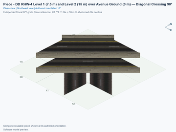](ddrhw-l1-and-l2-over-avenue-l0-crossing-diagonal-90deg/previews/preview.png) | [DD RHW-4 Level 1 (7.5 m) and Level 2 (15 m) over Avenue Ground (0 m) — Diagonal Crossing 90°](ddrhw-l1-and-l2-over-avenue-l0-crossing-diagonal-90deg/README.md) `ddrhw-l1-and-l2-over-avenue-l0-crossing-diagonal-90deg` | 3 × 3; 5 | No current design flag | [ ] 0/3 passed; 3 unverified; 0 failed; 0 stale | [ ] 0/4 passed; 4 unverified; 0 failed; 0 stale | [ ] 0/80 passed; 80 unverified; 0 failed; 0 stale |
| [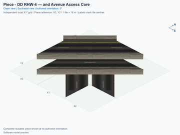](ddrhw-diagonal-access-core/previews/preview.png) | [DD RHW-4 — and Avenue Access Core](ddrhw-diagonal-access-core/README.md) `ddrhw-diagonal-access-core` | 3 × 3; 5 | No current design flag | [ ] 0/3 passed; 3 unverified; 0 failed; 0 stale | [ ] 0/4 passed; 4 unverified; 0 failed; 0 stale | [ ] 0/80 passed; 80 unverified; 0 failed; 0 stale |
| [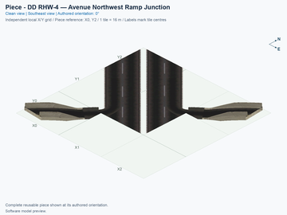](ddrhw-diagonal-northwest-junction/previews/preview.png) | [DD RHW-4 — Avenue Northwest Ramp Junction](ddrhw-diagonal-northwest-junction/README.md) `ddrhw-diagonal-northwest-junction` | 3 × 3; 6 | No current design flag | [ ] 0/3 passed; 3 unverified; 0 failed; 0 stale | [ ] 0/4 passed; 4 unverified; 0 failed; 0 stale | [ ] 0/64 passed; 64 unverified; 0 failed; 0 stale |
| [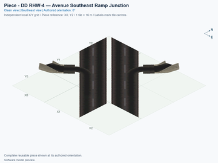](ddrhw-diagonal-southeast-junction/previews/preview.png) | [DD RHW-4 — Avenue Southeast Ramp Junction](ddrhw-diagonal-southeast-junction/README.md) `ddrhw-diagonal-southeast-junction` | 3 × 3; 8 | No current design flag | [ ] 0/3 passed; 3 unverified; 0 failed; 0 stale | [ ] 0/4 passed; 4 unverified; 0 failed; 0 stale | [ ] 0/64 passed; 64 unverified; 0 failed; 0 stale |
| [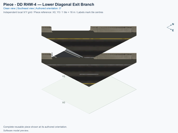](ddrhw-diagonal-lower-exit-branch/previews/preview.png) | [DD RHW-4 — Lower Diagonal Exit Branch](ddrhw-diagonal-lower-exit-branch/README.md) `ddrhw-diagonal-lower-exit-branch` | 2 × 2; 3 | No current design flag | [ ] 0/3 passed; 3 unverified; 0 failed; 0 stale | [ ] 0/4 passed; 4 unverified; 0 failed; 0 stale | [ ] 0/72 passed; 72 unverified; 0 failed; 0 stale |
| [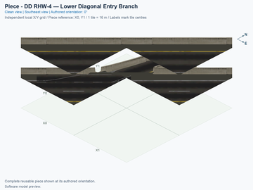](ddrhw-diagonal-lower-entry-branch/previews/preview.png) | [DD RHW-4 — Lower Diagonal Entry Branch](ddrhw-diagonal-lower-entry-branch/README.md) `ddrhw-diagonal-lower-entry-branch` | 2 × 2; 3 | No current design flag | [ ] 0/3 passed; 3 unverified; 0 failed; 0 stale | [ ] 0/4 passed; 4 unverified; 0 failed; 0 stale | [ ] 0/72 passed; 72 unverified; 0 failed; 0 stale |
| [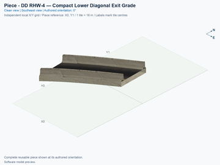](ddrhw-diagonal-lower-exit-grade/previews/preview.png) | [DD RHW-4 — Compact Lower Diagonal Exit Grade](ddrhw-diagonal-lower-exit-grade/README.md) `ddrhw-diagonal-lower-exit-grade` | 1 × 2; 2 | No current design flag | [ ] 0/3 passed; 3 unverified; 0 failed; 0 stale | [ ] 0/4 passed; 4 unverified; 0 failed; 0 stale | [ ] 0/8 passed; 8 unverified; 0 failed; 0 stale |
| [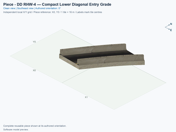](ddrhw-diagonal-lower-entry-grade/previews/preview.png) | [DD RHW-4 — Compact Lower Diagonal Entry Grade](ddrhw-diagonal-lower-entry-grade/README.md) `ddrhw-diagonal-lower-entry-grade` | 2 × 1; 2 | No current design flag | [ ] 0/3 passed; 3 unverified; 0 failed; 0 stale | [ ] 0/4 passed; 4 unverified; 0 failed; 0 stale | [ ] 0/8 passed; 8 unverified; 0 failed; 0 stale |
| [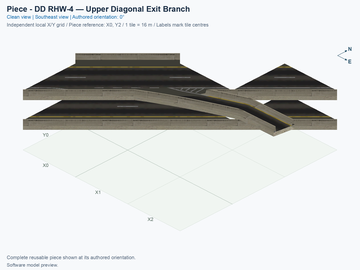](ddrhw-diagonal-upper-exit-branch/previews/preview.png) | [DD RHW-4 — Upper Diagonal Exit Branch](ddrhw-diagonal-upper-exit-branch/README.md) `ddrhw-diagonal-upper-exit-branch` | 3 × 3; 6 | No current design flag | [ ] 0/3 passed; 3 unverified; 0 failed; 0 stale | [ ] 0/4 passed; 4 unverified; 0 failed; 0 stale | [ ] 0/72 passed; 72 unverified; 0 failed; 0 stale |
| [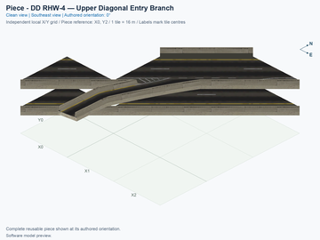](ddrhw-diagonal-upper-entry-branch/previews/preview.png) | [DD RHW-4 — Upper Diagonal Entry Branch](ddrhw-diagonal-upper-entry-branch/README.md) `ddrhw-diagonal-upper-entry-branch` | 3 × 3; 6 | No current design flag | [ ] 0/3 passed; 3 unverified; 0 failed; 0 stale | [ ] 0/4 passed; 4 unverified; 0 failed; 0 stale | [ ] 0/72 passed; 72 unverified; 0 failed; 0 stale |
| [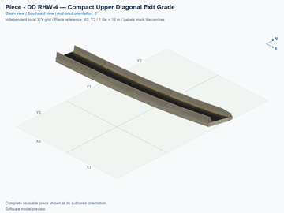](ddrhw-diagonal-upper-exit-grade/previews/preview.png) | [DD RHW-4 — Compact Upper Diagonal Exit Grade](ddrhw-diagonal-upper-exit-grade/README.md) `ddrhw-diagonal-upper-exit-grade` | 2 × 3; 4 | No current design flag | [ ] 0/3 passed; 3 unverified; 0 failed; 0 stale | [ ] 0/4 passed; 4 unverified; 0 failed; 0 stale | [ ] 0/8 passed; 8 unverified; 0 failed; 0 stale |
| [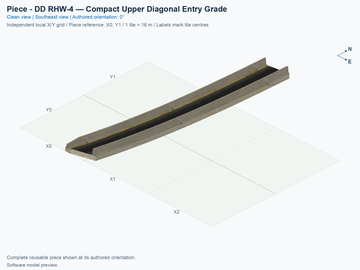](ddrhw-diagonal-upper-entry-grade/previews/preview.png) | [DD RHW-4 — Compact Upper Diagonal Entry Grade](ddrhw-diagonal-upper-entry-grade/README.md) `ddrhw-diagonal-upper-entry-grade` | 3 × 2; 4 | No current design flag | [ ] 0/3 passed; 3 unverified; 0 failed; 0 stale | [ ] 0/4 passed; 4 unverified; 0 failed; 0 stale | [ ] 0/8 passed; 8 unverified; 0 failed; 0 stale |
| [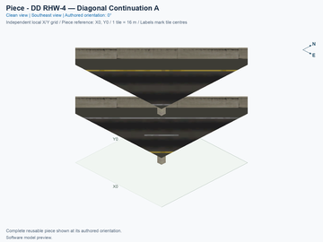](ddrhw-diagonal-diagonal-half-a/previews/preview.png) | [DD RHW-4 — Diagonal Continuation A](ddrhw-diagonal-diagonal-half-a/README.md) `ddrhw-diagonal-diagonal-half-a` | 1 × 1; 1 | No current design flag | [ ] 0/3 passed; 3 unverified; 0 failed; 0 stale | [ ] 0/4 passed; 4 unverified; 0 failed; 0 stale | [ ] 0/32 passed; 32 unverified; 0 failed; 0 stale |
| [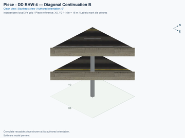](ddrhw-diagonal-diagonal-half-b/previews/preview.png) | [DD RHW-4 — Diagonal Continuation B](ddrhw-diagonal-diagonal-half-b/README.md) `ddrhw-diagonal-diagonal-half-b` | 1 × 1; 1 | No current design flag | [ ] 0/3 passed; 3 unverified; 0 failed; 0 stale | [ ] 0/4 passed; 4 unverified; 0 failed; 0 stale | [ ] 0/32 passed; 32 unverified; 0 failed; 0 stale |
| [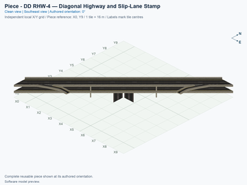](ddrhw-modular-highway-stamp/previews/preview.png) | [DD RHW-4 — Straight Diagonal Highway Stamp](ddrhw-modular-highway-stamp/README.md) `ddrhw-modular-highway-stamp` | 10 × 10; 21 | No current design flag | [ ] 0/3 passed; 3 unverified; 0 failed; 0 stale | [ ] 0/4 passed; 4 unverified; 0 failed; 0 stale | [ ] 0/128 passed; 128 unverified; 0 failed; 0 stale |
| [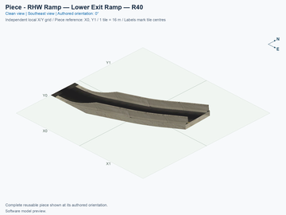](ddrhw-modular-lower-exit-r40/previews/preview.png) | [RHW Ramp — Lower Full Exit Ramp — R40](ddrhw-modular-lower-exit-r40/README.md) `ddrhw-modular-lower-exit-r40` | 3 × 2; 4 | No current design flag | [ ] 0/3 passed; 3 unverified; 0 failed; 0 stale | [ ] 0/4 passed; 4 unverified; 0 failed; 0 stale | [ ] 0/16 passed; 16 unverified; 0 failed; 0 stale |
| [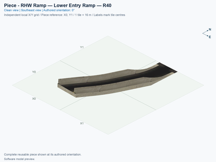](ddrhw-modular-lower-entry-r40/previews/preview.png) | [RHW Ramp — Lower Full Entry Ramp — R40](ddrhw-modular-lower-entry-r40/README.md) `ddrhw-modular-lower-entry-r40` | 2 × 3; 4 | No current design flag | [ ] 0/3 passed; 3 unverified; 0 failed; 0 stale | [ ] 0/4 passed; 4 unverified; 0 failed; 0 stale | [ ] 0/16 passed; 16 unverified; 0 failed; 0 stale |
| [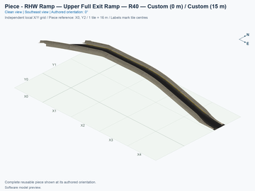](ddrhw-modular-upper-exit-r40/previews/preview.png) | [RHW Ramp — Upper Full Exit Ramp — R40](ddrhw-modular-upper-exit-r40/README.md) `ddrhw-modular-upper-exit-r40` | 5 × 3; 6 | No current design flag | [ ] 0/3 passed; 3 unverified; 0 failed; 0 stale | [ ] 0/4 passed; 4 unverified; 0 failed; 0 stale | [ ] 0/8 passed; 8 unverified; 0 failed; 0 stale |
| [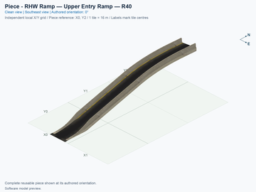](ddrhw-modular-upper-entry-r40/previews/preview.png) | [RHW Ramp — Upper Full Entry Ramp — R40](ddrhw-modular-upper-entry-r40/README.md) `ddrhw-modular-upper-entry-r40` | 3 × 5; 6 | No current design flag | [ ] 0/3 passed; 3 unverified; 0 failed; 0 stale | [ ] 0/4 passed; 4 unverified; 0 failed; 0 stale | [ ] 0/8 passed; 8 unverified; 0 failed; 0 stale |
| [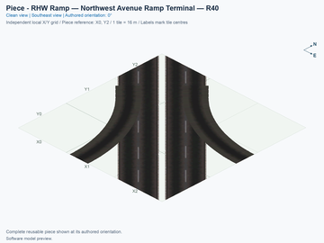](ddrhw-modular-northwest-terminal-r40/previews/preview.png) | [RHW Ramp — Northwest Avenue Ramp Terminal — R40](ddrhw-modular-northwest-terminal-r40/README.md) `ddrhw-modular-northwest-terminal-r40` | 3 × 3; 9 | No current design flag | [ ] 0/3 passed; 3 unverified; 0 failed; 0 stale | [ ] 0/4 passed; 4 unverified; 0 failed; 0 stale | [ ] 0/64 passed; 64 unverified; 0 failed; 0 stale |
| [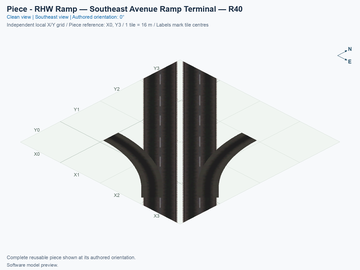](ddrhw-modular-southeast-terminal-r40/previews/preview.png) | [RHW Ramp — Southeast Avenue Ramp Terminal — R40](ddrhw-modular-southeast-terminal-r40/README.md) `ddrhw-modular-southeast-terminal-r40` | 4 × 4; 12 | No current design flag | [ ] 0/3 passed; 3 unverified; 0 failed; 0 stale | [ ] 0/4 passed; 4 unverified; 0 failed; 0 stale | [ ] 0/64 passed; 64 unverified; 0 failed; 0 stale |
| [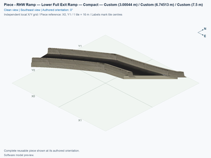](ddrhw-modular-lower-exit-compact/previews/preview.png) | [RHW Ramp — Lower Full Exit Ramp — Compact](ddrhw-modular-lower-exit-compact/README.md) `ddrhw-modular-lower-exit-compact` | 2 × 2; 3 | No current design flag | [ ] 0/3 passed; 3 unverified; 0 failed; 0 stale | [ ] 0/4 passed; 4 unverified; 0 failed; 0 stale | [ ] 0/16 passed; 16 unverified; 0 failed; 0 stale |
| [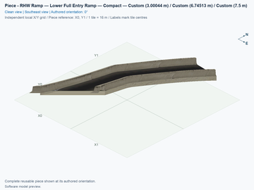](ddrhw-modular-lower-entry-compact/previews/preview.png) | [RHW Ramp — Lower Full Entry Ramp — Compact](ddrhw-modular-lower-entry-compact/README.md) `ddrhw-modular-lower-entry-compact` | 2 × 2; 3 | No current design flag | [ ] 0/3 passed; 3 unverified; 0 failed; 0 stale | [ ] 0/4 passed; 4 unverified; 0 failed; 0 stale | [ ] 0/16 passed; 16 unverified; 0 failed; 0 stale |
| [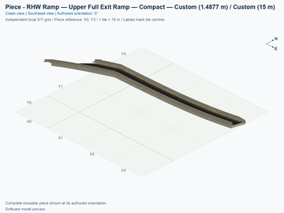](ddrhw-modular-upper-exit-compact/previews/preview.png) | [RHW Ramp — Upper Full Exit Ramp — Compact](ddrhw-modular-upper-exit-compact/README.md) `ddrhw-modular-upper-exit-compact` | 4 × 4; 6 | No current design flag | [ ] 0/3 passed; 3 unverified; 0 failed; 0 stale | [ ] 0/4 passed; 4 unverified; 0 failed; 0 stale | [ ] 0/8 passed; 8 unverified; 0 failed; 0 stale |
| [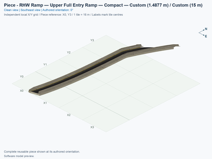](ddrhw-modular-upper-entry-compact/previews/preview.png) | [RHW Ramp — Upper Full Entry Ramp — Compact](ddrhw-modular-upper-entry-compact/README.md) `ddrhw-modular-upper-entry-compact` | 4 × 4; 6 | No current design flag | [ ] 0/3 passed; 3 unverified; 0 failed; 0 stale | [ ] 0/4 passed; 4 unverified; 0 failed; 0 stale | [ ] 0/8 passed; 8 unverified; 0 failed; 0 stale |
| [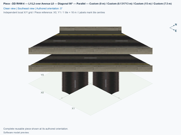](ddrhw-parallel-crossing/previews/preview.png) | [DD RHW-4 — L1/L2 over Avenue L0 — Diagonal 90° — Parallel](ddrhw-parallel-crossing/README.md) `ddrhw-parallel-crossing` | 2 × 2; 3 | No current design flag | [ ] 0/3 passed; 3 unverified; 0 failed; 0 stale | [ ] 0/4 passed; 4 unverified; 0 failed; 0 stale | [ ] 0/96 passed; 96 unverified; 0 failed; 0 stale |
| [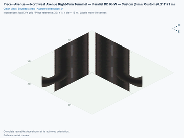](ddrhw-parallel-northwest-terminal/previews/preview.png) | [Avenue — Northwest Avenue Right-Turn Terminal — Parallel DD RHW](ddrhw-parallel-northwest-terminal/README.md) `ddrhw-parallel-northwest-terminal` | 2 × 2; 3 | No current design flag | [ ] 0/3 passed; 3 unverified; 0 failed; 0 stale | [ ] 0/4 passed; 4 unverified; 0 failed; 0 stale | [ ] 0/64 passed; 64 unverified; 0 failed; 0 stale |
| [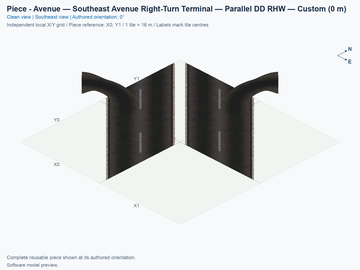](ddrhw-parallel-southeast-terminal/previews/preview.png) | [Avenue — Southeast Avenue Right-Turn Terminal — Parallel DD RHW](ddrhw-parallel-southeast-terminal/README.md) `ddrhw-parallel-southeast-terminal` | 2 × 2; 3 | No current design flag | [ ] 0/3 passed; 3 unverified; 0 failed; 0 stale | [ ] 0/4 passed; 4 unverified; 0 failed; 0 stale | [ ] 0/64 passed; 64 unverified; 0 failed; 0 stale |
| [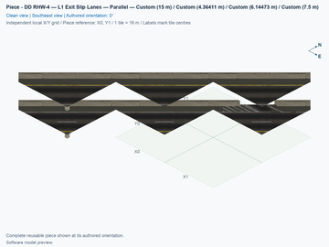](ddrhw-parallel-lower-exit-slip/previews/preview.png) | [DD RHW-4 — L1 Exit Slip Lanes — Parallel](ddrhw-parallel-lower-exit-slip/README.md) `ddrhw-parallel-lower-exit-slip` | 2 × 2; 2 | No current design flag | [ ] 0/3 passed; 3 unverified; 0 failed; 0 stale | [ ] 0/4 passed; 4 unverified; 0 failed; 0 stale | [ ] 0/80 passed; 80 unverified; 0 failed; 0 stale |
| [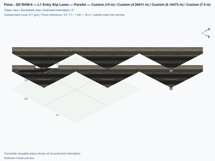](ddrhw-parallel-lower-entry-slip/previews/preview.png) | [DD RHW-4 — L1 Entry Slip Lanes — Parallel](ddrhw-parallel-lower-entry-slip/README.md) `ddrhw-parallel-lower-entry-slip` | 2 × 2; 2 | No current design flag | [ ] 0/3 passed; 3 unverified; 0 failed; 0 stale | [ ] 0/4 passed; 4 unverified; 0 failed; 0 stale | [ ] 0/80 passed; 80 unverified; 0 failed; 0 stale |
| [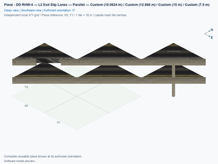](ddrhw-parallel-upper-exit-slip/previews/preview.png) | [DD RHW-4 — L2 Exit Slip Lanes — Parallel](ddrhw-parallel-upper-exit-slip/README.md) `ddrhw-parallel-upper-exit-slip` | 2 × 2; 2 | No current design flag | [ ] 0/3 passed; 3 unverified; 0 failed; 0 stale | [ ] 0/4 passed; 4 unverified; 0 failed; 0 stale | [ ] 0/88 passed; 88 unverified; 0 failed; 0 stale |
| [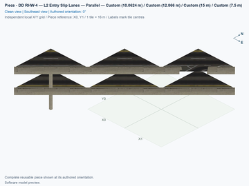](ddrhw-parallel-upper-entry-slip/previews/preview.png) | [DD RHW-4 — L2 Entry Slip Lanes — Parallel](ddrhw-parallel-upper-entry-slip/README.md) `ddrhw-parallel-upper-entry-slip` | 2 × 2; 2 | No current design flag | [ ] 0/3 passed; 3 unverified; 0 failed; 0 stale | [ ] 0/4 passed; 4 unverified; 0 failed; 0 stale | [ ] 0/88 passed; 88 unverified; 0 failed; 0 stale |
| [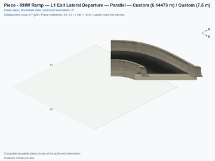](ddrhw-parallel-lower-exit-departure/previews/preview.png) | [RHW Ramp — L1 Exit Lateral Departure — Parallel](ddrhw-parallel-lower-exit-departure/README.md) `ddrhw-parallel-lower-exit-departure` | 1 × 1; 1 | No current design flag | [ ] 0/3 passed; 3 unverified; 0 failed; 0 stale | [ ] 0/4 passed; 4 unverified; 0 failed; 0 stale | [ ] 0/8 passed; 8 unverified; 0 failed; 0 stale |
| [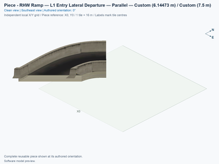](ddrhw-parallel-lower-entry-departure/previews/preview.png) | [RHW Ramp — L1 Entry Lateral Departure — Parallel](ddrhw-parallel-lower-entry-departure/README.md) `ddrhw-parallel-lower-entry-departure` | 1 × 1; 1 | No current design flag | [ ] 0/3 passed; 3 unverified; 0 failed; 0 stale | [ ] 0/4 passed; 4 unverified; 0 failed; 0 stale | [ ] 0/8 passed; 8 unverified; 0 failed; 0 stale |
| [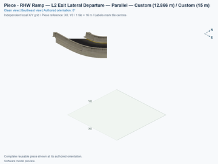](ddrhw-parallel-upper-exit-departure/previews/preview.png) | [RHW Ramp — L2 Exit Lateral Departure — Parallel](ddrhw-parallel-upper-exit-departure/README.md) `ddrhw-parallel-upper-exit-departure` | 1 × 1; 1 | No current design flag | [ ] 0/3 passed; 3 unverified; 0 failed; 0 stale | [ ] 0/4 passed; 4 unverified; 0 failed; 0 stale | [ ] 0/8 passed; 8 unverified; 0 failed; 0 stale |
| [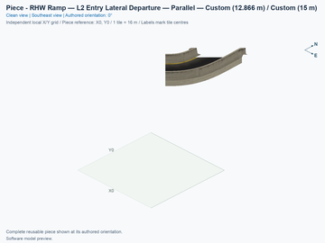](ddrhw-parallel-upper-entry-departure/previews/preview.png) | [RHW Ramp — L2 Entry Lateral Departure — Parallel](ddrhw-parallel-upper-entry-departure/README.md) `ddrhw-parallel-upper-entry-departure` | 1 × 1; 1 | No current design flag | [ ] 0/3 passed; 3 unverified; 0 failed; 0 stale | [ ] 0/4 passed; 4 unverified; 0 failed; 0 stale | [ ] 0/8 passed; 8 unverified; 0 failed; 0 stale |
| [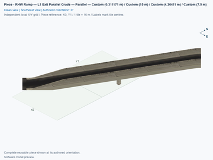](ddrhw-parallel-lower-exit-grade/previews/preview.png) | [RHW Ramp — L1 Exit Parallel Grade — Parallel](ddrhw-parallel-lower-exit-grade/README.md) `ddrhw-parallel-lower-exit-grade` | 1 × 2; 2 | No current design flag | [ ] 0/3 passed; 3 unverified; 0 failed; 0 stale | [ ] 0/4 passed; 4 unverified; 0 failed; 0 stale | [ ] 0/40 passed; 40 unverified; 0 failed; 0 stale |
| [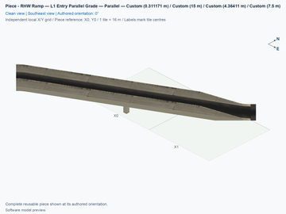](ddrhw-parallel-lower-entry-grade/previews/preview.png) | [RHW Ramp — L1 Entry Parallel Grade — Parallel](ddrhw-parallel-lower-entry-grade/README.md) `ddrhw-parallel-lower-entry-grade` | 2 × 1; 2 | No current design flag | [ ] 0/3 passed; 3 unverified; 0 failed; 0 stale | [ ] 0/4 passed; 4 unverified; 0 failed; 0 stale | [ ] 0/40 passed; 40 unverified; 0 failed; 0 stale |
| [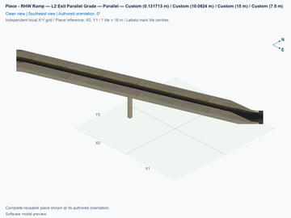](ddrhw-parallel-upper-exit-grade/previews/preview.png) | [RHW Ramp — L2 Exit Parallel Grade — Parallel](ddrhw-parallel-upper-exit-grade/README.md) `ddrhw-parallel-upper-exit-grade` | 2 × 2; 3 | No current design flag | [ ] 0/3 passed; 3 unverified; 0 failed; 0 stale | [ ] 0/4 passed; 4 unverified; 0 failed; 0 stale | [ ] 0/40 passed; 40 unverified; 0 failed; 0 stale |
| [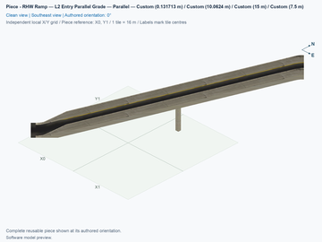](ddrhw-parallel-upper-entry-grade/previews/preview.png) | [RHW Ramp — L2 Entry Parallel Grade — Parallel](ddrhw-parallel-upper-entry-grade/README.md) `ddrhw-parallel-upper-entry-grade` | 2 × 2; 3 | No current design flag | [ ] 0/3 passed; 3 unverified; 0 failed; 0 stale | [ ] 0/4 passed; 4 unverified; 0 failed; 0 stale | [ ] 0/40 passed; 40 unverified; 0 failed; 0 stale |
| [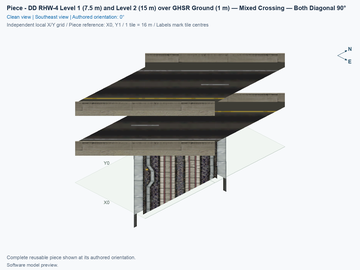](ddrhw-l1-and-l2-over-ghsr-ground-mixed-crossing-diagonal-90deg/previews/preview.png) | [DD RHW-4 Level 1 (7.5 m) and Level 2 (15 m) over GHSR Ground (1 m) — Mixed Crossing — Both Diagonal 90°](ddrhw-l1-and-l2-over-ghsr-ground-mixed-crossing-diagonal-90deg/README.md) `ddrhw-l1-and-l2-over-ghsr-ground-mixed-crossing-diagonal-90deg` | 1 × 2; 2 | No current design flag | [ ] 0/3 passed; 3 unverified; 0 failed; 0 stale | [ ] 0/4 passed; 4 unverified; 0 failed; 0 stale | [ ] 0/48 passed; 48 unverified; 0 failed; 0 stale |
| [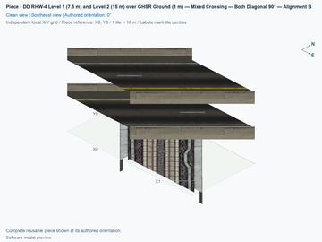](ddrhw-l1-l2-over-ghsr-ground-crossing-diagonal-90deg-alignment-b/previews/preview.png) | [DD RHW-4 Level 1 (7.5 m) and Level 2 (15 m) over GHSR Ground (1 m) — Mixed Crossing — Both Diagonal 90° — Alignment B](ddrhw-l1-l2-over-ghsr-ground-crossing-diagonal-90deg-alignment-b/README.md) `ddrhw-l1-l2-over-ghsr-ground-crossing-diagonal-90deg-alignment-b` | 2 × 1; 2 | No current design flag | [ ] 0/3 passed; 3 unverified; 0 failed; 0 stale | [ ] 0/4 passed; 4 unverified; 0 failed; 0 stale | [ ] 0/48 passed; 48 unverified; 0 failed; 0 stale |
