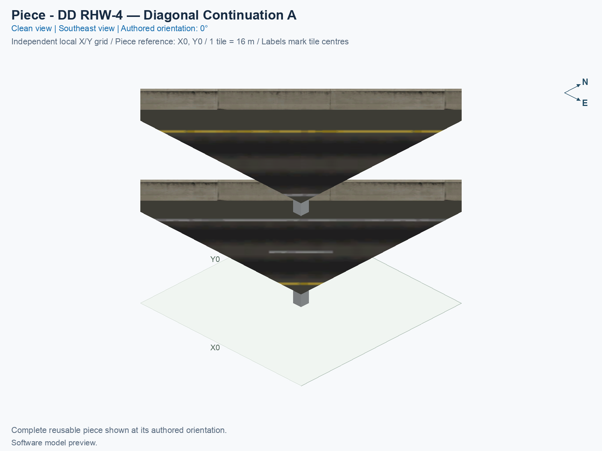
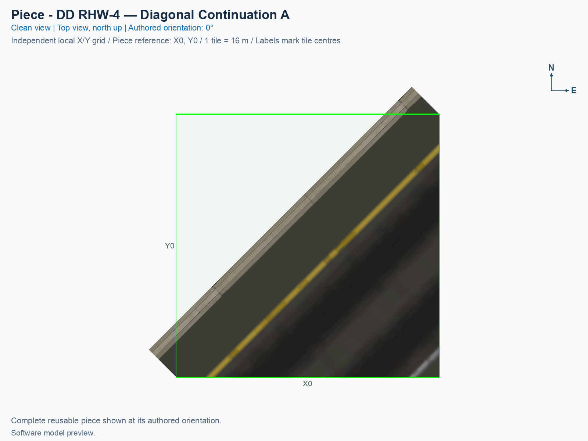

# DD RHW-4 — Diagonal Continuation A

Purpose: explain this reusable piece and its connections and test coverage.

<!-- PIECE README LAYOUT: 2 -->

[1. Views](#1-views) · [2. Piece and placement](#2-piece-and-placement) · [3. Connection matrix](#3-connection-matrix) · [Testing ↗ (separate document)](TESTING.md)

## 1. Views

These angled and north-up views render the actual saved game models and their referenced textures. They show geometry and tile ownership; the game must still be inspected separately.

<!-- BEGIN PIECE VIEWS -->

<!-- END PIECE VIEWS -->

## 2. Piece and placement

Preserves one native diagonal DD RHW-4 continuation half and adds one 0.8 m-square concrete centre column from ground to the upper deck. Use the complementary half beside it; a single half does not supply the complete roadway boundary.

A **construction tile** is one 16 × 16 m city square owned by this component. This component owns 1 tiles inside a 1 × 1-tile bounding rectangle. Empty cells in that rectangle belong to neighbouring components or remain open.

1. Prepare the exact NAM 50 right-hand-traffic profile using the [build and installation guide](../../../../docs/BUILD_AND_INSTALL.md).
2. Open a disposable city and flatten the complete placement area. These fixed components have no terrain-following implementation.
3. Open **Transportation → Roads**. For the complete layout, select the compact diamond assembly button, then press **Tab** or **Shift+Tab** until this exact component name appears. **Home** and **End** rotate the current component.
4. Follow the [assembly placement table](../../01_assemblies/ddrhw-l1-and-l2-diagonal-avenue-diamond/README.md#3-placements), including its reference tile and rotation. Click once for this component, then select the next one.

The eight selection states repeat four proper rotations. They do not mirror the traffic directions. Game placement, vehicle travel, lighting, demolition, and save/reload are unverified. The ramp slopes are a deliberately steep experiment, with a 40% software limit, rather than an established NAM design standard.

<!-- BEGIN PIECE OVERVIEW -->

Reusable native diagonal DD RHW-4 continuation half with an authored concrete centre pier meeting both deck pavement planes. Use the complementary half and the assembly placement guide; traffic follows measured native car lanes.

Exact reusable identifier: `ddrhw-diagonal-diagonal-half-a`.

Footprint: **1 × 1 tiles**. Exact menu name: **DD RHW-4 — Diagonal Continuation A**.

<!-- END PIECE OVERVIEW -->

## 3. Connection matrix

The generated matrix describes movements within this piece. A connector overview, when supplied, describes its exposed boundaries; neither establishes compatibility with an untested neighbour.

<!-- BEGIN PIECE CONNECTION MATRIX -->

### Directed entrance/exit matrix

Read **from an entrance row to an exit column**. **Saved PATH** checks the saved traffic route; **Route Query** checks the route shown by the game; **Visible travel** checks a vehicle completing that journey. For HSR, visible travel means a moving train.

**Game appearance:** [?](TESTING.md#case-in_game_render-eebd362bf912c7de2bae) — the complete piece’s appearance in the game, checked separately from its journeys.

**Legend:** ✅ confirmed; ❌ failed; ? not established. **Forbidden** means the movement is unavailable; its in-game check confirms that it stays unavailable. Click a result for its exact test case. Scope, evidence, and limitations remain in [the test checklist](TESTING.md#test-checklist).

| Entrance ↓ / Exit → | **Road · South exit** `1-S-out-1` Variant: dd-rhw-l1 | **Road · South exit** `1-S-out-3` Variant: dd-rhw-l1 | **Road · East exit** `1-E-out-6` Variant: dd-rhw-l2 | **Road · East exit** `1-E-out-8` Variant: dd-rhw-l2 |
| --- | --- | --- | --- | --- |
| **Road · South entrance** `1-S-in-2` Variant: dd-rhw-l2 | **Forbidden** **Saved PATH:** [?](TESTING.md#case-software_connectivity-e2a26c1b65672fe79daa) In-game check: [?](TESTING.md#case-in_game_forbidden_transfer-72eae0c27ae290240404) | **Forbidden** **Saved PATH:** [?](TESTING.md#case-software_connectivity-e2a26c1b65672fe79daa) In-game check: [?](TESTING.md#case-in_game_forbidden_transfer-1780d9ff3898f9e07b67) | **Forbidden** **Saved PATH:** [?](TESTING.md#case-software_connectivity-e2a26c1b65672fe79daa) In-game check: [?](TESTING.md#case-in_game_forbidden_transfer-ce5aa217176de84912e6) | **Saved PATH:** [?](TESTING.md#case-software_connectivity-e2a26c1b65672fe79daa) **Route Query:** [?](TESTING.md#case-in_game_route_query-7e299d3cdf10f1b5df41) **Visible travel:** [?](TESTING.md#case-in_game_visible_travel-7e299d3cdf10f1b5df41) |
| **Road · South entrance** `1-S-in-4` Variant: dd-rhw-l2 | **Forbidden** **Saved PATH:** [?](TESTING.md#case-software_connectivity-e2a26c1b65672fe79daa) In-game check: [?](TESTING.md#case-in_game_forbidden_transfer-8e9112aa8042ac3348c6) | **Forbidden** **Saved PATH:** [?](TESTING.md#case-software_connectivity-e2a26c1b65672fe79daa) In-game check: [?](TESTING.md#case-in_game_forbidden_transfer-78c2f609dc3b69a3818a) | **Saved PATH:** [?](TESTING.md#case-software_connectivity-e2a26c1b65672fe79daa) **Route Query:** [?](TESTING.md#case-in_game_route_query-b2677c07f80373fba6f2) **Visible travel:** [?](TESTING.md#case-in_game_visible_travel-b2677c07f80373fba6f2) | **Forbidden** **Saved PATH:** [?](TESTING.md#case-software_connectivity-e2a26c1b65672fe79daa) In-game check: [?](TESTING.md#case-in_game_forbidden_transfer-0eb6a4cfe5c6e961762b) |
| **Road · East entrance** `1-E-in-5` Variant: dd-rhw-l1 | **Forbidden** **Saved PATH:** [?](TESTING.md#case-software_connectivity-e2a26c1b65672fe79daa) In-game check: [?](TESTING.md#case-in_game_forbidden_transfer-ca2fc7df66c1a5ebf850) | **Saved PATH:** [?](TESTING.md#case-software_connectivity-e2a26c1b65672fe79daa) **Route Query:** [?](TESTING.md#case-in_game_route_query-2a3a1dad24f30c649b04) **Visible travel:** [?](TESTING.md#case-in_game_visible_travel-2a3a1dad24f30c649b04) | **Forbidden** **Saved PATH:** [?](TESTING.md#case-software_connectivity-e2a26c1b65672fe79daa) In-game check: [?](TESTING.md#case-in_game_forbidden_transfer-d8b41d012c10bf211ad1) | **Forbidden** **Saved PATH:** [?](TESTING.md#case-software_connectivity-e2a26c1b65672fe79daa) In-game check: [?](TESTING.md#case-in_game_forbidden_transfer-e373203c101b8611de8a) |
| **Road · East entrance** `1-E-in-7` Variant: dd-rhw-l1 | **Saved PATH:** [?](TESTING.md#case-software_connectivity-e2a26c1b65672fe79daa) **Route Query:** [?](TESTING.md#case-in_game_route_query-c24962a1e364b7c1fd72) **Visible travel:** [?](TESTING.md#case-in_game_visible_travel-c24962a1e364b7c1fd72) | **Forbidden** **Saved PATH:** [?](TESTING.md#case-software_connectivity-e2a26c1b65672fe79daa) In-game check: [?](TESTING.md#case-in_game_forbidden_transfer-03af9887363039575eb3) | **Forbidden** **Saved PATH:** [?](TESTING.md#case-software_connectivity-e2a26c1b65672fe79daa) In-game check: [?](TESTING.md#case-in_game_forbidden_transfer-d86f9e9248fa7c0b2ab3) | **Forbidden** **Saved PATH:** [?](TESTING.md#case-software_connectivity-e2a26c1b65672fe79daa) In-game check: [?](TESTING.md#case-in_game_forbidden_transfer-2176c6ca657977bc241e) |

Source: [connections.json](connections.json).

<!-- END PIECE CONNECTION MATRIX -->

<!-- BEGIN CONNECTOR OVERVIEW -->

<!-- END CONNECTOR OVERVIEW -->
