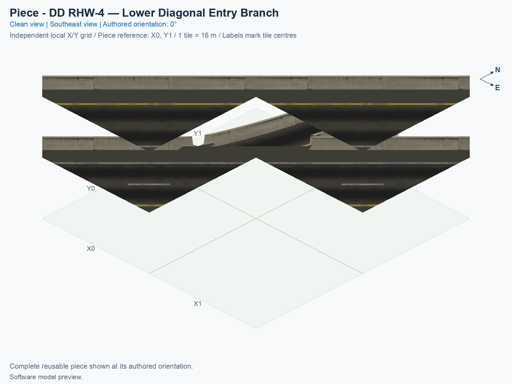
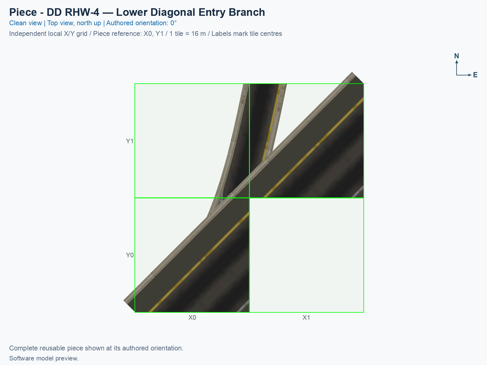

# DD RHW-4 — Lower Diagonal Entry Branch

Purpose: explain this reusable piece and its connections and test coverage.

<!-- PIECE README LAYOUT: 2 -->

[1. Views](#1-views) · [2. Piece and placement](#2-piece-and-placement) · [3. Connection matrix](#3-connection-matrix) · [Testing ↗ (separate document)](TESTING.md)

## 1. Views

These angled and north-up views render the actual saved game models and their referenced textures. They show geometry and tile ownership; the game must still be inspected separately.

<!-- BEGIN PIECE VIEWS -->

<!-- END PIECE VIEWS -->

## 2. Piece and placement

Merges the on-ramp from the northwest avenue access into an outer lower-deck lane. The branch is one diagonal city-grid step farther from the avenue than in the original layout. Its barrier opening belongs to the lower deck; the upper-deck edge remains closed here.

This branch uses a real flat auxiliary lane in the former highway shoulder, with a 12 m taper and a 4 m parallel section. Its saved driving path changes between the native outer through lane and that auxiliary lane. Native-material dashed separators and a painted split area identify the join; both highway through lanes remain available.

A **construction tile** is one 16 × 16 m city square owned by this component. This component owns 3 tiles inside a 2 × 2-tile bounding rectangle. Empty cells in that rectangle belong to neighbouring components or remain open.

1. Prepare the exact NAM 50 right-hand-traffic profile using the [build and installation guide](../../../../docs/BUILD_AND_INSTALL.md).
2. Open a disposable city and flatten the complete placement area. These fixed components have no terrain-following implementation.
3. Open **Transportation → Highways**. For the complete layout, select the compact diamond assembly button, then press **Tab** or **Shift+Tab** until this exact component name appears. **Home** and **End** rotate the current component.
4. Follow the [assembly placement table](../../01_assemblies/ddrhw-l1-and-l2-diagonal-avenue-diamond/README.md#3-placements), including its reference tile and rotation. Click once for this component, then select the next one.

The eight selection states repeat four proper rotations. They do not mirror the traffic directions. The complete assembly’s source design allows four right turns between the highway and avenue; ramp traffic stays on the adjacent avenue carriageway. The graded ramps remain experimental, with a 30% authoring bound. Current saved-resource results and separate game observations belong in [TESTING.md](TESTING.md).

<!-- BEGIN PIECE OVERVIEW -->

Reusable lower entry branch component of the compact diagonal double-decker highway and Avenue interchange. Place its owned tiles exactly as shown in the assembly guide; traffic uses actual car and pedestrian PATHs.

Exact reusable identifier: `ddrhw-diagonal-lower-entry-branch`.

Footprint: **2 × 2 tiles**. Exact menu name: **DD RHW-4 — Lower Diagonal Entry Branch**.

<!-- END PIECE OVERVIEW -->

## 3. Connection matrix

The generated matrix describes movements within this piece. A connector overview, when supplied, describes its exposed boundaries; neither establishes compatibility with an untested neighbour.

<!-- BEGIN PIECE CONNECTION MATRIX -->

### Directed entrance/exit matrix

Read **from an entrance row to an exit column**. **Saved PATH** checks the saved traffic route; **Route Query** checks the route shown by the game; **Visible travel** checks a vehicle completing that journey. For HSR, visible travel means a moving train.

**Game appearance:** [?](TESTING.md#case-in_game_render-508b180723f876d0dff8) — the complete piece’s appearance in the game, checked separately from its journeys.

**Legend:** ✅ confirmed; ❌ failed; ? not established. **Forbidden** means the movement is unavailable; its in-game check confirms that it stays unavailable. Click a result for its exact test case. Scope, evidence, and limitations remain in [the test checklist](TESTING.md#test-checklist).

| Entrance ↓ / Exit → | **Road · South exit** `1-S-out-1` Variant: dd-rhw-l1 | **Road · South exit** `1-S-out-3` Variant: dd-rhw-l1 | **Road · East exit** `1-E-out-6` Variant: dd-rhw-l2 | **Road · East exit** `1-E-out-8` Variant: dd-rhw-l2 | **Road · South exit** `1-S-out-10` Variant: dd-rhw-l1 | **Road · South exit** `1-S-out-12` Variant: dd-rhw-l1 | **Road · East exit** `1-E-out-15` Variant: dd-rhw-l2 | **Road · East exit** `1-E-out-17` Variant: dd-rhw-l2 |
| --- | --- | --- | --- | --- | --- | --- | --- | --- |
| **Road · South entrance** `1-S-in-2` Variant: dd-rhw-l2 | **Forbidden** **Saved PATH:** [?](TESTING.md#case-software_connectivity-0d8e83cbc22de1b2fb83) In-game check: [?](TESTING.md#case-in_game_forbidden_transfer-78b47be1097668bd4b23) | **Forbidden** **Saved PATH:** [?](TESTING.md#case-software_connectivity-0d8e83cbc22de1b2fb83) In-game check: [?](TESTING.md#case-in_game_forbidden_transfer-0991b2cde89997aa0e1f) | **Forbidden** **Saved PATH:** [?](TESTING.md#case-software_connectivity-0d8e83cbc22de1b2fb83) In-game check: [?](TESTING.md#case-in_game_forbidden_transfer-1fda65edaef5119a523f) | **Saved PATH:** [?](TESTING.md#case-software_connectivity-0d8e83cbc22de1b2fb83) **Route Query:** [?](TESTING.md#case-in_game_route_query-9837de4264cc6c4ebc2d) **Visible travel:** [?](TESTING.md#case-in_game_visible_travel-9837de4264cc6c4ebc2d) | **Forbidden** **Saved PATH:** [?](TESTING.md#case-software_connectivity-0d8e83cbc22de1b2fb83) In-game check: [?](TESTING.md#case-in_game_forbidden_transfer-728206ef316ed77ba9d9) | **Forbidden** **Saved PATH:** [?](TESTING.md#case-software_connectivity-0d8e83cbc22de1b2fb83) In-game check: [?](TESTING.md#case-in_game_forbidden_transfer-5ad36301db997f677eec) | **Forbidden** **Saved PATH:** [?](TESTING.md#case-software_connectivity-0d8e83cbc22de1b2fb83) In-game check: [?](TESTING.md#case-in_game_forbidden_transfer-3b962dc6801969d8d49f) | **Forbidden** **Saved PATH:** [?](TESTING.md#case-software_connectivity-0d8e83cbc22de1b2fb83) In-game check: [?](TESTING.md#case-in_game_forbidden_transfer-17e7066f227a643eec65) |
| **Road · South entrance** `1-S-in-4` Variant: dd-rhw-l2 | **Forbidden** **Saved PATH:** [?](TESTING.md#case-software_connectivity-0d8e83cbc22de1b2fb83) In-game check: [?](TESTING.md#case-in_game_forbidden_transfer-8284cc08688765e6962b) | **Forbidden** **Saved PATH:** [?](TESTING.md#case-software_connectivity-0d8e83cbc22de1b2fb83) In-game check: [?](TESTING.md#case-in_game_forbidden_transfer-9389c2ca224634e68336) | **Saved PATH:** [?](TESTING.md#case-software_connectivity-0d8e83cbc22de1b2fb83) **Route Query:** [?](TESTING.md#case-in_game_route_query-a9983992c2b911374095) **Visible travel:** [?](TESTING.md#case-in_game_visible_travel-a9983992c2b911374095) | **Forbidden** **Saved PATH:** [?](TESTING.md#case-software_connectivity-0d8e83cbc22de1b2fb83) In-game check: [?](TESTING.md#case-in_game_forbidden_transfer-876b61e05b1d6de88bb4) | **Forbidden** **Saved PATH:** [?](TESTING.md#case-software_connectivity-0d8e83cbc22de1b2fb83) In-game check: [?](TESTING.md#case-in_game_forbidden_transfer-a1dbef89e18fa1e77e48) | **Forbidden** **Saved PATH:** [?](TESTING.md#case-software_connectivity-0d8e83cbc22de1b2fb83) In-game check: [?](TESTING.md#case-in_game_forbidden_transfer-ce2c0a7b040562229b4b) | **Forbidden** **Saved PATH:** [?](TESTING.md#case-software_connectivity-0d8e83cbc22de1b2fb83) In-game check: [?](TESTING.md#case-in_game_forbidden_transfer-007c36acba6e3aa43308) | **Forbidden** **Saved PATH:** [?](TESTING.md#case-software_connectivity-0d8e83cbc22de1b2fb83) In-game check: [?](TESTING.md#case-in_game_forbidden_transfer-6cfbb8d339f461430e1a) |
| **Road · East entrance** `1-E-in-5` Variant: dd-rhw-l1 | **Forbidden** **Saved PATH:** [?](TESTING.md#case-software_connectivity-0d8e83cbc22de1b2fb83) In-game check: [?](TESTING.md#case-in_game_forbidden_transfer-8cebf5a96e77000f43bc) | **Saved PATH:** [?](TESTING.md#case-software_connectivity-0d8e83cbc22de1b2fb83) **Route Query:** [?](TESTING.md#case-in_game_route_query-53101c17050fddd96498) **Visible travel:** [?](TESTING.md#case-in_game_visible_travel-53101c17050fddd96498) | **Forbidden** **Saved PATH:** [?](TESTING.md#case-software_connectivity-0d8e83cbc22de1b2fb83) In-game check: [?](TESTING.md#case-in_game_forbidden_transfer-b920b7721ab1bd6ed25a) | **Forbidden** **Saved PATH:** [?](TESTING.md#case-software_connectivity-0d8e83cbc22de1b2fb83) In-game check: [?](TESTING.md#case-in_game_forbidden_transfer-c6850363f81763e17cd0) | **Forbidden** **Saved PATH:** [?](TESTING.md#case-software_connectivity-0d8e83cbc22de1b2fb83) In-game check: [?](TESTING.md#case-in_game_forbidden_transfer-9727f2e118265d39cdee) | **Forbidden** **Saved PATH:** [?](TESTING.md#case-software_connectivity-0d8e83cbc22de1b2fb83) In-game check: [?](TESTING.md#case-in_game_forbidden_transfer-09ad6eff9a35bd8b4117) | **Forbidden** **Saved PATH:** [?](TESTING.md#case-software_connectivity-0d8e83cbc22de1b2fb83) In-game check: [?](TESTING.md#case-in_game_forbidden_transfer-21646a49bdbeefbecee0) | **Forbidden** **Saved PATH:** [?](TESTING.md#case-software_connectivity-0d8e83cbc22de1b2fb83) In-game check: [?](TESTING.md#case-in_game_forbidden_transfer-4e3b6f379faa22189fd4) |
| **Road · East entrance** `1-E-in-7` Variant: dd-rhw-l1 | **Saved PATH:** [?](TESTING.md#case-software_connectivity-0d8e83cbc22de1b2fb83) **Route Query:** [?](TESTING.md#case-in_game_route_query-06fd65b283c942938831) **Visible travel:** [?](TESTING.md#case-in_game_visible_travel-06fd65b283c942938831) | **Forbidden** **Saved PATH:** [?](TESTING.md#case-software_connectivity-0d8e83cbc22de1b2fb83) In-game check: [?](TESTING.md#case-in_game_forbidden_transfer-92fccb2136cc80e8b5c9) | **Forbidden** **Saved PATH:** [?](TESTING.md#case-software_connectivity-0d8e83cbc22de1b2fb83) In-game check: [?](TESTING.md#case-in_game_forbidden_transfer-8a61d65f89adfe195430) | **Forbidden** **Saved PATH:** [?](TESTING.md#case-software_connectivity-0d8e83cbc22de1b2fb83) In-game check: [?](TESTING.md#case-in_game_forbidden_transfer-de8517bfad9296d47961) | **Forbidden** **Saved PATH:** [?](TESTING.md#case-software_connectivity-0d8e83cbc22de1b2fb83) In-game check: [?](TESTING.md#case-in_game_forbidden_transfer-720d1f9e337b7bc7a2eb) | **Forbidden** **Saved PATH:** [?](TESTING.md#case-software_connectivity-0d8e83cbc22de1b2fb83) In-game check: [?](TESTING.md#case-in_game_forbidden_transfer-703616dba3f2fb4896cc) | **Forbidden** **Saved PATH:** [?](TESTING.md#case-software_connectivity-0d8e83cbc22de1b2fb83) In-game check: [?](TESTING.md#case-in_game_forbidden_transfer-fc1cc162ef5fd415d9c7) | **Forbidden** **Saved PATH:** [?](TESTING.md#case-software_connectivity-0d8e83cbc22de1b2fb83) In-game check: [?](TESTING.md#case-in_game_forbidden_transfer-1bb7c8c1a8ee7d1c4a9a) |
| **Road · North entrance** `1-N-in-9` Variant: access-ramp | **Saved PATH:** [?](TESTING.md#case-software_connectivity-0d8e83cbc22de1b2fb83) **Route Query:** [?](TESTING.md#case-in_game_route_query-e336e581e33f584610a2) **Visible travel:** [?](TESTING.md#case-in_game_visible_travel-e336e581e33f584610a2) | **Forbidden** **Saved PATH:** [?](TESTING.md#case-software_connectivity-0d8e83cbc22de1b2fb83) In-game check: [?](TESTING.md#case-in_game_forbidden_transfer-693028d16d443cf3ba49) | **Forbidden** **Saved PATH:** [?](TESTING.md#case-software_connectivity-0d8e83cbc22de1b2fb83) In-game check: [?](TESTING.md#case-in_game_forbidden_transfer-285a87a70e4fd6085a1a) | **Forbidden** **Saved PATH:** [?](TESTING.md#case-software_connectivity-0d8e83cbc22de1b2fb83) In-game check: [?](TESTING.md#case-in_game_forbidden_transfer-129060e6be11fd42f6cf) | **Forbidden** **Saved PATH:** [?](TESTING.md#case-software_connectivity-0d8e83cbc22de1b2fb83) In-game check: [?](TESTING.md#case-in_game_forbidden_transfer-311444c1b0282a141606) | **Forbidden** **Saved PATH:** [?](TESTING.md#case-software_connectivity-0d8e83cbc22de1b2fb83) In-game check: [?](TESTING.md#case-in_game_forbidden_transfer-e3a400e15bc0243c0b96) | **Forbidden** **Saved PATH:** [?](TESTING.md#case-software_connectivity-0d8e83cbc22de1b2fb83) In-game check: [?](TESTING.md#case-in_game_forbidden_transfer-d37d4d517a3288b509c3) | **Forbidden** **Saved PATH:** [?](TESTING.md#case-software_connectivity-0d8e83cbc22de1b2fb83) In-game check: [?](TESTING.md#case-in_game_forbidden_transfer-59cd7946d4479047046a) |
| **Road · South entrance** `1-S-in-11` Variant: dd-rhw-l2 | **Forbidden** **Saved PATH:** [?](TESTING.md#case-software_connectivity-0d8e83cbc22de1b2fb83) In-game check: [?](TESTING.md#case-in_game_forbidden_transfer-f4cb5b950989069d066b) | **Forbidden** **Saved PATH:** [?](TESTING.md#case-software_connectivity-0d8e83cbc22de1b2fb83) In-game check: [?](TESTING.md#case-in_game_forbidden_transfer-7d1b8b07ba32506f7697) | **Forbidden** **Saved PATH:** [?](TESTING.md#case-software_connectivity-0d8e83cbc22de1b2fb83) In-game check: [?](TESTING.md#case-in_game_forbidden_transfer-2fa2336548310bd2befd) | **Forbidden** **Saved PATH:** [?](TESTING.md#case-software_connectivity-0d8e83cbc22de1b2fb83) In-game check: [?](TESTING.md#case-in_game_forbidden_transfer-3de6aa8b71eb7ddc6a54) | **Forbidden** **Saved PATH:** [?](TESTING.md#case-software_connectivity-0d8e83cbc22de1b2fb83) In-game check: [?](TESTING.md#case-in_game_forbidden_transfer-5fe52ff9c6917c7634a5) | **Forbidden** **Saved PATH:** [?](TESTING.md#case-software_connectivity-0d8e83cbc22de1b2fb83) In-game check: [?](TESTING.md#case-in_game_forbidden_transfer-fc70838e21df0259198c) | **Forbidden** **Saved PATH:** [?](TESTING.md#case-software_connectivity-0d8e83cbc22de1b2fb83) In-game check: [?](TESTING.md#case-in_game_forbidden_transfer-9876e6d2d61c6428cee3) | **Saved PATH:** [?](TESTING.md#case-software_connectivity-0d8e83cbc22de1b2fb83) **Route Query:** [?](TESTING.md#case-in_game_route_query-2634b8cba320232d7ca7) **Visible travel:** [?](TESTING.md#case-in_game_visible_travel-2634b8cba320232d7ca7) |
| **Road · South entrance** `1-S-in-13` Variant: dd-rhw-l2 | **Forbidden** **Saved PATH:** [?](TESTING.md#case-software_connectivity-0d8e83cbc22de1b2fb83) In-game check: [?](TESTING.md#case-in_game_forbidden_transfer-530db35c1ae00ce5295a) | **Forbidden** **Saved PATH:** [?](TESTING.md#case-software_connectivity-0d8e83cbc22de1b2fb83) In-game check: [?](TESTING.md#case-in_game_forbidden_transfer-8c4321babc32f0817fd9) | **Forbidden** **Saved PATH:** [?](TESTING.md#case-software_connectivity-0d8e83cbc22de1b2fb83) In-game check: [?](TESTING.md#case-in_game_forbidden_transfer-28238c3e60ba5ded5b32) | **Forbidden** **Saved PATH:** [?](TESTING.md#case-software_connectivity-0d8e83cbc22de1b2fb83) In-game check: [?](TESTING.md#case-in_game_forbidden_transfer-3d9a5478d8d031fe58cd) | **Forbidden** **Saved PATH:** [?](TESTING.md#case-software_connectivity-0d8e83cbc22de1b2fb83) In-game check: [?](TESTING.md#case-in_game_forbidden_transfer-41fc00abbeb6d117c440) | **Forbidden** **Saved PATH:** [?](TESTING.md#case-software_connectivity-0d8e83cbc22de1b2fb83) In-game check: [?](TESTING.md#case-in_game_forbidden_transfer-c5ae5455ae8c390b563d) | **Saved PATH:** [?](TESTING.md#case-software_connectivity-0d8e83cbc22de1b2fb83) **Route Query:** [?](TESTING.md#case-in_game_route_query-25e43e8863c43d9fb0b1) **Visible travel:** [?](TESTING.md#case-in_game_visible_travel-25e43e8863c43d9fb0b1) | **Forbidden** **Saved PATH:** [?](TESTING.md#case-software_connectivity-0d8e83cbc22de1b2fb83) In-game check: [?](TESTING.md#case-in_game_forbidden_transfer-e5b9aa2b8c0d551d31f9) |
| **Road · East entrance** `1-E-in-14` Variant: dd-rhw-l1 | **Forbidden** **Saved PATH:** [?](TESTING.md#case-software_connectivity-0d8e83cbc22de1b2fb83) In-game check: [?](TESTING.md#case-in_game_forbidden_transfer-c76ceacdb906cb8d25e2) | **Forbidden** **Saved PATH:** [?](TESTING.md#case-software_connectivity-0d8e83cbc22de1b2fb83) In-game check: [?](TESTING.md#case-in_game_forbidden_transfer-b86725fa12911664e33e) | **Forbidden** **Saved PATH:** [?](TESTING.md#case-software_connectivity-0d8e83cbc22de1b2fb83) In-game check: [?](TESTING.md#case-in_game_forbidden_transfer-bda3f25b0248beab9168) | **Forbidden** **Saved PATH:** [?](TESTING.md#case-software_connectivity-0d8e83cbc22de1b2fb83) In-game check: [?](TESTING.md#case-in_game_forbidden_transfer-2db7c9a2527c4054f0ee) | **Forbidden** **Saved PATH:** [?](TESTING.md#case-software_connectivity-0d8e83cbc22de1b2fb83) In-game check: [?](TESTING.md#case-in_game_forbidden_transfer-07daa0d7d728a01d1465) | **Saved PATH:** [?](TESTING.md#case-software_connectivity-0d8e83cbc22de1b2fb83) **Route Query:** [?](TESTING.md#case-in_game_route_query-685f5f2fac951e41a272) **Visible travel:** [?](TESTING.md#case-in_game_visible_travel-685f5f2fac951e41a272) | **Forbidden** **Saved PATH:** [?](TESTING.md#case-software_connectivity-0d8e83cbc22de1b2fb83) In-game check: [?](TESTING.md#case-in_game_forbidden_transfer-647775e6f08abc5b14d9) | **Forbidden** **Saved PATH:** [?](TESTING.md#case-software_connectivity-0d8e83cbc22de1b2fb83) In-game check: [?](TESTING.md#case-in_game_forbidden_transfer-dfed56dd66da277153b7) |
| **Road · East entrance** `1-E-in-16` Variant: dd-rhw-l1 | **Forbidden** **Saved PATH:** [?](TESTING.md#case-software_connectivity-0d8e83cbc22de1b2fb83) In-game check: [?](TESTING.md#case-in_game_forbidden_transfer-fc762b4e211c9ba926fa) | **Forbidden** **Saved PATH:** [?](TESTING.md#case-software_connectivity-0d8e83cbc22de1b2fb83) In-game check: [?](TESTING.md#case-in_game_forbidden_transfer-6acff869eebd80581da3) | **Forbidden** **Saved PATH:** [?](TESTING.md#case-software_connectivity-0d8e83cbc22de1b2fb83) In-game check: [?](TESTING.md#case-in_game_forbidden_transfer-df59d93627c53b8a3756) | **Forbidden** **Saved PATH:** [?](TESTING.md#case-software_connectivity-0d8e83cbc22de1b2fb83) In-game check: [?](TESTING.md#case-in_game_forbidden_transfer-16f4f4b9c1eaa6765291) | **Saved PATH:** [?](TESTING.md#case-software_connectivity-0d8e83cbc22de1b2fb83) **Route Query:** [?](TESTING.md#case-in_game_route_query-847872bd0efebb6f711a) **Visible travel:** [?](TESTING.md#case-in_game_visible_travel-847872bd0efebb6f711a) | **Forbidden** **Saved PATH:** [?](TESTING.md#case-software_connectivity-0d8e83cbc22de1b2fb83) In-game check: [?](TESTING.md#case-in_game_forbidden_transfer-089b32161deb5bf47fea) | **Forbidden** **Saved PATH:** [?](TESTING.md#case-software_connectivity-0d8e83cbc22de1b2fb83) In-game check: [?](TESTING.md#case-in_game_forbidden_transfer-8fa37b87716ff89a0625) | **Forbidden** **Saved PATH:** [?](TESTING.md#case-software_connectivity-0d8e83cbc22de1b2fb83) In-game check: [?](TESTING.md#case-in_game_forbidden_transfer-7161402fcca863658f22) |

Source: [connections.json](connections.json).

<!-- END PIECE CONNECTION MATRIX -->

<!-- BEGIN CONNECTOR OVERVIEW -->

<!-- END CONNECTOR OVERVIEW -->
