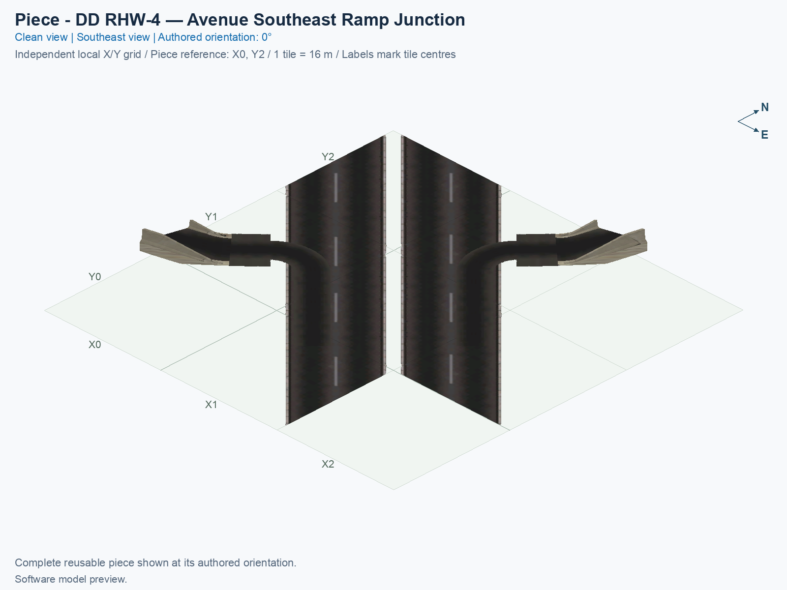
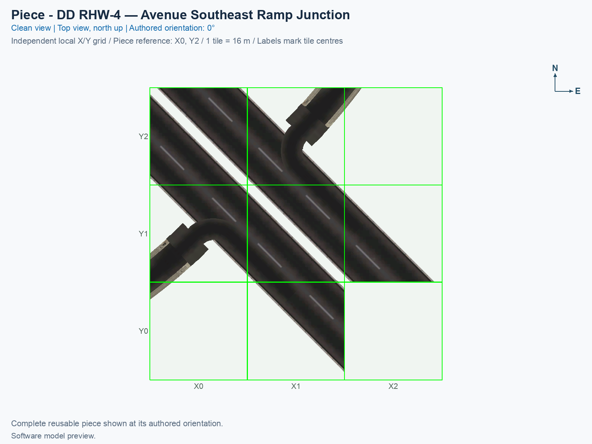

# DD RHW-4 — Avenue Southeast Ramp Junction

Purpose: explain this reusable piece and its connections and test coverage.

<!-- PIECE README LAYOUT: 2 -->

[1. Views](#1-views) · [2. Piece and placement](#2-piece-and-placement) · [3. Connection matrix](#3-connection-matrix) · [Testing ↗ (separate document)](TESTING.md)

## 1. Views

These angled and north-up views render the actual saved game models and their referenced textures. They show geometry and tile ownership; the game must still be inspected separately. The canonical models shown here remain a static reference for the approved geometry and ground artwork; these views do not simulate the sidewalk appearance selected by the game.

<!-- BEGIN PIECE VIEWS -->

<!-- END PIECE VIEWS -->

## 2. Piece and placement

Contains the southeast surface junction and the upper-deck ramp landings. The upper off-ramp feeds only the avenue heading southeast, and the upper on-ramp receives only traffic arriving from the southeast. These right turns stay on their adjacent carriageway.

A **construction tile** is one 16 × 16 m city square owned by this component. This component owns 8 tiles inside a 3 × 3-tile bounding rectangle. Empty cells in that rectangle belong to neighbouring components or remain open.

1. Prepare the exact NAM 50 right-hand-traffic profile using the [build and installation guide](../../../../docs/BUILD_AND_INSTALL.md).
2. Open a disposable city and flatten the complete placement area. These fixed components have no terrain-following implementation.
3. Open **Transportation → Highways → SCP → Assemblies**. For the complete layout, select the compact diamond assembly button, then press **Tab** or **Shift+Tab** until this exact component name appears. **Home** and **End** rotate the current component.
4. Follow the [assembly placement table](../../01_assemblies/ddrhw-l1-and-l2-diagonal-avenue-diamond/README.md#3-placements), including its reference tile and rotation. Click once for this component, then select the next one.

The eight selection states repeat four proper rotations. They do not mirror the traffic directions. The complete assembly’s source design allows four right turns between the highway and avenue; ramp traffic stays on the adjacent avenue carriageway. The graded ramps remain experimental, with a 30% authoring bound. Current saved-resource results and separate game observations belong in [TESTING.md](TESTING.md).

The Avenue-bearing tiles now use **adaptive ground**, meaning copies of native Avenue textures that allow the game to select a pavement appearance. A **T21 prop** is a model attached to a network tile; these props retain the decks, supports, slip lanes, and ramp mouths on those tiles. The complete saved car, pedestrian, and ramp routes are retained. This complete-component integration still needs fresh game checks; the isolated sidewalk prototype’s observed success does not establish a pass for this piece. See the [network specification](../../NETWORK_SPEC.md) and the [assembly testing guide](../../01_assemblies/ddrhw-l1-and-l2-diagonal-avenue-diamond/TESTING.md).

<!-- BEGIN PIECE OVERVIEW -->

Reusable southeast junction component of the compact diagonal double-decker highway and Avenue interchange. Place its owned tiles exactly as shown in the assembly guide; traffic uses actual car and pedestrian PATHs.

Exact reusable identifier: `ddrhw-diagonal-southeast-junction`.

Footprint: **3 × 3 tiles**. Exact menu name: **DD RHW-4 — Avenue Southeast Ramp Junction**.

<!-- END PIECE OVERVIEW -->

## 3. Connection matrix

The generated matrix describes movements within this piece. A connector overview, when supplied, describes its exposed boundaries; neither establishes compatibility with an untested neighbour.

<!-- BEGIN PIECE CONNECTION MATRIX -->

### Directed entrance/exit matrix

Read **from an entrance row to an exit column**. **Saved PATH** checks the saved traffic route; **Route Query** checks the route shown by the game; **Visible travel** checks a vehicle completing that journey. For HSR, visible travel means a moving train.

**Game appearance:** [?](TESTING.md#case-in_game_render-1971e5729b46d8d832a3) — the complete piece’s appearance in the game, checked separately from its journeys.

**Legend:** ✅ confirmed; ❌ failed; ? not established. **Forbidden** means the movement is unavailable; its in-game check confirms that it stays unavailable. Click a result for its exact test case. Scope, evidence, and limitations remain in [the test checklist](TESTING.md#test-checklist).

| Entrance ↓ / Exit → | **Road · North exit** `1-N-out-4` Variant: avenue-ground | **Road · North exit** `1-N-out-5` Variant: avenue-ground | **Road · North exit** `1-N-out-6` Variant: access-ramp | **Road · East exit** `1-E-out-7` Variant: avenue-ground | **Road · East exit** `1-E-out-8` Variant: avenue-ground | **Pedestrian · North exit** `2-N-out-2` Variant: avenue-sidewalk | **Pedestrian · East exit** `2-E-out-3` Variant: avenue-sidewalk |
| --- | --- | --- | --- | --- | --- | --- | --- |
| **Road · West entrance** `1-W-in-1` Variant: access-ramp | **Forbidden** **Saved PATH:** [?](TESTING.md#case-software_connectivity-0b53cd7996f02454c3a7) In-game check: [?](TESTING.md#case-in_game_forbidden_transfer-6b11d9311e2e4530524c) | **Forbidden** **Saved PATH:** [?](TESTING.md#case-software_connectivity-0b53cd7996f02454c3a7) In-game check: [?](TESTING.md#case-in_game_forbidden_transfer-7ae2fb8febef2838146b) | **Forbidden** **Saved PATH:** [?](TESTING.md#case-software_connectivity-0b53cd7996f02454c3a7) In-game check: [?](TESTING.md#case-in_game_forbidden_transfer-3468fd7edd0d4243f176) | **Saved PATH:** [?](TESTING.md#case-software_connectivity-0b53cd7996f02454c3a7) **Route Query:** [?](TESTING.md#case-in_game_route_query-92c6542c04cd22216865) **Visible travel:** [?](TESTING.md#case-in_game_visible_travel-92c6542c04cd22216865) | **Forbidden** **Saved PATH:** [?](TESTING.md#case-software_connectivity-0b53cd7996f02454c3a7) In-game check: [?](TESTING.md#case-in_game_forbidden_transfer-76881a6e343f18123360) | **Forbidden** **Saved PATH:** [?](TESTING.md#case-software_connectivity-0b53cd7996f02454c3a7) In-game check: [?](TESTING.md#case-in_game_forbidden_transfer-3e46594aa7f1ddf4c337) | **Forbidden** **Saved PATH:** [?](TESTING.md#case-software_connectivity-0b53cd7996f02454c3a7) In-game check: [?](TESTING.md#case-in_game_forbidden_transfer-325f5a7e464781e01a11) |
| **Road · West entrance** `1-W-in-2` Variant: avenue-ground | **Forbidden** **Saved PATH:** [?](TESTING.md#case-software_connectivity-0b53cd7996f02454c3a7) In-game check: [?](TESTING.md#case-in_game_forbidden_transfer-8ae7e9c28c831c7dfcfe) | **Forbidden** **Saved PATH:** [?](TESTING.md#case-software_connectivity-0b53cd7996f02454c3a7) In-game check: [?](TESTING.md#case-in_game_forbidden_transfer-7f56abd1febc1e4b0b09) | **Forbidden** **Saved PATH:** [?](TESTING.md#case-software_connectivity-0b53cd7996f02454c3a7) In-game check: [?](TESTING.md#case-in_game_forbidden_transfer-6b8830eb2b0af28e59f2) | **Saved PATH:** [?](TESTING.md#case-software_connectivity-0b53cd7996f02454c3a7) **Route Query:** [?](TESTING.md#case-in_game_route_query-84491b6ab4ed516f8dab) **Visible travel:** [?](TESTING.md#case-in_game_visible_travel-84491b6ab4ed516f8dab) | **Forbidden** **Saved PATH:** [?](TESTING.md#case-software_connectivity-0b53cd7996f02454c3a7) In-game check: [?](TESTING.md#case-in_game_forbidden_transfer-c339fd55b392edf20877) | **Forbidden** **Saved PATH:** [?](TESTING.md#case-software_connectivity-0b53cd7996f02454c3a7) In-game check: [?](TESTING.md#case-in_game_forbidden_transfer-2ba2bff824f3dd2176eb) | **Forbidden** **Saved PATH:** [?](TESTING.md#case-software_connectivity-0b53cd7996f02454c3a7) In-game check: [?](TESTING.md#case-in_game_forbidden_transfer-d1ababafdf7e6ab2e5fc) |
| **Road · West entrance** `1-W-in-3` Variant: avenue-ground | **Forbidden** **Saved PATH:** [?](TESTING.md#case-software_connectivity-0b53cd7996f02454c3a7) In-game check: [?](TESTING.md#case-in_game_forbidden_transfer-1f50099a159518157c79) | **Forbidden** **Saved PATH:** [?](TESTING.md#case-software_connectivity-0b53cd7996f02454c3a7) In-game check: [?](TESTING.md#case-in_game_forbidden_transfer-c1cf79ea02ba06044880) | **Forbidden** **Saved PATH:** [?](TESTING.md#case-software_connectivity-0b53cd7996f02454c3a7) In-game check: [?](TESTING.md#case-in_game_forbidden_transfer-9de4c4b4c87672ea43e6) | **Forbidden** **Saved PATH:** [?](TESTING.md#case-software_connectivity-0b53cd7996f02454c3a7) In-game check: [?](TESTING.md#case-in_game_forbidden_transfer-f4f8e5f132b22832dacb) | **Saved PATH:** [?](TESTING.md#case-software_connectivity-0b53cd7996f02454c3a7) **Route Query:** [?](TESTING.md#case-in_game_route_query-5f701686f72e21ece8fa) **Visible travel:** [?](TESTING.md#case-in_game_visible_travel-5f701686f72e21ece8fa) | **Forbidden** **Saved PATH:** [?](TESTING.md#case-software_connectivity-0b53cd7996f02454c3a7) In-game check: [?](TESTING.md#case-in_game_forbidden_transfer-4cb67f645ec0f091a488) | **Forbidden** **Saved PATH:** [?](TESTING.md#case-software_connectivity-0b53cd7996f02454c3a7) In-game check: [?](TESTING.md#case-in_game_forbidden_transfer-e7e9b5bddcfd70784a10) |
| **Road · South entrance** `1-S-in-9` Variant: avenue-ground | **Saved PATH:** [?](TESTING.md#case-software_connectivity-0b53cd7996f02454c3a7) **Route Query:** [?](TESTING.md#case-in_game_route_query-16d1a08e46e8e6d39156) **Visible travel:** [?](TESTING.md#case-in_game_visible_travel-16d1a08e46e8e6d39156) | **Forbidden** **Saved PATH:** [?](TESTING.md#case-software_connectivity-0b53cd7996f02454c3a7) In-game check: [?](TESTING.md#case-in_game_forbidden_transfer-b3ef51245e001a9fe744) | **Forbidden** **Saved PATH:** [?](TESTING.md#case-software_connectivity-0b53cd7996f02454c3a7) In-game check: [?](TESTING.md#case-in_game_forbidden_transfer-2e831f32e1711fadbb9d) | **Forbidden** **Saved PATH:** [?](TESTING.md#case-software_connectivity-0b53cd7996f02454c3a7) In-game check: [?](TESTING.md#case-in_game_forbidden_transfer-c7ac1d8364fd59a43d9b) | **Forbidden** **Saved PATH:** [?](TESTING.md#case-software_connectivity-0b53cd7996f02454c3a7) In-game check: [?](TESTING.md#case-in_game_forbidden_transfer-c0b6a2405d33dee300ef) | **Forbidden** **Saved PATH:** [?](TESTING.md#case-software_connectivity-0b53cd7996f02454c3a7) In-game check: [?](TESTING.md#case-in_game_forbidden_transfer-1ecd54479047efec73df) | **Forbidden** **Saved PATH:** [?](TESTING.md#case-software_connectivity-0b53cd7996f02454c3a7) In-game check: [?](TESTING.md#case-in_game_forbidden_transfer-79c30e5e414236dd2edb) |
| **Road · South entrance** `1-S-in-10` Variant: avenue-ground | **Forbidden** **Saved PATH:** [?](TESTING.md#case-software_connectivity-0b53cd7996f02454c3a7) In-game check: [?](TESTING.md#case-in_game_forbidden_transfer-eb8cc8d1aa5da7419be6) | **Saved PATH:** [?](TESTING.md#case-software_connectivity-0b53cd7996f02454c3a7) **Route Query:** [?](TESTING.md#case-in_game_route_query-7fec7dfbeef703a9eb13) **Visible travel:** [?](TESTING.md#case-in_game_visible_travel-7fec7dfbeef703a9eb13) | **Saved PATH:** [?](TESTING.md#case-software_connectivity-0b53cd7996f02454c3a7) **Route Query:** [?](TESTING.md#case-in_game_route_query-1e93d879560af096ea11) **Visible travel:** [?](TESTING.md#case-in_game_visible_travel-1e93d879560af096ea11) | **Forbidden** **Saved PATH:** [?](TESTING.md#case-software_connectivity-0b53cd7996f02454c3a7) In-game check: [?](TESTING.md#case-in_game_forbidden_transfer-ac519a03fc87b00a5fb9) | **Forbidden** **Saved PATH:** [?](TESTING.md#case-software_connectivity-0b53cd7996f02454c3a7) In-game check: [?](TESTING.md#case-in_game_forbidden_transfer-9c2dcb66835063eaeaaf) | **Forbidden** **Saved PATH:** [?](TESTING.md#case-software_connectivity-0b53cd7996f02454c3a7) In-game check: [?](TESTING.md#case-in_game_forbidden_transfer-eff71bd27542440c34af) | **Forbidden** **Saved PATH:** [?](TESTING.md#case-software_connectivity-0b53cd7996f02454c3a7) In-game check: [?](TESTING.md#case-in_game_forbidden_transfer-c0a3350e31c0cb217ca6) |
| **Pedestrian · West entrance** `2-W-in-1` Variant: avenue-sidewalk | **Forbidden** **Saved PATH:** [?](TESTING.md#case-software_connectivity-0b53cd7996f02454c3a7) In-game check: [?](TESTING.md#case-in_game_forbidden_transfer-28d82d3a8b633426f119) | **Forbidden** **Saved PATH:** [?](TESTING.md#case-software_connectivity-0b53cd7996f02454c3a7) In-game check: [?](TESTING.md#case-in_game_forbidden_transfer-95350ea8c3e93b331283) | **Forbidden** **Saved PATH:** [?](TESTING.md#case-software_connectivity-0b53cd7996f02454c3a7) In-game check: [?](TESTING.md#case-in_game_forbidden_transfer-bf2f53fb48bf6cb4fad8) | **Forbidden** **Saved PATH:** [?](TESTING.md#case-software_connectivity-0b53cd7996f02454c3a7) In-game check: [?](TESTING.md#case-in_game_forbidden_transfer-6ee06479e2c36e49e6cb) | **Forbidden** **Saved PATH:** [?](TESTING.md#case-software_connectivity-0b53cd7996f02454c3a7) In-game check: [?](TESTING.md#case-in_game_forbidden_transfer-89a41348bd864f29661d) | **Forbidden** **Saved PATH:** [?](TESTING.md#case-software_connectivity-0b53cd7996f02454c3a7) In-game check: [?](TESTING.md#case-in_game_forbidden_transfer-915a90ba596cc794f114) | **Saved PATH:** [?](TESTING.md#case-software_connectivity-0b53cd7996f02454c3a7) **Route Query:** [?](TESTING.md#case-in_game_route_query-7887b1660f1849add211) **Visible travel:** [?](TESTING.md#case-in_game_visible_travel-7887b1660f1849add211) |
| **Pedestrian · South entrance** `2-S-in-4` Variant: avenue-sidewalk | **Forbidden** **Saved PATH:** [?](TESTING.md#case-software_connectivity-0b53cd7996f02454c3a7) In-game check: [?](TESTING.md#case-in_game_forbidden_transfer-733c805b158b47992b53) | **Forbidden** **Saved PATH:** [?](TESTING.md#case-software_connectivity-0b53cd7996f02454c3a7) In-game check: [?](TESTING.md#case-in_game_forbidden_transfer-8a86f5a199144923509f) | **Forbidden** **Saved PATH:** [?](TESTING.md#case-software_connectivity-0b53cd7996f02454c3a7) In-game check: [?](TESTING.md#case-in_game_forbidden_transfer-564d618c32354a0d379b) | **Forbidden** **Saved PATH:** [?](TESTING.md#case-software_connectivity-0b53cd7996f02454c3a7) In-game check: [?](TESTING.md#case-in_game_forbidden_transfer-f890e9e1591f059036ee) | **Forbidden** **Saved PATH:** [?](TESTING.md#case-software_connectivity-0b53cd7996f02454c3a7) In-game check: [?](TESTING.md#case-in_game_forbidden_transfer-dd5afafa471290fc4809) | **Saved PATH:** [?](TESTING.md#case-software_connectivity-0b53cd7996f02454c3a7) **Route Query:** [?](TESTING.md#case-in_game_route_query-1b58748ac647b738ddb7) **Visible travel:** [?](TESTING.md#case-in_game_visible_travel-1b58748ac647b738ddb7) | **Forbidden** **Saved PATH:** [?](TESTING.md#case-software_connectivity-0b53cd7996f02454c3a7) In-game check: [?](TESTING.md#case-in_game_forbidden_transfer-d90768fe27275a02a734) |

Source: [connections.json](connections.json).

<!-- END PIECE CONNECTION MATRIX -->

<!-- BEGIN CONNECTOR OVERVIEW -->

### Connection overview

Generated from this piece's source-bound connector metadata and the current compiled model; marker letters refer to the boundary cards below.

[Rendering sources and verification scope](evidence/connection-overview.json).

Headings: 0° = North, 90° = East, 180° = South, and 270° = West; clockwise in plan view, pointing out of the piece.

Coordinates [E,N,H] = [east,north,height] in metres. Source cells [column,row] increase east and south.

Display grid: X = source column − (0); Y = 2 − source row.

Slope is measured outward at the joining edge; the interior may differ. Offsets are + left and − right facing out of the tile edge.

Member offsets use the section origin. Counts distinguish physical channels / edge cuts / directed members; modes do not multiply channels.

Incoming flow enters this piece; outgoing flow leaves it. Letters identify boundary cards; source IDs remain the stable identities.

Not declared means no section origin or offset was authored. Its marker uses an actual member endpoint; the measured intersections remain authoritative.

#### Boundary A: `boundary-02`

All 2 service groups are required together at this edge.

##### Service group 1 / 2: ROAD — Custom (0 m)

| Field | Value |
| --- | --- |
| End / component | `boundary-02-avenue-mainline-01` / `avenue-mainline` |
| Network / game class / role | road / Engine class (1); primary |
| Source cell / edge | `[0,0]` / North |
| Section origin [E,N] (m) | Not declared; see member endpoints |
| Centring / section offset | Not declared |
| Level (path height) | Custom (0 m); no nominal level |
| Outward heading | 315° |
| Slope at joining edge | 0% outward |
| Channels / edge cuts / directed members | 2 / 2 / 2 |
| Traffic arrangement / running | 0 incoming; 2 outgoing; See member directions |
| Channel spacing | 4.52548 m |
| Channel kinds | road-lane |
| Traffic modes | car |
| Profile | No profile reference |

| Member / measured source | Channel / cut / modes | Flow | Endpoint [E,N,H] (m) | Offset (m) | Outward heading | Edge slope (%) |
| --- | --- | --- | --- | ---: | ---: | ---: |
| `member-1-n-out-4` / `1-N-out-4` | `avenue-lane-03` / `cut-1-n-out-4` / car | Outgoing | `[-3.2,8,0]` | Not declared | 315° | 0 |
| `member-1-n-out-5` / `1-N-out-5` | `avenue-lane-04` / `cut-1-n-out-5` / car | Outgoing | `[3.2,8,0]` | Not declared | 315° | 0 |

##### Service group 2 / 2: PEDESTRIAN — Custom (0 m)

| Field | Value |
| --- | --- |
| End / component | `boundary-02-avenue-walkways-02` / `avenue-walkways` |
| Network / game class / role | pedestrian / Engine class (2); primary |
| Source cell / edge | `[0,0]` / North |
| Section origin [E,N] (m) | Not declared; see member endpoints |
| Centring / section offset | Not declared |
| Level (path height) | Custom (0 m); no nominal level |
| Outward heading | 315° |
| Slope at joining edge | 0% outward |
| Channels / edge cuts / directed members | 1 / 1 / 1 |
| Traffic arrangement / running | 0 incoming; 1 outgoing; See member directions |
| Channel spacing | See individual measured intersections |
| Channel kinds | walkway |
| Traffic modes | pedestrian |
| Profile | No profile reference |

| Member / measured source | Channel / cut / modes | Flow | Endpoint [E,N,H] (m) | Offset (m) | Outward heading | Edge slope (%) |
| --- | --- | --- | --- | ---: | ---: | ---: |
| `member-2-n-out-2` / `2-N-out-2` | `avenue-walkway-02` / `cut-2-n-out-2` / pedestrian | Outgoing | `[7.3,8,0]` | Not declared | 315° | 0 |

#### Boundary B: `boundary-01`

All 2 service groups are required together at this edge.

##### Service group 1 / 2: ROAD — Custom (0 m)

| Field | Value |
| --- | --- |
| End / component | `boundary-01-avenue-mainline-01` / `avenue-mainline` |
| Network / game class / role | road / Engine class (1); primary |
| Source cell / edge | `[0,0]` / West |
| Section origin [E,N] (m) | Not declared; see member endpoints |
| Centring / section offset | Not declared |
| Level (path height) | Custom (0 m); no nominal level |
| Outward heading | 315° |
| Slope at joining edge | 0% outward |
| Channels / edge cuts / directed members | 2 / 2 / 2 |
| Traffic arrangement / running | 2 incoming; 0 outgoing; See member directions |
| Channel spacing | 4.52548 m |
| Channel kinds | road-lane |
| Traffic modes | car |
| Profile | No profile reference |

| Member / measured source | Channel / cut / modes | Flow | Endpoint [E,N,H] (m) | Offset (m) | Outward heading | Edge slope (%) |
| --- | --- | --- | --- | ---: | ---: | ---: |
| `member-1-w-in-2` / `1-W-in-2` | `avenue-lane-01` / `cut-1-w-in-2` / car | Incoming | `[-8,-3.2,0]` | Not declared | 315° | 0 |
| `member-1-w-in-3` / `1-W-in-3` | `avenue-lane-02` / `cut-1-w-in-3` / car | Incoming | `[-8,3.2,0]` | Not declared | 315° | 0 |

##### Service group 2 / 2: PEDESTRIAN — Custom (0 m)

| Field | Value |
| --- | --- |
| End / component | `boundary-01-avenue-walkways-02` / `avenue-walkways` |
| Network / game class / role | pedestrian / Engine class (2); primary |
| Source cell / edge | `[0,0]` / West |
| Section origin [E,N] (m) | Not declared; see member endpoints |
| Centring / section offset | Not declared |
| Level (path height) | Custom (0 m); no nominal level |
| Outward heading | 315° |
| Slope at joining edge | 0% outward |
| Channels / edge cuts / directed members | 1 / 1 / 1 |
| Traffic arrangement / running | 1 incoming; 0 outgoing; See member directions |
| Channel spacing | See individual measured intersections |
| Channel kinds | walkway |
| Traffic modes | pedestrian |
| Profile | No profile reference |

| Member / measured source | Channel / cut / modes | Flow | Endpoint [E,N,H] (m) | Offset (m) | Outward heading | Edge slope (%) |
| --- | --- | --- | --- | ---: | ---: | ---: |
| `member-2-w-in-1` / `2-W-in-1` | `avenue-walkway-01` / `cut-2-w-in-1` / pedestrian | Incoming | `[-8,-7.3,0]` | Not declared | 315° | 0 |

#### Boundary C: `boundary-03`

This service group is required at this edge.

##### Service group 1 / 1: ROAD — Custom (1.4877 m)

| Field | Value |
| --- | --- |
| End / component | `boundary-03-avenue-mainline-01` / `avenue-mainline` |
| Network / game class / role | road / Engine class (1); primary |
| Source cell / edge | `[0,1]` / West |
| Section origin [E,N] (m) | Not declared; see member endpoints |
| Centring / section offset | Not declared |
| Level (path height) | Custom (1.4877 m); no nominal level |
| Outward heading | 232.238° |
| Slope at joining edge | 29.6123% outward |
| Channels / edge cuts / directed members | 1 / 1 / 1 |
| Traffic arrangement / running | 1 incoming; 0 outgoing; See member directions |
| Channel spacing | See individual measured intersections |
| Channel kinds | road-lane |
| Traffic modes | car |
| Profile | No profile reference |

| Member / measured source | Channel / cut / modes | Flow | Endpoint [E,N,H] (m) | Offset (m) | Outward heading | Edge slope (%) |
| --- | --- | --- | --- | ---: | ---: | ---: |
| `member-1-w-in-1` / `1-W-in-1` | `avenue-ramp-01` / `cut-1-w-in-1` / car | Incoming | `[-8,-23.1099,1.4877]` | Not declared | 232.238° | 29.6123 |

#### Boundary D: `boundary-04`

This service group is required at this edge.

##### Service group 1 / 1: ROAD — Custom (1.4877 m)

| Field | Value |
| --- | --- |
| End / component | `boundary-04-avenue-mainline-01` / `avenue-mainline` |
| Network / game class / role | road / Engine class (1); primary |
| Source cell / edge | `[1,0]` / North |
| Section origin [E,N] (m) | Not declared; see member endpoints |
| Centring / section offset | Not declared |
| Level (path height) | Custom (1.4877 m); no nominal level |
| Outward heading | 37.7622° |
| Slope at joining edge | 29.6123% outward |
| Channels / edge cuts / directed members | 1 / 1 / 1 |
| Traffic arrangement / running | 0 incoming; 1 outgoing; See member directions |
| Channel spacing | See individual measured intersections |
| Channel kinds | road-lane |
| Traffic modes | car |
| Profile | No profile reference |

| Member / measured source | Channel / cut / modes | Flow | Endpoint [E,N,H] (m) | Offset (m) | Outward heading | Edge slope (%) |
| --- | --- | --- | --- | ---: | ---: | ---: |
| `member-1-n-out-6` / `1-N-out-6` | `avenue-ramp-02` / `cut-1-n-out-6` / car | Outgoing | `[23.1099,8,1.4877]` | Not declared | 37.7622° | 29.6123 |

#### Boundary E: `boundary-05`

All 2 service groups are required together at this edge.

##### Service group 1 / 2: ROAD — Custom (0 m)

| Field | Value |
| --- | --- |
| End / component | `boundary-05-avenue-mainline-01` / `avenue-mainline` |
| Network / game class / role | road / Engine class (1); primary |
| Source cell / edge | `[1,2]` / East |
| Section origin [E,N] (m) | Not declared; see member endpoints |
| Centring / section offset | Not declared |
| Level (path height) | Custom (0 m); no nominal level |
| Outward heading | 135° |
| Slope at joining edge | 0% outward |
| Channels / edge cuts / directed members | 2 / 2 / 2 |
| Traffic arrangement / running | 0 incoming; 2 outgoing; See member directions |
| Channel spacing | 4.52548 m |
| Channel kinds | road-lane |
| Traffic modes | car |
| Profile | No profile reference |

| Member / measured source | Channel / cut / modes | Flow | Endpoint [E,N,H] (m) | Offset (m) | Outward heading | Edge slope (%) |
| --- | --- | --- | --- | ---: | ---: | ---: |
| `member-1-e-out-7` / `1-E-out-7` | `avenue-lane-01` / `cut-1-e-out-7` / car | Outgoing | `[24,-35.2,0]` | Not declared | 135° | 0 |
| `member-1-e-out-8` / `1-E-out-8` | `avenue-lane-02` / `cut-1-e-out-8` / car | Outgoing | `[24,-28.8,0]` | Not declared | 135° | 0 |

##### Service group 2 / 2: PEDESTRIAN — Custom (0 m)

| Field | Value |
| --- | --- |
| End / component | `boundary-05-avenue-walkways-02` / `avenue-walkways` |
| Network / game class / role | pedestrian / Engine class (2); primary |
| Source cell / edge | `[1,2]` / East |
| Section origin [E,N] (m) | Not declared; see member endpoints |
| Centring / section offset | Not declared |
| Level (path height) | Custom (0 m); no nominal level |
| Outward heading | 135° |
| Slope at joining edge | 0% outward |
| Channels / edge cuts / directed members | 1 / 1 / 1 |
| Traffic arrangement / running | 0 incoming; 1 outgoing; See member directions |
| Channel spacing | See individual measured intersections |
| Channel kinds | walkway |
| Traffic modes | pedestrian |
| Profile | No profile reference |

| Member / measured source | Channel / cut / modes | Flow | Endpoint [E,N,H] (m) | Offset (m) | Outward heading | Edge slope (%) |
| --- | --- | --- | --- | ---: | ---: | ---: |
| `member-2-e-out-3` / `2-E-out-3` | `avenue-walkway-01` / `cut-2-e-out-3` / pedestrian | Outgoing | `[24,-39.3,0]` | Not declared | 135° | 0 |

#### Boundary F: `boundary-06`

All 2 service groups are required together at this edge.

##### Service group 1 / 2: ROAD — Custom (0 m)

| Field | Value |
| --- | --- |
| End / component | `boundary-06-avenue-mainline-01` / `avenue-mainline` |
| Network / game class / role | road / Engine class (1); primary |
| Source cell / edge | `[2,1]` / South |
| Section origin [E,N] (m) | Not declared; see member endpoints |
| Centring / section offset | Not declared |
| Level (path height) | Custom (0 m); no nominal level |
| Outward heading | 135° |
| Slope at joining edge | 0% outward |
| Channels / edge cuts / directed members | 2 / 2 / 2 |
| Traffic arrangement / running | 2 incoming; 0 outgoing; See member directions |
| Channel spacing | 4.52548 m |
| Channel kinds | road-lane |
| Traffic modes | car |
| Profile | No profile reference |

| Member / measured source | Channel / cut / modes | Flow | Endpoint [E,N,H] (m) | Offset (m) | Outward heading | Edge slope (%) |
| --- | --- | --- | --- | ---: | ---: | ---: |
| `member-1-s-in-10` / `1-S-in-10` | `avenue-lane-04` / `cut-1-s-in-10` / car | Incoming | `[35.2,-24,0]` | Not declared | 135° | 0 |
| `member-1-s-in-9` / `1-S-in-9` | `avenue-lane-03` / `cut-1-s-in-9` / car | Incoming | `[28.8,-24,0]` | Not declared | 135° | 0 |

##### Service group 2 / 2: PEDESTRIAN — Custom (0 m)

| Field | Value |
| --- | --- |
| End / component | `boundary-06-avenue-walkways-02` / `avenue-walkways` |
| Network / game class / role | pedestrian / Engine class (2); primary |
| Source cell / edge | `[2,1]` / South |
| Section origin [E,N] (m) | Not declared; see member endpoints |
| Centring / section offset | Not declared |
| Level (path height) | Custom (0 m); no nominal level |
| Outward heading | 135° |
| Slope at joining edge | 0% outward |
| Channels / edge cuts / directed members | 1 / 1 / 1 |
| Traffic arrangement / running | 1 incoming; 0 outgoing; See member directions |
| Channel spacing | See individual measured intersections |
| Channel kinds | walkway |
| Traffic modes | pedestrian |
| Profile | No profile reference |

| Member / measured source | Channel / cut / modes | Flow | Endpoint [E,N,H] (m) | Offset (m) | Outward heading | Edge slope (%) |
| --- | --- | --- | --- | ---: | ---: | ---: |
| `member-2-s-in-4` / `2-S-in-4` | `avenue-walkway-02` / `cut-2-s-in-4` / pedestrian | Incoming | `[39.3,-24,0]` | Not declared | 135° | 0 |

The overview uses source metadata, current compiled resource identities, and the saved model. Current placement, connection, and traffic results belong to the generated connection matrix and linked testing records.

<!-- END CONNECTOR OVERVIEW -->
