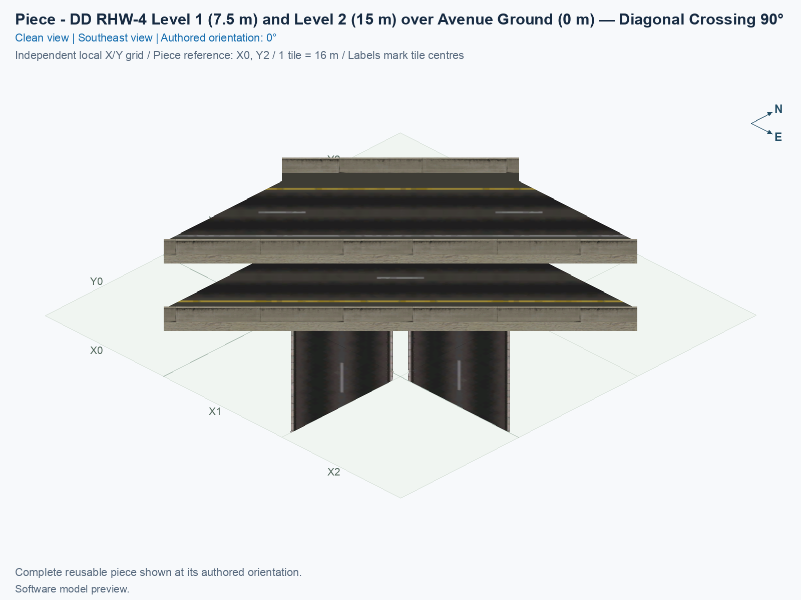
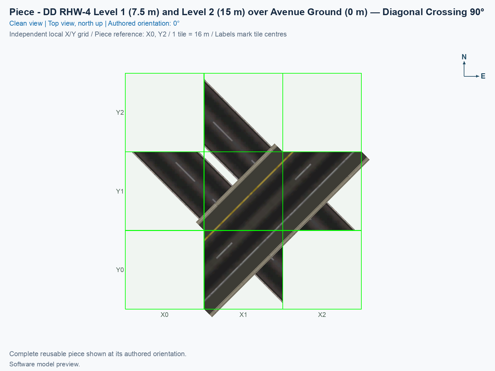

# DD RHW-4 Level 1 (7.5 m) and Level 2 (15 m) over Avenue Ground (0 m) — Diagonal Crossing 90°

Purpose: explain this reusable piece and its connections and test coverage.

<!-- PIECE README LAYOUT: 2 -->

[1. Views](#1-views) · [2. Piece and placement](#2-piece-and-placement) · [3. Connection matrix](#3-connection-matrix) · [Testing ↗ (separate document)](TESTING.md)

## 1. Views

These angled and north-up views render the actual saved game models and their referenced textures. They show geometry and tile ownership; the game must still be inspected separately.

<!-- BEGIN PIECE VIEWS -->

<!-- END PIECE VIEWS -->

## 2. Piece and placement

Preserves the native diagonal DD RHW-4 through lanes at 7.5 m and 15 m over a ground diagonal avenue. This standalone crossing has no ramp transfers; the compact interchange uses a separate coordinated access core.

A **construction tile** is one 16 × 16 m city square owned by this component. This component owns 5 tiles inside a 3 × 3-tile bounding rectangle. Empty cells in that rectangle belong to neighbouring components or remain open.

1. Prepare the exact NAM 50 right-hand-traffic profile using the [build and installation guide](../../../../docs/BUILD_AND_INSTALL.md).
2. Open a disposable city and flatten the complete placement area. These fixed components have no terrain-following implementation.
3. Open **Transportation → Highways → SCP → Assemblies**. For the complete layout, select the compact diamond assembly button, then press **Tab** or **Shift+Tab** until this exact component name appears. **Home** and **End** rotate the current component.
4. Follow the [assembly placement table](../../01_assemblies/ddrhw-l1-and-l2-diagonal-avenue-diamond/README.md#3-placements), including its reference tile and rotation. Click once for this component, then select the next one.

The eight selection states repeat four proper rotations. They do not mirror the traffic directions. Game placement, vehicle travel, lighting, demolition, and save/reload are unverified. The ramp slopes are a deliberately steep experiment, with a 40% software limit, rather than an established NAM design standard.

<!-- BEGIN PIECE OVERVIEW -->

Five coordinated construction tiles preserve the native stacked DD RHW-4 lanes above both directions of a diagonal avenue, including avenue pedestrians. This crossing supplies through routes; connecting access ramps are separate components.

Exact reusable identifier: `ddrhw-l1-and-l2-over-avenue-l0-crossing-diagonal-90deg`.

Footprint: **3 × 3 tiles**. Exact menu name: **DD RHW-4 Level 1 (7.5 m) and Level 2 (15 m) over Avenue Ground (0 m) — Diagonal Crossing 90°**.

<!-- END PIECE OVERVIEW -->

## 3. Connection matrix

The generated matrix describes movements within this piece. A connector overview, when supplied, describes its exposed boundaries; neither establishes compatibility with an untested neighbour.

<!-- BEGIN PIECE CONNECTION MATRIX -->

### Directed entrance/exit matrix

Read **from an entrance row to an exit column**. **Saved PATH** checks the saved traffic route; **Route Query** checks the route shown by the game; **Visible travel** checks a vehicle completing that journey. For HSR, visible travel means a moving train.

**Game appearance:** [?](TESTING.md#case-in_game_render-1937e6ab87db596fdea9) — the complete piece’s appearance in the game, checked separately from its journeys.

**Legend:** ✅ confirmed; ❌ failed; ? not established. **Forbidden** means the movement is unavailable; its in-game check confirms that it stays unavailable. Click a result for its exact test case. Scope, evidence, and limitations remain in [the test checklist](TESTING.md#test-checklist).

| Entrance ↓ / Exit → | **Road · West exit** `lower-lane-02-b` Variant: dd-rhw-l1 | **Road · West exit** `lower-lane-01-b` Variant: dd-rhw-l1 | **Road · West exit** `avenue-lane-03-b` Variant: avenue-ground | **Road · West exit** `avenue-lane-04-b` Variant: avenue-ground | **Road · East exit** `avenue-lane-01-b` Variant: avenue-ground | **Road · East exit** `avenue-lane-02-b` Variant: avenue-ground | **Road · North exit** `upper-lane-02-b` Variant: dd-rhw-l2 | **Road · North exit** `upper-lane-01-b` Variant: dd-rhw-l2 | **Pedestrian · West exit** `avenue-walkway-02-b` Variant: avenue-sidewalk | **Pedestrian · East exit** `avenue-walkway-01-b` Variant: avenue-sidewalk |
| --- | --- | --- | --- | --- | --- | --- | --- | --- | --- | --- |
| **Road · North entrance** `avenue-lane-01-a` Variant: avenue-ground | **Forbidden** **Saved PATH:** [?](TESTING.md#case-software_connectivity-5709bfee0535c2b49d2d) In-game check: [?](TESTING.md#case-in_game_forbidden_transfer-fc72579dde2aefa2879b) | **Forbidden** **Saved PATH:** [?](TESTING.md#case-software_connectivity-5709bfee0535c2b49d2d) In-game check: [?](TESTING.md#case-in_game_forbidden_transfer-541c1cf2af0f1df611db) | **Forbidden** **Saved PATH:** [?](TESTING.md#case-software_connectivity-5709bfee0535c2b49d2d) In-game check: [?](TESTING.md#case-in_game_forbidden_transfer-1c9e064218962a77ac1f) | **Forbidden** **Saved PATH:** [?](TESTING.md#case-software_connectivity-5709bfee0535c2b49d2d) In-game check: [?](TESTING.md#case-in_game_forbidden_transfer-0cb69d67ec7351cfb040) | **Saved PATH:** [?](TESTING.md#case-software_connectivity-5709bfee0535c2b49d2d) **Route Query:** [?](TESTING.md#case-in_game_route_query-7fac93716e874d0e91f9) **Visible travel:** [?](TESTING.md#case-in_game_visible_travel-7fac93716e874d0e91f9) | **Forbidden** **Saved PATH:** [?](TESTING.md#case-software_connectivity-5709bfee0535c2b49d2d) In-game check: [?](TESTING.md#case-in_game_forbidden_transfer-6af4aa1c7bc8f30ea718) | **Forbidden** **Saved PATH:** [?](TESTING.md#case-software_connectivity-5709bfee0535c2b49d2d) In-game check: [?](TESTING.md#case-in_game_forbidden_transfer-237a7c52e55d75964fd0) | **Forbidden** **Saved PATH:** [?](TESTING.md#case-software_connectivity-5709bfee0535c2b49d2d) In-game check: [?](TESTING.md#case-in_game_forbidden_transfer-d858101c88744f8d539a) | **Forbidden** **Saved PATH:** [?](TESTING.md#case-software_connectivity-5709bfee0535c2b49d2d) In-game check: [?](TESTING.md#case-in_game_forbidden_transfer-e74cb86cea60c8392b39) | **Forbidden** **Saved PATH:** [?](TESTING.md#case-software_connectivity-5709bfee0535c2b49d2d) In-game check: [?](TESTING.md#case-in_game_forbidden_transfer-076fd30acb2394d94ae1) |
| **Road · North entrance** `avenue-lane-02-a` Variant: avenue-ground | **Forbidden** **Saved PATH:** [?](TESTING.md#case-software_connectivity-5709bfee0535c2b49d2d) In-game check: [?](TESTING.md#case-in_game_forbidden_transfer-ced02aea377b0c611c1e) | **Forbidden** **Saved PATH:** [?](TESTING.md#case-software_connectivity-5709bfee0535c2b49d2d) In-game check: [?](TESTING.md#case-in_game_forbidden_transfer-4617b0e6726ec6b31efe) | **Forbidden** **Saved PATH:** [?](TESTING.md#case-software_connectivity-5709bfee0535c2b49d2d) In-game check: [?](TESTING.md#case-in_game_forbidden_transfer-31b0067c35b73f9df3c2) | **Forbidden** **Saved PATH:** [?](TESTING.md#case-software_connectivity-5709bfee0535c2b49d2d) In-game check: [?](TESTING.md#case-in_game_forbidden_transfer-e9757a4d61af26cf614e) | **Forbidden** **Saved PATH:** [?](TESTING.md#case-software_connectivity-5709bfee0535c2b49d2d) In-game check: [?](TESTING.md#case-in_game_forbidden_transfer-74e8da79d6f02a39853a) | **Saved PATH:** [?](TESTING.md#case-software_connectivity-5709bfee0535c2b49d2d) **Route Query:** [?](TESTING.md#case-in_game_route_query-ab54caa6dd51363531a9) **Visible travel:** [?](TESTING.md#case-in_game_visible_travel-ab54caa6dd51363531a9) | **Forbidden** **Saved PATH:** [?](TESTING.md#case-software_connectivity-5709bfee0535c2b49d2d) In-game check: [?](TESTING.md#case-in_game_forbidden_transfer-45b63d24170f5e29763e) | **Forbidden** **Saved PATH:** [?](TESTING.md#case-software_connectivity-5709bfee0535c2b49d2d) In-game check: [?](TESTING.md#case-in_game_forbidden_transfer-c896452ccf3753977692) | **Forbidden** **Saved PATH:** [?](TESTING.md#case-software_connectivity-5709bfee0535c2b49d2d) In-game check: [?](TESTING.md#case-in_game_forbidden_transfer-5c661a68cb5fd122a1ea) | **Forbidden** **Saved PATH:** [?](TESTING.md#case-software_connectivity-5709bfee0535c2b49d2d) In-game check: [?](TESTING.md#case-in_game_forbidden_transfer-0fdeeae15369a41df225) |
| **Road · West entrance** `upper-lane-01-a` Variant: dd-rhw-l2 | **Forbidden** **Saved PATH:** [?](TESTING.md#case-software_connectivity-5709bfee0535c2b49d2d) In-game check: [?](TESTING.md#case-in_game_forbidden_transfer-835ad6f4fc32857fd1b2) | **Forbidden** **Saved PATH:** [?](TESTING.md#case-software_connectivity-5709bfee0535c2b49d2d) In-game check: [?](TESTING.md#case-in_game_forbidden_transfer-20a6baabc0cfc3741d24) | **Forbidden** **Saved PATH:** [?](TESTING.md#case-software_connectivity-5709bfee0535c2b49d2d) In-game check: [?](TESTING.md#case-in_game_forbidden_transfer-495a7dea8a6172418299) | **Forbidden** **Saved PATH:** [?](TESTING.md#case-software_connectivity-5709bfee0535c2b49d2d) In-game check: [?](TESTING.md#case-in_game_forbidden_transfer-73f5b322373f1b269f30) | **Forbidden** **Saved PATH:** [?](TESTING.md#case-software_connectivity-5709bfee0535c2b49d2d) In-game check: [?](TESTING.md#case-in_game_forbidden_transfer-ef99d8e3617bf2c03c5d) | **Forbidden** **Saved PATH:** [?](TESTING.md#case-software_connectivity-5709bfee0535c2b49d2d) In-game check: [?](TESTING.md#case-in_game_forbidden_transfer-0a023fa7110b084086ac) | **Forbidden** **Saved PATH:** [?](TESTING.md#case-software_connectivity-5709bfee0535c2b49d2d) In-game check: [?](TESTING.md#case-in_game_forbidden_transfer-67a2e40ece9dbe57f5a9) | **Saved PATH:** [?](TESTING.md#case-software_connectivity-5709bfee0535c2b49d2d) **Route Query:** [?](TESTING.md#case-in_game_route_query-431853dbe37083269c0f) **Visible travel:** [?](TESTING.md#case-in_game_visible_travel-431853dbe37083269c0f) | **Forbidden** **Saved PATH:** [?](TESTING.md#case-software_connectivity-5709bfee0535c2b49d2d) In-game check: [?](TESTING.md#case-in_game_forbidden_transfer-36d8b7ee448943818d55) | **Forbidden** **Saved PATH:** [?](TESTING.md#case-software_connectivity-5709bfee0535c2b49d2d) In-game check: [?](TESTING.md#case-in_game_forbidden_transfer-eaea816be88031f8a7dc) |
| **Road · West entrance** `upper-lane-02-a` Variant: dd-rhw-l2 | **Forbidden** **Saved PATH:** [?](TESTING.md#case-software_connectivity-5709bfee0535c2b49d2d) In-game check: [?](TESTING.md#case-in_game_forbidden_transfer-8c021376272e692b189a) | **Forbidden** **Saved PATH:** [?](TESTING.md#case-software_connectivity-5709bfee0535c2b49d2d) In-game check: [?](TESTING.md#case-in_game_forbidden_transfer-abc9ecd0a0b3321cf41b) | **Forbidden** **Saved PATH:** [?](TESTING.md#case-software_connectivity-5709bfee0535c2b49d2d) In-game check: [?](TESTING.md#case-in_game_forbidden_transfer-b273531ee22d95fc54f0) | **Forbidden** **Saved PATH:** [?](TESTING.md#case-software_connectivity-5709bfee0535c2b49d2d) In-game check: [?](TESTING.md#case-in_game_forbidden_transfer-20ef72fc1859b18ac1d7) | **Forbidden** **Saved PATH:** [?](TESTING.md#case-software_connectivity-5709bfee0535c2b49d2d) In-game check: [?](TESTING.md#case-in_game_forbidden_transfer-3e847175e4fce6dc23bb) | **Forbidden** **Saved PATH:** [?](TESTING.md#case-software_connectivity-5709bfee0535c2b49d2d) In-game check: [?](TESTING.md#case-in_game_forbidden_transfer-2530a99ed0f52dc9226e) | **Saved PATH:** [?](TESTING.md#case-software_connectivity-5709bfee0535c2b49d2d) **Route Query:** [?](TESTING.md#case-in_game_route_query-7e3337d5aff0cb3b9dfd) **Visible travel:** [?](TESTING.md#case-in_game_visible_travel-7e3337d5aff0cb3b9dfd) | **Forbidden** **Saved PATH:** [?](TESTING.md#case-software_connectivity-5709bfee0535c2b49d2d) In-game check: [?](TESTING.md#case-in_game_forbidden_transfer-7d71562922c9ebfe4c20) | **Forbidden** **Saved PATH:** [?](TESTING.md#case-software_connectivity-5709bfee0535c2b49d2d) In-game check: [?](TESTING.md#case-in_game_forbidden_transfer-576a3c3ae739576dbb63) | **Forbidden** **Saved PATH:** [?](TESTING.md#case-software_connectivity-5709bfee0535c2b49d2d) In-game check: [?](TESTING.md#case-in_game_forbidden_transfer-a24fe1f8ff4cd43ccb82) |
| **Road · South entrance** `avenue-lane-03-a` Variant: avenue-ground | **Forbidden** **Saved PATH:** [?](TESTING.md#case-software_connectivity-5709bfee0535c2b49d2d) In-game check: [?](TESTING.md#case-in_game_forbidden_transfer-7fcf8f5411ab049473b4) | **Forbidden** **Saved PATH:** [?](TESTING.md#case-software_connectivity-5709bfee0535c2b49d2d) In-game check: [?](TESTING.md#case-in_game_forbidden_transfer-af7cc0b17b6423f13560) | **Saved PATH:** [?](TESTING.md#case-software_connectivity-5709bfee0535c2b49d2d) **Route Query:** [?](TESTING.md#case-in_game_route_query-fb3d0acb042014de9c03) **Visible travel:** [?](TESTING.md#case-in_game_visible_travel-fb3d0acb042014de9c03) | **Forbidden** **Saved PATH:** [?](TESTING.md#case-software_connectivity-5709bfee0535c2b49d2d) In-game check: [?](TESTING.md#case-in_game_forbidden_transfer-6e045a6735d38ca0e3e3) | **Forbidden** **Saved PATH:** [?](TESTING.md#case-software_connectivity-5709bfee0535c2b49d2d) In-game check: [?](TESTING.md#case-in_game_forbidden_transfer-0057e2c925627948d9ae) | **Forbidden** **Saved PATH:** [?](TESTING.md#case-software_connectivity-5709bfee0535c2b49d2d) In-game check: [?](TESTING.md#case-in_game_forbidden_transfer-316a918622f2a7e61037) | **Forbidden** **Saved PATH:** [?](TESTING.md#case-software_connectivity-5709bfee0535c2b49d2d) In-game check: [?](TESTING.md#case-in_game_forbidden_transfer-1ab8caba3036436f0069) | **Forbidden** **Saved PATH:** [?](TESTING.md#case-software_connectivity-5709bfee0535c2b49d2d) In-game check: [?](TESTING.md#case-in_game_forbidden_transfer-95466259d9dedd2815a9) | **Forbidden** **Saved PATH:** [?](TESTING.md#case-software_connectivity-5709bfee0535c2b49d2d) In-game check: [?](TESTING.md#case-in_game_forbidden_transfer-3a52284299c05cbfdcff) | **Forbidden** **Saved PATH:** [?](TESTING.md#case-software_connectivity-5709bfee0535c2b49d2d) In-game check: [?](TESTING.md#case-in_game_forbidden_transfer-7e4d89436c99a720f72d) |
| **Road · North entrance** `lower-lane-01-a` Variant: dd-rhw-l1 | **Forbidden** **Saved PATH:** [?](TESTING.md#case-software_connectivity-5709bfee0535c2b49d2d) In-game check: [?](TESTING.md#case-in_game_forbidden_transfer-375402fea370ac5a4c71) | **Saved PATH:** [?](TESTING.md#case-software_connectivity-5709bfee0535c2b49d2d) **Route Query:** [?](TESTING.md#case-in_game_route_query-15d0ef6416e43a23e26c) **Visible travel:** [?](TESTING.md#case-in_game_visible_travel-15d0ef6416e43a23e26c) | **Forbidden** **Saved PATH:** [?](TESTING.md#case-software_connectivity-5709bfee0535c2b49d2d) In-game check: [?](TESTING.md#case-in_game_forbidden_transfer-c88dc5dce3e3b309c33e) | **Forbidden** **Saved PATH:** [?](TESTING.md#case-software_connectivity-5709bfee0535c2b49d2d) In-game check: [?](TESTING.md#case-in_game_forbidden_transfer-39d848faf1b1742d45d8) | **Forbidden** **Saved PATH:** [?](TESTING.md#case-software_connectivity-5709bfee0535c2b49d2d) In-game check: [?](TESTING.md#case-in_game_forbidden_transfer-1ef9c9ce61d57f164f80) | **Forbidden** **Saved PATH:** [?](TESTING.md#case-software_connectivity-5709bfee0535c2b49d2d) In-game check: [?](TESTING.md#case-in_game_forbidden_transfer-5367206dd0bd2ef41b24) | **Forbidden** **Saved PATH:** [?](TESTING.md#case-software_connectivity-5709bfee0535c2b49d2d) In-game check: [?](TESTING.md#case-in_game_forbidden_transfer-3a49a67dbacd5fe2d555) | **Forbidden** **Saved PATH:** [?](TESTING.md#case-software_connectivity-5709bfee0535c2b49d2d) In-game check: [?](TESTING.md#case-in_game_forbidden_transfer-7f96d31a052f4d3ec346) | **Forbidden** **Saved PATH:** [?](TESTING.md#case-software_connectivity-5709bfee0535c2b49d2d) In-game check: [?](TESTING.md#case-in_game_forbidden_transfer-749e207c8eba9e931b04) | **Forbidden** **Saved PATH:** [?](TESTING.md#case-software_connectivity-5709bfee0535c2b49d2d) In-game check: [?](TESTING.md#case-in_game_forbidden_transfer-f9fe4795fe1b68ac6d9e) |
| **Road · South entrance** `avenue-lane-04-a` Variant: avenue-ground | **Forbidden** **Saved PATH:** [?](TESTING.md#case-software_connectivity-5709bfee0535c2b49d2d) In-game check: [?](TESTING.md#case-in_game_forbidden_transfer-d2999e066bd0777906d7) | **Forbidden** **Saved PATH:** [?](TESTING.md#case-software_connectivity-5709bfee0535c2b49d2d) In-game check: [?](TESTING.md#case-in_game_forbidden_transfer-db7c52f1697b7179af74) | **Forbidden** **Saved PATH:** [?](TESTING.md#case-software_connectivity-5709bfee0535c2b49d2d) In-game check: [?](TESTING.md#case-in_game_forbidden_transfer-3025a61c0f56212b6246) | **Saved PATH:** [?](TESTING.md#case-software_connectivity-5709bfee0535c2b49d2d) **Route Query:** [?](TESTING.md#case-in_game_route_query-422e0ad896eed7747753) **Visible travel:** [?](TESTING.md#case-in_game_visible_travel-422e0ad896eed7747753) | **Forbidden** **Saved PATH:** [?](TESTING.md#case-software_connectivity-5709bfee0535c2b49d2d) In-game check: [?](TESTING.md#case-in_game_forbidden_transfer-c4d4a57d032fe3a10394) | **Forbidden** **Saved PATH:** [?](TESTING.md#case-software_connectivity-5709bfee0535c2b49d2d) In-game check: [?](TESTING.md#case-in_game_forbidden_transfer-06fbf5296e640078fcef) | **Forbidden** **Saved PATH:** [?](TESTING.md#case-software_connectivity-5709bfee0535c2b49d2d) In-game check: [?](TESTING.md#case-in_game_forbidden_transfer-b8d21c361afde81b0a8b) | **Forbidden** **Saved PATH:** [?](TESTING.md#case-software_connectivity-5709bfee0535c2b49d2d) In-game check: [?](TESTING.md#case-in_game_forbidden_transfer-408da1de5a5b9dfa51a1) | **Forbidden** **Saved PATH:** [?](TESTING.md#case-software_connectivity-5709bfee0535c2b49d2d) In-game check: [?](TESTING.md#case-in_game_forbidden_transfer-64e735e5a8e66e3743e6) | **Forbidden** **Saved PATH:** [?](TESTING.md#case-software_connectivity-5709bfee0535c2b49d2d) In-game check: [?](TESTING.md#case-in_game_forbidden_transfer-63eff78d9efb7b4401af) |
| **Road · North entrance** `lower-lane-02-a` Variant: dd-rhw-l1 | **Saved PATH:** [?](TESTING.md#case-software_connectivity-5709bfee0535c2b49d2d) **Route Query:** [?](TESTING.md#case-in_game_route_query-72283520a3a97713da28) **Visible travel:** [?](TESTING.md#case-in_game_visible_travel-72283520a3a97713da28) | **Forbidden** **Saved PATH:** [?](TESTING.md#case-software_connectivity-5709bfee0535c2b49d2d) In-game check: [?](TESTING.md#case-in_game_forbidden_transfer-6904f59b896dcd5d66f1) | **Forbidden** **Saved PATH:** [?](TESTING.md#case-software_connectivity-5709bfee0535c2b49d2d) In-game check: [?](TESTING.md#case-in_game_forbidden_transfer-79d97e48cd6313303f51) | **Forbidden** **Saved PATH:** [?](TESTING.md#case-software_connectivity-5709bfee0535c2b49d2d) In-game check: [?](TESTING.md#case-in_game_forbidden_transfer-cbb22ed4b6230263b059) | **Forbidden** **Saved PATH:** [?](TESTING.md#case-software_connectivity-5709bfee0535c2b49d2d) In-game check: [?](TESTING.md#case-in_game_forbidden_transfer-bca56d96a56b9bb8cb64) | **Forbidden** **Saved PATH:** [?](TESTING.md#case-software_connectivity-5709bfee0535c2b49d2d) In-game check: [?](TESTING.md#case-in_game_forbidden_transfer-c6104a36faeeb8d864e5) | **Forbidden** **Saved PATH:** [?](TESTING.md#case-software_connectivity-5709bfee0535c2b49d2d) In-game check: [?](TESTING.md#case-in_game_forbidden_transfer-7f14acb3bc5edb450c4d) | **Forbidden** **Saved PATH:** [?](TESTING.md#case-software_connectivity-5709bfee0535c2b49d2d) In-game check: [?](TESTING.md#case-in_game_forbidden_transfer-de867b128ebf299210c6) | **Forbidden** **Saved PATH:** [?](TESTING.md#case-software_connectivity-5709bfee0535c2b49d2d) In-game check: [?](TESTING.md#case-in_game_forbidden_transfer-36d7d2c8da2e9c5ce4d5) | **Forbidden** **Saved PATH:** [?](TESTING.md#case-software_connectivity-5709bfee0535c2b49d2d) In-game check: [?](TESTING.md#case-in_game_forbidden_transfer-99c2389f75ab1b0aed90) |
| **Pedestrian · North entrance** `avenue-walkway-01-a` Variant: avenue-sidewalk | **Forbidden** **Saved PATH:** [?](TESTING.md#case-software_connectivity-5709bfee0535c2b49d2d) In-game check: [?](TESTING.md#case-in_game_forbidden_transfer-8e2818c59df03d453238) | **Forbidden** **Saved PATH:** [?](TESTING.md#case-software_connectivity-5709bfee0535c2b49d2d) In-game check: [?](TESTING.md#case-in_game_forbidden_transfer-c7e8fcb2c65d9e26afa9) | **Forbidden** **Saved PATH:** [?](TESTING.md#case-software_connectivity-5709bfee0535c2b49d2d) In-game check: [?](TESTING.md#case-in_game_forbidden_transfer-0b4ab4a1afed7545e1bf) | **Forbidden** **Saved PATH:** [?](TESTING.md#case-software_connectivity-5709bfee0535c2b49d2d) In-game check: [?](TESTING.md#case-in_game_forbidden_transfer-a3e1c3c6d7ed27f877be) | **Forbidden** **Saved PATH:** [?](TESTING.md#case-software_connectivity-5709bfee0535c2b49d2d) In-game check: [?](TESTING.md#case-in_game_forbidden_transfer-1b6910bd19bff706b2b4) | **Forbidden** **Saved PATH:** [?](TESTING.md#case-software_connectivity-5709bfee0535c2b49d2d) In-game check: [?](TESTING.md#case-in_game_forbidden_transfer-7a6a470be417209a66ce) | **Forbidden** **Saved PATH:** [?](TESTING.md#case-software_connectivity-5709bfee0535c2b49d2d) In-game check: [?](TESTING.md#case-in_game_forbidden_transfer-d92acfd7d619624f0c22) | **Forbidden** **Saved PATH:** [?](TESTING.md#case-software_connectivity-5709bfee0535c2b49d2d) In-game check: [?](TESTING.md#case-in_game_forbidden_transfer-eb322eaed90ec801e5ee) | **Forbidden** **Saved PATH:** [?](TESTING.md#case-software_connectivity-5709bfee0535c2b49d2d) In-game check: [?](TESTING.md#case-in_game_forbidden_transfer-c50cb8646bf92a340a1d) | **Saved PATH:** [?](TESTING.md#case-software_connectivity-5709bfee0535c2b49d2d) **Route Query:** [?](TESTING.md#case-in_game_route_query-6f6c04720a56b410522a) **Visible travel:** [?](TESTING.md#case-in_game_visible_travel-6f6c04720a56b410522a) |
| **Pedestrian · South entrance** `avenue-walkway-02-a` Variant: avenue-sidewalk | **Forbidden** **Saved PATH:** [?](TESTING.md#case-software_connectivity-5709bfee0535c2b49d2d) In-game check: [?](TESTING.md#case-in_game_forbidden_transfer-ea799739264e6b43bdf5) | **Forbidden** **Saved PATH:** [?](TESTING.md#case-software_connectivity-5709bfee0535c2b49d2d) In-game check: [?](TESTING.md#case-in_game_forbidden_transfer-408ef01f75ae27fbdbb8) | **Forbidden** **Saved PATH:** [?](TESTING.md#case-software_connectivity-5709bfee0535c2b49d2d) In-game check: [?](TESTING.md#case-in_game_forbidden_transfer-10862139186fa73e6db3) | **Forbidden** **Saved PATH:** [?](TESTING.md#case-software_connectivity-5709bfee0535c2b49d2d) In-game check: [?](TESTING.md#case-in_game_forbidden_transfer-528536438891031af40f) | **Forbidden** **Saved PATH:** [?](TESTING.md#case-software_connectivity-5709bfee0535c2b49d2d) In-game check: [?](TESTING.md#case-in_game_forbidden_transfer-d58d8e476711838fd192) | **Forbidden** **Saved PATH:** [?](TESTING.md#case-software_connectivity-5709bfee0535c2b49d2d) In-game check: [?](TESTING.md#case-in_game_forbidden_transfer-9783f4cf74141b923fea) | **Forbidden** **Saved PATH:** [?](TESTING.md#case-software_connectivity-5709bfee0535c2b49d2d) In-game check: [?](TESTING.md#case-in_game_forbidden_transfer-1c736fd8b869c3cfc5b2) | **Forbidden** **Saved PATH:** [?](TESTING.md#case-software_connectivity-5709bfee0535c2b49d2d) In-game check: [?](TESTING.md#case-in_game_forbidden_transfer-a0f15d6770d13106d1c1) | **Saved PATH:** [?](TESTING.md#case-software_connectivity-5709bfee0535c2b49d2d) **Route Query:** [?](TESTING.md#case-in_game_route_query-f2fb22064640d44573fc) **Visible travel:** [?](TESTING.md#case-in_game_visible_travel-f2fb22064640d44573fc) | **Forbidden** **Saved PATH:** [?](TESTING.md#case-software_connectivity-5709bfee0535c2b49d2d) In-game check: [?](TESTING.md#case-in_game_forbidden_transfer-c67ff91be487d93153d0) |

Source: [connections.json](connections.json).

<!-- END PIECE CONNECTION MATRIX -->

<!-- BEGIN CONNECTOR OVERVIEW -->

### Connection overview

Generated from this piece's source-bound connector metadata and the current compiled model; marker letters refer to the boundary cards below.

[Rendering sources and verification scope](evidence/connection-overview.json).

Headings: 0° = North, 90° = East, 180° = South, and 270° = West; clockwise in plan view, pointing out of the piece.

Coordinates [E,N,H] = [east,north,height] in metres. Source cells [column,row] increase east and south.

Display grid: X = source column − (0); Y = 2 − source row.

Slope is measured outward at the joining edge; the interior may differ. Offsets are + left and − right facing out of the tile edge.

Member offsets use the section origin. Counts distinguish physical channels / edge cuts / directed members; modes do not multiply channels.

Incoming flow enters this piece; outgoing flow leaves it. Letters identify boundary cards; source IDs remain the stable identities.

Not declared means no section origin or offset was authored. Its marker uses an actual member endpoint; the measured intersections remain authoritative.

#### Boundary A: `boundary-01`

All 2 service groups are required together at this edge.

##### Service group 1 / 2: ROAD — Custom (0 m)

| Field | Value |
| --- | --- |
| End / component | `boundary-01-avenue-mainline` / `avenue-mainline` |
| Network / game class / role | road / Engine class (1); primary |
| Source cell / edge | `[0,1]` / North |
| Section origin [E,N] (m) | Not declared; see member endpoints |
| Centring / section offset | Not declared |
| Level (path height) | Custom (0 m); no nominal level |
| Outward heading | 315° |
| Slope at joining edge | 0% outward |
| Channels / edge cuts / directed members | 2 / 2 / 2 |
| Traffic arrangement / running | 2 incoming; 0 outgoing; See member directions |
| Channel spacing | 4.52548 m |
| Channel kinds | road-lane |
| Traffic modes | car |
| Profile | No profile reference |

| Member / measured source | Channel / cut / modes | Flow | Endpoint [E,N,H] (m) | Offset (m) | Outward heading | Edge slope (%) |
| --- | --- | --- | --- | ---: | ---: | ---: |
| `avenue-lane-01-a-member` / `avenue-lane-01-a` | `avenue-lane-01` / `avenue-lane-01-a-cut` / car | Incoming | `[-3.2,-8,0]` | Not declared | 315° | 0 |
| `avenue-lane-02-a-member` / `avenue-lane-02-a` | `avenue-lane-02` / `avenue-lane-02-a-cut` / car | Incoming | `[3.2,-8,0]` | Not declared | 315° | 0 |

##### Service group 2 / 2: PEDESTRIAN — Custom (0 m)

| Field | Value |
| --- | --- |
| End / component | `boundary-01-avenue-walkways` / `avenue-walkways` |
| Network / game class / role | pedestrian / Engine class (2); primary |
| Source cell / edge | `[0,1]` / North |
| Section origin [E,N] (m) | Not declared; see member endpoints |
| Centring / section offset | Not declared |
| Level (path height) | Custom (0 m); no nominal level |
| Outward heading | 315° |
| Slope at joining edge | 0% outward |
| Channels / edge cuts / directed members | 1 / 1 / 1 |
| Traffic arrangement / running | 1 incoming; 0 outgoing; See member directions |
| Channel spacing | See individual measured intersections |
| Channel kinds | walkway |
| Traffic modes | pedestrian |
| Profile | No profile reference |

| Member / measured source | Channel / cut / modes | Flow | Endpoint [E,N,H] (m) | Offset (m) | Outward heading | Edge slope (%) |
| --- | --- | --- | --- | ---: | ---: | ---: |
| `avenue-walkway-01-a-member` / `avenue-walkway-01-a` | `avenue-walkway-01` / `avenue-walkway-01-a-cut` / pedestrian | Incoming | `[-7.3,-8,0]` | Not declared | 315° | 0 |

#### Boundary B: `boundary-02`

All 2 service groups are required together at this edge.

##### Service group 1 / 2: ROAD — Custom (0 m)

| Field | Value |
| --- | --- |
| End / component | `boundary-02-avenue-mainline` / `avenue-mainline` |
| Network / game class / role | road / Engine class (1); primary |
| Source cell / edge | `[1,0]` / West |
| Section origin [E,N] (m) | Not declared; see member endpoints |
| Centring / section offset | Not declared |
| Level (path height) | Custom (0 m); no nominal level |
| Outward heading | 315° |
| Slope at joining edge | 0% outward |
| Channels / edge cuts / directed members | 2 / 2 / 2 |
| Traffic arrangement / running | 0 incoming; 2 outgoing; See member directions |
| Channel spacing | 4.52548 m |
| Channel kinds | road-lane |
| Traffic modes | car |
| Profile | No profile reference |

| Member / measured source | Channel / cut / modes | Flow | Endpoint [E,N,H] (m) | Offset (m) | Outward heading | Edge slope (%) |
| --- | --- | --- | --- | ---: | ---: | ---: |
| `avenue-lane-03-b-member` / `avenue-lane-03-b` | `avenue-lane-03` / `avenue-lane-03-b-cut` / car | Outgoing | `[8,-3.2,0]` | Not declared | 315° | 0 |
| `avenue-lane-04-b-member` / `avenue-lane-04-b` | `avenue-lane-04` / `avenue-lane-04-b-cut` / car | Outgoing | `[8,3.2,0]` | Not declared | 315° | 0 |

##### Service group 2 / 2: PEDESTRIAN — Custom (0 m)

| Field | Value |
| --- | --- |
| End / component | `boundary-02-avenue-walkways` / `avenue-walkways` |
| Network / game class / role | pedestrian / Engine class (2); primary |
| Source cell / edge | `[1,0]` / West |
| Section origin [E,N] (m) | Not declared; see member endpoints |
| Centring / section offset | Not declared |
| Level (path height) | Custom (0 m); no nominal level |
| Outward heading | 315° |
| Slope at joining edge | 0% outward |
| Channels / edge cuts / directed members | 1 / 1 / 1 |
| Traffic arrangement / running | 0 incoming; 1 outgoing; See member directions |
| Channel spacing | See individual measured intersections |
| Channel kinds | walkway |
| Traffic modes | pedestrian |
| Profile | No profile reference |

| Member / measured source | Channel / cut / modes | Flow | Endpoint [E,N,H] (m) | Offset (m) | Outward heading | Edge slope (%) |
| --- | --- | --- | --- | ---: | ---: | ---: |
| `avenue-walkway-02-b-member` / `avenue-walkway-02-b` | `avenue-walkway-02` / `avenue-walkway-02-b-cut` / pedestrian | Outgoing | `[8,7.3,0]` | Not declared | 315° | 0 |

#### Boundary C: `boundary-03`

All 2 service groups are required together at this edge.

##### Service group 1 / 2: ROAD — Custom (7.5 m)

| Field | Value |
| --- | --- |
| End / component | `boundary-03-lower-mainline` / `lower-mainline` |
| Network / game class / role | road / Engine class (1); primary |
| Source cell / edge | `[1,2]` / West |
| Section origin [E,N] (m) | Not declared; see member endpoints |
| Centring / section offset | Not declared |
| Level (path height) | Custom (7.5 m); no nominal level |
| Outward heading | 225° |
| Slope at joining edge | 0% outward |
| Channels / edge cuts / directed members | 2 / 2 / 2 |
| Traffic arrangement / running | 0 incoming; 2 outgoing; See member directions |
| Channel spacing | 4.52548 m |
| Channel kinds | road-lane |
| Traffic modes | car |
| Profile | No profile reference |

| Member / measured source | Channel / cut / modes | Flow | Endpoint [E,N,H] (m) | Offset (m) | Outward heading | Edge slope (%) |
| --- | --- | --- | --- | ---: | ---: | ---: |
| `lower-lane-01-b-member` / `lower-lane-01-b` | `lower-lane-01` / `lower-lane-01-b-cut` / car | Outgoing | `[8,-28.8,7.5]` | Not declared | 225° | 0 |
| `lower-lane-02-b-member` / `lower-lane-02-b` | `lower-lane-02` / `lower-lane-02-b-cut` / car | Outgoing | `[8,-35.2,7.5]` | Not declared | 225° | 0 |

##### Service group 2 / 2: ROAD — Custom (15 m)

| Field | Value |
| --- | --- |
| End / component | `boundary-03-upper-mainline` / `upper-mainline` |
| Network / game class / role | road / Engine class (1); primary |
| Source cell / edge | `[1,2]` / West |
| Section origin [E,N] (m) | Not declared; see member endpoints |
| Centring / section offset | Not declared |
| Level (path height) | Custom (15 m); no nominal level |
| Outward heading | 225° |
| Slope at joining edge | 0% outward |
| Channels / edge cuts / directed members | 2 / 2 / 2 |
| Traffic arrangement / running | 2 incoming; 0 outgoing; See member directions |
| Channel spacing | 4.52548 m |
| Channel kinds | road-lane |
| Traffic modes | car |
| Profile | No profile reference |

| Member / measured source | Channel / cut / modes | Flow | Endpoint [E,N,H] (m) | Offset (m) | Outward heading | Edge slope (%) |
| --- | --- | --- | --- | ---: | ---: | ---: |
| `upper-lane-01-a-member` / `upper-lane-01-a` | `upper-lane-01` / `upper-lane-01-a-cut` / car | Incoming | `[8,-35.2,15]` | Not declared | 225° | 0 |
| `upper-lane-02-a-member` / `upper-lane-02-a` | `upper-lane-02` / `upper-lane-02-a-cut` / car | Incoming | `[8,-28.8,15]` | Not declared | 225° | 0 |

#### Boundary D: `boundary-04`

All 2 service groups are required together at this edge.

##### Service group 1 / 2: ROAD — Custom (0 m)

| Field | Value |
| --- | --- |
| End / component | `boundary-04-avenue-mainline` / `avenue-mainline` |
| Network / game class / role | road / Engine class (1); primary |
| Source cell / edge | `[1,2]` / East |
| Section origin [E,N] (m) | Not declared; see member endpoints |
| Centring / section offset | Not declared |
| Level (path height) | Custom (0 m); no nominal level |
| Outward heading | 135° |
| Slope at joining edge | 0% outward |
| Channels / edge cuts / directed members | 2 / 2 / 2 |
| Traffic arrangement / running | 0 incoming; 2 outgoing; See member directions |
| Channel spacing | 4.52548 m |
| Channel kinds | road-lane |
| Traffic modes | car |
| Profile | No profile reference |

| Member / measured source | Channel / cut / modes | Flow | Endpoint [E,N,H] (m) | Offset (m) | Outward heading | Edge slope (%) |
| --- | --- | --- | --- | ---: | ---: | ---: |
| `avenue-lane-01-b-member` / `avenue-lane-01-b` | `avenue-lane-01` / `avenue-lane-01-b-cut` / car | Outgoing | `[24,-35.2,0]` | Not declared | 135° | 0 |
| `avenue-lane-02-b-member` / `avenue-lane-02-b` | `avenue-lane-02` / `avenue-lane-02-b-cut` / car | Outgoing | `[24,-28.8,0]` | Not declared | 135° | 0 |

##### Service group 2 / 2: PEDESTRIAN — Custom (0 m)

| Field | Value |
| --- | --- |
| End / component | `boundary-04-avenue-walkways` / `avenue-walkways` |
| Network / game class / role | pedestrian / Engine class (2); primary |
| Source cell / edge | `[1,2]` / East |
| Section origin [E,N] (m) | Not declared; see member endpoints |
| Centring / section offset | Not declared |
| Level (path height) | Custom (0 m); no nominal level |
| Outward heading | 135° |
| Slope at joining edge | 0% outward |
| Channels / edge cuts / directed members | 1 / 1 / 1 |
| Traffic arrangement / running | 0 incoming; 1 outgoing; See member directions |
| Channel spacing | See individual measured intersections |
| Channel kinds | walkway |
| Traffic modes | pedestrian |
| Profile | No profile reference |

| Member / measured source | Channel / cut / modes | Flow | Endpoint [E,N,H] (m) | Offset (m) | Outward heading | Edge slope (%) |
| --- | --- | --- | --- | ---: | ---: | ---: |
| `avenue-walkway-01-b-member` / `avenue-walkway-01-b` | `avenue-walkway-01` / `avenue-walkway-01-b-cut` / pedestrian | Outgoing | `[24,-39.3,0]` | Not declared | 135° | 0 |

#### Boundary E: `boundary-06`

All 2 service groups are required together at this edge.

##### Service group 1 / 2: ROAD — Custom (0 m)

| Field | Value |
| --- | --- |
| End / component | `boundary-06-avenue-mainline` / `avenue-mainline` |
| Network / game class / role | road / Engine class (1); primary |
| Source cell / edge | `[2,1]` / South |
| Section origin [E,N] (m) | Not declared; see member endpoints |
| Centring / section offset | Not declared |
| Level (path height) | Custom (0 m); no nominal level |
| Outward heading | 135° |
| Slope at joining edge | 0% outward |
| Channels / edge cuts / directed members | 2 / 2 / 2 |
| Traffic arrangement / running | 2 incoming; 0 outgoing; See member directions |
| Channel spacing | 4.52548 m |
| Channel kinds | road-lane |
| Traffic modes | car |
| Profile | No profile reference |

| Member / measured source | Channel / cut / modes | Flow | Endpoint [E,N,H] (m) | Offset (m) | Outward heading | Edge slope (%) |
| --- | --- | --- | --- | ---: | ---: | ---: |
| `avenue-lane-03-a-member` / `avenue-lane-03-a` | `avenue-lane-03` / `avenue-lane-03-a-cut` / car | Incoming | `[28.8,-24,0]` | Not declared | 135° | 0 |
| `avenue-lane-04-a-member` / `avenue-lane-04-a` | `avenue-lane-04` / `avenue-lane-04-a-cut` / car | Incoming | `[35.2,-24,0]` | Not declared | 135° | 0 |

##### Service group 2 / 2: PEDESTRIAN — Custom (0 m)

| Field | Value |
| --- | --- |
| End / component | `boundary-06-avenue-walkways` / `avenue-walkways` |
| Network / game class / role | pedestrian / Engine class (2); primary |
| Source cell / edge | `[2,1]` / South |
| Section origin [E,N] (m) | Not declared; see member endpoints |
| Centring / section offset | Not declared |
| Level (path height) | Custom (0 m); no nominal level |
| Outward heading | 135° |
| Slope at joining edge | 0% outward |
| Channels / edge cuts / directed members | 1 / 1 / 1 |
| Traffic arrangement / running | 1 incoming; 0 outgoing; See member directions |
| Channel spacing | See individual measured intersections |
| Channel kinds | walkway |
| Traffic modes | pedestrian |
| Profile | No profile reference |

| Member / measured source | Channel / cut / modes | Flow | Endpoint [E,N,H] (m) | Offset (m) | Outward heading | Edge slope (%) |
| --- | --- | --- | --- | ---: | ---: | ---: |
| `avenue-walkway-02-a-member` / `avenue-walkway-02-a` | `avenue-walkway-02` / `avenue-walkway-02-a-cut` / pedestrian | Incoming | `[39.3,-24,0]` | Not declared | 135° | 0 |

#### Boundary F: `boundary-05`

All 2 service groups are required together at this edge.

##### Service group 1 / 2: ROAD — Custom (7.5 m)

| Field | Value |
| --- | --- |
| End / component | `boundary-05-lower-mainline` / `lower-mainline` |
| Network / game class / role | road / Engine class (1); primary |
| Source cell / edge | `[2,1]` / North |
| Section origin [E,N] (m) | Not declared; see member endpoints |
| Centring / section offset | Not declared |
| Level (path height) | Custom (7.5 m); no nominal level |
| Outward heading | 45° |
| Slope at joining edge | 0% outward |
| Channels / edge cuts / directed members | 2 / 2 / 2 |
| Traffic arrangement / running | 2 incoming; 0 outgoing; See member directions |
| Channel spacing | 4.52548 m |
| Channel kinds | road-lane |
| Traffic modes | car |
| Profile | No profile reference |

| Member / measured source | Channel / cut / modes | Flow | Endpoint [E,N,H] (m) | Offset (m) | Outward heading | Edge slope (%) |
| --- | --- | --- | --- | ---: | ---: | ---: |
| `lower-lane-01-a-member` / `lower-lane-01-a` | `lower-lane-01` / `lower-lane-01-a-cut` / car | Incoming | `[28.8,-8,7.5]` | Not declared | 45° | 0 |
| `lower-lane-02-a-member` / `lower-lane-02-a` | `lower-lane-02` / `lower-lane-02-a-cut` / car | Incoming | `[35.2,-8,7.5]` | Not declared | 45° | 0 |

##### Service group 2 / 2: ROAD — Custom (15 m)

| Field | Value |
| --- | --- |
| End / component | `boundary-05-upper-mainline` / `upper-mainline` |
| Network / game class / role | road / Engine class (1); primary |
| Source cell / edge | `[2,1]` / North |
| Section origin [E,N] (m) | Not declared; see member endpoints |
| Centring / section offset | Not declared |
| Level (path height) | Custom (15 m); no nominal level |
| Outward heading | 45° |
| Slope at joining edge | 0% outward |
| Channels / edge cuts / directed members | 2 / 2 / 2 |
| Traffic arrangement / running | 0 incoming; 2 outgoing; See member directions |
| Channel spacing | 4.52548 m |
| Channel kinds | road-lane |
| Traffic modes | car |
| Profile | No profile reference |

| Member / measured source | Channel / cut / modes | Flow | Endpoint [E,N,H] (m) | Offset (m) | Outward heading | Edge slope (%) |
| --- | --- | --- | --- | ---: | ---: | ---: |
| `upper-lane-01-b-member` / `upper-lane-01-b` | `upper-lane-01` / `upper-lane-01-b-cut` / car | Outgoing | `[35.2,-8,15]` | Not declared | 45° | 0 |
| `upper-lane-02-b-member` / `upper-lane-02-b` | `upper-lane-02` / `upper-lane-02-b-cut` / car | Outgoing | `[28.8,-8,15]` | Not declared | 45° | 0 |

The overview uses source metadata, current compiled resource identities, and the saved model. Current placement, connection, and traffic results belong to the generated connection matrix and linked testing records.

<!-- END CONNECTOR OVERVIEW -->
