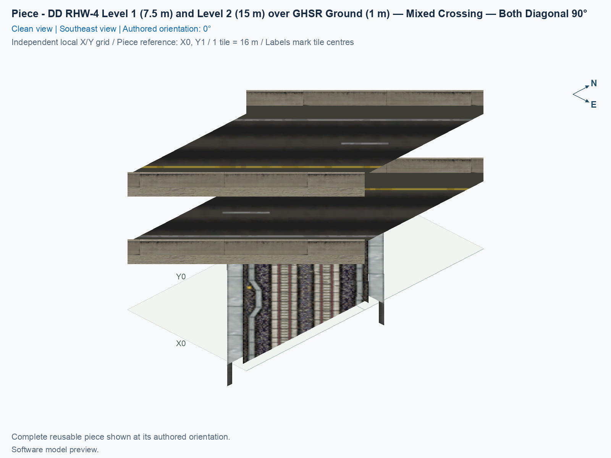
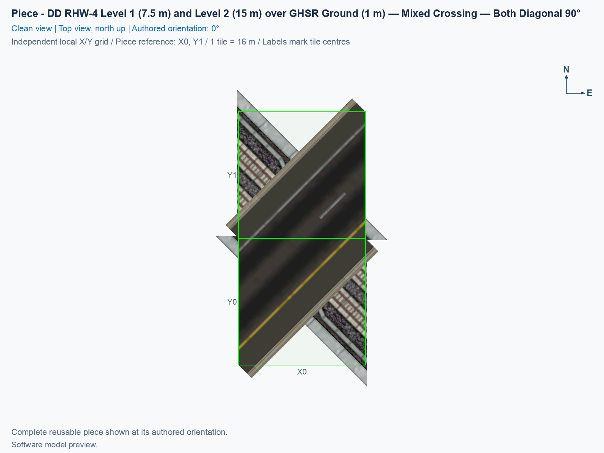

# DD RHW-4 Level 1 (7.5 m) and Level 2 (15 m) over GHSR Ground (1 m) — Mixed Crossing — Both Diagonal 90°

Purpose: place a diagonal ground high-speed railway beneath a diagonal double-decker highway, then extend both networks from their native approaches.

<!-- PIECE README LAYOUT: 2 -->

[1. Views](#1-views) · [2. Piece and placement](#2-piece-and-placement) · [3. Connection matrix](#3-connection-matrix) · [Testing ↗ (separate document)](TESTING.md)

## 1. Views

The angled view shows the two highway decks above the ground railway. The north-up top view shows both networks crossing at 90° and the two green-outlined city tiles owned by this piece. A model can extend past an owned tile's edge; that visible overhang does not make the neighbouring tile part of the fixed crossing. These are previews of the saved models. Actual appearance and moving traffic remain separate checks in [TESTING.md](TESTING.md).

The native GHSR model includes track-bed geometry from approximately −0.989332 m to 1.989332 m relative to ground. The isolated software preview can expose its below-ground side faces because the grid is not an opaque terrain surface. The retained native geometry is checked separately from its unverified appearance on actual terrain.

<!-- BEGIN PIECE VIEWS -->

<!-- END PIECE VIEWS -->

## 2. Piece and placement

**GHSR** means Ground High Speed Rail, and **DD RHW-4** means the double-decker RealHighway with two lanes on each opposing deck. This one reusable piece carries both railway directions at 1 m, two highway lanes at 7.5 m, and the opposing two highway lanes at 15 m. It is a crossing with independent through routes. The authored 0° layout carries upper-deck traffic northeast → southwest and lower-deck traffic southwest → northeast; rotating the whole piece rotates those directions together.

The exact identifier is `ddrhw-l1-and-l2-over-ghsr-ground-mixed-crossing-diagonal-90deg`. Its standalone button is under **Transportation → Highways**, titled **SCP | [HW] DD RHW-4 Level 1 (7.5 m) and Level 2 (15 m) over GHSR Ground (1 m) — Mixed Crossing — Both Diagonal 90°**. It uses the audited NAM 50 right-hand-traffic setup for Windows SimCity 4, including through Wine or CrossOver. Native approach markers for both draggable networks are implemented; their placement, extension, and actual traffic still need the focused game checks.

### 2.1 Keep the four approach tiles clear

A **tile** is one 16 × 16 m city square. The crossing owns two tiles in a **1 × 2** column. Four adjacent **native approach tiles** belong to the ordinary draggable networks rather than to the fixed crossing. Keep the complete **3 × 2** arrangement available when placing it. In the authored 0° orientation, with north at the top, the arrangement is:

| Row | West approach | Fixed crossing | East approach |
| --- | --- | --- | --- |
| North | GHSR approach | Upper core tile | DD RHW-4 approach |
| South | DD RHW-4 approach | Lower core tile | GHSR approach |

The two fixed tiles must have one owner. The four approach tiles are separate native connection points and must not be covered by another fixed custom piece. Leave additional room outside this rectangle for the lines you will drag. The construction uses fixed heights, so begin on flat ground.

### 2.2 Place a fresh crossing, and extend both networks

1. Install a checked build containing this exact piece, and start SimCity 4 after installation. The [build and installation guide](../../../../docs/BUILD_AND_INSTALL.md) explains the separate build and installation steps. Use a disposable test city for the first placement.
2. Prepare flat, empty land covering the six squares in the table and several extra squares beyond each approach. Keep the camera north-up while matching the reference arrangement.
3. Click **Transportation → Highways**, select the exact **SCP | [HW] … over GHSR Ground … Both Diagonal 90°** button named above, and compare its two owned preview tiles with the table. Press **Home** or **End** to rotate the preview. There are four distinct rotations repeated across eight selection states; the piece does not mirror.
4. Click once to place the crossing. Press **Esc** to leave the placement tool. Check the two stacked highway decks and the ground railway separately, then locate the four native approaches beside the fixed tiles.
5. Click **Transportation → Highways**, and select the **RealHighway** drawing tool, also called **RHW-2**. Begin on the northeast DD approach, drag diagonally outward for at least three city squares, and release. Repeat from the southwest DD approach. The intended result is a continuing double-decker highway on both sides.
6. Click **Transportation → Rail → Monorail**. Begin on the northwest GHSR approach, drag diagonally outward for at least three city squares, and release. Repeat from the southeast GHSR approach. The intended result is continuing ground high-speed rail. Monorail is the drawing tool used by this native GHSR network.
7. Inspect the [connection matrix](#3-connection-matrix), then follow the separate [game checks](TESTING.md#4-game-checks) for Route Query, moving cars, moving trains, shadows, and save/reload. A visible connection or a drawn query route alone does not confirm that a vehicle completes it.

For a connection from an existing native line, use the NAM **Ground High Speed Rail (GHSR)** button under **Transportation → Rail** to place its **Ground High Speed Rail Starter Piece**, and extend it with **Monorail**. For the highway, select **Transportation → Highways → RealHighway (RHW) Starter Pieces**, and press **Tab** until the query reads **Double-Decker RHW-4 Starter Piece (Upper Deck: Level 2, Lower Deck: Level 1)**; extend that starter with **RealHighway (RHW-2)**. The separately named **DDRHW-4 Starter Piece (Rail-based network)** uses a different network and is outside this crossing's measured connection contract. The [test procedure](TESTING.md#42-native-approaches-first-then-the-crossing) covers placing the native approaches before the fixed crossing.

<!-- BEGIN PIECE OVERVIEW -->

Two fixed tiles carry both directions of diagonal ground high-speed rail beneath the two diagonal DD RHW-4 decks. Four unowned native approach tiles seed actual NAM draggable continuation. Rail and highway have independent through routes.

Exact reusable identifier: `ddrhw-l1-and-l2-over-ghsr-ground-mixed-crossing-diagonal-90deg`.

Footprint: **1 × 2 tiles**. Exact menu name: **DD RHW-4 Level 1 (7.5 m) and Level 2 (15 m) over GHSR Ground (1 m) — Mixed Crossing — Both Diagonal 90°**.

<!-- END PIECE OVERVIEW -->

## 3. Connection matrix

Read the matrix from an entrance row to an exit column. **Saved PATH** checks the traffic routes stored in the game files. **Route Query** checks the route displayed by the game. **Visible travel** checks a car or train actually completing that route. The matrix describes the six directed through journeys inside this crossing: two railway directions and two lanes on each highway deck. Highway-to-rail transfers, transfers between highway decks, and same-arm returns are excluded from its declared route graph. The connector overview groups each complete exposed boundary; manual confirmation of the native joins remains separate.

<!-- BEGIN PIECE CONNECTION MATRIX -->

### Directed entrance/exit matrix

Read **from an entrance row to an exit column**. **Saved PATH** checks the saved traffic route; **Route Query** checks the route shown by the game; **Visible travel** checks a vehicle completing that journey. For HSR, visible travel means a moving train.

**Game appearance:** [?](TESTING.md#case-in_game_render-e798ee95402b3e1c87d5) — the complete piece’s appearance in the game, checked separately from its journeys.

**Legend:** ✅ confirmed; ❌ failed; ? not established. **Forbidden** means the movement is unavailable; its in-game check confirms that it stays unavailable. Click a result for its exact test case. Scope, evidence, and limitations remain in [the test checklist](TESTING.md#test-checklist).

| Entrance ↓ / Exit → | **Road · West exit** `upper-lane-01-out` Variant: dd-rhw-l2 | **Road · West exit** `upper-lane-02-out` Variant: dd-rhw-l2 | **Road · East exit** `lower-lane-01-out` Variant: dd-rhw-l1 | **Road · East exit** `lower-lane-02-out` Variant: dd-rhw-l1 | **GHSR · West exit** `ghsr-track-02-out` | **GHSR · East exit** `ghsr-track-01-out` |
| --- | --- | --- | --- | --- | --- | --- |
| **Road · West entrance** `lower-lane-01-in` Variant: dd-rhw-l1 | **Forbidden** **Saved PATH:** [?](TESTING.md#case-software_connectivity-e8ed3d694b629f212561) In-game check: [?](TESTING.md#case-in_game_forbidden_transfer-45f059bf181db717a926) | **Forbidden** **Saved PATH:** [?](TESTING.md#case-software_connectivity-e8ed3d694b629f212561) In-game check: [?](TESTING.md#case-in_game_forbidden_transfer-a7de1380b7962e8558f5) | **Saved PATH:** [?](TESTING.md#case-software_connectivity-e8ed3d694b629f212561) **Route Query:** [?](TESTING.md#case-in_game_route_query-50007a8a544067632df8) **Visible travel:** [?](TESTING.md#case-in_game_visible_travel-50007a8a544067632df8) | **Forbidden** **Saved PATH:** [?](TESTING.md#case-software_connectivity-e8ed3d694b629f212561) In-game check: [?](TESTING.md#case-in_game_forbidden_transfer-f42df378907f4c211abe) | **Forbidden** **Saved PATH:** [?](TESTING.md#case-software_connectivity-e8ed3d694b629f212561) In-game check: [?](TESTING.md#case-in_game_forbidden_transfer-a969ca3320f93626d158) | **Forbidden** **Saved PATH:** [?](TESTING.md#case-software_connectivity-e8ed3d694b629f212561) In-game check: [?](TESTING.md#case-in_game_forbidden_transfer-e2fc0e6bcc8302bc0d7e) |
| **Road · West entrance** `lower-lane-02-in` Variant: dd-rhw-l1 | **Forbidden** **Saved PATH:** [?](TESTING.md#case-software_connectivity-e8ed3d694b629f212561) In-game check: [?](TESTING.md#case-in_game_forbidden_transfer-2724a235ab3f02da74bf) | **Forbidden** **Saved PATH:** [?](TESTING.md#case-software_connectivity-e8ed3d694b629f212561) In-game check: [?](TESTING.md#case-in_game_forbidden_transfer-c7ee9e0084c4a78c3b17) | **Forbidden** **Saved PATH:** [?](TESTING.md#case-software_connectivity-e8ed3d694b629f212561) In-game check: [?](TESTING.md#case-in_game_forbidden_transfer-508ac88655ecfebf0cce) | **Saved PATH:** [?](TESTING.md#case-software_connectivity-e8ed3d694b629f212561) **Route Query:** [?](TESTING.md#case-in_game_route_query-44b900d2419028db3d9c) **Visible travel:** [?](TESTING.md#case-in_game_visible_travel-44b900d2419028db3d9c) | **Forbidden** **Saved PATH:** [?](TESTING.md#case-software_connectivity-e8ed3d694b629f212561) In-game check: [?](TESTING.md#case-in_game_forbidden_transfer-170853adb921b007819f) | **Forbidden** **Saved PATH:** [?](TESTING.md#case-software_connectivity-e8ed3d694b629f212561) In-game check: [?](TESTING.md#case-in_game_forbidden_transfer-bd07f2a9933a850f1cda) |
| **Road · East entrance** `upper-lane-01-in` Variant: dd-rhw-l2 | **Saved PATH:** [?](TESTING.md#case-software_connectivity-e8ed3d694b629f212561) **Route Query:** [?](TESTING.md#case-in_game_route_query-7347234933817d8bc777) **Visible travel:** [?](TESTING.md#case-in_game_visible_travel-7347234933817d8bc777) | **Forbidden** **Saved PATH:** [?](TESTING.md#case-software_connectivity-e8ed3d694b629f212561) In-game check: [?](TESTING.md#case-in_game_forbidden_transfer-be6b0868d6028c04575b) | **Forbidden** **Saved PATH:** [?](TESTING.md#case-software_connectivity-e8ed3d694b629f212561) In-game check: [?](TESTING.md#case-in_game_forbidden_transfer-e85de43b6232aced084c) | **Forbidden** **Saved PATH:** [?](TESTING.md#case-software_connectivity-e8ed3d694b629f212561) In-game check: [?](TESTING.md#case-in_game_forbidden_transfer-b3b2fa4fc3cbbe7025ac) | **Forbidden** **Saved PATH:** [?](TESTING.md#case-software_connectivity-e8ed3d694b629f212561) In-game check: [?](TESTING.md#case-in_game_forbidden_transfer-605614f264283571e5c1) | **Forbidden** **Saved PATH:** [?](TESTING.md#case-software_connectivity-e8ed3d694b629f212561) In-game check: [?](TESTING.md#case-in_game_forbidden_transfer-51e1f870858af73e35d9) |
| **Road · East entrance** `upper-lane-02-in` Variant: dd-rhw-l2 | **Forbidden** **Saved PATH:** [?](TESTING.md#case-software_connectivity-e8ed3d694b629f212561) In-game check: [?](TESTING.md#case-in_game_forbidden_transfer-cc56eece15cb2745efa7) | **Saved PATH:** [?](TESTING.md#case-software_connectivity-e8ed3d694b629f212561) **Route Query:** [?](TESTING.md#case-in_game_route_query-1c93d9ac8ff075b3ae9f) **Visible travel:** [?](TESTING.md#case-in_game_visible_travel-1c93d9ac8ff075b3ae9f) | **Forbidden** **Saved PATH:** [?](TESTING.md#case-software_connectivity-e8ed3d694b629f212561) In-game check: [?](TESTING.md#case-in_game_forbidden_transfer-374795d2fe615b8a8fb7) | **Forbidden** **Saved PATH:** [?](TESTING.md#case-software_connectivity-e8ed3d694b629f212561) In-game check: [?](TESTING.md#case-in_game_forbidden_transfer-65a8b8ce22622a926fee) | **Forbidden** **Saved PATH:** [?](TESTING.md#case-software_connectivity-e8ed3d694b629f212561) In-game check: [?](TESTING.md#case-in_game_forbidden_transfer-ea45fba00ba56901ac65) | **Forbidden** **Saved PATH:** [?](TESTING.md#case-software_connectivity-e8ed3d694b629f212561) In-game check: [?](TESTING.md#case-in_game_forbidden_transfer-3979105d31e892d07ba0) |
| **GHSR · West entrance** `ghsr-track-01-in` | **Forbidden** **Saved PATH:** [?](TESTING.md#case-software_connectivity-e8ed3d694b629f212561) In-game check: [?](TESTING.md#case-in_game_forbidden_transfer-bab76ce828cd6135a04b) | **Forbidden** **Saved PATH:** [?](TESTING.md#case-software_connectivity-e8ed3d694b629f212561) In-game check: [?](TESTING.md#case-in_game_forbidden_transfer-6a41ada2f45097aae57b) | **Forbidden** **Saved PATH:** [?](TESTING.md#case-software_connectivity-e8ed3d694b629f212561) In-game check: [?](TESTING.md#case-in_game_forbidden_transfer-18a048ff1c8870a9063e) | **Forbidden** **Saved PATH:** [?](TESTING.md#case-software_connectivity-e8ed3d694b629f212561) In-game check: [?](TESTING.md#case-in_game_forbidden_transfer-a890c4828d37837e9d8b) | **Forbidden** **Saved PATH:** [?](TESTING.md#case-software_connectivity-e8ed3d694b629f212561) In-game check: [?](TESTING.md#case-in_game_forbidden_transfer-12783c955f2e740100bd) | **Saved PATH:** [?](TESTING.md#case-software_connectivity-e8ed3d694b629f212561) **Route Query:** [?](TESTING.md#case-in_game_route_query-f580ac96a57572891d18) **Visible train travel:** [?](TESTING.md#case-in_game_visible_travel-f580ac96a57572891d18) |
| **GHSR · East entrance** `ghsr-track-02-in` | **Forbidden** **Saved PATH:** [?](TESTING.md#case-software_connectivity-e8ed3d694b629f212561) In-game check: [?](TESTING.md#case-in_game_forbidden_transfer-282438b99d4e8781b47d) | **Forbidden** **Saved PATH:** [?](TESTING.md#case-software_connectivity-e8ed3d694b629f212561) In-game check: [?](TESTING.md#case-in_game_forbidden_transfer-f2339573871c905bc194) | **Forbidden** **Saved PATH:** [?](TESTING.md#case-software_connectivity-e8ed3d694b629f212561) In-game check: [?](TESTING.md#case-in_game_forbidden_transfer-1ec5a0e2b6a5ead1a3d1) | **Forbidden** **Saved PATH:** [?](TESTING.md#case-software_connectivity-e8ed3d694b629f212561) In-game check: [?](TESTING.md#case-in_game_forbidden_transfer-daf6c3f8e24f5b2ac783) | **Saved PATH:** [?](TESTING.md#case-software_connectivity-e8ed3d694b629f212561) **Route Query:** [?](TESTING.md#case-in_game_route_query-49a14201b3d53a972e04) **Visible train travel:** [?](TESTING.md#case-in_game_visible_travel-49a14201b3d53a972e04) | **Forbidden** **Saved PATH:** [?](TESTING.md#case-software_connectivity-e8ed3d694b629f212561) In-game check: [?](TESTING.md#case-in_game_forbidden_transfer-97d70eccf46a65c2ce4f) |

Source: [connections.json](connections.json).

<!-- END PIECE CONNECTION MATRIX -->

<!-- BEGIN CONNECTOR OVERVIEW -->

### Connection overview

Generated from this piece's source-bound connector metadata and the current compiled model; marker letters refer to the boundary cards below.

[Rendering sources and verification scope](evidence/connection-overview.json).

Headings: 0° = North, 90° = East, 180° = South, and 270° = West; clockwise in plan view, pointing out of the piece.

Coordinates [E,N,H] = [east,north,height] in metres. Source cells [column,row] increase east and south.

Display grid: X = source column − (0); Y = 1 − source row.

Slope is measured outward at the joining edge; the interior may differ. Offsets are + left and − right facing out of the tile edge.

Member offsets use the section origin. Counts distinguish physical channels / edge cuts / directed members; modes do not multiply channels.

Incoming flow enters this piece; outgoing flow leaves it. Letters identify boundary cards; source IDs remain the stable identities.

Not declared means no section origin or offset was authored. Its marker uses an actual member endpoint; the measured intersections remain authoritative.

#### Boundary A: `boundary-01`

This service group is required at this edge.

##### Service group 1 / 1: GHSR — Custom (1 m)

| Field | Value |
| --- | --- |
| End / component | `boundary-01-ghsr-mainline-01` / `ghsr-mainline` |
| Network / game class / role | ghsr / Monorail (7); primary |
| Source cell / edge | `[0,0]` / West |
| Section origin [E,N] (m) | Not declared; see member endpoints |
| Centring / section offset | Not declared |
| Level (path height) | Custom (1 m); no nominal level |
| Outward heading | Different; see members |
| Slope at joining edge | 0% outward |
| Channels / edge cuts / directed members | 2 / 2 / 2 |
| Traffic arrangement / running | 1 incoming; 1 outgoing; See member directions |
| Channel spacing | See individual measured intersections |
| Channel kinds | rail-track |
| Traffic modes | monorail |
| Profile | No profile reference |

| Member / measured source | Channel / cut / modes | Flow | Endpoint [E,N,H] (m) | Offset (m) | Outward heading | Edge slope (%) |
| --- | --- | --- | --- | ---: | ---: | ---: |
| `member-ghsr-track-01-in` / `ghsr-track-01-in` | `ghsr-track-01` / `cut-ghsr-track-01-in` / monorail | Incoming | `[-8,-2.9,1]` | Not declared | 315° | 0 |
| `member-ghsr-track-02-out` / `ghsr-track-02-out` | `ghsr-track-02` / `cut-ghsr-track-02-out` / monorail | Outgoing | `[-8,2.9,1]` | Not declared | 314.444° | 0 |

#### Boundary B: `boundary-02`

All 2 service groups are required together at this edge.

##### Service group 1 / 2: ROAD — Custom (7.5 m)

| Field | Value |
| --- | --- |
| End / component | `boundary-02-lower-mainline-01` / `lower-mainline` |
| Network / game class / role | road / Engine class (1); primary |
| Source cell / edge | `[0,0]` / East |
| Section origin [E,N] (m) | Not declared; see member endpoints |
| Centring / section offset | Not declared |
| Level (path height) | Custom (7.5 m); no nominal level |
| Outward heading | 45° |
| Slope at joining edge | 0% outward |
| Channels / edge cuts / directed members | 2 / 2 / 2 |
| Traffic arrangement / running | 0 incoming; 2 outgoing; See member directions |
| Channel spacing | 4.52548 m |
| Channel kinds | road-lane |
| Traffic modes | car |
| Profile | No profile reference |

| Member / measured source | Channel / cut / modes | Flow | Endpoint [E,N,H] (m) | Offset (m) | Outward heading | Edge slope (%) |
| --- | --- | --- | --- | ---: | ---: | ---: |
| `member-lower-lane-01-out` / `lower-lane-01-out` | `lower-lane-01` / `cut-lower-lane-01-out` / car | Outgoing | `[8,-3.2,7.5]` | Not declared | 45° | 0 |
| `member-lower-lane-02-out` / `lower-lane-02-out` | `lower-lane-02` / `cut-lower-lane-02-out` / car | Outgoing | `[8,3.2,7.5]` | Not declared | 45° | 0 |

##### Service group 2 / 2: ROAD — Custom (15 m)

| Field | Value |
| --- | --- |
| End / component | `boundary-02-upper-mainline-02` / `upper-mainline` |
| Network / game class / role | road / Engine class (1); primary |
| Source cell / edge | `[0,0]` / East |
| Section origin [E,N] (m) | Not declared; see member endpoints |
| Centring / section offset | Not declared |
| Level (path height) | Custom (15 m); no nominal level |
| Outward heading | 45° |
| Slope at joining edge | 0% outward |
| Channels / edge cuts / directed members | 2 / 2 / 2 |
| Traffic arrangement / running | 2 incoming; 0 outgoing; See member directions |
| Channel spacing | 4.52548 m |
| Channel kinds | road-lane |
| Traffic modes | car |
| Profile | No profile reference |

| Member / measured source | Channel / cut / modes | Flow | Endpoint [E,N,H] (m) | Offset (m) | Outward heading | Edge slope (%) |
| --- | --- | --- | --- | ---: | ---: | ---: |
| `member-upper-lane-01-in` / `upper-lane-01-in` | `upper-lane-01` / `cut-upper-lane-01-in` / car | Incoming | `[8,-3.2,15]` | Not declared | 45° | 0 |
| `member-upper-lane-02-in` / `upper-lane-02-in` | `upper-lane-02` / `cut-upper-lane-02-in` / car | Incoming | `[8,3.2,15]` | Not declared | 45° | 0 |

#### Boundary C: `boundary-03`

All 2 service groups are required together at this edge.

##### Service group 1 / 2: ROAD — Custom (7.5 m)

| Field | Value |
| --- | --- |
| End / component | `boundary-03-lower-mainline-01` / `lower-mainline` |
| Network / game class / role | road / Engine class (1); primary |
| Source cell / edge | `[0,1]` / West |
| Section origin [E,N] (m) | Not declared; see member endpoints |
| Centring / section offset | Not declared |
| Level (path height) | Custom (7.5 m); no nominal level |
| Outward heading | 225° |
| Slope at joining edge | 0% outward |
| Channels / edge cuts / directed members | 2 / 2 / 2 |
| Traffic arrangement / running | 2 incoming; 0 outgoing; See member directions |
| Channel spacing | 4.52548 m |
| Channel kinds | road-lane |
| Traffic modes | car |
| Profile | No profile reference |

| Member / measured source | Channel / cut / modes | Flow | Endpoint [E,N,H] (m) | Offset (m) | Outward heading | Edge slope (%) |
| --- | --- | --- | --- | ---: | ---: | ---: |
| `member-lower-lane-01-in` / `lower-lane-01-in` | `lower-lane-01` / `cut-lower-lane-01-in` / car | Incoming | `[-8,-19.2,7.5]` | Not declared | 225° | 0 |
| `member-lower-lane-02-in` / `lower-lane-02-in` | `lower-lane-02` / `cut-lower-lane-02-in` / car | Incoming | `[-8,-12.8,7.5]` | Not declared | 225° | 0 |

##### Service group 2 / 2: ROAD — Custom (15 m)

| Field | Value |
| --- | --- |
| End / component | `boundary-03-upper-mainline-02` / `upper-mainline` |
| Network / game class / role | road / Engine class (1); primary |
| Source cell / edge | `[0,1]` / West |
| Section origin [E,N] (m) | Not declared; see member endpoints |
| Centring / section offset | Not declared |
| Level (path height) | Custom (15 m); no nominal level |
| Outward heading | 225° |
| Slope at joining edge | 0% outward |
| Channels / edge cuts / directed members | 2 / 2 / 2 |
| Traffic arrangement / running | 0 incoming; 2 outgoing; See member directions |
| Channel spacing | 4.52548 m |
| Channel kinds | road-lane |
| Traffic modes | car |
| Profile | No profile reference |

| Member / measured source | Channel / cut / modes | Flow | Endpoint [E,N,H] (m) | Offset (m) | Outward heading | Edge slope (%) |
| --- | --- | --- | --- | ---: | ---: | ---: |
| `member-upper-lane-01-out` / `upper-lane-01-out` | `upper-lane-01` / `cut-upper-lane-01-out` / car | Outgoing | `[-8,-19.2,15]` | Not declared | 225° | 0 |
| `member-upper-lane-02-out` / `upper-lane-02-out` | `upper-lane-02` / `cut-upper-lane-02-out` / car | Outgoing | `[-8,-12.8,15]` | Not declared | 225° | 0 |

#### Boundary D: `boundary-04`

This service group is required at this edge.

##### Service group 1 / 1: GHSR — Custom (1 m)

| Field | Value |
| --- | --- |
| End / component | `boundary-04-ghsr-mainline-01` / `ghsr-mainline` |
| Network / game class / role | ghsr / Monorail (7); primary |
| Source cell / edge | `[0,1]` / East |
| Section origin [E,N] (m) | Not declared; see member endpoints |
| Centring / section offset | Not declared |
| Level (path height) | Custom (1 m); no nominal level |
| Outward heading | Different; see members |
| Slope at joining edge | 0% outward |
| Channels / edge cuts / directed members | 2 / 2 / 2 |
| Traffic arrangement / running | 1 incoming; 1 outgoing; See member directions |
| Channel spacing | See individual measured intersections |
| Channel kinds | rail-track |
| Traffic modes | monorail |
| Profile | No profile reference |

| Member / measured source | Channel / cut / modes | Flow | Endpoint [E,N,H] (m) | Offset (m) | Outward heading | Edge slope (%) |
| --- | --- | --- | --- | ---: | ---: | ---: |
| `member-ghsr-track-01-out` / `ghsr-track-01-out` | `ghsr-track-01` / `cut-ghsr-track-01-out` / monorail | Outgoing | `[8,-18.9,1]` | Not declared | 134.444° | 0 |
| `member-ghsr-track-02-in` / `ghsr-track-02-in` | `ghsr-track-02` / `cut-ghsr-track-02-in` / monorail | Incoming | `[8,-13.1,1]` | Not declared | 135° | 0 |

The overview uses source metadata, current compiled resource identities, and the saved model. Current placement, connection, and traffic results belong to the generated connection matrix and linked testing records.

<!-- END CONNECTOR OVERVIEW -->
