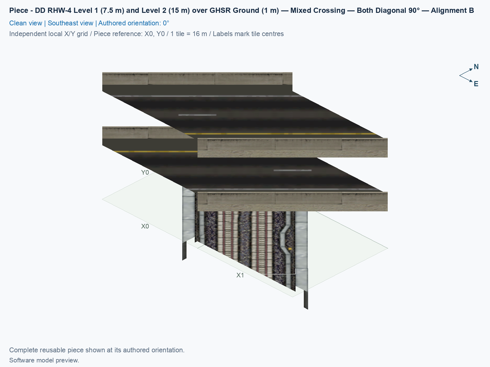
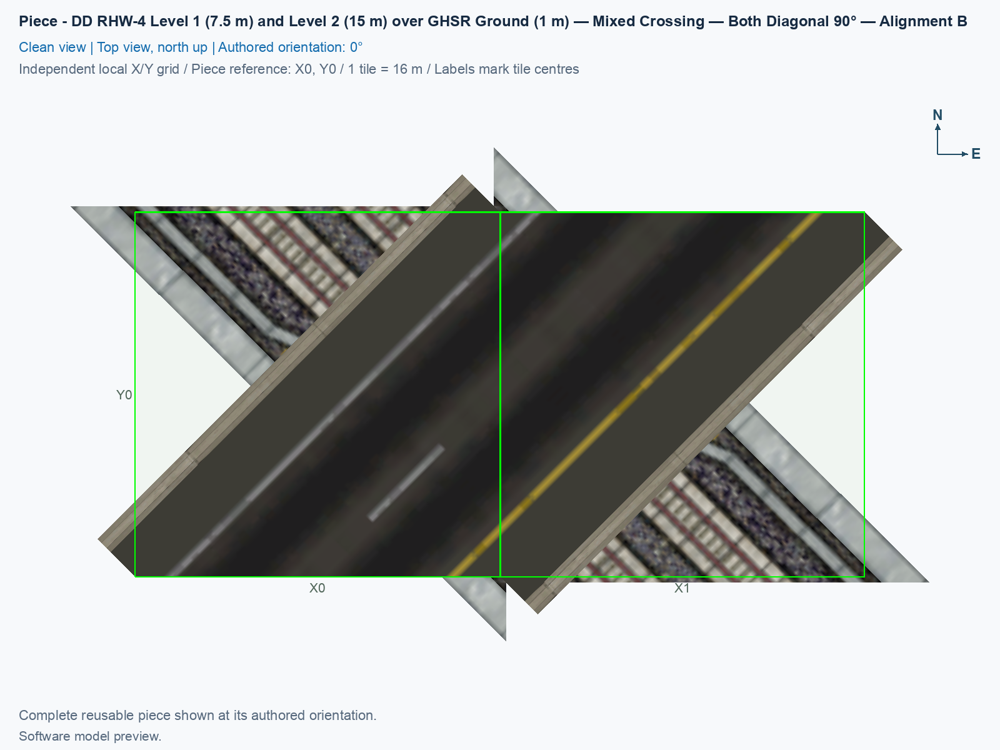

# DD RHW-4 Level 1 (7.5 m) and Level 2 (15 m) over GHSR Ground (1 m) — Mixed Crossing — Both Diagonal 90° — Alignment B

Purpose: fit the alternate diagonal ground railway position beneath the same directed double-decker highway, with native draggable continuation on both networks.

<!-- PIECE README LAYOUT: 2 -->

[1. Views](#1-views) · [2. Piece and placement](#2-piece-and-placement) · [3. Connection matrix](#3-connection-matrix) · [Testing ↗ (separate document)](TESTING.md)

## 1. Views

The clean angled view shows both highway decks above GHSR, meaning Ground High Speed Rail. The top view outlines the two fixed city tiles. Alignment B uses two horizontally adjacent tiles in the authored 0° view; the original Alignment A uses two vertically adjacent tiles. The visible models may extend beyond their owned tiles. These saved-model previews do not establish actual game appearance or moving traffic.

<!-- BEGIN PIECE VIEWS -->

<!-- END PIECE VIEWS -->

## 2. Piece and placement

**Current shadow policy:** this alignment intentionally supplies no cast shadows. Both GHSR/DD RHW alignments follow the same policy, chosen after the user reported that the adjoining draggable DD highway has no visible shadow. That report is the reason for this appearance choice, not an independent measurement of every native DD resource. Restart after installing the checked revision, and test a fresh crossing so an older saved shadow attachment cannot be mistaken for the new result. See [the current shadow checks](TESTING.md#4-game-checks).

**DD RHW-4** is the double-decker RealHighway with two lanes on each opposing deck. This crossing carries both railway directions at 1 m, two highway lanes at 7.5 m, and the opposing two lanes at 15 m. At 0°, the upper deck travels northeast → southwest, and the lower deck travels southwest → northeast. There are no transfers between railway and highway, or between highway decks.

### 2.1 Choose Alignment A or B

The two alignments fit alternating positions of the ground railway against the same highway. A city tile is a 16 × 16 m square. Moving a diagonal railway to the next adjacent grid line changes its sideways position by approximately 11.314 m. Moving the old crossing along the highway by complete diagonal tile steps advances approximately 22.627 m, skipping that intermediate position. Alignment B fills the missing position while retaining the highway's existing deck directions. Turning the original piece around does not supply this arrangement.

The [original crossing](../ddrhw-l1-and-l2-over-ghsr-ground-mixed-crossing-diagonal-90deg/README.md) is Alignment A. In a build containing both alignments, open **Transportation → Highways**, and select the existing **SCP | [HW] DD RHW-4 Level 1 (7.5 m) and Level 2 (15 m) over GHSR Ground (1 m) — Mixed Crossing — Both Diagonal 90°** button. Press **Tab** to select this variant; its placement query ends with **Alignment B**. **Shift+Tab** returns to A, while **Home** and **End** rotate the currently selected alignment. Each alignment has four distinct rotations repeated across eight states. They share one button and form a family of alternative crossings; they are not two components to place on top of each other.

When only B is included in a development build, its standalone button includes **Alignment B**, and A is unavailable. The delivered combined A/B candidate retains the original crossing button and hides that extra standalone entry.

### 2.2 Keep all four native approaches clear

The fixed core owns **2 × 1 tiles**. Four adjacent native approach tiles belong to the ordinary draggable networks. Keep the complete **2 × 3** arrangement below clear, plus at least three extra tiles beyond each approach for extension. The table shows the authored 0° arrangement with north at the top.

| Row | West column | East column |
| --- | --- | --- |
| North | GHSR approach | DD RHW-4 approach |
| Middle | West fixed core tile | East fixed core tile |
| South | DD RHW-4 approach | GHSR approach |

The railway and highway share both fixed core tiles, so they form one coordinated reusable crossing. Do not cover the four native approaches with other fixed pieces. Fixed heights require flat ground for the first test. Rotating the piece rotates this complete arrangement.

### 2.3 Place and extend Alignment B

1. Install the checked combined A/B candidate through the [installation procedure](../../../../docs/BUILD_AND_INSTALL.md#7-install-remove-or-roll-back-a-test-build), and start SimCity 4 after installation. Begin in a disposable flat test city.
2. Open **Transportation → Highways**, select the original crossing button, press **Tab** until the placement query ends with **Alignment B**, and use **Home** or **End** to match the highway's direction and deck markings.
3. Place a **fresh** B crossing in the arrangement above. Fresh placement creates the native approach markers and avoids retaining an older saved shadow attachment; existing A crossings keep their IDs and geometry.
4. Press **Esc**. Select **Transportation → Highways → RealHighway (RHW-2)**. Drag from the northeast DD approach diagonally outward for at least three tiles. Repeat from the southwest DD approach.
5. Select **Transportation → Rail → Monorail**. Drag from the northwest railway approach diagonally outward for at least three tiles. Repeat from the southeast approach. NAM's ground high-speed railway uses the Monorail drawing tool.
6. Join these arms to working control lines, and follow actual cars across both decks and trains through both railway directions. Route Query lines and moving vehicles are separate checks. Follow [TESTING](TESTING.md#4-game-checks) for both railway positions, every rotation, shadows, and save/reload.

For prebuilt control lines, place the NAM **Ground High Speed Rail Starter Piece** from **Transportation → Rail → Ground High Speed Rail (GHSR)**, then extend it with **Monorail**. For DD, select **Transportation → Highways → RealHighway (RHW) Starter Pieces**, press **Tab** until the query reads **Double-Decker RHW-4 Starter Piece (Upper Deck: Level 2, Lower Deck: Level 1)**, and extend it with **RealHighway (RHW-2)**. The similarly named rail-based DDRHW starter is a different network. When building approaches first, leave the two fixed core tiles empty and compare all four native approaches with the table before placing B.

<!-- BEGIN PIECE OVERVIEW -->

Alignment B fits the alternate diagonal railway position beneath the same directed double-decker highway. Two horizontal fixed tiles and four native approaches provide independent rail and highway through routes. When both alignments are selected, Tab changes between A and B from the original crossing button.

Exact reusable identifier: `ddrhw-l1-l2-over-ghsr-ground-crossing-diagonal-90deg-alignment-b`.

Footprint: **2 × 1 tiles**. Exact menu name: **DD RHW-4 Level 1 (7.5 m) and Level 2 (15 m) over GHSR Ground (1 m) — Mixed Crossing — Both Diagonal 90° — Alignment B**.

<!-- END PIECE OVERVIEW -->

## 3. Connection matrix

The matrix describes six directed through journeys inside Alignment B. Saved PATH means the traffic routes stored in the game files; Route Query means the route displayed in the game; Visible travel means an actual car or train completing that route. Forbidden transfers must remain unavailable. The connection cards describe complete exposed boundaries; native construction and moving-vehicle acceptance remain separate game checks.

<!-- BEGIN PIECE CONNECTION MATRIX -->

### Directed entrance/exit matrix

Read **from an entrance row to an exit column**. **Saved PATH** checks the saved traffic route; **Route Query** checks the route shown by the game; **Visible travel** checks a vehicle completing that journey. For HSR, visible travel means a moving train.

**Game appearance:** [✅](TESTING.md#case-in_game_render-3107d4ec938f3c22bea2) — the complete piece’s appearance in the game, checked separately from its journeys.

**Legend:** ✅ confirmed; ❌ failed; ? not established. **Forbidden** means the movement is unavailable; its in-game check confirms that it stays unavailable. Click a result for its exact test case. Scope, evidence, and limitations remain in [the test checklist](TESTING.md#test-checklist).

| Entrance ↓ / Exit → | **Road · South exit** `upper-lane-01-out` Variant: dd-rhw-l2 | **Road · South exit** `upper-lane-02-out` Variant: dd-rhw-l2 | **Road · North exit** `lower-lane-01-out` Variant: dd-rhw-l1 | **Road · North exit** `lower-lane-02-out` Variant: dd-rhw-l1 | **GHSR · North exit** `ghsr-track-02-out` | **GHSR · South exit** `ghsr-track-01-out` |
| --- | --- | --- | --- | --- | --- | --- |
| **Road · South entrance** `lower-lane-01-in` Variant: dd-rhw-l1 | **Forbidden** **Saved PATH:** [?](TESTING.md#case-software_connectivity-240be4715171a2175c4f) In-game check: [✅](TESTING.md#case-in_game_forbidden_transfer-e3d466a8f45129dd22ba) | **Forbidden** **Saved PATH:** [?](TESTING.md#case-software_connectivity-240be4715171a2175c4f) In-game check: [✅](TESTING.md#case-in_game_forbidden_transfer-b0b6c0a450555409ada6) | **Saved PATH:** [?](TESTING.md#case-software_connectivity-240be4715171a2175c4f) **Route Query:** [✅](TESTING.md#case-in_game_route_query-b4711d8f8bda7b210e0d) **Visible travel:** [✅](TESTING.md#case-in_game_visible_travel-b4711d8f8bda7b210e0d) | **Forbidden** **Saved PATH:** [?](TESTING.md#case-software_connectivity-240be4715171a2175c4f) In-game check: [✅](TESTING.md#case-in_game_forbidden_transfer-bf05162024cb1af14b9e) | **Forbidden** **Saved PATH:** [?](TESTING.md#case-software_connectivity-240be4715171a2175c4f) In-game check: [✅](TESTING.md#case-in_game_forbidden_transfer-bb5085c94312226ce288) | **Forbidden** **Saved PATH:** [?](TESTING.md#case-software_connectivity-240be4715171a2175c4f) In-game check: [✅](TESTING.md#case-in_game_forbidden_transfer-51a0873772f80ab90f78) |
| **Road · South entrance** `lower-lane-02-in` Variant: dd-rhw-l1 | **Forbidden** **Saved PATH:** [?](TESTING.md#case-software_connectivity-240be4715171a2175c4f) In-game check: [✅](TESTING.md#case-in_game_forbidden_transfer-f082e76d068f15e083dd) | **Forbidden** **Saved PATH:** [?](TESTING.md#case-software_connectivity-240be4715171a2175c4f) In-game check: [✅](TESTING.md#case-in_game_forbidden_transfer-7fbd286698e998b16f44) | **Forbidden** **Saved PATH:** [?](TESTING.md#case-software_connectivity-240be4715171a2175c4f) In-game check: [✅](TESTING.md#case-in_game_forbidden_transfer-ce5b336d9797f26ef837) | **Saved PATH:** [?](TESTING.md#case-software_connectivity-240be4715171a2175c4f) **Route Query:** [✅](TESTING.md#case-in_game_route_query-590e1332b9c7c9fafeee) **Visible travel:** [✅](TESTING.md#case-in_game_visible_travel-590e1332b9c7c9fafeee) | **Forbidden** **Saved PATH:** [?](TESTING.md#case-software_connectivity-240be4715171a2175c4f) In-game check: [✅](TESTING.md#case-in_game_forbidden_transfer-21d9088b7fd6c10c7958) | **Forbidden** **Saved PATH:** [?](TESTING.md#case-software_connectivity-240be4715171a2175c4f) In-game check: [✅](TESTING.md#case-in_game_forbidden_transfer-6a5fe0e16ad0ce6c1327) |
| **Road · North entrance** `upper-lane-01-in` Variant: dd-rhw-l2 | **Saved PATH:** [?](TESTING.md#case-software_connectivity-240be4715171a2175c4f) **Route Query:** [✅](TESTING.md#case-in_game_route_query-2fbd79de7cd740a75c92) **Visible travel:** [✅](TESTING.md#case-in_game_visible_travel-2fbd79de7cd740a75c92) | **Forbidden** **Saved PATH:** [?](TESTING.md#case-software_connectivity-240be4715171a2175c4f) In-game check: [✅](TESTING.md#case-in_game_forbidden_transfer-f67195a7caaceddc2768) | **Forbidden** **Saved PATH:** [?](TESTING.md#case-software_connectivity-240be4715171a2175c4f) In-game check: [✅](TESTING.md#case-in_game_forbidden_transfer-8d5d020b2104fe6f038b) | **Forbidden** **Saved PATH:** [?](TESTING.md#case-software_connectivity-240be4715171a2175c4f) In-game check: [✅](TESTING.md#case-in_game_forbidden_transfer-fb5cc05dd088f623fe46) | **Forbidden** **Saved PATH:** [?](TESTING.md#case-software_connectivity-240be4715171a2175c4f) In-game check: [✅](TESTING.md#case-in_game_forbidden_transfer-2da7b382e74eae37f587) | **Forbidden** **Saved PATH:** [?](TESTING.md#case-software_connectivity-240be4715171a2175c4f) In-game check: [✅](TESTING.md#case-in_game_forbidden_transfer-8ceba357564d9c9a12e1) |
| **Road · North entrance** `upper-lane-02-in` Variant: dd-rhw-l2 | **Forbidden** **Saved PATH:** [?](TESTING.md#case-software_connectivity-240be4715171a2175c4f) In-game check: [✅](TESTING.md#case-in_game_forbidden_transfer-a261072d5941839f6d37) | **Saved PATH:** [?](TESTING.md#case-software_connectivity-240be4715171a2175c4f) **Route Query:** [✅](TESTING.md#case-in_game_route_query-1993094849d021e36d7c) **Visible travel:** [✅](TESTING.md#case-in_game_visible_travel-1993094849d021e36d7c) | **Forbidden** **Saved PATH:** [?](TESTING.md#case-software_connectivity-240be4715171a2175c4f) In-game check: [✅](TESTING.md#case-in_game_forbidden_transfer-bd9d72782c3feaa92ba1) | **Forbidden** **Saved PATH:** [?](TESTING.md#case-software_connectivity-240be4715171a2175c4f) In-game check: [✅](TESTING.md#case-in_game_forbidden_transfer-627606805459be4dc8bc) | **Forbidden** **Saved PATH:** [?](TESTING.md#case-software_connectivity-240be4715171a2175c4f) In-game check: [✅](TESTING.md#case-in_game_forbidden_transfer-dc9aa7f70d7962f76c9e) | **Forbidden** **Saved PATH:** [?](TESTING.md#case-software_connectivity-240be4715171a2175c4f) In-game check: [✅](TESTING.md#case-in_game_forbidden_transfer-27a58eed28584a0f55c5) |
| **GHSR · North entrance** `ghsr-track-01-in` | **Forbidden** **Saved PATH:** [?](TESTING.md#case-software_connectivity-240be4715171a2175c4f) In-game check: [✅](TESTING.md#case-in_game_forbidden_transfer-63e86a4305bda809339a) | **Forbidden** **Saved PATH:** [?](TESTING.md#case-software_connectivity-240be4715171a2175c4f) In-game check: [✅](TESTING.md#case-in_game_forbidden_transfer-0e16a01bb748454c4b58) | **Forbidden** **Saved PATH:** [?](TESTING.md#case-software_connectivity-240be4715171a2175c4f) In-game check: [✅](TESTING.md#case-in_game_forbidden_transfer-e61098710b5ffce1d83a) | **Forbidden** **Saved PATH:** [?](TESTING.md#case-software_connectivity-240be4715171a2175c4f) In-game check: [✅](TESTING.md#case-in_game_forbidden_transfer-f6840e467494228c7bd9) | **Forbidden** **Saved PATH:** [?](TESTING.md#case-software_connectivity-240be4715171a2175c4f) In-game check: [✅](TESTING.md#case-in_game_forbidden_transfer-289bc797e6cbed06295d) | **Saved PATH:** [?](TESTING.md#case-software_connectivity-240be4715171a2175c4f) **Route Query:** [✅](TESTING.md#case-in_game_route_query-9d4c8d0b3bb1b8424074) **Visible train travel:** [✅](TESTING.md#case-in_game_visible_travel-9d4c8d0b3bb1b8424074) |
| **GHSR · South entrance** `ghsr-track-02-in` | **Forbidden** **Saved PATH:** [?](TESTING.md#case-software_connectivity-240be4715171a2175c4f) In-game check: [✅](TESTING.md#case-in_game_forbidden_transfer-821d723667b6e562da59) | **Forbidden** **Saved PATH:** [?](TESTING.md#case-software_connectivity-240be4715171a2175c4f) In-game check: [✅](TESTING.md#case-in_game_forbidden_transfer-2b38e39af31dac102eda) | **Forbidden** **Saved PATH:** [?](TESTING.md#case-software_connectivity-240be4715171a2175c4f) In-game check: [✅](TESTING.md#case-in_game_forbidden_transfer-c8372f23238fbf194311) | **Forbidden** **Saved PATH:** [?](TESTING.md#case-software_connectivity-240be4715171a2175c4f) In-game check: [✅](TESTING.md#case-in_game_forbidden_transfer-79a9594109cb09a641ec) | **Saved PATH:** [?](TESTING.md#case-software_connectivity-240be4715171a2175c4f) **Route Query:** [✅](TESTING.md#case-in_game_route_query-6e27109cabaee54de1c1) **Visible train travel:** [✅](TESTING.md#case-in_game_visible_travel-6e27109cabaee54de1c1) | **Forbidden** **Saved PATH:** [?](TESTING.md#case-software_connectivity-240be4715171a2175c4f) In-game check: [✅](TESTING.md#case-in_game_forbidden_transfer-a004837b7d16e8cfbb86) |

Source: [connections.json](connections.json).

<!-- END PIECE CONNECTION MATRIX -->

<!-- BEGIN CONNECTOR OVERVIEW -->

### Connection overview

Generated from this piece's source-bound connector metadata and the current compiled model; marker letters refer to the boundary cards below.

[Rendering sources and verification scope](evidence/connection-overview.json).

Headings: 0° = North, 90° = East, 180° = South, and 270° = West; clockwise in plan view, pointing out of the piece.

Coordinates [E,N,H] = [east,north,height] in metres. Source cells [column,row] increase east and south.

Display grid: X = source column − (0); Y = 0 − source row.

Slope is measured outward at the joining edge; the interior may differ. Offsets are + left and − right facing out of the tile edge.

Member offsets use the section origin. Counts distinguish physical channels / edge cuts / directed members; modes do not multiply channels.

Incoming flow enters this piece; outgoing flow leaves it. Letters identify boundary cards; source IDs remain the stable identities.

Not declared means no section origin or offset was authored. Its marker uses an actual member endpoint; the measured intersections remain authoritative.

#### Boundary A: `boundary-02`

All 2 service groups are required together at this edge.

##### Service group 1 / 2: ROAD — Custom (7.5 m)

| Field | Value |
| --- | --- |
| End / component | `boundary-02-lower-mainline-01` / `lower-mainline` |
| Network / game class / role | road / Engine class (1); primary |
| Source cell / edge | `[0,0]` / South |
| Section origin [E,N] (m) | Not declared; see member endpoints |
| Centring / section offset | Not declared |
| Level (path height) | Custom (7.5 m); no nominal level |
| Outward heading | 225° |
| Slope at joining edge | 0% outward |
| Channels / edge cuts / directed members | 2 / 2 / 2 |
| Traffic arrangement / running | 2 incoming; 0 outgoing; See member directions |
| Channel spacing | 4.52548 m |
| Channel kinds | road-lane |
| Traffic modes | car |
| Profile | No profile reference |

| Member / measured source | Channel / cut / modes | Flow | Endpoint [E,N,H] (m) | Offset (m) | Outward heading | Edge slope (%) |
| --- | --- | --- | --- | ---: | ---: | ---: |
| `member-lower-lane-01-in` / `lower-lane-01-in` | `lower-lane-01` / `cut-lower-lane-01-in` / car | Incoming | `[-3.2,-8,7.5]` | Not declared | 225° | 0 |
| `member-lower-lane-02-in` / `lower-lane-02-in` | `lower-lane-02` / `cut-lower-lane-02-in` / car | Incoming | `[3.2,-8,7.5]` | Not declared | 225° | 0 |

##### Service group 2 / 2: ROAD — Custom (15 m)

| Field | Value |
| --- | --- |
| End / component | `boundary-02-upper-mainline-02` / `upper-mainline` |
| Network / game class / role | road / Engine class (1); primary |
| Source cell / edge | `[0,0]` / South |
| Section origin [E,N] (m) | Not declared; see member endpoints |
| Centring / section offset | Not declared |
| Level (path height) | Custom (15 m); no nominal level |
| Outward heading | 225° |
| Slope at joining edge | 0% outward |
| Channels / edge cuts / directed members | 2 / 2 / 2 |
| Traffic arrangement / running | 0 incoming; 2 outgoing; See member directions |
| Channel spacing | 4.52548 m |
| Channel kinds | road-lane |
| Traffic modes | car |
| Profile | No profile reference |

| Member / measured source | Channel / cut / modes | Flow | Endpoint [E,N,H] (m) | Offset (m) | Outward heading | Edge slope (%) |
| --- | --- | --- | --- | ---: | ---: | ---: |
| `member-upper-lane-01-out` / `upper-lane-01-out` | `upper-lane-01` / `cut-upper-lane-01-out` / car | Outgoing | `[-3.2,-8,15]` | Not declared | 225° | 0 |
| `member-upper-lane-02-out` / `upper-lane-02-out` | `upper-lane-02` / `cut-upper-lane-02-out` / car | Outgoing | `[3.2,-8,15]` | Not declared | 225° | 0 |

#### Boundary B: `boundary-01`

This service group is required at this edge.

##### Service group 1 / 1: GHSR — Custom (1 m)

| Field | Value |
| --- | --- |
| End / component | `boundary-01-ghsr-mainline-01` / `ghsr-mainline` |
| Network / game class / role | ghsr / Monorail (7); primary |
| Source cell / edge | `[0,0]` / North |
| Section origin [E,N] (m) | Not declared; see member endpoints |
| Centring / section offset | Not declared |
| Level (path height) | Custom (1 m); no nominal level |
| Outward heading | Different; see members |
| Slope at joining edge | 0% outward |
| Channels / edge cuts / directed members | 2 / 2 / 2 |
| Traffic arrangement / running | 1 incoming; 1 outgoing; See member directions |
| Channel spacing | See individual measured intersections |
| Channel kinds | rail-track |
| Traffic modes | monorail |
| Profile | No profile reference |

| Member / measured source | Channel / cut / modes | Flow | Endpoint [E,N,H] (m) | Offset (m) | Outward heading | Edge slope (%) |
| --- | --- | --- | --- | ---: | ---: | ---: |
| `member-ghsr-track-01-in` / `ghsr-track-01-in` | `ghsr-track-01` / `cut-ghsr-track-01-in` / monorail | Incoming | `[-2.8,8,1]` | Not declared | 314.444° | 0 |
| `member-ghsr-track-02-out` / `ghsr-track-02-out` | `ghsr-track-02` / `cut-ghsr-track-02-out` / monorail | Outgoing | `[2.9,8,1]` | Not declared | 315° | 0 |

#### Boundary C: `boundary-04`

This service group is required at this edge.

##### Service group 1 / 1: GHSR — Custom (1 m)

| Field | Value |
| --- | --- |
| End / component | `boundary-04-ghsr-mainline-01` / `ghsr-mainline` |
| Network / game class / role | ghsr / Monorail (7); primary |
| Source cell / edge | `[1,0]` / South |
| Section origin [E,N] (m) | Not declared; see member endpoints |
| Centring / section offset | Not declared |
| Level (path height) | Custom (1 m); no nominal level |
| Outward heading | Different; see members |
| Slope at joining edge | 0% outward |
| Channels / edge cuts / directed members | 2 / 2 / 2 |
| Traffic arrangement / running | 1 incoming; 1 outgoing; See member directions |
| Channel spacing | See individual measured intersections |
| Channel kinds | rail-track |
| Traffic modes | monorail |
| Profile | No profile reference |

| Member / measured source | Channel / cut / modes | Flow | Endpoint [E,N,H] (m) | Offset (m) | Outward heading | Edge slope (%) |
| --- | --- | --- | --- | ---: | ---: | ---: |
| `member-ghsr-track-01-out` / `ghsr-track-01-out` | `ghsr-track-01` / `cut-ghsr-track-01-out` / monorail | Outgoing | `[13.1,-8,1]` | Not declared | 135° | 0 |
| `member-ghsr-track-02-in` / `ghsr-track-02-in` | `ghsr-track-02` / `cut-ghsr-track-02-in` / monorail | Incoming | `[18.8,-8,1]` | Not declared | 134.444° | 0 |

#### Boundary D: `boundary-03`

All 2 service groups are required together at this edge.

##### Service group 1 / 2: ROAD — Custom (7.5 m)

| Field | Value |
| --- | --- |
| End / component | `boundary-03-lower-mainline-01` / `lower-mainline` |
| Network / game class / role | road / Engine class (1); primary |
| Source cell / edge | `[1,0]` / North |
| Section origin [E,N] (m) | Not declared; see member endpoints |
| Centring / section offset | Not declared |
| Level (path height) | Custom (7.5 m); no nominal level |
| Outward heading | 45° |
| Slope at joining edge | 0% outward |
| Channels / edge cuts / directed members | 2 / 2 / 2 |
| Traffic arrangement / running | 0 incoming; 2 outgoing; See member directions |
| Channel spacing | 4.52548 m |
| Channel kinds | road-lane |
| Traffic modes | car |
| Profile | No profile reference |

| Member / measured source | Channel / cut / modes | Flow | Endpoint [E,N,H] (m) | Offset (m) | Outward heading | Edge slope (%) |
| --- | --- | --- | --- | ---: | ---: | ---: |
| `member-lower-lane-01-out` / `lower-lane-01-out` | `lower-lane-01` / `cut-lower-lane-01-out` / car | Outgoing | `[12.8,8,7.5]` | Not declared | 45° | 0 |
| `member-lower-lane-02-out` / `lower-lane-02-out` | `lower-lane-02` / `cut-lower-lane-02-out` / car | Outgoing | `[19.2,8,7.5]` | Not declared | 45° | 0 |

##### Service group 2 / 2: ROAD — Custom (15 m)

| Field | Value |
| --- | --- |
| End / component | `boundary-03-upper-mainline-02` / `upper-mainline` |
| Network / game class / role | road / Engine class (1); primary |
| Source cell / edge | `[1,0]` / North |
| Section origin [E,N] (m) | Not declared; see member endpoints |
| Centring / section offset | Not declared |
| Level (path height) | Custom (15 m); no nominal level |
| Outward heading | 45° |
| Slope at joining edge | 0% outward |
| Channels / edge cuts / directed members | 2 / 2 / 2 |
| Traffic arrangement / running | 2 incoming; 0 outgoing; See member directions |
| Channel spacing | 4.52548 m |
| Channel kinds | road-lane |
| Traffic modes | car |
| Profile | No profile reference |

| Member / measured source | Channel / cut / modes | Flow | Endpoint [E,N,H] (m) | Offset (m) | Outward heading | Edge slope (%) |
| --- | --- | --- | --- | ---: | ---: | ---: |
| `member-upper-lane-01-in` / `upper-lane-01-in` | `upper-lane-01` / `cut-upper-lane-01-in` / car | Incoming | `[12.8,8,15]` | Not declared | 45° | 0 |
| `member-upper-lane-02-in` / `upper-lane-02-in` | `upper-lane-02` / `cut-upper-lane-02-in` / car | Incoming | `[19.2,8,15]` | Not declared | 45° | 0 |

The overview uses source metadata, current compiled resource identities, and the saved model. Current placement, connection, and traffic results belong to the generated connection matrix and linked testing records.

<!-- END CONNECTOR OVERVIEW -->
