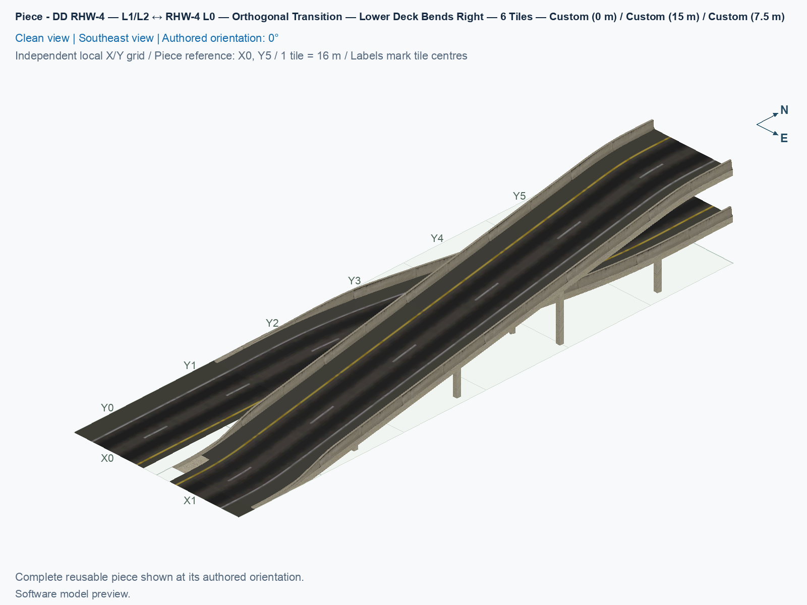
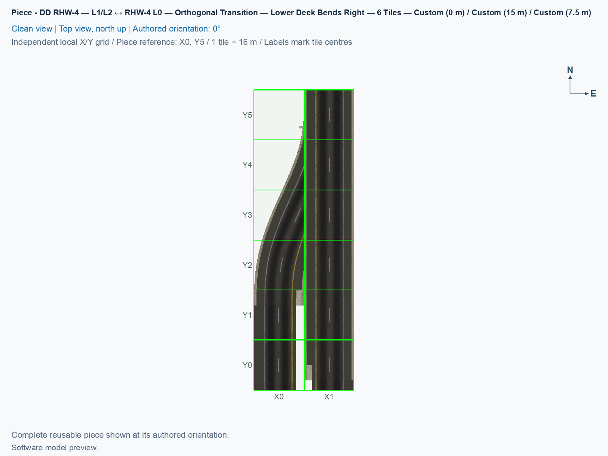
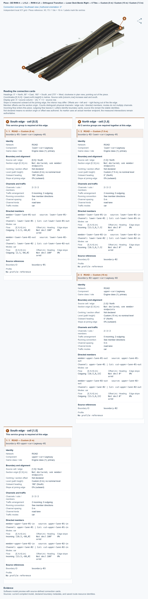

# DD RHW-4 — L1/L2 ↔ RHW-4 L0 — Orthogonal Transition — Lower Deck Bends Right — 6 Tiles

Purpose: Connect a straight double-decker RealHighway to two ground carriageways by bending the lower road one tile right.

<!-- PIECE README LAYOUT: 2 -->

[1. Views](#1-views) · [2. Piece and placement](#2-piece-and-placement) · [3. Connection matrix](#3-connection-matrix) · [Testing ↗ (separate document)](TESTING.md)

## 1. Views

The angled view shows both descents. In the north-up view, follow the two stacked roads south from the east column. The lower road bends west into the neighbouring column, which is on the right when looking south.

<!-- BEGIN PIECE VIEWS -->

<!-- END PIECE VIEWS -->

## 2. Piece and placement

**DD RHW-4** is a double-decker RealHighway with two lanes on each opposing deck. The upper deck begins 15 m above the ground, the lower deck begins 7.5 m above the ground, and both meet separate two-lane roads at **L0**, the ground level. **Orthogonal** means that the approach follows the square city grid.

In the source orientation, north is at the top, and the DD end is at the north end of the east column. Looking south from that end, the upper road follows the same centreline down to ground. The lower road shifts 16 m west, or one city tile to the right when looking south. Cars travel **southbound downhill on the lower road** and **northbound uphill on the upper road**. The [saved marking checks](TESTING.md#5-results-and-known-issues) place yellow on the driver’s left in all sampled lanes. Each lane continues to its own matching lane at the other end.

### 2.1 Reserve the footprint and its native connections

Keep a flat rectangle two tiles wide and six tiles long. Each tile is 16 m square. Columns count east from zero, and rows count south from zero. A **socket** is the first ordinary NAM highway tile beyond the fixed adapter. The source coordinates below apply when the stacked end points north. The preview’s X labels match the columns. Its Y labels count north from the south end, so source row 0 is displayed at Y5, and source row 5 at Y0. Keep all three sockets and at least three more straight tiles beyond each one clear.

| Connection | Last custom tile (column, row) | Native socket (column, row) | Travel |
| --- | --- | --- | --- |
| DD, north | (1, 0) | (1, −1) | Upper northbound out at 15 m, and lower southbound in at 7.5 m |
| Lower road at ground, west | (0, 5) | (0, 6) | Southbound out |
| Upper road at ground, east | (1, 5) | (1, 6) | Northbound in |

### 2.2 Place and connect the adapter

1. Follow the [build and installation guide](../../../../docs/BUILD_AND_INSTALL.md#7-install-remove-or-roll-back-a-test-build) to install a checked experimental selection. Restart SimCity 4 and open a disposable flat city for a fresh placement.
2. Open **Transportation → Highways → SCP → Pieces** and select **SCP | [HW] DD RHW-4 — L1/L2 ↔ RHW-4 L0 — Orthogonal Transition — Lower Deck Bends Right — 6 Tiles**.
3. Move the preview over the flat rectangle. Press **Home** or **End** until its single stacked end points north and the lower ground end is in the west column. Click once to place both roads.
4. Press **Esc**, and select **Transportation → Highways → RealHighway (RHW-2)**. Start at the ordinary DD socket and drag north to extend the stacked road.
5. Start at each ordinary ground socket and drag south to extend the two ground roads. Match the finished road directions to the table. Dragging extends the ordinary roads while the adapter keeps its fixed traffic directions.
6. Follow [the game checks](TESTING.md#4-game-checks) for joining prebuilt approaches, checking traffic, and recording an observation.

The reusable identifier is `ddrhw-l1-l2-rhw-l0-orthogonal-lower-right-6tile`. Reuse the complete twelve-cell adapter and match all three native connections. The two roads share starting tiles and support space, and their standard NAM connections are at the three ends.

<!-- BEGIN PIECE OVERVIEW -->

Viewed from the stacked end looking downhill, the lower road curves one tile right as it reaches ground, and the upper road descends on the original centreline. The lower road carries two lanes downhill, and the upper road carries two lanes uphill. Both join native RHW-4.

Exact reusable identifier: `ddrhw-l1-l2-rhw-l0-orthogonal-lower-right-6tile`.

Footprint: **2 × 6 tiles**. Exact menu name: **DD RHW-4 — L1/L2 ↔ RHW-4 L0 — Orthogonal Transition — Lower Deck Bends Right — 6 Tiles**.

<!-- END PIECE OVERVIEW -->

## 3. Connection matrix

The generated matrix describes four same-lane journeys within this piece. **Saved PATH** checks the stored traffic routes, **Route Query** checks the routes displayed by the game, and **Visible travel** checks actual moving vehicles. The [testing guide](TESTING.md) records these results separately.

<!-- BEGIN PIECE CONNECTION MATRIX -->

### Directed entrance/exit matrix

Read **from an entrance row to an exit column**. **Saved PATH** checks the saved traffic route; **Route Query** checks the route shown by the game; **Visible travel** checks a vehicle completing that journey. For HSR, visible travel means a moving train.

**Game appearance:** [?](TESTING.md#case-in_game_render-e1b983b35394cf18a4fe) — the complete piece’s appearance in the game, checked separately from its journeys.

**Legend:** ✅ confirmed; ❌ failed; ? not established. **Forbidden** means the movement is unavailable; its in-game check confirms that it stays unavailable. Click a result for its exact test case. Scope, evidence, and limitations remain in [the test checklist](TESTING.md#test-checklist).

| Entrance ↓ / Exit → | **Road · South exit** `lower-lane-01-out` Variant: rhw-4-l0 | **Road · South exit** `lower-lane-02-out` Variant: rhw-4-l0 | **Road · North exit** `upper-lane-02-out` Variant: dd-rhw-l2 | **Road · North exit** `upper-lane-01-out` Variant: dd-rhw-l2 |
| --- | --- | --- | --- | --- |
| **Road · South entrance** `upper-lane-02-in` Variant: rhw-4-l0 | **Forbidden** **Saved PATH:** [?](TESTING.md#case-software_connectivity-3d9a4da4d5d226d7de21) In-game check: [?](TESTING.md#case-in_game_forbidden_transfer-a6b5783796057e50879a) | **Forbidden** **Saved PATH:** [?](TESTING.md#case-software_connectivity-3d9a4da4d5d226d7de21) In-game check: [?](TESTING.md#case-in_game_forbidden_transfer-b9d33e0eb8f243e9c533) | **Saved PATH:** [?](TESTING.md#case-software_connectivity-3d9a4da4d5d226d7de21) **Route Query:** [?](TESTING.md#case-in_game_route_query-d975ff161877122f0e6b) **Visible travel:** [?](TESTING.md#case-in_game_visible_travel-d975ff161877122f0e6b) | **Forbidden** **Saved PATH:** [?](TESTING.md#case-software_connectivity-3d9a4da4d5d226d7de21) In-game check: [?](TESTING.md#case-in_game_forbidden_transfer-17df8ef27508d53cb3e3) |
| **Road · North entrance** `lower-lane-01-in` Variant: dd-rhw-l1 | **Saved PATH:** [?](TESTING.md#case-software_connectivity-3d9a4da4d5d226d7de21) **Route Query:** [?](TESTING.md#case-in_game_route_query-888411b03dfe135c6417) **Visible travel:** [?](TESTING.md#case-in_game_visible_travel-888411b03dfe135c6417) | **Forbidden** **Saved PATH:** [?](TESTING.md#case-software_connectivity-3d9a4da4d5d226d7de21) In-game check: [?](TESTING.md#case-in_game_forbidden_transfer-a41fe03dc3b8783406c3) | **Forbidden** **Saved PATH:** [?](TESTING.md#case-software_connectivity-3d9a4da4d5d226d7de21) In-game check: [?](TESTING.md#case-in_game_forbidden_transfer-ed037450d16112254df8) | **Forbidden** **Saved PATH:** [?](TESTING.md#case-software_connectivity-3d9a4da4d5d226d7de21) In-game check: [?](TESTING.md#case-in_game_forbidden_transfer-99ced5bf6cc4f32bd2be) |
| **Road · South entrance** `upper-lane-01-in` Variant: rhw-4-l0 | **Forbidden** **Saved PATH:** [?](TESTING.md#case-software_connectivity-3d9a4da4d5d226d7de21) In-game check: [?](TESTING.md#case-in_game_forbidden_transfer-d708a283f04a50f2bb37) | **Forbidden** **Saved PATH:** [?](TESTING.md#case-software_connectivity-3d9a4da4d5d226d7de21) In-game check: [?](TESTING.md#case-in_game_forbidden_transfer-de73e5c4631cf19c4a0c) | **Forbidden** **Saved PATH:** [?](TESTING.md#case-software_connectivity-3d9a4da4d5d226d7de21) In-game check: [?](TESTING.md#case-in_game_forbidden_transfer-6e3c6bc46e8e5830ea56) | **Saved PATH:** [?](TESTING.md#case-software_connectivity-3d9a4da4d5d226d7de21) **Route Query:** [?](TESTING.md#case-in_game_route_query-8981e36a8ece06e4af42) **Visible travel:** [?](TESTING.md#case-in_game_visible_travel-8981e36a8ece06e4af42) |
| **Road · North entrance** `lower-lane-02-in` Variant: dd-rhw-l1 | **Forbidden** **Saved PATH:** [?](TESTING.md#case-software_connectivity-3d9a4da4d5d226d7de21) In-game check: [?](TESTING.md#case-in_game_forbidden_transfer-b65a851162eff0ffb8a5) | **Saved PATH:** [?](TESTING.md#case-software_connectivity-3d9a4da4d5d226d7de21) **Route Query:** [?](TESTING.md#case-in_game_route_query-57b41bf7628a8bfe3087) **Visible travel:** [?](TESTING.md#case-in_game_visible_travel-57b41bf7628a8bfe3087) | **Forbidden** **Saved PATH:** [?](TESTING.md#case-software_connectivity-3d9a4da4d5d226d7de21) In-game check: [?](TESTING.md#case-in_game_forbidden_transfer-54dc8461f694f231dd90) | **Forbidden** **Saved PATH:** [?](TESTING.md#case-software_connectivity-3d9a4da4d5d226d7de21) In-game check: [?](TESTING.md#case-in_game_forbidden_transfer-a8242d42603b9b7aedec) |

Source: [connections.json](connections.json).

<!-- END PIECE CONNECTION MATRIX -->

<!-- BEGIN CONNECTOR OVERVIEW -->

### Connection overview

Generated from this piece's source-bound connector metadata and the current compiled model; marker letters refer to the boundary cards below.

[Rendering sources and verification scope](evidence/connection-overview.json).

Headings: 0° = North, 90° = East, 180° = South, and 270° = West; clockwise in plan view, pointing out of the piece.

Coordinates [E,N,H] = [east,north,height] in metres. Source cells [column,row] increase east and south.

Display grid: X = source column − (0); Y = 5 − source row.

Slope is measured outward at the joining edge; the interior may differ. Offsets are + left and − right facing out of the tile edge.

Member offsets use the section origin. Counts distinguish physical channels / edge cuts / directed members; modes do not multiply channels.

Incoming flow enters this piece; outgoing flow leaves it. Letters identify boundary cards; source IDs remain the stable identities.

Not declared means no section origin or offset was authored. Its marker uses an actual member endpoint; the measured intersections remain authoritative.

#### Boundary A: `boundary-01`

This service group is required at this edge.

##### Service group 1 / 1: ROAD — Custom (0 m)

| Field | Value |
| --- | --- |
| End / component | `boundary-01-lower-carriageway-01` / `lower-carriageway` |
| Network / game class / role | road / Engine class (1); primary |
| Source cell / edge | `[0,5]` / South |
| Section origin [E,N] (m) | Not declared; see member endpoints |
| Centring / section offset | Not declared |
| Level (path height) | Custom (0 m); no nominal level |
| Outward heading | 180° (South) |
| Slope at joining edge | 0% outward |
| Channels / edge cuts / directed members | 2 / 2 / 2 |
| Traffic arrangement / running | 0 incoming; 2 outgoing; See member directions |
| Channel spacing | 5 m |
| Channel kinds | road-lane |
| Traffic modes | car |
| Profile | No profile reference |

| Member / measured source | Channel / cut / modes | Flow | Endpoint [E,N,H] (m) | Offset (m) | Outward heading | Edge slope (%) |
| --- | --- | --- | --- | ---: | ---: | ---: |
| `member-lower-lane-01-out` / `lower-lane-01-out` | `lower-lane-01` / `cut-lower-lane-01-out` / car | Outgoing | `[-2.5,-88,0]` | Not declared | 180° | 0 |
| `member-lower-lane-02-out` / `lower-lane-02-out` | `lower-lane-02` / `cut-lower-lane-02-out` / car | Outgoing | `[2.5,-88,0]` | Not declared | 180° | 0 |

#### Boundary B: `boundary-02`

All 2 service groups are required together at this edge.

##### Service group 1 / 2: ROAD — Custom (7.5 m)

| Field | Value |
| --- | --- |
| End / component | `boundary-02-lower-carriageway-01` / `lower-carriageway` |
| Network / game class / role | road / Engine class (1); primary |
| Source cell / edge | `[1,0]` / North |
| Section origin [E,N] (m) | Not declared; see member endpoints |
| Centring / section offset | Not declared |
| Level (path height) | Custom (7.5 m); no nominal level |
| Outward heading | 0° (North) |
| Slope at joining edge | 0% outward |
| Channels / edge cuts / directed members | 2 / 2 / 2 |
| Traffic arrangement / running | 2 incoming; 0 outgoing; See member directions |
| Channel spacing | 5 m |
| Channel kinds | road-lane |
| Traffic modes | car |
| Profile | No profile reference |

| Member / measured source | Channel / cut / modes | Flow | Endpoint [E,N,H] (m) | Offset (m) | Outward heading | Edge slope (%) |
| --- | --- | --- | --- | ---: | ---: | ---: |
| `member-lower-lane-01-in` / `lower-lane-01-in` | `lower-lane-01` / `cut-lower-lane-01-in` / car | Incoming | `[13.5,8,7.5]` | Not declared | 0° | 0 |
| `member-lower-lane-02-in` / `lower-lane-02-in` | `lower-lane-02` / `cut-lower-lane-02-in` / car | Incoming | `[18.5,8,7.5]` | Not declared | 0° | 0 |

##### Service group 2 / 2: ROAD — Custom (15 m)

| Field | Value |
| --- | --- |
| End / component | `boundary-02-upper-carriageway-02` / `upper-carriageway` |
| Network / game class / role | road / Engine class (1); primary |
| Source cell / edge | `[1,0]` / North |
| Section origin [E,N] (m) | Not declared; see member endpoints |
| Centring / section offset | Not declared |
| Level (path height) | Custom (15 m); no nominal level |
| Outward heading | 0° (North) |
| Slope at joining edge | 0% outward |
| Channels / edge cuts / directed members | 2 / 2 / 2 |
| Traffic arrangement / running | 0 incoming; 2 outgoing; See member directions |
| Channel spacing | 5 m |
| Channel kinds | road-lane |
| Traffic modes | car |
| Profile | No profile reference |

| Member / measured source | Channel / cut / modes | Flow | Endpoint [E,N,H] (m) | Offset (m) | Outward heading | Edge slope (%) |
| --- | --- | --- | --- | ---: | ---: | ---: |
| `member-upper-lane-01-out` / `upper-lane-01-out` | `upper-lane-01` / `cut-upper-lane-01-out` / car | Outgoing | `[18.5,8,15]` | Not declared | 0° | 0 |
| `member-upper-lane-02-out` / `upper-lane-02-out` | `upper-lane-02` / `cut-upper-lane-02-out` / car | Outgoing | `[13.5,8,15]` | Not declared | 0° | 0 |

#### Boundary C: `boundary-03`

This service group is required at this edge.

##### Service group 1 / 1: ROAD — Custom (0 m)

| Field | Value |
| --- | --- |
| End / component | `boundary-03-upper-carriageway-01` / `upper-carriageway` |
| Network / game class / role | road / Engine class (1); primary |
| Source cell / edge | `[1,5]` / South |
| Section origin [E,N] (m) | Not declared; see member endpoints |
| Centring / section offset | Not declared |
| Level (path height) | Custom (0 m); no nominal level |
| Outward heading | 180° (South) |
| Slope at joining edge | 0% outward |
| Channels / edge cuts / directed members | 2 / 2 / 2 |
| Traffic arrangement / running | 2 incoming; 0 outgoing; See member directions |
| Channel spacing | 5 m |
| Channel kinds | road-lane |
| Traffic modes | car |
| Profile | No profile reference |

| Member / measured source | Channel / cut / modes | Flow | Endpoint [E,N,H] (m) | Offset (m) | Outward heading | Edge slope (%) |
| --- | --- | --- | --- | ---: | ---: | ---: |
| `member-upper-lane-01-in` / `upper-lane-01-in` | `upper-lane-01` / `cut-upper-lane-01-in` / car | Incoming | `[18.5,-88,0]` | Not declared | 180° | 0 |
| `member-upper-lane-02-in` / `upper-lane-02-in` | `upper-lane-02` / `cut-upper-lane-02-in` / car | Incoming | `[13.5,-88,0]` | Not declared | 180° | 0 |

The overview uses source metadata, current compiled resource identities, and the saved model. Current placement, connection, and traffic results belong to the generated connection matrix and linked testing records.

<!-- END CONNECTOR OVERVIEW -->
