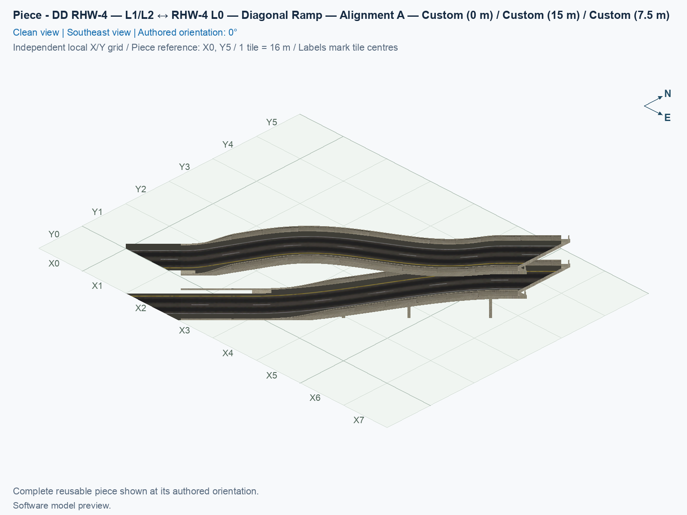
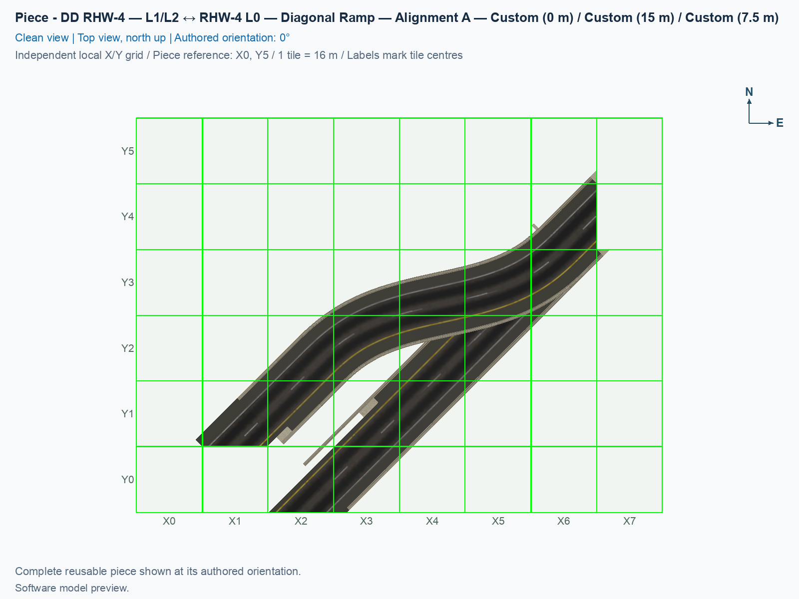
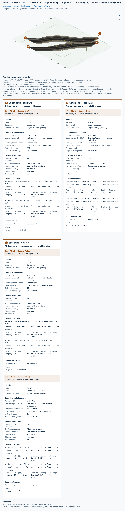

# DD RHW-4 — L1/L2 ↔ RHW-4 L0 — Diagonal Ramp — Alignment A

Purpose: connect the two stacked DD RHW-4 travel decks to two separate diagonal ground carriageways while retaining this choice’s upper-road side, native traffic phase, two lanes per deck, and driver-left yellow markings.

<!-- PIECE README LAYOUT: 2 -->

[1. Views](#1-views) · [2. Piece and placement](#2-piece-and-placement) · [3. Connection matrix](#3-connection-matrix) · [Testing ↗ (separate document)](TESTING.md)

## 1. Views

The views below show this registered experimental Alignment A adapter from the independently checked ordinary DAT build. A **DAT** is the game’s resource archive. Its saved routes, physical models, and native interfaces passed software checks; actual game appearance and moving traffic remain unverified. The [testing guide](TESTING.md#5-results-and-known-issues) links the exact compiled and sampled marking evidence.

<!-- BEGIN PIECE VIEWS -->

<!-- END PIECE VIEWS -->

## 2. Piece and placement

**RHW** means RealHighway, and **DD** means double-decker. This adapter carries two lanes on the 15 m upper deck and two opposing lanes on the 7.5 m lower deck. **L0** means the ground level. Each deck connects to its own two-lane ground carriageway. **Diagonal** means that the native approach follows a 45° line across the square city grid; turning an orthogonal type by the game’s normal 90° steps does not create this type.

In the source 0° orientation, the DD end is northeast, and the ground ends are southwest. The upper road moves to the **northwest side of the straight lower road** as the source height falls. Upper traffic enters the DD end southwest at 15 m, descends, and leaves through the northwest ground carriageway southwest. Lower traffic starts on its main-axis ground carriageway northeast, climbs to 7.5 m, and leaves the DD end northeast. Each lane remains a separate journey. This choice has no lane change, U-turn, transfer between the opposing carriageways, pedestrian route, or Avenue service. Yellow must remain on the driver’s left for the actual travel direction.

The side and the traffic phase are independent choices. `original` and `opposite-side` retain upper southwest/lower northeast travel; `mirrored` and `opposite-side-mirrored` retain upper northeast/lower southwest travel. The `opposite-side` choices change which side receives the upper ground road while preserving the corresponding base traffic phase. “Upper Descent” names the shape when followed from the DD end towards ground; in a mirrored-phase choice, actual upper traffic climbs that shape.

### 2.1 Reserve the core and native approaches

A city tile is 16 × 16 m. This type owns **24 custom cells inside an 8 × 6-tile bounding rectangle: 15 routed cells and nine model-only cells**. A model-only cell carries visible geometry but an intentionally empty traffic PATH, the game’s stored route resource. The rectangle is not a completely filled stamp. Actual saved models, PATHs, and native-interface checks agree with this sparse ownership; the socket and peer cells remain ordinary unowned native approaches.

The tables use **source city-cell addresses (column,row)**. Columns increase east, rows increase south, and cell centres are east = 16 × column m and north = −16 × row m. Negative addresses are offsets in this local design, not a request for negative city coordinates. The registered definition origin is source cell **(-6,-1)**. Each registered local cell is its source address minus that origin. Do not reflect a cell list to obtain another choice: every side and traffic phase is cut and checked again on the city grid.

A **native socket** is an immediately adjacent ordinary NAM cell that connects the fixed custom adapter to a draggable highway. It remains unowned by the custom piece. A **peer** is the other native diagonal half needed to retain the complete road width and original model profile. Keep all three sockets, their peers, and their continuing staircases clear.

| Boundary | Joining source core cell | Unowned source socket | Native donor / clockwise pose | Required directed service |
| --- | --- | --- | --- | --- |
| Northeast DD | (0,0) | (1,0) | `57530900` / 2 | upper southwest in at 15 m and lower northeast out at 7.5 m |
| Northwest upper-linked ground | (-5,3) | (-5,4) | `57030900` / 2 | Two lanes southwest out of the adapter, at 0 m |
| Main-axis lower-linked ground | (−4,4) | (-4,5) | `57030200` / 2 | Two lanes northeast into the adapter, at 0 m |

| Approach | Socket | Next outward native peer | Further continuation |
| --- | --- | --- | --- |
| DD | (1,0) | (1,−1), `57530200` / 0 | Then (2,−1); continue northeast |
| Upper-linked ground | (-5,4) | (-6,4), `57030200` / 0 | Then one row south of that peer; continue southwest |
| Lower-linked ground | (-4,5) | (-5,5), `57030900` / 0 | Then (−5,6); continue southwest |

The paired native halves can project shoulders beyond their own city cells. Keep their complete measured profiles; similar-looking 302 and 309 halves do not carry interchangeable traffic directions. A donor pose is an internal clockwise quarter-turn count: pose 2 is 180°. It is separate from the complete piece’s Home/End rotation and the camera direction. Leave at least three additional native cells beyond each socket along its diagonal staircase. The checked ground collars retain actual finite source outlines and a named inner bridge. A literal native fragment is cut into an owned free cell where one exists; only a source-certified fragment projecting into a reserved native cell retains its original owned source host. The software checks prove that finite hosting scope; it is not a general authored-overhang allowance.

Use a flat, clear base across the exact custom mask. The saved construction uses `#` constraints to tie its 39 distinct terrain-corner vertices to a common height, rather than selecting an absolute world altitude. All four proper rotations pass the construction checks. Actual game terrain behavior, including close placement, still needs the tests below. Preserve the 24-cell sparse mask; its bounding rectangle includes cells that this adapter does not own.

### 2.2 Select the checked type and draw outward

Use the following steps with a deliberately installed build containing this exact checked identity. Building and installing are separate operations; follow the [build and installation guide](../../../../docs/BUILD_AND_INSTALL.md), and preserve every other installed type. Software menu and native-rule checks do not establish automatic placement or traffic in the game.

1. Close SimCity 4 before replacing Plugins, then restart it. Open a disposable city with a flat, clear test area and use a fresh placement to check the revised cursor position. Leave the exact custom mask, all three sockets, their paired halves, and the continuation corridors free.
2. Open **Transportation → Highways → SCP → Pieces**. With the original diagonal anchor included, select **SCP | [HW] DD RHW-4 — L1/L2 ↔ RHW-4 L0 — Diagonal Ramp — Alignment A**, then use **Tab** or **Shift+Tab** until the query names **DD RHW-4 — L1/L2 ↔ RHW-4 L0 — Diagonal Ramp — Alignment A**. The checked family has one button and four alternatives. If the anchor is absent from an intentionally selected build, this type keeps its standalone button **SCP | [HW] DD RHW-4 — L1/L2 ↔ RHW-4 L0 — Diagonal Ramp — Alignment A**. Tab changes the type; it does not place the other three alternatives automatically.
3. Point at the city tile where the **last custom DD tile** should sit. In the source coordinates above it is **(0,0)**, or **(6,1)** in registered local coordinates measured east and south. The ordinary DD socket is one tile east in the source orientation. Keep the mouse still and press **Home** or **End**. The DD end tile should stay under the cursor while the ramp and both ground ends rotate around it. For the orientation shown here, stop when the DD end points northeast and the upper-linked ground end is on the **northwest side** of the lower end. In that orientation the DD directions are **upper southwest in at 15 m and lower northeast out at 7.5 m**.
4. Click once to place the complete coordinated adapter. Confirm that the ordinary DD socket and both ordinary ground sockets appear, without terrain excavation or a temporary custom construction tile left behind. Their automatic appearance is an unverified game result, rather than a promise supplied by the source plan.
5. Press **Esc**, open **Transportation → Highways → RealHighway (RHW-2)**, start at the ordinary DD socket, and drag northeast along the native diagonal for at least three additional native cells. Release outside the fixed core.
6. With the same tool, start at the upper-linked ground socket and drag southwest for at least three additional native cells. Release, then repeat from the lower-linked ground socket. Drawing direction and the road’s traffic direction are different: use the table’s actual directions.
7. Connect useful traffic sources and destinations through working native control roads, run the simulation, and test each of the four lane journeys separately. Follow the [game checks](TESTING.md#4-game-checks); neither a preview nor a coloured Route Query line proves visible traffic.

### 2.3 Join prebuilt native controls

1. Open **Transportation → Highways → RealHighway (RHW) Starter Pieces**. Select **Double-Decker RHW-4 Starter Piece (Upper Deck: Level 2, Lower Deck: Level 1)**, orient it with **upper southwest in at 15 m and lower northeast out at 7.5 m**, and create a working diagonal continuation using **RealHighway (RHW-2)**. The separately named rail-based DDRHW starter is a different network.
2. Select **RHW-4 Starter Piece** from the native starter cycle, and create two working diagonal ground controls. The upper-linked control carries traffic **southwest out of the adapter**, and the lower-linked control carries traffic **northeast into the adapter**. Their source axes are parallel and 22.627417 m apart; the exact diagonal halves and socket addresses above matter.
3. Reserve the exact custom mask between those controls. Leave a short ordinary diagonal gap outside each socket, and record the number of native half cells in each gap. Place a fresh adapter on the flat base without occupying any native socket or peer.
4. Select **RealHighway (RHW-2)**, start on a working control, and draw across its gap to the matching ordinary socket. Stop at the socket; do not draw through the fixed custom core. Repeat for all three controls.
5. Test this inward-drawing order separately from drawing outward in section 2.2. Also test a fresh placement beside completed matching approaches as a third order. Record the exact type, rotation, native half phase, gap, and terrain behavior.

### 2.4 Reuse and limits

The registered reusable identifier is **`ddrhw-l1-l2-rhw-l0-ramp-diagonal-alignment-a`**, with construction root **`F889`**. This is one bounded, coordinated two-deck transition. Its upper sideways curve, lower straight road, height changes, supports, and native joining collars share the same function. An arbitrary internal cut is not a proven interchangeable ramp socket. Reuse the complete checked adapter; the four retained orthogonal types remain separate and their complete DAT bytes are unchanged.

The first-cut plan has a nominal longitudinal run of 101.823376 m, two legal ground axes 22.627417 m apart, and native lane offsets of ±2.262742 m. Its peak sampled lane grades are approximately 18.95182% upper and 17.04542% lower, below the 20% ceiling. A **grade** is height change divided by horizontal distance: 20% loses 2 m over 10 m horizontally. The actual saved routes match the reviewed curves. The checked 2.5 m-wide × 3.8 m-high car corridor is an authoring assumption, rather than a limit measured for every replacement vehicle or a structural-capacity rating. Native flat DD collars retain the 302 nominal roofs and 309 roofs approximately 1 mm higher, with an authored underside at 14 m upper and 6.5 m lower. Flat slab depths are therefore 1 m to approximately 1.001 m. A separate 1 m-long inner bridge joins each finite native profile to the graded middle; its underside follows the driving roof 1 m below until clamped to ground height, where the solid tapers to a zero-depth ground sheet. Complete saved-face checks cover these finite interfaces, bodies, and fourteen support solids.

<!-- BEGIN PIECE OVERVIEW -->

A diagonal paired ramp converts the stacked L1/L2 DD RHW-4 into two ground RHW-4 carriageways. It preserves two lanes per direction, the selected upper-road side and traffic phase, driver-left yellow markings, and explicitly measured first-cut native sockets.

Exact reusable identifier: `ddrhw-l1-l2-rhw-l0-ramp-diagonal-alignment-a`.

Footprint: **8 × 6 tiles**. Exact menu name: **DD RHW-4 — L1/L2 ↔ RHW-4 L0 — Diagonal Ramp — Alignment A**.

<!-- END PIECE OVERVIEW -->

## 3. Connection matrix

The checked function has four same-lane journeys, two per opposing carriageway, and twelve forbidden entrance-to-exit transfers. The generated matrix describes the actual saved routes. **Saved PATH** checks the stored route, **Route Query** checks the game’s displayed route, and **Visible travel** checks a moving vehicle completing it. Those checks remain separate; this matrix does not certify compatibility with another fixed piece.

<!-- BEGIN PIECE CONNECTION MATRIX -->

### Directed entrance/exit matrix

Read **from an entrance row to an exit column**. **Saved PATH** checks the saved traffic route; **Route Query** checks the route shown by the game; **Visible travel** checks a vehicle completing that journey. For HSR, visible travel means a moving train.

**Game appearance:** [?](TESTING.md#case-in_game_render-eb58ba7be84f155deab1) — the complete piece’s appearance in the game, checked separately from its journeys.

**Legend:** ✅ confirmed; ❌ failed; ? not established. **Forbidden** means the movement is unavailable; its in-game check confirms that it stays unavailable. Click a result for its exact test case. Scope, evidence, and limitations remain in [the test checklist](TESTING.md#test-checklist).

| Entrance ↓ / Exit → | **Road · South exit** `upper-lane-01-out` Variant: rhw-4-l0 | **Road · South exit** `upper-lane-02-out` Variant: rhw-4-l0 | **Road · East exit** `lower-lane-01-out` Variant: dd-rhw-l1 | **Road · East exit** `lower-lane-02-out` Variant: dd-rhw-l1 |
| --- | --- | --- | --- | --- |
| **Road · South entrance** `lower-lane-02-in` Variant: rhw-4-l0 | **Forbidden** **Saved PATH:** [?](TESTING.md#case-software_connectivity-ea8a7568f06d9c81741a) In-game check: [?](TESTING.md#case-in_game_forbidden_transfer-7d88586bd5b042877030) | **Forbidden** **Saved PATH:** [?](TESTING.md#case-software_connectivity-ea8a7568f06d9c81741a) In-game check: [?](TESTING.md#case-in_game_forbidden_transfer-0e211754ba7ec3753091) | **Forbidden** **Saved PATH:** [?](TESTING.md#case-software_connectivity-ea8a7568f06d9c81741a) In-game check: [?](TESTING.md#case-in_game_forbidden_transfer-863d84a8b86370c38f6e) | **Saved PATH:** [?](TESTING.md#case-software_connectivity-ea8a7568f06d9c81741a) **Route Query:** [?](TESTING.md#case-in_game_route_query-b9e13730c82f3127ae0d) **Visible travel:** [?](TESTING.md#case-in_game_visible_travel-b9e13730c82f3127ae0d) |
| **Road · South entrance** `lower-lane-01-in` Variant: rhw-4-l0 | **Forbidden** **Saved PATH:** [?](TESTING.md#case-software_connectivity-ea8a7568f06d9c81741a) In-game check: [?](TESTING.md#case-in_game_forbidden_transfer-7ae53f8b3a461f8a10e6) | **Forbidden** **Saved PATH:** [?](TESTING.md#case-software_connectivity-ea8a7568f06d9c81741a) In-game check: [?](TESTING.md#case-in_game_forbidden_transfer-bf85877b3662955423c8) | **Saved PATH:** [?](TESTING.md#case-software_connectivity-ea8a7568f06d9c81741a) **Route Query:** [?](TESTING.md#case-in_game_route_query-da3b4a1d0418a4e9417d) **Visible travel:** [?](TESTING.md#case-in_game_visible_travel-da3b4a1d0418a4e9417d) | **Forbidden** **Saved PATH:** [?](TESTING.md#case-software_connectivity-ea8a7568f06d9c81741a) In-game check: [?](TESTING.md#case-in_game_forbidden_transfer-1afbd35dee36961ae03d) |
| **Road · East entrance** `upper-lane-02-in` Variant: dd-rhw-l2 | **Forbidden** **Saved PATH:** [?](TESTING.md#case-software_connectivity-ea8a7568f06d9c81741a) In-game check: [?](TESTING.md#case-in_game_forbidden_transfer-7200a4bd8b38a577c078) | **Saved PATH:** [?](TESTING.md#case-software_connectivity-ea8a7568f06d9c81741a) **Route Query:** [?](TESTING.md#case-in_game_route_query-5a8e00bd218591a83d6f) **Visible travel:** [?](TESTING.md#case-in_game_visible_travel-5a8e00bd218591a83d6f) | **Forbidden** **Saved PATH:** [?](TESTING.md#case-software_connectivity-ea8a7568f06d9c81741a) In-game check: [?](TESTING.md#case-in_game_forbidden_transfer-09de1a5640d7f1d39a27) | **Forbidden** **Saved PATH:** [?](TESTING.md#case-software_connectivity-ea8a7568f06d9c81741a) In-game check: [?](TESTING.md#case-in_game_forbidden_transfer-13f24e94ce15f308cf5a) |
| **Road · East entrance** `upper-lane-01-in` Variant: dd-rhw-l2 | **Saved PATH:** [?](TESTING.md#case-software_connectivity-ea8a7568f06d9c81741a) **Route Query:** [?](TESTING.md#case-in_game_route_query-655cdc147848524fec3e) **Visible travel:** [?](TESTING.md#case-in_game_visible_travel-655cdc147848524fec3e) | **Forbidden** **Saved PATH:** [?](TESTING.md#case-software_connectivity-ea8a7568f06d9c81741a) In-game check: [?](TESTING.md#case-in_game_forbidden_transfer-7f9b31634fac9400e1f0) | **Forbidden** **Saved PATH:** [?](TESTING.md#case-software_connectivity-ea8a7568f06d9c81741a) In-game check: [?](TESTING.md#case-in_game_forbidden_transfer-b4328978845bf7066fdc) | **Forbidden** **Saved PATH:** [?](TESTING.md#case-software_connectivity-ea8a7568f06d9c81741a) In-game check: [?](TESTING.md#case-in_game_forbidden_transfer-9d3b25c643c494ee07c7) |

Source: [connections.json](connections.json).

<!-- END PIECE CONNECTION MATRIX -->

<!-- BEGIN CONNECTOR OVERVIEW -->

### Connection overview

Generated from this piece's source-bound connector metadata and the current compiled model; marker letters refer to the boundary cards below.

[Rendering sources and verification scope](evidence/connection-overview.json).

Headings: 0° = North, 90° = East, 180° = South, and 270° = West; clockwise in plan view, pointing out of the piece.

Coordinates [E,N,H] = [east,north,height] in metres. Source cells [column,row] increase east and south.

Display grid: X = source column − (0); Y = 5 − source row.

Slope is measured outward at the joining edge; the interior may differ. Offsets are + left and − right facing out of the tile edge.

Member offsets use the section origin. Counts distinguish physical channels / edge cuts / directed members; modes do not multiply channels.

Incoming flow enters this piece; outgoing flow leaves it. Letters identify boundary cards; source IDs remain the stable identities.

Not declared means no section origin or offset was authored. Its marker uses an actual member endpoint; the measured intersections remain authoritative.

#### Boundary A: `boundary-01`

This service group is required at this edge.

##### Service group 1 / 1: ROAD — Custom (0 m)

| Field | Value |
| --- | --- |
| End / component | `boundary-01-upper-carriageway-01` / `upper-carriageway` |
| Network / game class / role | road / Engine class (1); primary |
| Source cell / edge | `[1,4]` / South |
| Section origin [E,N] (m) | Not declared; see member endpoints |
| Centring / section offset | Not declared |
| Level (path height) | Custom (0 m); no nominal level |
| Outward heading | 225° |
| Slope at joining edge | 0% outward |
| Channels / edge cuts / directed members | 2 / 2 / 2 |
| Traffic arrangement / running | 0 incoming; 2 outgoing; See member directions |
| Channel spacing | 4.52548 m |
| Channel kinds | road-lane |
| Traffic modes | car |
| Profile | No profile reference |

| Member / measured source | Channel / cut / modes | Flow | Endpoint [E,N,H] (m) | Offset (m) | Outward heading | Edge slope (%) |
| --- | --- | --- | --- | ---: | ---: | ---: |
| `member-upper-lane-01-out` / `upper-lane-01-out` | `upper-lane-01` / `cut-upper-lane-01-out` / car | Outgoing | `[12.8,-72,0]` | Not declared | 225° | 0 |
| `member-upper-lane-02-out` / `upper-lane-02-out` | `upper-lane-02` / `cut-upper-lane-02-out` / car | Outgoing | `[19.2,-72,0]` | Not declared | 225° | 0 |

#### Boundary B: `boundary-02`

This service group is required at this edge.

##### Service group 1 / 1: ROAD — Custom (0 m)

| Field | Value |
| --- | --- |
| End / component | `boundary-02-lower-carriageway-01` / `lower-carriageway` |
| Network / game class / role | road / Engine class (1); primary |
| Source cell / edge | `[2,5]` / South |
| Section origin [E,N] (m) | Not declared; see member endpoints |
| Centring / section offset | Not declared |
| Level (path height) | Custom (0 m); no nominal level |
| Outward heading | 225° |
| Slope at joining edge | 0% outward |
| Channels / edge cuts / directed members | 2 / 2 / 2 |
| Traffic arrangement / running | 2 incoming; 0 outgoing; See member directions |
| Channel spacing | 4.52548 m |
| Channel kinds | road-lane |
| Traffic modes | car |
| Profile | No profile reference |

| Member / measured source | Channel / cut / modes | Flow | Endpoint [E,N,H] (m) | Offset (m) | Outward heading | Edge slope (%) |
| --- | --- | --- | --- | ---: | ---: | ---: |
| `member-lower-lane-01-in` / `lower-lane-01-in` | `lower-lane-01` / `cut-lower-lane-01-in` / car | Incoming | `[35.2,-88,0]` | Not declared | 225° | 0 |
| `member-lower-lane-02-in` / `lower-lane-02-in` | `lower-lane-02` / `cut-lower-lane-02-in` / car | Incoming | `[28.8,-88,0]` | Not declared | 225° | 0 |

#### Boundary C: `boundary-03`

All 2 service groups are required together at this edge.

##### Service group 1 / 2: ROAD — Custom (7.5 m)

| Field | Value |
| --- | --- |
| End / component | `boundary-03-lower-carriageway-01` / `lower-carriageway` |
| Network / game class / role | road / Engine class (1); primary |
| Source cell / edge | `[6,1]` / East |
| Section origin [E,N] (m) | Not declared; see member endpoints |
| Centring / section offset | Not declared |
| Level (path height) | Custom (7.5 m); no nominal level |
| Outward heading | 45° |
| Slope at joining edge | 0% outward |
| Channels / edge cuts / directed members | 2 / 2 / 2 |
| Traffic arrangement / running | 0 incoming; 2 outgoing; See member directions |
| Channel spacing | 4.52548 m |
| Channel kinds | road-lane |
| Traffic modes | car |
| Profile | No profile reference |

| Member / measured source | Channel / cut / modes | Flow | Endpoint [E,N,H] (m) | Offset (m) | Outward heading | Edge slope (%) |
| --- | --- | --- | --- | ---: | ---: | ---: |
| `member-lower-lane-01-out` / `lower-lane-01-out` | `lower-lane-01` / `cut-lower-lane-01-out` / car | Outgoing | `[104,-19.2,7.5]` | Not declared | 45° | 0 |
| `member-lower-lane-02-out` / `lower-lane-02-out` | `lower-lane-02` / `cut-lower-lane-02-out` / car | Outgoing | `[104,-12.8,7.5]` | Not declared | 45° | 0 |

##### Service group 2 / 2: ROAD — Custom (15 m)

| Field | Value |
| --- | --- |
| End / component | `boundary-03-upper-carriageway-02` / `upper-carriageway` |
| Network / game class / role | road / Engine class (1); primary |
| Source cell / edge | `[6,1]` / East |
| Section origin [E,N] (m) | Not declared; see member endpoints |
| Centring / section offset | Not declared |
| Level (path height) | Custom (15 m); no nominal level |
| Outward heading | 45° |
| Slope at joining edge | 0% outward |
| Channels / edge cuts / directed members | 2 / 2 / 2 |
| Traffic arrangement / running | 2 incoming; 0 outgoing; See member directions |
| Channel spacing | 4.52548 m |
| Channel kinds | road-lane |
| Traffic modes | car |
| Profile | No profile reference |

| Member / measured source | Channel / cut / modes | Flow | Endpoint [E,N,H] (m) | Offset (m) | Outward heading | Edge slope (%) |
| --- | --- | --- | --- | ---: | ---: | ---: |
| `member-upper-lane-01-in` / `upper-lane-01-in` | `upper-lane-01` / `cut-upper-lane-01-in` / car | Incoming | `[104,-12.8,15]` | Not declared | 45° | 0 |
| `member-upper-lane-02-in` / `upper-lane-02-in` | `upper-lane-02` / `cut-upper-lane-02-in` / car | Incoming | `[104,-19.2,15]` | Not declared | 45° | 0 |

The overview uses source metadata, current compiled resource identities, and the saved model. Current placement, connection, and traffic results belong to the generated connection matrix and linked testing records.

<!-- END CONNECTOR OVERVIEW -->
