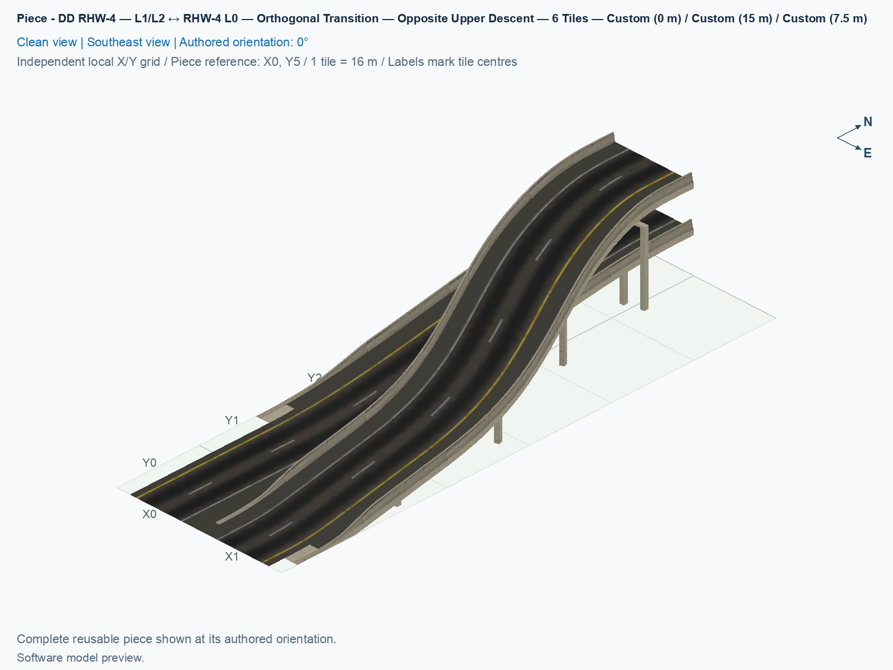
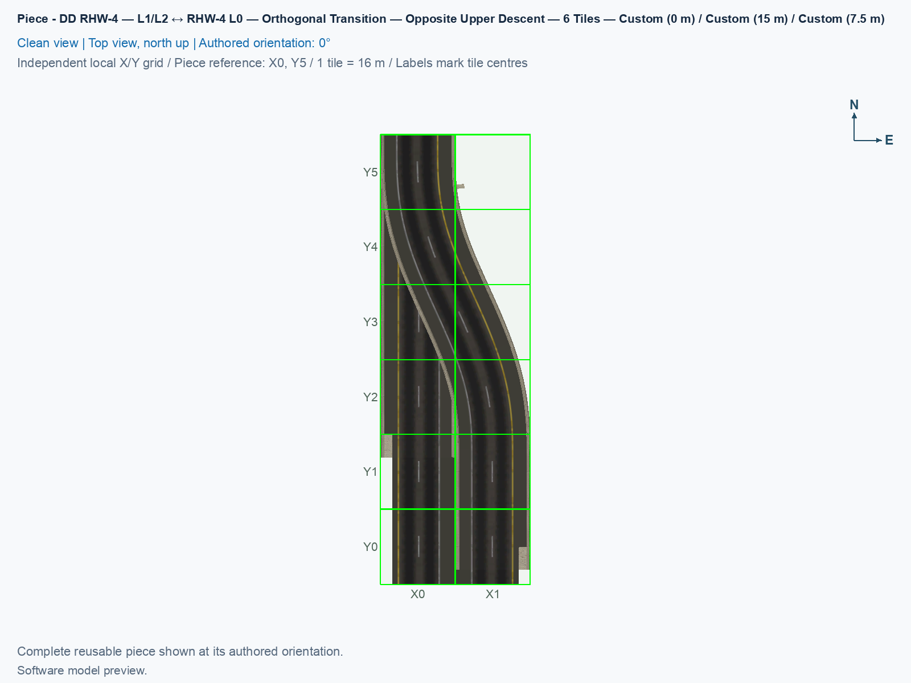
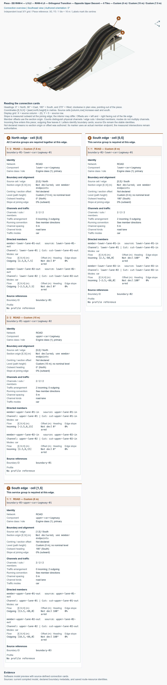

# DD RHW-4 — L1/L2 ↔ RHW-4 L0 — Orthogonal Transition — Opposite Upper Descent — 6 Tiles

Purpose: place the upper ramp on the opposite side of the straight lower carriageway while keeping the base transition's DD traffic directions, two lanes per direction, and driver-left yellow lines.

<!-- PIECE README LAYOUT: 2 -->

[1. Views](#1-views) · [2. Piece and placement](#2-piece-and-placement) · [3. Connection matrix](#3-connection-matrix) · [Testing ↗ (separate document)](TESTING.md)

## 1. Views

The canonical angled view, north-up top view, and thumbnail show this complete standalone type at 0°, using the independently checked actual DAT model. North is at the top of the top view. The [saved-resource acceptance](evidence/compiled-verification.jsonc) and [actual marking audit](evidence/native-markings-verification.jsonc) are separate from game appearance and moving traffic; human results belong in [TESTING](TESTING.md).

The picture uses an independent local grid with **X increasing east and Y increasing north** from the southwest tile centre. The source placement table below uses rows increasing south. At 0°, picture **X = source column** and **Y = 5 − source row**: source row 0 is picture Y5, and source row 5 is picture Y0.

<!-- BEGIN PIECE VIEWS -->

<!-- END PIECE VIEWS -->

## 2. Piece and placement

**DD RHW-4** is a double-decker RealHighway with two lanes on each of two opposing travel decks. Level 1, or L1, is 7.5 m above the flat base; Level 2, or L2, is 15 m. **RHW-4 L0** is the ground arrangement with two adjacent opposing two-lane carriageways. **Orthogonal** means aligned with the square city grid. This type retains the DD directions of **[DD RHW-4 — L1/L2 ↔ RHW-4 L0 — Orthogonal Combined Transition — 6 Tiles](../ddrhw-l1-l2-to-rhw-l0-transition-orthogonal-6tile/README.md)** while putting the upper road on the other physical side. The two retained types remain separate selectable choices.

In the authored 0° orientation, north is at the top, east is right, and the DD end is north of the core. The north DD connection is in the west column. The upper carriageway moves 16 m east, from x = 0 m at the DD end to x = 16 m at the ground end. Upper traffic enters from the north at 15 m, descends, and leaves through the east ground carriageway travelling south. The lower carriageway stays on x = 0 m; its traffic enters from the west ground carriageway travelling north and climbs to the 7.5 m lower DD deck. Every lane keeps its own directed journey. Yellow remains on the driver's left. No lane change, U-turn, transfer between opposing carriageways, pedestrian route, Avenue pavement, or custom cast shadow is supplied.

### 2.1 Reserve the core and three native sockets

A city tile measures 16 × 16 m. The fixed core owns all twelve cells in two columns and six rows: 32 m wide × 96 m long. Local source addresses are (column,row), with columns increasing east and rows increasing south. Cell centres are x = 16 × column and north = −16 × row. The complete registered definition is [piece.jsonc](piece.jsonc).

A **native socket** is an immediately adjacent ordinary NAM highway cell used to connect the fixed core to a draggable network. The component requests that ordinary tile but does not own it. Keep the 2 × 8 connection arrangement below clear, plus at least three straight native tiles beyond every socket.

| Source row | West column 0 | East column 1 |
| --- | --- | --- |
| −1, north of the core | DD socket: upper southbound into the adapter at 15 m and lower northbound out at 7.5 m | No socket |
| 0 | Fixed core; DD joining end | Fixed model-only core cell; empty traffic PATH |
| 1–4 | Fixed core cells | Fixed core cells |
| 5 | Fixed core; lower-deck ground joining end | Fixed core; upper-deck ground joining end |
| 6, south of the core | Ground RHW-4 socket, northbound | Ground RHW-4 socket, southbound |

The model-only cell **(1,0)** has visible geometry and an intentionally empty traffic PATH, which is the game's stored route resource. It still owns its city tile. The two padding rows in this table are connection space, not additional owned cells. Both ground sockets must remain clear of other fixed pieces.

The native cross-section retains an approximately 1 mm origin overhang. Its fading continuation can project a thin model sliver beyond the **east long edge** while the upper carriageway is on x = 16 m. The side follows the DD donor pose and traffic phase, not the direction of the bend. Keep the complete source profile when judging physical fit: the owned core remains **2 × 6**, and the clear native-check arrangement remains **2 × 8**. An overhanging model fragment does not acquire ownership of another city tile.

Use a **flat base across all twelve core cells**. The construction layout uses `#` to connect all 21 shared terrain-corner vertices into one common-height group. That constraint specifies a flat base rather than an absolute world altitude; the road models still slope between their deck heights and ground. Its actual terrain and close-placement behavior must be tested for this type.

### 2.2 Select this type and draw outward

1. Deliberately install a verified experimental selection through the [build and installation guide](../../../../docs/BUILD_AND_INSTALL.md). Close SimCity 4 before replacing Plugins, restart afterward, and use a fresh placement in an already flat, clear part of a disposable city. Building does not install anything. Preserve other installed types by using a complete managed selection or an explicitly checked additive installation.
2. If the original family anchor is included, open **Transportation → Highways → SCP → Pieces**, and select **SCP | [HW] DD RHW-4 — L1/L2 ↔ RHW-4 L0 — Orthogonal Combined Transition — 6 Tiles**. Press **Tab** or **Shift+Tab** until the query names **DD RHW-4 — L1/L2 ↔ RHW-4 L0 — Orthogonal Transition — Opposite Upper Descent — 6 Tiles**. If the anchor is absent from the installed selection, select **SCP | [HW] DD RHW-4 — L1/L2 ↔ RHW-4 L0 — Orthogonal Transition — Opposite Upper Descent — 6 Tiles** directly from **Transportation → Highways → SCP → Pieces**. Each click places one complete twelve-cell adapter.
3. Use **Home** or **End** to turn the selected type until its DD end points north and its DD socket is in the **west column**, as shown in the table. The south ground pair must be **west northbound and east southbound**. Tab selects a different type; Home and End rotate the current type. Four proper rotations repeat across eight cursor states.
4. Match the complete 2 × 6 highlighted core to the clear ground, keep all three sockets free, and click once. Confirm the ordinary north DD socket and both south ground sockets appear without a temporary construction tile left behind. Their automatic appearance is a separate game check.
5. Press **Esc**, open **Transportation → Highways → RealHighway (RHW-2)**, start on the north DD socket at **(0,−1)**, and drag straight north for at least three tiles. Release the mouse button outside the fixed core.
6. With the same tool, drag south from **(0,6)** for at least three tiles, release, and repeat from **(1,6)**. The west ground carriageway carries traffic north; the east ground carriageway carries traffic south. Dragging direction and traffic direction are separate.
7. Connect useful traffic sources and destinations through working native control roads. Test all four lane journeys described in [TESTING](TESTING.md#4-game-checks), including both lanes and their actual heights.

### 2.3 Join prebuilt native controls

1. Open **Transportation → Highways → RealHighway (RHW) Starter Pieces**. Press **Tab** until the tooltip reads **Double-Decker RHW-4 Starter Piece (Upper Deck: Level 2, Lower Deck: Level 1)**, and place it with upper southbound into the adapter at 15 m and lower northbound out at 7.5 m. Extend it with **RealHighway (RHW-2)**. The separately named rail-based DDRHW starter is a different network.
2. From the same starter-piece cycle, select **RHW-4 Starter Piece**, and create two ground controls: west northbound and east southbound. Extend them with **RealHighway (RHW-2)**, and confirm they work before using them to judge this adapter.
3. Place a fresh adapter on a flat base with its ends facing the three matching controls. Leave short straight gaps outside the core and record their lengths. Keep all twelve core cells clear of the drawn controls.
4. Select **RealHighway (RHW-2)**, start on an existing control, and drag across its gap to the corresponding ordinary socket. Stop at that socket; do not drag through the fixed core. Repeat for the DD socket and both ground sockets.
5. Check inward dragging separately from outward drawing in section 2.2. Also test a fresh placement directly between already completed matching approaches as a third construction order. Record any terrain deformation or wrong native direction against its exact rotation and arrangement.

### 2.4 Reuse and limits

The reusable identifier is **`ddrhw-l1-l2-to-rhw-l0-transition-opposite-6tile`**. Reuse the complete twelve-cell adapter and match every external lane, deck height, direction, physical profile, and native phase. Its upper height profile depends on the sideways curve, so an arbitrary internal cut is not a standard interchangeable ramp socket. Turning an existing type changes its complete orientation; it does not independently swap the upper side while retaining the same DD-facing directions.

The source curve retains a 96 m length, 32 m core width, native flat collars of at least 3 m, and experimental peak lane grades of approximately 19.08% upper and 17.05% lower. A **grade** is height change divided by horizontal distance; a 20% descent loses 2 m in 10 m horizontally. The source ceiling is 20%. Actual saved geometry, native fit, and vehicle behavior have separate checks. The declared car envelope is 2.5 m wide × 3.8 m high, rather than a structural-capacity rating or proof for every replacement vehicle.

<!-- BEGIN PIECE OVERVIEW -->

The upper carriageway reaches ground on the opposite side of the straight lower carriageway, while retaining this base transition’s DD traffic directions, two lanes per direction, native sockets, and driver-left yellow markings.

Exact reusable identifier: `ddrhw-l1-l2-to-rhw-l0-transition-opposite-6tile`.

Footprint: **2 × 6 tiles**. Exact menu name: **DD RHW-4 — L1/L2 ↔ RHW-4 L0 — Orthogonal Transition — Opposite Upper Descent — 6 Tiles**.

<!-- END PIECE OVERVIEW -->

## 3. Connection matrix

This type has four same-lane journeys: two upper DD-to-east-ground lanes and two west-ground-to-lower-DD lanes. The generated matrix describes these intrinsic routes and forbids lane changes, U-turns, and transfers between opposing carriageways. **Saved PATH** checks stored routes, **Route Query** checks the game's displayed route, and **Visible travel** checks an actual moving vehicle. Those results remain separate in [TESTING](TESTING.md).

<!-- BEGIN PIECE CONNECTION MATRIX -->

### Directed entrance/exit matrix

Read **from an entrance row to an exit column**. **Saved PATH** checks the saved traffic route; **Route Query** checks the route shown by the game; **Visible travel** checks a vehicle completing that journey. For HSR, visible travel means a moving train.

**Game appearance:** [?](TESTING.md#case-in_game_render-dbaae4136a1c7fd5ebbe) — the complete piece’s appearance in the game, checked separately from its journeys.

**Legend:** ✅ confirmed; ❌ failed; ? not established. **Forbidden** means the movement is unavailable; its in-game check confirms that it stays unavailable. Click a result for its exact test case. Scope, evidence, and limitations remain in [the test checklist](TESTING.md#test-checklist).

| Entrance ↓ / Exit → | **Road · North exit** `lower-lane-02-out` Variant: dd-rhw-l1 | **Road · North exit** `lower-lane-01-out` Variant: dd-rhw-l1 | **Road · South exit** `upper-lane-01-out` Variant: rhw-4-l0 | **Road · South exit** `upper-lane-02-out` Variant: rhw-4-l0 |
| --- | --- | --- | --- | --- |
| **Road · South entrance** `lower-lane-02-in` Variant: rhw-4-l0 | **Saved PATH:** [?](TESTING.md#case-software_connectivity-5e0346b1e42cc8c25363) **Route Query:** [?](TESTING.md#case-in_game_route_query-2a0839a4ea38753a0444) **Visible travel:** [?](TESTING.md#case-in_game_visible_travel-2a0839a4ea38753a0444) | **Forbidden** **Saved PATH:** [?](TESTING.md#case-software_connectivity-5e0346b1e42cc8c25363) In-game check: [?](TESTING.md#case-in_game_forbidden_transfer-76e83cfcd41ac6e18391) | **Forbidden** **Saved PATH:** [?](TESTING.md#case-software_connectivity-5e0346b1e42cc8c25363) In-game check: [?](TESTING.md#case-in_game_forbidden_transfer-8e9c002e4667c7b54aaa) | **Forbidden** **Saved PATH:** [?](TESTING.md#case-software_connectivity-5e0346b1e42cc8c25363) In-game check: [?](TESTING.md#case-in_game_forbidden_transfer-d7d7c272a0b8ca388570) |
| **Road · North entrance** `upper-lane-01-in` Variant: dd-rhw-l2 | **Forbidden** **Saved PATH:** [?](TESTING.md#case-software_connectivity-5e0346b1e42cc8c25363) In-game check: [?](TESTING.md#case-in_game_forbidden_transfer-ad610c5725f193a5a48f) | **Forbidden** **Saved PATH:** [?](TESTING.md#case-software_connectivity-5e0346b1e42cc8c25363) In-game check: [?](TESTING.md#case-in_game_forbidden_transfer-2c3b6b8b3e54f7d8933a) | **Saved PATH:** [?](TESTING.md#case-software_connectivity-5e0346b1e42cc8c25363) **Route Query:** [?](TESTING.md#case-in_game_route_query-7d361d66bc52769b1743) **Visible travel:** [?](TESTING.md#case-in_game_visible_travel-7d361d66bc52769b1743) | **Forbidden** **Saved PATH:** [?](TESTING.md#case-software_connectivity-5e0346b1e42cc8c25363) In-game check: [?](TESTING.md#case-in_game_forbidden_transfer-79cdec3277e377e8a11f) |
| **Road · South entrance** `lower-lane-01-in` Variant: rhw-4-l0 | **Forbidden** **Saved PATH:** [?](TESTING.md#case-software_connectivity-5e0346b1e42cc8c25363) In-game check: [?](TESTING.md#case-in_game_forbidden_transfer-7945488292ea9580c3f3) | **Saved PATH:** [?](TESTING.md#case-software_connectivity-5e0346b1e42cc8c25363) **Route Query:** [?](TESTING.md#case-in_game_route_query-f8b88b319c2cb36f4112) **Visible travel:** [?](TESTING.md#case-in_game_visible_travel-f8b88b319c2cb36f4112) | **Forbidden** **Saved PATH:** [?](TESTING.md#case-software_connectivity-5e0346b1e42cc8c25363) In-game check: [?](TESTING.md#case-in_game_forbidden_transfer-0b374f03390cdf489853) | **Forbidden** **Saved PATH:** [?](TESTING.md#case-software_connectivity-5e0346b1e42cc8c25363) In-game check: [?](TESTING.md#case-in_game_forbidden_transfer-a5cdaf7fd19e014d8d80) |
| **Road · North entrance** `upper-lane-02-in` Variant: dd-rhw-l2 | **Forbidden** **Saved PATH:** [?](TESTING.md#case-software_connectivity-5e0346b1e42cc8c25363) In-game check: [?](TESTING.md#case-in_game_forbidden_transfer-8866e00d90e977bca8cc) | **Forbidden** **Saved PATH:** [?](TESTING.md#case-software_connectivity-5e0346b1e42cc8c25363) In-game check: [?](TESTING.md#case-in_game_forbidden_transfer-a4da1e3a61fe7ea49a33) | **Forbidden** **Saved PATH:** [?](TESTING.md#case-software_connectivity-5e0346b1e42cc8c25363) In-game check: [?](TESTING.md#case-in_game_forbidden_transfer-c84d4421e165846a2acd) | **Saved PATH:** [?](TESTING.md#case-software_connectivity-5e0346b1e42cc8c25363) **Route Query:** [?](TESTING.md#case-in_game_route_query-e9f7ec18b37ad92d4386) **Visible travel:** [?](TESTING.md#case-in_game_visible_travel-e9f7ec18b37ad92d4386) |

Source: [connections.json](connections.json).

<!-- END PIECE CONNECTION MATRIX -->

<!-- BEGIN CONNECTOR OVERVIEW -->

### Connection overview

Generated from this piece's source-bound connector metadata and the current compiled model; marker letters refer to the boundary cards below.

[Rendering sources and verification scope](evidence/connection-overview.json).

Headings: 0° = North, 90° = East, 180° = South, and 270° = West; clockwise in plan view, pointing out of the piece.

Coordinates [E,N,H] = [east,north,height] in metres. Source cells [column,row] increase east and south.

Display grid: X = source column − (0); Y = 5 − source row.

Slope is measured outward at the joining edge; the interior may differ. Offsets are + left and − right facing out of the tile edge.

Member offsets use the section origin. Counts distinguish physical channels / edge cuts / directed members; modes do not multiply channels.

Incoming flow enters this piece; outgoing flow leaves it. Letters identify boundary cards; source IDs remain the stable identities.

Not declared means no section origin or offset was authored. Its marker uses an actual member endpoint; the measured intersections remain authoritative.

#### Boundary A: `boundary-01`

All 2 service groups are required together at this edge.

##### Service group 1 / 2: ROAD — Custom (7.5 m)

| Field | Value |
| --- | --- |
| End / component | `boundary-01-lower-carriageway-01` / `lower-carriageway` |
| Network / game class / role | road / Engine class (1); primary |
| Source cell / edge | `[0,0]` / North |
| Section origin [E,N] (m) | Not declared; see member endpoints |
| Centring / section offset | Not declared |
| Level (path height) | Custom (7.5 m); no nominal level |
| Outward heading | 0° (North) |
| Slope at joining edge | 0% outward |
| Channels / edge cuts / directed members | 2 / 2 / 2 |
| Traffic arrangement / running | 0 incoming; 2 outgoing; See member directions |
| Channel spacing | 5 m |
| Channel kinds | road-lane |
| Traffic modes | car |
| Profile | No profile reference |

| Member / measured source | Channel / cut / modes | Flow | Endpoint [E,N,H] (m) | Offset (m) | Outward heading | Edge slope (%) |
| --- | --- | --- | --- | ---: | ---: | ---: |
| `member-lower-lane-01-out` / `lower-lane-01-out` | `lower-lane-01` / `cut-lower-lane-01-out` / car | Outgoing | `[2.5,8,7.5]` | Not declared | 0° | 0 |
| `member-lower-lane-02-out` / `lower-lane-02-out` | `lower-lane-02` / `cut-lower-lane-02-out` / car | Outgoing | `[-2.5,8,7.5]` | Not declared | 0° | 0 |

##### Service group 2 / 2: ROAD — Custom (15 m)

| Field | Value |
| --- | --- |
| End / component | `boundary-01-upper-carriageway-02` / `upper-carriageway` |
| Network / game class / role | road / Engine class (1); primary |
| Source cell / edge | `[0,0]` / North |
| Section origin [E,N] (m) | Not declared; see member endpoints |
| Centring / section offset | Not declared |
| Level (path height) | Custom (15 m); no nominal level |
| Outward heading | 0° (North) |
| Slope at joining edge | 0% outward |
| Channels / edge cuts / directed members | 2 / 2 / 2 |
| Traffic arrangement / running | 2 incoming; 0 outgoing; See member directions |
| Channel spacing | 5 m |
| Channel kinds | road-lane |
| Traffic modes | car |
| Profile | No profile reference |

| Member / measured source | Channel / cut / modes | Flow | Endpoint [E,N,H] (m) | Offset (m) | Outward heading | Edge slope (%) |
| --- | --- | --- | --- | ---: | ---: | ---: |
| `member-upper-lane-01-in` / `upper-lane-01-in` | `upper-lane-01` / `cut-upper-lane-01-in` / car | Incoming | `[-2.5,8,15]` | Not declared | 0° | 0 |
| `member-upper-lane-02-in` / `upper-lane-02-in` | `upper-lane-02` / `cut-upper-lane-02-in` / car | Incoming | `[2.5,8,15]` | Not declared | 0° | 0 |

#### Boundary B: `boundary-02`

This service group is required at this edge.

##### Service group 1 / 1: ROAD — Custom (0 m)

| Field | Value |
| --- | --- |
| End / component | `boundary-02-lower-carriageway-01` / `lower-carriageway` |
| Network / game class / role | road / Engine class (1); primary |
| Source cell / edge | `[0,5]` / South |
| Section origin [E,N] (m) | Not declared; see member endpoints |
| Centring / section offset | Not declared |
| Level (path height) | Custom (0 m); no nominal level |
| Outward heading | 180° (South) |
| Slope at joining edge | 0% outward |
| Channels / edge cuts / directed members | 2 / 2 / 2 |
| Traffic arrangement / running | 2 incoming; 0 outgoing; See member directions |
| Channel spacing | 5 m |
| Channel kinds | road-lane |
| Traffic modes | car |
| Profile | No profile reference |

| Member / measured source | Channel / cut / modes | Flow | Endpoint [E,N,H] (m) | Offset (m) | Outward heading | Edge slope (%) |
| --- | --- | --- | --- | ---: | ---: | ---: |
| `member-lower-lane-01-in` / `lower-lane-01-in` | `lower-lane-01` / `cut-lower-lane-01-in` / car | Incoming | `[2.5,-88,0]` | Not declared | 180° | 0 |
| `member-lower-lane-02-in` / `lower-lane-02-in` | `lower-lane-02` / `cut-lower-lane-02-in` / car | Incoming | `[-2.5,-88,0]` | Not declared | 180° | 0 |

#### Boundary C: `boundary-03`

This service group is required at this edge.

##### Service group 1 / 1: ROAD — Custom (0 m)

| Field | Value |
| --- | --- |
| End / component | `boundary-03-upper-carriageway-01` / `upper-carriageway` |
| Network / game class / role | road / Engine class (1); primary |
| Source cell / edge | `[1,5]` / South |
| Section origin [E,N] (m) | Not declared; see member endpoints |
| Centring / section offset | Not declared |
| Level (path height) | Custom (0 m); no nominal level |
| Outward heading | 180° (South) |
| Slope at joining edge | 0% outward |
| Channels / edge cuts / directed members | 2 / 2 / 2 |
| Traffic arrangement / running | 0 incoming; 2 outgoing; See member directions |
| Channel spacing | 5 m |
| Channel kinds | road-lane |
| Traffic modes | car |
| Profile | No profile reference |

| Member / measured source | Channel / cut / modes | Flow | Endpoint [E,N,H] (m) | Offset (m) | Outward heading | Edge slope (%) |
| --- | --- | --- | --- | ---: | ---: | ---: |
| `member-upper-lane-01-out` / `upper-lane-01-out` | `upper-lane-01` / `cut-upper-lane-01-out` / car | Outgoing | `[13.5,-88,0]` | Not declared | 180° | 0 |
| `member-upper-lane-02-out` / `upper-lane-02-out` | `upper-lane-02` / `cut-upper-lane-02-out` / car | Outgoing | `[18.5,-88,0]` | Not declared | 180° | 0 |

The overview uses source metadata, current compiled resource identities, and the saved model. Current placement, connection, and traffic results belong to the generated connection matrix and linked testing records.

<!-- END CONNECTOR OVERVIEW -->
