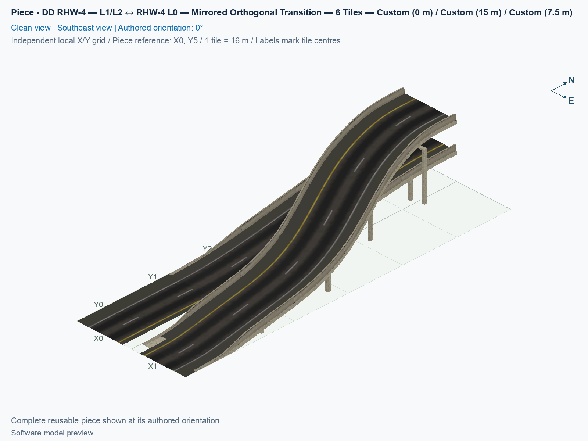
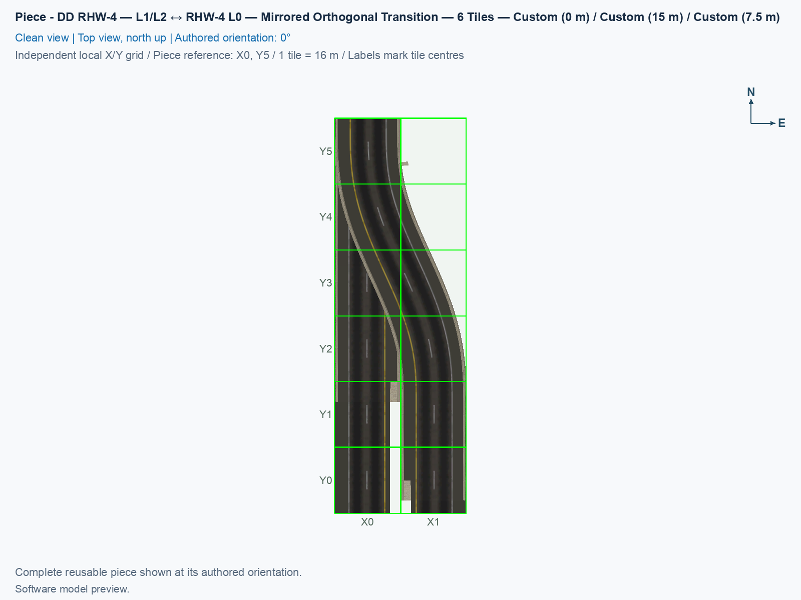
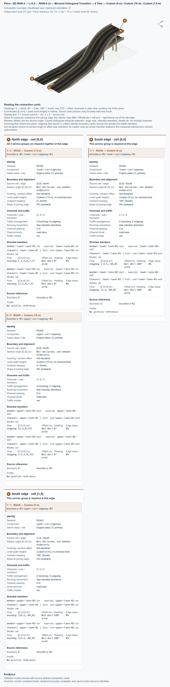

# DD RHW-4 — L1/L2 ↔ RHW-4 L0 — Mirrored Orthogonal Transition — 6 Tiles

Purpose: connect the opposite end of a directed double-decker RHW-4 to adjacent ground RHW-4 carriageways within six tiles, retaining two lanes in each direction.

<!-- PIECE README LAYOUT: 2 -->

[1. Views](#1-views) · [2. Piece and placement](#2-piece-and-placement) · [3. Connection matrix](#3-connection-matrix) · [Testing ↗ (separate document)](TESTING.md)

## 1. Views

The clean angled view shows the mirrored stacked-to-ground transition, followed by the north-up top view and the source-bound connector cards. The upper carriageway moves sideways while both decks change height. Each city tile is 16 × 16 m; this core occupies 2 × 6 tiles, or 32 m wide × 96 m long. These images show the compiled model. Actual game rendering, dragging, and moving traffic remain separate checks in [TESTING](TESTING.md).

<!-- BEGIN PIECE VIEWS -->

<!-- END PIECE VIEWS -->

## 2. Piece and placement

**DD RHW-4** is the RealHighway with two opposing two-lane carriageways stacked on separate decks: Level 1 is 7.5 m, and Level 2 is 15 m above ground. **L0 RHW-4** is the ground arrangement, with two adjacent two-lane carriageways. **Orthogonal** means aligned with the square city grid. This mirrored adapter supplies the other end of the same directed DD highway as the [original adapter](../ddrhw-l1-l2-to-rhw-l0-transition-orthogonal-6tile/README.md). It has no pedestrian service, Avenue pavement, or custom cast shadow.

In the authored 0° arrangement, north is at the top. The north DD connection is in the west column. Upper-deck traffic travels north out of the adapter at 15 m; lower-deck traffic travels south into it at 7.5 m. At the south end, the east ground carriageway carries cars north into the adapter and up to the upper deck. The west ground carriageway carries cars south out of the adapter from the lower deck. Each direction retains two lanes. The yellow line remains on the driver's left.

### 2.1 Leave room for all three native sockets

The core owns twelve cells in two columns and six rows. A **native socket** is the immediately adjacent ordinary draggable highway cell used to connect a fixed adapter to a drawn network. The adapter requests its original NAM starter marker but does not own a fixed model there. For the first test, keep the 2 × 8 arrangement below clear, plus at least three straight tiles beyond every socket.

| Source row | West column 0 | East column 1 |
| --- | --- | --- |
| −1, north of the core | DD socket: upper northbound at 15 m, lower southbound at 7.5 m | No socket |
| 0 | Fixed core; DD joining end | Fixed model-only core cell; empty traffic PATH |
| 1–4 | Fixed core cells | Fixed core cells |
| 5 | Fixed core; lower-deck ground joining end | Fixed core; upper-deck ground joining end |
| 6, south of the core | Ground RHW-4 socket, southbound | Ground RHW-4 socket, northbound |

Rows increase south, and columns increase east. The padding rows describe clear connection space; they do not enlarge the twelve owned cells. Keep other fixed pieces out of the three native sockets.

### 2.2 Select the mirrored shape and draw outward

1. Use Windows SimCity 4 with the supported NAM 50 right-hand-traffic setup, including Wine or CrossOver where applicable. Follow the [installation procedure](../../../../docs/BUILD_AND_INSTALL.md#7-install-remove-or-roll-back-a-test-build) for the intended candidate with the game fully closed, then start a disposable flat test city. Building this candidate does not install it.
2. Open **Transportation → Highways**, and select **SCP | [HW] DD RHW-4 — L1/L2 ↔ RHW-4 L0 — Orthogonal Combined Transition — 6 Tiles**. When both types are included, this original button contains both shapes. Press **Tab** or **Shift+Tab** until the placement query contains **DD RHW-4 — L1/L2 ↔ RHW-4 L0 — Mirrored Orthogonal Transition — 6 Tiles**. A mirrored-only build instead shows that type's standalone button.
3. Use **Home** or **End** to choose its rotation, and place a fresh adapter with the three sockets clear. Each shape has four proper rotations repeated over eight cursor states. Tab changes shape; rotation turns the currently selected shape.
4. Press **Esc**, select **Transportation → Highways → RealHighway (RHW-2)**, start on the north DD socket, and drag straight north for at least three tiles. Release the mouse button.
5. With the same tool, drag south from the southwest ground socket for at least three tiles, then repeat from the southeast ground socket. Check that both ground carriageways appear with opposing directions.
6. Connect useful traffic sources and destinations through working native control lines. Follow actual cars from the east ground carriageway up to the upper DD deck and from the lower DD deck down to the west ground carriageway. Inspect both lanes of each direction.

The decoded native resources and joining paths support these construction steps. The user confirmed all declared game checks for the installed transition pair on 1 November 2026; [TESTING](TESTING.md#5-results-and-known-issues) records that aggregate acceptance, its exact build, and its limits. A correct preview or coloured Route Query alone does not establish native dragging, car movement, or correct vehicle height.

### 2.3 Drag existing native RHW into either end

1. Create a working DD control from **Transportation → Highways → RealHighway (RHW) Starter Pieces**. Press **Tab** until the query reads **Double-Decker RHW-4 Starter Piece (Upper Deck: Level 2, Lower Deck: Level 1)**, place it with upper northbound and lower southbound traffic for this source pose, and extend it with **RealHighway (RHW-2)**. The separately named rail-based DDRHW starter is a different network.
2. Create the two ground controls using **RHW-4 Starter Piece** from the same starter cycle. Extend them with **RealHighway (RHW-2)**, with west southbound and east northbound traffic.
3. Place a fresh mirrored adapter with its matching ends facing these controls, leaving short straight gaps and the twelve core cells clear.
4. Select **RealHighway (RHW-2)**, start on the existing DD control, and drag through its gap to the north native socket immediately beside the adapter. Release at that socket outside the fixed core.
5. Repeat from the existing west ground control to the southwest socket, then from the east ground control to the southeast socket. The ground end requires two separate drags, one for each carriageway.
6. Inspect the joined network, then follow moving cars across every joining edge. Record these inward drags separately from drawing outward in section 2.2. Also test placing a fresh adapter directly between already completed native approaches as a third construction order.

Do not drag across the twelve fixed core cells. If a socket does not adopt the expected native network, record the exact shape, rotation, construction order, and socket; keep that game result unverified or failed until observed. [TESTING](TESTING.md#4-game-checks) supplies the complete comparison.

### 2.4 Use both ends of one straight DD stretch

Use the original shape at one end and this mirrored shape at the other. With original 0° and mirrored 180°, both ends agree on upper southbound and lower northbound DD traffic. The mirrored half-turn places its DD socket at the south end, ready to face the same straight DD line. Prepare the corresponding ground controls at each outside end. Rotating the original alone would turn its upper traffic north and lower traffic south, which would mismatch that existing DD line.

This is one coordinated reusable adapter, with native expansion points at all three outside sockets. Its height profile depends on the sideways curve, so arbitrary internal cuts do not provide standard interchangeable ramp interfaces. It retains the original 96 m length, 32 m width, flat native collars of at least 3 m, and experimental maximum lane grades of approximately 19.08% upper and 17.05% lower. Its independent vehicle envelope is 2.5 m wide × 3.8 m high. These bounded game-geometry checks do not establish structural capacity or fit for every replacement vehicle.

<!-- BEGIN PIECE OVERVIEW -->

The mirrored six-tile coupled adapter has the stacked highway at its north-west end. Its lower deck travels south into the west ground carriageway, and its upper deck rises north from the east ground carriageway. Each direction retains two lanes and native DD and ground RHW-4 sockets.

Exact reusable identifier: `ddrhw-l1-l2-to-rhw-l0-transition-orthogonal-6tile-mirrored`.

Footprint: **2 × 6 tiles**. Exact menu name: **DD RHW-4 — L1/L2 ↔ RHW-4 L0 — Mirrored Orthogonal Transition — 6 Tiles**.

<!-- END PIECE OVERVIEW -->

## 3. Connection matrix

The matrix describes four same-lane journeys: two from the east ground carriageway to the upper DD deck and two from the lower DD deck to the west ground carriageway. Lane changes, U-turns, and transfers between opposing carriageways are forbidden. The north DD boundary requires both deck services together. Saved PATH, Route Query, and visible travel retain separate results: ✅ confirmed, ❌ failed, and ? not established. The native joining audit checks the declared NAM boundaries separately; current human game acceptance is recorded in [TESTING](TESTING.md#5-results-and-known-issues).

<!-- BEGIN PIECE CONNECTION MATRIX -->

### Directed entrance/exit matrix

Read **from an entrance row to an exit column**. **Saved PATH** checks the saved traffic route; **Route Query** checks the route shown by the game; **Visible travel** checks a vehicle completing that journey. For HSR, visible travel means a moving train.

**Game appearance:** [✅](TESTING.md#case-in_game_render-02cd5171513d446ad225) — the complete piece’s appearance in the game, checked separately from its journeys.

**Legend:** ✅ confirmed; ❌ failed; ? not established. **Forbidden** means the movement is unavailable; its in-game check confirms that it stays unavailable. Click a result for its exact test case. Scope, evidence, and limitations remain in [the test checklist](TESTING.md#test-checklist).

| Entrance ↓ / Exit → | **Road · South exit** `lower-lane-01-out` Variant: rhw-4-l0 | **Road · North exit** `upper-lane-02-out` Variant: dd-rhw-l2 | **Road · South exit** `lower-lane-02-out` Variant: rhw-4-l0 | **Road · North exit** `upper-lane-01-out` Variant: dd-rhw-l2 |
| --- | --- | --- | --- | --- |
| **Road · North entrance** `lower-lane-01-in` Variant: dd-rhw-l1 | **Saved PATH:** [?](TESTING.md#case-software_connectivity-c0b7af9fa7cef748191c) **Route Query:** [✅](TESTING.md#case-in_game_route_query-47fbe843f0ca6e7e63ef) **Visible travel:** [✅](TESTING.md#case-in_game_visible_travel-47fbe843f0ca6e7e63ef) | **Forbidden** **Saved PATH:** [?](TESTING.md#case-software_connectivity-c0b7af9fa7cef748191c) In-game check: [✅](TESTING.md#case-in_game_forbidden_transfer-2c84806a0ca17d9f6451) | **Forbidden** **Saved PATH:** [?](TESTING.md#case-software_connectivity-c0b7af9fa7cef748191c) In-game check: [✅](TESTING.md#case-in_game_forbidden_transfer-ea49f3a8fbafcc74fbda) | **Forbidden** **Saved PATH:** [?](TESTING.md#case-software_connectivity-c0b7af9fa7cef748191c) In-game check: [✅](TESTING.md#case-in_game_forbidden_transfer-42239deba2cc99e0344f) |
| **Road · North entrance** `lower-lane-02-in` Variant: dd-rhw-l1 | **Forbidden** **Saved PATH:** [?](TESTING.md#case-software_connectivity-c0b7af9fa7cef748191c) In-game check: [✅](TESTING.md#case-in_game_forbidden_transfer-67d3df107ac4cc7320f5) | **Forbidden** **Saved PATH:** [?](TESTING.md#case-software_connectivity-c0b7af9fa7cef748191c) In-game check: [✅](TESTING.md#case-in_game_forbidden_transfer-f9b4c787e08c13a272cd) | **Saved PATH:** [?](TESTING.md#case-software_connectivity-c0b7af9fa7cef748191c) **Route Query:** [✅](TESTING.md#case-in_game_route_query-cc1794c749e1953e2727) **Visible travel:** [✅](TESTING.md#case-in_game_visible_travel-cc1794c749e1953e2727) | **Forbidden** **Saved PATH:** [?](TESTING.md#case-software_connectivity-c0b7af9fa7cef748191c) In-game check: [✅](TESTING.md#case-in_game_forbidden_transfer-ece0405fca6b259d3b26) |
| **Road · South entrance** `upper-lane-02-in` Variant: rhw-4-l0 | **Forbidden** **Saved PATH:** [?](TESTING.md#case-software_connectivity-c0b7af9fa7cef748191c) In-game check: [✅](TESTING.md#case-in_game_forbidden_transfer-ce16aca07506500a8807) | **Saved PATH:** [?](TESTING.md#case-software_connectivity-c0b7af9fa7cef748191c) **Route Query:** [✅](TESTING.md#case-in_game_route_query-084ae714c2b3df99af0d) **Visible travel:** [✅](TESTING.md#case-in_game_visible_travel-084ae714c2b3df99af0d) | **Forbidden** **Saved PATH:** [?](TESTING.md#case-software_connectivity-c0b7af9fa7cef748191c) In-game check: [✅](TESTING.md#case-in_game_forbidden_transfer-36a0967e265de44e9ffb) | **Forbidden** **Saved PATH:** [?](TESTING.md#case-software_connectivity-c0b7af9fa7cef748191c) In-game check: [✅](TESTING.md#case-in_game_forbidden_transfer-e5841ce4e5ea5afe2b2b) |
| **Road · South entrance** `upper-lane-01-in` Variant: rhw-4-l0 | **Forbidden** **Saved PATH:** [?](TESTING.md#case-software_connectivity-c0b7af9fa7cef748191c) In-game check: [✅](TESTING.md#case-in_game_forbidden_transfer-8b28e223d252dbf2cbd3) | **Forbidden** **Saved PATH:** [?](TESTING.md#case-software_connectivity-c0b7af9fa7cef748191c) In-game check: [✅](TESTING.md#case-in_game_forbidden_transfer-1f792232f7cb31193122) | **Forbidden** **Saved PATH:** [?](TESTING.md#case-software_connectivity-c0b7af9fa7cef748191c) In-game check: [✅](TESTING.md#case-in_game_forbidden_transfer-b7a215ecec175f249936) | **Saved PATH:** [?](TESTING.md#case-software_connectivity-c0b7af9fa7cef748191c) **Route Query:** [✅](TESTING.md#case-in_game_route_query-1a7f130da4c638d1604e) **Visible travel:** [✅](TESTING.md#case-in_game_visible_travel-1a7f130da4c638d1604e) |

Source: [connections.json](connections.json).

<!-- END PIECE CONNECTION MATRIX -->

<!-- BEGIN CONNECTOR OVERVIEW -->

### Connection overview

Generated from this piece's source-bound connector metadata and the current compiled model; marker letters refer to the boundary cards below.

[Rendering sources and verification scope](evidence/connection-overview.json).

Headings: 0° = North, 90° = East, 180° = South, and 270° = West; clockwise in plan view, pointing out of the piece.

Coordinates [E,N,H] = [east,north,height] in metres. Source cells [column,row] increase east and south.

Display grid: X = source column − (0); Y = 5 − source row.

Slope is measured outward at the joining edge; the interior may differ. Offsets are + left and − right facing out of the tile edge.

Member offsets use the section origin. Counts distinguish physical channels / edge cuts / directed members; modes do not multiply channels.

Incoming flow enters this piece; outgoing flow leaves it. Letters identify boundary cards; source IDs remain the stable identities.

Not declared means no section origin or offset was authored. Its marker uses an actual member endpoint; the measured intersections remain authoritative.

#### Boundary A: `boundary-01`

All 2 service groups are required together at this edge.

##### Service group 1 / 2: ROAD — Custom (7.5 m)

| Field | Value |
| --- | --- |
| End / component | `boundary-01-lower-carriageway-01` / `lower-carriageway` |
| Network / game class / role | road / Engine class (1); primary |
| Source cell / edge | `[0,0]` / North |
| Section origin [E,N] (m) | Not declared; see member endpoints |
| Centring / section offset | Not declared |
| Level (path height) | Custom (7.5 m); no nominal level |
| Outward heading | 0° (North) |
| Slope at joining edge | 0% outward |
| Channels / edge cuts / directed members | 2 / 2 / 2 |
| Traffic arrangement / running | 2 incoming; 0 outgoing; See member directions |
| Channel spacing | 5 m |
| Channel kinds | road-lane |
| Traffic modes | car |
| Profile | No profile reference |

| Member / measured source | Channel / cut / modes | Flow | Endpoint [E,N,H] (m) | Offset (m) | Outward heading | Edge slope (%) |
| --- | --- | --- | --- | ---: | ---: | ---: |
| `member-lower-lane-01-in` / `lower-lane-01-in` | `lower-lane-01` / `cut-lower-lane-01-in` / car | Incoming | `[-2.5,8,7.5]` | Not declared | 0° | 0 |
| `member-lower-lane-02-in` / `lower-lane-02-in` | `lower-lane-02` / `cut-lower-lane-02-in` / car | Incoming | `[2.5,8,7.5]` | Not declared | 0° | 0 |

##### Service group 2 / 2: ROAD — Custom (15 m)

| Field | Value |
| --- | --- |
| End / component | `boundary-01-upper-carriageway-02` / `upper-carriageway` |
| Network / game class / role | road / Engine class (1); primary |
| Source cell / edge | `[0,0]` / North |
| Section origin [E,N] (m) | Not declared; see member endpoints |
| Centring / section offset | Not declared |
| Level (path height) | Custom (15 m); no nominal level |
| Outward heading | 0° (North) |
| Slope at joining edge | 0% outward |
| Channels / edge cuts / directed members | 2 / 2 / 2 |
| Traffic arrangement / running | 0 incoming; 2 outgoing; See member directions |
| Channel spacing | 5 m |
| Channel kinds | road-lane |
| Traffic modes | car |
| Profile | No profile reference |

| Member / measured source | Channel / cut / modes | Flow | Endpoint [E,N,H] (m) | Offset (m) | Outward heading | Edge slope (%) |
| --- | --- | --- | --- | ---: | ---: | ---: |
| `member-upper-lane-01-out` / `upper-lane-01-out` | `upper-lane-01` / `cut-upper-lane-01-out` / car | Outgoing | `[2.5,8,15]` | Not declared | 0° | 0 |
| `member-upper-lane-02-out` / `upper-lane-02-out` | `upper-lane-02` / `cut-upper-lane-02-out` / car | Outgoing | `[-2.5,8,15]` | Not declared | 0° | 0 |

#### Boundary B: `boundary-02`

This service group is required at this edge.

##### Service group 1 / 1: ROAD — Custom (0 m)

| Field | Value |
| --- | --- |
| End / component | `boundary-02-lower-carriageway-01` / `lower-carriageway` |
| Network / game class / role | road / Engine class (1); primary |
| Source cell / edge | `[0,5]` / South |
| Section origin [E,N] (m) | Not declared; see member endpoints |
| Centring / section offset | Not declared |
| Level (path height) | Custom (0 m); no nominal level |
| Outward heading | 180° (South) |
| Slope at joining edge | 0% outward |
| Channels / edge cuts / directed members | 2 / 2 / 2 |
| Traffic arrangement / running | 0 incoming; 2 outgoing; See member directions |
| Channel spacing | 5 m |
| Channel kinds | road-lane |
| Traffic modes | car |
| Profile | No profile reference |

| Member / measured source | Channel / cut / modes | Flow | Endpoint [E,N,H] (m) | Offset (m) | Outward heading | Edge slope (%) |
| --- | --- | --- | --- | ---: | ---: | ---: |
| `member-lower-lane-01-out` / `lower-lane-01-out` | `lower-lane-01` / `cut-lower-lane-01-out` / car | Outgoing | `[-2.5,-88,0]` | Not declared | 180° | 0 |
| `member-lower-lane-02-out` / `lower-lane-02-out` | `lower-lane-02` / `cut-lower-lane-02-out` / car | Outgoing | `[2.5,-88,0]` | Not declared | 180° | 0 |

#### Boundary C: `boundary-03`

This service group is required at this edge.

##### Service group 1 / 1: ROAD — Custom (0 m)

| Field | Value |
| --- | --- |
| End / component | `boundary-03-upper-carriageway-01` / `upper-carriageway` |
| Network / game class / role | road / Engine class (1); primary |
| Source cell / edge | `[1,5]` / South |
| Section origin [E,N] (m) | Not declared; see member endpoints |
| Centring / section offset | Not declared |
| Level (path height) | Custom (0 m); no nominal level |
| Outward heading | 180° (South) |
| Slope at joining edge | 0% outward |
| Channels / edge cuts / directed members | 2 / 2 / 2 |
| Traffic arrangement / running | 2 incoming; 0 outgoing; See member directions |
| Channel spacing | 5 m |
| Channel kinds | road-lane |
| Traffic modes | car |
| Profile | No profile reference |

| Member / measured source | Channel / cut / modes | Flow | Endpoint [E,N,H] (m) | Offset (m) | Outward heading | Edge slope (%) |
| --- | --- | --- | --- | ---: | ---: | ---: |
| `member-upper-lane-01-in` / `upper-lane-01-in` | `upper-lane-01` / `cut-upper-lane-01-in` / car | Incoming | `[18.5,-88,0]` | Not declared | 180° | 0 |
| `member-upper-lane-02-in` / `upper-lane-02-in` | `upper-lane-02` / `cut-upper-lane-02-in` / car | Incoming | `[13.5,-88,0]` | Not declared | 180° | 0 |

The overview uses source metadata, current compiled resource identities, and the saved model. Current placement, connection, and traffic results belong to the generated connection matrix and linked testing records.

<!-- END CONNECTOR OVERVIEW -->
