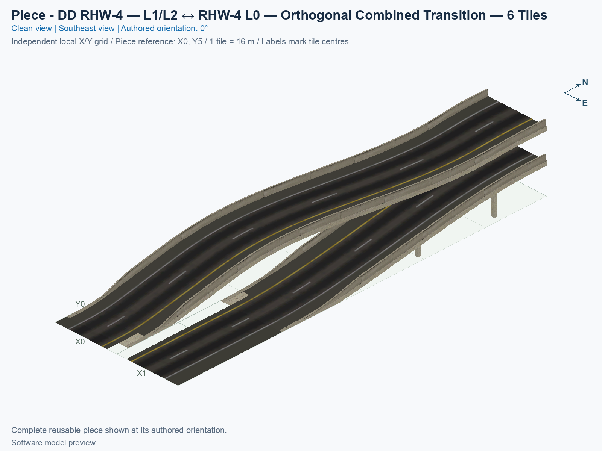
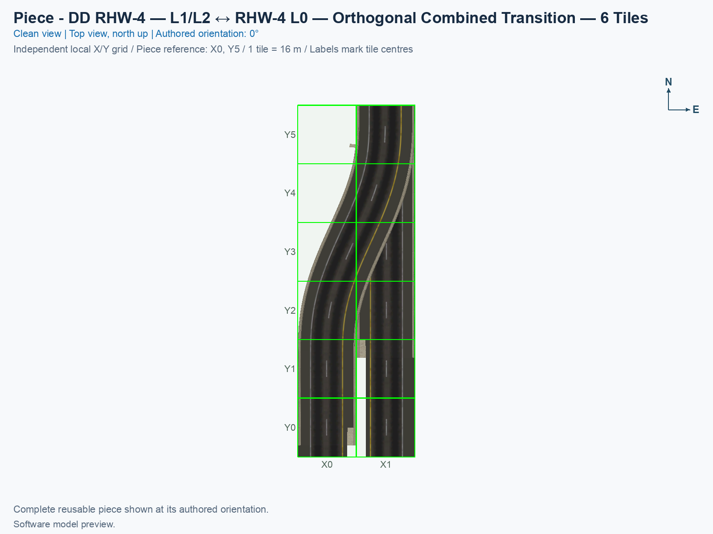
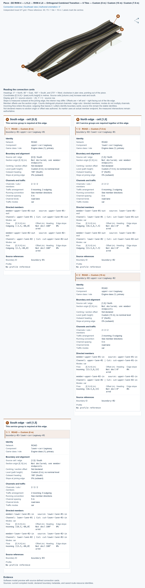

# DD RHW-4 — L1/L2 ↔ RHW-4 L0 — Orthogonal Combined Transition — 6 Tiles

Purpose: connect an orthogonal double-decker RHW-4 to two adjacent ground RHW-4 carriageways within one six-tile-long adapter, retaining two lanes in each direction.

<!-- PIECE README LAYOUT: 2 -->

[1. Views](#1-views) · [2. Piece and placement](#2-piece-and-placement) · [3. Connection matrix](#3-connection-matrix) · [Testing ↗ (separate document)](TESTING.md)

## 1. Views

The clean angled view shows the two stacked directions descending together while the original upper carriageway moves into the neighbouring ground tile. The clean top view follows it, using the same north-up city grid and the library's normal view order. Each city tile measures 16 × 16 m. The complete core occupies 2 × 6 tiles, or 32 m wide × 96 m long. These previews show the compiled model; actual game rendering, dragging, and moving traffic require separate checks in [TESTING](TESTING.md).

<!-- BEGIN PIECE VIEWS -->

<!-- END PIECE VIEWS -->

## 2. Piece and placement

**DD RHW-4** means the RealHighway with two opposing two-lane carriageways stacked on separate decks: Level 1 is 7.5 m, and Level 2 is 15 m above ground. **L0 RHW-4** is the ground version, with two adjacent two-lane carriageways. This piece changes between those arrangements. It is orthogonal, meaning aligned with the square city grid, and carries four directed car journeys. It contains no pedestrian route or Avenue pavement, and it intentionally supplies no cast shadows.

In the authored 0° arrangement, north is at the top. The DD highway connects at the north end, in the east column. Its upper deck carries cars south into the transition, and its lower deck carries cars north out of it. At the south end, the west ground carriageway carries traffic south, and the east ground carriageway carries traffic north. Thus the original upper deck becomes the west ground carriageway, and the original lower deck becomes the east ground carriageway. Rotating the piece rotates this complete arrangement; it does not exchange its two directed services.

### 2.1 Leave room for the native approaches

The piece owns all twelve cells of its 2 × 6 core. Three adjacent **native sockets** are ordinary draggable highway tiles whose starter markers are requested by construction. They are check-only cells: the adapter owns no fixed model there. Keep the 2 × 8 arrangement below clear for the first test, plus at least three tiles beyond each socket for drawing the approach lines. The extra rows do not enlarge the adapter's twelve owned cells.

| Source row | West column 0 | East column 1 |
| --- | --- | --- |
| −1, north of the core | No socket | DD RHW-4 socket: upper southbound at 15 m, lower northbound at 7.5 m |
| 0 | Fixed core cell | Fixed core cell; DD joining end |
| 1–4 | Fixed core cells | Fixed core cells |
| 5 | Fixed core cell; southbound ground joining end | Fixed core cell; northbound ground joining end |
| 6, south of the core | Ground RHW-4 socket, southbound | Ground RHW-4 socket, northbound |

Source rows increase south, and columns increase east. The northwest core cell at `[0,0]` owns visible road-envelope geometry but has no traffic route; its empty traffic resource is intentional. Keep other fixed pieces out of the three native socket cells.

### 2.2 Place the adapter and draw outward

1. Use Windows SimCity 4 with the audited NAM 50 right-hand-traffic setup, including the selected Wine or CrossOver environment where applicable. Building a candidate creates files; installing it is a separate operation. Follow the [shared installation procedure](../../../../docs/BUILD_AND_INSTALL.md#7-install-remove-or-roll-back-a-test-build) for the approved candidate, with the game fully closed, then start a disposable flat test city.
2. Open **Transportation → Highways**, and select **SCP | [HW] DD RHW-4 — L1/L2 ↔ RHW-4 L0 — Orthogonal Combined Transition — 6 Tiles**. When both transition types are included, **Tab** and **Shift+Tab** switch between this original shape and the separately authored mirrored shape under this one button; check the selected piece's placement-query name. Use **Home** or **End** to rotate the selected shape until its single DD end and paired ground end match your layout. Each shape has four distinct proper rotations; its eight cursor states repeat those four arrangements. Rotation does not select the mirrored shape.
3. Place a fresh adapter on flat clear ground, with the three sockets and the approach space shown above available. Press **Esc** to leave placement mode.
4. Select **Transportation → Highways → RealHighway (RHW-2)**. Start on the north DD socket, drag straight north for at least three tiles, and release. The expected result is continuation of both DD decks through the ordinary native network.
5. With the same drawing tool, start on the southwest ground socket, drag straight south for at least three tiles, and release. Repeat from the southeast ground socket. Check that the two ground carriageways retain the opposing directions in the table.
6. Join those approaches to working highway controls and useful traffic sources and destinations. Follow actual cars from the upper DD deck to the west ground carriageway, and from the east ground carriageway to the lower DD deck. Inspect both lanes of each direction. A Route Query line alone does not establish moving traffic or correct car height.

These construction steps are supported by the inspected native marker and continuation rules. The user confirmed all declared game checks for the installed transition pair on 1 November 2026; [TESTING](TESTING.md#5-results-and-known-issues) records that aggregate acceptance, its exact build, and its limits. Keep placement, dragging, visible travel, rotations, demolition, and save/reload as separate cases for future observations.

### 2.3 Connect to prebuilt draggable highways

For a DD control, open **Transportation → Highways → RealHighway (RHW) Starter Pieces**, press **Tab** until the query reads **Double-Decker RHW-4 Starter Piece (Upper Deck: Level 2, Lower Deck: Level 1)**, place the starter, and extend it with **RealHighway (RHW-2)**. The separately named **DDRHW-4 Starter Piece (Rail-based network)** is a different network and is outside this piece's measured contract.

For the ground control, use **RealHighway (RHW) Starter Pieces**, select **RHW-4 Starter Piece**, place it in the required direction, and extend it with **RealHighway (RHW-2)**. Prepare the second carriageway with the opposing direction. Match the ground approaches to west southbound and east northbound in the authored frame, or to the corresponding rotated arrangement. Leave the twelve core cells empty and the three native socket cells aligned before placing a fresh adapter between these prebuilt approaches. Test this build order independently of drawing outward from a new adapter.

### 2.4 Reuse and limits

This is one reusable adapter with three standard native end boundaries. Its upper height profile depends on the sideways curve, so arbitrary cuts inside the adapter would expose different slopes, heights, and curvatures. Such cuts do not provide interchangeable standard ramp pieces. Future assemblies can reuse the complete adapter where its measured DD and ground boundaries fit; a different intermediate connection needs its own defined interface and verification.

### 2.5 Use the mirrored counterpart at the other end

To return to ground at both ends of one continuous DD highway, use this original type at one end and the [mirrored type](../ddrhw-l1-l2-to-rhw-l0-transition-orthogonal-6tile-mirrored/README.md) at the other. A 180° turn of this type also turns its upper and lower travel directions, so it cannot supply the opposite end while preserving that same directed DD line. The counterpart retains the two deck identities and two lanes per direction, with a separately verified reflected shape and adjusted paths, native sockets, and markings. Both occupy 2 × 6 tiles. The `ddrhw-orthogonal-ground-transition` build selection includes both, with one shared menu button.

For a drawing-inward test, first create a working native line with its proper NAM starter and **RealHighway (RHW-2)**. Place a fresh adapter with the matching end facing that line, leaving a short straight gap. Select **RealHighway (RHW-2)** again, start on the existing native line, drag through the gap to the adapter's immediately adjacent native socket cell, and release. Repeat at the DD end and at each of the two ground carriageways. Stop at the socket outside the twelve fixed core cells. Record this independently of drawing outward from a newly placed adapter and placing an adapter directly between prebuilt approaches. The native resource checks support these joins; the user’s current game acceptance is recorded separately in [TESTING](TESTING.md#5-results-and-known-issues).

Both directions have flat native joining collars of at least 3 m. The lower carriageway reaches ground after 69 m and stays level for the remaining 27 m; the upper reaches its final flat ground collar at 93 m. Source lane-grade calculations are approximately 19.08% maximum for the upper direction and 17.05% for the lower direction. These are experimental game geometry choices, not civil-engineering design standards. The independent saved-resource checks establish the actual encoded slopes, model clearance, and complete route joins; the [test record](TESTING.md#3-software-checks) owns that evidence and its limits.

<!-- BEGIN PIECE OVERVIEW -->

One six-tile adapter lowers both stacked highway directions while moving the upper carriageway into the neighbouring ground tile. It preserves two lanes per direction and uses native DD and ground RHW-4 approach sockets.

Exact reusable identifier: `ddrhw-l1-l2-to-rhw-l0-transition-orthogonal-6tile`.

Footprint: **2 × 6 tiles**. Exact menu name: **DD RHW-4 — L1/L2 ↔ RHW-4 L0 — Orthogonal Combined Transition — 6 Tiles**.

<!-- END PIECE OVERVIEW -->

## 3. Connection matrix

The matrix describes four allowed same-lane journeys: two from the upper DD deck to the west ground carriageway, and two from the east ground carriageway to the lower DD deck. There are no lane changes, U-turns, or transfers between opposing carriageways inside the adapter. The connector overview groups both DD levels into one complete north boundary and shows the two separate ground boundaries at the south end. Saved PATH, Route Query, and visible travel remain separate results, with the standard legend: ✅ confirmed, ❌ failed, and ? not established.

<!-- BEGIN PIECE CONNECTION MATRIX -->

### Directed entrance/exit matrix

Read **from an entrance row to an exit column**. **Saved PATH** checks the saved traffic route; **Route Query** checks the route shown by the game; **Visible travel** checks a vehicle completing that journey. For HSR, visible travel means a moving train.

**Game appearance:** [✅](TESTING.md#case-in_game_render-82d7c3784103b584b40a) — the complete piece’s appearance in the game, checked separately from its journeys.

**Legend:** ✅ confirmed; ❌ failed; ? not established. **Forbidden** means the movement is unavailable; its in-game check confirms that it stays unavailable. Click a result for its exact test case. Scope, evidence, and limitations remain in [the test checklist](TESTING.md#test-checklist).

| Entrance ↓ / Exit → | **Road · South exit** `upper-lane-01-out` Variant: rhw-4-l0 | **Road · South exit** `upper-lane-02-out` Variant: rhw-4-l0 | **Road · North exit** `lower-lane-02-out` Variant: dd-rhw-l1 | **Road · North exit** `lower-lane-01-out` Variant: dd-rhw-l1 |
| --- | --- | --- | --- | --- |
| **Road · South entrance** `lower-lane-02-in` Variant: rhw-4-l0 | **Forbidden** **Saved PATH:** [?](TESTING.md#case-software_connectivity-9cc2be9312108b11e410) In-game check: [✅](TESTING.md#case-in_game_forbidden_transfer-21ccc86ba4330692e461) | **Forbidden** **Saved PATH:** [?](TESTING.md#case-software_connectivity-9cc2be9312108b11e410) In-game check: [✅](TESTING.md#case-in_game_forbidden_transfer-2552a31910f97d383d4d) | **Saved PATH:** [?](TESTING.md#case-software_connectivity-9cc2be9312108b11e410) **Route Query:** [✅](TESTING.md#case-in_game_route_query-40232bbf2761771185ec) **Visible travel:** [✅](TESTING.md#case-in_game_visible_travel-40232bbf2761771185ec) | **Forbidden** **Saved PATH:** [?](TESTING.md#case-software_connectivity-9cc2be9312108b11e410) In-game check: [✅](TESTING.md#case-in_game_forbidden_transfer-c140df69d24caf867419) |
| **Road · North entrance** `upper-lane-01-in` Variant: dd-rhw-l2 | **Saved PATH:** [?](TESTING.md#case-software_connectivity-9cc2be9312108b11e410) **Route Query:** [✅](TESTING.md#case-in_game_route_query-6799b7ff56e0c66614ef) **Visible travel:** [✅](TESTING.md#case-in_game_visible_travel-6799b7ff56e0c66614ef) | **Forbidden** **Saved PATH:** [?](TESTING.md#case-software_connectivity-9cc2be9312108b11e410) In-game check: [✅](TESTING.md#case-in_game_forbidden_transfer-dcfb5ce89b33c2bf3755) | **Forbidden** **Saved PATH:** [?](TESTING.md#case-software_connectivity-9cc2be9312108b11e410) In-game check: [✅](TESTING.md#case-in_game_forbidden_transfer-e7a07bb3b4f03741298a) | **Forbidden** **Saved PATH:** [?](TESTING.md#case-software_connectivity-9cc2be9312108b11e410) In-game check: [✅](TESTING.md#case-in_game_forbidden_transfer-7e9ec79bb046aa92c461) |
| **Road · South entrance** `lower-lane-01-in` Variant: rhw-4-l0 | **Forbidden** **Saved PATH:** [?](TESTING.md#case-software_connectivity-9cc2be9312108b11e410) In-game check: [✅](TESTING.md#case-in_game_forbidden_transfer-6305b8695458c22c1b49) | **Forbidden** **Saved PATH:** [?](TESTING.md#case-software_connectivity-9cc2be9312108b11e410) In-game check: [✅](TESTING.md#case-in_game_forbidden_transfer-6ab7264e7a0a47a279c9) | **Forbidden** **Saved PATH:** [?](TESTING.md#case-software_connectivity-9cc2be9312108b11e410) In-game check: [✅](TESTING.md#case-in_game_forbidden_transfer-c48e3bc5a7e670ff4db9) | **Saved PATH:** [?](TESTING.md#case-software_connectivity-9cc2be9312108b11e410) **Route Query:** [✅](TESTING.md#case-in_game_route_query-5c0670b5c7127cba6c58) **Visible travel:** [✅](TESTING.md#case-in_game_visible_travel-5c0670b5c7127cba6c58) |
| **Road · North entrance** `upper-lane-02-in` Variant: dd-rhw-l2 | **Forbidden** **Saved PATH:** [?](TESTING.md#case-software_connectivity-9cc2be9312108b11e410) In-game check: [✅](TESTING.md#case-in_game_forbidden_transfer-ba1487ac29580cf0b9a6) | **Saved PATH:** [?](TESTING.md#case-software_connectivity-9cc2be9312108b11e410) **Route Query:** [✅](TESTING.md#case-in_game_route_query-0ee7de8c4d85354d08d7) **Visible travel:** [✅](TESTING.md#case-in_game_visible_travel-0ee7de8c4d85354d08d7) | **Forbidden** **Saved PATH:** [?](TESTING.md#case-software_connectivity-9cc2be9312108b11e410) In-game check: [✅](TESTING.md#case-in_game_forbidden_transfer-063c7f4087ae5435a8c7) | **Forbidden** **Saved PATH:** [?](TESTING.md#case-software_connectivity-9cc2be9312108b11e410) In-game check: [✅](TESTING.md#case-in_game_forbidden_transfer-95feddc024406ea84348) |

Source: [connections.json](connections.json).

<!-- END PIECE CONNECTION MATRIX -->

<!-- BEGIN CONNECTOR OVERVIEW -->

### Connection overview

Generated from this piece's source-bound connector metadata and the current compiled model; marker letters refer to the boundary cards below.

[Rendering sources and verification scope](evidence/connection-overview.json).

Headings: 0° = North, 90° = East, 180° = South, and 270° = West; clockwise in plan view, pointing out of the piece.

Coordinates [E,N,H] = [east,north,height] in metres. Source cells [column,row] increase east and south.

Display grid: X = source column − (0); Y = 5 − source row.

Slope is measured outward at the joining edge; the interior may differ. Offsets are + left and − right facing out of the tile edge.

Member offsets use the section origin. Counts distinguish physical channels / edge cuts / directed members; modes do not multiply channels.

Incoming flow enters this piece; outgoing flow leaves it. Letters identify boundary cards; source IDs remain the stable identities.

Not declared means no section origin or offset was authored. Its marker uses an actual member endpoint; the measured intersections remain authoritative.

#### Boundary A: `boundary-01`

This service group is required at this edge.

##### Service group 1 / 1: ROAD — Custom (0 m)

| Field | Value |
| --- | --- |
| End / component | `boundary-01-upper-carriageway-01` / `upper-carriageway` |
| Network / game class / role | road / Engine class (1); primary |
| Source cell / edge | `[0,5]` / South |
| Section origin [E,N] (m) | Not declared; see member endpoints |
| Centring / section offset | Not declared |
| Level (path height) | Custom (0 m); no nominal level |
| Outward heading | 180° (South) |
| Slope at joining edge | 0% outward |
| Channels / edge cuts / directed members | 2 / 2 / 2 |
| Traffic arrangement / running | 0 incoming; 2 outgoing; See member directions |
| Channel spacing | 5 m |
| Channel kinds | road-lane |
| Traffic modes | car |
| Profile | No profile reference |

| Member / measured source | Channel / cut / modes | Flow | Endpoint [E,N,H] (m) | Offset (m) | Outward heading | Edge slope (%) |
| --- | --- | --- | --- | ---: | ---: | ---: |
| `member-upper-lane-01-out` / `upper-lane-01-out` | `upper-lane-01` / `cut-upper-lane-01-out` / car | Outgoing | `[-2.5,-88,0]` | Not declared | 180° | 0 |
| `member-upper-lane-02-out` / `upper-lane-02-out` | `upper-lane-02` / `cut-upper-lane-02-out` / car | Outgoing | `[2.5,-88,0]` | Not declared | 180° | 0 |

#### Boundary B: `boundary-02`

All 2 service groups are required together at this edge.

##### Service group 1 / 2: ROAD — Custom (7.5 m)

| Field | Value |
| --- | --- |
| End / component | `boundary-02-lower-carriageway-01` / `lower-carriageway` |
| Network / game class / role | road / Engine class (1); primary |
| Source cell / edge | `[1,0]` / North |
| Section origin [E,N] (m) | Not declared; see member endpoints |
| Centring / section offset | Not declared |
| Level (path height) | Custom (7.5 m); no nominal level |
| Outward heading | 0° (North) |
| Slope at joining edge | 0% outward |
| Channels / edge cuts / directed members | 2 / 2 / 2 |
| Traffic arrangement / running | 0 incoming; 2 outgoing; See member directions |
| Channel spacing | 5 m |
| Channel kinds | road-lane |
| Traffic modes | car |
| Profile | No profile reference |

| Member / measured source | Channel / cut / modes | Flow | Endpoint [E,N,H] (m) | Offset (m) | Outward heading | Edge slope (%) |
| --- | --- | --- | --- | ---: | ---: | ---: |
| `member-lower-lane-01-out` / `lower-lane-01-out` | `lower-lane-01` / `cut-lower-lane-01-out` / car | Outgoing | `[18.5,8,7.5]` | Not declared | 0° | 0 |
| `member-lower-lane-02-out` / `lower-lane-02-out` | `lower-lane-02` / `cut-lower-lane-02-out` / car | Outgoing | `[13.5,8,7.5]` | Not declared | 0° | 0 |

##### Service group 2 / 2: ROAD — Custom (15 m)

| Field | Value |
| --- | --- |
| End / component | `boundary-02-upper-carriageway-02` / `upper-carriageway` |
| Network / game class / role | road / Engine class (1); primary |
| Source cell / edge | `[1,0]` / North |
| Section origin [E,N] (m) | Not declared; see member endpoints |
| Centring / section offset | Not declared |
| Level (path height) | Custom (15 m); no nominal level |
| Outward heading | 0° (North) |
| Slope at joining edge | 0% outward |
| Channels / edge cuts / directed members | 2 / 2 / 2 |
| Traffic arrangement / running | 2 incoming; 0 outgoing; See member directions |
| Channel spacing | 5 m |
| Channel kinds | road-lane |
| Traffic modes | car |
| Profile | No profile reference |

| Member / measured source | Channel / cut / modes | Flow | Endpoint [E,N,H] (m) | Offset (m) | Outward heading | Edge slope (%) |
| --- | --- | --- | --- | ---: | ---: | ---: |
| `member-upper-lane-01-in` / `upper-lane-01-in` | `upper-lane-01` / `cut-upper-lane-01-in` / car | Incoming | `[13.5,8,15]` | Not declared | 0° | 0 |
| `member-upper-lane-02-in` / `upper-lane-02-in` | `upper-lane-02` / `cut-upper-lane-02-in` / car | Incoming | `[18.5,8,15]` | Not declared | 0° | 0 |

#### Boundary C: `boundary-03`

This service group is required at this edge.

##### Service group 1 / 1: ROAD — Custom (0 m)

| Field | Value |
| --- | --- |
| End / component | `boundary-03-lower-carriageway-01` / `lower-carriageway` |
| Network / game class / role | road / Engine class (1); primary |
| Source cell / edge | `[1,5]` / South |
| Section origin [E,N] (m) | Not declared; see member endpoints |
| Centring / section offset | Not declared |
| Level (path height) | Custom (0 m); no nominal level |
| Outward heading | 180° (South) |
| Slope at joining edge | 0% outward |
| Channels / edge cuts / directed members | 2 / 2 / 2 |
| Traffic arrangement / running | 2 incoming; 0 outgoing; See member directions |
| Channel spacing | 5 m |
| Channel kinds | road-lane |
| Traffic modes | car |
| Profile | No profile reference |

| Member / measured source | Channel / cut / modes | Flow | Endpoint [E,N,H] (m) | Offset (m) | Outward heading | Edge slope (%) |
| --- | --- | --- | --- | ---: | ---: | ---: |
| `member-lower-lane-01-in` / `lower-lane-01-in` | `lower-lane-01` / `cut-lower-lane-01-in` / car | Incoming | `[18.5,-88,0]` | Not declared | 180° | 0 |
| `member-lower-lane-02-in` / `lower-lane-02-in` | `lower-lane-02` / `cut-lower-lane-02-in` / car | Incoming | `[13.5,-88,0]` | Not declared | 180° | 0 |

The overview uses source metadata, current compiled resource identities, and the saved model. Current placement, connection, and traffic results belong to the generated connection matrix and linked testing records.

<!-- END CONNECTOR OVERVIEW -->
