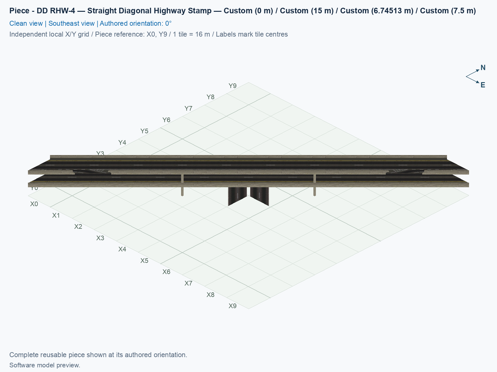
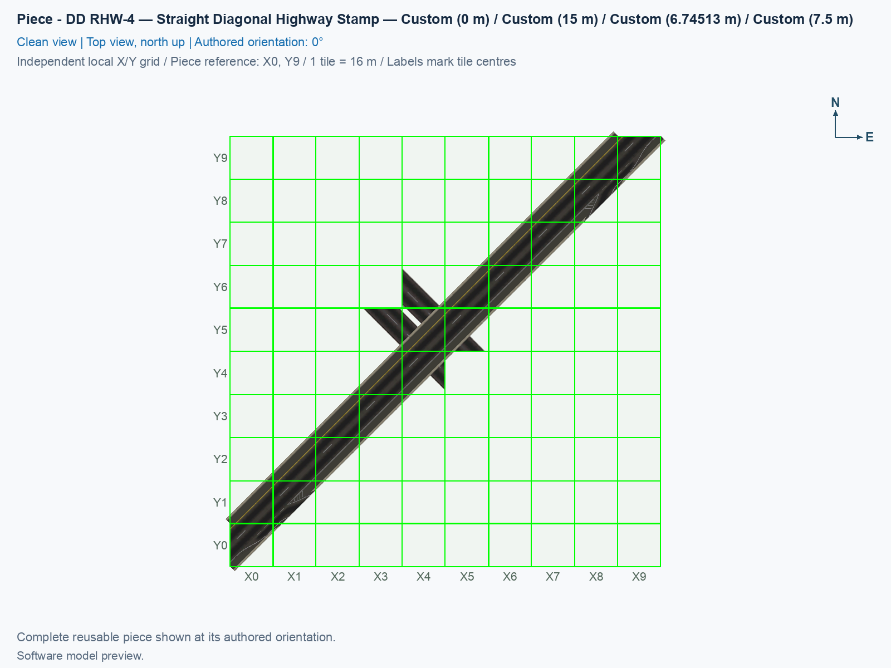

# DD RHW-4 — Straight Diagonal Highway Stamp

Purpose: Place the straight double-decker highway, its inside-deck slip lanes, and its four barrier openings together; attach every curved ramp separately.

<!-- PIECE README LAYOUT: 2 -->

[1. Views](#1-views) · [2. Piece and placement](#2-piece-and-placement) · [3. Connection matrix](#3-connection-matrix) · [Testing ↗ (separate document)](TESTING.md)

## 1. Views

The angled and north-up pictures show the actual saved model in its authored 0° orientation. The connection overview records complete measured traffic boundaries, including their signed slopes. A software picture does not establish appearance or vehicle travel in the game.

<!-- BEGIN PIECE VIEWS -->

<!-- END PIECE VIEWS -->

## 2. Piece and placement

Fresh placement also requests two native NAM DD approach tiles, one beyond each highway end. Reserve one extra 16 × 16 m native plot at both ends outside the fixed footprint shown in the pictures. The retained models and traffic paths are unchanged. This [native highway connection experiment](../../NETWORK_SPEC.md#12-native-highway-approach-experiment) needs a game test, and existing city placements must be replaced to run the new construction request.

One click places two completely straight highway decks, at 7.5 m and 15 m above the ground pavement, their six centre piers, and four barrier openings. The slip lanes and their paint stay inside the straight highway envelope. Every curved ramp surface, underside, barrier, and joining bridge belongs to a separately placed ramp. The stamp also carries the ground Avenue through the crossing.

The visible ramp openings lie at the native highway edge and are flat, at 7.5 m on the lower deck and 15 m on the upper deck. Traffic-route connections follow city-tile edges instead. A physical opening and a connection-card boundary therefore describe different cuts; neither may replace the other.

The stamp retains native highway and Avenue through routes, pedestrian routes, and the ramp-route portions inside highway-owned tiles. Some of these ramp-route portions have no external roadway until a separate full ramp is attached. Test cars only after completing the matching assembly.

A **construction tile** is a 16 × 16 m city square occupied by one piece. This type owns 21 tiles inside a 10 × 10-tile construction rectangle. Visible model overhang does not grant overlapping construction ownership. The assembly construction picture distinguishes the actual model outline from the owned tiles.

1. Prepare Windows SimCity 4 with the exact NAM 50 right-hand-traffic inputs in the [build guide](../../../../docs/BUILD_AND_INSTALL.md), including the adaptive Avenue capture for the stamp and terminals.
2. Open a disposable city, and flatten the full 10 × 10-tile assembly area.
3. Open **Transportation → Highways → SCP → Assemblies**, and select **SCP | ASSEMBLY | DD RHW-4 — Modular Diagonal Avenue Diamond**. Press **Tab** or **Shift+Tab** until **DD RHW-4 — Straight Diagonal Highway Stamp** appears. Each click places this component only.
4. Follow the [assembly placement table](../../01_assemblies/ddrhw-l1-and-l2-diagonal-avenue-modular-diamond/README.md#3-placements) for this family's reference position. Use 0° for the reference layout; **Home** and **End** rotate the selected component. Align its occupied preview cells, including sparse shapes whose construction reference cell is empty.
5. Complete the matching seven-part layout, and connect native DD RHW-4 highway approaches and ordinary diagonal Avenue approaches at the outside ends. Placement over an existing Avenue and dragging through occupied pieces remain separate game tests.

These are fixed-height click-to-place components. They do not follow sloping terrain, acquire arbitrary height offsets, or establish draggable/FLEX compatibility. Four proper rotations repeat across eight selection states; none reflects traffic handedness. Match every required traffic boundary, and check the physical joining profiles separately in [TESTING.md](TESTING.md).

<!-- BEGIN PIECE OVERVIEW -->

Straight double-decker highway with slip lanes and barrier cutouts only. All curved ramp pavement, undersides, and barriers are separately placed attachments.

Exact reusable identifier: `ddrhw-modular-highway-stamp`.

Footprint: **10 × 10 tiles**. Exact menu name: **DD RHW-4 — Straight Diagonal Highway Stamp**.

<!-- END PIECE OVERVIEW -->

## 3. Connection matrix

The generated matrix describes movements within this piece. For the lower full ramps, its two fragments become one highway-to-Avenue journey only through the stamp-owned middle tile. Boundary cards describe saved traffic cuts; the physical native-edge opening is checked separately.

<!-- BEGIN PIECE CONNECTION MATRIX -->

### Directed entrance/exit matrix

Read **from an entrance row to an exit column**. **Saved PATH** checks the saved traffic route; **Route Query** checks the route shown by the game; **Visible travel** checks a vehicle completing that journey. For HSR, visible travel means a moving train.

**Game appearance:** [?](TESTING.md#case-in_game_render-d0ef5112f7b9929ff065) — the complete piece’s appearance in the game, checked separately from its journeys.

**Legend:** ✅ confirmed; ❌ failed; ? not established. **Forbidden** means the movement is unavailable; its in-game check confirms that it stays unavailable. Click a result for its exact test case. Scope, evidence, and limitations remain in [the test checklist](TESTING.md#test-checklist).

| Entrance ↓ / Exit → | **Road · West exit** `1-W-out-1` Variant: dd-rhw-l1 | **Road · West exit** `1-W-out-3` Variant: dd-rhw-l1 | **Road · East exit** `1-E-out-6` Variant: dd-rhw-l2 | **Road · West exit** `1-W-out-7` Variant: dd-rhw-l1 | **Road · West exit** `1-W-out-11` Variant: avenue-ground | **Road · West exit** `1-W-out-12` Variant: avenue-ground | **Road · East exit** `1-E-out-13` Variant: avenue-ground | **Road · East exit** `1-E-out-14` Variant: avenue-ground | **Road · West exit** `1-W-out-17` Variant: access-ramp | **Road · West exit** `1-W-out-19` Variant: dd-rhw-l1 | **Road · North exit** `1-N-out-22` Variant: dd-rhw-l2 | **Road · North exit** `1-N-out-24` Variant: dd-rhw-l2 | **Pedestrian · West exit** `2-W-out-2` Variant: avenue-sidewalk | **Pedestrian · East exit** `2-E-out-3` Variant: avenue-sidewalk |
| --- | --- | --- | --- | --- | --- | --- | --- | --- | --- | --- | --- | --- | --- | --- |
| **Road · West entrance** `1-W-in-2` Variant: dd-rhw-l2 | **Forbidden** **Saved PATH:** [?](TESTING.md#case-software_connectivity-1c233e8adbd824473999) In-game check: [?](TESTING.md#case-in_game_forbidden_transfer-66febcb432cac1b0159c) | **Forbidden** **Saved PATH:** [?](TESTING.md#case-software_connectivity-1c233e8adbd824473999) In-game check: [?](TESTING.md#case-in_game_forbidden_transfer-7c40e76bd8c2b4346058) | **Saved PATH:** [?](TESTING.md#case-software_connectivity-1c233e8adbd824473999) **Route Query:** [?](TESTING.md#case-in_game_route_query-970fc5a9b1d0a8c2372a) **Visible travel:** [?](TESTING.md#case-in_game_visible_travel-970fc5a9b1d0a8c2372a) | **Forbidden** **Saved PATH:** [?](TESTING.md#case-software_connectivity-1c233e8adbd824473999) In-game check: [?](TESTING.md#case-in_game_forbidden_transfer-1f97103c6012fd006075) | **Forbidden** **Saved PATH:** [?](TESTING.md#case-software_connectivity-1c233e8adbd824473999) In-game check: [?](TESTING.md#case-in_game_forbidden_transfer-a5849d670704f9abb87d) | **Forbidden** **Saved PATH:** [?](TESTING.md#case-software_connectivity-1c233e8adbd824473999) In-game check: [?](TESTING.md#case-in_game_forbidden_transfer-e02cf196f3710ca20de4) | **Forbidden** **Saved PATH:** [?](TESTING.md#case-software_connectivity-1c233e8adbd824473999) In-game check: [?](TESTING.md#case-in_game_forbidden_transfer-3d06cb94f9207a9fcada) | **Forbidden** **Saved PATH:** [?](TESTING.md#case-software_connectivity-1c233e8adbd824473999) In-game check: [?](TESTING.md#case-in_game_forbidden_transfer-b737a8d17db4b40c0a27) | **Forbidden** **Saved PATH:** [?](TESTING.md#case-software_connectivity-1c233e8adbd824473999) In-game check: [?](TESTING.md#case-in_game_forbidden_transfer-d0bb4e323db3bfbd0fab) | **Forbidden** **Saved PATH:** [?](TESTING.md#case-software_connectivity-1c233e8adbd824473999) In-game check: [?](TESTING.md#case-in_game_forbidden_transfer-5700e89e3f3a745842fb) | **Forbidden** **Saved PATH:** [?](TESTING.md#case-software_connectivity-1c233e8adbd824473999) In-game check: [?](TESTING.md#case-in_game_forbidden_transfer-44efb91ed7ded62dab49) | **Saved PATH:** [?](TESTING.md#case-software_connectivity-1c233e8adbd824473999) **Route Query:** [?](TESTING.md#case-in_game_route_query-ea736bf530766a186dc7) **Visible travel:** [?](TESTING.md#case-in_game_visible_travel-ea736bf530766a186dc7) | **Forbidden** **Saved PATH:** [?](TESTING.md#case-software_connectivity-1c233e8adbd824473999) In-game check: [?](TESTING.md#case-in_game_forbidden_transfer-ec80ad41a12a10f10477) | **Forbidden** **Saved PATH:** [?](TESTING.md#case-software_connectivity-1c233e8adbd824473999) In-game check: [?](TESTING.md#case-in_game_forbidden_transfer-d33a9ff99515e785533a) |
| **Road · West entrance** `1-W-in-4` Variant: dd-rhw-l2 | **Forbidden** **Saved PATH:** [?](TESTING.md#case-software_connectivity-1c233e8adbd824473999) In-game check: [?](TESTING.md#case-in_game_forbidden_transfer-cfd406c14ccc7ffe5e6b) | **Forbidden** **Saved PATH:** [?](TESTING.md#case-software_connectivity-1c233e8adbd824473999) In-game check: [?](TESTING.md#case-in_game_forbidden_transfer-c24ff28a590450ae79b6) | **Forbidden** **Saved PATH:** [?](TESTING.md#case-software_connectivity-1c233e8adbd824473999) In-game check: [?](TESTING.md#case-in_game_forbidden_transfer-75db42d202240f976d3f) | **Forbidden** **Saved PATH:** [?](TESTING.md#case-software_connectivity-1c233e8adbd824473999) In-game check: [?](TESTING.md#case-in_game_forbidden_transfer-baf019bc06e6a436c865) | **Forbidden** **Saved PATH:** [?](TESTING.md#case-software_connectivity-1c233e8adbd824473999) In-game check: [?](TESTING.md#case-in_game_forbidden_transfer-75056ac26fa25434d2c3) | **Forbidden** **Saved PATH:** [?](TESTING.md#case-software_connectivity-1c233e8adbd824473999) In-game check: [?](TESTING.md#case-in_game_forbidden_transfer-68a98565770e6b07797b) | **Forbidden** **Saved PATH:** [?](TESTING.md#case-software_connectivity-1c233e8adbd824473999) In-game check: [?](TESTING.md#case-in_game_forbidden_transfer-55616ebc1f215c288bf1) | **Forbidden** **Saved PATH:** [?](TESTING.md#case-software_connectivity-1c233e8adbd824473999) In-game check: [?](TESTING.md#case-in_game_forbidden_transfer-687193622616177b181b) | **Forbidden** **Saved PATH:** [?](TESTING.md#case-software_connectivity-1c233e8adbd824473999) In-game check: [?](TESTING.md#case-in_game_forbidden_transfer-e7400c0b0cf981977c6c) | **Forbidden** **Saved PATH:** [?](TESTING.md#case-software_connectivity-1c233e8adbd824473999) In-game check: [?](TESTING.md#case-in_game_forbidden_transfer-04cec6cd94fc95132a24) | **Saved PATH:** [?](TESTING.md#case-software_connectivity-1c233e8adbd824473999) **Route Query:** [?](TESTING.md#case-in_game_route_query-375af6274b377b2304e4) **Visible travel:** [?](TESTING.md#case-in_game_visible_travel-375af6274b377b2304e4) | **Forbidden** **Saved PATH:** [?](TESTING.md#case-software_connectivity-1c233e8adbd824473999) In-game check: [?](TESTING.md#case-in_game_forbidden_transfer-d50f85053f99ebbebfa6) | **Forbidden** **Saved PATH:** [?](TESTING.md#case-software_connectivity-1c233e8adbd824473999) In-game check: [?](TESTING.md#case-in_game_forbidden_transfer-10c4a0acbc7c51574909) | **Forbidden** **Saved PATH:** [?](TESTING.md#case-software_connectivity-1c233e8adbd824473999) In-game check: [?](TESTING.md#case-in_game_forbidden_transfer-135e7c32048431400296) |
| **Road · North entrance** `1-N-in-5` Variant: dd-rhw-l1 | **Forbidden** **Saved PATH:** [?](TESTING.md#case-software_connectivity-1c233e8adbd824473999) In-game check: [?](TESTING.md#case-in_game_forbidden_transfer-ab707a58a23111cb6d24) | **Saved PATH:** [?](TESTING.md#case-software_connectivity-1c233e8adbd824473999) **Route Query:** [?](TESTING.md#case-in_game_route_query-b3c07d4ff49097bc85fb) **Visible travel:** [?](TESTING.md#case-in_game_visible_travel-b3c07d4ff49097bc85fb) | **Forbidden** **Saved PATH:** [?](TESTING.md#case-software_connectivity-1c233e8adbd824473999) In-game check: [?](TESTING.md#case-in_game_forbidden_transfer-93422a00895ba981be05) | **Forbidden** **Saved PATH:** [?](TESTING.md#case-software_connectivity-1c233e8adbd824473999) In-game check: [?](TESTING.md#case-in_game_forbidden_transfer-bb7ff907001c1f342270) | **Forbidden** **Saved PATH:** [?](TESTING.md#case-software_connectivity-1c233e8adbd824473999) In-game check: [?](TESTING.md#case-in_game_forbidden_transfer-c5d5b6b999ee5fada217) | **Forbidden** **Saved PATH:** [?](TESTING.md#case-software_connectivity-1c233e8adbd824473999) In-game check: [?](TESTING.md#case-in_game_forbidden_transfer-e2ef12d36aafc997aef4) | **Forbidden** **Saved PATH:** [?](TESTING.md#case-software_connectivity-1c233e8adbd824473999) In-game check: [?](TESTING.md#case-in_game_forbidden_transfer-e9bd9ee0fbc3e04edc76) | **Forbidden** **Saved PATH:** [?](TESTING.md#case-software_connectivity-1c233e8adbd824473999) In-game check: [?](TESTING.md#case-in_game_forbidden_transfer-2f93ebc52ed34194d76b) | **Forbidden** **Saved PATH:** [?](TESTING.md#case-software_connectivity-1c233e8adbd824473999) In-game check: [?](TESTING.md#case-in_game_forbidden_transfer-a4b364e92f47e2463b23) | **Forbidden** **Saved PATH:** [?](TESTING.md#case-software_connectivity-1c233e8adbd824473999) In-game check: [?](TESTING.md#case-in_game_forbidden_transfer-1c9f56b0874576d07026) | **Forbidden** **Saved PATH:** [?](TESTING.md#case-software_connectivity-1c233e8adbd824473999) In-game check: [?](TESTING.md#case-in_game_forbidden_transfer-a09db5718943048f9e52) | **Forbidden** **Saved PATH:** [?](TESTING.md#case-software_connectivity-1c233e8adbd824473999) In-game check: [?](TESTING.md#case-in_game_forbidden_transfer-f7e2fb3b8e8986d04506) | **Forbidden** **Saved PATH:** [?](TESTING.md#case-software_connectivity-1c233e8adbd824473999) In-game check: [?](TESTING.md#case-in_game_forbidden_transfer-0834b6565e74b47aefe1) | **Forbidden** **Saved PATH:** [?](TESTING.md#case-software_connectivity-1c233e8adbd824473999) In-game check: [?](TESTING.md#case-in_game_forbidden_transfer-630abeaf75f7b9a53be8) |
| **Road · North entrance** `1-N-in-8` Variant: access-ramp | **Forbidden** **Saved PATH:** [?](TESTING.md#case-software_connectivity-1c233e8adbd824473999) In-game check: [?](TESTING.md#case-in_game_forbidden_transfer-02ac829809f960238cf0) | **Forbidden** **Saved PATH:** [?](TESTING.md#case-software_connectivity-1c233e8adbd824473999) In-game check: [?](TESTING.md#case-in_game_forbidden_transfer-01b579da253305b19e0c) | **Forbidden** **Saved PATH:** [?](TESTING.md#case-software_connectivity-1c233e8adbd824473999) In-game check: [?](TESTING.md#case-in_game_forbidden_transfer-a7ae964cb5f097b0812d) | **Saved PATH:** [?](TESTING.md#case-software_connectivity-1c233e8adbd824473999) **Route Query:** [?](TESTING.md#case-in_game_route_query-9048c50964fc3ec5d5ea) **Visible travel:** [?](TESTING.md#case-in_game_visible_travel-9048c50964fc3ec5d5ea) | **Forbidden** **Saved PATH:** [?](TESTING.md#case-software_connectivity-1c233e8adbd824473999) In-game check: [?](TESTING.md#case-in_game_forbidden_transfer-788c2e021dff830d44eb) | **Forbidden** **Saved PATH:** [?](TESTING.md#case-software_connectivity-1c233e8adbd824473999) In-game check: [?](TESTING.md#case-in_game_forbidden_transfer-39a4a4a9688190a6b805) | **Forbidden** **Saved PATH:** [?](TESTING.md#case-software_connectivity-1c233e8adbd824473999) In-game check: [?](TESTING.md#case-in_game_forbidden_transfer-ea834bc4c0816095f504) | **Forbidden** **Saved PATH:** [?](TESTING.md#case-software_connectivity-1c233e8adbd824473999) In-game check: [?](TESTING.md#case-in_game_forbidden_transfer-0ded73b3c89a281bfa19) | **Forbidden** **Saved PATH:** [?](TESTING.md#case-software_connectivity-1c233e8adbd824473999) In-game check: [?](TESTING.md#case-in_game_forbidden_transfer-90c83f6f691c686c3ae2) | **Forbidden** **Saved PATH:** [?](TESTING.md#case-software_connectivity-1c233e8adbd824473999) In-game check: [?](TESTING.md#case-in_game_forbidden_transfer-634a282a9a6d614666ba) | **Forbidden** **Saved PATH:** [?](TESTING.md#case-software_connectivity-1c233e8adbd824473999) In-game check: [?](TESTING.md#case-in_game_forbidden_transfer-94ef907bbefbcaae58bb) | **Forbidden** **Saved PATH:** [?](TESTING.md#case-software_connectivity-1c233e8adbd824473999) In-game check: [?](TESTING.md#case-in_game_forbidden_transfer-e5e337c1019acbc8ba2e) | **Forbidden** **Saved PATH:** [?](TESTING.md#case-software_connectivity-1c233e8adbd824473999) In-game check: [?](TESTING.md#case-in_game_forbidden_transfer-58cbef086864c3548663) | **Forbidden** **Saved PATH:** [?](TESTING.md#case-software_connectivity-1c233e8adbd824473999) In-game check: [?](TESTING.md#case-in_game_forbidden_transfer-bbc03c0ac8bc78dfe9eb) |
| **Road · North entrance** `1-N-in-9` Variant: avenue-ground | **Forbidden** **Saved PATH:** [?](TESTING.md#case-software_connectivity-1c233e8adbd824473999) In-game check: [?](TESTING.md#case-in_game_forbidden_transfer-965470822944a3d2ad1c) | **Forbidden** **Saved PATH:** [?](TESTING.md#case-software_connectivity-1c233e8adbd824473999) In-game check: [?](TESTING.md#case-in_game_forbidden_transfer-7452431d43202c6f9e8d) | **Forbidden** **Saved PATH:** [?](TESTING.md#case-software_connectivity-1c233e8adbd824473999) In-game check: [?](TESTING.md#case-in_game_forbidden_transfer-e744074af8a8c8e71c0d) | **Forbidden** **Saved PATH:** [?](TESTING.md#case-software_connectivity-1c233e8adbd824473999) In-game check: [?](TESTING.md#case-in_game_forbidden_transfer-6eba86a9d3ac4fe4f860) | **Forbidden** **Saved PATH:** [?](TESTING.md#case-software_connectivity-1c233e8adbd824473999) In-game check: [?](TESTING.md#case-in_game_forbidden_transfer-fc795ca84615a36b8297) | **Forbidden** **Saved PATH:** [?](TESTING.md#case-software_connectivity-1c233e8adbd824473999) In-game check: [?](TESTING.md#case-in_game_forbidden_transfer-10b9160ae0e2e5013153) | **Saved PATH:** [?](TESTING.md#case-software_connectivity-1c233e8adbd824473999) **Route Query:** [?](TESTING.md#case-in_game_route_query-6643b07010e10e7b2728) **Visible travel:** [?](TESTING.md#case-in_game_visible_travel-6643b07010e10e7b2728) | **Forbidden** **Saved PATH:** [?](TESTING.md#case-software_connectivity-1c233e8adbd824473999) In-game check: [?](TESTING.md#case-in_game_forbidden_transfer-14ff71d5b96cf52e1521) | **Forbidden** **Saved PATH:** [?](TESTING.md#case-software_connectivity-1c233e8adbd824473999) In-game check: [?](TESTING.md#case-in_game_forbidden_transfer-76c9777e97c953290c65) | **Forbidden** **Saved PATH:** [?](TESTING.md#case-software_connectivity-1c233e8adbd824473999) In-game check: [?](TESTING.md#case-in_game_forbidden_transfer-63f9bfc5d76f3aed1f63) | **Forbidden** **Saved PATH:** [?](TESTING.md#case-software_connectivity-1c233e8adbd824473999) In-game check: [?](TESTING.md#case-in_game_forbidden_transfer-d6385568433c5d1055cb) | **Forbidden** **Saved PATH:** [?](TESTING.md#case-software_connectivity-1c233e8adbd824473999) In-game check: [?](TESTING.md#case-in_game_forbidden_transfer-e3c6efdbacc0529ec9d9) | **Forbidden** **Saved PATH:** [?](TESTING.md#case-software_connectivity-1c233e8adbd824473999) In-game check: [?](TESTING.md#case-in_game_forbidden_transfer-089cd1aaf7c2fb3bfacf) | **Forbidden** **Saved PATH:** [?](TESTING.md#case-software_connectivity-1c233e8adbd824473999) In-game check: [?](TESTING.md#case-in_game_forbidden_transfer-1fe5334cb603d081f941) |
| **Road · North entrance** `1-N-in-10` Variant: avenue-ground | **Forbidden** **Saved PATH:** [?](TESTING.md#case-software_connectivity-1c233e8adbd824473999) In-game check: [?](TESTING.md#case-in_game_forbidden_transfer-597914e7fdf3e7b5df72) | **Forbidden** **Saved PATH:** [?](TESTING.md#case-software_connectivity-1c233e8adbd824473999) In-game check: [?](TESTING.md#case-in_game_forbidden_transfer-618c9e50e5a3bee4381b) | **Forbidden** **Saved PATH:** [?](TESTING.md#case-software_connectivity-1c233e8adbd824473999) In-game check: [?](TESTING.md#case-in_game_forbidden_transfer-231546bf9699caa991b7) | **Forbidden** **Saved PATH:** [?](TESTING.md#case-software_connectivity-1c233e8adbd824473999) In-game check: [?](TESTING.md#case-in_game_forbidden_transfer-f41e74f37e96d4e39bca) | **Forbidden** **Saved PATH:** [?](TESTING.md#case-software_connectivity-1c233e8adbd824473999) In-game check: [?](TESTING.md#case-in_game_forbidden_transfer-82348f8ee84c7c11c941) | **Forbidden** **Saved PATH:** [?](TESTING.md#case-software_connectivity-1c233e8adbd824473999) In-game check: [?](TESTING.md#case-in_game_forbidden_transfer-6ff1b28a66371182f51c) | **Forbidden** **Saved PATH:** [?](TESTING.md#case-software_connectivity-1c233e8adbd824473999) In-game check: [?](TESTING.md#case-in_game_forbidden_transfer-b0868afe94eeb08d5dea) | **Saved PATH:** [?](TESTING.md#case-software_connectivity-1c233e8adbd824473999) **Route Query:** [?](TESTING.md#case-in_game_route_query-a4b387b9926da653f8f2) **Visible travel:** [?](TESTING.md#case-in_game_visible_travel-a4b387b9926da653f8f2) | **Forbidden** **Saved PATH:** [?](TESTING.md#case-software_connectivity-1c233e8adbd824473999) In-game check: [?](TESTING.md#case-in_game_forbidden_transfer-3d07c0876d7e9e20a30c) | **Forbidden** **Saved PATH:** [?](TESTING.md#case-software_connectivity-1c233e8adbd824473999) In-game check: [?](TESTING.md#case-in_game_forbidden_transfer-7666abfc16dcbf3ddd2d) | **Forbidden** **Saved PATH:** [?](TESTING.md#case-software_connectivity-1c233e8adbd824473999) In-game check: [?](TESTING.md#case-in_game_forbidden_transfer-41821b4dfaeaba7fe495) | **Forbidden** **Saved PATH:** [?](TESTING.md#case-software_connectivity-1c233e8adbd824473999) In-game check: [?](TESTING.md#case-in_game_forbidden_transfer-d241dd7e1c3828725174) | **Forbidden** **Saved PATH:** [?](TESTING.md#case-software_connectivity-1c233e8adbd824473999) In-game check: [?](TESTING.md#case-in_game_forbidden_transfer-098f9e53abe8b1651363) | **Forbidden** **Saved PATH:** [?](TESTING.md#case-software_connectivity-1c233e8adbd824473999) In-game check: [?](TESTING.md#case-in_game_forbidden_transfer-1dd73ee28da257e80fb0) |
| **Road · South entrance** `1-S-in-15` Variant: avenue-ground | **Forbidden** **Saved PATH:** [?](TESTING.md#case-software_connectivity-1c233e8adbd824473999) In-game check: [?](TESTING.md#case-in_game_forbidden_transfer-a73d75480f0752b7ae6a) | **Forbidden** **Saved PATH:** [?](TESTING.md#case-software_connectivity-1c233e8adbd824473999) In-game check: [?](TESTING.md#case-in_game_forbidden_transfer-19499bd50c9f059a6606) | **Forbidden** **Saved PATH:** [?](TESTING.md#case-software_connectivity-1c233e8adbd824473999) In-game check: [?](TESTING.md#case-in_game_forbidden_transfer-049579e165be9927a7db) | **Forbidden** **Saved PATH:** [?](TESTING.md#case-software_connectivity-1c233e8adbd824473999) In-game check: [?](TESTING.md#case-in_game_forbidden_transfer-3de47e586b531f48199b) | **Saved PATH:** [?](TESTING.md#case-software_connectivity-1c233e8adbd824473999) **Route Query:** [?](TESTING.md#case-in_game_route_query-edeaa440015e64a49645) **Visible travel:** [?](TESTING.md#case-in_game_visible_travel-edeaa440015e64a49645) | **Forbidden** **Saved PATH:** [?](TESTING.md#case-software_connectivity-1c233e8adbd824473999) In-game check: [?](TESTING.md#case-in_game_forbidden_transfer-77477b4913726494fe31) | **Forbidden** **Saved PATH:** [?](TESTING.md#case-software_connectivity-1c233e8adbd824473999) In-game check: [?](TESTING.md#case-in_game_forbidden_transfer-42d8532d8bb9c0614472) | **Forbidden** **Saved PATH:** [?](TESTING.md#case-software_connectivity-1c233e8adbd824473999) In-game check: [?](TESTING.md#case-in_game_forbidden_transfer-935f625ee8c0e1d08242) | **Forbidden** **Saved PATH:** [?](TESTING.md#case-software_connectivity-1c233e8adbd824473999) In-game check: [?](TESTING.md#case-in_game_forbidden_transfer-4958312f5bf57a13c1e0) | **Forbidden** **Saved PATH:** [?](TESTING.md#case-software_connectivity-1c233e8adbd824473999) In-game check: [?](TESTING.md#case-in_game_forbidden_transfer-72b82a3e0f39c2ec2a46) | **Forbidden** **Saved PATH:** [?](TESTING.md#case-software_connectivity-1c233e8adbd824473999) In-game check: [?](TESTING.md#case-in_game_forbidden_transfer-ad55e3d2b78807ce9668) | **Forbidden** **Saved PATH:** [?](TESTING.md#case-software_connectivity-1c233e8adbd824473999) In-game check: [?](TESTING.md#case-in_game_forbidden_transfer-3df67c811c104f2984aa) | **Forbidden** **Saved PATH:** [?](TESTING.md#case-software_connectivity-1c233e8adbd824473999) In-game check: [?](TESTING.md#case-in_game_forbidden_transfer-fe05bb813a7a979d6ad3) | **Forbidden** **Saved PATH:** [?](TESTING.md#case-software_connectivity-1c233e8adbd824473999) In-game check: [?](TESTING.md#case-in_game_forbidden_transfer-03b03ae142b58d7fd434) |
| **Road · South entrance** `1-S-in-16` Variant: avenue-ground | **Forbidden** **Saved PATH:** [?](TESTING.md#case-software_connectivity-1c233e8adbd824473999) In-game check: [?](TESTING.md#case-in_game_forbidden_transfer-912375e61e38abf38ed2) | **Forbidden** **Saved PATH:** [?](TESTING.md#case-software_connectivity-1c233e8adbd824473999) In-game check: [?](TESTING.md#case-in_game_forbidden_transfer-ed68e7d3991671bd0b16) | **Forbidden** **Saved PATH:** [?](TESTING.md#case-software_connectivity-1c233e8adbd824473999) In-game check: [?](TESTING.md#case-in_game_forbidden_transfer-1ad75c690890a8b7ea45) | **Forbidden** **Saved PATH:** [?](TESTING.md#case-software_connectivity-1c233e8adbd824473999) In-game check: [?](TESTING.md#case-in_game_forbidden_transfer-5fc41b9b4ce04b1c464b) | **Forbidden** **Saved PATH:** [?](TESTING.md#case-software_connectivity-1c233e8adbd824473999) In-game check: [?](TESTING.md#case-in_game_forbidden_transfer-66845eea9758feb98653) | **Saved PATH:** [?](TESTING.md#case-software_connectivity-1c233e8adbd824473999) **Route Query:** [?](TESTING.md#case-in_game_route_query-c8257f891134eb00e196) **Visible travel:** [?](TESTING.md#case-in_game_visible_travel-c8257f891134eb00e196) | **Forbidden** **Saved PATH:** [?](TESTING.md#case-software_connectivity-1c233e8adbd824473999) In-game check: [?](TESTING.md#case-in_game_forbidden_transfer-c70afb1acac6ecd182c2) | **Forbidden** **Saved PATH:** [?](TESTING.md#case-software_connectivity-1c233e8adbd824473999) In-game check: [?](TESTING.md#case-in_game_forbidden_transfer-b2729d6e9d1fe9a61470) | **Forbidden** **Saved PATH:** [?](TESTING.md#case-software_connectivity-1c233e8adbd824473999) In-game check: [?](TESTING.md#case-in_game_forbidden_transfer-6cf8710d9275144252ea) | **Forbidden** **Saved PATH:** [?](TESTING.md#case-software_connectivity-1c233e8adbd824473999) In-game check: [?](TESTING.md#case-in_game_forbidden_transfer-557f97af7f6db3d1838e) | **Forbidden** **Saved PATH:** [?](TESTING.md#case-software_connectivity-1c233e8adbd824473999) In-game check: [?](TESTING.md#case-in_game_forbidden_transfer-b9573883f5d793e719d6) | **Forbidden** **Saved PATH:** [?](TESTING.md#case-software_connectivity-1c233e8adbd824473999) In-game check: [?](TESTING.md#case-in_game_forbidden_transfer-709cb7e15c84fec6d0aa) | **Forbidden** **Saved PATH:** [?](TESTING.md#case-software_connectivity-1c233e8adbd824473999) In-game check: [?](TESTING.md#case-in_game_forbidden_transfer-e1624d872f8476b9b164) | **Forbidden** **Saved PATH:** [?](TESTING.md#case-software_connectivity-1c233e8adbd824473999) In-game check: [?](TESTING.md#case-in_game_forbidden_transfer-7d3e1937f5db675134bb) |
| **Road · North entrance** `1-N-in-18` Variant: dd-rhw-l1 | **Forbidden** **Saved PATH:** [?](TESTING.md#case-software_connectivity-1c233e8adbd824473999) In-game check: [?](TESTING.md#case-in_game_forbidden_transfer-f638089e12360421d588) | **Forbidden** **Saved PATH:** [?](TESTING.md#case-software_connectivity-1c233e8adbd824473999) In-game check: [?](TESTING.md#case-in_game_forbidden_transfer-6911963bbd8a40fd53b2) | **Forbidden** **Saved PATH:** [?](TESTING.md#case-software_connectivity-1c233e8adbd824473999) In-game check: [?](TESTING.md#case-in_game_forbidden_transfer-9f004640671ec6fc1732) | **Forbidden** **Saved PATH:** [?](TESTING.md#case-software_connectivity-1c233e8adbd824473999) In-game check: [?](TESTING.md#case-in_game_forbidden_transfer-33ea57c3b47f4fab4265) | **Forbidden** **Saved PATH:** [?](TESTING.md#case-software_connectivity-1c233e8adbd824473999) In-game check: [?](TESTING.md#case-in_game_forbidden_transfer-4c754a2fa5a7b3322671) | **Forbidden** **Saved PATH:** [?](TESTING.md#case-software_connectivity-1c233e8adbd824473999) In-game check: [?](TESTING.md#case-in_game_forbidden_transfer-c8f9c49b2e79b35c7f72) | **Forbidden** **Saved PATH:** [?](TESTING.md#case-software_connectivity-1c233e8adbd824473999) In-game check: [?](TESTING.md#case-in_game_forbidden_transfer-0ad5b5aee2efd79b6e08) | **Forbidden** **Saved PATH:** [?](TESTING.md#case-software_connectivity-1c233e8adbd824473999) In-game check: [?](TESTING.md#case-in_game_forbidden_transfer-3c2b375bfce388365056) | **Saved PATH:** [?](TESTING.md#case-software_connectivity-1c233e8adbd824473999) **Route Query:** [?](TESTING.md#case-in_game_route_query-864c3239608bb3a176ac) **Visible travel:** [?](TESTING.md#case-in_game_visible_travel-864c3239608bb3a176ac) | **Forbidden** **Saved PATH:** [?](TESTING.md#case-software_connectivity-1c233e8adbd824473999) In-game check: [?](TESTING.md#case-in_game_forbidden_transfer-96d8899632897712e824) | **Forbidden** **Saved PATH:** [?](TESTING.md#case-software_connectivity-1c233e8adbd824473999) In-game check: [?](TESTING.md#case-in_game_forbidden_transfer-a2534efe87face756e94) | **Forbidden** **Saved PATH:** [?](TESTING.md#case-software_connectivity-1c233e8adbd824473999) In-game check: [?](TESTING.md#case-in_game_forbidden_transfer-7d8c7883ab50463e1368) | **Forbidden** **Saved PATH:** [?](TESTING.md#case-software_connectivity-1c233e8adbd824473999) In-game check: [?](TESTING.md#case-in_game_forbidden_transfer-a700b86a616db07e84f8) | **Forbidden** **Saved PATH:** [?](TESTING.md#case-software_connectivity-1c233e8adbd824473999) In-game check: [?](TESTING.md#case-in_game_forbidden_transfer-31d57c1f5870f9b594be) |
| **Road · South entrance** `1-S-in-20` Variant: dd-rhw-l2 | **Forbidden** **Saved PATH:** [?](TESTING.md#case-software_connectivity-1c233e8adbd824473999) In-game check: [?](TESTING.md#case-in_game_forbidden_transfer-2d930edb3296e3183f11) | **Forbidden** **Saved PATH:** [?](TESTING.md#case-software_connectivity-1c233e8adbd824473999) In-game check: [?](TESTING.md#case-in_game_forbidden_transfer-c8b26258a5cfc21e061b) | **Forbidden** **Saved PATH:** [?](TESTING.md#case-software_connectivity-1c233e8adbd824473999) In-game check: [?](TESTING.md#case-in_game_forbidden_transfer-e44d88fae63a24d69ba6) | **Forbidden** **Saved PATH:** [?](TESTING.md#case-software_connectivity-1c233e8adbd824473999) In-game check: [?](TESTING.md#case-in_game_forbidden_transfer-8ad748762053041f36df) | **Forbidden** **Saved PATH:** [?](TESTING.md#case-software_connectivity-1c233e8adbd824473999) In-game check: [?](TESTING.md#case-in_game_forbidden_transfer-3a2c55b8297cfe7e36e7) | **Forbidden** **Saved PATH:** [?](TESTING.md#case-software_connectivity-1c233e8adbd824473999) In-game check: [?](TESTING.md#case-in_game_forbidden_transfer-a252e3384e37eb329555) | **Forbidden** **Saved PATH:** [?](TESTING.md#case-software_connectivity-1c233e8adbd824473999) In-game check: [?](TESTING.md#case-in_game_forbidden_transfer-3c9f68dc1a8a53f39b54) | **Forbidden** **Saved PATH:** [?](TESTING.md#case-software_connectivity-1c233e8adbd824473999) In-game check: [?](TESTING.md#case-in_game_forbidden_transfer-2d8f945aa3e61b4d1f21) | **Forbidden** **Saved PATH:** [?](TESTING.md#case-software_connectivity-1c233e8adbd824473999) In-game check: [?](TESTING.md#case-in_game_forbidden_transfer-ee37bca0fe980a8c2f18) | **Forbidden** **Saved PATH:** [?](TESTING.md#case-software_connectivity-1c233e8adbd824473999) In-game check: [?](TESTING.md#case-in_game_forbidden_transfer-a8b5f6c12d3e7fde006e) | **Forbidden** **Saved PATH:** [?](TESTING.md#case-software_connectivity-1c233e8adbd824473999) In-game check: [?](TESTING.md#case-in_game_forbidden_transfer-c6c17bca08aae5d4a478) | **Saved PATH:** [?](TESTING.md#case-software_connectivity-1c233e8adbd824473999) **Route Query:** [?](TESTING.md#case-in_game_route_query-e13f58f805419378832f) **Visible travel:** [?](TESTING.md#case-in_game_visible_travel-e13f58f805419378832f) | **Forbidden** **Saved PATH:** [?](TESTING.md#case-software_connectivity-1c233e8adbd824473999) In-game check: [?](TESTING.md#case-in_game_forbidden_transfer-7db9be73bacc3b17f2a8) | **Forbidden** **Saved PATH:** [?](TESTING.md#case-software_connectivity-1c233e8adbd824473999) In-game check: [?](TESTING.md#case-in_game_forbidden_transfer-859460065b5dd9a079f8) |
| **Road · North entrance** `1-N-in-21` Variant: dd-rhw-l1 | **Forbidden** **Saved PATH:** [?](TESTING.md#case-software_connectivity-1c233e8adbd824473999) In-game check: [?](TESTING.md#case-in_game_forbidden_transfer-2ae3a341f6c3bba7d308) | **Saved PATH:** [?](TESTING.md#case-software_connectivity-1c233e8adbd824473999) **Route Query:** [?](TESTING.md#case-in_game_route_query-39bb346ad5203198d834) **Visible travel:** [?](TESTING.md#case-in_game_visible_travel-39bb346ad5203198d834) | **Forbidden** **Saved PATH:** [?](TESTING.md#case-software_connectivity-1c233e8adbd824473999) In-game check: [?](TESTING.md#case-in_game_forbidden_transfer-0852594f044bf4f83da1) | **Forbidden** **Saved PATH:** [?](TESTING.md#case-software_connectivity-1c233e8adbd824473999) In-game check: [?](TESTING.md#case-in_game_forbidden_transfer-6c4ffa71692998be486b) | **Forbidden** **Saved PATH:** [?](TESTING.md#case-software_connectivity-1c233e8adbd824473999) In-game check: [?](TESTING.md#case-in_game_forbidden_transfer-48d6cae357c60466a46e) | **Forbidden** **Saved PATH:** [?](TESTING.md#case-software_connectivity-1c233e8adbd824473999) In-game check: [?](TESTING.md#case-in_game_forbidden_transfer-112b94731f0455612a1e) | **Forbidden** **Saved PATH:** [?](TESTING.md#case-software_connectivity-1c233e8adbd824473999) In-game check: [?](TESTING.md#case-in_game_forbidden_transfer-cc1bb4c73ec60c953670) | **Forbidden** **Saved PATH:** [?](TESTING.md#case-software_connectivity-1c233e8adbd824473999) In-game check: [?](TESTING.md#case-in_game_forbidden_transfer-16912c82631de0146b46) | **Forbidden** **Saved PATH:** [?](TESTING.md#case-software_connectivity-1c233e8adbd824473999) In-game check: [?](TESTING.md#case-in_game_forbidden_transfer-dbb49cf458adc5ceec0c) | **Saved PATH:** [?](TESTING.md#case-software_connectivity-1c233e8adbd824473999) **Route Query:** [?](TESTING.md#case-in_game_route_query-0fe9a5dad2450703e682) **Visible travel:** [?](TESTING.md#case-in_game_visible_travel-0fe9a5dad2450703e682) | **Forbidden** **Saved PATH:** [?](TESTING.md#case-software_connectivity-1c233e8adbd824473999) In-game check: [?](TESTING.md#case-in_game_forbidden_transfer-99b665a4d47379fa813e) | **Forbidden** **Saved PATH:** [?](TESTING.md#case-software_connectivity-1c233e8adbd824473999) In-game check: [?](TESTING.md#case-in_game_forbidden_transfer-19d94ad67753cc406315) | **Forbidden** **Saved PATH:** [?](TESTING.md#case-software_connectivity-1c233e8adbd824473999) In-game check: [?](TESTING.md#case-in_game_forbidden_transfer-e29d40aadbd8c2723ad5) | **Forbidden** **Saved PATH:** [?](TESTING.md#case-software_connectivity-1c233e8adbd824473999) In-game check: [?](TESTING.md#case-in_game_forbidden_transfer-195851a42a0275c62298) |
| **Road · North entrance** `1-N-in-23` Variant: dd-rhw-l1 | **Saved PATH:** [?](TESTING.md#case-software_connectivity-1c233e8adbd824473999) **Route Query:** [?](TESTING.md#case-in_game_route_query-68ad13375629ad70fd5c) **Visible travel:** [?](TESTING.md#case-in_game_visible_travel-68ad13375629ad70fd5c) | **Forbidden** **Saved PATH:** [?](TESTING.md#case-software_connectivity-1c233e8adbd824473999) In-game check: [?](TESTING.md#case-in_game_forbidden_transfer-16ed47fdea403ac439be) | **Forbidden** **Saved PATH:** [?](TESTING.md#case-software_connectivity-1c233e8adbd824473999) In-game check: [?](TESTING.md#case-in_game_forbidden_transfer-17589a2889e78ff869ad) | **Forbidden** **Saved PATH:** [?](TESTING.md#case-software_connectivity-1c233e8adbd824473999) In-game check: [?](TESTING.md#case-in_game_forbidden_transfer-e7d3daf87fbb5dec8ffe) | **Forbidden** **Saved PATH:** [?](TESTING.md#case-software_connectivity-1c233e8adbd824473999) In-game check: [?](TESTING.md#case-in_game_forbidden_transfer-bbaa8aba78927e0b95e1) | **Forbidden** **Saved PATH:** [?](TESTING.md#case-software_connectivity-1c233e8adbd824473999) In-game check: [?](TESTING.md#case-in_game_forbidden_transfer-fe0554439cf5aeedb7af) | **Forbidden** **Saved PATH:** [?](TESTING.md#case-software_connectivity-1c233e8adbd824473999) In-game check: [?](TESTING.md#case-in_game_forbidden_transfer-0bfbf82929f97afe4334) | **Forbidden** **Saved PATH:** [?](TESTING.md#case-software_connectivity-1c233e8adbd824473999) In-game check: [?](TESTING.md#case-in_game_forbidden_transfer-957fc80557cb81697804) | **Forbidden** **Saved PATH:** [?](TESTING.md#case-software_connectivity-1c233e8adbd824473999) In-game check: [?](TESTING.md#case-in_game_forbidden_transfer-8f3abc5750e122181766) | **Forbidden** **Saved PATH:** [?](TESTING.md#case-software_connectivity-1c233e8adbd824473999) In-game check: [?](TESTING.md#case-in_game_forbidden_transfer-670507d543a0deabbaec) | **Forbidden** **Saved PATH:** [?](TESTING.md#case-software_connectivity-1c233e8adbd824473999) In-game check: [?](TESTING.md#case-in_game_forbidden_transfer-e524d6d7b0b96f63f81b) | **Forbidden** **Saved PATH:** [?](TESTING.md#case-software_connectivity-1c233e8adbd824473999) In-game check: [?](TESTING.md#case-in_game_forbidden_transfer-fbbfa8eedd7c900a1ee9) | **Forbidden** **Saved PATH:** [?](TESTING.md#case-software_connectivity-1c233e8adbd824473999) In-game check: [?](TESTING.md#case-in_game_forbidden_transfer-2f1f8858e3f54c2ac00f) | **Forbidden** **Saved PATH:** [?](TESTING.md#case-software_connectivity-1c233e8adbd824473999) In-game check: [?](TESTING.md#case-in_game_forbidden_transfer-52d24a041278f31664e8) |
| **Pedestrian · North entrance** `2-N-in-1` Variant: avenue-sidewalk | **Forbidden** **Saved PATH:** [?](TESTING.md#case-software_connectivity-1c233e8adbd824473999) In-game check: [?](TESTING.md#case-in_game_forbidden_transfer-068afd5d04630eb0a817) | **Forbidden** **Saved PATH:** [?](TESTING.md#case-software_connectivity-1c233e8adbd824473999) In-game check: [?](TESTING.md#case-in_game_forbidden_transfer-9e73a7e3bccf3ac5cdcd) | **Forbidden** **Saved PATH:** [?](TESTING.md#case-software_connectivity-1c233e8adbd824473999) In-game check: [?](TESTING.md#case-in_game_forbidden_transfer-8edc1cc5e26482252bbb) | **Forbidden** **Saved PATH:** [?](TESTING.md#case-software_connectivity-1c233e8adbd824473999) In-game check: [?](TESTING.md#case-in_game_forbidden_transfer-7ffdca674b60c7e037d3) | **Forbidden** **Saved PATH:** [?](TESTING.md#case-software_connectivity-1c233e8adbd824473999) In-game check: [?](TESTING.md#case-in_game_forbidden_transfer-c43bcec27de64c8e16d8) | **Forbidden** **Saved PATH:** [?](TESTING.md#case-software_connectivity-1c233e8adbd824473999) In-game check: [?](TESTING.md#case-in_game_forbidden_transfer-c02562975d17053335fc) | **Forbidden** **Saved PATH:** [?](TESTING.md#case-software_connectivity-1c233e8adbd824473999) In-game check: [?](TESTING.md#case-in_game_forbidden_transfer-6c5c2b2b490e1fff1f62) | **Forbidden** **Saved PATH:** [?](TESTING.md#case-software_connectivity-1c233e8adbd824473999) In-game check: [?](TESTING.md#case-in_game_forbidden_transfer-1d66ccc315a599e3bf34) | **Forbidden** **Saved PATH:** [?](TESTING.md#case-software_connectivity-1c233e8adbd824473999) In-game check: [?](TESTING.md#case-in_game_forbidden_transfer-63e341ec390373a6d3b3) | **Forbidden** **Saved PATH:** [?](TESTING.md#case-software_connectivity-1c233e8adbd824473999) In-game check: [?](TESTING.md#case-in_game_forbidden_transfer-98be73ca8d2835805f29) | **Forbidden** **Saved PATH:** [?](TESTING.md#case-software_connectivity-1c233e8adbd824473999) In-game check: [?](TESTING.md#case-in_game_forbidden_transfer-e5b506bc96d990774565) | **Forbidden** **Saved PATH:** [?](TESTING.md#case-software_connectivity-1c233e8adbd824473999) In-game check: [?](TESTING.md#case-in_game_forbidden_transfer-aa90ff0eba6b7df408af) | **Forbidden** **Saved PATH:** [?](TESTING.md#case-software_connectivity-1c233e8adbd824473999) In-game check: [?](TESTING.md#case-in_game_forbidden_transfer-3f9b449d6326a1c07276) | **Saved PATH:** [?](TESTING.md#case-software_connectivity-1c233e8adbd824473999) **Route Query:** [?](TESTING.md#case-in_game_route_query-4d3847a380323c3058a3) **Visible travel:** [?](TESTING.md#case-in_game_visible_travel-4d3847a380323c3058a3) |
| **Pedestrian · South entrance** `2-S-in-4` Variant: avenue-sidewalk | **Forbidden** **Saved PATH:** [?](TESTING.md#case-software_connectivity-1c233e8adbd824473999) In-game check: [?](TESTING.md#case-in_game_forbidden_transfer-96add150c70ca306c29e) | **Forbidden** **Saved PATH:** [?](TESTING.md#case-software_connectivity-1c233e8adbd824473999) In-game check: [?](TESTING.md#case-in_game_forbidden_transfer-652c9b75e15491beff5b) | **Forbidden** **Saved PATH:** [?](TESTING.md#case-software_connectivity-1c233e8adbd824473999) In-game check: [?](TESTING.md#case-in_game_forbidden_transfer-b8c0e1cf53c069ffa9c5) | **Forbidden** **Saved PATH:** [?](TESTING.md#case-software_connectivity-1c233e8adbd824473999) In-game check: [?](TESTING.md#case-in_game_forbidden_transfer-ac7d89934e82fb6a4c82) | **Forbidden** **Saved PATH:** [?](TESTING.md#case-software_connectivity-1c233e8adbd824473999) In-game check: [?](TESTING.md#case-in_game_forbidden_transfer-23fba44891ada629af8c) | **Forbidden** **Saved PATH:** [?](TESTING.md#case-software_connectivity-1c233e8adbd824473999) In-game check: [?](TESTING.md#case-in_game_forbidden_transfer-70457536e3ad8edf9b62) | **Forbidden** **Saved PATH:** [?](TESTING.md#case-software_connectivity-1c233e8adbd824473999) In-game check: [?](TESTING.md#case-in_game_forbidden_transfer-df354657735203bd22a6) | **Forbidden** **Saved PATH:** [?](TESTING.md#case-software_connectivity-1c233e8adbd824473999) In-game check: [?](TESTING.md#case-in_game_forbidden_transfer-9bbfc5f673cc3845d4a1) | **Forbidden** **Saved PATH:** [?](TESTING.md#case-software_connectivity-1c233e8adbd824473999) In-game check: [?](TESTING.md#case-in_game_forbidden_transfer-a10daebbead436339ebc) | **Forbidden** **Saved PATH:** [?](TESTING.md#case-software_connectivity-1c233e8adbd824473999) In-game check: [?](TESTING.md#case-in_game_forbidden_transfer-2bc7a89822116ebcedb9) | **Forbidden** **Saved PATH:** [?](TESTING.md#case-software_connectivity-1c233e8adbd824473999) In-game check: [?](TESTING.md#case-in_game_forbidden_transfer-70ee562101147db491ff) | **Forbidden** **Saved PATH:** [?](TESTING.md#case-software_connectivity-1c233e8adbd824473999) In-game check: [?](TESTING.md#case-in_game_forbidden_transfer-043d025c03de4f13ccd7) | **Saved PATH:** [?](TESTING.md#case-software_connectivity-1c233e8adbd824473999) **Route Query:** [?](TESTING.md#case-in_game_route_query-74bff4e9f001a185c0cf) **Visible travel:** [?](TESTING.md#case-in_game_visible_travel-74bff4e9f001a185c0cf) | **Forbidden** **Saved PATH:** [?](TESTING.md#case-software_connectivity-1c233e8adbd824473999) In-game check: [?](TESTING.md#case-in_game_forbidden_transfer-d1ff89f4be378cb28e6c) |

Source: [connections.json](connections.json).

<!-- END PIECE CONNECTION MATRIX -->

<!-- BEGIN CONNECTOR OVERVIEW -->

### Connection overview

Generated from this piece's source-bound connector metadata and the current compiled model; marker letters refer to the boundary cards below.

[Rendering sources and verification scope](evidence/connection-overview.json).

Headings: 0° = North, 90° = East, 180° = South, and 270° = West; clockwise in plan view, pointing out of the piece.

Coordinates [E,N,H] = [east,north,height] in metres. Source cells [column,row] increase east and south.

Display grid: X = source column − (0); Y = 9 − source row.

Slope is measured outward at the joining edge; the interior may differ. Offsets are + left and − right facing out of the tile edge.

Member offsets use the section origin. Counts distinguish physical channels / edge cuts / directed members; modes do not multiply channels.

Incoming flow enters this piece; outgoing flow leaves it. Letters identify boundary cards; source IDs remain the stable identities.

Not declared means no section origin or offset was authored. Its marker uses an actual member endpoint; the measured intersections remain authoritative.

#### Boundary A: `boundary-01`

All 2 service groups are required together at this edge.

##### Service group 1 / 2: ROAD — Custom (7.5 m)

| Field | Value |
| --- | --- |
| End / component | `boundary-01-lower-mainline-01` / `lower-mainline` |
| Network / game class / role | road / Engine class (1); primary |
| Source cell / edge | `[0,9]` / West |
| Section origin [E,N] (m) | Not declared; see member endpoints |
| Centring / section offset | Not declared |
| Level (path height) | Custom (7.5 m); no nominal level |
| Outward heading | 225° |
| Slope at joining edge | 0% outward |
| Channels / edge cuts / directed members | 2 / 2 / 2 |
| Traffic arrangement / running | 0 incoming; 2 outgoing; See member directions |
| Channel spacing | 4.52548 m |
| Channel kinds | road-lane |
| Traffic modes | car |
| Profile | No profile reference |

| Member / measured source | Channel / cut / modes | Flow | Endpoint [E,N,H] (m) | Offset (m) | Outward heading | Edge slope (%) |
| --- | --- | --- | --- | ---: | ---: | ---: |
| `member-1-w-out-1` / `1-W-out-1` | `lower-lane-02` / `cut-1-w-out-1` / car | Outgoing | `[-8,-147.2,7.5]` | Not declared | 225° | 0 |
| `member-1-w-out-3` / `1-W-out-3` | `lower-lane-01` / `cut-1-w-out-3` / car | Outgoing | `[-8,-140.8,7.5]` | Not declared | 225° | 0 |

##### Service group 2 / 2: ROAD — Custom (15 m)

| Field | Value |
| --- | --- |
| End / component | `boundary-01-upper-mainline-02` / `upper-mainline` |
| Network / game class / role | road / Engine class (1); primary |
| Source cell / edge | `[0,9]` / West |
| Section origin [E,N] (m) | Not declared; see member endpoints |
| Centring / section offset | Not declared |
| Level (path height) | Custom (15 m); no nominal level |
| Outward heading | 225° |
| Slope at joining edge | 0% outward |
| Channels / edge cuts / directed members | 2 / 2 / 2 |
| Traffic arrangement / running | 2 incoming; 0 outgoing; See member directions |
| Channel spacing | 4.52548 m |
| Channel kinds | road-lane |
| Traffic modes | car |
| Profile | No profile reference |

| Member / measured source | Channel / cut / modes | Flow | Endpoint [E,N,H] (m) | Offset (m) | Outward heading | Edge slope (%) |
| --- | --- | --- | --- | ---: | ---: | ---: |
| `member-1-w-in-2` / `1-W-in-2` | `upper-lane-01` / `cut-1-w-in-2` / car | Incoming | `[-8,-147.2,15]` | Not declared | 225° | 0 |
| `member-1-w-in-4` / `1-W-in-4` | `upper-lane-02` / `cut-1-w-in-4` / car | Incoming | `[-8,-140.8,15]` | Not declared | 225° | 0 |

#### Boundary B: `boundary-02`

This service group is required at this edge.

##### Service group 1 / 1: ROAD — Custom (7.5 m)

| Field | Value |
| --- | --- |
| End / component | `boundary-02-lower-mainline-01` / `lower-mainline` |
| Network / game class / role | road / Engine class (1); primary |
| Source cell / edge | `[1,7]` / North |
| Section origin [E,N] (m) | Not declared; see member endpoints |
| Centring / section offset | Not declared |
| Level (path height) | Custom (7.5 m); no nominal level |
| Outward heading | 6.51295° |
| Slope at joining edge | 0% outward |
| Channels / edge cuts / directed members | 1 / 1 / 1 |
| Traffic arrangement / running | 1 incoming; 0 outgoing; See member directions |
| Channel spacing | See individual measured intersections |
| Channel kinds | road-lane |
| Traffic modes | car |
| Profile | No profile reference |

| Member / measured source | Channel / cut / modes | Flow | Endpoint [E,N,H] (m) | Offset (m) | Outward heading | Edge slope (%) |
| --- | --- | --- | --- | ---: | ---: | ---: |
| `member-1-n-in-5` / `1-N-in-5` | `lower-ramp-entry` / `cut-1-n-in-5` / car | Incoming | `[22.6341,-104,7.5]` | Not declared | 6.51295° | 0 |

#### Boundary C: `boundary-03`

This service group is required at this edge.

##### Service group 1 / 1: ROAD — Custom (15 m)

| Field | Value |
| --- | --- |
| End / component | `boundary-03-upper-mainline-01` / `upper-mainline` |
| Network / game class / role | road / Engine class (1); primary |
| Source cell / edge | `[1,8]` / East |
| Section origin [E,N] (m) | Not declared; see member endpoints |
| Centring / section offset | Not declared |
| Level (path height) | Custom (15 m); no nominal level |
| Outward heading | 66.5545° |
| Slope at joining edge | 0% outward |
| Channels / edge cuts / directed members | 1 / 1 / 1 |
| Traffic arrangement / running | 0 incoming; 1 outgoing; See member directions |
| Channel spacing | See individual measured intersections |
| Channel kinds | road-lane |
| Traffic modes | car |
| Profile | No profile reference |

| Member / measured source | Channel / cut / modes | Flow | Endpoint [E,N,H] (m) | Offset (m) | Outward heading | Edge slope (%) |
| --- | --- | --- | --- | ---: | ---: | ---: |
| `member-1-e-out-6` / `1-E-out-6` | `upper-ramp-exit` / `cut-1-e-out-6` / car | Outgoing | `[24,-126.67,15]` | Not declared | 66.5545° | 0 |

#### Boundary D: `boundary-05`

This service group is required at this edge.

##### Service group 1 / 1: ROAD — Custom (6.74513 m)

| Field | Value |
| --- | --- |
| End / component | `boundary-05-lower-mainline-01` / `lower-mainline` |
| Network / game class / role | road / Engine class (1); primary |
| Source cell / edge | `[2,6]` / North |
| Section origin [E,N] (m) | Not declared; see member endpoints |
| Centring / section offset | Not declared |
| Level (path height) | Custom (6.74513 m); no nominal level |
| Outward heading | 11.6638° |
| Slope at joining edge | -22.6757% outward |
| Channels / edge cuts / directed members | 1 / 1 / 1 |
| Traffic arrangement / running | 1 incoming; 0 outgoing; See member directions |
| Channel spacing | See individual measured intersections |
| Channel kinds | road-lane |
| Traffic modes | car |
| Profile | No profile reference |

| Member / measured source | Channel / cut / modes | Flow | Endpoint [E,N,H] (m) | Offset (m) | Outward heading | Edge slope (%) |
| --- | --- | --- | --- | ---: | ---: | ---: |
| `member-1-n-in-8` / `1-N-in-8` | `lower-ramp-entry` / `cut-1-n-in-8` / car | Incoming | `[26.2074,-88,6.74513]` | Not declared | 11.6638° | -22.6757 |

#### Boundary E: `boundary-04`

This service group is required at this edge.

##### Service group 1 / 1: ROAD — Custom (7.5 m)

| Field | Value |
| --- | --- |
| End / component | `boundary-04-lower-mainline-01` / `lower-mainline` |
| Network / game class / role | road / Engine class (1); primary |
| Source cell / edge | `[2,6]` / West |
| Section origin [E,N] (m) | Not declared; see member endpoints |
| Centring / section offset | Not declared |
| Level (path height) | Custom (7.5 m); no nominal level |
| Outward heading | 194.264° |
| Slope at joining edge | 0% outward |
| Channels / edge cuts / directed members | 1 / 1 / 1 |
| Traffic arrangement / running | 0 incoming; 1 outgoing; See member directions |
| Channel spacing | See individual measured intersections |
| Channel kinds | road-lane |
| Traffic modes | car |
| Profile | No profile reference |

| Member / measured source | Channel / cut / modes | Flow | Endpoint [E,N,H] (m) | Offset (m) | Outward heading | Edge slope (%) |
| --- | --- | --- | --- | ---: | ---: | ---: |
| `member-1-w-out-7` / `1-W-out-7` | `lower-ramp-entry` / `cut-1-w-out-7` / car | Outgoing | `[24,-97.9606,7.5]` | Not declared | 194.264° | 0 |

#### Boundary F: `boundary-06`

All 2 service groups are required together at this edge.

##### Service group 1 / 2: ROAD — Custom (0 m)

| Field | Value |
| --- | --- |
| End / component | `boundary-06-avenue-mainline-01` / `avenue-mainline` |
| Network / game class / role | road / Engine class (1); primary |
| Source cell / edge | `[3,4]` / North |
| Section origin [E,N] (m) | Not declared; see member endpoints |
| Centring / section offset | Not declared |
| Level (path height) | Custom (0 m); no nominal level |
| Outward heading | 315° |
| Slope at joining edge | 0% outward |
| Channels / edge cuts / directed members | 2 / 2 / 2 |
| Traffic arrangement / running | 2 incoming; 0 outgoing; See member directions |
| Channel spacing | 4.52548 m |
| Channel kinds | road-lane |
| Traffic modes | car |
| Profile | No profile reference |

| Member / measured source | Channel / cut / modes | Flow | Endpoint [E,N,H] (m) | Offset (m) | Outward heading | Edge slope (%) |
| --- | --- | --- | --- | ---: | ---: | ---: |
| `member-1-n-in-10` / `1-N-in-10` | `avenue-lane-02` / `cut-1-n-in-10` / car | Incoming | `[51.2,-56,0]` | Not declared | 315° | 0 |
| `member-1-n-in-9` / `1-N-in-9` | `avenue-lane-01` / `cut-1-n-in-9` / car | Incoming | `[44.8,-56,0]` | Not declared | 315° | 0 |

##### Service group 2 / 2: PEDESTRIAN — Custom (0 m)

| Field | Value |
| --- | --- |
| End / component | `boundary-06-avenue-walkways-02` / `avenue-walkways` |
| Network / game class / role | pedestrian / Engine class (2); primary |
| Source cell / edge | `[3,4]` / North |
| Section origin [E,N] (m) | Not declared; see member endpoints |
| Centring / section offset | Not declared |
| Level (path height) | Custom (0 m); no nominal level |
| Outward heading | 315° |
| Slope at joining edge | 0% outward |
| Channels / edge cuts / directed members | 1 / 1 / 1 |
| Traffic arrangement / running | 1 incoming; 0 outgoing; See member directions |
| Channel spacing | See individual measured intersections |
| Channel kinds | walkway |
| Traffic modes | pedestrian |
| Profile | No profile reference |

| Member / measured source | Channel / cut / modes | Flow | Endpoint [E,N,H] (m) | Offset (m) | Outward heading | Edge slope (%) |
| --- | --- | --- | --- | ---: | ---: | ---: |
| `member-2-n-in-1` / `2-N-in-1` | `avenue-walkway-01` / `cut-2-n-in-1` / pedestrian | Incoming | `[40.7,-56,0]` | Not declared | 315° | 0 |

#### Boundary G: `boundary-07`

All 2 service groups are required together at this edge.

##### Service group 1 / 2: ROAD — Custom (0 m)

| Field | Value |
| --- | --- |
| End / component | `boundary-07-avenue-mainline-01` / `avenue-mainline` |
| Network / game class / role | road / Engine class (1); primary |
| Source cell / edge | `[4,3]` / West |
| Section origin [E,N] (m) | Not declared; see member endpoints |
| Centring / section offset | Not declared |
| Level (path height) | Custom (0 m); no nominal level |
| Outward heading | 315° |
| Slope at joining edge | 0% outward |
| Channels / edge cuts / directed members | 2 / 2 / 2 |
| Traffic arrangement / running | 0 incoming; 2 outgoing; See member directions |
| Channel spacing | 4.52548 m |
| Channel kinds | road-lane |
| Traffic modes | car |
| Profile | No profile reference |

| Member / measured source | Channel / cut / modes | Flow | Endpoint [E,N,H] (m) | Offset (m) | Outward heading | Edge slope (%) |
| --- | --- | --- | --- | ---: | ---: | ---: |
| `member-1-w-out-11` / `1-W-out-11` | `avenue-lane-03` / `cut-1-w-out-11` / car | Outgoing | `[56,-51.2,0]` | Not declared | 315° | 0 |
| `member-1-w-out-12` / `1-W-out-12` | `avenue-lane-04` / `cut-1-w-out-12` / car | Outgoing | `[56,-44.8,0]` | Not declared | 315° | 0 |

##### Service group 2 / 2: PEDESTRIAN — Custom (0 m)

| Field | Value |
| --- | --- |
| End / component | `boundary-07-avenue-walkways-02` / `avenue-walkways` |
| Network / game class / role | pedestrian / Engine class (2); primary |
| Source cell / edge | `[4,3]` / West |
| Section origin [E,N] (m) | Not declared; see member endpoints |
| Centring / section offset | Not declared |
| Level (path height) | Custom (0 m); no nominal level |
| Outward heading | 315° |
| Slope at joining edge | 0% outward |
| Channels / edge cuts / directed members | 1 / 1 / 1 |
| Traffic arrangement / running | 0 incoming; 1 outgoing; See member directions |
| Channel spacing | See individual measured intersections |
| Channel kinds | walkway |
| Traffic modes | pedestrian |
| Profile | No profile reference |

| Member / measured source | Channel / cut / modes | Flow | Endpoint [E,N,H] (m) | Offset (m) | Outward heading | Edge slope (%) |
| --- | --- | --- | --- | ---: | ---: | ---: |
| `member-2-w-out-2` / `2-W-out-2` | `avenue-walkway-02` / `cut-2-w-out-2` / pedestrian | Outgoing | `[56,-40.7,0]` | Not declared | 315° | 0 |

#### Boundary H: `boundary-08`

All 2 service groups are required together at this edge.

##### Service group 1 / 2: ROAD — Custom (0 m)

| Field | Value |
| --- | --- |
| End / component | `boundary-08-avenue-mainline-01` / `avenue-mainline` |
| Network / game class / role | road / Engine class (1); primary |
| Source cell / edge | `[4,5]` / East |
| Section origin [E,N] (m) | Not declared; see member endpoints |
| Centring / section offset | Not declared |
| Level (path height) | Custom (0 m); no nominal level |
| Outward heading | 135° |
| Slope at joining edge | 0% outward |
| Channels / edge cuts / directed members | 2 / 2 / 2 |
| Traffic arrangement / running | 0 incoming; 2 outgoing; See member directions |
| Channel spacing | 4.52548 m |
| Channel kinds | road-lane |
| Traffic modes | car |
| Profile | No profile reference |

| Member / measured source | Channel / cut / modes | Flow | Endpoint [E,N,H] (m) | Offset (m) | Outward heading | Edge slope (%) |
| --- | --- | --- | --- | ---: | ---: | ---: |
| `member-1-e-out-13` / `1-E-out-13` | `avenue-lane-01` / `cut-1-e-out-13` / car | Outgoing | `[72,-83.2,0]` | Not declared | 135° | 0 |
| `member-1-e-out-14` / `1-E-out-14` | `avenue-lane-02` / `cut-1-e-out-14` / car | Outgoing | `[72,-76.8,0]` | Not declared | 135° | 0 |

##### Service group 2 / 2: PEDESTRIAN — Custom (0 m)

| Field | Value |
| --- | --- |
| End / component | `boundary-08-avenue-walkways-02` / `avenue-walkways` |
| Network / game class / role | pedestrian / Engine class (2); primary |
| Source cell / edge | `[4,5]` / East |
| Section origin [E,N] (m) | Not declared; see member endpoints |
| Centring / section offset | Not declared |
| Level (path height) | Custom (0 m); no nominal level |
| Outward heading | 135° |
| Slope at joining edge | 0% outward |
| Channels / edge cuts / directed members | 1 / 1 / 1 |
| Traffic arrangement / running | 0 incoming; 1 outgoing; See member directions |
| Channel spacing | See individual measured intersections |
| Channel kinds | walkway |
| Traffic modes | pedestrian |
| Profile | No profile reference |

| Member / measured source | Channel / cut / modes | Flow | Endpoint [E,N,H] (m) | Offset (m) | Outward heading | Edge slope (%) |
| --- | --- | --- | --- | ---: | ---: | ---: |
| `member-2-e-out-3` / `2-E-out-3` | `avenue-walkway-01` / `cut-2-e-out-3` / pedestrian | Outgoing | `[72,-87.3,0]` | Not declared | 135° | 0 |

#### Boundary I: `boundary-09`

All 2 service groups are required together at this edge.

##### Service group 1 / 2: ROAD — Custom (0 m)

| Field | Value |
| --- | --- |
| End / component | `boundary-09-avenue-mainline-01` / `avenue-mainline` |
| Network / game class / role | road / Engine class (1); primary |
| Source cell / edge | `[5,4]` / South |
| Section origin [E,N] (m) | Not declared; see member endpoints |
| Centring / section offset | Not declared |
| Level (path height) | Custom (0 m); no nominal level |
| Outward heading | 135° |
| Slope at joining edge | 0% outward |
| Channels / edge cuts / directed members | 2 / 2 / 2 |
| Traffic arrangement / running | 2 incoming; 0 outgoing; See member directions |
| Channel spacing | 4.52548 m |
| Channel kinds | road-lane |
| Traffic modes | car |
| Profile | No profile reference |

| Member / measured source | Channel / cut / modes | Flow | Endpoint [E,N,H] (m) | Offset (m) | Outward heading | Edge slope (%) |
| --- | --- | --- | --- | ---: | ---: | ---: |
| `member-1-s-in-15` / `1-S-in-15` | `avenue-lane-03` / `cut-1-s-in-15` / car | Incoming | `[76.8,-72,0]` | Not declared | 135° | 0 |
| `member-1-s-in-16` / `1-S-in-16` | `avenue-lane-04` / `cut-1-s-in-16` / car | Incoming | `[83.2,-72,0]` | Not declared | 135° | 0 |

##### Service group 2 / 2: PEDESTRIAN — Custom (0 m)

| Field | Value |
| --- | --- |
| End / component | `boundary-09-avenue-walkways-02` / `avenue-walkways` |
| Network / game class / role | pedestrian / Engine class (2); primary |
| Source cell / edge | `[5,4]` / South |
| Section origin [E,N] (m) | Not declared; see member endpoints |
| Centring / section offset | Not declared |
| Level (path height) | Custom (0 m); no nominal level |
| Outward heading | 135° |
| Slope at joining edge | 0% outward |
| Channels / edge cuts / directed members | 1 / 1 / 1 |
| Traffic arrangement / running | 1 incoming; 0 outgoing; See member directions |
| Channel spacing | See individual measured intersections |
| Channel kinds | walkway |
| Traffic modes | pedestrian |
| Profile | No profile reference |

| Member / measured source | Channel / cut / modes | Flow | Endpoint [E,N,H] (m) | Offset (m) | Outward heading | Edge slope (%) |
| --- | --- | --- | --- | ---: | ---: | ---: |
| `member-2-s-in-4` / `2-S-in-4` | `avenue-walkway-02` / `cut-2-s-in-4` / pedestrian | Incoming | `[87.3,-72,0]` | Not declared | 135° | 0 |

#### Boundary J: `boundary-11`

This service group is required at this edge.

##### Service group 1 / 1: ROAD — Custom (7.5 m)

| Field | Value |
| --- | --- |
| End / component | `boundary-11-lower-mainline-01` / `lower-mainline` |
| Network / game class / role | road / Engine class (1); primary |
| Source cell / edge | `[6,2]` / North |
| Section origin [E,N] (m) | Not declared; see member endpoints |
| Centring / section offset | Not declared |
| Level (path height) | Custom (7.5 m); no nominal level |
| Outward heading | 75.7362° |
| Slope at joining edge | 0% outward |
| Channels / edge cuts / directed members | 1 / 1 / 1 |
| Traffic arrangement / running | 1 incoming; 0 outgoing; See member directions |
| Channel spacing | See individual measured intersections |
| Channel kinds | road-lane |
| Traffic modes | car |
| Profile | No profile reference |

| Member / measured source | Channel / cut / modes | Flow | Endpoint [E,N,H] (m) | Offset (m) | Outward heading | Edge slope (%) |
| --- | --- | --- | --- | ---: | ---: | ---: |
| `member-1-n-in-18` / `1-N-in-18` | `lower-ramp-exit` / `cut-1-n-in-18` / car | Incoming | `[97.9606,-24,7.5]` | Not declared | 75.7362° | 0 |

#### Boundary K: `boundary-10`

This service group is required at this edge.

##### Service group 1 / 1: ROAD — Custom (6.74513 m)

| Field | Value |
| --- | --- |
| End / component | `boundary-10-lower-mainline-01` / `lower-mainline` |
| Network / game class / role | road / Engine class (1); primary |
| Source cell / edge | `[6,2]` / West |
| Section origin [E,N] (m) | Not declared; see member endpoints |
| Centring / section offset | Not declared |
| Level (path height) | Custom (6.74513 m); no nominal level |
| Outward heading | 258.336° |
| Slope at joining edge | -22.6757% outward |
| Channels / edge cuts / directed members | 1 / 1 / 1 |
| Traffic arrangement / running | 0 incoming; 1 outgoing; See member directions |
| Channel spacing | See individual measured intersections |
| Channel kinds | road-lane |
| Traffic modes | car |
| Profile | No profile reference |

| Member / measured source | Channel / cut / modes | Flow | Endpoint [E,N,H] (m) | Offset (m) | Outward heading | Edge slope (%) |
| --- | --- | --- | --- | ---: | ---: | ---: |
| `member-1-w-out-17` / `1-W-out-17` | `lower-ramp-exit` / `cut-1-w-out-17` / car | Outgoing | `[88,-26.2074,6.74513]` | Not declared | 258.336° | -22.6757 |

#### Boundary L: `boundary-12`

This service group is required at this edge.

##### Service group 1 / 1: ROAD — Custom (7.5 m)

| Field | Value |
| --- | --- |
| End / component | `boundary-12-lower-mainline-01` / `lower-mainline` |
| Network / game class / role | road / Engine class (1); primary |
| Source cell / edge | `[7,1]` / West |
| Section origin [E,N] (m) | Not declared; see member endpoints |
| Centring / section offset | Not declared |
| Level (path height) | Custom (7.5 m); no nominal level |
| Outward heading | 263.487° |
| Slope at joining edge | 0% outward |
| Channels / edge cuts / directed members | 1 / 1 / 1 |
| Traffic arrangement / running | 0 incoming; 1 outgoing; See member directions |
| Channel spacing | See individual measured intersections |
| Channel kinds | road-lane |
| Traffic modes | car |
| Profile | No profile reference |

| Member / measured source | Channel / cut / modes | Flow | Endpoint [E,N,H] (m) | Offset (m) | Outward heading | Edge slope (%) |
| --- | --- | --- | --- | ---: | ---: | ---: |
| `member-1-w-out-19` / `1-W-out-19` | `lower-ramp-exit` / `cut-1-w-out-19` / car | Outgoing | `[104,-22.6341,7.5]` | Not declared | 263.487° | 0 |

#### Boundary M: `boundary-13`

This service group is required at this edge.

##### Service group 1 / 1: ROAD — Custom (15 m)

| Field | Value |
| --- | --- |
| End / component | `boundary-13-upper-mainline-01` / `upper-mainline` |
| Network / game class / role | road / Engine class (1); primary |
| Source cell / edge | `[8,1]` / South |
| Section origin [E,N] (m) | Not declared; see member endpoints |
| Centring / section offset | Not declared |
| Level (path height) | Custom (15 m); no nominal level |
| Outward heading | 203.445° |
| Slope at joining edge | 0% outward |
| Channels / edge cuts / directed members | 1 / 1 / 1 |
| Traffic arrangement / running | 1 incoming; 0 outgoing; See member directions |
| Channel spacing | See individual measured intersections |
| Channel kinds | road-lane |
| Traffic modes | car |
| Profile | No profile reference |

| Member / measured source | Channel / cut / modes | Flow | Endpoint [E,N,H] (m) | Offset (m) | Outward heading | Edge slope (%) |
| --- | --- | --- | --- | ---: | ---: | ---: |
| `member-1-s-in-20` / `1-S-in-20` | `upper-ramp-entry` / `cut-1-s-in-20` / car | Incoming | `[126.67,-24,15]` | Not declared | 203.445° | 0 |

#### Boundary N: `boundary-14`

All 2 service groups are required together at this edge.

##### Service group 1 / 2: ROAD — Custom (7.5 m)

| Field | Value |
| --- | --- |
| End / component | `boundary-14-lower-mainline-01` / `lower-mainline` |
| Network / game class / role | road / Engine class (1); primary |
| Source cell / edge | `[9,0]` / North |
| Section origin [E,N] (m) | Not declared; see member endpoints |
| Centring / section offset | Not declared |
| Level (path height) | Custom (7.5 m); no nominal level |
| Outward heading | 45° |
| Slope at joining edge | 0% outward |
| Channels / edge cuts / directed members | 2 / 2 / 2 |
| Traffic arrangement / running | 2 incoming; 0 outgoing; See member directions |
| Channel spacing | 4.52548 m |
| Channel kinds | road-lane |
| Traffic modes | car |
| Profile | No profile reference |

| Member / measured source | Channel / cut / modes | Flow | Endpoint [E,N,H] (m) | Offset (m) | Outward heading | Edge slope (%) |
| --- | --- | --- | --- | ---: | ---: | ---: |
| `member-1-n-in-21` / `1-N-in-21` | `lower-lane-01` / `cut-1-n-in-21` / car | Incoming | `[140.8,8,7.5]` | Not declared | 45° | 0 |
| `member-1-n-in-23` / `1-N-in-23` | `lower-lane-02` / `cut-1-n-in-23` / car | Incoming | `[147.2,8,7.5]` | Not declared | 45° | 0 |

##### Service group 2 / 2: ROAD — Custom (15 m)

| Field | Value |
| --- | --- |
| End / component | `boundary-14-upper-mainline-02` / `upper-mainline` |
| Network / game class / role | road / Engine class (1); primary |
| Source cell / edge | `[9,0]` / North |
| Section origin [E,N] (m) | Not declared; see member endpoints |
| Centring / section offset | Not declared |
| Level (path height) | Custom (15 m); no nominal level |
| Outward heading | 45° |
| Slope at joining edge | 0% outward |
| Channels / edge cuts / directed members | 2 / 2 / 2 |
| Traffic arrangement / running | 0 incoming; 2 outgoing; See member directions |
| Channel spacing | 4.52548 m |
| Channel kinds | road-lane |
| Traffic modes | car |
| Profile | No profile reference |

| Member / measured source | Channel / cut / modes | Flow | Endpoint [E,N,H] (m) | Offset (m) | Outward heading | Edge slope (%) |
| --- | --- | --- | --- | ---: | ---: | ---: |
| `member-1-n-out-22` / `1-N-out-22` | `upper-lane-02` / `cut-1-n-out-22` / car | Outgoing | `[140.8,8,15]` | Not declared | 45° | 0 |
| `member-1-n-out-24` / `1-N-out-24` | `upper-lane-01` / `cut-1-n-out-24` / car | Outgoing | `[147.2,8,15]` | Not declared | 45° | 0 |

The overview uses source metadata, current compiled resource identities, and the saved model. Current placement, connection, and traffic results belong to the generated connection matrix and linked testing records.

<!-- END CONNECTOR OVERVIEW -->
