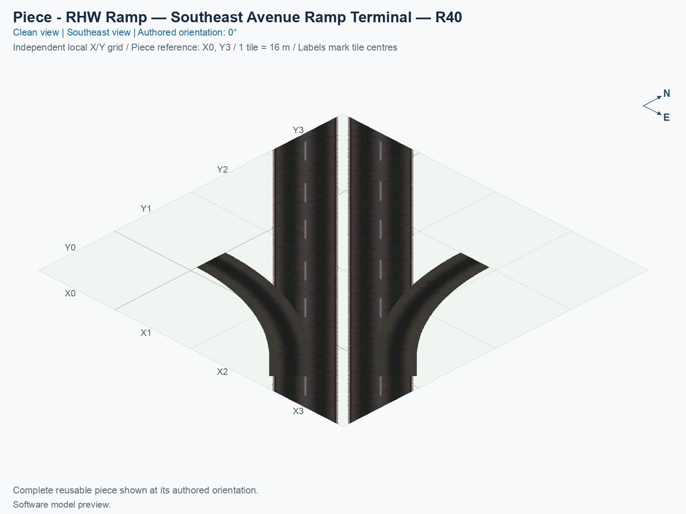
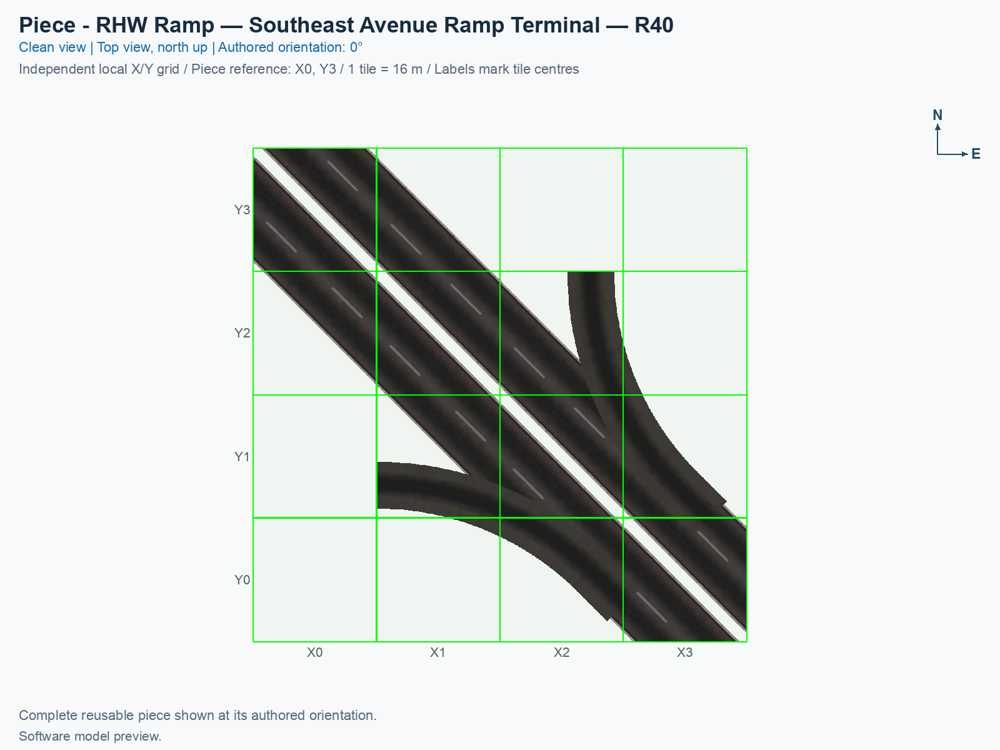

# RHW Ramp — Southeast Avenue Ramp Terminal — R40

Purpose: join separate ramp ends to the adjacent Avenue carriageway while retaining its car and pedestrian services.

<!-- PIECE README LAYOUT: 2 -->

[1. Views](#1-views) · [2. Piece and placement](#2-piece-and-placement) · [3. Connection matrix](#3-connection-matrix) · [Testing ↗ (separate document)](TESTING.md)

## 1. Views

The angled and north-up views render the actual saved game models and their referenced textures. The connection overview uses the shared complete-boundary cards, including nonzero endpoint slopes.

<!-- BEGIN PIECE VIEWS -->

<!-- END PIECE VIEWS -->

## 2. Piece and placement

This ground-level terminal joins two separately placed ramp ends to the adjacent Avenue carriageway. R40 means the new circular road centreline has a 40 m radius. The Avenue, its native car lanes, and both pedestrian paths continue through the component. Ramp traffic makes right turns only; it cannot cross the opposing Avenue carriageway.

A **construction tile** is a 16 × 16 m city square occupied by this piece. This piece owns 12 tiles inside a 4 × 4-tile bounding rectangle. Model artwork can extend beyond an owned tile; the assembly plan keeps the construction ownership separate.

1. Prepare Windows SimCity 4 with the exact NAM 50 right-hand-traffic inputs in the [build guide](../../../../docs/BUILD_AND_INSTALL.md), including the adaptive Avenue capture for the stamp and terminals.
2. Open a disposable city and flatten the full 10 × 10-tile placement area.
3. Open **Transportation → Highways**, and select **SCP | ASSEMBLY | DD RHW-4 — Modular Diagonal Avenue Diamond**. Press **Tab** or **Shift+Tab** until **RHW Ramp — Southeast Avenue Ramp Terminal — R40** appears. Each click places just this component.
4. Follow the [assembly placement table](../../01_assemblies/ddrhw-l1-and-l2-diagonal-avenue-modular-diamond/README.md#3-placements) for the reference tile and rotation. Press **Home** or **End** to rotate, then click once at the specified reference position.
5. After the seven parts are placed, extend ordinary diagonal Avenue approaches from the two outer Avenue ends. Placing over an existing Avenue or dragging through occupied pieces remains a separate unverified game test.

These are fixed-height click-to-place components. Their geometry does not follow sloping terrain. Eight selection states repeat four rotations; they do not reflect the traffic directions. Custom attachments must match the whole connector card, including position, height, heading, slope, direction, and all services. A matching card alone does not prove that barriers and road surfaces fit; see [TESTING.md](TESTING.md).

<!-- BEGIN PIECE OVERVIEW -->

Independently placed southeast avenue ramp terminal — r40. Use its complete connection cards; it attaches outside the highway stamp and owns no highway tiles.

Exact reusable identifier: `ddrhw-modular-southeast-terminal-r40`.

Footprint: **4 × 4 tiles**. Exact menu name: **RHW Ramp — Southeast Avenue Ramp Terminal — R40**.

<!-- END PIECE OVERVIEW -->

## 3. Connection matrix

The generated matrix describes movements within this piece. A connector overview, when supplied, describes its exposed boundaries; neither establishes compatibility with an untested neighbour.

<!-- BEGIN PIECE CONNECTION MATRIX -->

### Directed entrance/exit matrix

Read **from an entrance row to an exit column**. **Saved PATH** checks the saved traffic route; **Route Query** checks the route shown by the game; **Visible travel** checks a vehicle completing that journey. For HSR, visible travel means a moving train.

**Game appearance:** [?](TESTING.md#case-in_game_render-0ba22ff44a0fce73cad8) — the complete piece’s appearance in the game, checked separately from its journeys.

**Legend:** ✅ confirmed; ❌ failed; ? not established. **Forbidden** means the movement is unavailable; its in-game check confirms that it stays unavailable. Click a result for its exact test case. Scope, evidence, and limitations remain in [the test checklist](TESTING.md#test-checklist).

| Entrance ↓ / Exit → | **Road · North exit** `1-N-out-3` Variant: avenue-ground | **Road · North exit** `1-N-out-4` Variant: avenue-ground | **Road · North exit** `1-N-out-6` Variant: avenue-ground | **Road · South exit** `1-S-out-7` Variant: avenue-ground | **Road · South exit** `1-S-out-8` Variant: avenue-ground | **Pedestrian · North exit** `2-N-out-2` Variant: avenue-sidewalk | **Pedestrian · South exit** `2-S-out-3` Variant: avenue-sidewalk |
| --- | --- | --- | --- | --- | --- | --- | --- |
| **Road · West entrance** `1-W-in-1` Variant: avenue-ground | **Forbidden** **Saved PATH:** [?](TESTING.md#case-software_connectivity-b6efdc00b8593789a710) In-game check: [?](TESTING.md#case-in_game_forbidden_transfer-c7b49c5bf0b1c4638caf) | **Forbidden** **Saved PATH:** [?](TESTING.md#case-software_connectivity-b6efdc00b8593789a710) In-game check: [?](TESTING.md#case-in_game_forbidden_transfer-087e6dd948144da3d942) | **Forbidden** **Saved PATH:** [?](TESTING.md#case-software_connectivity-b6efdc00b8593789a710) In-game check: [?](TESTING.md#case-in_game_forbidden_transfer-95084b033c3e2ce52325) | **Saved PATH:** [?](TESTING.md#case-software_connectivity-b6efdc00b8593789a710) **Route Query:** [?](TESTING.md#case-in_game_route_query-f86768c787cd597f11ef) **Visible travel:** [?](TESTING.md#case-in_game_visible_travel-f86768c787cd597f11ef) | **Forbidden** **Saved PATH:** [?](TESTING.md#case-software_connectivity-b6efdc00b8593789a710) In-game check: [?](TESTING.md#case-in_game_forbidden_transfer-1a5485ae0924e8a5a877) | **Forbidden** **Saved PATH:** [?](TESTING.md#case-software_connectivity-b6efdc00b8593789a710) In-game check: [?](TESTING.md#case-in_game_forbidden_transfer-3cc346cb27c2964a31ed) | **Forbidden** **Saved PATH:** [?](TESTING.md#case-software_connectivity-b6efdc00b8593789a710) In-game check: [?](TESTING.md#case-in_game_forbidden_transfer-9bef7574ac25eab6801c) |
| **Road · West entrance** `1-W-in-2` Variant: avenue-ground | **Forbidden** **Saved PATH:** [?](TESTING.md#case-software_connectivity-b6efdc00b8593789a710) In-game check: [?](TESTING.md#case-in_game_forbidden_transfer-1fa33831b943553ec362) | **Forbidden** **Saved PATH:** [?](TESTING.md#case-software_connectivity-b6efdc00b8593789a710) In-game check: [?](TESTING.md#case-in_game_forbidden_transfer-fd4a93eab00880b85a8d) | **Forbidden** **Saved PATH:** [?](TESTING.md#case-software_connectivity-b6efdc00b8593789a710) In-game check: [?](TESTING.md#case-in_game_forbidden_transfer-d6939790f340d80a4624) | **Forbidden** **Saved PATH:** [?](TESTING.md#case-software_connectivity-b6efdc00b8593789a710) In-game check: [?](TESTING.md#case-in_game_forbidden_transfer-f93bcc178c21851de17b) | **Saved PATH:** [?](TESTING.md#case-software_connectivity-b6efdc00b8593789a710) **Route Query:** [?](TESTING.md#case-in_game_route_query-430419d30f4ee1c87cb2) **Visible travel:** [?](TESTING.md#case-in_game_visible_travel-430419d30f4ee1c87cb2) | **Forbidden** **Saved PATH:** [?](TESTING.md#case-software_connectivity-b6efdc00b8593789a710) In-game check: [?](TESTING.md#case-in_game_forbidden_transfer-5a85e7ead6e784661967) | **Forbidden** **Saved PATH:** [?](TESTING.md#case-software_connectivity-b6efdc00b8593789a710) In-game check: [?](TESTING.md#case-in_game_forbidden_transfer-ce3968629509680681df) |
| **Road · West entrance** `1-W-in-5` Variant: avenue-ground | **Forbidden** **Saved PATH:** [?](TESTING.md#case-software_connectivity-b6efdc00b8593789a710) In-game check: [?](TESTING.md#case-in_game_forbidden_transfer-0a163fa84f06745d658f) | **Forbidden** **Saved PATH:** [?](TESTING.md#case-software_connectivity-b6efdc00b8593789a710) In-game check: [?](TESTING.md#case-in_game_forbidden_transfer-862d9327e9353f65d4ed) | **Forbidden** **Saved PATH:** [?](TESTING.md#case-software_connectivity-b6efdc00b8593789a710) In-game check: [?](TESTING.md#case-in_game_forbidden_transfer-9bae7e4b910fd7d3acd3) | **Saved PATH:** [?](TESTING.md#case-software_connectivity-b6efdc00b8593789a710) **Route Query:** [?](TESTING.md#case-in_game_route_query-a820a0d14e530178a493) **Visible travel:** [?](TESTING.md#case-in_game_visible_travel-a820a0d14e530178a493) | **Forbidden** **Saved PATH:** [?](TESTING.md#case-software_connectivity-b6efdc00b8593789a710) In-game check: [?](TESTING.md#case-in_game_forbidden_transfer-2c1e2dabac160a490eeb) | **Forbidden** **Saved PATH:** [?](TESTING.md#case-software_connectivity-b6efdc00b8593789a710) In-game check: [?](TESTING.md#case-in_game_forbidden_transfer-498c378cf8ce2bef9492) | **Forbidden** **Saved PATH:** [?](TESTING.md#case-software_connectivity-b6efdc00b8593789a710) In-game check: [?](TESTING.md#case-in_game_forbidden_transfer-6c0969c18ca8e8b6963c) |
| **Road · East entrance** `1-E-in-9` Variant: avenue-ground | **Saved PATH:** [?](TESTING.md#case-software_connectivity-b6efdc00b8593789a710) **Route Query:** [?](TESTING.md#case-in_game_route_query-0b71e593c96f69838f53) **Visible travel:** [?](TESTING.md#case-in_game_visible_travel-0b71e593c96f69838f53) | **Forbidden** **Saved PATH:** [?](TESTING.md#case-software_connectivity-b6efdc00b8593789a710) In-game check: [?](TESTING.md#case-in_game_forbidden_transfer-8019354560e0e2b22827) | **Forbidden** **Saved PATH:** [?](TESTING.md#case-software_connectivity-b6efdc00b8593789a710) In-game check: [?](TESTING.md#case-in_game_forbidden_transfer-6aa3de870cacb4aa2a90) | **Forbidden** **Saved PATH:** [?](TESTING.md#case-software_connectivity-b6efdc00b8593789a710) In-game check: [?](TESTING.md#case-in_game_forbidden_transfer-f7e7a3474f6420a88be9) | **Forbidden** **Saved PATH:** [?](TESTING.md#case-software_connectivity-b6efdc00b8593789a710) In-game check: [?](TESTING.md#case-in_game_forbidden_transfer-249c0726b2e89caf4658) | **Forbidden** **Saved PATH:** [?](TESTING.md#case-software_connectivity-b6efdc00b8593789a710) In-game check: [?](TESTING.md#case-in_game_forbidden_transfer-f18ed201fb7336c192ee) | **Forbidden** **Saved PATH:** [?](TESTING.md#case-software_connectivity-b6efdc00b8593789a710) In-game check: [?](TESTING.md#case-in_game_forbidden_transfer-37656fbb4ecc83c83675) |
| **Road · East entrance** `1-E-in-10` Variant: avenue-ground | **Forbidden** **Saved PATH:** [?](TESTING.md#case-software_connectivity-b6efdc00b8593789a710) In-game check: [?](TESTING.md#case-in_game_forbidden_transfer-38aa41fd5a28d70337ce) | **Saved PATH:** [?](TESTING.md#case-software_connectivity-b6efdc00b8593789a710) **Route Query:** [?](TESTING.md#case-in_game_route_query-3bcca2e8d74867acfbea) **Visible travel:** [?](TESTING.md#case-in_game_visible_travel-3bcca2e8d74867acfbea) | **Saved PATH:** [?](TESTING.md#case-software_connectivity-b6efdc00b8593789a710) **Route Query:** [?](TESTING.md#case-in_game_route_query-d45666cc8bbd549a700b) **Visible travel:** [?](TESTING.md#case-in_game_visible_travel-d45666cc8bbd549a700b) | **Forbidden** **Saved PATH:** [?](TESTING.md#case-software_connectivity-b6efdc00b8593789a710) In-game check: [?](TESTING.md#case-in_game_forbidden_transfer-49aed7aeeeb3ad36b2a1) | **Forbidden** **Saved PATH:** [?](TESTING.md#case-software_connectivity-b6efdc00b8593789a710) In-game check: [?](TESTING.md#case-in_game_forbidden_transfer-f652f871da4a493b5f9c) | **Forbidden** **Saved PATH:** [?](TESTING.md#case-software_connectivity-b6efdc00b8593789a710) In-game check: [?](TESTING.md#case-in_game_forbidden_transfer-ca169386123b49ebe400) | **Forbidden** **Saved PATH:** [?](TESTING.md#case-software_connectivity-b6efdc00b8593789a710) In-game check: [?](TESTING.md#case-in_game_forbidden_transfer-c997743d951f10536961) |
| **Pedestrian · West entrance** `2-W-in-1` Variant: avenue-sidewalk | **Forbidden** **Saved PATH:** [?](TESTING.md#case-software_connectivity-b6efdc00b8593789a710) In-game check: [?](TESTING.md#case-in_game_forbidden_transfer-53722bb41725bcf6e838) | **Forbidden** **Saved PATH:** [?](TESTING.md#case-software_connectivity-b6efdc00b8593789a710) In-game check: [?](TESTING.md#case-in_game_forbidden_transfer-5c0e7d4af4d2c38b8639) | **Forbidden** **Saved PATH:** [?](TESTING.md#case-software_connectivity-b6efdc00b8593789a710) In-game check: [?](TESTING.md#case-in_game_forbidden_transfer-207acf04558cbdb4ab87) | **Forbidden** **Saved PATH:** [?](TESTING.md#case-software_connectivity-b6efdc00b8593789a710) In-game check: [?](TESTING.md#case-in_game_forbidden_transfer-32a0b7d9aa20a5cc1c4d) | **Forbidden** **Saved PATH:** [?](TESTING.md#case-software_connectivity-b6efdc00b8593789a710) In-game check: [?](TESTING.md#case-in_game_forbidden_transfer-c3f9f6c1f2726c6f5356) | **Forbidden** **Saved PATH:** [?](TESTING.md#case-software_connectivity-b6efdc00b8593789a710) In-game check: [?](TESTING.md#case-in_game_forbidden_transfer-9cb9c104e41637a415de) | **Saved PATH:** [?](TESTING.md#case-software_connectivity-b6efdc00b8593789a710) **Route Query:** [?](TESTING.md#case-in_game_route_query-185ae6aae6d39dda2e7b) **Visible travel:** [?](TESTING.md#case-in_game_visible_travel-185ae6aae6d39dda2e7b) |
| **Pedestrian · East entrance** `2-E-in-4` Variant: avenue-sidewalk | **Forbidden** **Saved PATH:** [?](TESTING.md#case-software_connectivity-b6efdc00b8593789a710) In-game check: [?](TESTING.md#case-in_game_forbidden_transfer-a7f15f649af8daf77741) | **Forbidden** **Saved PATH:** [?](TESTING.md#case-software_connectivity-b6efdc00b8593789a710) In-game check: [?](TESTING.md#case-in_game_forbidden_transfer-de5b9d10bb3bb1e44a28) | **Forbidden** **Saved PATH:** [?](TESTING.md#case-software_connectivity-b6efdc00b8593789a710) In-game check: [?](TESTING.md#case-in_game_forbidden_transfer-c31ad6f5930aa45c977c) | **Forbidden** **Saved PATH:** [?](TESTING.md#case-software_connectivity-b6efdc00b8593789a710) In-game check: [?](TESTING.md#case-in_game_forbidden_transfer-e1a46a0e4d537191efa5) | **Forbidden** **Saved PATH:** [?](TESTING.md#case-software_connectivity-b6efdc00b8593789a710) In-game check: [?](TESTING.md#case-in_game_forbidden_transfer-ebbb62dcd732e1c9b011) | **Saved PATH:** [?](TESTING.md#case-software_connectivity-b6efdc00b8593789a710) **Route Query:** [?](TESTING.md#case-in_game_route_query-e728b4f1c2be1ff9f2d4) **Visible travel:** [?](TESTING.md#case-in_game_visible_travel-e728b4f1c2be1ff9f2d4) | **Forbidden** **Saved PATH:** [?](TESTING.md#case-software_connectivity-b6efdc00b8593789a710) In-game check: [?](TESTING.md#case-in_game_forbidden_transfer-6ed76464a75038b11c03) |

Source: [connections.json](connections.json).

<!-- END PIECE CONNECTION MATRIX -->

<!-- BEGIN CONNECTOR OVERVIEW -->

### Connection overview

Generated from this piece's source-bound connector metadata and the current compiled model; marker letters refer to the boundary cards below.

[Rendering sources and verification scope](evidence/connection-overview.json).

Headings: 0° = North, 90° = East, 180° = South, and 270° = West; clockwise in plan view, pointing out of the piece.

Coordinates [E,N,H] = [east,north,height] in metres. Source cells [column,row] increase east and south.

Display grid: X = source column − (0); Y = 3 − source row.

Slope is measured outward at the joining edge; the interior may differ. Offsets are + left and − right facing out of the tile edge.

Member offsets use the section origin. Counts distinguish physical channels / edge cuts / directed members; modes do not multiply channels.

Incoming flow enters this piece; outgoing flow leaves it. Letters identify boundary cards; source IDs remain the stable identities.

Not declared means no section origin or offset was authored. Its marker uses an actual member endpoint; the measured intersections remain authoritative.

#### Boundary A: `boundary-02`

All 2 service groups are required together at this edge.

##### Service group 1 / 2: ROAD — Custom (0 m)

| Field | Value |
| --- | --- |
| End / component | `boundary-02-avenue-mainline-01` / `avenue-mainline` |
| Network / game class / role | road / Engine class (1); primary |
| Source cell / edge | `[0,0]` / North |
| Section origin [E,N] (m) | Not declared; see member endpoints |
| Centring / section offset | Not declared |
| Level (path height) | Custom (0 m); no nominal level |
| Outward heading | 315° |
| Slope at joining edge | 0% outward |
| Channels / edge cuts / directed members | 2 / 2 / 2 |
| Traffic arrangement / running | 0 incoming; 2 outgoing; See member directions |
| Channel spacing | 4.52548 m |
| Channel kinds | road-lane |
| Traffic modes | car |
| Profile | No profile reference |

| Member / measured source | Channel / cut / modes | Flow | Endpoint [E,N,H] (m) | Offset (m) | Outward heading | Edge slope (%) |
| --- | --- | --- | --- | ---: | ---: | ---: |
| `member-1-n-out-3` / `1-N-out-3` | `avenue-lane-02` / `cut-1-n-out-3` / car | Outgoing | `[-3.2,8,0]` | Not declared | 315° | 0 |
| `member-1-n-out-4` / `1-N-out-4` | `avenue-lane-01` / `cut-1-n-out-4` / car | Outgoing | `[3.2,8,0]` | Not declared | 315° | 0 |

##### Service group 2 / 2: PEDESTRIAN — Custom (0 m)

| Field | Value |
| --- | --- |
| End / component | `boundary-02-avenue-walkways-02` / `avenue-walkways` |
| Network / game class / role | pedestrian / Engine class (2); primary |
| Source cell / edge | `[0,0]` / North |
| Section origin [E,N] (m) | Not declared; see member endpoints |
| Centring / section offset | Not declared |
| Level (path height) | Custom (0 m); no nominal level |
| Outward heading | 315° |
| Slope at joining edge | 0% outward |
| Channels / edge cuts / directed members | 1 / 1 / 1 |
| Traffic arrangement / running | 0 incoming; 1 outgoing; See member directions |
| Channel spacing | See individual measured intersections |
| Channel kinds | walkway |
| Traffic modes | pedestrian |
| Profile | No profile reference |

| Member / measured source | Channel / cut / modes | Flow | Endpoint [E,N,H] (m) | Offset (m) | Outward heading | Edge slope (%) |
| --- | --- | --- | --- | ---: | ---: | ---: |
| `member-2-n-out-2` / `2-N-out-2` | `avenue-walkway-01` / `cut-2-n-out-2` / pedestrian | Outgoing | `[7.3,8,0]` | Not declared | 315° | 0 |

#### Boundary B: `boundary-01`

All 2 service groups are required together at this edge.

##### Service group 1 / 2: ROAD — Custom (0 m)

| Field | Value |
| --- | --- |
| End / component | `boundary-01-avenue-mainline-01` / `avenue-mainline` |
| Network / game class / role | road / Engine class (1); primary |
| Source cell / edge | `[0,0]` / West |
| Section origin [E,N] (m) | Not declared; see member endpoints |
| Centring / section offset | Not declared |
| Level (path height) | Custom (0 m); no nominal level |
| Outward heading | 315° |
| Slope at joining edge | 0% outward |
| Channels / edge cuts / directed members | 2 / 2 / 2 |
| Traffic arrangement / running | 2 incoming; 0 outgoing; See member directions |
| Channel spacing | 4.52548 m |
| Channel kinds | road-lane |
| Traffic modes | car |
| Profile | No profile reference |

| Member / measured source | Channel / cut / modes | Flow | Endpoint [E,N,H] (m) | Offset (m) | Outward heading | Edge slope (%) |
| --- | --- | --- | --- | ---: | ---: | ---: |
| `member-1-w-in-1` / `1-W-in-1` | `avenue-lane-04` / `cut-1-w-in-1` / car | Incoming | `[-8,-3.2,0]` | Not declared | 315° | 0 |
| `member-1-w-in-2` / `1-W-in-2` | `avenue-lane-03` / `cut-1-w-in-2` / car | Incoming | `[-8,3.2,0]` | Not declared | 315° | 0 |

##### Service group 2 / 2: PEDESTRIAN — Custom (0 m)

| Field | Value |
| --- | --- |
| End / component | `boundary-01-avenue-walkways-02` / `avenue-walkways` |
| Network / game class / role | pedestrian / Engine class (2); primary |
| Source cell / edge | `[0,0]` / West |
| Section origin [E,N] (m) | Not declared; see member endpoints |
| Centring / section offset | Not declared |
| Level (path height) | Custom (0 m); no nominal level |
| Outward heading | 315° |
| Slope at joining edge | 0% outward |
| Channels / edge cuts / directed members | 1 / 1 / 1 |
| Traffic arrangement / running | 1 incoming; 0 outgoing; See member directions |
| Channel spacing | See individual measured intersections |
| Channel kinds | walkway |
| Traffic modes | pedestrian |
| Profile | No profile reference |

| Member / measured source | Channel / cut / modes | Flow | Endpoint [E,N,H] (m) | Offset (m) | Outward heading | Edge slope (%) |
| --- | --- | --- | --- | ---: | ---: | ---: |
| `member-2-w-in-1` / `2-W-in-1` | `avenue-walkway-02` / `cut-2-w-in-1` / pedestrian | Incoming | `[-8,-7.3,0]` | Not declared | 315° | 0 |

#### Boundary C: `boundary-03`

This service group is required at this edge.

##### Service group 1 / 1: ROAD — Custom (0 m)

| Field | Value |
| --- | --- |
| End / component | `boundary-03-avenue-mainline-01` / `avenue-mainline` |
| Network / game class / role | road / Engine class (1); primary |
| Source cell / edge | `[1,2]` / West |
| Section origin [E,N] (m) | Not declared; see member endpoints |
| Centring / section offset | Not declared |
| Level (path height) | Custom (0 m); no nominal level |
| Outward heading | 270° (West) |
| Slope at joining edge | 0% outward |
| Channels / edge cuts / directed members | 1 / 1 / 1 |
| Traffic arrangement / running | 1 incoming; 0 outgoing; See member directions |
| Channel spacing | See individual measured intersections |
| Channel kinds | road-lane |
| Traffic modes | car |
| Profile | No profile reference |

| Member / measured source | Channel / cut / modes | Flow | Endpoint [E,N,H] (m) | Offset (m) | Outward heading | Edge slope (%) |
| --- | --- | --- | --- | ---: | ---: | ---: |
| `member-1-w-in-5` / `1-W-in-5` | `avenue-ramp-01` / `cut-1-w-in-5` / car | Incoming | `[8,-35.7685,0]` | Not declared | 270° | 0 |

#### Boundary D: `boundary-04`

This service group is required at this edge.

##### Service group 1 / 1: ROAD — Custom (0 m)

| Field | Value |
| --- | --- |
| End / component | `boundary-04-avenue-mainline-01` / `avenue-mainline` |
| Network / game class / role | road / Engine class (1); primary |
| Source cell / edge | `[2,1]` / North |
| Section origin [E,N] (m) | Not declared; see member endpoints |
| Centring / section offset | Not declared |
| Level (path height) | Custom (0 m); no nominal level |
| Outward heading | 0° (North) |
| Slope at joining edge | 0% outward |
| Channels / edge cuts / directed members | 1 / 1 / 1 |
| Traffic arrangement / running | 0 incoming; 1 outgoing; See member directions |
| Channel spacing | See individual measured intersections |
| Channel kinds | road-lane |
| Traffic modes | car |
| Profile | No profile reference |

| Member / measured source | Channel / cut / modes | Flow | Endpoint [E,N,H] (m) | Offset (m) | Outward heading | Edge slope (%) |
| --- | --- | --- | --- | ---: | ---: | ---: |
| `member-1-n-out-6` / `1-N-out-6` | `avenue-ramp-02` / `cut-1-n-out-6` / car | Outgoing | `[35.7685,-8,0]` | Not declared | 0° | 0 |

#### Boundary E: `boundary-06`

All 2 service groups are required together at this edge.

##### Service group 1 / 2: ROAD — Custom (0 m)

| Field | Value |
| --- | --- |
| End / component | `boundary-06-avenue-mainline-01` / `avenue-mainline` |
| Network / game class / role | road / Engine class (1); primary |
| Source cell / edge | `[3,3]` / South |
| Section origin [E,N] (m) | Not declared; see member endpoints |
| Centring / section offset | Not declared |
| Level (path height) | Custom (0 m); no nominal level |
| Outward heading | 135° |
| Slope at joining edge | 0% outward |
| Channels / edge cuts / directed members | 2 / 2 / 2 |
| Traffic arrangement / running | 0 incoming; 2 outgoing; See member directions |
| Channel spacing | 4.52548 m |
| Channel kinds | road-lane |
| Traffic modes | car |
| Profile | No profile reference |

| Member / measured source | Channel / cut / modes | Flow | Endpoint [E,N,H] (m) | Offset (m) | Outward heading | Edge slope (%) |
| --- | --- | --- | --- | ---: | ---: | ---: |
| `member-1-s-out-7` / `1-S-out-7` | `avenue-lane-04` / `cut-1-s-out-7` / car | Outgoing | `[44.8,-56,0]` | Not declared | 135° | 0 |
| `member-1-s-out-8` / `1-S-out-8` | `avenue-lane-03` / `cut-1-s-out-8` / car | Outgoing | `[51.2,-56,0]` | Not declared | 135° | 0 |

##### Service group 2 / 2: PEDESTRIAN — Custom (0 m)

| Field | Value |
| --- | --- |
| End / component | `boundary-06-avenue-walkways-02` / `avenue-walkways` |
| Network / game class / role | pedestrian / Engine class (2); primary |
| Source cell / edge | `[3,3]` / South |
| Section origin [E,N] (m) | Not declared; see member endpoints |
| Centring / section offset | Not declared |
| Level (path height) | Custom (0 m); no nominal level |
| Outward heading | 135° |
| Slope at joining edge | 0% outward |
| Channels / edge cuts / directed members | 1 / 1 / 1 |
| Traffic arrangement / running | 0 incoming; 1 outgoing; See member directions |
| Channel spacing | See individual measured intersections |
| Channel kinds | walkway |
| Traffic modes | pedestrian |
| Profile | No profile reference |

| Member / measured source | Channel / cut / modes | Flow | Endpoint [E,N,H] (m) | Offset (m) | Outward heading | Edge slope (%) |
| --- | --- | --- | --- | ---: | ---: | ---: |
| `member-2-s-out-3` / `2-S-out-3` | `avenue-walkway-02` / `cut-2-s-out-3` / pedestrian | Outgoing | `[40.7,-56,0]` | Not declared | 135° | 0 |

#### Boundary F: `boundary-05`

All 2 service groups are required together at this edge.

##### Service group 1 / 2: ROAD — Custom (0 m)

| Field | Value |
| --- | --- |
| End / component | `boundary-05-avenue-mainline-01` / `avenue-mainline` |
| Network / game class / role | road / Engine class (1); primary |
| Source cell / edge | `[3,3]` / East |
| Section origin [E,N] (m) | Not declared; see member endpoints |
| Centring / section offset | Not declared |
| Level (path height) | Custom (0 m); no nominal level |
| Outward heading | 135° |
| Slope at joining edge | 0% outward |
| Channels / edge cuts / directed members | 2 / 2 / 2 |
| Traffic arrangement / running | 2 incoming; 0 outgoing; See member directions |
| Channel spacing | 4.52548 m |
| Channel kinds | road-lane |
| Traffic modes | car |
| Profile | No profile reference |

| Member / measured source | Channel / cut / modes | Flow | Endpoint [E,N,H] (m) | Offset (m) | Outward heading | Edge slope (%) |
| --- | --- | --- | --- | ---: | ---: | ---: |
| `member-1-e-in-10` / `1-E-in-10` | `avenue-lane-01` / `cut-1-e-in-10` / car | Incoming | `[56,-44.8,0]` | Not declared | 135° | 0 |
| `member-1-e-in-9` / `1-E-in-9` | `avenue-lane-02` / `cut-1-e-in-9` / car | Incoming | `[56,-51.2,0]` | Not declared | 135° | 0 |

##### Service group 2 / 2: PEDESTRIAN — Custom (0 m)

| Field | Value |
| --- | --- |
| End / component | `boundary-05-avenue-walkways-02` / `avenue-walkways` |
| Network / game class / role | pedestrian / Engine class (2); primary |
| Source cell / edge | `[3,3]` / East |
| Section origin [E,N] (m) | Not declared; see member endpoints |
| Centring / section offset | Not declared |
| Level (path height) | Custom (0 m); no nominal level |
| Outward heading | 135° |
| Slope at joining edge | 0% outward |
| Channels / edge cuts / directed members | 1 / 1 / 1 |
| Traffic arrangement / running | 1 incoming; 0 outgoing; See member directions |
| Channel spacing | See individual measured intersections |
| Channel kinds | walkway |
| Traffic modes | pedestrian |
| Profile | No profile reference |

| Member / measured source | Channel / cut / modes | Flow | Endpoint [E,N,H] (m) | Offset (m) | Outward heading | Edge slope (%) |
| --- | --- | --- | --- | ---: | ---: | ---: |
| `member-2-e-in-4` / `2-E-in-4` | `avenue-walkway-01` / `cut-2-e-in-4` / pedestrian | Incoming | `[56,-40.7,0]` | Not declared | 135° | 0 |

The overview uses source metadata, current compiled resource identities, and the saved model. Current placement, connection, and traffic results belong to the generated connection matrix and linked testing records.

<!-- END CONNECTOR OVERVIEW -->
