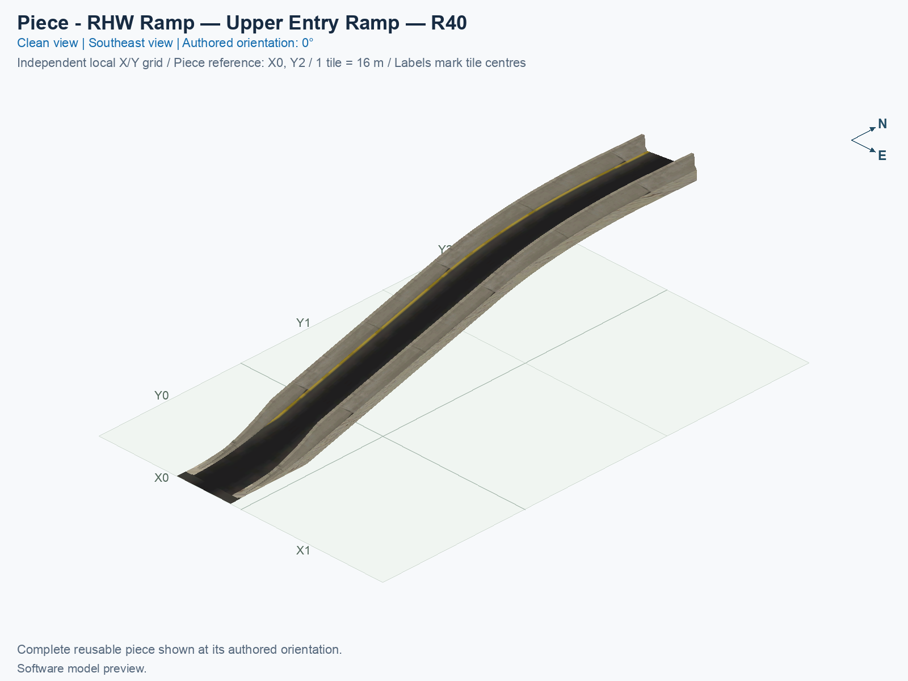
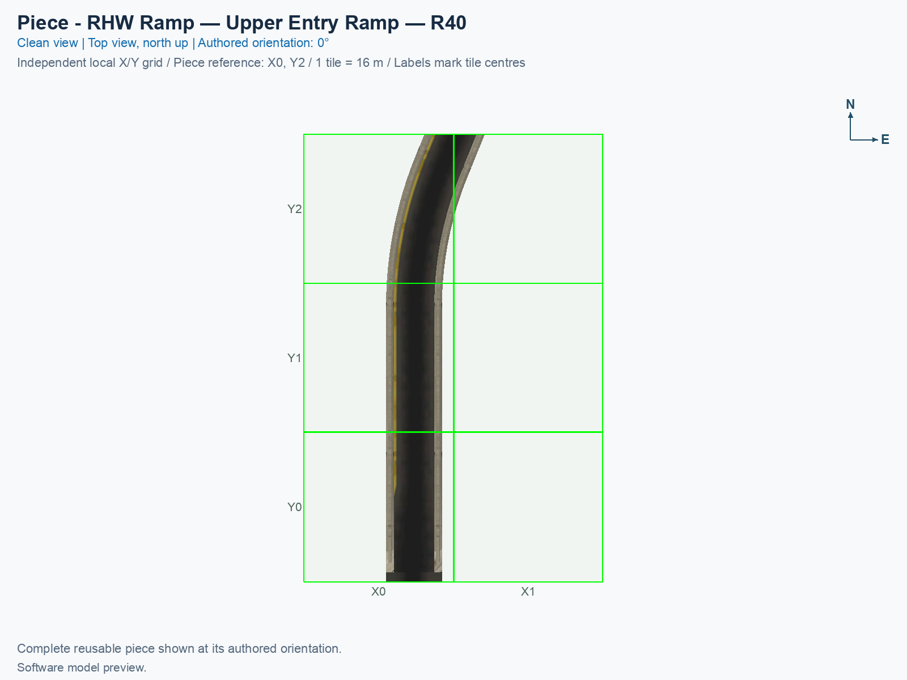
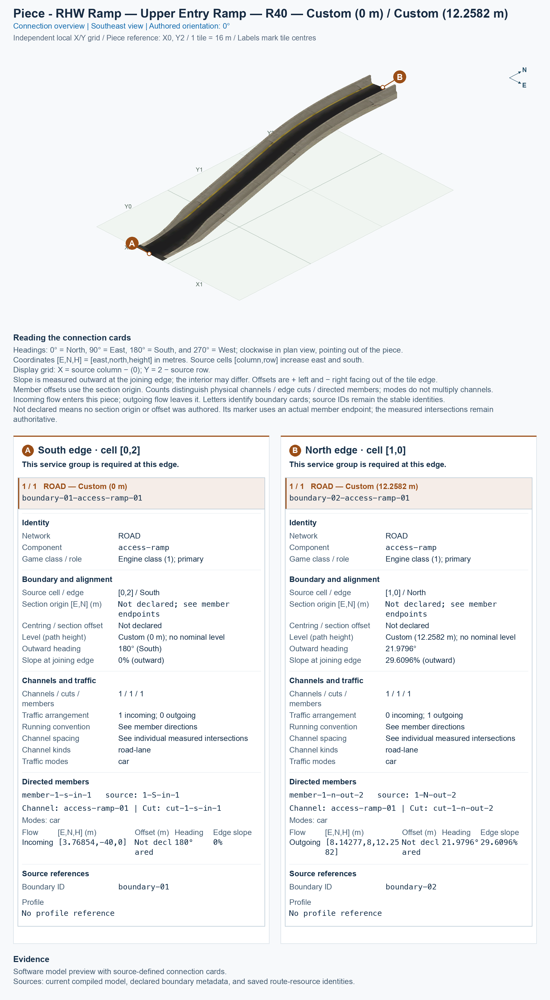

# RHW Ramp — Upper Entry Ramp — R40

Purpose: attach this independently placed ramp between its fixed highway opening and matching Avenue terminal.

<!-- PIECE README LAYOUT: 2 -->

[1. Views](#1-views) · [2. Piece and placement](#2-piece-and-placement) · [3. Connection matrix](#3-connection-matrix) · [Testing ↗ (separate document)](TESTING.md)

## 1. Views

The angled and north-up views render the actual saved game models and their referenced textures. The connection overview uses the shared complete-boundary cards, including nonzero endpoint slopes.

<!-- BEGIN PIECE VIEWS -->

<!-- END PIECE VIEWS -->

## 2. Piece and placement

This separately placed on-ramp, carrying cars up to the highway, connects a fixed sloped opening on the upper deck at 15 m to its matching R40 Avenue terminal. R40 means the new circular centreline section has a 40 m radius. The first 2 m beside the highway retain the original pavement, barriers, slope, and texture alignment. The ground end is exactly level, with a 1 m straight joining chord.

A **construction tile** is a 16 × 16 m city square occupied by this piece. This piece owns 4 tiles inside a 2 × 3-tile bounding rectangle. Model artwork can extend beyond an owned tile; the assembly plan keeps the construction ownership separate.

1. Prepare Windows SimCity 4 with the exact NAM 50 right-hand-traffic inputs in the [build guide](../../../../docs/BUILD_AND_INSTALL.md), including the adaptive Avenue capture for the stamp and terminals.
2. Open a disposable city and flatten the full 10 × 10-tile placement area.
3. Open **Transportation → Highways**, and select **SCP | ASSEMBLY | DD RHW-4 — Modular Diagonal Avenue Diamond**. Press **Tab** or **Shift+Tab** until **RHW Ramp — Upper Entry Ramp — R40** appears. Each click places just this component.
4. Follow the [assembly placement table](../../01_assemblies/ddrhw-l1-and-l2-diagonal-avenue-modular-diamond/README.md#3-placements) for the reference tile and rotation. Press **Home** or **End** to rotate, then click once at the specified reference position.
5. After the seven parts are placed, extend ordinary diagonal Avenue approaches from the two outer Avenue ends. Placing over an existing Avenue or dragging through occupied pieces remains a separate unverified game test.

The upper ramp retains a short original high collar whose measured minimum radius is approximately 29.50 m; only the newly authored circular section is R40. Eight selection states repeat four rotations; they do not reflect the traffic directions. Custom attachments must match the whole connector card, including position, height, heading, slope, direction, and all services. A matching card alone does not prove that barriers and road surfaces fit; see [TESTING.md](TESTING.md).

<!-- BEGIN PIECE OVERVIEW -->

Independently placed upper entry ramp — r40. Use its complete connection cards; it attaches outside the highway stamp and owns no highway tiles.

Exact reusable identifier: `ddrhw-modular-upper-entry-r40`.

Footprint: **2 × 3 tiles**. Exact menu name: **RHW Ramp — Upper Entry Ramp — R40**.

<!-- END PIECE OVERVIEW -->

## 3. Connection matrix

The generated matrix describes movements within this piece. A connector overview, when supplied, describes its exposed boundaries; neither establishes compatibility with an untested neighbour.

<!-- BEGIN PIECE CONNECTION MATRIX -->

### Directed entrance/exit matrix

Read **from an entrance row to an exit column**. **Saved PATH** checks the saved traffic route; **Route Query** checks the route shown by the game; **Visible travel** checks a vehicle completing that journey. For HSR, visible travel means a moving train.

**Game appearance:** [?](TESTING.md#case-in_game_render-9ab11444c9d7b0c8ab06) — the complete piece’s appearance in the game, checked separately from its journeys.

**Legend:** ✅ confirmed; ❌ failed; ? not established. **Forbidden** means the movement is unavailable; its in-game check confirms that it stays unavailable. Click a result for its exact test case. Scope, evidence, and limitations remain in [the test checklist](TESTING.md#test-checklist).

| Entrance ↓ / Exit → | **Road · North exit** `1-N-out-2` Variant: access-ramp |
| --- | --- |
| **Road · South entrance** `1-S-in-1` Variant: avenue-ground | **Saved PATH:** [?](TESTING.md#case-software_connectivity-d3975890182d15048d6c) **Route Query:** [?](TESTING.md#case-in_game_route_query-e3b351baf41a6d4a3f95) **Visible travel:** [?](TESTING.md#case-in_game_visible_travel-e3b351baf41a6d4a3f95) |

Source: [connections.json](connections.json).

<!-- END PIECE CONNECTION MATRIX -->

<!-- BEGIN CONNECTOR OVERVIEW -->

### Connection overview

Generated from this piece's source-bound connector metadata and the current compiled model; marker letters refer to the boundary cards below.

[Rendering sources and verification scope](evidence/connection-overview.json).

Headings: 0° = North, 90° = East, 180° = South, and 270° = West; clockwise in plan view, pointing out of the piece.

Coordinates [E,N,H] = [east,north,height] in metres. Source cells [column,row] increase east and south.

Display grid: X = source column − (0); Y = 2 − source row.

Slope is measured outward at the joining edge; the interior may differ. Offsets are + left and − right facing out of the tile edge.

Member offsets use the section origin. Counts distinguish physical channels / edge cuts / directed members; modes do not multiply channels.

Incoming flow enters this piece; outgoing flow leaves it. Letters identify boundary cards; source IDs remain the stable identities.

Not declared means no section origin or offset was authored. Its marker uses an actual member endpoint; the measured intersections remain authoritative.

#### Boundary A: `boundary-01`

This service group is required at this edge.

##### Service group 1 / 1: ROAD — Custom (0 m)

| Field | Value |
| --- | --- |
| End / component | `boundary-01-access-ramp-01` / `access-ramp` |
| Network / game class / role | road / Engine class (1); primary |
| Source cell / edge | `[0,2]` / South |
| Section origin [E,N] (m) | Not declared; see member endpoints |
| Centring / section offset | Not declared |
| Level (path height) | Custom (0 m); no nominal level |
| Outward heading | 180° (South) |
| Slope at joining edge | 0% outward |
| Channels / edge cuts / directed members | 1 / 1 / 1 |
| Traffic arrangement / running | 1 incoming; 0 outgoing; See member directions |
| Channel spacing | See individual measured intersections |
| Channel kinds | road-lane |
| Traffic modes | car |
| Profile | No profile reference |

| Member / measured source | Channel / cut / modes | Flow | Endpoint [E,N,H] (m) | Offset (m) | Outward heading | Edge slope (%) |
| --- | --- | --- | --- | ---: | ---: | ---: |
| `member-1-s-in-1` / `1-S-in-1` | `access-ramp-01` / `cut-1-s-in-1` / car | Incoming | `[3.76854,-40,0]` | Not declared | 180° | 0 |

#### Boundary B: `boundary-02`

This service group is required at this edge.

##### Service group 1 / 1: ROAD — Custom (12.2582 m)

| Field | Value |
| --- | --- |
| End / component | `boundary-02-access-ramp-01` / `access-ramp` |
| Network / game class / role | road / Engine class (1); primary |
| Source cell / edge | `[1,0]` / North |
| Section origin [E,N] (m) | Not declared; see member endpoints |
| Centring / section offset | Not declared |
| Level (path height) | Custom (12.2582 m); no nominal level |
| Outward heading | 21.9796° |
| Slope at joining edge | 29.6096% outward |
| Channels / edge cuts / directed members | 1 / 1 / 1 |
| Traffic arrangement / running | 0 incoming; 1 outgoing; See member directions |
| Channel spacing | See individual measured intersections |
| Channel kinds | road-lane |
| Traffic modes | car |
| Profile | No profile reference |

| Member / measured source | Channel / cut / modes | Flow | Endpoint [E,N,H] (m) | Offset (m) | Outward heading | Edge slope (%) |
| --- | --- | --- | --- | ---: | ---: | ---: |
| `member-1-n-out-2` / `1-N-out-2` | `access-ramp-01` / `cut-1-n-out-2` / car | Outgoing | `[8.14277,8,12.2582]` | Not declared | 21.9796° | 29.6096 |

The overview uses source metadata, current compiled resource identities, and the saved model. Current placement, connection, and traffic results belong to the generated connection matrix and linked testing records.

<!-- END CONNECTOR OVERVIEW -->
