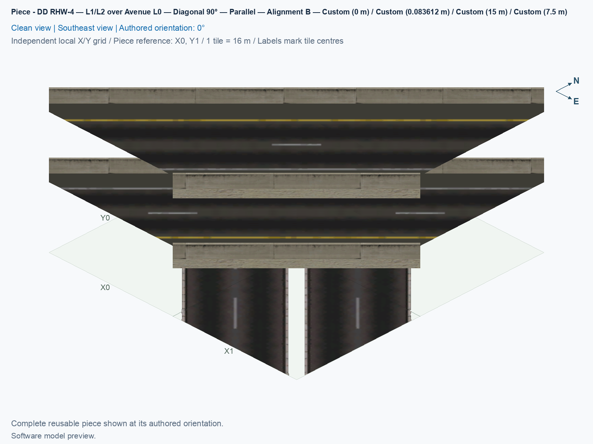
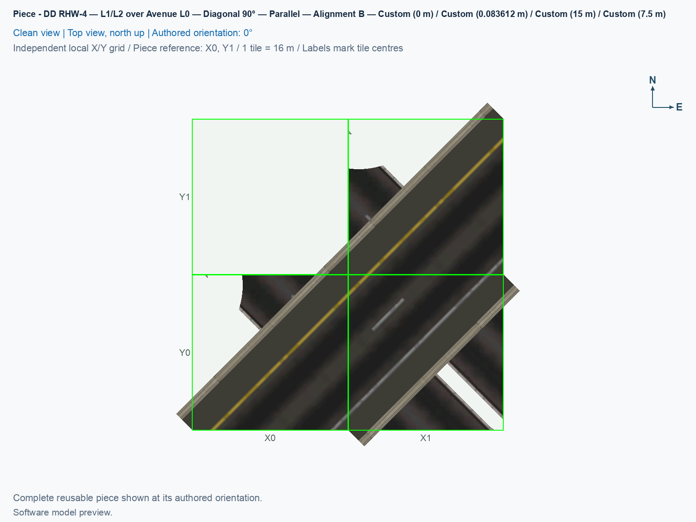

# DD RHW-4 — L1/L2 over Avenue L0 — Diagonal 90° — Parallel — Alignment B

Reusable Alignment B component for the close parallel diagonal diamond.

<!-- PIECE README LAYOUT: 2 -->

[1. Views](#1-views) · [2. Piece and placement](#2-piece-and-placement) · [3. Connection matrix](#3-connection-matrix) · [Testing ↗ (separate document)](TESTING.md)

## 1. Views

The angled view shows this type's actual model and overhang; the north-up view shows its relation to the city grid. These software pictures do not establish game appearance, native-neighbour compatibility, or visible traffic. Use the component's own pictures when comparing it with another type.

<!-- BEGIN PIECE VIEWS -->

<!-- END PIECE VIEWS -->

## 2. Piece and placement

This is the central crossing of a straight double-decker highway and the adjacent diagonal Avenue grid alignment. It retains both highway directions and the native ground Avenue routes.

**Permanent ID:** `ddrhw-parallel-b-crossing`. **Recipe:** `highway_ddrhw_parallel_b_crossing`. This component owns **3 city tiles** inside a **2 × 2 bounding footprint**. Its local occupied cells are **[1,0], [0,1], [1,1]**, measured from the reference corner with columns increasing east and rows increasing south. Empty cells inside that rectangle remain unowned. Ground Avenue at 0 m; lower deck at 7.5 m; upper deck at 15 m.

1. Open **Transportation → Highways → SCP → Assemblies**, and select **SCP | ASSEMBLY | DD RHW-4 — Parallel Diagonal Avenue Diamond — Alignment B**.
2. Starting at P01, leave the first selection unchanged to use **P01 — DD RHW-4 — L1/L2 over Avenue L0 — Diagonal 90° — Parallel — Alignment B**. Shift+Tab moves backward. Each click places this component, rather than the whole junction.
3. In the [B reference layout](../../01_assemblies/ddrhw-l1-and-l2-diagonal-avenue-parallel-diamond-alignment-b/README.md#3-placements), use **X4, Y6**, with the authored **0°** orientation. Home and End rotate the selected type. Match its actual occupied preview cells before clicking; the reference corner can itself be empty.
4. Join only the complete matching B boundary described by its connection card and the assembly placement plan. A similar A model does not establish matching whole-cell PATH ownership. For an independent layout, check every direction, endpoint, height, angle, and grade; compatibility with an untested neighbour remains unverified.

This component owns 3 adaptive Avenue cells. Native ground textures can change with surrounding development, while rotating model props retain this component's non-ground geometry. Its temporary Road helper is local **[0,0]** and is not permanent ownership. Place this crossing before the northwest terminal in the first reference layout, so its empty helper corner remains available.

All B components intentionally generate no custom cast shadows. A **PATH** is the directed game traffic resource; a visible road surface and a PATH connection establish different facts. Preserve this type's complete owned-cell traffic data when reusing it. New B identifiers require fresh placement, and game results are recorded separately in [TESTING.md](TESTING.md).

<!-- BEGIN PIECE OVERVIEW -->

Place one dd rhw / avenue crossing for Alignment B of the close parallel diagonal diamond. Use the complete connection cards and assembly grid; heights are fixed.

Exact reusable identifier: `ddrhw-parallel-b-crossing`.

Footprint: **2 × 2 tiles**. Exact menu name: **DD RHW-4 — L1/L2 over Avenue L0 — Diagonal 90° — Parallel — Alignment B**.

<!-- END PIECE OVERVIEW -->

## 3. Connection matrix

The generated matrix describes this piece's intrinsic measured journeys. Its connector overview identifies exposed boundaries, including any overhang; it does not establish compatibility with an untested neighbour. Route Query and visible travel retain separate observation cases.

<!-- BEGIN PIECE CONNECTION MATRIX -->

### Directed entrance/exit matrix

Read **from an entrance row to an exit column**. **Saved PATH** checks the saved traffic route; **Route Query** checks the route shown by the game; **Visible travel** checks a vehicle completing that journey. For HSR, visible travel means a moving train.

**Game appearance:** [?](TESTING.md#case-in_game_render-750703a675a9a07d952b) — the complete piece’s appearance in the game, checked separately from its journeys.

**Legend:** ✅ confirmed; ❌ failed; ? not established. **Forbidden** means the movement is unavailable; its in-game check confirms that it stays unavailable. Click a result for its exact test case. Scope, evidence, and limitations remain in [the test checklist](TESTING.md#test-checklist).

| Entrance ↓ / Exit → | **Road · West exit** `channel-11-out` Variant: access-ramp | **Road · South exit** `channel-12-out` Variant: dd-rhw-l1 | **Road · South exit** `channel-13-out` Variant: dd-rhw-l1 | **Road · West exit** `channel-14-out` Variant: avenue-ground | **Road · West exit** `channel-15-out` Variant: avenue-ground | **Road · West exit** `channel-16-out` Variant: avenue-ground | **Road · South exit** `channel-17-out` Variant: avenue-ground | **Road · South exit** `channel-18-out` Variant: avenue-ground | **Road · East exit** `channel-19-out` Variant: dd-rhw-l2 | **Road · East exit** `channel-20-out` Variant: dd-rhw-l2 | **Pedestrian · West exit** `channel-23-out` Variant: avenue-sidewalk | **Pedestrian · South exit** `channel-24-out` Variant: avenue-sidewalk |
| --- | --- | --- | --- | --- | --- | --- | --- | --- | --- | --- | --- | --- |
| **Road · North entrance** `channel-01-in` Variant: avenue-ground | **Saved PATH:** [?](TESTING.md#case-software_connectivity-ac43cbf54a8eb207563f) **Route Query:** [?](TESTING.md#case-in_game_route_query-3ed43d64fc51a26a2218) **Visible travel:** [?](TESTING.md#case-in_game_visible_travel-3ed43d64fc51a26a2218) | **Forbidden** **Saved PATH:** [?](TESTING.md#case-software_connectivity-ac43cbf54a8eb207563f) In-game check: [?](TESTING.md#case-in_game_forbidden_transfer-37bc89a1badaff4a6398) | **Forbidden** **Saved PATH:** [?](TESTING.md#case-software_connectivity-ac43cbf54a8eb207563f) In-game check: [?](TESTING.md#case-in_game_forbidden_transfer-6fd65dd3d3d012294183) | **Forbidden** **Saved PATH:** [?](TESTING.md#case-software_connectivity-ac43cbf54a8eb207563f) In-game check: [?](TESTING.md#case-in_game_forbidden_transfer-9785372d68ca7c8c0699) | **Forbidden** **Saved PATH:** [?](TESTING.md#case-software_connectivity-ac43cbf54a8eb207563f) In-game check: [?](TESTING.md#case-in_game_forbidden_transfer-8f46673665af92b3fa08) | **Forbidden** **Saved PATH:** [?](TESTING.md#case-software_connectivity-ac43cbf54a8eb207563f) In-game check: [?](TESTING.md#case-in_game_forbidden_transfer-3b32cd2bb0d2bfb66c41) | **Forbidden** **Saved PATH:** [?](TESTING.md#case-software_connectivity-ac43cbf54a8eb207563f) In-game check: [?](TESTING.md#case-in_game_forbidden_transfer-f1f7e366e28aba325bbb) | **Forbidden** **Saved PATH:** [?](TESTING.md#case-software_connectivity-ac43cbf54a8eb207563f) In-game check: [?](TESTING.md#case-in_game_forbidden_transfer-01de0e66a1ede87763c8) | **Forbidden** **Saved PATH:** [?](TESTING.md#case-software_connectivity-ac43cbf54a8eb207563f) In-game check: [?](TESTING.md#case-in_game_forbidden_transfer-f82d76087291f9ec5277) | **Forbidden** **Saved PATH:** [?](TESTING.md#case-software_connectivity-ac43cbf54a8eb207563f) In-game check: [?](TESTING.md#case-in_game_forbidden_transfer-e48aa38ffb6efa75b2d6) | **Forbidden** **Saved PATH:** [?](TESTING.md#case-software_connectivity-ac43cbf54a8eb207563f) In-game check: [?](TESTING.md#case-in_game_forbidden_transfer-7c62e88780d872cc0932) | **Forbidden** **Saved PATH:** [?](TESTING.md#case-software_connectivity-ac43cbf54a8eb207563f) In-game check: [?](TESTING.md#case-in_game_forbidden_transfer-66f215c25565fb82e3d3) |
| **Road · South entrance** `channel-02-in` Variant: dd-rhw-l2 | **Forbidden** **Saved PATH:** [?](TESTING.md#case-software_connectivity-ac43cbf54a8eb207563f) In-game check: [?](TESTING.md#case-in_game_forbidden_transfer-2e3ef0ae2c54ce9e0e57) | **Forbidden** **Saved PATH:** [?](TESTING.md#case-software_connectivity-ac43cbf54a8eb207563f) In-game check: [?](TESTING.md#case-in_game_forbidden_transfer-e019d2cde7d1c348356f) | **Forbidden** **Saved PATH:** [?](TESTING.md#case-software_connectivity-ac43cbf54a8eb207563f) In-game check: [?](TESTING.md#case-in_game_forbidden_transfer-3a1d7227b702fbc9176c) | **Forbidden** **Saved PATH:** [?](TESTING.md#case-software_connectivity-ac43cbf54a8eb207563f) In-game check: [?](TESTING.md#case-in_game_forbidden_transfer-7921d12d764e241d86e4) | **Forbidden** **Saved PATH:** [?](TESTING.md#case-software_connectivity-ac43cbf54a8eb207563f) In-game check: [?](TESTING.md#case-in_game_forbidden_transfer-8ac2b548dc2abcfacfd6) | **Forbidden** **Saved PATH:** [?](TESTING.md#case-software_connectivity-ac43cbf54a8eb207563f) In-game check: [?](TESTING.md#case-in_game_forbidden_transfer-5a856d25d3a4e2b9eee4) | **Forbidden** **Saved PATH:** [?](TESTING.md#case-software_connectivity-ac43cbf54a8eb207563f) In-game check: [?](TESTING.md#case-in_game_forbidden_transfer-30510e339d331fba685f) | **Forbidden** **Saved PATH:** [?](TESTING.md#case-software_connectivity-ac43cbf54a8eb207563f) In-game check: [?](TESTING.md#case-in_game_forbidden_transfer-7786f98ed1b8c5800efe) | **Forbidden** **Saved PATH:** [?](TESTING.md#case-software_connectivity-ac43cbf54a8eb207563f) In-game check: [?](TESTING.md#case-in_game_forbidden_transfer-cb522bb473605325d02c) | **Saved PATH:** [?](TESTING.md#case-software_connectivity-ac43cbf54a8eb207563f) **Route Query:** [?](TESTING.md#case-in_game_route_query-183a5d686495aa64a6e1) **Visible travel:** [?](TESTING.md#case-in_game_visible_travel-183a5d686495aa64a6e1) | **Forbidden** **Saved PATH:** [?](TESTING.md#case-software_connectivity-ac43cbf54a8eb207563f) In-game check: [?](TESTING.md#case-in_game_forbidden_transfer-f4b7fc7287248f82ce39) | **Forbidden** **Saved PATH:** [?](TESTING.md#case-software_connectivity-ac43cbf54a8eb207563f) In-game check: [?](TESTING.md#case-in_game_forbidden_transfer-7cc03886ec6cf1324116) |
| **Road · North entrance** `channel-03-in` Variant: avenue-ground | **Forbidden** **Saved PATH:** [?](TESTING.md#case-software_connectivity-ac43cbf54a8eb207563f) In-game check: [?](TESTING.md#case-in_game_forbidden_transfer-d390cc12cf2df4669f44) | **Forbidden** **Saved PATH:** [?](TESTING.md#case-software_connectivity-ac43cbf54a8eb207563f) In-game check: [?](TESTING.md#case-in_game_forbidden_transfer-6857b6a55a6183f57b09) | **Forbidden** **Saved PATH:** [?](TESTING.md#case-software_connectivity-ac43cbf54a8eb207563f) In-game check: [?](TESTING.md#case-in_game_forbidden_transfer-359b6e34f0188837f813) | **Forbidden** **Saved PATH:** [?](TESTING.md#case-software_connectivity-ac43cbf54a8eb207563f) In-game check: [?](TESTING.md#case-in_game_forbidden_transfer-5810dde5c1d35b9b5f79) | **Forbidden** **Saved PATH:** [?](TESTING.md#case-software_connectivity-ac43cbf54a8eb207563f) In-game check: [?](TESTING.md#case-in_game_forbidden_transfer-4571392888699a620145) | **Forbidden** **Saved PATH:** [?](TESTING.md#case-software_connectivity-ac43cbf54a8eb207563f) In-game check: [?](TESTING.md#case-in_game_forbidden_transfer-b289973be96b2df83604) | **Saved PATH:** [?](TESTING.md#case-software_connectivity-ac43cbf54a8eb207563f) **Route Query:** [?](TESTING.md#case-in_game_route_query-88e71ccc8aab417b0087) **Visible travel:** [?](TESTING.md#case-in_game_visible_travel-88e71ccc8aab417b0087) | **Forbidden** **Saved PATH:** [?](TESTING.md#case-software_connectivity-ac43cbf54a8eb207563f) In-game check: [?](TESTING.md#case-in_game_forbidden_transfer-cab70b2271eaab24d621) | **Forbidden** **Saved PATH:** [?](TESTING.md#case-software_connectivity-ac43cbf54a8eb207563f) In-game check: [?](TESTING.md#case-in_game_forbidden_transfer-e7716c673c5b59350285) | **Forbidden** **Saved PATH:** [?](TESTING.md#case-software_connectivity-ac43cbf54a8eb207563f) In-game check: [?](TESTING.md#case-in_game_forbidden_transfer-1a3acb9e8f6634a79076) | **Forbidden** **Saved PATH:** [?](TESTING.md#case-software_connectivity-ac43cbf54a8eb207563f) In-game check: [?](TESTING.md#case-in_game_forbidden_transfer-b7730e08769030da49e1) | **Forbidden** **Saved PATH:** [?](TESTING.md#case-software_connectivity-ac43cbf54a8eb207563f) In-game check: [?](TESTING.md#case-in_game_forbidden_transfer-f12d34930faa9031f45b) |
| **Road · South entrance** `channel-04-in` Variant: dd-rhw-l2 | **Forbidden** **Saved PATH:** [?](TESTING.md#case-software_connectivity-ac43cbf54a8eb207563f) In-game check: [?](TESTING.md#case-in_game_forbidden_transfer-4a649b52863ffd343249) | **Forbidden** **Saved PATH:** [?](TESTING.md#case-software_connectivity-ac43cbf54a8eb207563f) In-game check: [?](TESTING.md#case-in_game_forbidden_transfer-fb9f890be8f7d04db92a) | **Forbidden** **Saved PATH:** [?](TESTING.md#case-software_connectivity-ac43cbf54a8eb207563f) In-game check: [?](TESTING.md#case-in_game_forbidden_transfer-3967be732f2d90b36ced) | **Forbidden** **Saved PATH:** [?](TESTING.md#case-software_connectivity-ac43cbf54a8eb207563f) In-game check: [?](TESTING.md#case-in_game_forbidden_transfer-49564335961804065c26) | **Forbidden** **Saved PATH:** [?](TESTING.md#case-software_connectivity-ac43cbf54a8eb207563f) In-game check: [?](TESTING.md#case-in_game_forbidden_transfer-1867e40998950b043e1c) | **Forbidden** **Saved PATH:** [?](TESTING.md#case-software_connectivity-ac43cbf54a8eb207563f) In-game check: [?](TESTING.md#case-in_game_forbidden_transfer-12fe65035fc3101bae3d) | **Forbidden** **Saved PATH:** [?](TESTING.md#case-software_connectivity-ac43cbf54a8eb207563f) In-game check: [?](TESTING.md#case-in_game_forbidden_transfer-e68d9660b16e37672204) | **Forbidden** **Saved PATH:** [?](TESTING.md#case-software_connectivity-ac43cbf54a8eb207563f) In-game check: [?](TESTING.md#case-in_game_forbidden_transfer-45ed0d12c27f4a579ec3) | **Saved PATH:** [?](TESTING.md#case-software_connectivity-ac43cbf54a8eb207563f) **Route Query:** [?](TESTING.md#case-in_game_route_query-ab20c1b0a1e1a046ccc7) **Visible travel:** [?](TESTING.md#case-in_game_visible_travel-ab20c1b0a1e1a046ccc7) | **Forbidden** **Saved PATH:** [?](TESTING.md#case-software_connectivity-ac43cbf54a8eb207563f) In-game check: [?](TESTING.md#case-in_game_forbidden_transfer-e8d7e299a45b5a546c83) | **Forbidden** **Saved PATH:** [?](TESTING.md#case-software_connectivity-ac43cbf54a8eb207563f) In-game check: [?](TESTING.md#case-in_game_forbidden_transfer-fdeb12f46d6ae7d20a0c) | **Forbidden** **Saved PATH:** [?](TESTING.md#case-software_connectivity-ac43cbf54a8eb207563f) In-game check: [?](TESTING.md#case-in_game_forbidden_transfer-26b1744f8b97a523255a) |
| **Road · North entrance** `channel-05-in` Variant: avenue-ground | **Forbidden** **Saved PATH:** [?](TESTING.md#case-software_connectivity-ac43cbf54a8eb207563f) In-game check: [?](TESTING.md#case-in_game_forbidden_transfer-3d24bf414e65e20799c8) | **Forbidden** **Saved PATH:** [?](TESTING.md#case-software_connectivity-ac43cbf54a8eb207563f) In-game check: [?](TESTING.md#case-in_game_forbidden_transfer-5cb92697435f0a40d2d8) | **Forbidden** **Saved PATH:** [?](TESTING.md#case-software_connectivity-ac43cbf54a8eb207563f) In-game check: [?](TESTING.md#case-in_game_forbidden_transfer-983566739e23336f5b2f) | **Forbidden** **Saved PATH:** [?](TESTING.md#case-software_connectivity-ac43cbf54a8eb207563f) In-game check: [?](TESTING.md#case-in_game_forbidden_transfer-46d565e5647089bf32ea) | **Forbidden** **Saved PATH:** [?](TESTING.md#case-software_connectivity-ac43cbf54a8eb207563f) In-game check: [?](TESTING.md#case-in_game_forbidden_transfer-73a4d5e4c552dd4e15bc) | **Forbidden** **Saved PATH:** [?](TESTING.md#case-software_connectivity-ac43cbf54a8eb207563f) In-game check: [?](TESTING.md#case-in_game_forbidden_transfer-c4ed6759db164d87a9d5) | **Forbidden** **Saved PATH:** [?](TESTING.md#case-software_connectivity-ac43cbf54a8eb207563f) In-game check: [?](TESTING.md#case-in_game_forbidden_transfer-0e9a08bb9f0f885b55c3) | **Saved PATH:** [?](TESTING.md#case-software_connectivity-ac43cbf54a8eb207563f) **Route Query:** [?](TESTING.md#case-in_game_route_query-dc033f53dc7413a902b9) **Visible travel:** [?](TESTING.md#case-in_game_visible_travel-dc033f53dc7413a902b9) | **Forbidden** **Saved PATH:** [?](TESTING.md#case-software_connectivity-ac43cbf54a8eb207563f) In-game check: [?](TESTING.md#case-in_game_forbidden_transfer-875946182f62232c4dd6) | **Forbidden** **Saved PATH:** [?](TESTING.md#case-software_connectivity-ac43cbf54a8eb207563f) In-game check: [?](TESTING.md#case-in_game_forbidden_transfer-4d48eac9757054e6f452) | **Forbidden** **Saved PATH:** [?](TESTING.md#case-software_connectivity-ac43cbf54a8eb207563f) In-game check: [?](TESTING.md#case-in_game_forbidden_transfer-2e3cc85818ee243dc43b) | **Forbidden** **Saved PATH:** [?](TESTING.md#case-software_connectivity-ac43cbf54a8eb207563f) In-game check: [?](TESTING.md#case-in_game_forbidden_transfer-506f2ac4d4a5f4b42825) |
| **Road · North entrance** `channel-06-in` Variant: access-ramp | **Forbidden** **Saved PATH:** [?](TESTING.md#case-software_connectivity-ac43cbf54a8eb207563f) In-game check: [?](TESTING.md#case-in_game_forbidden_transfer-c3b2acaf9205b51570bc) | **Forbidden** **Saved PATH:** [?](TESTING.md#case-software_connectivity-ac43cbf54a8eb207563f) In-game check: [?](TESTING.md#case-in_game_forbidden_transfer-48749e7ed247385d56a0) | **Forbidden** **Saved PATH:** [?](TESTING.md#case-software_connectivity-ac43cbf54a8eb207563f) In-game check: [?](TESTING.md#case-in_game_forbidden_transfer-a52b6b13f1da1777aaef) | **Forbidden** **Saved PATH:** [?](TESTING.md#case-software_connectivity-ac43cbf54a8eb207563f) In-game check: [?](TESTING.md#case-in_game_forbidden_transfer-1850d96e05c2ddd70328) | **Forbidden** **Saved PATH:** [?](TESTING.md#case-software_connectivity-ac43cbf54a8eb207563f) In-game check: [?](TESTING.md#case-in_game_forbidden_transfer-2887810f8197ddb35ce3) | **Saved PATH:** [?](TESTING.md#case-software_connectivity-ac43cbf54a8eb207563f) **Route Query:** [?](TESTING.md#case-in_game_route_query-ab880866d38fd312a2e7) **Visible travel:** [?](TESTING.md#case-in_game_visible_travel-ab880866d38fd312a2e7) | **Forbidden** **Saved PATH:** [?](TESTING.md#case-software_connectivity-ac43cbf54a8eb207563f) In-game check: [?](TESTING.md#case-in_game_forbidden_transfer-bca900d5b61aab7fcfba) | **Forbidden** **Saved PATH:** [?](TESTING.md#case-software_connectivity-ac43cbf54a8eb207563f) In-game check: [?](TESTING.md#case-in_game_forbidden_transfer-5c2e402e12af1f9d83b3) | **Forbidden** **Saved PATH:** [?](TESTING.md#case-software_connectivity-ac43cbf54a8eb207563f) In-game check: [?](TESTING.md#case-in_game_forbidden_transfer-28fe1ed8feec8ec22f1c) | **Forbidden** **Saved PATH:** [?](TESTING.md#case-software_connectivity-ac43cbf54a8eb207563f) In-game check: [?](TESTING.md#case-in_game_forbidden_transfer-de3f84edb0e663ca1266) | **Forbidden** **Saved PATH:** [?](TESTING.md#case-software_connectivity-ac43cbf54a8eb207563f) In-game check: [?](TESTING.md#case-in_game_forbidden_transfer-8b31c47b3907fa199f9b) | **Forbidden** **Saved PATH:** [?](TESTING.md#case-software_connectivity-ac43cbf54a8eb207563f) In-game check: [?](TESTING.md#case-in_game_forbidden_transfer-dec3c275a064ba99a02a) |
| **Road · East entrance** `channel-07-in` Variant: avenue-ground | **Forbidden** **Saved PATH:** [?](TESTING.md#case-software_connectivity-ac43cbf54a8eb207563f) In-game check: [?](TESTING.md#case-in_game_forbidden_transfer-9781c78b966cfcdc5456) | **Forbidden** **Saved PATH:** [?](TESTING.md#case-software_connectivity-ac43cbf54a8eb207563f) In-game check: [?](TESTING.md#case-in_game_forbidden_transfer-5fbf7c4118facb222706) | **Forbidden** **Saved PATH:** [?](TESTING.md#case-software_connectivity-ac43cbf54a8eb207563f) In-game check: [?](TESTING.md#case-in_game_forbidden_transfer-37aec4cd464ad1a8066b) | **Saved PATH:** [?](TESTING.md#case-software_connectivity-ac43cbf54a8eb207563f) **Route Query:** [?](TESTING.md#case-in_game_route_query-4cde2ef1cd2dca039820) **Visible travel:** [?](TESTING.md#case-in_game_visible_travel-4cde2ef1cd2dca039820) | **Forbidden** **Saved PATH:** [?](TESTING.md#case-software_connectivity-ac43cbf54a8eb207563f) In-game check: [?](TESTING.md#case-in_game_forbidden_transfer-55e35c0ae64ee86f81b1) | **Forbidden** **Saved PATH:** [?](TESTING.md#case-software_connectivity-ac43cbf54a8eb207563f) In-game check: [?](TESTING.md#case-in_game_forbidden_transfer-b34e61a5daa3b8986ff7) | **Forbidden** **Saved PATH:** [?](TESTING.md#case-software_connectivity-ac43cbf54a8eb207563f) In-game check: [?](TESTING.md#case-in_game_forbidden_transfer-432e5d8c4334bb468b9d) | **Forbidden** **Saved PATH:** [?](TESTING.md#case-software_connectivity-ac43cbf54a8eb207563f) In-game check: [?](TESTING.md#case-in_game_forbidden_transfer-c00ec0b2339b6daec958) | **Forbidden** **Saved PATH:** [?](TESTING.md#case-software_connectivity-ac43cbf54a8eb207563f) In-game check: [?](TESTING.md#case-in_game_forbidden_transfer-edb41a63afd0c8d826d7) | **Forbidden** **Saved PATH:** [?](TESTING.md#case-software_connectivity-ac43cbf54a8eb207563f) In-game check: [?](TESTING.md#case-in_game_forbidden_transfer-5f1071a6e4af307ef7f3) | **Forbidden** **Saved PATH:** [?](TESTING.md#case-software_connectivity-ac43cbf54a8eb207563f) In-game check: [?](TESTING.md#case-in_game_forbidden_transfer-6feceec79c4adf02880d) | **Forbidden** **Saved PATH:** [?](TESTING.md#case-software_connectivity-ac43cbf54a8eb207563f) In-game check: [?](TESTING.md#case-in_game_forbidden_transfer-99331a01f5ea109e8fb0) |
| **Road · East entrance** `channel-08-in` Variant: avenue-ground | **Forbidden** **Saved PATH:** [?](TESTING.md#case-software_connectivity-ac43cbf54a8eb207563f) In-game check: [?](TESTING.md#case-in_game_forbidden_transfer-fc4f38da2589bf96bdd4) | **Forbidden** **Saved PATH:** [?](TESTING.md#case-software_connectivity-ac43cbf54a8eb207563f) In-game check: [?](TESTING.md#case-in_game_forbidden_transfer-26e66041cc7b2e3b57fc) | **Forbidden** **Saved PATH:** [?](TESTING.md#case-software_connectivity-ac43cbf54a8eb207563f) In-game check: [?](TESTING.md#case-in_game_forbidden_transfer-885a34a23bcc20082941) | **Forbidden** **Saved PATH:** [?](TESTING.md#case-software_connectivity-ac43cbf54a8eb207563f) In-game check: [?](TESTING.md#case-in_game_forbidden_transfer-ccc1a00413657ff88925) | **Saved PATH:** [?](TESTING.md#case-software_connectivity-ac43cbf54a8eb207563f) **Route Query:** [?](TESTING.md#case-in_game_route_query-da5597f47efcc1396765) **Visible travel:** [?](TESTING.md#case-in_game_visible_travel-da5597f47efcc1396765) | **Forbidden** **Saved PATH:** [?](TESTING.md#case-software_connectivity-ac43cbf54a8eb207563f) In-game check: [?](TESTING.md#case-in_game_forbidden_transfer-22a5adb914ee542fc8a2) | **Forbidden** **Saved PATH:** [?](TESTING.md#case-software_connectivity-ac43cbf54a8eb207563f) In-game check: [?](TESTING.md#case-in_game_forbidden_transfer-365a033fd3a4ce3b1641) | **Forbidden** **Saved PATH:** [?](TESTING.md#case-software_connectivity-ac43cbf54a8eb207563f) In-game check: [?](TESTING.md#case-in_game_forbidden_transfer-db7d7ba7acf878265784) | **Forbidden** **Saved PATH:** [?](TESTING.md#case-software_connectivity-ac43cbf54a8eb207563f) In-game check: [?](TESTING.md#case-in_game_forbidden_transfer-c6158af526307c0c41c2) | **Forbidden** **Saved PATH:** [?](TESTING.md#case-software_connectivity-ac43cbf54a8eb207563f) In-game check: [?](TESTING.md#case-in_game_forbidden_transfer-1a1e567c1b28fc0def89) | **Forbidden** **Saved PATH:** [?](TESTING.md#case-software_connectivity-ac43cbf54a8eb207563f) In-game check: [?](TESTING.md#case-in_game_forbidden_transfer-4f4ffd6fb81302d2d0cd) | **Forbidden** **Saved PATH:** [?](TESTING.md#case-software_connectivity-ac43cbf54a8eb207563f) In-game check: [?](TESTING.md#case-in_game_forbidden_transfer-61b2e0fc335320678fc3) |
| **Road · East entrance** `channel-09-in` Variant: dd-rhw-l1 | **Forbidden** **Saved PATH:** [?](TESTING.md#case-software_connectivity-ac43cbf54a8eb207563f) In-game check: [?](TESTING.md#case-in_game_forbidden_transfer-f5af8f421a57d61c6dc9) | **Forbidden** **Saved PATH:** [?](TESTING.md#case-software_connectivity-ac43cbf54a8eb207563f) In-game check: [?](TESTING.md#case-in_game_forbidden_transfer-6eab32f60a9ae67f5ddb) | **Saved PATH:** [?](TESTING.md#case-software_connectivity-ac43cbf54a8eb207563f) **Route Query:** [?](TESTING.md#case-in_game_route_query-a6a3dbc5eff105899381) **Visible travel:** [?](TESTING.md#case-in_game_visible_travel-a6a3dbc5eff105899381) | **Forbidden** **Saved PATH:** [?](TESTING.md#case-software_connectivity-ac43cbf54a8eb207563f) In-game check: [?](TESTING.md#case-in_game_forbidden_transfer-6da8c75960d0bb12f61b) | **Forbidden** **Saved PATH:** [?](TESTING.md#case-software_connectivity-ac43cbf54a8eb207563f) In-game check: [?](TESTING.md#case-in_game_forbidden_transfer-f17653b6570a6f70e098) | **Forbidden** **Saved PATH:** [?](TESTING.md#case-software_connectivity-ac43cbf54a8eb207563f) In-game check: [?](TESTING.md#case-in_game_forbidden_transfer-86c2a167d44451ecd466) | **Forbidden** **Saved PATH:** [?](TESTING.md#case-software_connectivity-ac43cbf54a8eb207563f) In-game check: [?](TESTING.md#case-in_game_forbidden_transfer-58a51f940e23da69729d) | **Forbidden** **Saved PATH:** [?](TESTING.md#case-software_connectivity-ac43cbf54a8eb207563f) In-game check: [?](TESTING.md#case-in_game_forbidden_transfer-788cd9c3f1b4e6b750a6) | **Forbidden** **Saved PATH:** [?](TESTING.md#case-software_connectivity-ac43cbf54a8eb207563f) In-game check: [?](TESTING.md#case-in_game_forbidden_transfer-4f05b48c37d5c2e2971a) | **Forbidden** **Saved PATH:** [?](TESTING.md#case-software_connectivity-ac43cbf54a8eb207563f) In-game check: [?](TESTING.md#case-in_game_forbidden_transfer-5335ea609c749fd2ee24) | **Forbidden** **Saved PATH:** [?](TESTING.md#case-software_connectivity-ac43cbf54a8eb207563f) In-game check: [?](TESTING.md#case-in_game_forbidden_transfer-c4ff262c5def83bed306) | **Forbidden** **Saved PATH:** [?](TESTING.md#case-software_connectivity-ac43cbf54a8eb207563f) In-game check: [?](TESTING.md#case-in_game_forbidden_transfer-8c1e008a9b25da841c78) |
| **Road · East entrance** `channel-10-in` Variant: dd-rhw-l1 | **Forbidden** **Saved PATH:** [?](TESTING.md#case-software_connectivity-ac43cbf54a8eb207563f) In-game check: [?](TESTING.md#case-in_game_forbidden_transfer-d0b8ee26aaa494785184) | **Saved PATH:** [?](TESTING.md#case-software_connectivity-ac43cbf54a8eb207563f) **Route Query:** [?](TESTING.md#case-in_game_route_query-ee21873a681de35569ab) **Visible travel:** [?](TESTING.md#case-in_game_visible_travel-ee21873a681de35569ab) | **Forbidden** **Saved PATH:** [?](TESTING.md#case-software_connectivity-ac43cbf54a8eb207563f) In-game check: [?](TESTING.md#case-in_game_forbidden_transfer-2fbb78084616bd44d09f) | **Forbidden** **Saved PATH:** [?](TESTING.md#case-software_connectivity-ac43cbf54a8eb207563f) In-game check: [?](TESTING.md#case-in_game_forbidden_transfer-f295ae0d044c78d09476) | **Forbidden** **Saved PATH:** [?](TESTING.md#case-software_connectivity-ac43cbf54a8eb207563f) In-game check: [?](TESTING.md#case-in_game_forbidden_transfer-7efe8e27efc03dac91cd) | **Forbidden** **Saved PATH:** [?](TESTING.md#case-software_connectivity-ac43cbf54a8eb207563f) In-game check: [?](TESTING.md#case-in_game_forbidden_transfer-0351c0a9a3b821874f36) | **Forbidden** **Saved PATH:** [?](TESTING.md#case-software_connectivity-ac43cbf54a8eb207563f) In-game check: [?](TESTING.md#case-in_game_forbidden_transfer-2e55e7b6c58008eb387e) | **Forbidden** **Saved PATH:** [?](TESTING.md#case-software_connectivity-ac43cbf54a8eb207563f) In-game check: [?](TESTING.md#case-in_game_forbidden_transfer-99ddadf727ab58851eea) | **Forbidden** **Saved PATH:** [?](TESTING.md#case-software_connectivity-ac43cbf54a8eb207563f) In-game check: [?](TESTING.md#case-in_game_forbidden_transfer-f11a3f3b88af4d975978) | **Forbidden** **Saved PATH:** [?](TESTING.md#case-software_connectivity-ac43cbf54a8eb207563f) In-game check: [?](TESTING.md#case-in_game_forbidden_transfer-12b63e0766e6ccc4efea) | **Forbidden** **Saved PATH:** [?](TESTING.md#case-software_connectivity-ac43cbf54a8eb207563f) In-game check: [?](TESTING.md#case-in_game_forbidden_transfer-9a767dbd34b4343da575) | **Forbidden** **Saved PATH:** [?](TESTING.md#case-software_connectivity-ac43cbf54a8eb207563f) In-game check: [?](TESTING.md#case-in_game_forbidden_transfer-41a214e08f7cec3619f5) |
| **Pedestrian · North entrance** `channel-21-in` Variant: avenue-sidewalk | **Forbidden** **Saved PATH:** [?](TESTING.md#case-software_connectivity-ac43cbf54a8eb207563f) In-game check: [?](TESTING.md#case-in_game_forbidden_transfer-d4176577dd20765e9d84) | **Forbidden** **Saved PATH:** [?](TESTING.md#case-software_connectivity-ac43cbf54a8eb207563f) In-game check: [?](TESTING.md#case-in_game_forbidden_transfer-1cf3d70ca368177885a8) | **Forbidden** **Saved PATH:** [?](TESTING.md#case-software_connectivity-ac43cbf54a8eb207563f) In-game check: [?](TESTING.md#case-in_game_forbidden_transfer-4dc2a04e3ebcddd1bf6e) | **Forbidden** **Saved PATH:** [?](TESTING.md#case-software_connectivity-ac43cbf54a8eb207563f) In-game check: [?](TESTING.md#case-in_game_forbidden_transfer-8ca335f6487105eb8846) | **Forbidden** **Saved PATH:** [?](TESTING.md#case-software_connectivity-ac43cbf54a8eb207563f) In-game check: [?](TESTING.md#case-in_game_forbidden_transfer-80ca95f2cf3f424e5b00) | **Forbidden** **Saved PATH:** [?](TESTING.md#case-software_connectivity-ac43cbf54a8eb207563f) In-game check: [?](TESTING.md#case-in_game_forbidden_transfer-4a68e01ffe01015eb070) | **Forbidden** **Saved PATH:** [?](TESTING.md#case-software_connectivity-ac43cbf54a8eb207563f) In-game check: [?](TESTING.md#case-in_game_forbidden_transfer-5b9bd9e1765914ef7438) | **Forbidden** **Saved PATH:** [?](TESTING.md#case-software_connectivity-ac43cbf54a8eb207563f) In-game check: [?](TESTING.md#case-in_game_forbidden_transfer-0fe1ec2b955d7b901b46) | **Forbidden** **Saved PATH:** [?](TESTING.md#case-software_connectivity-ac43cbf54a8eb207563f) In-game check: [?](TESTING.md#case-in_game_forbidden_transfer-5c986009c04c0b2572d5) | **Forbidden** **Saved PATH:** [?](TESTING.md#case-software_connectivity-ac43cbf54a8eb207563f) In-game check: [?](TESTING.md#case-in_game_forbidden_transfer-e0225273e96ae61159c4) | **Forbidden** **Saved PATH:** [?](TESTING.md#case-software_connectivity-ac43cbf54a8eb207563f) In-game check: [?](TESTING.md#case-in_game_forbidden_transfer-89f7a798d21fb186fc78) | **Saved PATH:** [?](TESTING.md#case-software_connectivity-ac43cbf54a8eb207563f) **Route Query:** [?](TESTING.md#case-in_game_route_query-e4b571c6ca33803df682) **Visible travel:** [?](TESTING.md#case-in_game_visible_travel-e4b571c6ca33803df682) |
| **Pedestrian · East entrance** `channel-22-in` Variant: avenue-sidewalk | **Forbidden** **Saved PATH:** [?](TESTING.md#case-software_connectivity-ac43cbf54a8eb207563f) In-game check: [?](TESTING.md#case-in_game_forbidden_transfer-c68f11d0635952045e5a) | **Forbidden** **Saved PATH:** [?](TESTING.md#case-software_connectivity-ac43cbf54a8eb207563f) In-game check: [?](TESTING.md#case-in_game_forbidden_transfer-e7aef069bd6395ffd443) | **Forbidden** **Saved PATH:** [?](TESTING.md#case-software_connectivity-ac43cbf54a8eb207563f) In-game check: [?](TESTING.md#case-in_game_forbidden_transfer-467f24889d24681adeeb) | **Forbidden** **Saved PATH:** [?](TESTING.md#case-software_connectivity-ac43cbf54a8eb207563f) In-game check: [?](TESTING.md#case-in_game_forbidden_transfer-987d2f6e2376d31e2eba) | **Forbidden** **Saved PATH:** [?](TESTING.md#case-software_connectivity-ac43cbf54a8eb207563f) In-game check: [?](TESTING.md#case-in_game_forbidden_transfer-b6f04798f947f5ed30d3) | **Forbidden** **Saved PATH:** [?](TESTING.md#case-software_connectivity-ac43cbf54a8eb207563f) In-game check: [?](TESTING.md#case-in_game_forbidden_transfer-4c9a43746d68d6be5392) | **Forbidden** **Saved PATH:** [?](TESTING.md#case-software_connectivity-ac43cbf54a8eb207563f) In-game check: [?](TESTING.md#case-in_game_forbidden_transfer-6d590950d87fde41f881) | **Forbidden** **Saved PATH:** [?](TESTING.md#case-software_connectivity-ac43cbf54a8eb207563f) In-game check: [?](TESTING.md#case-in_game_forbidden_transfer-6eee45b3b2188785de66) | **Forbidden** **Saved PATH:** [?](TESTING.md#case-software_connectivity-ac43cbf54a8eb207563f) In-game check: [?](TESTING.md#case-in_game_forbidden_transfer-e400b01104186d8c2196) | **Forbidden** **Saved PATH:** [?](TESTING.md#case-software_connectivity-ac43cbf54a8eb207563f) In-game check: [?](TESTING.md#case-in_game_forbidden_transfer-e7a92ff9e84a7d4e835a) | **Saved PATH:** [?](TESTING.md#case-software_connectivity-ac43cbf54a8eb207563f) **Route Query:** [?](TESTING.md#case-in_game_route_query-efa363b018e5cbfe38d5) **Visible travel:** [?](TESTING.md#case-in_game_visible_travel-efa363b018e5cbfe38d5) | **Forbidden** **Saved PATH:** [?](TESTING.md#case-software_connectivity-ac43cbf54a8eb207563f) In-game check: [?](TESTING.md#case-in_game_forbidden_transfer-f9825c3b2d7818c439a4) |

Source: [connections.json](connections.json).

<!-- END PIECE CONNECTION MATRIX -->

<!-- BEGIN CONNECTOR OVERVIEW -->

### Connection overview

Generated from this piece's source-bound connector metadata and the current compiled model; marker letters refer to the boundary cards below.

[Rendering sources and verification scope](evidence/connection-overview.json).

Headings: 0° = North, 90° = East, 180° = South, and 270° = West; clockwise in plan view, pointing out of the piece.

Coordinates [E,N,H] = [east,north,height] in metres. Source cells [column,row] increase east and south.

Display grid: X = source column − (0); Y = 1 − source row.

Slope is measured outward at the joining edge; the interior may differ. Offsets are + left and − right facing out of the tile edge.

Member offsets use the section origin. Counts distinguish physical channels / edge cuts / directed members; modes do not multiply channels.

Incoming flow enters this piece; outgoing flow leaves it. Letters identify boundary cards; source IDs remain the stable identities.

Not declared means no section origin or offset was authored. Its marker uses an actual member endpoint; the measured intersections remain authoritative.

#### Boundary A: `boundary-03`

All 2 service groups are required together at this edge.

##### Service group 1 / 2: ROAD — Custom (7.5 m)

| Field | Value |
| --- | --- |
| End / component | `boundary-03-lower-mainline-01` / `lower-mainline` |
| Network / game class / role | road / Engine class (1); primary |
| Source cell / edge | `[0,1]` / South |
| Section origin [E,N] (m) | Not declared; see member endpoints |
| Centring / section offset | Not declared |
| Level (path height) | Custom (7.5 m); no nominal level |
| Outward heading | 225° |
| Slope at joining edge | 0% outward |
| Channels / edge cuts / directed members | 2 / 2 / 2 |
| Traffic arrangement / running | 0 incoming; 2 outgoing; See member directions |
| Channel spacing | 4.52548 m |
| Channel kinds | road-lane |
| Traffic modes | car |
| Profile | No profile reference |

| Member / measured source | Channel / cut / modes | Flow | Endpoint [E,N,H] (m) | Offset (m) | Outward heading | Edge slope (%) |
| --- | --- | --- | --- | ---: | ---: | ---: |
| `member-channel-12-out` / `channel-12-out` | `lower-mainline-axis-plus-2-26274-negative` / `cut-channel-12-out` / car | Outgoing | `[-3.2,-24,7.5]` | Not declared | 225° | 0 |
| `member-channel-13-out` / `channel-13-out` | `lower-mainline-axis-minus-2-26274-negative` / `cut-channel-13-out` / car | Outgoing | `[3.2,-24,7.5]` | Not declared | 225° | 0 |

##### Service group 2 / 2: ROAD — Custom (15 m)

| Field | Value |
| --- | --- |
| End / component | `boundary-03-upper-mainline-02` / `upper-mainline` |
| Network / game class / role | road / Engine class (1); primary |
| Source cell / edge | `[0,1]` / South |
| Section origin [E,N] (m) | Not declared; see member endpoints |
| Centring / section offset | Not declared |
| Level (path height) | Custom (15 m); no nominal level |
| Outward heading | 225° |
| Slope at joining edge | 0% outward |
| Channels / edge cuts / directed members | 2 / 2 / 2 |
| Traffic arrangement / running | 2 incoming; 0 outgoing; See member directions |
| Channel spacing | 4.52548 m |
| Channel kinds | road-lane |
| Traffic modes | car |
| Profile | No profile reference |

| Member / measured source | Channel / cut / modes | Flow | Endpoint [E,N,H] (m) | Offset (m) | Outward heading | Edge slope (%) |
| --- | --- | --- | --- | ---: | ---: | ---: |
| `member-channel-02-in` / `channel-02-in` | `upper-mainline-axis-plus-2-26274-positive` / `cut-channel-02-in` / car | Incoming | `[-3.2,-24,15]` | Not declared | 225° | 0 |
| `member-channel-04-in` / `channel-04-in` | `upper-mainline-axis-minus-2-26274-positive` / `cut-channel-04-in` / car | Incoming | `[3.2,-24,15]` | Not declared | 225° | 0 |

#### Boundary B: `boundary-02`

All 3 service groups are required together at this edge.

##### Service group 1 / 3: ROAD — Custom (0 m)

| Field | Value |
| --- | --- |
| End / component | `boundary-02-access-network-lower-on-01` / `access-network-lower-on` |
| Network / game class / role | road / Engine class (1); primary |
| Source cell / edge | `[0,1]` / North |
| Section origin [E,N] (m) | Not declared; see member endpoints |
| Centring / section offset | Not declared |
| Level (path height) | Custom (0 m); no nominal level |
| Outward heading | 349.579° |
| Slope at joining edge | 0% outward |
| Channels / edge cuts / directed members | 1 / 1 / 1 |
| Traffic arrangement / running | 1 incoming; 0 outgoing; See member directions |
| Channel spacing | See individual measured intersections |
| Channel kinds | road-lane |
| Traffic modes | car |
| Profile | No profile reference |

| Member / measured source | Channel / cut / modes | Flow | Endpoint [E,N,H] (m) | Offset (m) | Outward heading | Edge slope (%) |
| --- | --- | --- | --- | ---: | ---: | ---: |
| `member-channel-01-in` / `channel-01-in` | `access-lower-on` / `cut-channel-01-in` / car | Incoming | `[-4.67515,-8,0]` | Not declared | 349.579° | 0 |

##### Service group 2 / 3: ROAD — Custom (0 m)

| Field | Value |
| --- | --- |
| End / component | `boundary-02-avenue-mainline-02` / `avenue-mainline` |
| Network / game class / role | road / Engine class (1); primary |
| Source cell / edge | `[0,1]` / North |
| Section origin [E,N] (m) | Not declared; see member endpoints |
| Centring / section offset | Not declared |
| Level (path height) | Custom (0 m); no nominal level |
| Outward heading | 315° |
| Slope at joining edge | 0% outward |
| Channels / edge cuts / directed members | 2 / 2 / 2 |
| Traffic arrangement / running | 2 incoming; 0 outgoing; See member directions |
| Channel spacing | 4.52548 m |
| Channel kinds | road-lane |
| Traffic modes | car |
| Profile | No profile reference |

| Member / measured source | Channel / cut / modes | Flow | Endpoint [E,N,H] (m) | Offset (m) | Outward heading | Edge slope (%) |
| --- | --- | --- | --- | ---: | ---: | ---: |
| `member-channel-03-in` / `channel-03-in` | `avenue-mainline-axis-minus-7-91960-negative` / `cut-channel-03-in` / car | Incoming | `[-3.2,-8,0]` | Not declared | 315° | 0 |
| `member-channel-05-in` / `channel-05-in` | `avenue-mainline-axis-minus-3-39411-negative` / `cut-channel-05-in` / car | Incoming | `[3.2,-8,0]` | Not declared | 315° | 0 |

##### Service group 3 / 3: PEDESTRIAN — Custom (0 m)

| Field | Value |
| --- | --- |
| End / component | `boundary-02-avenue-walkways-03` / `avenue-walkways` |
| Network / game class / role | pedestrian / Engine class (2); primary |
| Source cell / edge | `[0,1]` / North |
| Section origin [E,N] (m) | Not declared; see member endpoints |
| Centring / section offset | Not declared |
| Level (path height) | Custom (0 m); no nominal level |
| Outward heading | 315° |
| Slope at joining edge | 0% outward |
| Channels / edge cuts / directed members | 1 / 1 / 1 |
| Traffic arrangement / running | 1 incoming; 0 outgoing; See member directions |
| Channel spacing | See individual measured intersections |
| Channel kinds | walkway |
| Traffic modes | pedestrian |
| Profile | No profile reference |

| Member / measured source | Channel / cut / modes | Flow | Endpoint [E,N,H] (m) | Offset (m) | Outward heading | Edge slope (%) |
| --- | --- | --- | --- | ---: | ---: | ---: |
| `member-channel-21-in` / `channel-21-in` | `avenue-walkways-axis-minus-10-81873-negative` / `cut-channel-21-in` / pedestrian | Incoming | `[-7.3,-8,0]` | Not declared | 315° | 0 |

#### Boundary C: `boundary-01`

This service group is required at this edge.

##### Service group 1 / 1: ROAD — Custom (0.083612 m)

| Field | Value |
| --- | --- |
| End / component | `boundary-01-access-network-lower-on-01` / `access-network-lower-on` |
| Network / game class / role | road / Engine class (1); primary |
| Source cell / edge | `[0,1]` / West |
| Section origin [E,N] (m) | Not declared; see member endpoints |
| Centring / section offset | Not declared |
| Level (path height) | Custom (0.083612 m); no nominal level |
| Outward heading | 225° |
| Slope at joining edge | 11.5841% outward |
| Channels / edge cuts / directed members | 1 / 1 / 1 |
| Traffic arrangement / running | 0 incoming; 1 outgoing; See member directions |
| Channel spacing | See individual measured intersections |
| Channel kinds | road-lane |
| Traffic modes | car |
| Profile | No profile reference |

| Member / measured source | Channel / cut / modes | Flow | Endpoint [E,N,H] (m) | Offset (m) | Outward heading | Edge slope (%) |
| --- | --- | --- | --- | ---: | ---: | ---: |
| `member-channel-11-out` / `channel-11-out` | `access-lower-on` / `cut-channel-11-out` / car | Outgoing | `[-8,-15.0294,0.083612]` | Not declared | 225° | 11.5841 |

#### Boundary D: `boundary-05`

This service group is required at this edge.

##### Service group 1 / 1: ROAD — Custom (0.083612 m)

| Field | Value |
| --- | --- |
| End / component | `boundary-05-access-network-lower-off-01` / `access-network-lower-off` |
| Network / game class / role | road / Engine class (1); primary |
| Source cell / edge | `[1,0]` / North |
| Section origin [E,N] (m) | Not declared; see member endpoints |
| Centring / section offset | Not declared |
| Level (path height) | Custom (0.083612 m); no nominal level |
| Outward heading | 45° |
| Slope at joining edge | 11.5841% outward |
| Channels / edge cuts / directed members | 1 / 1 / 1 |
| Traffic arrangement / running | 1 incoming; 0 outgoing; See member directions |
| Channel spacing | See individual measured intersections |
| Channel kinds | road-lane |
| Traffic modes | car |
| Profile | No profile reference |

| Member / measured source | Channel / cut / modes | Flow | Endpoint [E,N,H] (m) | Offset (m) | Outward heading | Edge slope (%) |
| --- | --- | --- | --- | ---: | ---: | ---: |
| `member-channel-06-in` / `channel-06-in` | `access-lower-off` / `cut-channel-06-in` / car | Incoming | `[15.0294,8,0.083612]` | Not declared | 45° | 11.5841 |

#### Boundary E: `boundary-04`

All 3 service groups are required together at this edge.

##### Service group 1 / 3: ROAD — Custom (0 m)

| Field | Value |
| --- | --- |
| End / component | `boundary-04-access-network-lower-off-01` / `access-network-lower-off` |
| Network / game class / role | road / Engine class (1); primary |
| Source cell / edge | `[1,0]` / West |
| Section origin [E,N] (m) | Not declared; see member endpoints |
| Centring / section offset | Not declared |
| Level (path height) | Custom (0 m); no nominal level |
| Outward heading | 280.421° |
| Slope at joining edge | 0% outward |
| Channels / edge cuts / directed members | 1 / 1 / 1 |
| Traffic arrangement / running | 0 incoming; 1 outgoing; See member directions |
| Channel spacing | See individual measured intersections |
| Channel kinds | road-lane |
| Traffic modes | car |
| Profile | No profile reference |

| Member / measured source | Channel / cut / modes | Flow | Endpoint [E,N,H] (m) | Offset (m) | Outward heading | Edge slope (%) |
| --- | --- | --- | --- | ---: | ---: | ---: |
| `member-channel-16-out` / `channel-16-out` | `access-lower-off` / `cut-channel-16-out` / car | Outgoing | `[8,4.67515,0]` | Not declared | 280.421° | 0 |

##### Service group 2 / 3: ROAD — Custom (0 m)

| Field | Value |
| --- | --- |
| End / component | `boundary-04-avenue-mainline-02` / `avenue-mainline` |
| Network / game class / role | road / Engine class (1); primary |
| Source cell / edge | `[1,0]` / West |
| Section origin [E,N] (m) | Not declared; see member endpoints |
| Centring / section offset | Not declared |
| Level (path height) | Custom (0 m); no nominal level |
| Outward heading | 315° |
| Slope at joining edge | 0% outward |
| Channels / edge cuts / directed members | 2 / 2 / 2 |
| Traffic arrangement / running | 0 incoming; 2 outgoing; See member directions |
| Channel spacing | 4.52548 m |
| Channel kinds | road-lane |
| Traffic modes | car |
| Profile | No profile reference |

| Member / measured source | Channel / cut / modes | Flow | Endpoint [E,N,H] (m) | Offset (m) | Outward heading | Edge slope (%) |
| --- | --- | --- | --- | ---: | ---: | ---: |
| `member-channel-14-out` / `channel-14-out` | `avenue-mainline-axis-plus-3-39411-positive` / `cut-channel-14-out` / car | Outgoing | `[8,-3.2,0]` | Not declared | 315° | 0 |
| `member-channel-15-out` / `channel-15-out` | `avenue-mainline-axis-plus-7-91960-positive` / `cut-channel-15-out` / car | Outgoing | `[8,3.2,0]` | Not declared | 315° | 0 |

##### Service group 3 / 3: PEDESTRIAN — Custom (0 m)

| Field | Value |
| --- | --- |
| End / component | `boundary-04-avenue-walkways-03` / `avenue-walkways` |
| Network / game class / role | pedestrian / Engine class (2); primary |
| Source cell / edge | `[1,0]` / West |
| Section origin [E,N] (m) | Not declared; see member endpoints |
| Centring / section offset | Not declared |
| Level (path height) | Custom (0 m); no nominal level |
| Outward heading | 315° |
| Slope at joining edge | 0% outward |
| Channels / edge cuts / directed members | 1 / 1 / 1 |
| Traffic arrangement / running | 0 incoming; 1 outgoing; See member directions |
| Channel spacing | See individual measured intersections |
| Channel kinds | walkway |
| Traffic modes | pedestrian |
| Profile | No profile reference |

| Member / measured source | Channel / cut / modes | Flow | Endpoint [E,N,H] (m) | Offset (m) | Outward heading | Edge slope (%) |
| --- | --- | --- | --- | ---: | ---: | ---: |
| `member-channel-23-out` / `channel-23-out` | `avenue-walkways-axis-plus-10-81873-positive` / `cut-channel-23-out` / pedestrian | Outgoing | `[8,7.3,0]` | Not declared | 315° | 0 |

#### Boundary F: `boundary-06`

All 2 service groups are required together at this edge.

##### Service group 1 / 2: ROAD — Custom (7.5 m)

| Field | Value |
| --- | --- |
| End / component | `boundary-06-lower-mainline-01` / `lower-mainline` |
| Network / game class / role | road / Engine class (1); primary |
| Source cell / edge | `[1,0]` / East |
| Section origin [E,N] (m) | Not declared; see member endpoints |
| Centring / section offset | Not declared |
| Level (path height) | Custom (7.5 m); no nominal level |
| Outward heading | 45° |
| Slope at joining edge | 0% outward |
| Channels / edge cuts / directed members | 2 / 2 / 2 |
| Traffic arrangement / running | 2 incoming; 0 outgoing; See member directions |
| Channel spacing | 4.52548 m |
| Channel kinds | road-lane |
| Traffic modes | car |
| Profile | No profile reference |

| Member / measured source | Channel / cut / modes | Flow | Endpoint [E,N,H] (m) | Offset (m) | Outward heading | Edge slope (%) |
| --- | --- | --- | --- | ---: | ---: | ---: |
| `member-channel-09-in` / `channel-09-in` | `lower-mainline-axis-minus-2-26274-negative` / `cut-channel-09-in` / car | Incoming | `[24,-3.2,7.5]` | Not declared | 45° | 0 |
| `member-channel-10-in` / `channel-10-in` | `lower-mainline-axis-plus-2-26274-negative` / `cut-channel-10-in` / car | Incoming | `[24,3.2,7.5]` | Not declared | 45° | 0 |

##### Service group 2 / 2: ROAD — Custom (15 m)

| Field | Value |
| --- | --- |
| End / component | `boundary-06-upper-mainline-02` / `upper-mainline` |
| Network / game class / role | road / Engine class (1); primary |
| Source cell / edge | `[1,0]` / East |
| Section origin [E,N] (m) | Not declared; see member endpoints |
| Centring / section offset | Not declared |
| Level (path height) | Custom (15 m); no nominal level |
| Outward heading | 45° |
| Slope at joining edge | 0% outward |
| Channels / edge cuts / directed members | 2 / 2 / 2 |
| Traffic arrangement / running | 0 incoming; 2 outgoing; See member directions |
| Channel spacing | 4.52548 m |
| Channel kinds | road-lane |
| Traffic modes | car |
| Profile | No profile reference |

| Member / measured source | Channel / cut / modes | Flow | Endpoint [E,N,H] (m) | Offset (m) | Outward heading | Edge slope (%) |
| --- | --- | --- | --- | ---: | ---: | ---: |
| `member-channel-19-out` / `channel-19-out` | `upper-mainline-axis-minus-2-26274-positive` / `cut-channel-19-out` / car | Outgoing | `[24,-3.2,15]` | Not declared | 45° | 0 |
| `member-channel-20-out` / `channel-20-out` | `upper-mainline-axis-plus-2-26274-positive` / `cut-channel-20-out` / car | Outgoing | `[24,3.2,15]` | Not declared | 45° | 0 |

#### Boundary G: `boundary-08`

All 2 service groups are required together at this edge.

##### Service group 1 / 2: ROAD — Custom (0 m)

| Field | Value |
| --- | --- |
| End / component | `boundary-08-avenue-mainline-01` / `avenue-mainline` |
| Network / game class / role | road / Engine class (1); primary |
| Source cell / edge | `[1,1]` / South |
| Section origin [E,N] (m) | Not declared; see member endpoints |
| Centring / section offset | Not declared |
| Level (path height) | Custom (0 m); no nominal level |
| Outward heading | 135° |
| Slope at joining edge | 0% outward |
| Channels / edge cuts / directed members | 2 / 2 / 2 |
| Traffic arrangement / running | 0 incoming; 2 outgoing; See member directions |
| Channel spacing | 4.52548 m |
| Channel kinds | road-lane |
| Traffic modes | car |
| Profile | No profile reference |

| Member / measured source | Channel / cut / modes | Flow | Endpoint [E,N,H] (m) | Offset (m) | Outward heading | Edge slope (%) |
| --- | --- | --- | --- | ---: | ---: | ---: |
| `member-channel-17-out` / `channel-17-out` | `avenue-mainline-axis-minus-7-91960-negative` / `cut-channel-17-out` / car | Outgoing | `[12.8,-24,0]` | Not declared | 135° | 0 |
| `member-channel-18-out` / `channel-18-out` | `avenue-mainline-axis-minus-3-39411-negative` / `cut-channel-18-out` / car | Outgoing | `[19.2,-24,0]` | Not declared | 135° | 0 |

##### Service group 2 / 2: PEDESTRIAN — Custom (0 m)

| Field | Value |
| --- | --- |
| End / component | `boundary-08-avenue-walkways-02` / `avenue-walkways` |
| Network / game class / role | pedestrian / Engine class (2); primary |
| Source cell / edge | `[1,1]` / South |
| Section origin [E,N] (m) | Not declared; see member endpoints |
| Centring / section offset | Not declared |
| Level (path height) | Custom (0 m); no nominal level |
| Outward heading | 135° |
| Slope at joining edge | 0% outward |
| Channels / edge cuts / directed members | 1 / 1 / 1 |
| Traffic arrangement / running | 0 incoming; 1 outgoing; See member directions |
| Channel spacing | See individual measured intersections |
| Channel kinds | walkway |
| Traffic modes | pedestrian |
| Profile | No profile reference |

| Member / measured source | Channel / cut / modes | Flow | Endpoint [E,N,H] (m) | Offset (m) | Outward heading | Edge slope (%) |
| --- | --- | --- | --- | ---: | ---: | ---: |
| `member-channel-24-out` / `channel-24-out` | `avenue-walkways-axis-minus-10-81873-negative` / `cut-channel-24-out` / pedestrian | Outgoing | `[8.7,-24,0]` | Not declared | 135° | 0 |

#### Boundary H: `boundary-07`

All 2 service groups are required together at this edge.

##### Service group 1 / 2: ROAD — Custom (0 m)

| Field | Value |
| --- | --- |
| End / component | `boundary-07-avenue-mainline-01` / `avenue-mainline` |
| Network / game class / role | road / Engine class (1); primary |
| Source cell / edge | `[1,1]` / East |
| Section origin [E,N] (m) | Not declared; see member endpoints |
| Centring / section offset | Not declared |
| Level (path height) | Custom (0 m); no nominal level |
| Outward heading | 135° |
| Slope at joining edge | 0% outward |
| Channels / edge cuts / directed members | 2 / 2 / 2 |
| Traffic arrangement / running | 2 incoming; 0 outgoing; See member directions |
| Channel spacing | 4.52548 m |
| Channel kinds | road-lane |
| Traffic modes | car |
| Profile | No profile reference |

| Member / measured source | Channel / cut / modes | Flow | Endpoint [E,N,H] (m) | Offset (m) | Outward heading | Edge slope (%) |
| --- | --- | --- | --- | ---: | ---: | ---: |
| `member-channel-07-in` / `channel-07-in` | `avenue-mainline-axis-plus-3-39411-positive` / `cut-channel-07-in` / car | Incoming | `[24,-19.2,0]` | Not declared | 135° | 0 |
| `member-channel-08-in` / `channel-08-in` | `avenue-mainline-axis-plus-7-91960-positive` / `cut-channel-08-in` / car | Incoming | `[24,-12.8,0]` | Not declared | 135° | 0 |

##### Service group 2 / 2: PEDESTRIAN — Custom (0 m)

| Field | Value |
| --- | --- |
| End / component | `boundary-07-avenue-walkways-02` / `avenue-walkways` |
| Network / game class / role | pedestrian / Engine class (2); primary |
| Source cell / edge | `[1,1]` / East |
| Section origin [E,N] (m) | Not declared; see member endpoints |
| Centring / section offset | Not declared |
| Level (path height) | Custom (0 m); no nominal level |
| Outward heading | 135° |
| Slope at joining edge | 0% outward |
| Channels / edge cuts / directed members | 1 / 1 / 1 |
| Traffic arrangement / running | 1 incoming; 0 outgoing; See member directions |
| Channel spacing | See individual measured intersections |
| Channel kinds | walkway |
| Traffic modes | pedestrian |
| Profile | No profile reference |

| Member / measured source | Channel / cut / modes | Flow | Endpoint [E,N,H] (m) | Offset (m) | Outward heading | Edge slope (%) |
| --- | --- | --- | --- | ---: | ---: | ---: |
| `member-channel-22-in` / `channel-22-in` | `avenue-walkways-axis-plus-10-81873-positive` / `cut-channel-22-in` / pedestrian | Incoming | `[24,-8.7,0]` | Not declared | 135° | 0 |

The overview uses source metadata, current compiled resource identities, and the saved model. Current placement, connection, and traffic results belong to the generated connection matrix and linked testing records.

<!-- END CONNECTOR OVERVIEW -->
