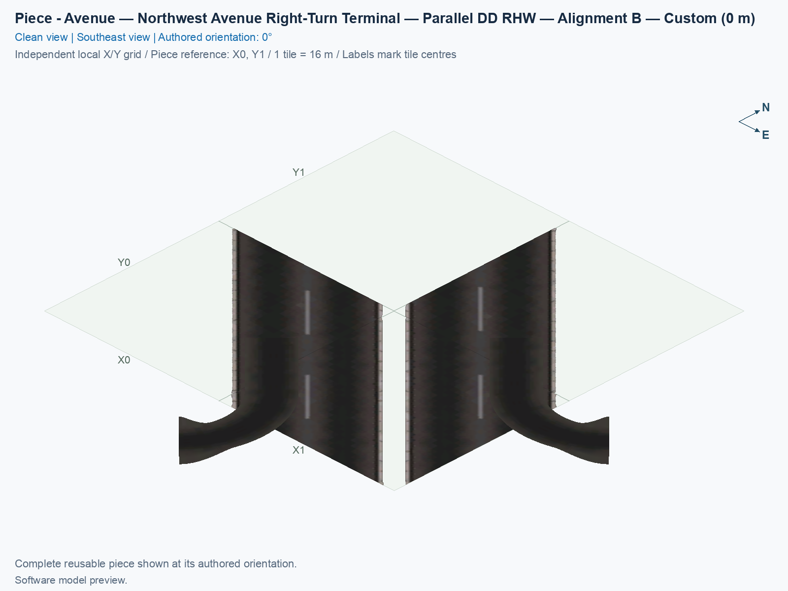
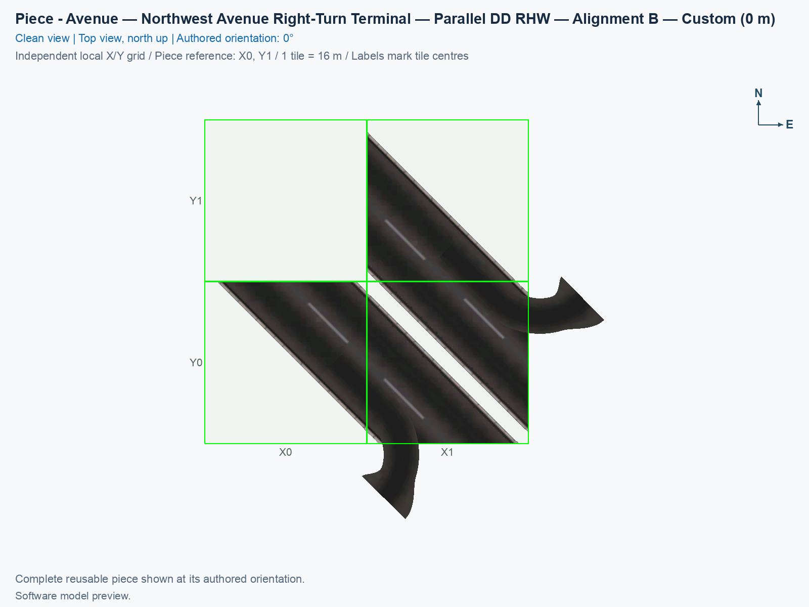
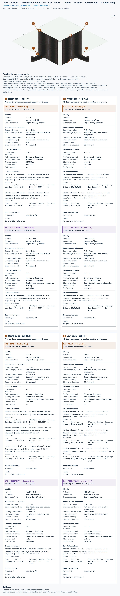

# Avenue — Northwest Avenue Right-Turn Terminal — Parallel DD RHW — Alignment B

Reusable Alignment B component for the close parallel diagonal diamond.

<!-- PIECE README LAYOUT: 2 -->

[1. Views](#1-views) · [2. Piece and placement](#2-piece-and-placement) · [3. Connection matrix](#3-connection-matrix) · [Testing ↗ (separate document)](TESTING.md)

## 1. Views

The angled view shows this type's actual model and overhang; the north-up view shows its relation to the city grid. These software pictures do not establish game appearance, native-neighbour compatibility, or visible traffic. Use the component's own pictures when comparing it with another type.

<!-- BEGIN PIECE VIEWS -->

<!-- END PIECE VIEWS -->

## 2. Piece and placement

This is the northwest ground right-turn terminal. The ramp joins only the adjacent Avenue carriageway, meaning its lanes carrying traffic in one direction. The retained pedestrian route crosses the driveway separately from the car route.

**Permanent ID:** `ddrhw-parallel-b-northwest-terminal`. **Recipe:** `highway_ddrhw_parallel_b_northwest_terminal`. This component owns **3 city tiles** inside a **2 × 2 bounding footprint**. Its local occupied cells are **[1,0], [0,1], [1,1]**, measured from the reference corner with columns increasing east and rows increasing south. Empty cells inside that rectangle remain unowned. Ground Avenue and right-turn pavement at 0 m.

1. Open **Transportation → Highways → SCP → Assemblies**, and select **SCP | ASSEMBLY | DD RHW-4 — Parallel Diagonal Avenue Diamond — Alignment B**.
2. Starting at P01, press **Tab once** to reach **P02 — Avenue — Northwest Avenue Right-Turn Terminal — Parallel DD RHW — Alignment B**. Shift+Tab moves backward. Each click places this component, rather than the whole junction.
3. In the [B reference layout](../../01_assemblies/ddrhw-l1-and-l2-diagonal-avenue-parallel-diamond-alignment-b/README.md#3-placements), use **X3, Y7**, with the authored **0°** orientation. Home and End rotate the selected type. Match its actual occupied preview cells before clicking; the reference corner can itself be empty.
4. Join only the complete matching B boundary described by its connection card and the assembly placement plan. A similar A model does not establish matching whole-cell PATH ownership. For an independent layout, check every direction, endpoint, height, angle, and grade; compatibility with an untested neighbour remains unverified.

This component owns 3 adaptive Avenue cells. Native ground textures can change with surrounding development, while rotating model props retain this component's non-ground geometry. Its temporary Road helper is local **[0,0]** and is not permanent ownership. Place the crossing first, this terminal second, and the southeast terminal third in the first reference layout.

All B components intentionally generate no custom cast shadows. A **PATH** is the directed game traffic resource; a visible road surface and a PATH connection establish different facts. Preserve this type's complete owned-cell traffic data when reusing it. New B identifiers require fresh placement, and game results are recorded separately in [TESTING.md](TESTING.md).

<!-- BEGIN PIECE OVERVIEW -->

Place one northwest avenue right-turn terminal for Alignment B of the close parallel diagonal diamond. Use the complete connection cards and assembly grid; heights are fixed.

Exact reusable identifier: `ddrhw-parallel-b-northwest-terminal`.

Footprint: **2 × 2 tiles**. Exact menu name: **Avenue — Northwest Avenue Right-Turn Terminal — Parallel DD RHW — Alignment B**.

<!-- END PIECE OVERVIEW -->

## 3. Connection matrix

The generated matrix describes this piece's intrinsic measured journeys. Its connector overview identifies exposed boundaries, including any overhang; it does not establish compatibility with an untested neighbour. Route Query and visible travel retain separate observation cases.

<!-- BEGIN PIECE CONNECTION MATRIX -->

### Directed entrance/exit matrix

Read **from an entrance row to an exit column**. **Saved PATH** checks the saved traffic route; **Route Query** checks the route shown by the game; **Visible travel** checks a vehicle completing that journey. For HSR, visible travel means a moving train.

**Game appearance:** [?](TESTING.md#case-in_game_render-6a814a55c65a0dbf71c7) — the complete piece’s appearance in the game, checked separately from its journeys.

**Legend:** ✅ confirmed; ❌ failed; ? not established. **Forbidden** means the movement is unavailable; its in-game check confirms that it stays unavailable. Click a result for its exact test case. Scope, evidence, and limitations remain in [the test checklist](TESTING.md#test-checklist).

| Entrance ↓ / Exit → | **Road · West exit** `channel-06-out` Variant: avenue-ground | **Road · West exit** `channel-07-out` Variant: avenue-ground | **Road · South exit** `channel-08-out` Variant: avenue-ground | **Road · South exit** `channel-09-out` Variant: avenue-ground | **Road · South exit** `channel-10-out` Variant: avenue-ground | **Pedestrian · West exit** `channel-13-out` Variant: avenue-sidewalk | **Pedestrian · South exit** `channel-14-out` Variant: avenue-sidewalk |
| --- | --- | --- | --- | --- | --- | --- | --- |
| **Road · North entrance** `channel-01-in` Variant: avenue-ground | **Forbidden** **Saved PATH:** [?](TESTING.md#case-software_connectivity-d1d54d9b686404070a61) In-game check: [?](TESTING.md#case-in_game_forbidden_transfer-bcaa416767c4750a934a) | **Forbidden** **Saved PATH:** [?](TESTING.md#case-software_connectivity-d1d54d9b686404070a61) In-game check: [?](TESTING.md#case-in_game_forbidden_transfer-648b08469aa2b3d918b5) | **Saved PATH:** [?](TESTING.md#case-software_connectivity-d1d54d9b686404070a61) **Route Query:** [?](TESTING.md#case-in_game_route_query-d461cf9834d1b33fc3cd) **Visible travel:** [?](TESTING.md#case-in_game_visible_travel-d461cf9834d1b33fc3cd) | **Saved PATH:** [?](TESTING.md#case-software_connectivity-d1d54d9b686404070a61) **Route Query:** [?](TESTING.md#case-in_game_route_query-d75c8762eb16a1183478) **Visible travel:** [?](TESTING.md#case-in_game_visible_travel-d75c8762eb16a1183478) | **Forbidden** **Saved PATH:** [?](TESTING.md#case-software_connectivity-d1d54d9b686404070a61) In-game check: [?](TESTING.md#case-in_game_forbidden_transfer-f78408f2e753deec3b71) | **Forbidden** **Saved PATH:** [?](TESTING.md#case-software_connectivity-d1d54d9b686404070a61) In-game check: [?](TESTING.md#case-in_game_forbidden_transfer-f0e9923ebddcd0ebce9d) | **Forbidden** **Saved PATH:** [?](TESTING.md#case-software_connectivity-d1d54d9b686404070a61) In-game check: [?](TESTING.md#case-in_game_forbidden_transfer-80be77e474df83953e3e) |
| **Road · North entrance** `channel-02-in` Variant: avenue-ground | **Forbidden** **Saved PATH:** [?](TESTING.md#case-software_connectivity-d1d54d9b686404070a61) In-game check: [?](TESTING.md#case-in_game_forbidden_transfer-8a3a867775064b5a4b3d) | **Forbidden** **Saved PATH:** [?](TESTING.md#case-software_connectivity-d1d54d9b686404070a61) In-game check: [?](TESTING.md#case-in_game_forbidden_transfer-d27a3aabe5453beedca8) | **Forbidden** **Saved PATH:** [?](TESTING.md#case-software_connectivity-d1d54d9b686404070a61) In-game check: [?](TESTING.md#case-in_game_forbidden_transfer-178860975f3197a81304) | **Forbidden** **Saved PATH:** [?](TESTING.md#case-software_connectivity-d1d54d9b686404070a61) In-game check: [?](TESTING.md#case-in_game_forbidden_transfer-a3f0c734e079bd543a19) | **Saved PATH:** [?](TESTING.md#case-software_connectivity-d1d54d9b686404070a61) **Route Query:** [?](TESTING.md#case-in_game_route_query-e9f9727f357958e14d55) **Visible travel:** [?](TESTING.md#case-in_game_visible_travel-e9f9727f357958e14d55) | **Forbidden** **Saved PATH:** [?](TESTING.md#case-software_connectivity-d1d54d9b686404070a61) In-game check: [?](TESTING.md#case-in_game_forbidden_transfer-55a6f37cd7abed2be5f2) | **Forbidden** **Saved PATH:** [?](TESTING.md#case-software_connectivity-d1d54d9b686404070a61) In-game check: [?](TESTING.md#case-in_game_forbidden_transfer-7a245703f2a59c3d0722) |
| **Road · East entrance** `channel-03-in` Variant: avenue-ground | **Saved PATH:** [?](TESTING.md#case-software_connectivity-d1d54d9b686404070a61) **Route Query:** [?](TESTING.md#case-in_game_route_query-1d8914e889763933b12d) **Visible travel:** [?](TESTING.md#case-in_game_visible_travel-1d8914e889763933b12d) | **Forbidden** **Saved PATH:** [?](TESTING.md#case-software_connectivity-d1d54d9b686404070a61) In-game check: [?](TESTING.md#case-in_game_forbidden_transfer-94aeac1b231261130655) | **Forbidden** **Saved PATH:** [?](TESTING.md#case-software_connectivity-d1d54d9b686404070a61) In-game check: [?](TESTING.md#case-in_game_forbidden_transfer-44c6ffb1dc8295736657) | **Forbidden** **Saved PATH:** [?](TESTING.md#case-software_connectivity-d1d54d9b686404070a61) In-game check: [?](TESTING.md#case-in_game_forbidden_transfer-4a2353a7fdcb5f5d441b) | **Forbidden** **Saved PATH:** [?](TESTING.md#case-software_connectivity-d1d54d9b686404070a61) In-game check: [?](TESTING.md#case-in_game_forbidden_transfer-12be828cbbbb4c660c27) | **Forbidden** **Saved PATH:** [?](TESTING.md#case-software_connectivity-d1d54d9b686404070a61) In-game check: [?](TESTING.md#case-in_game_forbidden_transfer-28a91235f4fb2bf4fc6b) | **Forbidden** **Saved PATH:** [?](TESTING.md#case-software_connectivity-d1d54d9b686404070a61) In-game check: [?](TESTING.md#case-in_game_forbidden_transfer-8896d99f23fe2f054908) |
| **Road · East entrance** `channel-04-in` Variant: avenue-ground | **Forbidden** **Saved PATH:** [?](TESTING.md#case-software_connectivity-d1d54d9b686404070a61) In-game check: [?](TESTING.md#case-in_game_forbidden_transfer-b8501bd85cde3e477cc9) | **Saved PATH:** [?](TESTING.md#case-software_connectivity-d1d54d9b686404070a61) **Route Query:** [?](TESTING.md#case-in_game_route_query-ec4190a0cfad85dd389a) **Visible travel:** [?](TESTING.md#case-in_game_visible_travel-ec4190a0cfad85dd389a) | **Forbidden** **Saved PATH:** [?](TESTING.md#case-software_connectivity-d1d54d9b686404070a61) In-game check: [?](TESTING.md#case-in_game_forbidden_transfer-4906c4fe5bd855d75af4) | **Forbidden** **Saved PATH:** [?](TESTING.md#case-software_connectivity-d1d54d9b686404070a61) In-game check: [?](TESTING.md#case-in_game_forbidden_transfer-72bc52a8fc23f9f008de) | **Forbidden** **Saved PATH:** [?](TESTING.md#case-software_connectivity-d1d54d9b686404070a61) In-game check: [?](TESTING.md#case-in_game_forbidden_transfer-66348725ec698b8587b3) | **Forbidden** **Saved PATH:** [?](TESTING.md#case-software_connectivity-d1d54d9b686404070a61) In-game check: [?](TESTING.md#case-in_game_forbidden_transfer-2363bc0a3648a5055722) | **Forbidden** **Saved PATH:** [?](TESTING.md#case-software_connectivity-d1d54d9b686404070a61) In-game check: [?](TESTING.md#case-in_game_forbidden_transfer-732c709f651a4faa0616) |
| **Road · East entrance** `channel-05-in` Variant: avenue-ground | **Forbidden** **Saved PATH:** [?](TESTING.md#case-software_connectivity-d1d54d9b686404070a61) In-game check: [?](TESTING.md#case-in_game_forbidden_transfer-ae5e406283f2b3762234) | **Saved PATH:** [?](TESTING.md#case-software_connectivity-d1d54d9b686404070a61) **Route Query:** [?](TESTING.md#case-in_game_route_query-59c535c72530c5389b73) **Visible travel:** [?](TESTING.md#case-in_game_visible_travel-59c535c72530c5389b73) | **Forbidden** **Saved PATH:** [?](TESTING.md#case-software_connectivity-d1d54d9b686404070a61) In-game check: [?](TESTING.md#case-in_game_forbidden_transfer-2d3905d2d69b21cb9d06) | **Forbidden** **Saved PATH:** [?](TESTING.md#case-software_connectivity-d1d54d9b686404070a61) In-game check: [?](TESTING.md#case-in_game_forbidden_transfer-b8e131a560c70e7a80cd) | **Forbidden** **Saved PATH:** [?](TESTING.md#case-software_connectivity-d1d54d9b686404070a61) In-game check: [?](TESTING.md#case-in_game_forbidden_transfer-525d59308eed0ecd5d74) | **Forbidden** **Saved PATH:** [?](TESTING.md#case-software_connectivity-d1d54d9b686404070a61) In-game check: [?](TESTING.md#case-in_game_forbidden_transfer-33aa7f9143763d27336c) | **Forbidden** **Saved PATH:** [?](TESTING.md#case-software_connectivity-d1d54d9b686404070a61) In-game check: [?](TESTING.md#case-in_game_forbidden_transfer-38bb223c10d1fc0fe2a3) |
| **Pedestrian · North entrance** `channel-11-in` Variant: avenue-sidewalk | **Forbidden** **Saved PATH:** [?](TESTING.md#case-software_connectivity-d1d54d9b686404070a61) In-game check: [?](TESTING.md#case-in_game_forbidden_transfer-d99589a260fe07588ae0) | **Forbidden** **Saved PATH:** [?](TESTING.md#case-software_connectivity-d1d54d9b686404070a61) In-game check: [?](TESTING.md#case-in_game_forbidden_transfer-a4d34c644765a504f706) | **Forbidden** **Saved PATH:** [?](TESTING.md#case-software_connectivity-d1d54d9b686404070a61) In-game check: [?](TESTING.md#case-in_game_forbidden_transfer-cf71efabf9c08b8ef385) | **Forbidden** **Saved PATH:** [?](TESTING.md#case-software_connectivity-d1d54d9b686404070a61) In-game check: [?](TESTING.md#case-in_game_forbidden_transfer-5a7591296d23ca3f34ac) | **Forbidden** **Saved PATH:** [?](TESTING.md#case-software_connectivity-d1d54d9b686404070a61) In-game check: [?](TESTING.md#case-in_game_forbidden_transfer-91e547563dff4a917057) | **Forbidden** **Saved PATH:** [?](TESTING.md#case-software_connectivity-d1d54d9b686404070a61) In-game check: [?](TESTING.md#case-in_game_forbidden_transfer-edd25bf37cb67b0cea61) | **Saved PATH:** [?](TESTING.md#case-software_connectivity-d1d54d9b686404070a61) **Route Query:** [?](TESTING.md#case-in_game_route_query-0f386be2704f32416ef8) **Visible travel:** [?](TESTING.md#case-in_game_visible_travel-0f386be2704f32416ef8) |
| **Pedestrian · East entrance** `channel-12-in` Variant: avenue-sidewalk | **Forbidden** **Saved PATH:** [?](TESTING.md#case-software_connectivity-d1d54d9b686404070a61) In-game check: [?](TESTING.md#case-in_game_forbidden_transfer-fe0e595e7017497ff802) | **Forbidden** **Saved PATH:** [?](TESTING.md#case-software_connectivity-d1d54d9b686404070a61) In-game check: [?](TESTING.md#case-in_game_forbidden_transfer-32df7371ae8effc5f6d4) | **Forbidden** **Saved PATH:** [?](TESTING.md#case-software_connectivity-d1d54d9b686404070a61) In-game check: [?](TESTING.md#case-in_game_forbidden_transfer-be22a35d9b23c4d4c194) | **Forbidden** **Saved PATH:** [?](TESTING.md#case-software_connectivity-d1d54d9b686404070a61) In-game check: [?](TESTING.md#case-in_game_forbidden_transfer-aaa8b1e5c6f852453daa) | **Forbidden** **Saved PATH:** [?](TESTING.md#case-software_connectivity-d1d54d9b686404070a61) In-game check: [?](TESTING.md#case-in_game_forbidden_transfer-8b5e74cfd63b64684925) | **Saved PATH:** [?](TESTING.md#case-software_connectivity-d1d54d9b686404070a61) **Route Query:** [?](TESTING.md#case-in_game_route_query-e070ecd2183609a7fc12) **Visible travel:** [?](TESTING.md#case-in_game_visible_travel-e070ecd2183609a7fc12) | **Forbidden** **Saved PATH:** [?](TESTING.md#case-software_connectivity-d1d54d9b686404070a61) In-game check: [?](TESTING.md#case-in_game_forbidden_transfer-d92a6d887e3fd9e316df) |

Source: [connections.json](connections.json).

<!-- END PIECE CONNECTION MATRIX -->

<!-- BEGIN CONNECTOR OVERVIEW -->

### Connection overview

Generated from this piece's source-bound connector metadata and the current compiled model; marker letters refer to the boundary cards below.

[Rendering sources and verification scope](evidence/connection-overview.json).

Headings: 0° = North, 90° = East, 180° = South, and 270° = West; clockwise in plan view, pointing out of the piece.

Coordinates [E,N,H] = [east,north,height] in metres. Source cells [column,row] increase east and south.

Display grid: X = source column − (0); Y = 1 − source row.

Slope is measured outward at the joining edge; the interior may differ. Offsets are + left and − right facing out of the tile edge.

Member offsets use the section origin. Counts distinguish physical channels / edge cuts / directed members; modes do not multiply channels.

Incoming flow enters this piece; outgoing flow leaves it. Letters identify boundary cards; source IDs remain the stable identities.

Not declared means no section origin or offset was authored. Its marker uses an actual member endpoint; the measured intersections remain authoritative.

#### Boundary A: `boundary-01`

All 2 service groups are required together at this edge.

##### Service group 1 / 2: ROAD — Custom (0 m)

| Field | Value |
| --- | --- |
| End / component | `boundary-01-avenue-mainline-01` / `avenue-mainline` |
| Network / game class / role | road / Engine class (1); primary |
| Source cell / edge | `[0,1]` / North |
| Section origin [E,N] (m) | Not declared; see member endpoints |
| Centring / section offset | Not declared |
| Level (path height) | Custom (0 m); no nominal level |
| Outward heading | 315° |
| Slope at joining edge | 0% outward |
| Channels / edge cuts / directed members | 2 / 2 / 2 |
| Traffic arrangement / running | 2 incoming; 0 outgoing; See member directions |
| Channel spacing | 4.52548 m |
| Channel kinds | road-lane |
| Traffic modes | car |
| Profile | No profile reference |

| Member / measured source | Channel / cut / modes | Flow | Endpoint [E,N,H] (m) | Offset (m) | Outward heading | Edge slope (%) |
| --- | --- | --- | --- | ---: | ---: | ---: |
| `member-channel-01-in` / `channel-01-in` | `avenue-mainline-axis-minus-7-91960-negative` / `cut-channel-01-in` / car | Incoming | `[-3.2,-8,0]` | Not declared | 315° | 0 |
| `member-channel-02-in` / `channel-02-in` | `avenue-mainline-axis-minus-3-39411-negative` / `cut-channel-02-in` / car | Incoming | `[3.2,-8,0]` | Not declared | 315° | 0 |

##### Service group 2 / 2: PEDESTRIAN — Custom (0 m)

| Field | Value |
| --- | --- |
| End / component | `boundary-01-avenue-walkways-02` / `avenue-walkways` |
| Network / game class / role | pedestrian / Engine class (2); primary |
| Source cell / edge | `[0,1]` / North |
| Section origin [E,N] (m) | Not declared; see member endpoints |
| Centring / section offset | Not declared |
| Level (path height) | Custom (0 m); no nominal level |
| Outward heading | 315° |
| Slope at joining edge | 0% outward |
| Channels / edge cuts / directed members | 1 / 1 / 1 |
| Traffic arrangement / running | 1 incoming; 0 outgoing; See member directions |
| Channel spacing | See individual measured intersections |
| Channel kinds | walkway |
| Traffic modes | pedestrian |
| Profile | No profile reference |

| Member / measured source | Channel / cut / modes | Flow | Endpoint [E,N,H] (m) | Offset (m) | Outward heading | Edge slope (%) |
| --- | --- | --- | --- | ---: | ---: | ---: |
| `member-channel-11-in` / `channel-11-in` | `avenue-walkways-axis-minus-10-81873-negative` / `cut-channel-11-in` / pedestrian | Incoming | `[-7.3,-8,0]` | Not declared | 315° | 0 |

#### Boundary B: `boundary-02`

All 2 service groups are required together at this edge.

##### Service group 1 / 2: ROAD — Custom (0 m)

| Field | Value |
| --- | --- |
| End / component | `boundary-02-avenue-mainline-01` / `avenue-mainline` |
| Network / game class / role | road / Engine class (1); primary |
| Source cell / edge | `[1,0]` / West |
| Section origin [E,N] (m) | Not declared; see member endpoints |
| Centring / section offset | Not declared |
| Level (path height) | Custom (0 m); no nominal level |
| Outward heading | 315° |
| Slope at joining edge | 0% outward |
| Channels / edge cuts / directed members | 2 / 2 / 2 |
| Traffic arrangement / running | 0 incoming; 2 outgoing; See member directions |
| Channel spacing | 4.52548 m |
| Channel kinds | road-lane |
| Traffic modes | car |
| Profile | No profile reference |

| Member / measured source | Channel / cut / modes | Flow | Endpoint [E,N,H] (m) | Offset (m) | Outward heading | Edge slope (%) |
| --- | --- | --- | --- | ---: | ---: | ---: |
| `member-channel-06-out` / `channel-06-out` | `avenue-mainline-axis-plus-3-39411-positive` / `cut-channel-06-out` / car | Outgoing | `[8,-3.2,0]` | Not declared | 315° | 0 |
| `member-channel-07-out` / `channel-07-out` | `avenue-mainline-axis-plus-7-91960-positive` / `cut-channel-07-out` / car | Outgoing | `[8,3.2,0]` | Not declared | 315° | 0 |

##### Service group 2 / 2: PEDESTRIAN — Custom (0 m)

| Field | Value |
| --- | --- |
| End / component | `boundary-02-avenue-walkways-02` / `avenue-walkways` |
| Network / game class / role | pedestrian / Engine class (2); primary |
| Source cell / edge | `[1,0]` / West |
| Section origin [E,N] (m) | Not declared; see member endpoints |
| Centring / section offset | Not declared |
| Level (path height) | Custom (0 m); no nominal level |
| Outward heading | 315° |
| Slope at joining edge | 0% outward |
| Channels / edge cuts / directed members | 1 / 1 / 1 |
| Traffic arrangement / running | 0 incoming; 1 outgoing; See member directions |
| Channel spacing | See individual measured intersections |
| Channel kinds | walkway |
| Traffic modes | pedestrian |
| Profile | No profile reference |

| Member / measured source | Channel / cut / modes | Flow | Endpoint [E,N,H] (m) | Offset (m) | Outward heading | Edge slope (%) |
| --- | --- | --- | --- | ---: | ---: | ---: |
| `member-channel-13-out` / `channel-13-out` | `avenue-walkways-axis-plus-10-81873-positive` / `cut-channel-13-out` / pedestrian | Outgoing | `[8,7.3,0]` | Not declared | 315° | 0 |

#### Boundary C: `boundary-04`

All 2 service groups are required together at this edge.

##### Service group 1 / 2: ROAD — Custom (0 m)

| Field | Value |
| --- | --- |
| End / component | `boundary-04-avenue-mainline-01` / `avenue-mainline` |
| Network / game class / role | road / Engine class (1); primary |
| Source cell / edge | `[1,1]` / South |
| Section origin [E,N] (m) | Not declared; see member endpoints |
| Centring / section offset | Not declared |
| Level (path height) | Custom (0 m); no nominal level |
| Outward heading | Different; see members |
| Slope at joining edge | 0% outward |
| Channels / edge cuts / directed members | 3 / 3 / 3 |
| Traffic arrangement / running | 0 incoming; 3 outgoing; See member directions |
| Channel spacing | See individual measured intersections |
| Channel kinds | road-lane |
| Traffic modes | car |
| Profile | No profile reference |

| Member / measured source | Channel / cut / modes | Flow | Endpoint [E,N,H] (m) | Offset (m) | Outward heading | Edge slope (%) |
| --- | --- | --- | --- | ---: | ---: | ---: |
| `member-channel-08-out` / `channel-08-out` | `access-lower-on` / `cut-channel-08-out` / car | Outgoing | `[11.3248,-24,0]` | Not declared | 169.579° | 0 |
| `member-channel-09-out` / `channel-09-out` | `avenue-mainline-axis-minus-7-91960-negative` / `cut-channel-09-out` / car | Outgoing | `[12.8,-24,0]` | Not declared | 135° | 0 |
| `member-channel-10-out` / `channel-10-out` | `avenue-mainline-axis-minus-3-39411-negative` / `cut-channel-10-out` / car | Outgoing | `[19.2,-24,0]` | Not declared | 135° | 0 |

##### Service group 2 / 2: PEDESTRIAN — Custom (0 m)

| Field | Value |
| --- | --- |
| End / component | `boundary-04-avenue-walkways-02` / `avenue-walkways` |
| Network / game class / role | pedestrian / Engine class (2); primary |
| Source cell / edge | `[1,1]` / South |
| Section origin [E,N] (m) | Not declared; see member endpoints |
| Centring / section offset | Not declared |
| Level (path height) | Custom (0 m); no nominal level |
| Outward heading | 135° |
| Slope at joining edge | 0% outward |
| Channels / edge cuts / directed members | 1 / 1 / 1 |
| Traffic arrangement / running | 0 incoming; 1 outgoing; See member directions |
| Channel spacing | See individual measured intersections |
| Channel kinds | walkway |
| Traffic modes | pedestrian |
| Profile | No profile reference |

| Member / measured source | Channel / cut / modes | Flow | Endpoint [E,N,H] (m) | Offset (m) | Outward heading | Edge slope (%) |
| --- | --- | --- | --- | ---: | ---: | ---: |
| `member-channel-14-out` / `channel-14-out` | `avenue-walkways-axis-minus-10-81873-negative` / `cut-channel-14-out` / pedestrian | Outgoing | `[8.7,-24,0]` | Not declared | 135° | 0 |

#### Boundary D: `boundary-03`

All 2 service groups are required together at this edge.

##### Service group 1 / 2: ROAD — Custom (0 m)

| Field | Value |
| --- | --- |
| End / component | `boundary-03-avenue-mainline-01` / `avenue-mainline` |
| Network / game class / role | road / Engine class (1); primary |
| Source cell / edge | `[1,1]` / East |
| Section origin [E,N] (m) | Not declared; see member endpoints |
| Centring / section offset | Not declared |
| Level (path height) | Custom (0 m); no nominal level |
| Outward heading | Different; see members |
| Slope at joining edge | 0% outward |
| Channels / edge cuts / directed members | 3 / 3 / 3 |
| Traffic arrangement / running | 3 incoming; 0 outgoing; See member directions |
| Channel spacing | See individual measured intersections |
| Channel kinds | road-lane |
| Traffic modes | car |
| Profile | No profile reference |

| Member / measured source | Channel / cut / modes | Flow | Endpoint [E,N,H] (m) | Offset (m) | Outward heading | Edge slope (%) |
| --- | --- | --- | --- | ---: | ---: | ---: |
| `member-channel-03-in` / `channel-03-in` | `avenue-mainline-axis-plus-3-39411-positive` / `cut-channel-03-in` / car | Incoming | `[24,-19.2,0]` | Not declared | 135° | 0 |
| `member-channel-04-in` / `channel-04-in` | `avenue-mainline-axis-plus-7-91960-positive` / `cut-channel-04-in` / car | Incoming | `[24,-12.8,0]` | Not declared | 135° | 0 |
| `member-channel-05-in` / `channel-05-in` | `access-lower-off` / `cut-channel-05-in` / car | Incoming | `[24,-11.3248,0]` | Not declared | 100.421° | 0 |

##### Service group 2 / 2: PEDESTRIAN — Custom (0 m)

| Field | Value |
| --- | --- |
| End / component | `boundary-03-avenue-walkways-02` / `avenue-walkways` |
| Network / game class / role | pedestrian / Engine class (2); primary |
| Source cell / edge | `[1,1]` / East |
| Section origin [E,N] (m) | Not declared; see member endpoints |
| Centring / section offset | Not declared |
| Level (path height) | Custom (0 m); no nominal level |
| Outward heading | 135° |
| Slope at joining edge | 0% outward |
| Channels / edge cuts / directed members | 1 / 1 / 1 |
| Traffic arrangement / running | 1 incoming; 0 outgoing; See member directions |
| Channel spacing | See individual measured intersections |
| Channel kinds | walkway |
| Traffic modes | pedestrian |
| Profile | No profile reference |

| Member / measured source | Channel / cut / modes | Flow | Endpoint [E,N,H] (m) | Offset (m) | Outward heading | Edge slope (%) |
| --- | --- | --- | --- | ---: | ---: | ---: |
| `member-channel-12-in` / `channel-12-in` | `avenue-walkways-axis-plus-10-81873-positive` / `cut-channel-12-in` / pedestrian | Incoming | `[24,-8.7,0]` | Not declared | 135° | 0 |

The overview uses source metadata, current compiled resource identities, and the saved model. Current placement, connection, and traffic results belong to the generated connection matrix and linked testing records.

<!-- END CONNECTOR OVERVIEW -->
