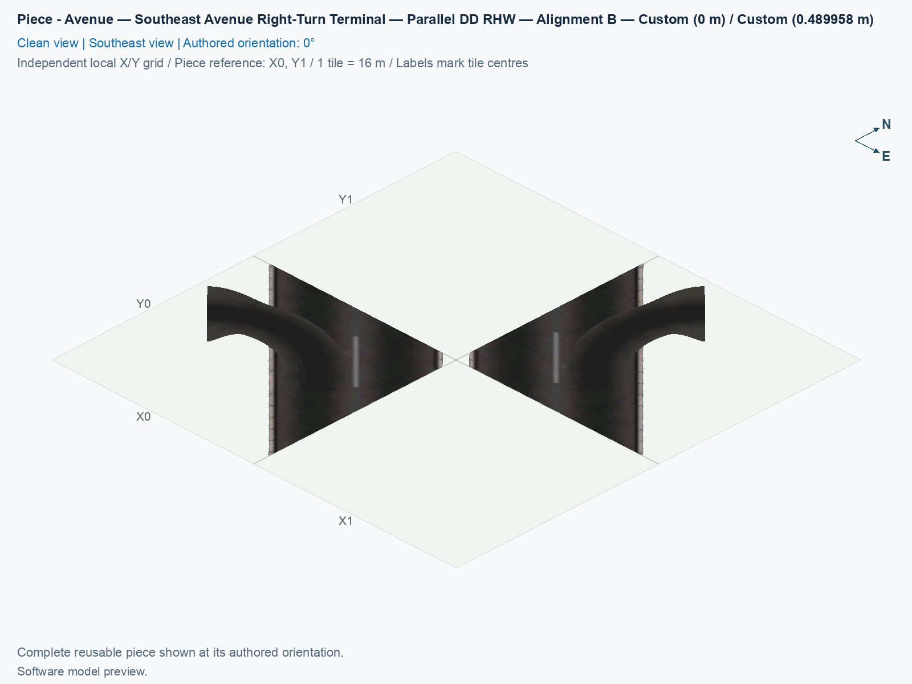
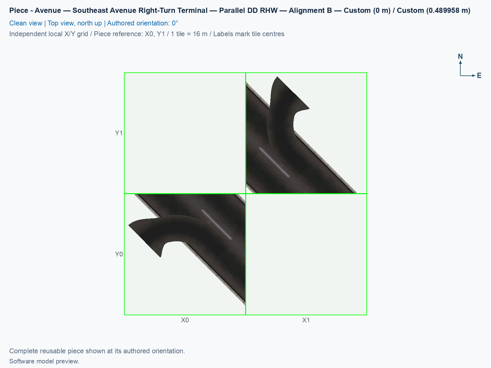

# Avenue — Southeast Avenue Right-Turn Terminal — Parallel DD RHW — Alignment B

Reusable Alignment B component for the close parallel diagonal diamond.

<!-- PIECE README LAYOUT: 2 -->

[1. Views](#1-views) · [2. Piece and placement](#2-piece-and-placement) · [3. Connection matrix](#3-connection-matrix) · [Testing ↗ (separate document)](TESTING.md)

## 1. Views

The angled view shows this type's actual model and overhang; the north-up view shows its relation to the city grid. These software pictures do not establish game appearance, native-neighbour compatibility, or visible traffic. Use the component's own pictures when comparing it with another type.

<!-- BEGIN PIECE VIEWS -->

<!-- END PIECE VIEWS -->

## 2. Piece and placement

This is the southeast ground right-turn terminal. The ramp joins only the adjacent Avenue carriageway, meaning its lanes carrying traffic in one direction. The retained pedestrian route crosses the driveway separately from the car route.

**Permanent ID:** `ddrhw-parallel-b-southeast-terminal`. **Recipe:** `highway_ddrhw_parallel_b_southeast_terminal`. This component owns **2 city tiles** inside a **2 × 2 bounding footprint**. Its local occupied cells are **[1,0], [0,1]**, measured from the reference corner with columns increasing east and rows increasing south. Empty cells inside that rectangle remain unowned. Ground Avenue and right-turn pavement at 0 m.

1. Open **Transportation → Highways → SCP | DD RHW-4 — Parallel Diagonal Avenue Diamond**, and select **SCP | ASSEMBLY | DD RHW-4 — Parallel Diagonal Avenue Diamond — Alignment B**.
2. Starting at P01, press **Tab 2 times** to reach **P03 — Avenue — Southeast Avenue Right-Turn Terminal — Parallel DD RHW — Alignment B**. Shift+Tab moves backward. Each click places this component, rather than the whole junction.
3. In the [B reference layout](../../01_assemblies/ddrhw-l1-and-l2-diagonal-avenue-parallel-diamond-alignment-b/README.md#3-placements), use **X5, Y5**, with the authored **0°** orientation. Home and End rotate the selected type. Match its actual occupied preview cells before clicking; the reference corner can itself be empty.
4. Join only the complete matching B boundary described by its connection card and the assembly placement plan. A similar A model does not establish matching whole-cell PATH ownership. For an independent layout, check every direction, endpoint, height, angle, and grade; compatibility with an untested neighbour remains unverified.

This component owns 2 adaptive Avenue cells. Native ground textures can change with surrounding development, while rotating model props retain this component's non-ground geometry. Its temporary Road helper is local **[1,1]** and is not permanent ownership. Keep the helper plot clear for placement, then connect the ordinary native Avenue centre at assembly **X6, Y4**. That centre is not one of this piece's two custom cells; all six native incident car and pedestrian members require a complete match.

All B components intentionally generate no custom cast shadows. A **PATH** is the directed game traffic resource; a visible road surface and a PATH connection establish different facts. Preserve this type's complete owned-cell traffic data when reusing it. New B identifiers require fresh placement, and game results are recorded separately in [TESTING.md](TESTING.md).

<!-- BEGIN PIECE OVERVIEW -->

Place one southeast avenue right-turn terminal for Alignment B of the close parallel diagonal diamond. Use the complete connection cards and assembly grid; heights are fixed.

Exact reusable identifier: `ddrhw-parallel-b-southeast-terminal`.

Footprint: **2 × 2 tiles**. Exact menu name: **Avenue — Southeast Avenue Right-Turn Terminal — Parallel DD RHW — Alignment B**.

<!-- END PIECE OVERVIEW -->

## 3. Connection matrix

The generated matrix describes this piece's intrinsic measured journeys. Its connector overview identifies exposed boundaries, including any overhang; it does not establish compatibility with an untested neighbour. Route Query and visible travel retain separate observation cases.

<!-- BEGIN PIECE CONNECTION MATRIX -->

### Directed entrance/exit matrix

Read **from an entrance row to an exit column**. **Saved PATH** checks the saved traffic route; **Route Query** checks the route shown by the game; **Visible travel** checks a vehicle completing that journey. For HSR, visible travel means a moving train.

**Game appearance:** [?](TESTING.md#case-in_game_render-1342999c395a7317a27e) — the complete piece’s appearance in the game, checked separately from its journeys.

**Legend:** ✅ confirmed; ❌ failed; ? not established. **Forbidden** means the movement is unavailable; its in-game check confirms that it stays unavailable. Click a result for its exact test case. Scope, evidence, and limitations remain in [the test checklist](TESTING.md#test-checklist).

| Entrance ↓ / Exit → | **Road · East exit** `channel-06-out` Variant: avenue-ground | **Road · East exit** `channel-07-out` Variant: avenue-ground | **Road · West exit** `channel-08-out` Variant: avenue-ground | **Road · West exit** `channel-09-out` Variant: avenue-ground | **Road · North exit** `channel-10-out` Variant: access-ramp | **Pedestrian · East exit** `channel-13-out` Variant: avenue-sidewalk | **Pedestrian · West exit** `channel-14-out` Variant: avenue-sidewalk |
| --- | --- | --- | --- | --- | --- | --- | --- |
| **Road · West entrance** `channel-01-in` Variant: access-ramp | **Saved PATH:** [?](TESTING.md#case-software_connectivity-386171de80eb568ccc2c) **Route Query:** [?](TESTING.md#case-in_game_route_query-01c1ecf582f2703ccc7c) **Visible travel:** [?](TESTING.md#case-in_game_visible_travel-01c1ecf582f2703ccc7c) | **Forbidden** **Saved PATH:** [?](TESTING.md#case-software_connectivity-386171de80eb568ccc2c) In-game check: [?](TESTING.md#case-in_game_forbidden_transfer-b0d67ff62cbcd7413587) | **Forbidden** **Saved PATH:** [?](TESTING.md#case-software_connectivity-386171de80eb568ccc2c) In-game check: [?](TESTING.md#case-in_game_forbidden_transfer-5c50ec9759b164be3cd1) | **Forbidden** **Saved PATH:** [?](TESTING.md#case-software_connectivity-386171de80eb568ccc2c) In-game check: [?](TESTING.md#case-in_game_forbidden_transfer-2e30eb794c29e937e0e1) | **Forbidden** **Saved PATH:** [?](TESTING.md#case-software_connectivity-386171de80eb568ccc2c) In-game check: [?](TESTING.md#case-in_game_forbidden_transfer-abf26401b39aa601cd00) | **Forbidden** **Saved PATH:** [?](TESTING.md#case-software_connectivity-386171de80eb568ccc2c) In-game check: [?](TESTING.md#case-in_game_forbidden_transfer-75e51d9ef5706687f2dd) | **Forbidden** **Saved PATH:** [?](TESTING.md#case-software_connectivity-386171de80eb568ccc2c) In-game check: [?](TESTING.md#case-in_game_forbidden_transfer-aa4b2d5aa5ddeb722158) |
| **Road · North entrance** `channel-02-in` Variant: avenue-ground | **Saved PATH:** [?](TESTING.md#case-software_connectivity-386171de80eb568ccc2c) **Route Query:** [?](TESTING.md#case-in_game_route_query-7021e7e4885cd7bd076e) **Visible travel:** [?](TESTING.md#case-in_game_visible_travel-7021e7e4885cd7bd076e) | **Forbidden** **Saved PATH:** [?](TESTING.md#case-software_connectivity-386171de80eb568ccc2c) In-game check: [?](TESTING.md#case-in_game_forbidden_transfer-5ee1eb01f7d567776fbb) | **Forbidden** **Saved PATH:** [?](TESTING.md#case-software_connectivity-386171de80eb568ccc2c) In-game check: [?](TESTING.md#case-in_game_forbidden_transfer-bb1b9fa275493bb94aef) | **Forbidden** **Saved PATH:** [?](TESTING.md#case-software_connectivity-386171de80eb568ccc2c) In-game check: [?](TESTING.md#case-in_game_forbidden_transfer-cea55d8d766306a03c9b) | **Forbidden** **Saved PATH:** [?](TESTING.md#case-software_connectivity-386171de80eb568ccc2c) In-game check: [?](TESTING.md#case-in_game_forbidden_transfer-030c4e37fe1dcef0263a) | **Forbidden** **Saved PATH:** [?](TESTING.md#case-software_connectivity-386171de80eb568ccc2c) In-game check: [?](TESTING.md#case-in_game_forbidden_transfer-af66965c04a76452c0c9) | **Forbidden** **Saved PATH:** [?](TESTING.md#case-software_connectivity-386171de80eb568ccc2c) In-game check: [?](TESTING.md#case-in_game_forbidden_transfer-fa8326391a46f47bdff4) |
| **Road · North entrance** `channel-03-in` Variant: avenue-ground | **Forbidden** **Saved PATH:** [?](TESTING.md#case-software_connectivity-386171de80eb568ccc2c) In-game check: [?](TESTING.md#case-in_game_forbidden_transfer-9bc49529964c36936409) | **Saved PATH:** [?](TESTING.md#case-software_connectivity-386171de80eb568ccc2c) **Route Query:** [?](TESTING.md#case-in_game_route_query-74f358cb941f0243a1eb) **Visible travel:** [?](TESTING.md#case-in_game_visible_travel-74f358cb941f0243a1eb) | **Forbidden** **Saved PATH:** [?](TESTING.md#case-software_connectivity-386171de80eb568ccc2c) In-game check: [?](TESTING.md#case-in_game_forbidden_transfer-daeff732f8b8b81de60e) | **Forbidden** **Saved PATH:** [?](TESTING.md#case-software_connectivity-386171de80eb568ccc2c) In-game check: [?](TESTING.md#case-in_game_forbidden_transfer-bcb3da1360c7d521d995) | **Forbidden** **Saved PATH:** [?](TESTING.md#case-software_connectivity-386171de80eb568ccc2c) In-game check: [?](TESTING.md#case-in_game_forbidden_transfer-2e87f9b57b5afdc2f815) | **Forbidden** **Saved PATH:** [?](TESTING.md#case-software_connectivity-386171de80eb568ccc2c) In-game check: [?](TESTING.md#case-in_game_forbidden_transfer-705393fad4087211b3d6) | **Forbidden** **Saved PATH:** [?](TESTING.md#case-software_connectivity-386171de80eb568ccc2c) In-game check: [?](TESTING.md#case-in_game_forbidden_transfer-7c8da558937682434ba5) |
| **Road · South entrance** `channel-04-in` Variant: avenue-ground | **Forbidden** **Saved PATH:** [?](TESTING.md#case-software_connectivity-386171de80eb568ccc2c) In-game check: [?](TESTING.md#case-in_game_forbidden_transfer-9387868768ab124a2696) | **Forbidden** **Saved PATH:** [?](TESTING.md#case-software_connectivity-386171de80eb568ccc2c) In-game check: [?](TESTING.md#case-in_game_forbidden_transfer-bfd01c84c062b59fec39) | **Saved PATH:** [?](TESTING.md#case-software_connectivity-386171de80eb568ccc2c) **Route Query:** [?](TESTING.md#case-in_game_route_query-a515410a0225945ee779) **Visible travel:** [?](TESTING.md#case-in_game_visible_travel-a515410a0225945ee779) | **Forbidden** **Saved PATH:** [?](TESTING.md#case-software_connectivity-386171de80eb568ccc2c) In-game check: [?](TESTING.md#case-in_game_forbidden_transfer-a588e8b2a11e837a9efa) | **Forbidden** **Saved PATH:** [?](TESTING.md#case-software_connectivity-386171de80eb568ccc2c) In-game check: [?](TESTING.md#case-in_game_forbidden_transfer-3e0c54e6d11eecef4e54) | **Forbidden** **Saved PATH:** [?](TESTING.md#case-software_connectivity-386171de80eb568ccc2c) In-game check: [?](TESTING.md#case-in_game_forbidden_transfer-4b77a7846b5d33fe1af0) | **Forbidden** **Saved PATH:** [?](TESTING.md#case-software_connectivity-386171de80eb568ccc2c) In-game check: [?](TESTING.md#case-in_game_forbidden_transfer-ee082d8e9b5577ade6d5) |
| **Road · South entrance** `channel-05-in` Variant: avenue-ground | **Forbidden** **Saved PATH:** [?](TESTING.md#case-software_connectivity-386171de80eb568ccc2c) In-game check: [?](TESTING.md#case-in_game_forbidden_transfer-70b770346daa51998d6a) | **Forbidden** **Saved PATH:** [?](TESTING.md#case-software_connectivity-386171de80eb568ccc2c) In-game check: [?](TESTING.md#case-in_game_forbidden_transfer-f33d8794509a75534f9b) | **Forbidden** **Saved PATH:** [?](TESTING.md#case-software_connectivity-386171de80eb568ccc2c) In-game check: [?](TESTING.md#case-in_game_forbidden_transfer-c4d9ebd161f0a83b19e7) | **Saved PATH:** [?](TESTING.md#case-software_connectivity-386171de80eb568ccc2c) **Route Query:** [?](TESTING.md#case-in_game_route_query-ea087424863a7f0b61ca) **Visible travel:** [?](TESTING.md#case-in_game_visible_travel-ea087424863a7f0b61ca) | **Saved PATH:** [?](TESTING.md#case-software_connectivity-386171de80eb568ccc2c) **Route Query:** [?](TESTING.md#case-in_game_route_query-140a611da1f747106525) **Visible travel:** [?](TESTING.md#case-in_game_visible_travel-140a611da1f747106525) | **Forbidden** **Saved PATH:** [?](TESTING.md#case-software_connectivity-386171de80eb568ccc2c) In-game check: [?](TESTING.md#case-in_game_forbidden_transfer-0e4cb3f08e2cb719e543) | **Forbidden** **Saved PATH:** [?](TESTING.md#case-software_connectivity-386171de80eb568ccc2c) In-game check: [?](TESTING.md#case-in_game_forbidden_transfer-afd0e1bd0afd37b71cb9) |
| **Pedestrian · North entrance** `channel-11-in` Variant: avenue-sidewalk | **Forbidden** **Saved PATH:** [?](TESTING.md#case-software_connectivity-386171de80eb568ccc2c) In-game check: [?](TESTING.md#case-in_game_forbidden_transfer-6bdeeea5e5e179a3de5f) | **Forbidden** **Saved PATH:** [?](TESTING.md#case-software_connectivity-386171de80eb568ccc2c) In-game check: [?](TESTING.md#case-in_game_forbidden_transfer-1943ffb88c87f0869664) | **Forbidden** **Saved PATH:** [?](TESTING.md#case-software_connectivity-386171de80eb568ccc2c) In-game check: [?](TESTING.md#case-in_game_forbidden_transfer-26f3768c42af43b9f66c) | **Forbidden** **Saved PATH:** [?](TESTING.md#case-software_connectivity-386171de80eb568ccc2c) In-game check: [?](TESTING.md#case-in_game_forbidden_transfer-3a8699a3e424914896d0) | **Forbidden** **Saved PATH:** [?](TESTING.md#case-software_connectivity-386171de80eb568ccc2c) In-game check: [?](TESTING.md#case-in_game_forbidden_transfer-74995d127454cabcc375) | **Saved PATH:** [?](TESTING.md#case-software_connectivity-386171de80eb568ccc2c) **Route Query:** [?](TESTING.md#case-in_game_route_query-25016f2e462296328c86) **Visible travel:** [?](TESTING.md#case-in_game_visible_travel-25016f2e462296328c86) | **Forbidden** **Saved PATH:** [?](TESTING.md#case-software_connectivity-386171de80eb568ccc2c) In-game check: [?](TESTING.md#case-in_game_forbidden_transfer-a20742de450b43fe2cea) |
| **Pedestrian · South entrance** `channel-12-in` Variant: avenue-sidewalk | **Forbidden** **Saved PATH:** [?](TESTING.md#case-software_connectivity-386171de80eb568ccc2c) In-game check: [?](TESTING.md#case-in_game_forbidden_transfer-8f57ddf859dd2126b6c6) | **Forbidden** **Saved PATH:** [?](TESTING.md#case-software_connectivity-386171de80eb568ccc2c) In-game check: [?](TESTING.md#case-in_game_forbidden_transfer-fc24a234567dd6474339) | **Forbidden** **Saved PATH:** [?](TESTING.md#case-software_connectivity-386171de80eb568ccc2c) In-game check: [?](TESTING.md#case-in_game_forbidden_transfer-18e42e6ea11f92934b76) | **Forbidden** **Saved PATH:** [?](TESTING.md#case-software_connectivity-386171de80eb568ccc2c) In-game check: [?](TESTING.md#case-in_game_forbidden_transfer-74e38e1e3a9711b8a9c9) | **Forbidden** **Saved PATH:** [?](TESTING.md#case-software_connectivity-386171de80eb568ccc2c) In-game check: [?](TESTING.md#case-in_game_forbidden_transfer-e7ff6d60d69b99c0ddf5) | **Forbidden** **Saved PATH:** [?](TESTING.md#case-software_connectivity-386171de80eb568ccc2c) In-game check: [?](TESTING.md#case-in_game_forbidden_transfer-a451e67dd9ea924b5524) | **Saved PATH:** [?](TESTING.md#case-software_connectivity-386171de80eb568ccc2c) **Route Query:** [?](TESTING.md#case-in_game_route_query-e8eef2a6ea6f938ed82d) **Visible travel:** [?](TESTING.md#case-in_game_visible_travel-e8eef2a6ea6f938ed82d) |

Source: [connections.json](connections.json).

<!-- END PIECE CONNECTION MATRIX -->

<!-- BEGIN CONNECTOR OVERVIEW -->

### Connection overview

Generated from this piece's source-bound connector metadata and the current compiled model; marker letters refer to the boundary cards below.

[Rendering sources and verification scope](evidence/connection-overview.json).

Headings: 0° = North, 90° = East, 180° = South, and 270° = West; clockwise in plan view, pointing out of the piece.

Coordinates [E,N,H] = [east,north,height] in metres. Source cells [column,row] increase east and south.

Display grid: X = source column − (0); Y = 1 − source row.

Slope is measured outward at the joining edge; the interior may differ. Offsets are + left and − right facing out of the tile edge.

Member offsets use the section origin. Counts distinguish physical channels / edge cuts / directed members; modes do not multiply channels.

Incoming flow enters this piece; outgoing flow leaves it. Letters identify boundary cards; source IDs remain the stable identities.

Not declared means no section origin or offset was authored. Its marker uses an actual member endpoint; the measured intersections remain authoritative.

#### Boundary A: `boundary-02`

All 2 service groups are required together at this edge.

##### Service group 1 / 2: ROAD — Custom (0 m)

| Field | Value |
| --- | --- |
| End / component | `boundary-02-avenue-mainline-01` / `avenue-mainline` |
| Network / game class / role | road / Engine class (1); primary |
| Source cell / edge | `[0,1]` / North |
| Section origin [E,N] (m) | Not declared; see member endpoints |
| Centring / section offset | Not declared |
| Level (path height) | Custom (0 m); no nominal level |
| Outward heading | 315° |
| Slope at joining edge | 0% outward |
| Channels / edge cuts / directed members | 2 / 2 / 2 |
| Traffic arrangement / running | 2 incoming; 0 outgoing; See member directions |
| Channel spacing | 4.52548 m |
| Channel kinds | road-lane |
| Traffic modes | car |
| Profile | No profile reference |

| Member / measured source | Channel / cut / modes | Flow | Endpoint [E,N,H] (m) | Offset (m) | Outward heading | Edge slope (%) |
| --- | --- | --- | --- | ---: | ---: | ---: |
| `member-channel-02-in` / `channel-02-in` | `avenue-mainline-axis-minus-7-91960-negative` / `cut-channel-02-in` / car | Incoming | `[-3.2,-8,0]` | Not declared | 315° | 0 |
| `member-channel-03-in` / `channel-03-in` | `avenue-mainline-axis-minus-3-39411-negative` / `cut-channel-03-in` / car | Incoming | `[3.2,-8,0]` | Not declared | 315° | 0 |

##### Service group 2 / 2: PEDESTRIAN — Custom (0 m)

| Field | Value |
| --- | --- |
| End / component | `boundary-02-avenue-walkways-02` / `avenue-walkways` |
| Network / game class / role | pedestrian / Engine class (2); primary |
| Source cell / edge | `[0,1]` / North |
| Section origin [E,N] (m) | Not declared; see member endpoints |
| Centring / section offset | Not declared |
| Level (path height) | Custom (0 m); no nominal level |
| Outward heading | 315° |
| Slope at joining edge | 0% outward |
| Channels / edge cuts / directed members | 1 / 1 / 1 |
| Traffic arrangement / running | 1 incoming; 0 outgoing; See member directions |
| Channel spacing | See individual measured intersections |
| Channel kinds | walkway |
| Traffic modes | pedestrian |
| Profile | No profile reference |

| Member / measured source | Channel / cut / modes | Flow | Endpoint [E,N,H] (m) | Offset (m) | Outward heading | Edge slope (%) |
| --- | --- | --- | --- | ---: | ---: | ---: |
| `member-channel-11-in` / `channel-11-in` | `avenue-walkways-axis-minus-10-81873-negative` / `cut-channel-11-in` / pedestrian | Incoming | `[-7.3,-8,0]` | Not declared | 315° | 0 |

#### Boundary B: `boundary-01`

This service group is required at this edge.

##### Service group 1 / 1: ROAD — Custom (0.489958 m)

| Field | Value |
| --- | --- |
| End / component | `boundary-01-avenue-mainline-01` / `avenue-mainline` |
| Network / game class / role | road / Engine class (1); primary |
| Source cell / edge | `[0,1]` / West |
| Section origin [E,N] (m) | Not declared; see member endpoints |
| Centring / section offset | Not declared |
| Level (path height) | Custom (0.489958 m); no nominal level |
| Outward heading | 225° |
| Slope at joining edge | 28.2029% outward |
| Channels / edge cuts / directed members | 1 / 1 / 1 |
| Traffic arrangement / running | 1 incoming; 0 outgoing; See member directions |
| Channel spacing | See individual measured intersections |
| Channel kinds | road-lane |
| Traffic modes | car |
| Profile | No profile reference |

| Member / measured source | Channel / cut / modes | Flow | Endpoint [E,N,H] (m) | Offset (m) | Outward heading | Edge slope (%) |
| --- | --- | --- | --- | ---: | ---: | ---: |
| `member-channel-01-in` / `channel-01-in` | `access-upper-off` / `cut-channel-01-in` / car | Incoming | `[-8,-16.9706,0.489958]` | Not declared | 225° | 28.2029 |

#### Boundary C: `boundary-03`

All 2 service groups are required together at this edge.

##### Service group 1 / 2: ROAD — Custom (0 m)

| Field | Value |
| --- | --- |
| End / component | `boundary-03-avenue-mainline-01` / `avenue-mainline` |
| Network / game class / role | road / Engine class (1); primary |
| Source cell / edge | `[0,1]` / East |
| Section origin [E,N] (m) | Not declared; see member endpoints |
| Centring / section offset | Not declared |
| Level (path height) | Custom (0 m); no nominal level |
| Outward heading | 135° |
| Slope at joining edge | 0% outward |
| Channels / edge cuts / directed members | 2 / 2 / 2 |
| Traffic arrangement / running | 0 incoming; 2 outgoing; See member directions |
| Channel spacing | 4.52548 m |
| Channel kinds | road-lane |
| Traffic modes | car |
| Profile | No profile reference |

| Member / measured source | Channel / cut / modes | Flow | Endpoint [E,N,H] (m) | Offset (m) | Outward heading | Edge slope (%) |
| --- | --- | --- | --- | ---: | ---: | ---: |
| `member-channel-06-out` / `channel-06-out` | `avenue-mainline-axis-minus-7-91960-negative` / `cut-channel-06-out` / car | Outgoing | `[8,-19.2,0]` | Not declared | 135° | 0 |
| `member-channel-07-out` / `channel-07-out` | `avenue-mainline-axis-minus-3-39411-negative` / `cut-channel-07-out` / car | Outgoing | `[8,-12.8,0]` | Not declared | 135° | 0 |

##### Service group 2 / 2: PEDESTRIAN — Custom (0 m)

| Field | Value |
| --- | --- |
| End / component | `boundary-03-avenue-walkways-02` / `avenue-walkways` |
| Network / game class / role | pedestrian / Engine class (2); primary |
| Source cell / edge | `[0,1]` / East |
| Section origin [E,N] (m) | Not declared; see member endpoints |
| Centring / section offset | Not declared |
| Level (path height) | Custom (0 m); no nominal level |
| Outward heading | 135° |
| Slope at joining edge | 0% outward |
| Channels / edge cuts / directed members | 1 / 1 / 1 |
| Traffic arrangement / running | 0 incoming; 1 outgoing; See member directions |
| Channel spacing | See individual measured intersections |
| Channel kinds | walkway |
| Traffic modes | pedestrian |
| Profile | No profile reference |

| Member / measured source | Channel / cut / modes | Flow | Endpoint [E,N,H] (m) | Offset (m) | Outward heading | Edge slope (%) |
| --- | --- | --- | --- | ---: | ---: | ---: |
| `member-channel-13-out` / `channel-13-out` | `avenue-walkways-axis-minus-10-81873-negative` / `cut-channel-13-out` / pedestrian | Outgoing | `[8,-23.3,0]` | Not declared | 135° | 0 |

#### Boundary D: `boundary-06`

All 2 service groups are required together at this edge.

##### Service group 1 / 2: ROAD — Custom (0 m)

| Field | Value |
| --- | --- |
| End / component | `boundary-06-avenue-mainline-01` / `avenue-mainline` |
| Network / game class / role | road / Engine class (1); primary |
| Source cell / edge | `[1,0]` / South |
| Section origin [E,N] (m) | Not declared; see member endpoints |
| Centring / section offset | Not declared |
| Level (path height) | Custom (0 m); no nominal level |
| Outward heading | 135° |
| Slope at joining edge | 0% outward |
| Channels / edge cuts / directed members | 2 / 2 / 2 |
| Traffic arrangement / running | 2 incoming; 0 outgoing; See member directions |
| Channel spacing | 4.52548 m |
| Channel kinds | road-lane |
| Traffic modes | car |
| Profile | No profile reference |

| Member / measured source | Channel / cut / modes | Flow | Endpoint [E,N,H] (m) | Offset (m) | Outward heading | Edge slope (%) |
| --- | --- | --- | --- | ---: | ---: | ---: |
| `member-channel-04-in` / `channel-04-in` | `avenue-mainline-axis-plus-3-39411-positive` / `cut-channel-04-in` / car | Incoming | `[12.8,-8,0]` | Not declared | 135° | 0 |
| `member-channel-05-in` / `channel-05-in` | `avenue-mainline-axis-plus-7-91960-positive` / `cut-channel-05-in` / car | Incoming | `[19.2,-8,0]` | Not declared | 135° | 0 |

##### Service group 2 / 2: PEDESTRIAN — Custom (0 m)

| Field | Value |
| --- | --- |
| End / component | `boundary-06-avenue-walkways-02` / `avenue-walkways` |
| Network / game class / role | pedestrian / Engine class (2); primary |
| Source cell / edge | `[1,0]` / South |
| Section origin [E,N] (m) | Not declared; see member endpoints |
| Centring / section offset | Not declared |
| Level (path height) | Custom (0 m); no nominal level |
| Outward heading | 135° |
| Slope at joining edge | 0% outward |
| Channels / edge cuts / directed members | 1 / 1 / 1 |
| Traffic arrangement / running | 1 incoming; 0 outgoing; See member directions |
| Channel spacing | See individual measured intersections |
| Channel kinds | walkway |
| Traffic modes | pedestrian |
| Profile | No profile reference |

| Member / measured source | Channel / cut / modes | Flow | Endpoint [E,N,H] (m) | Offset (m) | Outward heading | Edge slope (%) |
| --- | --- | --- | --- | ---: | ---: | ---: |
| `member-channel-12-in` / `channel-12-in` | `avenue-walkways-axis-plus-10-81873-positive` / `cut-channel-12-in` / pedestrian | Incoming | `[23.3,-8,0]` | Not declared | 135° | 0 |

#### Boundary E: `boundary-05`

This service group is required at this edge.

##### Service group 1 / 1: ROAD — Custom (0.489958 m)

| Field | Value |
| --- | --- |
| End / component | `boundary-05-avenue-mainline-01` / `avenue-mainline` |
| Network / game class / role | road / Engine class (1); primary |
| Source cell / edge | `[1,0]` / North |
| Section origin [E,N] (m) | Not declared; see member endpoints |
| Centring / section offset | Not declared |
| Level (path height) | Custom (0.489958 m); no nominal level |
| Outward heading | 45° |
| Slope at joining edge | 28.2029% outward |
| Channels / edge cuts / directed members | 1 / 1 / 1 |
| Traffic arrangement / running | 0 incoming; 1 outgoing; See member directions |
| Channel spacing | See individual measured intersections |
| Channel kinds | road-lane |
| Traffic modes | car |
| Profile | No profile reference |

| Member / measured source | Channel / cut / modes | Flow | Endpoint [E,N,H] (m) | Offset (m) | Outward heading | Edge slope (%) |
| --- | --- | --- | --- | ---: | ---: | ---: |
| `member-channel-10-out` / `channel-10-out` | `access-upper-on` / `cut-channel-10-out` / car | Outgoing | `[16.9706,8,0.489958]` | Not declared | 45° | 28.2029 |

#### Boundary F: `boundary-04`

All 2 service groups are required together at this edge.

##### Service group 1 / 2: ROAD — Custom (0 m)

| Field | Value |
| --- | --- |
| End / component | `boundary-04-avenue-mainline-01` / `avenue-mainline` |
| Network / game class / role | road / Engine class (1); primary |
| Source cell / edge | `[1,0]` / West |
| Section origin [E,N] (m) | Not declared; see member endpoints |
| Centring / section offset | Not declared |
| Level (path height) | Custom (0 m); no nominal level |
| Outward heading | 315° |
| Slope at joining edge | 0% outward |
| Channels / edge cuts / directed members | 2 / 2 / 2 |
| Traffic arrangement / running | 0 incoming; 2 outgoing; See member directions |
| Channel spacing | 4.52548 m |
| Channel kinds | road-lane |
| Traffic modes | car |
| Profile | No profile reference |

| Member / measured source | Channel / cut / modes | Flow | Endpoint [E,N,H] (m) | Offset (m) | Outward heading | Edge slope (%) |
| --- | --- | --- | --- | ---: | ---: | ---: |
| `member-channel-08-out` / `channel-08-out` | `avenue-mainline-axis-plus-3-39411-positive` / `cut-channel-08-out` / car | Outgoing | `[8,-3.2,0]` | Not declared | 315° | 0 |
| `member-channel-09-out` / `channel-09-out` | `avenue-mainline-axis-plus-7-91960-positive` / `cut-channel-09-out` / car | Outgoing | `[8,3.2,0]` | Not declared | 315° | 0 |

##### Service group 2 / 2: PEDESTRIAN — Custom (0 m)

| Field | Value |
| --- | --- |
| End / component | `boundary-04-avenue-walkways-02` / `avenue-walkways` |
| Network / game class / role | pedestrian / Engine class (2); primary |
| Source cell / edge | `[1,0]` / West |
| Section origin [E,N] (m) | Not declared; see member endpoints |
| Centring / section offset | Not declared |
| Level (path height) | Custom (0 m); no nominal level |
| Outward heading | 315° |
| Slope at joining edge | 0% outward |
| Channels / edge cuts / directed members | 1 / 1 / 1 |
| Traffic arrangement / running | 0 incoming; 1 outgoing; See member directions |
| Channel spacing | See individual measured intersections |
| Channel kinds | walkway |
| Traffic modes | pedestrian |
| Profile | No profile reference |

| Member / measured source | Channel / cut / modes | Flow | Endpoint [E,N,H] (m) | Offset (m) | Outward heading | Edge slope (%) |
| --- | --- | --- | --- | ---: | ---: | ---: |
| `member-channel-14-out` / `channel-14-out` | `avenue-walkways-axis-plus-10-81873-positive` / `cut-channel-14-out` / pedestrian | Outgoing | `[8,7.3,0]` | Not declared | 315° | 0 |

The overview uses source metadata, current compiled resource identities, and the saved model. Current placement, connection, and traffic results belong to the generated connection matrix and linked testing records.

<!-- END CONNECTOR OVERVIEW -->
