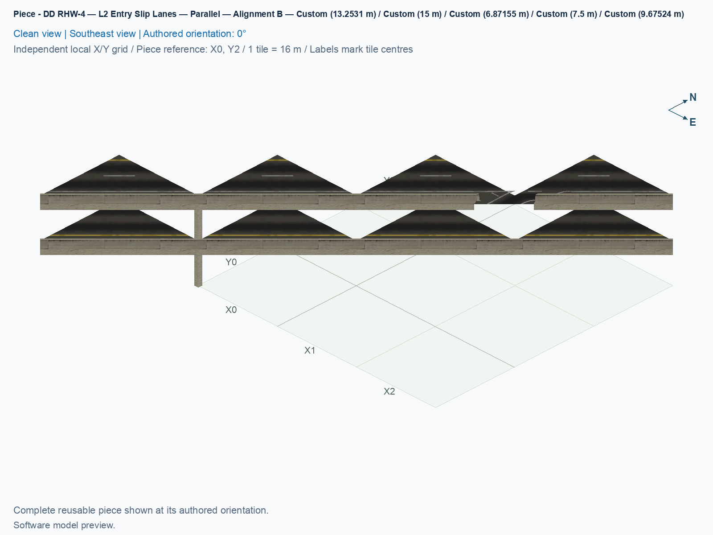
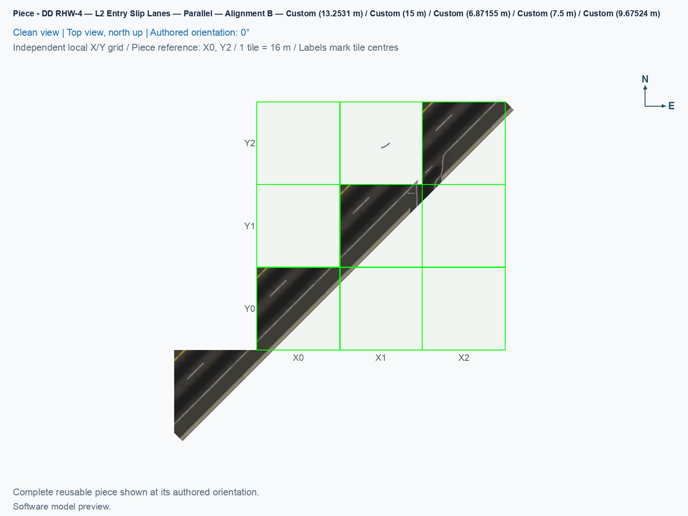

# DD RHW-4 — L2 Entry Slip Lanes — Parallel — Alignment B

Reusable Alignment B component for the close parallel diagonal diamond.

<!-- PIECE README LAYOUT: 2 -->

[1. Views](#1-views) · [2. Piece and placement](#2-piece-and-placement) · [3. Connection matrix](#3-connection-matrix) · [Testing ↗ (separate document)](TESTING.md)

## 1. Views

The angled view shows this type's actual model and overhang; the north-up view shows its relation to the city grid. These software pictures do not establish game appearance, native-neighbour compatibility, or visible traffic. Use the component's own pictures when comparing it with another type.

<!-- BEGIN PIECE VIEWS -->

<!-- END PIECE VIEWS -->

## 2. Piece and placement

This straight highway section supplies the named entry auxiliary slip lane and its barrier opening. The curved departure and graded ramp are separate components. Both native decks remain present even though the name identifies access on only one level.

**Permanent ID:** `ddrhw-parallel-b-upper-entry-slip`. **Recipe:** `highway_ddrhw_parallel_b_upper_entry_slip`. This component owns **3 city tiles** inside a **3 × 3 bounding footprint**. Its local occupied cells are **[2,0], [1,1], [0,2]**, measured from the reference corner with columns increasing east and rows increasing south. Empty cells inside that rectangle remain unowned. Both native decks at 7.5 m and 15 m; the named access is at 15 m.

1. Open **Transportation → Highways → SCP → Assemblies**, and select **SCP | ASSEMBLY | DD RHW-4 — Parallel Diagonal Avenue Diamond — Alignment B**.
2. Starting at P01, press **Tab 6 times** to reach **P07 — DD RHW-4 — L2 Entry Slip Lanes — Parallel — Alignment B**. Shift+Tab moves backward. Each click places this component, rather than the whole junction.
3. In the [B reference layout](../../01_assemblies/ddrhw-l1-and-l2-diagonal-avenue-parallel-diamond-alignment-b/README.md#3-placements), use **X7, Y9**, with the authored **0°** orientation. Home and End rotate the selected type. Match its actual occupied preview cells before clicking; the reference corner can itself be empty.
4. Join only the complete matching B boundary described by its connection card and the assembly placement plan. A similar A model does not establish matching whole-cell PATH ownership. For an independent layout, check every direction, endpoint, height, angle, and grade; compatibility with an untested neighbour remains unverified.

This component has no adaptive Avenue cells of its own. Dynamic pavement belongs to the crossing, the two ground terminals, and the ordinary native Avenue around them; no fixed sidewalk slab is added here.

All B components intentionally generate no custom cast shadows. A **PATH** is the directed game traffic resource; a visible road surface and a PATH connection establish different facts. Preserve this type's complete owned-cell traffic data when reusing it. New B identifiers require fresh placement, and game results are recorded separately in [TESTING.md](TESTING.md).

<!-- BEGIN PIECE OVERVIEW -->

Place one l2 entry slip lanes for Alignment B of the close parallel diagonal diamond. Use the complete connection cards and assembly grid; heights are fixed.

Exact reusable identifier: `ddrhw-parallel-b-upper-entry-slip`.

Footprint: **3 × 3 tiles**. Exact menu name: **DD RHW-4 — L2 Entry Slip Lanes — Parallel — Alignment B**.

<!-- END PIECE OVERVIEW -->

## 3. Connection matrix

The generated matrix describes this piece's intrinsic measured journeys. Its connector overview identifies exposed boundaries, including any overhang; it does not establish compatibility with an untested neighbour. Route Query and visible travel retain separate observation cases.

<!-- BEGIN PIECE CONNECTION MATRIX -->

### Directed entrance/exit matrix

Read **from an entrance row to an exit column**. **Saved PATH** checks the saved traffic route; **Route Query** checks the route shown by the game; **Visible travel** checks a vehicle completing that journey. For HSR, visible travel means a moving train.

**Game appearance:** [?](TESTING.md#case-in_game_render-0c43370a38bdbde2b759) — the complete piece’s appearance in the game, checked separately from its journeys.

**Legend:** ✅ confirmed; ❌ failed; ? not established. **Forbidden** means the movement is unavailable; its in-game check confirms that it stays unavailable. Click a result for its exact test case. Scope, evidence, and limitations remain in [the test checklist](TESTING.md#test-checklist).

| Entrance ↓ / Exit → | **Road · West exit** `channel-16-out` Variant: dd-rhw-l1 | **Road · West exit** `channel-17-out` Variant: dd-rhw-l1 | **Road · North exit** `channel-18-out` Variant: dd-rhw-l2 | **Road · North exit** `channel-19-out` Variant: dd-rhw-l2 | **Road · East exit** `channel-20-out` Variant: access-ramp | **Road · West exit** `channel-21-out` Variant: dd-rhw-l1 | **Road · West exit** `channel-22-out` Variant: dd-rhw-l1 | **Road · North exit** `channel-23-out` Variant: dd-rhw-l2 | **Road · North exit** `channel-24-out` Variant: dd-rhw-l2 | **Road · East exit** `channel-25-out` Variant: dd-rhw-l2 | **Road · West exit** `channel-26-out` Variant: dd-rhw-l1 | **Road · West exit** `channel-27-out` Variant: dd-rhw-l1 | **Road · North exit** `channel-28-out` Variant: dd-rhw-l2 | **Road · North exit** `channel-29-out` Variant: dd-rhw-l2 |
| --- | --- | --- | --- | --- | --- | --- | --- | --- | --- | --- | --- | --- | --- | --- |
| **Road · West entrance** `channel-01-in` Variant: dd-rhw-l2 | **Forbidden** **Saved PATH:** [?](TESTING.md#case-software_connectivity-ba177d1dd6b64027ece7) In-game check: [?](TESTING.md#case-in_game_forbidden_transfer-3acdd1be7321c9d32451) | **Forbidden** **Saved PATH:** [?](TESTING.md#case-software_connectivity-ba177d1dd6b64027ece7) In-game check: [?](TESTING.md#case-in_game_forbidden_transfer-a3241fde4541ef113c6a) | **Forbidden** **Saved PATH:** [?](TESTING.md#case-software_connectivity-ba177d1dd6b64027ece7) In-game check: [?](TESTING.md#case-in_game_forbidden_transfer-f6208f5d46633277650c) | **Saved PATH:** [?](TESTING.md#case-software_connectivity-ba177d1dd6b64027ece7) **Route Query:** [?](TESTING.md#case-in_game_route_query-699e172a5eac895e6267) **Visible travel:** [?](TESTING.md#case-in_game_visible_travel-699e172a5eac895e6267) | **Forbidden** **Saved PATH:** [?](TESTING.md#case-software_connectivity-ba177d1dd6b64027ece7) In-game check: [?](TESTING.md#case-in_game_forbidden_transfer-f321596f32dedf00cb16) | **Forbidden** **Saved PATH:** [?](TESTING.md#case-software_connectivity-ba177d1dd6b64027ece7) In-game check: [?](TESTING.md#case-in_game_forbidden_transfer-4b9ed064f217c721335a) | **Forbidden** **Saved PATH:** [?](TESTING.md#case-software_connectivity-ba177d1dd6b64027ece7) In-game check: [?](TESTING.md#case-in_game_forbidden_transfer-c2ee9eceda1a8d4d3b39) | **Forbidden** **Saved PATH:** [?](TESTING.md#case-software_connectivity-ba177d1dd6b64027ece7) In-game check: [?](TESTING.md#case-in_game_forbidden_transfer-7dad2709872826af12bd) | **Forbidden** **Saved PATH:** [?](TESTING.md#case-software_connectivity-ba177d1dd6b64027ece7) In-game check: [?](TESTING.md#case-in_game_forbidden_transfer-b48ddc29e8037f56c3ff) | **Forbidden** **Saved PATH:** [?](TESTING.md#case-software_connectivity-ba177d1dd6b64027ece7) In-game check: [?](TESTING.md#case-in_game_forbidden_transfer-e3c797fbe4dd7d457ffe) | **Forbidden** **Saved PATH:** [?](TESTING.md#case-software_connectivity-ba177d1dd6b64027ece7) In-game check: [?](TESTING.md#case-in_game_forbidden_transfer-4e366b551a44ab1c4861) | **Forbidden** **Saved PATH:** [?](TESTING.md#case-software_connectivity-ba177d1dd6b64027ece7) In-game check: [?](TESTING.md#case-in_game_forbidden_transfer-d06f9ca641ef632a15c4) | **Forbidden** **Saved PATH:** [?](TESTING.md#case-software_connectivity-ba177d1dd6b64027ece7) In-game check: [?](TESTING.md#case-in_game_forbidden_transfer-afe92b0f31864a0a315e) | **Forbidden** **Saved PATH:** [?](TESTING.md#case-software_connectivity-ba177d1dd6b64027ece7) In-game check: [?](TESTING.md#case-in_game_forbidden_transfer-80c5bad8c7983858f3c9) |
| **Road · West entrance** `channel-02-in` Variant: dd-rhw-l2 | **Forbidden** **Saved PATH:** [?](TESTING.md#case-software_connectivity-ba177d1dd6b64027ece7) In-game check: [?](TESTING.md#case-in_game_forbidden_transfer-2e25c66a71ef8dce2ad2) | **Forbidden** **Saved PATH:** [?](TESTING.md#case-software_connectivity-ba177d1dd6b64027ece7) In-game check: [?](TESTING.md#case-in_game_forbidden_transfer-f007aaf990b83379984d) | **Saved PATH:** [?](TESTING.md#case-software_connectivity-ba177d1dd6b64027ece7) **Route Query:** [?](TESTING.md#case-in_game_route_query-5965258daeff402033c9) **Visible travel:** [?](TESTING.md#case-in_game_visible_travel-5965258daeff402033c9) | **Forbidden** **Saved PATH:** [?](TESTING.md#case-software_connectivity-ba177d1dd6b64027ece7) In-game check: [?](TESTING.md#case-in_game_forbidden_transfer-84625b9fee030b583f50) | **Forbidden** **Saved PATH:** [?](TESTING.md#case-software_connectivity-ba177d1dd6b64027ece7) In-game check: [?](TESTING.md#case-in_game_forbidden_transfer-cd8cf4dd0aac7ec79ee4) | **Forbidden** **Saved PATH:** [?](TESTING.md#case-software_connectivity-ba177d1dd6b64027ece7) In-game check: [?](TESTING.md#case-in_game_forbidden_transfer-83d09c53a47cabde50a8) | **Forbidden** **Saved PATH:** [?](TESTING.md#case-software_connectivity-ba177d1dd6b64027ece7) In-game check: [?](TESTING.md#case-in_game_forbidden_transfer-dd94d0c4b26afcca19bc) | **Forbidden** **Saved PATH:** [?](TESTING.md#case-software_connectivity-ba177d1dd6b64027ece7) In-game check: [?](TESTING.md#case-in_game_forbidden_transfer-6f400ae618f391e0f0f7) | **Forbidden** **Saved PATH:** [?](TESTING.md#case-software_connectivity-ba177d1dd6b64027ece7) In-game check: [?](TESTING.md#case-in_game_forbidden_transfer-f35b20ee3c9f6b2c1752) | **Forbidden** **Saved PATH:** [?](TESTING.md#case-software_connectivity-ba177d1dd6b64027ece7) In-game check: [?](TESTING.md#case-in_game_forbidden_transfer-3d90abbc04920e17d14e) | **Forbidden** **Saved PATH:** [?](TESTING.md#case-software_connectivity-ba177d1dd6b64027ece7) In-game check: [?](TESTING.md#case-in_game_forbidden_transfer-327a9e05d292dc838a21) | **Forbidden** **Saved PATH:** [?](TESTING.md#case-software_connectivity-ba177d1dd6b64027ece7) In-game check: [?](TESTING.md#case-in_game_forbidden_transfer-ef6b94a477a5f9c88150) | **Forbidden** **Saved PATH:** [?](TESTING.md#case-software_connectivity-ba177d1dd6b64027ece7) In-game check: [?](TESTING.md#case-in_game_forbidden_transfer-295a7ba854c5e124841e) | **Forbidden** **Saved PATH:** [?](TESTING.md#case-software_connectivity-ba177d1dd6b64027ece7) In-game check: [?](TESTING.md#case-in_game_forbidden_transfer-3c0ee1a320ff0711fbe7) |
| **Road · North entrance** `channel-03-in` Variant: dd-rhw-l1 | **Forbidden** **Saved PATH:** [?](TESTING.md#case-software_connectivity-ba177d1dd6b64027ece7) In-game check: [?](TESTING.md#case-in_game_forbidden_transfer-f7206d18e03bc420b2e9) | **Saved PATH:** [?](TESTING.md#case-software_connectivity-ba177d1dd6b64027ece7) **Route Query:** [?](TESTING.md#case-in_game_route_query-eb12fef37606bddbc9e1) **Visible travel:** [?](TESTING.md#case-in_game_visible_travel-eb12fef37606bddbc9e1) | **Forbidden** **Saved PATH:** [?](TESTING.md#case-software_connectivity-ba177d1dd6b64027ece7) In-game check: [?](TESTING.md#case-in_game_forbidden_transfer-abe081a58257106eb7ba) | **Forbidden** **Saved PATH:** [?](TESTING.md#case-software_connectivity-ba177d1dd6b64027ece7) In-game check: [?](TESTING.md#case-in_game_forbidden_transfer-776edbcc2cd0c13d388d) | **Forbidden** **Saved PATH:** [?](TESTING.md#case-software_connectivity-ba177d1dd6b64027ece7) In-game check: [?](TESTING.md#case-in_game_forbidden_transfer-765c07d78ff03c68f1c0) | **Forbidden** **Saved PATH:** [?](TESTING.md#case-software_connectivity-ba177d1dd6b64027ece7) In-game check: [?](TESTING.md#case-in_game_forbidden_transfer-c552b30dc442ab16eeeb) | **Forbidden** **Saved PATH:** [?](TESTING.md#case-software_connectivity-ba177d1dd6b64027ece7) In-game check: [?](TESTING.md#case-in_game_forbidden_transfer-c0393bcf9403b2632940) | **Forbidden** **Saved PATH:** [?](TESTING.md#case-software_connectivity-ba177d1dd6b64027ece7) In-game check: [?](TESTING.md#case-in_game_forbidden_transfer-133d082731da024513a8) | **Forbidden** **Saved PATH:** [?](TESTING.md#case-software_connectivity-ba177d1dd6b64027ece7) In-game check: [?](TESTING.md#case-in_game_forbidden_transfer-eae771e6ca09918eb90b) | **Forbidden** **Saved PATH:** [?](TESTING.md#case-software_connectivity-ba177d1dd6b64027ece7) In-game check: [?](TESTING.md#case-in_game_forbidden_transfer-ff748904afc0ccb0dc38) | **Forbidden** **Saved PATH:** [?](TESTING.md#case-software_connectivity-ba177d1dd6b64027ece7) In-game check: [?](TESTING.md#case-in_game_forbidden_transfer-ff5bb095da905b20fff6) | **Forbidden** **Saved PATH:** [?](TESTING.md#case-software_connectivity-ba177d1dd6b64027ece7) In-game check: [?](TESTING.md#case-in_game_forbidden_transfer-1c8d3ca5a2b07415e07d) | **Forbidden** **Saved PATH:** [?](TESTING.md#case-software_connectivity-ba177d1dd6b64027ece7) In-game check: [?](TESTING.md#case-in_game_forbidden_transfer-8d50c424526e5e4cc930) | **Forbidden** **Saved PATH:** [?](TESTING.md#case-software_connectivity-ba177d1dd6b64027ece7) In-game check: [?](TESTING.md#case-in_game_forbidden_transfer-8d8d7141b6506297d860) |
| **Road · South entrance** `channel-04-in` Variant: access-ramp | **Forbidden** **Saved PATH:** [?](TESTING.md#case-software_connectivity-ba177d1dd6b64027ece7) In-game check: [?](TESTING.md#case-in_game_forbidden_transfer-1b0b157eb93980cf65e6) | **Forbidden** **Saved PATH:** [?](TESTING.md#case-software_connectivity-ba177d1dd6b64027ece7) In-game check: [?](TESTING.md#case-in_game_forbidden_transfer-bd2bb01c9da1f7b29793) | **Forbidden** **Saved PATH:** [?](TESTING.md#case-software_connectivity-ba177d1dd6b64027ece7) In-game check: [?](TESTING.md#case-in_game_forbidden_transfer-743e6844e360d6895f18) | **Forbidden** **Saved PATH:** [?](TESTING.md#case-software_connectivity-ba177d1dd6b64027ece7) In-game check: [?](TESTING.md#case-in_game_forbidden_transfer-38e22eb31981063f24c3) | **Saved PATH:** [?](TESTING.md#case-software_connectivity-ba177d1dd6b64027ece7) **Route Query:** [?](TESTING.md#case-in_game_route_query-218d4d9fb4661d3f8d6b) **Visible travel:** [?](TESTING.md#case-in_game_visible_travel-218d4d9fb4661d3f8d6b) | **Forbidden** **Saved PATH:** [?](TESTING.md#case-software_connectivity-ba177d1dd6b64027ece7) In-game check: [?](TESTING.md#case-in_game_forbidden_transfer-8c50078e691691fe1302) | **Forbidden** **Saved PATH:** [?](TESTING.md#case-software_connectivity-ba177d1dd6b64027ece7) In-game check: [?](TESTING.md#case-in_game_forbidden_transfer-a452e7518c65c12268e9) | **Forbidden** **Saved PATH:** [?](TESTING.md#case-software_connectivity-ba177d1dd6b64027ece7) In-game check: [?](TESTING.md#case-in_game_forbidden_transfer-1e604eb97c47a123ea01) | **Forbidden** **Saved PATH:** [?](TESTING.md#case-software_connectivity-ba177d1dd6b64027ece7) In-game check: [?](TESTING.md#case-in_game_forbidden_transfer-826b7026493282d15929) | **Forbidden** **Saved PATH:** [?](TESTING.md#case-software_connectivity-ba177d1dd6b64027ece7) In-game check: [?](TESTING.md#case-in_game_forbidden_transfer-5e552d991a5ef7b65e77) | **Forbidden** **Saved PATH:** [?](TESTING.md#case-software_connectivity-ba177d1dd6b64027ece7) In-game check: [?](TESTING.md#case-in_game_forbidden_transfer-7effd46e6e6a622f45e1) | **Forbidden** **Saved PATH:** [?](TESTING.md#case-software_connectivity-ba177d1dd6b64027ece7) In-game check: [?](TESTING.md#case-in_game_forbidden_transfer-7c5691e21fa3c0ea179f) | **Forbidden** **Saved PATH:** [?](TESTING.md#case-software_connectivity-ba177d1dd6b64027ece7) In-game check: [?](TESTING.md#case-in_game_forbidden_transfer-f138a03d709ff98decdc) | **Forbidden** **Saved PATH:** [?](TESTING.md#case-software_connectivity-ba177d1dd6b64027ece7) In-game check: [?](TESTING.md#case-in_game_forbidden_transfer-1aca73f9a6c0a5a87a8d) |
| **Road · North entrance** `channel-05-in` Variant: dd-rhw-l1 | **Saved PATH:** [?](TESTING.md#case-software_connectivity-ba177d1dd6b64027ece7) **Route Query:** [?](TESTING.md#case-in_game_route_query-0dbc5a6f37c4c2459c6c) **Visible travel:** [?](TESTING.md#case-in_game_visible_travel-0dbc5a6f37c4c2459c6c) | **Forbidden** **Saved PATH:** [?](TESTING.md#case-software_connectivity-ba177d1dd6b64027ece7) In-game check: [?](TESTING.md#case-in_game_forbidden_transfer-4190a1998d76d8a0f435) | **Forbidden** **Saved PATH:** [?](TESTING.md#case-software_connectivity-ba177d1dd6b64027ece7) In-game check: [?](TESTING.md#case-in_game_forbidden_transfer-4412091f6b63169848a1) | **Forbidden** **Saved PATH:** [?](TESTING.md#case-software_connectivity-ba177d1dd6b64027ece7) In-game check: [?](TESTING.md#case-in_game_forbidden_transfer-da0904dbfc8a22fd3fe6) | **Forbidden** **Saved PATH:** [?](TESTING.md#case-software_connectivity-ba177d1dd6b64027ece7) In-game check: [?](TESTING.md#case-in_game_forbidden_transfer-41671e38988a42f7df9a) | **Forbidden** **Saved PATH:** [?](TESTING.md#case-software_connectivity-ba177d1dd6b64027ece7) In-game check: [?](TESTING.md#case-in_game_forbidden_transfer-4adc842bb215f378b14d) | **Forbidden** **Saved PATH:** [?](TESTING.md#case-software_connectivity-ba177d1dd6b64027ece7) In-game check: [?](TESTING.md#case-in_game_forbidden_transfer-67e3110ee01f9c0d53fe) | **Forbidden** **Saved PATH:** [?](TESTING.md#case-software_connectivity-ba177d1dd6b64027ece7) In-game check: [?](TESTING.md#case-in_game_forbidden_transfer-908600122a9da7766a17) | **Forbidden** **Saved PATH:** [?](TESTING.md#case-software_connectivity-ba177d1dd6b64027ece7) In-game check: [?](TESTING.md#case-in_game_forbidden_transfer-5bd30f37502e0bac21d7) | **Forbidden** **Saved PATH:** [?](TESTING.md#case-software_connectivity-ba177d1dd6b64027ece7) In-game check: [?](TESTING.md#case-in_game_forbidden_transfer-85ee76a0db681cd7b235) | **Forbidden** **Saved PATH:** [?](TESTING.md#case-software_connectivity-ba177d1dd6b64027ece7) In-game check: [?](TESTING.md#case-in_game_forbidden_transfer-fa78c4f5a8d43fd49094) | **Forbidden** **Saved PATH:** [?](TESTING.md#case-software_connectivity-ba177d1dd6b64027ece7) In-game check: [?](TESTING.md#case-in_game_forbidden_transfer-b9e7ae44b387e9c2ae99) | **Forbidden** **Saved PATH:** [?](TESTING.md#case-software_connectivity-ba177d1dd6b64027ece7) In-game check: [?](TESTING.md#case-in_game_forbidden_transfer-f2b5fe81dbeb27519ccf) | **Forbidden** **Saved PATH:** [?](TESTING.md#case-software_connectivity-ba177d1dd6b64027ece7) In-game check: [?](TESTING.md#case-in_game_forbidden_transfer-5ca8da5cb054d526cbde) |
| **Road · West entrance** `channel-06-in` Variant: dd-rhw-l2 | **Forbidden** **Saved PATH:** [?](TESTING.md#case-software_connectivity-ba177d1dd6b64027ece7) In-game check: [?](TESTING.md#case-in_game_forbidden_transfer-7769e285916862ed21d8) | **Forbidden** **Saved PATH:** [?](TESTING.md#case-software_connectivity-ba177d1dd6b64027ece7) In-game check: [?](TESTING.md#case-in_game_forbidden_transfer-2806bbea7b92a0dc7e59) | **Forbidden** **Saved PATH:** [?](TESTING.md#case-software_connectivity-ba177d1dd6b64027ece7) In-game check: [?](TESTING.md#case-in_game_forbidden_transfer-1cf09e6f4a9970607302) | **Forbidden** **Saved PATH:** [?](TESTING.md#case-software_connectivity-ba177d1dd6b64027ece7) In-game check: [?](TESTING.md#case-in_game_forbidden_transfer-b2e0bb0fd288487d53e9) | **Forbidden** **Saved PATH:** [?](TESTING.md#case-software_connectivity-ba177d1dd6b64027ece7) In-game check: [?](TESTING.md#case-in_game_forbidden_transfer-b01fea6c52e386862669) | **Forbidden** **Saved PATH:** [?](TESTING.md#case-software_connectivity-ba177d1dd6b64027ece7) In-game check: [?](TESTING.md#case-in_game_forbidden_transfer-e1056fa308860651f207) | **Forbidden** **Saved PATH:** [?](TESTING.md#case-software_connectivity-ba177d1dd6b64027ece7) In-game check: [?](TESTING.md#case-in_game_forbidden_transfer-8cb44e8879189e9de427) | **Forbidden** **Saved PATH:** [?](TESTING.md#case-software_connectivity-ba177d1dd6b64027ece7) In-game check: [?](TESTING.md#case-in_game_forbidden_transfer-ac4238d2a431a407e572) | **Saved PATH:** [?](TESTING.md#case-software_connectivity-ba177d1dd6b64027ece7) **Route Query:** [?](TESTING.md#case-in_game_route_query-6387d7feaa53d3e21408) **Visible travel:** [?](TESTING.md#case-in_game_visible_travel-6387d7feaa53d3e21408) | **Forbidden** **Saved PATH:** [?](TESTING.md#case-software_connectivity-ba177d1dd6b64027ece7) In-game check: [?](TESTING.md#case-in_game_forbidden_transfer-ac2706a2e65d5e508278) | **Forbidden** **Saved PATH:** [?](TESTING.md#case-software_connectivity-ba177d1dd6b64027ece7) In-game check: [?](TESTING.md#case-in_game_forbidden_transfer-5aabaae6a573b8be1f3f) | **Forbidden** **Saved PATH:** [?](TESTING.md#case-software_connectivity-ba177d1dd6b64027ece7) In-game check: [?](TESTING.md#case-in_game_forbidden_transfer-980ec6e52717e1a50eef) | **Forbidden** **Saved PATH:** [?](TESTING.md#case-software_connectivity-ba177d1dd6b64027ece7) In-game check: [?](TESTING.md#case-in_game_forbidden_transfer-8ddf098c539b1c731d38) | **Forbidden** **Saved PATH:** [?](TESTING.md#case-software_connectivity-ba177d1dd6b64027ece7) In-game check: [?](TESTING.md#case-in_game_forbidden_transfer-c79c6b2543b4a577ea48) |
| **Road · West entrance** `channel-07-in` Variant: dd-rhw-l2 | **Forbidden** **Saved PATH:** [?](TESTING.md#case-software_connectivity-ba177d1dd6b64027ece7) In-game check: [?](TESTING.md#case-in_game_forbidden_transfer-04370f13a9a453659e1f) | **Forbidden** **Saved PATH:** [?](TESTING.md#case-software_connectivity-ba177d1dd6b64027ece7) In-game check: [?](TESTING.md#case-in_game_forbidden_transfer-0eba6436d8588e7309ad) | **Forbidden** **Saved PATH:** [?](TESTING.md#case-software_connectivity-ba177d1dd6b64027ece7) In-game check: [?](TESTING.md#case-in_game_forbidden_transfer-6f0963a94ffc5027f98e) | **Forbidden** **Saved PATH:** [?](TESTING.md#case-software_connectivity-ba177d1dd6b64027ece7) In-game check: [?](TESTING.md#case-in_game_forbidden_transfer-df9d96ea827e4d8b1870) | **Forbidden** **Saved PATH:** [?](TESTING.md#case-software_connectivity-ba177d1dd6b64027ece7) In-game check: [?](TESTING.md#case-in_game_forbidden_transfer-2ae3bb2a4ffbb5a30f5a) | **Forbidden** **Saved PATH:** [?](TESTING.md#case-software_connectivity-ba177d1dd6b64027ece7) In-game check: [?](TESTING.md#case-in_game_forbidden_transfer-5b382d26aaee091f237f) | **Forbidden** **Saved PATH:** [?](TESTING.md#case-software_connectivity-ba177d1dd6b64027ece7) In-game check: [?](TESTING.md#case-in_game_forbidden_transfer-84592b7d791e93ec029b) | **Saved PATH:** [?](TESTING.md#case-software_connectivity-ba177d1dd6b64027ece7) **Route Query:** [?](TESTING.md#case-in_game_route_query-f6b4dec005ef6b5883a1) **Visible travel:** [?](TESTING.md#case-in_game_visible_travel-f6b4dec005ef6b5883a1) | **Forbidden** **Saved PATH:** [?](TESTING.md#case-software_connectivity-ba177d1dd6b64027ece7) In-game check: [?](TESTING.md#case-in_game_forbidden_transfer-85e558721ed957d1763b) | **Forbidden** **Saved PATH:** [?](TESTING.md#case-software_connectivity-ba177d1dd6b64027ece7) In-game check: [?](TESTING.md#case-in_game_forbidden_transfer-6e92c288ad287dcdde22) | **Forbidden** **Saved PATH:** [?](TESTING.md#case-software_connectivity-ba177d1dd6b64027ece7) In-game check: [?](TESTING.md#case-in_game_forbidden_transfer-2f4932fa67c1bb8270b7) | **Forbidden** **Saved PATH:** [?](TESTING.md#case-software_connectivity-ba177d1dd6b64027ece7) In-game check: [?](TESTING.md#case-in_game_forbidden_transfer-dc11ceb6db5cefd0044b) | **Forbidden** **Saved PATH:** [?](TESTING.md#case-software_connectivity-ba177d1dd6b64027ece7) In-game check: [?](TESTING.md#case-in_game_forbidden_transfer-bd15febcbb179a574191) | **Forbidden** **Saved PATH:** [?](TESTING.md#case-software_connectivity-ba177d1dd6b64027ece7) In-game check: [?](TESTING.md#case-in_game_forbidden_transfer-240ddf1acc65ce7f44ce) |
| **Road · North entrance** `channel-08-in` Variant: dd-rhw-l1 | **Forbidden** **Saved PATH:** [?](TESTING.md#case-software_connectivity-ba177d1dd6b64027ece7) In-game check: [?](TESTING.md#case-in_game_forbidden_transfer-c6a1b5f3c88adde14c53) | **Forbidden** **Saved PATH:** [?](TESTING.md#case-software_connectivity-ba177d1dd6b64027ece7) In-game check: [?](TESTING.md#case-in_game_forbidden_transfer-db36c9aa52386010e8b3) | **Forbidden** **Saved PATH:** [?](TESTING.md#case-software_connectivity-ba177d1dd6b64027ece7) In-game check: [?](TESTING.md#case-in_game_forbidden_transfer-a37b709bf95ef9617642) | **Forbidden** **Saved PATH:** [?](TESTING.md#case-software_connectivity-ba177d1dd6b64027ece7) In-game check: [?](TESTING.md#case-in_game_forbidden_transfer-8e6698f01db3bb19ff00) | **Forbidden** **Saved PATH:** [?](TESTING.md#case-software_connectivity-ba177d1dd6b64027ece7) In-game check: [?](TESTING.md#case-in_game_forbidden_transfer-d64234eee80aaaea5342) | **Forbidden** **Saved PATH:** [?](TESTING.md#case-software_connectivity-ba177d1dd6b64027ece7) In-game check: [?](TESTING.md#case-in_game_forbidden_transfer-a328135a0d3ab4c52481) | **Saved PATH:** [?](TESTING.md#case-software_connectivity-ba177d1dd6b64027ece7) **Route Query:** [?](TESTING.md#case-in_game_route_query-fb039b26582c98cd50de) **Visible travel:** [?](TESTING.md#case-in_game_visible_travel-fb039b26582c98cd50de) | **Forbidden** **Saved PATH:** [?](TESTING.md#case-software_connectivity-ba177d1dd6b64027ece7) In-game check: [?](TESTING.md#case-in_game_forbidden_transfer-4c6745d388cae96ca312) | **Forbidden** **Saved PATH:** [?](TESTING.md#case-software_connectivity-ba177d1dd6b64027ece7) In-game check: [?](TESTING.md#case-in_game_forbidden_transfer-fb74ba1997cd3a3a90a2) | **Forbidden** **Saved PATH:** [?](TESTING.md#case-software_connectivity-ba177d1dd6b64027ece7) In-game check: [?](TESTING.md#case-in_game_forbidden_transfer-5a72e867676e07de5da9) | **Forbidden** **Saved PATH:** [?](TESTING.md#case-software_connectivity-ba177d1dd6b64027ece7) In-game check: [?](TESTING.md#case-in_game_forbidden_transfer-d0ade269eb4fefbf1e59) | **Forbidden** **Saved PATH:** [?](TESTING.md#case-software_connectivity-ba177d1dd6b64027ece7) In-game check: [?](TESTING.md#case-in_game_forbidden_transfer-36a017fcc806f2e0b3e1) | **Forbidden** **Saved PATH:** [?](TESTING.md#case-software_connectivity-ba177d1dd6b64027ece7) In-game check: [?](TESTING.md#case-in_game_forbidden_transfer-111c9922ee430d9989f3) | **Forbidden** **Saved PATH:** [?](TESTING.md#case-software_connectivity-ba177d1dd6b64027ece7) In-game check: [?](TESTING.md#case-in_game_forbidden_transfer-ae81b3802e5a35a41f69) |
| **Road · South entrance** `channel-09-in` Variant: access-ramp | **Forbidden** **Saved PATH:** [?](TESTING.md#case-software_connectivity-ba177d1dd6b64027ece7) In-game check: [?](TESTING.md#case-in_game_forbidden_transfer-46b344e9e4d5cf469d62) | **Forbidden** **Saved PATH:** [?](TESTING.md#case-software_connectivity-ba177d1dd6b64027ece7) In-game check: [?](TESTING.md#case-in_game_forbidden_transfer-a8dbada50759287a74bd) | **Forbidden** **Saved PATH:** [?](TESTING.md#case-software_connectivity-ba177d1dd6b64027ece7) In-game check: [?](TESTING.md#case-in_game_forbidden_transfer-0ee720a8581d331d6467) | **Forbidden** **Saved PATH:** [?](TESTING.md#case-software_connectivity-ba177d1dd6b64027ece7) In-game check: [?](TESTING.md#case-in_game_forbidden_transfer-7127f1c479c187379b8f) | **Forbidden** **Saved PATH:** [?](TESTING.md#case-software_connectivity-ba177d1dd6b64027ece7) In-game check: [?](TESTING.md#case-in_game_forbidden_transfer-49f1548094dd51b75b4b) | **Forbidden** **Saved PATH:** [?](TESTING.md#case-software_connectivity-ba177d1dd6b64027ece7) In-game check: [?](TESTING.md#case-in_game_forbidden_transfer-699f3820ea852eb2d63d) | **Forbidden** **Saved PATH:** [?](TESTING.md#case-software_connectivity-ba177d1dd6b64027ece7) In-game check: [?](TESTING.md#case-in_game_forbidden_transfer-fdb22b3e81fd4c87fbe5) | **Forbidden** **Saved PATH:** [?](TESTING.md#case-software_connectivity-ba177d1dd6b64027ece7) In-game check: [?](TESTING.md#case-in_game_forbidden_transfer-8eaa6bfd3d6cacea80fe) | **Forbidden** **Saved PATH:** [?](TESTING.md#case-software_connectivity-ba177d1dd6b64027ece7) In-game check: [?](TESTING.md#case-in_game_forbidden_transfer-4e84c842ad6531e8167b) | **Saved PATH:** [?](TESTING.md#case-software_connectivity-ba177d1dd6b64027ece7) **Route Query:** [?](TESTING.md#case-in_game_route_query-3917b3a9d8ee111bd3ed) **Visible travel:** [?](TESTING.md#case-in_game_visible_travel-3917b3a9d8ee111bd3ed) | **Forbidden** **Saved PATH:** [?](TESTING.md#case-software_connectivity-ba177d1dd6b64027ece7) In-game check: [?](TESTING.md#case-in_game_forbidden_transfer-9706c8a0f7b51f41db45) | **Forbidden** **Saved PATH:** [?](TESTING.md#case-software_connectivity-ba177d1dd6b64027ece7) In-game check: [?](TESTING.md#case-in_game_forbidden_transfer-43f2444605adc333c1f7) | **Forbidden** **Saved PATH:** [?](TESTING.md#case-software_connectivity-ba177d1dd6b64027ece7) In-game check: [?](TESTING.md#case-in_game_forbidden_transfer-9554d93627b01a8427b3) | **Forbidden** **Saved PATH:** [?](TESTING.md#case-software_connectivity-ba177d1dd6b64027ece7) In-game check: [?](TESTING.md#case-in_game_forbidden_transfer-4dd9d4deff93af75cf2a) |
| **Road · North entrance** `channel-10-in` Variant: dd-rhw-l1 | **Forbidden** **Saved PATH:** [?](TESTING.md#case-software_connectivity-ba177d1dd6b64027ece7) In-game check: [?](TESTING.md#case-in_game_forbidden_transfer-6e7541f6c5f06e168298) | **Forbidden** **Saved PATH:** [?](TESTING.md#case-software_connectivity-ba177d1dd6b64027ece7) In-game check: [?](TESTING.md#case-in_game_forbidden_transfer-a713809d1da4bb01c2d6) | **Forbidden** **Saved PATH:** [?](TESTING.md#case-software_connectivity-ba177d1dd6b64027ece7) In-game check: [?](TESTING.md#case-in_game_forbidden_transfer-468a517383f9f392fa94) | **Forbidden** **Saved PATH:** [?](TESTING.md#case-software_connectivity-ba177d1dd6b64027ece7) In-game check: [?](TESTING.md#case-in_game_forbidden_transfer-ee0828238b6a1c5c4a6f) | **Forbidden** **Saved PATH:** [?](TESTING.md#case-software_connectivity-ba177d1dd6b64027ece7) In-game check: [?](TESTING.md#case-in_game_forbidden_transfer-131920202fc31002eae0) | **Saved PATH:** [?](TESTING.md#case-software_connectivity-ba177d1dd6b64027ece7) **Route Query:** [?](TESTING.md#case-in_game_route_query-ecc5069709bfc95743fd) **Visible travel:** [?](TESTING.md#case-in_game_visible_travel-ecc5069709bfc95743fd) | **Forbidden** **Saved PATH:** [?](TESTING.md#case-software_connectivity-ba177d1dd6b64027ece7) In-game check: [?](TESTING.md#case-in_game_forbidden_transfer-e288a942a8bc080303d2) | **Forbidden** **Saved PATH:** [?](TESTING.md#case-software_connectivity-ba177d1dd6b64027ece7) In-game check: [?](TESTING.md#case-in_game_forbidden_transfer-17ff4b8877e6a628dcfe) | **Forbidden** **Saved PATH:** [?](TESTING.md#case-software_connectivity-ba177d1dd6b64027ece7) In-game check: [?](TESTING.md#case-in_game_forbidden_transfer-bb76537a58e159abd75e) | **Forbidden** **Saved PATH:** [?](TESTING.md#case-software_connectivity-ba177d1dd6b64027ece7) In-game check: [?](TESTING.md#case-in_game_forbidden_transfer-a4307838a33d945c1a39) | **Forbidden** **Saved PATH:** [?](TESTING.md#case-software_connectivity-ba177d1dd6b64027ece7) In-game check: [?](TESTING.md#case-in_game_forbidden_transfer-36c6d707423340056abf) | **Forbidden** **Saved PATH:** [?](TESTING.md#case-software_connectivity-ba177d1dd6b64027ece7) In-game check: [?](TESTING.md#case-in_game_forbidden_transfer-aa776321ae6432d28da5) | **Forbidden** **Saved PATH:** [?](TESTING.md#case-software_connectivity-ba177d1dd6b64027ece7) In-game check: [?](TESTING.md#case-in_game_forbidden_transfer-0674a15f0ddce6c8460d) | **Forbidden** **Saved PATH:** [?](TESTING.md#case-software_connectivity-ba177d1dd6b64027ece7) In-game check: [?](TESTING.md#case-in_game_forbidden_transfer-17aa94022721146e2f5c) |
| **Road · West entrance** `channel-11-in` Variant: dd-rhw-l2 | **Forbidden** **Saved PATH:** [?](TESTING.md#case-software_connectivity-ba177d1dd6b64027ece7) In-game check: [?](TESTING.md#case-in_game_forbidden_transfer-e6cae6ec06f790c8d41c) | **Forbidden** **Saved PATH:** [?](TESTING.md#case-software_connectivity-ba177d1dd6b64027ece7) In-game check: [?](TESTING.md#case-in_game_forbidden_transfer-36d480a7f1097747dda5) | **Forbidden** **Saved PATH:** [?](TESTING.md#case-software_connectivity-ba177d1dd6b64027ece7) In-game check: [?](TESTING.md#case-in_game_forbidden_transfer-ea33a1416249a3cf7ba2) | **Forbidden** **Saved PATH:** [?](TESTING.md#case-software_connectivity-ba177d1dd6b64027ece7) In-game check: [?](TESTING.md#case-in_game_forbidden_transfer-e2f1ee31d361ea2baf9b) | **Forbidden** **Saved PATH:** [?](TESTING.md#case-software_connectivity-ba177d1dd6b64027ece7) In-game check: [?](TESTING.md#case-in_game_forbidden_transfer-76d784bd8914c187f6ae) | **Forbidden** **Saved PATH:** [?](TESTING.md#case-software_connectivity-ba177d1dd6b64027ece7) In-game check: [?](TESTING.md#case-in_game_forbidden_transfer-46131f462e3331f1d0bd) | **Forbidden** **Saved PATH:** [?](TESTING.md#case-software_connectivity-ba177d1dd6b64027ece7) In-game check: [?](TESTING.md#case-in_game_forbidden_transfer-53e4cdd40f5c7b3eb936) | **Forbidden** **Saved PATH:** [?](TESTING.md#case-software_connectivity-ba177d1dd6b64027ece7) In-game check: [?](TESTING.md#case-in_game_forbidden_transfer-97f9f4968dfd7972b718) | **Forbidden** **Saved PATH:** [?](TESTING.md#case-software_connectivity-ba177d1dd6b64027ece7) In-game check: [?](TESTING.md#case-in_game_forbidden_transfer-be8d5e8446e7e4c09ee7) | **Forbidden** **Saved PATH:** [?](TESTING.md#case-software_connectivity-ba177d1dd6b64027ece7) In-game check: [?](TESTING.md#case-in_game_forbidden_transfer-abb93c66a9be730d7c32) | **Forbidden** **Saved PATH:** [?](TESTING.md#case-software_connectivity-ba177d1dd6b64027ece7) In-game check: [?](TESTING.md#case-in_game_forbidden_transfer-e93d6e32b1f365b1d7c3) | **Forbidden** **Saved PATH:** [?](TESTING.md#case-software_connectivity-ba177d1dd6b64027ece7) In-game check: [?](TESTING.md#case-in_game_forbidden_transfer-119167c72a3073f35ee3) | **Forbidden** **Saved PATH:** [?](TESTING.md#case-software_connectivity-ba177d1dd6b64027ece7) In-game check: [?](TESTING.md#case-in_game_forbidden_transfer-bed17964042282b17915) | **Saved PATH:** [?](TESTING.md#case-software_connectivity-ba177d1dd6b64027ece7) **Route Query:** [?](TESTING.md#case-in_game_route_query-c3216be99f32ad7b5021) **Visible travel:** [?](TESTING.md#case-in_game_visible_travel-c3216be99f32ad7b5021) |
| **Road · West entrance** `channel-12-in` Variant: dd-rhw-l2 | **Forbidden** **Saved PATH:** [?](TESTING.md#case-software_connectivity-ba177d1dd6b64027ece7) In-game check: [?](TESTING.md#case-in_game_forbidden_transfer-de0fd2f420f729a6df13) | **Forbidden** **Saved PATH:** [?](TESTING.md#case-software_connectivity-ba177d1dd6b64027ece7) In-game check: [?](TESTING.md#case-in_game_forbidden_transfer-ee6781511ad98710054e) | **Forbidden** **Saved PATH:** [?](TESTING.md#case-software_connectivity-ba177d1dd6b64027ece7) In-game check: [?](TESTING.md#case-in_game_forbidden_transfer-f76499c93c543294c41c) | **Forbidden** **Saved PATH:** [?](TESTING.md#case-software_connectivity-ba177d1dd6b64027ece7) In-game check: [?](TESTING.md#case-in_game_forbidden_transfer-920e82e46790759df0d1) | **Forbidden** **Saved PATH:** [?](TESTING.md#case-software_connectivity-ba177d1dd6b64027ece7) In-game check: [?](TESTING.md#case-in_game_forbidden_transfer-73e3d4466b15e7702eb8) | **Forbidden** **Saved PATH:** [?](TESTING.md#case-software_connectivity-ba177d1dd6b64027ece7) In-game check: [?](TESTING.md#case-in_game_forbidden_transfer-d585fc47ee2b4fd050ad) | **Forbidden** **Saved PATH:** [?](TESTING.md#case-software_connectivity-ba177d1dd6b64027ece7) In-game check: [?](TESTING.md#case-in_game_forbidden_transfer-7fac45f552e3d5856ade) | **Forbidden** **Saved PATH:** [?](TESTING.md#case-software_connectivity-ba177d1dd6b64027ece7) In-game check: [?](TESTING.md#case-in_game_forbidden_transfer-b5cb97b1874d25a9e108) | **Forbidden** **Saved PATH:** [?](TESTING.md#case-software_connectivity-ba177d1dd6b64027ece7) In-game check: [?](TESTING.md#case-in_game_forbidden_transfer-a0309c234700d58e0d70) | **Forbidden** **Saved PATH:** [?](TESTING.md#case-software_connectivity-ba177d1dd6b64027ece7) In-game check: [?](TESTING.md#case-in_game_forbidden_transfer-641e134cc0a599cb58a0) | **Forbidden** **Saved PATH:** [?](TESTING.md#case-software_connectivity-ba177d1dd6b64027ece7) In-game check: [?](TESTING.md#case-in_game_forbidden_transfer-3c8f70d80277fc331cbd) | **Forbidden** **Saved PATH:** [?](TESTING.md#case-software_connectivity-ba177d1dd6b64027ece7) In-game check: [?](TESTING.md#case-in_game_forbidden_transfer-85a0f58e930eb6f87318) | **Saved PATH:** [?](TESTING.md#case-software_connectivity-ba177d1dd6b64027ece7) **Route Query:** [?](TESTING.md#case-in_game_route_query-85c1726524329b3fe6a6) **Visible travel:** [?](TESTING.md#case-in_game_visible_travel-85c1726524329b3fe6a6) | **Forbidden** **Saved PATH:** [?](TESTING.md#case-software_connectivity-ba177d1dd6b64027ece7) In-game check: [?](TESTING.md#case-in_game_forbidden_transfer-f668104611a984310d8a) |
| **Road · South entrance** `channel-13-in` Variant: dd-rhw-l2 | **Forbidden** **Saved PATH:** [?](TESTING.md#case-software_connectivity-ba177d1dd6b64027ece7) In-game check: [?](TESTING.md#case-in_game_forbidden_transfer-cd51bc40d3ae281c7f14) | **Forbidden** **Saved PATH:** [?](TESTING.md#case-software_connectivity-ba177d1dd6b64027ece7) In-game check: [?](TESTING.md#case-in_game_forbidden_transfer-fc1b22e4bdaa65cda2df) | **Forbidden** **Saved PATH:** [?](TESTING.md#case-software_connectivity-ba177d1dd6b64027ece7) In-game check: [?](TESTING.md#case-in_game_forbidden_transfer-5973737caefa170d7089) | **Forbidden** **Saved PATH:** [?](TESTING.md#case-software_connectivity-ba177d1dd6b64027ece7) In-game check: [?](TESTING.md#case-in_game_forbidden_transfer-da1fc780889ebca3577e) | **Forbidden** **Saved PATH:** [?](TESTING.md#case-software_connectivity-ba177d1dd6b64027ece7) In-game check: [?](TESTING.md#case-in_game_forbidden_transfer-1efe25df8bfd5d009a99) | **Forbidden** **Saved PATH:** [?](TESTING.md#case-software_connectivity-ba177d1dd6b64027ece7) In-game check: [?](TESTING.md#case-in_game_forbidden_transfer-54bbbcf72fe06a6c8c43) | **Forbidden** **Saved PATH:** [?](TESTING.md#case-software_connectivity-ba177d1dd6b64027ece7) In-game check: [?](TESTING.md#case-in_game_forbidden_transfer-c5e51f2e2239b27fd63b) | **Forbidden** **Saved PATH:** [?](TESTING.md#case-software_connectivity-ba177d1dd6b64027ece7) In-game check: [?](TESTING.md#case-in_game_forbidden_transfer-ca69fb83b4d8259a25ee) | **Forbidden** **Saved PATH:** [?](TESTING.md#case-software_connectivity-ba177d1dd6b64027ece7) In-game check: [?](TESTING.md#case-in_game_forbidden_transfer-2677b4611391ee88a21d) | **Forbidden** **Saved PATH:** [?](TESTING.md#case-software_connectivity-ba177d1dd6b64027ece7) In-game check: [?](TESTING.md#case-in_game_forbidden_transfer-54bcb62ac8216dc2f358) | **Forbidden** **Saved PATH:** [?](TESTING.md#case-software_connectivity-ba177d1dd6b64027ece7) In-game check: [?](TESTING.md#case-in_game_forbidden_transfer-8ee037c5f3f3ab9a8621) | **Forbidden** **Saved PATH:** [?](TESTING.md#case-software_connectivity-ba177d1dd6b64027ece7) In-game check: [?](TESTING.md#case-in_game_forbidden_transfer-b917633fba949c84058c) | **Forbidden** **Saved PATH:** [?](TESTING.md#case-software_connectivity-ba177d1dd6b64027ece7) In-game check: [?](TESTING.md#case-in_game_forbidden_transfer-0bdd24b4196fa9534095) | **Saved PATH:** [?](TESTING.md#case-software_connectivity-ba177d1dd6b64027ece7) **Route Query:** [?](TESTING.md#case-in_game_route_query-b0166449891ae861864f) **Visible travel:** [?](TESTING.md#case-in_game_visible_travel-b0166449891ae861864f) |
| **Road · North entrance** `channel-14-in` Variant: dd-rhw-l1 | **Forbidden** **Saved PATH:** [?](TESTING.md#case-software_connectivity-ba177d1dd6b64027ece7) In-game check: [?](TESTING.md#case-in_game_forbidden_transfer-1154790c59257704290f) | **Forbidden** **Saved PATH:** [?](TESTING.md#case-software_connectivity-ba177d1dd6b64027ece7) In-game check: [?](TESTING.md#case-in_game_forbidden_transfer-74bdd56f26f0e208679e) | **Forbidden** **Saved PATH:** [?](TESTING.md#case-software_connectivity-ba177d1dd6b64027ece7) In-game check: [?](TESTING.md#case-in_game_forbidden_transfer-29e99877325d33679514) | **Forbidden** **Saved PATH:** [?](TESTING.md#case-software_connectivity-ba177d1dd6b64027ece7) In-game check: [?](TESTING.md#case-in_game_forbidden_transfer-ced193f54e68fd95f7b0) | **Forbidden** **Saved PATH:** [?](TESTING.md#case-software_connectivity-ba177d1dd6b64027ece7) In-game check: [?](TESTING.md#case-in_game_forbidden_transfer-f2127aac3c67f85f97bf) | **Forbidden** **Saved PATH:** [?](TESTING.md#case-software_connectivity-ba177d1dd6b64027ece7) In-game check: [?](TESTING.md#case-in_game_forbidden_transfer-df4519992c0e8806aae2) | **Forbidden** **Saved PATH:** [?](TESTING.md#case-software_connectivity-ba177d1dd6b64027ece7) In-game check: [?](TESTING.md#case-in_game_forbidden_transfer-8eb995e454acf0795ce7) | **Forbidden** **Saved PATH:** [?](TESTING.md#case-software_connectivity-ba177d1dd6b64027ece7) In-game check: [?](TESTING.md#case-in_game_forbidden_transfer-7bbfe87a073de3bd8341) | **Forbidden** **Saved PATH:** [?](TESTING.md#case-software_connectivity-ba177d1dd6b64027ece7) In-game check: [?](TESTING.md#case-in_game_forbidden_transfer-9ca61069352fd02df1ea) | **Forbidden** **Saved PATH:** [?](TESTING.md#case-software_connectivity-ba177d1dd6b64027ece7) In-game check: [?](TESTING.md#case-in_game_forbidden_transfer-5a92394c84ade817c029) | **Forbidden** **Saved PATH:** [?](TESTING.md#case-software_connectivity-ba177d1dd6b64027ece7) In-game check: [?](TESTING.md#case-in_game_forbidden_transfer-b8fed7c0ad51bc788f11) | **Saved PATH:** [?](TESTING.md#case-software_connectivity-ba177d1dd6b64027ece7) **Route Query:** [?](TESTING.md#case-in_game_route_query-7d4d4e51777996866dd4) **Visible travel:** [?](TESTING.md#case-in_game_visible_travel-7d4d4e51777996866dd4) | **Forbidden** **Saved PATH:** [?](TESTING.md#case-software_connectivity-ba177d1dd6b64027ece7) In-game check: [?](TESTING.md#case-in_game_forbidden_transfer-a4ba4603faac76000a3c) | **Forbidden** **Saved PATH:** [?](TESTING.md#case-software_connectivity-ba177d1dd6b64027ece7) In-game check: [?](TESTING.md#case-in_game_forbidden_transfer-20b32308856f6a1cd553) |
| **Road · North entrance** `channel-15-in` Variant: dd-rhw-l1 | **Forbidden** **Saved PATH:** [?](TESTING.md#case-software_connectivity-ba177d1dd6b64027ece7) In-game check: [?](TESTING.md#case-in_game_forbidden_transfer-662f85a215cf60f6221b) | **Forbidden** **Saved PATH:** [?](TESTING.md#case-software_connectivity-ba177d1dd6b64027ece7) In-game check: [?](TESTING.md#case-in_game_forbidden_transfer-193f49cf5761125ef747) | **Forbidden** **Saved PATH:** [?](TESTING.md#case-software_connectivity-ba177d1dd6b64027ece7) In-game check: [?](TESTING.md#case-in_game_forbidden_transfer-52008417c8ec5b3039aa) | **Forbidden** **Saved PATH:** [?](TESTING.md#case-software_connectivity-ba177d1dd6b64027ece7) In-game check: [?](TESTING.md#case-in_game_forbidden_transfer-39e6823ac9f634d5697c) | **Forbidden** **Saved PATH:** [?](TESTING.md#case-software_connectivity-ba177d1dd6b64027ece7) In-game check: [?](TESTING.md#case-in_game_forbidden_transfer-53e3d3150f9608f41b1a) | **Forbidden** **Saved PATH:** [?](TESTING.md#case-software_connectivity-ba177d1dd6b64027ece7) In-game check: [?](TESTING.md#case-in_game_forbidden_transfer-46c05953192b74dd1488) | **Forbidden** **Saved PATH:** [?](TESTING.md#case-software_connectivity-ba177d1dd6b64027ece7) In-game check: [?](TESTING.md#case-in_game_forbidden_transfer-3fcc56c12b02b1c7f05f) | **Forbidden** **Saved PATH:** [?](TESTING.md#case-software_connectivity-ba177d1dd6b64027ece7) In-game check: [?](TESTING.md#case-in_game_forbidden_transfer-125ce6e6efc930942a78) | **Forbidden** **Saved PATH:** [?](TESTING.md#case-software_connectivity-ba177d1dd6b64027ece7) In-game check: [?](TESTING.md#case-in_game_forbidden_transfer-bbc4fc12da7b3ae8d000) | **Forbidden** **Saved PATH:** [?](TESTING.md#case-software_connectivity-ba177d1dd6b64027ece7) In-game check: [?](TESTING.md#case-in_game_forbidden_transfer-4d306e8e25bcad7a144d) | **Saved PATH:** [?](TESTING.md#case-software_connectivity-ba177d1dd6b64027ece7) **Route Query:** [?](TESTING.md#case-in_game_route_query-9f0bb4d87110a12150db) **Visible travel:** [?](TESTING.md#case-in_game_visible_travel-9f0bb4d87110a12150db) | **Forbidden** **Saved PATH:** [?](TESTING.md#case-software_connectivity-ba177d1dd6b64027ece7) In-game check: [?](TESTING.md#case-in_game_forbidden_transfer-96511a3ce553f2340937) | **Forbidden** **Saved PATH:** [?](TESTING.md#case-software_connectivity-ba177d1dd6b64027ece7) In-game check: [?](TESTING.md#case-in_game_forbidden_transfer-d5d8de45a97f2ab49366) | **Forbidden** **Saved PATH:** [?](TESTING.md#case-software_connectivity-ba177d1dd6b64027ece7) In-game check: [?](TESTING.md#case-in_game_forbidden_transfer-25f508f3c004e9a84a80) |

Source: [connections.json](connections.json).

<!-- END PIECE CONNECTION MATRIX -->

<!-- BEGIN CONNECTOR OVERVIEW -->

### Connection overview

Generated from this piece's source-bound connector metadata and the current compiled model; marker letters refer to the boundary cards below.

[Rendering sources and verification scope](evidence/connection-overview.json).

Headings: 0° = North, 90° = East, 180° = South, and 270° = West; clockwise in plan view, pointing out of the piece.

Coordinates [E,N,H] = [east,north,height] in metres. Source cells [column,row] increase east and south.

Display grid: X = source column − (0); Y = 2 − source row.

Slope is measured outward at the joining edge; the interior may differ. Offsets are + left and − right facing out of the tile edge.

Member offsets use the section origin. Counts distinguish physical channels / edge cuts / directed members; modes do not multiply channels.

Incoming flow enters this piece; outgoing flow leaves it. Letters identify boundary cards; source IDs remain the stable identities.

Not declared means no section origin or offset was authored. Its marker uses an actual member endpoint; the measured intersections remain authoritative.

#### Boundary A: `boundary-04`

This service group is required at this edge.

##### Service group 1 / 1: ROAD — Custom (6.87155 m)

| Field | Value |
| --- | --- |
| End / component | `boundary-04-upper-mainline-01` / `upper-mainline` |
| Network / game class / role | road / Engine class (1); primary |
| Source cell / edge | `[0,2]` / South |
| Section origin [E,N] (m) | Not declared; see member endpoints |
| Centring / section offset | Not declared |
| Level (path height) | Custom (6.87155 m); no nominal level |
| Outward heading | 225° |
| Slope at joining edge | -28.2029% outward |
| Channels / edge cuts / directed members | 1 / 1 / 1 |
| Traffic arrangement / running | 1 incoming; 0 outgoing; See member directions |
| Channel spacing | See individual measured intersections |
| Channel kinds | road-lane |
| Traffic modes | car |
| Profile | No profile reference |

| Member / measured source | Channel / cut / modes | Flow | Endpoint [E,N,H] (m) | Offset (m) | Outward heading | Edge slope (%) |
| --- | --- | --- | --- | ---: | ---: | ---: |
| `member-channel-04-in` / `channel-04-in` | `access-upper-on` / `cut-channel-04-in` / car | Incoming | `[0.970563,-40,6.87155]` | Not declared | 225° | -28.2029 |

#### Boundary B: `boundary-02`

All 2 service groups are required together at this edge.

##### Service group 1 / 2: ROAD — Custom (7.5 m)

| Field | Value |
| --- | --- |
| End / component | `boundary-02-lower-mainline-01` / `lower-mainline` |
| Network / game class / role | road / Engine class (1); primary |
| Source cell / edge | `[0,2]` / North |
| Section origin [E,N] (m) | Not declared; see member endpoints |
| Centring / section offset | Not declared |
| Level (path height) | Custom (7.5 m); no nominal level |
| Outward heading | 45° |
| Slope at joining edge | 0% outward |
| Channels / edge cuts / directed members | 2 / 2 / 2 |
| Traffic arrangement / running | 2 incoming; 0 outgoing; See member directions |
| Channel spacing | 4.52548 m |
| Channel kinds | road-lane |
| Traffic modes | car |
| Profile | No profile reference |

| Member / measured source | Channel / cut / modes | Flow | Endpoint [E,N,H] (m) | Offset (m) | Outward heading | Edge slope (%) |
| --- | --- | --- | --- | ---: | ---: | ---: |
| `member-channel-03-in` / `channel-03-in` | `lower-mainline-axis-plus-2-26274-negative` / `cut-channel-03-in` / car | Incoming | `[-3.2,-24,7.5]` | Not declared | 45° | 0 |
| `member-channel-05-in` / `channel-05-in` | `lower-mainline-axis-minus-2-26274-negative` / `cut-channel-05-in` / car | Incoming | `[3.2,-24,7.5]` | Not declared | 45° | 0 |

##### Service group 2 / 2: ROAD — Custom (15 m)

| Field | Value |
| --- | --- |
| End / component | `boundary-02-upper-mainline-02` / `upper-mainline` |
| Network / game class / role | road / Engine class (1); primary |
| Source cell / edge | `[0,2]` / North |
| Section origin [E,N] (m) | Not declared; see member endpoints |
| Centring / section offset | Not declared |
| Level (path height) | Custom (15 m); no nominal level |
| Outward heading | 45° |
| Slope at joining edge | 0% outward |
| Channels / edge cuts / directed members | 2 / 2 / 2 |
| Traffic arrangement / running | 0 incoming; 2 outgoing; See member directions |
| Channel spacing | 4.52548 m |
| Channel kinds | road-lane |
| Traffic modes | car |
| Profile | No profile reference |

| Member / measured source | Channel / cut / modes | Flow | Endpoint [E,N,H] (m) | Offset (m) | Outward heading | Edge slope (%) |
| --- | --- | --- | --- | ---: | ---: | ---: |
| `member-channel-18-out` / `channel-18-out` | `upper-mainline-axis-plus-2-26274-positive` / `cut-channel-18-out` / car | Outgoing | `[-3.2,-24,15]` | Not declared | 45° | 0 |
| `member-channel-19-out` / `channel-19-out` | `upper-mainline-axis-minus-2-26274-positive` / `cut-channel-19-out` / car | Outgoing | `[3.2,-24,15]` | Not declared | 45° | 0 |

#### Boundary C: `boundary-01`

All 2 service groups are required together at this edge.

##### Service group 1 / 2: ROAD — Custom (7.5 m)

| Field | Value |
| --- | --- |
| End / component | `boundary-01-lower-mainline-01` / `lower-mainline` |
| Network / game class / role | road / Engine class (1); primary |
| Source cell / edge | `[0,2]` / West |
| Section origin [E,N] (m) | Not declared; see member endpoints |
| Centring / section offset | Not declared |
| Level (path height) | Custom (7.5 m); no nominal level |
| Outward heading | 225° |
| Slope at joining edge | 0% outward |
| Channels / edge cuts / directed members | 2 / 2 / 2 |
| Traffic arrangement / running | 0 incoming; 2 outgoing; See member directions |
| Channel spacing | 4.52548 m |
| Channel kinds | road-lane |
| Traffic modes | car |
| Profile | No profile reference |

| Member / measured source | Channel / cut / modes | Flow | Endpoint [E,N,H] (m) | Offset (m) | Outward heading | Edge slope (%) |
| --- | --- | --- | --- | ---: | ---: | ---: |
| `member-channel-16-out` / `channel-16-out` | `lower-mainline-axis-minus-2-26274-negative` / `cut-channel-16-out` / car | Outgoing | `[-8,-35.2,7.5]` | Not declared | 225° | 0 |
| `member-channel-17-out` / `channel-17-out` | `lower-mainline-axis-plus-2-26274-negative` / `cut-channel-17-out` / car | Outgoing | `[-8,-28.8,7.5]` | Not declared | 225° | 0 |

##### Service group 2 / 2: ROAD — Custom (15 m)

| Field | Value |
| --- | --- |
| End / component | `boundary-01-upper-mainline-02` / `upper-mainline` |
| Network / game class / role | road / Engine class (1); primary |
| Source cell / edge | `[0,2]` / West |
| Section origin [E,N] (m) | Not declared; see member endpoints |
| Centring / section offset | Not declared |
| Level (path height) | Custom (15 m); no nominal level |
| Outward heading | 225° |
| Slope at joining edge | 0% outward |
| Channels / edge cuts / directed members | 2 / 2 / 2 |
| Traffic arrangement / running | 2 incoming; 0 outgoing; See member directions |
| Channel spacing | 4.52548 m |
| Channel kinds | road-lane |
| Traffic modes | car |
| Profile | No profile reference |

| Member / measured source | Channel / cut / modes | Flow | Endpoint [E,N,H] (m) | Offset (m) | Outward heading | Edge slope (%) |
| --- | --- | --- | --- | ---: | ---: | ---: |
| `member-channel-01-in` / `channel-01-in` | `upper-mainline-axis-minus-2-26274-positive` / `cut-channel-01-in` / car | Incoming | `[-8,-35.2,15]` | Not declared | 225° | 0 |
| `member-channel-02-in` / `channel-02-in` | `upper-mainline-axis-plus-2-26274-positive` / `cut-channel-02-in` / car | Incoming | `[-8,-28.8,15]` | Not declared | 225° | 0 |

#### Boundary D: `boundary-03`

This service group is required at this edge.

##### Service group 1 / 1: ROAD — Custom (9.67524 m)

| Field | Value |
| --- | --- |
| End / component | `boundary-03-upper-mainline-01` / `upper-mainline` |
| Network / game class / role | road / Engine class (1); primary |
| Source cell / edge | `[0,2]` / East |
| Section origin [E,N] (m) | Not declared; see member endpoints |
| Centring / section offset | Not declared |
| Level (path height) | Custom (9.67524 m); no nominal level |
| Outward heading | 45° |
| Slope at joining edge | 28.2029% outward |
| Channels / edge cuts / directed members | 1 / 1 / 1 |
| Traffic arrangement / running | 0 incoming; 1 outgoing; See member directions |
| Channel spacing | See individual measured intersections |
| Channel kinds | road-lane |
| Traffic modes | car |
| Profile | No profile reference |

| Member / measured source | Channel / cut / modes | Flow | Endpoint [E,N,H] (m) | Offset (m) | Outward heading | Edge slope (%) |
| --- | --- | --- | --- | ---: | ---: | ---: |
| `member-channel-20-out` / `channel-20-out` | `access-upper-on` / `cut-channel-20-out` / car | Outgoing | `[8,-32.9706,9.67524]` | Not declared | 45° | 28.2029 |

#### Boundary E: `boundary-08`

This service group is required at this edge.

##### Service group 1 / 1: ROAD — Custom (13.2531 m)

| Field | Value |
| --- | --- |
| End / component | `boundary-08-upper-mainline-01` / `upper-mainline` |
| Network / game class / role | road / Engine class (1); primary |
| Source cell / edge | `[1,1]` / South |
| Section origin [E,N] (m) | Not declared; see member endpoints |
| Centring / section offset | Not declared |
| Level (path height) | Custom (13.2531 m); no nominal level |
| Outward heading | 225° |
| Slope at joining edge | -28.2029% outward |
| Channels / edge cuts / directed members | 1 / 1 / 1 |
| Traffic arrangement / running | 1 incoming; 0 outgoing; See member directions |
| Channel spacing | See individual measured intersections |
| Channel kinds | road-lane |
| Traffic modes | car |
| Profile | No profile reference |

| Member / measured source | Channel / cut / modes | Flow | Endpoint [E,N,H] (m) | Offset (m) | Outward heading | Edge slope (%) |
| --- | --- | --- | --- | ---: | ---: | ---: |
| `member-channel-09-in` / `channel-09-in` | `access-upper-on` / `cut-channel-09-in` / car | Incoming | `[16.9706,-24,13.2531]` | Not declared | 225° | -28.2029 |

#### Boundary F: `boundary-06`

All 2 service groups are required together at this edge.

##### Service group 1 / 2: ROAD — Custom (7.5 m)

| Field | Value |
| --- | --- |
| End / component | `boundary-06-lower-mainline-01` / `lower-mainline` |
| Network / game class / role | road / Engine class (1); primary |
| Source cell / edge | `[1,1]` / North |
| Section origin [E,N] (m) | Not declared; see member endpoints |
| Centring / section offset | Not declared |
| Level (path height) | Custom (7.5 m); no nominal level |
| Outward heading | 45° |
| Slope at joining edge | 0% outward |
| Channels / edge cuts / directed members | 2 / 2 / 2 |
| Traffic arrangement / running | 2 incoming; 0 outgoing; See member directions |
| Channel spacing | 4.52548 m |
| Channel kinds | road-lane |
| Traffic modes | car |
| Profile | No profile reference |

| Member / measured source | Channel / cut / modes | Flow | Endpoint [E,N,H] (m) | Offset (m) | Outward heading | Edge slope (%) |
| --- | --- | --- | --- | ---: | ---: | ---: |
| `member-channel-08-in` / `channel-08-in` | `lower-mainline-axis-plus-2-26274-negative` / `cut-channel-08-in` / car | Incoming | `[12.8,-8,7.5]` | Not declared | 45° | 0 |
| `member-channel-10-in` / `channel-10-in` | `lower-mainline-axis-minus-2-26274-negative` / `cut-channel-10-in` / car | Incoming | `[19.2,-8,7.5]` | Not declared | 45° | 0 |

##### Service group 2 / 2: ROAD — Custom (15 m)

| Field | Value |
| --- | --- |
| End / component | `boundary-06-upper-mainline-02` / `upper-mainline` |
| Network / game class / role | road / Engine class (1); primary |
| Source cell / edge | `[1,1]` / North |
| Section origin [E,N] (m) | Not declared; see member endpoints |
| Centring / section offset | Not declared |
| Level (path height) | Custom (15 m); no nominal level |
| Outward heading | 45° |
| Slope at joining edge | 0% outward |
| Channels / edge cuts / directed members | 2 / 2 / 2 |
| Traffic arrangement / running | 0 incoming; 2 outgoing; See member directions |
| Channel spacing | 4.52548 m |
| Channel kinds | road-lane |
| Traffic modes | car |
| Profile | No profile reference |

| Member / measured source | Channel / cut / modes | Flow | Endpoint [E,N,H] (m) | Offset (m) | Outward heading | Edge slope (%) |
| --- | --- | --- | --- | ---: | ---: | ---: |
| `member-channel-23-out` / `channel-23-out` | `upper-mainline-axis-plus-2-26274-positive` / `cut-channel-23-out` / car | Outgoing | `[12.8,-8,15]` | Not declared | 45° | 0 |
| `member-channel-24-out` / `channel-24-out` | `upper-mainline-axis-minus-2-26274-positive` / `cut-channel-24-out` / car | Outgoing | `[19.2,-8,15]` | Not declared | 45° | 0 |

#### Boundary G: `boundary-05`

All 2 service groups are required together at this edge.

##### Service group 1 / 2: ROAD — Custom (7.5 m)

| Field | Value |
| --- | --- |
| End / component | `boundary-05-lower-mainline-01` / `lower-mainline` |
| Network / game class / role | road / Engine class (1); primary |
| Source cell / edge | `[1,1]` / West |
| Section origin [E,N] (m) | Not declared; see member endpoints |
| Centring / section offset | Not declared |
| Level (path height) | Custom (7.5 m); no nominal level |
| Outward heading | 225° |
| Slope at joining edge | 0% outward |
| Channels / edge cuts / directed members | 2 / 2 / 2 |
| Traffic arrangement / running | 0 incoming; 2 outgoing; See member directions |
| Channel spacing | 4.52548 m |
| Channel kinds | road-lane |
| Traffic modes | car |
| Profile | No profile reference |

| Member / measured source | Channel / cut / modes | Flow | Endpoint [E,N,H] (m) | Offset (m) | Outward heading | Edge slope (%) |
| --- | --- | --- | --- | ---: | ---: | ---: |
| `member-channel-21-out` / `channel-21-out` | `lower-mainline-axis-minus-2-26274-negative` / `cut-channel-21-out` / car | Outgoing | `[8,-19.2,7.5]` | Not declared | 225° | 0 |
| `member-channel-22-out` / `channel-22-out` | `lower-mainline-axis-plus-2-26274-negative` / `cut-channel-22-out` / car | Outgoing | `[8,-12.8,7.5]` | Not declared | 225° | 0 |

##### Service group 2 / 2: ROAD — Custom (15 m)

| Field | Value |
| --- | --- |
| End / component | `boundary-05-upper-mainline-02` / `upper-mainline` |
| Network / game class / role | road / Engine class (1); primary |
| Source cell / edge | `[1,1]` / West |
| Section origin [E,N] (m) | Not declared; see member endpoints |
| Centring / section offset | Not declared |
| Level (path height) | Custom (15 m); no nominal level |
| Outward heading | 225° |
| Slope at joining edge | 0% outward |
| Channels / edge cuts / directed members | 2 / 2 / 2 |
| Traffic arrangement / running | 2 incoming; 0 outgoing; See member directions |
| Channel spacing | 4.52548 m |
| Channel kinds | road-lane |
| Traffic modes | car |
| Profile | No profile reference |

| Member / measured source | Channel / cut / modes | Flow | Endpoint [E,N,H] (m) | Offset (m) | Outward heading | Edge slope (%) |
| --- | --- | --- | --- | ---: | ---: | ---: |
| `member-channel-06-in` / `channel-06-in` | `upper-mainline-axis-minus-2-26274-positive` / `cut-channel-06-in` / car | Incoming | `[8,-19.2,15]` | Not declared | 225° | 0 |
| `member-channel-07-in` / `channel-07-in` | `upper-mainline-axis-plus-2-26274-positive` / `cut-channel-07-in` / car | Incoming | `[8,-12.8,15]` | Not declared | 225° | 0 |

#### Boundary H: `boundary-07`

This service group is required at this edge.

##### Service group 1 / 1: ROAD — Custom (15 m)

| Field | Value |
| --- | --- |
| End / component | `boundary-07-upper-mainline-01` / `upper-mainline` |
| Network / game class / role | road / Engine class (1); primary |
| Source cell / edge | `[1,1]` / East |
| Section origin [E,N] (m) | Not declared; see member endpoints |
| Centring / section offset | Not declared |
| Level (path height) | Custom (15 m); no nominal level |
| Outward heading | 22.6644° |
| Slope at joining edge | 0% outward |
| Channels / edge cuts / directed members | 1 / 1 / 1 |
| Traffic arrangement / running | 0 incoming; 1 outgoing; See member directions |
| Channel spacing | See individual measured intersections |
| Channel kinds | road-lane |
| Traffic modes | car |
| Profile | No profile reference |

| Member / measured source | Channel / cut / modes | Flow | Endpoint [E,N,H] (m) | Offset (m) | Outward heading | Edge slope (%) |
| --- | --- | --- | --- | ---: | ---: | ---: |
| `member-channel-25-out` / `channel-25-out` | `access-upper-on` / `cut-channel-25-out` / car | Outgoing | `[24,-16.2652,15]` | Not declared | 22.6644° | 0 |

#### Boundary I: `boundary-11`

This service group is required at this edge.

##### Service group 1 / 1: ROAD — Custom (15 m)

| Field | Value |
| --- | --- |
| End / component | `boundary-11-upper-mainline-01` / `upper-mainline` |
| Network / game class / role | road / Engine class (1); primary |
| Source cell / edge | `[2,0]` / South |
| Section origin [E,N] (m) | Not declared; see member endpoints |
| Centring / section offset | Not declared |
| Level (path height) | Custom (15 m); no nominal level |
| Outward heading | 187.301° |
| Slope at joining edge | 0% outward |
| Channels / edge cuts / directed members | 1 / 1 / 1 |
| Traffic arrangement / running | 1 incoming; 0 outgoing; See member directions |
| Channel spacing | See individual measured intersections |
| Channel kinds | road-lane |
| Traffic modes | car |
| Profile | No profile reference |

| Member / measured source | Channel / cut / modes | Flow | Endpoint [E,N,H] (m) | Offset (m) | Outward heading | Edge slope (%) |
| --- | --- | --- | --- | ---: | ---: | ---: |
| `member-channel-13-in` / `channel-13-in` | `access-upper-on` / `cut-channel-13-in` / car | Incoming | `[24.6717,-8,15]` | Not declared | 187.301° | 0 |

#### Boundary J: `boundary-10`

All 2 service groups are required together at this edge.

##### Service group 1 / 2: ROAD — Custom (7.5 m)

| Field | Value |
| --- | --- |
| End / component | `boundary-10-lower-mainline-01` / `lower-mainline` |
| Network / game class / role | road / Engine class (1); primary |
| Source cell / edge | `[2,0]` / North |
| Section origin [E,N] (m) | Not declared; see member endpoints |
| Centring / section offset | Not declared |
| Level (path height) | Custom (7.5 m); no nominal level |
| Outward heading | 45° |
| Slope at joining edge | 0% outward |
| Channels / edge cuts / directed members | 2 / 2 / 2 |
| Traffic arrangement / running | 2 incoming; 0 outgoing; See member directions |
| Channel spacing | 4.52548 m |
| Channel kinds | road-lane |
| Traffic modes | car |
| Profile | No profile reference |

| Member / measured source | Channel / cut / modes | Flow | Endpoint [E,N,H] (m) | Offset (m) | Outward heading | Edge slope (%) |
| --- | --- | --- | --- | ---: | ---: | ---: |
| `member-channel-14-in` / `channel-14-in` | `lower-mainline-axis-plus-2-26274-negative` / `cut-channel-14-in` / car | Incoming | `[28.8,8,7.5]` | Not declared | 45° | 0 |
| `member-channel-15-in` / `channel-15-in` | `lower-mainline-axis-minus-2-26274-negative` / `cut-channel-15-in` / car | Incoming | `[35.2,8,7.5]` | Not declared | 45° | 0 |

##### Service group 2 / 2: ROAD — Custom (15 m)

| Field | Value |
| --- | --- |
| End / component | `boundary-10-upper-mainline-02` / `upper-mainline` |
| Network / game class / role | road / Engine class (1); primary |
| Source cell / edge | `[2,0]` / North |
| Section origin [E,N] (m) | Not declared; see member endpoints |
| Centring / section offset | Not declared |
| Level (path height) | Custom (15 m); no nominal level |
| Outward heading | 45° |
| Slope at joining edge | 0% outward |
| Channels / edge cuts / directed members | 2 / 2 / 2 |
| Traffic arrangement / running | 0 incoming; 2 outgoing; See member directions |
| Channel spacing | 4.52548 m |
| Channel kinds | road-lane |
| Traffic modes | car |
| Profile | No profile reference |

| Member / measured source | Channel / cut / modes | Flow | Endpoint [E,N,H] (m) | Offset (m) | Outward heading | Edge slope (%) |
| --- | --- | --- | --- | ---: | ---: | ---: |
| `member-channel-28-out` / `channel-28-out` | `upper-mainline-axis-plus-2-26274-positive` / `cut-channel-28-out` / car | Outgoing | `[28.8,8,15]` | Not declared | 45° | 0 |
| `member-channel-29-out` / `channel-29-out` | `upper-mainline-axis-minus-2-26274-positive` / `cut-channel-29-out` / car | Outgoing | `[35.2,8,15]` | Not declared | 45° | 0 |

#### Boundary K: `boundary-09`

All 2 service groups are required together at this edge.

##### Service group 1 / 2: ROAD — Custom (7.5 m)

| Field | Value |
| --- | --- |
| End / component | `boundary-09-lower-mainline-01` / `lower-mainline` |
| Network / game class / role | road / Engine class (1); primary |
| Source cell / edge | `[2,0]` / West |
| Section origin [E,N] (m) | Not declared; see member endpoints |
| Centring / section offset | Not declared |
| Level (path height) | Custom (7.5 m); no nominal level |
| Outward heading | 225° |
| Slope at joining edge | 0% outward |
| Channels / edge cuts / directed members | 2 / 2 / 2 |
| Traffic arrangement / running | 0 incoming; 2 outgoing; See member directions |
| Channel spacing | 4.52548 m |
| Channel kinds | road-lane |
| Traffic modes | car |
| Profile | No profile reference |

| Member / measured source | Channel / cut / modes | Flow | Endpoint [E,N,H] (m) | Offset (m) | Outward heading | Edge slope (%) |
| --- | --- | --- | --- | ---: | ---: | ---: |
| `member-channel-26-out` / `channel-26-out` | `lower-mainline-axis-minus-2-26274-negative` / `cut-channel-26-out` / car | Outgoing | `[24,-3.2,7.5]` | Not declared | 225° | 0 |
| `member-channel-27-out` / `channel-27-out` | `lower-mainline-axis-plus-2-26274-negative` / `cut-channel-27-out` / car | Outgoing | `[24,3.2,7.5]` | Not declared | 225° | 0 |

##### Service group 2 / 2: ROAD — Custom (15 m)

| Field | Value |
| --- | --- |
| End / component | `boundary-09-upper-mainline-02` / `upper-mainline` |
| Network / game class / role | road / Engine class (1); primary |
| Source cell / edge | `[2,0]` / West |
| Section origin [E,N] (m) | Not declared; see member endpoints |
| Centring / section offset | Not declared |
| Level (path height) | Custom (15 m); no nominal level |
| Outward heading | 225° |
| Slope at joining edge | 0% outward |
| Channels / edge cuts / directed members | 2 / 2 / 2 |
| Traffic arrangement / running | 2 incoming; 0 outgoing; See member directions |
| Channel spacing | 4.52548 m |
| Channel kinds | road-lane |
| Traffic modes | car |
| Profile | No profile reference |

| Member / measured source | Channel / cut / modes | Flow | Endpoint [E,N,H] (m) | Offset (m) | Outward heading | Edge slope (%) |
| --- | --- | --- | --- | ---: | ---: | ---: |
| `member-channel-11-in` / `channel-11-in` | `upper-mainline-axis-minus-2-26274-positive` / `cut-channel-11-in` / car | Incoming | `[24,-3.2,15]` | Not declared | 225° | 0 |
| `member-channel-12-in` / `channel-12-in` | `upper-mainline-axis-plus-2-26274-positive` / `cut-channel-12-in` / car | Incoming | `[24,3.2,15]` | Not declared | 225° | 0 |

The overview uses source metadata, current compiled resource identities, and the saved model. Current placement, connection, and traffic results belong to the generated connection matrix and linked testing records.

<!-- END CONNECTOR OVERVIEW -->
