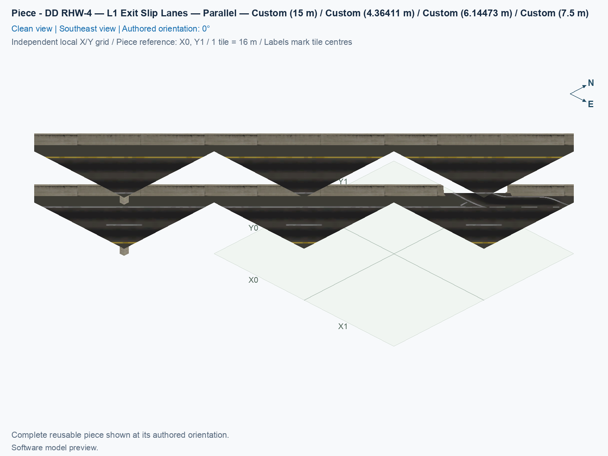
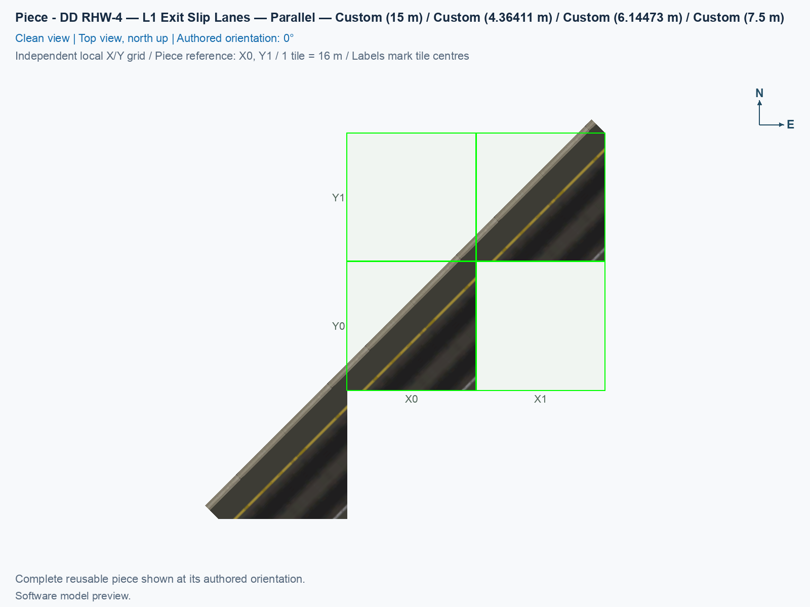

# DD RHW-4 — L1 Exit Slip Lanes — Parallel

Purpose: Place this functional component of the compact parallel diagonal highway diamond and match all of its measured services.

<!-- PIECE README LAYOUT: 2 -->

[1. Views](#1-views) · [2. Piece and placement](#2-piece-and-placement) · [3. Connection matrix](#3-connection-matrix) · [Testing ↗ (separate document)](TESTING.md)

## 1. Views

The canonical angled and north-up pictures show the saved model in its authored 0° orientation. The connector overview identifies complete traffic boundaries. Software images show the authored resources; appearance and travel in the game need their own observations in [TESTING.md](TESTING.md).

<!-- BEGIN PIECE VIEWS -->

<!-- END PIECE VIEWS -->

## 2. Piece and placement

**Current shadow policy:** this component intentionally supplies no cast shadow, as do all fifteen parallel-kit components. After installing the checked revision and restarting, use a fresh placement to avoid confusing older saved attachments with the current result. Follow the assembly’s [no-shadow and cleanup checks](../../01_assemblies/ddrhw-l1-and-l2-diagonal-avenue-parallel-diamond/TESTING.md#44-independent-module-shadow-test); the earlier carrier repair remains historical evidence.

This straight highway section contains the lower L1 off-ramp slip-lane service and its native barrier opening. A slip lane is the auxiliary lane leading between a through lane and a ramp. Both highway decks remain completely straight, with their native through routes retained. All curved roadway outside the native highway edge belongs to the separately placed lateral-departure module.

The revised traffic route and matching white markings use the existing shoulder. Read from the highway through lane toward the ramp: the lower L1 shoulder section has a 8 m smooth sideways taper, followed by 4 m straight and parallel to the highway. An on-ramp follows the reverse sequence in its direction of travel. These two lengths are measured along the straight highway axis and describe the shoulder section, not the complete ramp. The lower route starts 6.788225 m farther upstream, within an already owned native highway tile. The auxiliary-lane centre is 5.5 m from the highway axis. Its checked 2.5 m-wide car corridor leaves 0.421875 m to the native barrier foot at the straight shoulder section. The two occupied cells lie diagonally inside a sparse 2 × 2 rectangle. Its construction reference is an empty corner, so align both occupied preview cells instead of assuming that the reference position is a third tile. Complete boundary cards include both highway levels and every access fragment; matching only the named ramp is insufficient.

This component supplies highway or ramp geometry. The three ground components P01, P02, and P03 own the implemented adaptive Avenue pavement and retained pedestrian routes. Connecting this elevated component does not itself select a sidewalk appearance. Read the [actual mechanism and limits](../../01_assemblies/ddrhw-l1-and-l2-diagonal-avenue-parallel-diamond/TESTING.md#3-software-checks).

A construction tile is a 16 × 16 m city square occupied by one component. This type owns **2 tiles inside a 2 × 2-tile rectangle**. Its reference position in the complete assembly is **P04: X6, Y8, at 0°**. Its actual occupied cells on that shared grid are **(X7, Y8), (X6, Y7)**. The [assembly construction picture](../../01_assemblies/ddrhw-l1-and-l2-diagonal-avenue-parallel-diamond/README.md#1-views) distinguishes thick ownership borders from each real model outline, including overhang.

1. Use the matching parallel-kit build with Windows SimCity 4 and NAM 50 in right-hand traffic, including supported Wine or CrossOver use. See [the build and install guide](../../../../docs/BUILD_AND_INSTALL.md); compiling a build does not install it.
2. Open a disposable, flat test area, and follow the [complete assembly placement sequence](../../01_assemblies/ddrhw-l1-and-l2-diagonal-avenue-parallel-diamond/README.md#3-placements). The three adaptive pieces are placed P02, P01, and P03 first so each temporary helper corner starts clear.
3. Click **Transportation → Highways → SCP → Assemblies**, and select **SCP | ASSEMBLY | DD RHW-4 — Parallel Diagonal Avenue Diamond — Alignment A**. Press **Tab** to cycle forward or **Shift+Tab** to cycle backward until **DD RHW-4 — L1 Exit Slip Lanes — Parallel** appears. Each click places only that selected component.
4. Keep the authored 0° orientation for the reference plan. **Home** and **End** rotate the selected preview; use the actual occupied squares to match the table. Four proper rotations repeat across eight selection states, without reflecting traffic handedness.
5. Position the construction reference at **X6, Y8**, check the occupied cells listed above, and click once. Add the matching components at their own reference positions; never place a second owner on an occupied city square merely because two models overlap visually.

**Physical connection levels:** Both highway levels: 7.5/15 m; named access at 7.5 m. Match exact positions, height profiles, directions, and every boundary service on the generated cards. Matching a visible edge or one road lane alone does not establish a compatible neighbour. These fixed pieces do not adjust to arbitrary terrain heights, and the kit does not establish that native RHW can be dragged through its occupied cells.

<!-- BEGIN PIECE OVERVIEW -->

Place one l1 exit slip lanes for the close parallel diagonal diamond. Use the complete connection cards and assembly grid; heights are fixed.

Exact reusable identifier: `ddrhw-parallel-lower-exit-slip`.

Footprint: **2 × 2 tiles**. Exact menu name: **DD RHW-4 — L1 Exit Slip Lanes — Parallel**.

<!-- END PIECE OVERVIEW -->

## 3. Connection matrix

Read from an entrance row to an exit column. A saved PATH is the traffic data stored in the game resource. Route Query is the route shown by the game, and Visible travel is an observed car or pedestrian completing it. The matrix describes this component's intrinsic fragments; the complete journey can pass through another component's city tile even when its physical model is visibly continuous. Physical joining sections and saved traffic cuts are checked separately.

<!-- BEGIN PIECE CONNECTION MATRIX -->

### Directed entrance/exit matrix

Read **from an entrance row to an exit column**. **Saved PATH** checks the saved traffic route; **Route Query** checks the route shown by the game; **Visible travel** checks a vehicle completing that journey. For HSR, visible travel means a moving train.

**Game appearance:** [?](TESTING.md#case-in_game_render-2e95d1a948c33f76e34f) — the complete piece’s appearance in the game, checked separately from its journeys.

**Legend:** ✅ confirmed; ❌ failed; ? not established. **Forbidden** means the movement is unavailable; its in-game check confirms that it stays unavailable. Click a result for its exact test case. Scope, evidence, and limitations remain in [the test checklist](TESTING.md#test-checklist).

| Entrance ↓ / Exit → | **Road · West exit** `channel-11-out` Variant: access-ramp | **Road · South exit** `channel-12-out` Variant: dd-rhw-l1 | **Road · South exit** `channel-13-out` Variant: dd-rhw-l1 | **Road · East exit** `channel-14-out` Variant: dd-rhw-l2 | **Road · East exit** `channel-15-out` Variant: dd-rhw-l2 | **Road · West exit** `channel-16-out` Variant: dd-rhw-l1 | **Road · South exit** `channel-17-out` Variant: dd-rhw-l1 | **Road · South exit** `channel-18-out` Variant: dd-rhw-l1 | **Road · East exit** `channel-19-out` Variant: dd-rhw-l2 | **Road · East exit** `channel-20-out` Variant: dd-rhw-l2 |
| --- | --- | --- | --- | --- | --- | --- | --- | --- | --- | --- |
| **Road · South entrance** `channel-01-in` Variant: dd-rhw-l2 | **Forbidden** **Saved PATH:** [?](TESTING.md#case-software_connectivity-b0fa3bba38db48447050) In-game check: [?](TESTING.md#case-in_game_forbidden_transfer-1e19317eb88c3c9b9aae) | **Forbidden** **Saved PATH:** [?](TESTING.md#case-software_connectivity-b0fa3bba38db48447050) In-game check: [?](TESTING.md#case-in_game_forbidden_transfer-c6087de923aaf5be3823) | **Forbidden** **Saved PATH:** [?](TESTING.md#case-software_connectivity-b0fa3bba38db48447050) In-game check: [?](TESTING.md#case-in_game_forbidden_transfer-1d293b217f34f699af94) | **Forbidden** **Saved PATH:** [?](TESTING.md#case-software_connectivity-b0fa3bba38db48447050) In-game check: [?](TESTING.md#case-in_game_forbidden_transfer-2781924f8f9549b389ef) | **Saved PATH:** [?](TESTING.md#case-software_connectivity-b0fa3bba38db48447050) **Route Query:** [?](TESTING.md#case-in_game_route_query-1fa520b339b7d034ab00) **Visible travel:** [?](TESTING.md#case-in_game_visible_travel-1fa520b339b7d034ab00) | **Forbidden** **Saved PATH:** [?](TESTING.md#case-software_connectivity-b0fa3bba38db48447050) In-game check: [?](TESTING.md#case-in_game_forbidden_transfer-e18e21820a6767425c62) | **Forbidden** **Saved PATH:** [?](TESTING.md#case-software_connectivity-b0fa3bba38db48447050) In-game check: [?](TESTING.md#case-in_game_forbidden_transfer-ceb9022d9c04387777e6) | **Forbidden** **Saved PATH:** [?](TESTING.md#case-software_connectivity-b0fa3bba38db48447050) In-game check: [?](TESTING.md#case-in_game_forbidden_transfer-3abddb3b6785ba1d5457) | **Forbidden** **Saved PATH:** [?](TESTING.md#case-software_connectivity-b0fa3bba38db48447050) In-game check: [?](TESTING.md#case-in_game_forbidden_transfer-3049cd6ca39c33b7f6e7) | **Forbidden** **Saved PATH:** [?](TESTING.md#case-software_connectivity-b0fa3bba38db48447050) In-game check: [?](TESTING.md#case-in_game_forbidden_transfer-1f3c9364a008be6e7f51) |
| **Road · North entrance** `channel-02-in` Variant: access-ramp | **Saved PATH:** [?](TESTING.md#case-software_connectivity-b0fa3bba38db48447050) **Route Query:** [?](TESTING.md#case-in_game_route_query-f28046d5ff0529f3997b) **Visible travel:** [?](TESTING.md#case-in_game_visible_travel-f28046d5ff0529f3997b) | **Forbidden** **Saved PATH:** [?](TESTING.md#case-software_connectivity-b0fa3bba38db48447050) In-game check: [?](TESTING.md#case-in_game_forbidden_transfer-beaac1309ddbd009e9f2) | **Forbidden** **Saved PATH:** [?](TESTING.md#case-software_connectivity-b0fa3bba38db48447050) In-game check: [?](TESTING.md#case-in_game_forbidden_transfer-12e30c98f69302a54128) | **Forbidden** **Saved PATH:** [?](TESTING.md#case-software_connectivity-b0fa3bba38db48447050) In-game check: [?](TESTING.md#case-in_game_forbidden_transfer-05f2c4aa2138dce9c28e) | **Forbidden** **Saved PATH:** [?](TESTING.md#case-software_connectivity-b0fa3bba38db48447050) In-game check: [?](TESTING.md#case-in_game_forbidden_transfer-e0f4f033dbdcb5915cdf) | **Forbidden** **Saved PATH:** [?](TESTING.md#case-software_connectivity-b0fa3bba38db48447050) In-game check: [?](TESTING.md#case-in_game_forbidden_transfer-e7a9b89b924ee50b2981) | **Forbidden** **Saved PATH:** [?](TESTING.md#case-software_connectivity-b0fa3bba38db48447050) In-game check: [?](TESTING.md#case-in_game_forbidden_transfer-5c9d0955f81d8226a817) | **Forbidden** **Saved PATH:** [?](TESTING.md#case-software_connectivity-b0fa3bba38db48447050) In-game check: [?](TESTING.md#case-in_game_forbidden_transfer-cb4d80c2d0bf944e4175) | **Forbidden** **Saved PATH:** [?](TESTING.md#case-software_connectivity-b0fa3bba38db48447050) In-game check: [?](TESTING.md#case-in_game_forbidden_transfer-7f4ea71a24372d720b23) | **Forbidden** **Saved PATH:** [?](TESTING.md#case-software_connectivity-b0fa3bba38db48447050) In-game check: [?](TESTING.md#case-in_game_forbidden_transfer-8b0070642dd155edf0fb) |
| **Road · South entrance** `channel-03-in` Variant: dd-rhw-l2 | **Forbidden** **Saved PATH:** [?](TESTING.md#case-software_connectivity-b0fa3bba38db48447050) In-game check: [?](TESTING.md#case-in_game_forbidden_transfer-ec42db807cad000a383a) | **Forbidden** **Saved PATH:** [?](TESTING.md#case-software_connectivity-b0fa3bba38db48447050) In-game check: [?](TESTING.md#case-in_game_forbidden_transfer-f9f9fe139944f70a85d5) | **Forbidden** **Saved PATH:** [?](TESTING.md#case-software_connectivity-b0fa3bba38db48447050) In-game check: [?](TESTING.md#case-in_game_forbidden_transfer-705bb9ecb799f5dd49fe) | **Saved PATH:** [?](TESTING.md#case-software_connectivity-b0fa3bba38db48447050) **Route Query:** [?](TESTING.md#case-in_game_route_query-c24da3d8497415fa6c36) **Visible travel:** [?](TESTING.md#case-in_game_visible_travel-c24da3d8497415fa6c36) | **Forbidden** **Saved PATH:** [?](TESTING.md#case-software_connectivity-b0fa3bba38db48447050) In-game check: [?](TESTING.md#case-in_game_forbidden_transfer-a6a02fdfb9faab980a21) | **Forbidden** **Saved PATH:** [?](TESTING.md#case-software_connectivity-b0fa3bba38db48447050) In-game check: [?](TESTING.md#case-in_game_forbidden_transfer-1f481357e2bcc14133f9) | **Forbidden** **Saved PATH:** [?](TESTING.md#case-software_connectivity-b0fa3bba38db48447050) In-game check: [?](TESTING.md#case-in_game_forbidden_transfer-d7d6095d6966fc47f687) | **Forbidden** **Saved PATH:** [?](TESTING.md#case-software_connectivity-b0fa3bba38db48447050) In-game check: [?](TESTING.md#case-in_game_forbidden_transfer-ac84551be725eb2eca26) | **Forbidden** **Saved PATH:** [?](TESTING.md#case-software_connectivity-b0fa3bba38db48447050) In-game check: [?](TESTING.md#case-in_game_forbidden_transfer-119b5fe658fe952cb707) | **Forbidden** **Saved PATH:** [?](TESTING.md#case-software_connectivity-b0fa3bba38db48447050) In-game check: [?](TESTING.md#case-in_game_forbidden_transfer-2236d0763cd30bfb3e26) |
| **Road · East entrance** `channel-04-in` Variant: dd-rhw-l1 | **Forbidden** **Saved PATH:** [?](TESTING.md#case-software_connectivity-b0fa3bba38db48447050) In-game check: [?](TESTING.md#case-in_game_forbidden_transfer-363cd96f9801137cf988) | **Forbidden** **Saved PATH:** [?](TESTING.md#case-software_connectivity-b0fa3bba38db48447050) In-game check: [?](TESTING.md#case-in_game_forbidden_transfer-d4a3cbc4861dcc9b00cf) | **Saved PATH:** [?](TESTING.md#case-software_connectivity-b0fa3bba38db48447050) **Route Query:** [?](TESTING.md#case-in_game_route_query-051d0e4b86a7b9c82763) **Visible travel:** [?](TESTING.md#case-in_game_visible_travel-051d0e4b86a7b9c82763) | **Forbidden** **Saved PATH:** [?](TESTING.md#case-software_connectivity-b0fa3bba38db48447050) In-game check: [?](TESTING.md#case-in_game_forbidden_transfer-b222f748ad4042326d6a) | **Forbidden** **Saved PATH:** [?](TESTING.md#case-software_connectivity-b0fa3bba38db48447050) In-game check: [?](TESTING.md#case-in_game_forbidden_transfer-5ee8cd717645d3554ae4) | **Forbidden** **Saved PATH:** [?](TESTING.md#case-software_connectivity-b0fa3bba38db48447050) In-game check: [?](TESTING.md#case-in_game_forbidden_transfer-c217b99c9b08561eca7e) | **Forbidden** **Saved PATH:** [?](TESTING.md#case-software_connectivity-b0fa3bba38db48447050) In-game check: [?](TESTING.md#case-in_game_forbidden_transfer-9aff43ccc7e363890fff) | **Forbidden** **Saved PATH:** [?](TESTING.md#case-software_connectivity-b0fa3bba38db48447050) In-game check: [?](TESTING.md#case-in_game_forbidden_transfer-ab2c3e8b5e058c06531e) | **Forbidden** **Saved PATH:** [?](TESTING.md#case-software_connectivity-b0fa3bba38db48447050) In-game check: [?](TESTING.md#case-in_game_forbidden_transfer-2da18ec045e7b9828e6f) | **Forbidden** **Saved PATH:** [?](TESTING.md#case-software_connectivity-b0fa3bba38db48447050) In-game check: [?](TESTING.md#case-in_game_forbidden_transfer-5800351aa8f2db29469c) |
| **Road · East entrance** `channel-05-in` Variant: dd-rhw-l1 | **Forbidden** **Saved PATH:** [?](TESTING.md#case-software_connectivity-b0fa3bba38db48447050) In-game check: [?](TESTING.md#case-in_game_forbidden_transfer-7cd9f697abe3a4781ee4) | **Saved PATH:** [?](TESTING.md#case-software_connectivity-b0fa3bba38db48447050) **Route Query:** [?](TESTING.md#case-in_game_route_query-e96d644ebd2be7589764) **Visible travel:** [?](TESTING.md#case-in_game_visible_travel-e96d644ebd2be7589764) | **Forbidden** **Saved PATH:** [?](TESTING.md#case-software_connectivity-b0fa3bba38db48447050) In-game check: [?](TESTING.md#case-in_game_forbidden_transfer-b542d09c2577ae4da250) | **Forbidden** **Saved PATH:** [?](TESTING.md#case-software_connectivity-b0fa3bba38db48447050) In-game check: [?](TESTING.md#case-in_game_forbidden_transfer-14b5f287aeef64137dbc) | **Forbidden** **Saved PATH:** [?](TESTING.md#case-software_connectivity-b0fa3bba38db48447050) In-game check: [?](TESTING.md#case-in_game_forbidden_transfer-8582b3300a20544ecc84) | **Forbidden** **Saved PATH:** [?](TESTING.md#case-software_connectivity-b0fa3bba38db48447050) In-game check: [?](TESTING.md#case-in_game_forbidden_transfer-e958c35eba65c60e2838) | **Forbidden** **Saved PATH:** [?](TESTING.md#case-software_connectivity-b0fa3bba38db48447050) In-game check: [?](TESTING.md#case-in_game_forbidden_transfer-d6dc60c1ad6e4384e59d) | **Forbidden** **Saved PATH:** [?](TESTING.md#case-software_connectivity-b0fa3bba38db48447050) In-game check: [?](TESTING.md#case-in_game_forbidden_transfer-ce5f39adcfd352c55f5c) | **Forbidden** **Saved PATH:** [?](TESTING.md#case-software_connectivity-b0fa3bba38db48447050) In-game check: [?](TESTING.md#case-in_game_forbidden_transfer-7e4e8b76268eba35a640) | **Forbidden** **Saved PATH:** [?](TESTING.md#case-software_connectivity-b0fa3bba38db48447050) In-game check: [?](TESTING.md#case-in_game_forbidden_transfer-c1f9ff5e2340fe03271a) |
| **Road · South entrance** `channel-06-in` Variant: dd-rhw-l2 | **Forbidden** **Saved PATH:** [?](TESTING.md#case-software_connectivity-b0fa3bba38db48447050) In-game check: [?](TESTING.md#case-in_game_forbidden_transfer-20de0deb91457a7441f6) | **Forbidden** **Saved PATH:** [?](TESTING.md#case-software_connectivity-b0fa3bba38db48447050) In-game check: [?](TESTING.md#case-in_game_forbidden_transfer-10ac1adb5581470143b4) | **Forbidden** **Saved PATH:** [?](TESTING.md#case-software_connectivity-b0fa3bba38db48447050) In-game check: [?](TESTING.md#case-in_game_forbidden_transfer-117c29001974da1f2d40) | **Forbidden** **Saved PATH:** [?](TESTING.md#case-software_connectivity-b0fa3bba38db48447050) In-game check: [?](TESTING.md#case-in_game_forbidden_transfer-8d42a2cd65414a18311d) | **Forbidden** **Saved PATH:** [?](TESTING.md#case-software_connectivity-b0fa3bba38db48447050) In-game check: [?](TESTING.md#case-in_game_forbidden_transfer-7206f4d09bea82636cb7) | **Forbidden** **Saved PATH:** [?](TESTING.md#case-software_connectivity-b0fa3bba38db48447050) In-game check: [?](TESTING.md#case-in_game_forbidden_transfer-a229aa4fdbbe8e2f5e78) | **Forbidden** **Saved PATH:** [?](TESTING.md#case-software_connectivity-b0fa3bba38db48447050) In-game check: [?](TESTING.md#case-in_game_forbidden_transfer-ab06d5f5ffd6e60d0410) | **Forbidden** **Saved PATH:** [?](TESTING.md#case-software_connectivity-b0fa3bba38db48447050) In-game check: [?](TESTING.md#case-in_game_forbidden_transfer-51063ac521bda54b89f8) | **Forbidden** **Saved PATH:** [?](TESTING.md#case-software_connectivity-b0fa3bba38db48447050) In-game check: [?](TESTING.md#case-in_game_forbidden_transfer-a14f8c68b430847472e8) | **Saved PATH:** [?](TESTING.md#case-software_connectivity-b0fa3bba38db48447050) **Route Query:** [?](TESTING.md#case-in_game_route_query-6becdf74122ba4f58f57) **Visible travel:** [?](TESTING.md#case-in_game_visible_travel-6becdf74122ba4f58f57) |
| **Road · South entrance** `channel-07-in` Variant: dd-rhw-l2 | **Forbidden** **Saved PATH:** [?](TESTING.md#case-software_connectivity-b0fa3bba38db48447050) In-game check: [?](TESTING.md#case-in_game_forbidden_transfer-e6c21dd157beccc107ee) | **Forbidden** **Saved PATH:** [?](TESTING.md#case-software_connectivity-b0fa3bba38db48447050) In-game check: [?](TESTING.md#case-in_game_forbidden_transfer-a693f70432bd048c579a) | **Forbidden** **Saved PATH:** [?](TESTING.md#case-software_connectivity-b0fa3bba38db48447050) In-game check: [?](TESTING.md#case-in_game_forbidden_transfer-70b1715ae1379c541398) | **Forbidden** **Saved PATH:** [?](TESTING.md#case-software_connectivity-b0fa3bba38db48447050) In-game check: [?](TESTING.md#case-in_game_forbidden_transfer-a019ba45b7443c73633f) | **Forbidden** **Saved PATH:** [?](TESTING.md#case-software_connectivity-b0fa3bba38db48447050) In-game check: [?](TESTING.md#case-in_game_forbidden_transfer-4cbf1ae2e1fd08144792) | **Forbidden** **Saved PATH:** [?](TESTING.md#case-software_connectivity-b0fa3bba38db48447050) In-game check: [?](TESTING.md#case-in_game_forbidden_transfer-f400e0c746fe6219e612) | **Forbidden** **Saved PATH:** [?](TESTING.md#case-software_connectivity-b0fa3bba38db48447050) In-game check: [?](TESTING.md#case-in_game_forbidden_transfer-45cdc8c145f615173c17) | **Forbidden** **Saved PATH:** [?](TESTING.md#case-software_connectivity-b0fa3bba38db48447050) In-game check: [?](TESTING.md#case-in_game_forbidden_transfer-270263c1fdc7ed04769e) | **Saved PATH:** [?](TESTING.md#case-software_connectivity-b0fa3bba38db48447050) **Route Query:** [?](TESTING.md#case-in_game_route_query-e648234c4e6f689eb43d) **Visible travel:** [?](TESTING.md#case-in_game_visible_travel-e648234c4e6f689eb43d) | **Forbidden** **Saved PATH:** [?](TESTING.md#case-software_connectivity-b0fa3bba38db48447050) In-game check: [?](TESTING.md#case-in_game_forbidden_transfer-d24ddeeb47fb3ed0c071) |
| **Road · East entrance** `channel-08-in` Variant: dd-rhw-l1 | **Forbidden** **Saved PATH:** [?](TESTING.md#case-software_connectivity-b0fa3bba38db48447050) In-game check: [?](TESTING.md#case-in_game_forbidden_transfer-36d37664c569038db2d7) | **Forbidden** **Saved PATH:** [?](TESTING.md#case-software_connectivity-b0fa3bba38db48447050) In-game check: [?](TESTING.md#case-in_game_forbidden_transfer-22c56716f1d0ab2fa822) | **Forbidden** **Saved PATH:** [?](TESTING.md#case-software_connectivity-b0fa3bba38db48447050) In-game check: [?](TESTING.md#case-in_game_forbidden_transfer-5378e79bc92aae38bef3) | **Forbidden** **Saved PATH:** [?](TESTING.md#case-software_connectivity-b0fa3bba38db48447050) In-game check: [?](TESTING.md#case-in_game_forbidden_transfer-49acb456a4ef30a2c4f9) | **Forbidden** **Saved PATH:** [?](TESTING.md#case-software_connectivity-b0fa3bba38db48447050) In-game check: [?](TESTING.md#case-in_game_forbidden_transfer-bbfb321e6abba462ad72) | **Forbidden** **Saved PATH:** [?](TESTING.md#case-software_connectivity-b0fa3bba38db48447050) In-game check: [?](TESTING.md#case-in_game_forbidden_transfer-317aa026d3b84a6c99f9) | **Forbidden** **Saved PATH:** [?](TESTING.md#case-software_connectivity-b0fa3bba38db48447050) In-game check: [?](TESTING.md#case-in_game_forbidden_transfer-cb910f345cded7f4ceb8) | **Saved PATH:** [?](TESTING.md#case-software_connectivity-b0fa3bba38db48447050) **Route Query:** [?](TESTING.md#case-in_game_route_query-616ebaa1590f2df822b3) **Visible travel:** [?](TESTING.md#case-in_game_visible_travel-616ebaa1590f2df822b3) | **Forbidden** **Saved PATH:** [?](TESTING.md#case-software_connectivity-b0fa3bba38db48447050) In-game check: [?](TESTING.md#case-in_game_forbidden_transfer-821dd7831fbfaccb1645) | **Forbidden** **Saved PATH:** [?](TESTING.md#case-software_connectivity-b0fa3bba38db48447050) In-game check: [?](TESTING.md#case-in_game_forbidden_transfer-8d31e79bb136c201d80c) |
| **Road · East entrance** `channel-09-in` Variant: dd-rhw-l1 | **Forbidden** **Saved PATH:** [?](TESTING.md#case-software_connectivity-b0fa3bba38db48447050) In-game check: [?](TESTING.md#case-in_game_forbidden_transfer-b24e81414eaa779aad65) | **Forbidden** **Saved PATH:** [?](TESTING.md#case-software_connectivity-b0fa3bba38db48447050) In-game check: [?](TESTING.md#case-in_game_forbidden_transfer-7d55e18b1fa1e70e1beb) | **Forbidden** **Saved PATH:** [?](TESTING.md#case-software_connectivity-b0fa3bba38db48447050) In-game check: [?](TESTING.md#case-in_game_forbidden_transfer-01a1d7c04707bb42ec78) | **Forbidden** **Saved PATH:** [?](TESTING.md#case-software_connectivity-b0fa3bba38db48447050) In-game check: [?](TESTING.md#case-in_game_forbidden_transfer-fad920843a69c051878e) | **Forbidden** **Saved PATH:** [?](TESTING.md#case-software_connectivity-b0fa3bba38db48447050) In-game check: [?](TESTING.md#case-in_game_forbidden_transfer-d43a2f8478548ab723f4) | **Forbidden** **Saved PATH:** [?](TESTING.md#case-software_connectivity-b0fa3bba38db48447050) In-game check: [?](TESTING.md#case-in_game_forbidden_transfer-7c7504538e0b4f5d659f) | **Saved PATH:** [?](TESTING.md#case-software_connectivity-b0fa3bba38db48447050) **Route Query:** [?](TESTING.md#case-in_game_route_query-0d87f34c9b86cb44db24) **Visible travel:** [?](TESTING.md#case-in_game_visible_travel-0d87f34c9b86cb44db24) | **Forbidden** **Saved PATH:** [?](TESTING.md#case-software_connectivity-b0fa3bba38db48447050) In-game check: [?](TESTING.md#case-in_game_forbidden_transfer-9894437b1ed0e090ab47) | **Forbidden** **Saved PATH:** [?](TESTING.md#case-software_connectivity-b0fa3bba38db48447050) In-game check: [?](TESTING.md#case-in_game_forbidden_transfer-903337fe6ec2f4262ead) | **Forbidden** **Saved PATH:** [?](TESTING.md#case-software_connectivity-b0fa3bba38db48447050) In-game check: [?](TESTING.md#case-in_game_forbidden_transfer-7da31cd73fcddcb40dfa) |
| **Road · East entrance** `channel-10-in` Variant: dd-rhw-l1 | **Forbidden** **Saved PATH:** [?](TESTING.md#case-software_connectivity-b0fa3bba38db48447050) In-game check: [?](TESTING.md#case-in_game_forbidden_transfer-53a63ae6100ad7538785) | **Forbidden** **Saved PATH:** [?](TESTING.md#case-software_connectivity-b0fa3bba38db48447050) In-game check: [?](TESTING.md#case-in_game_forbidden_transfer-73514cdb84e2651b8da0) | **Forbidden** **Saved PATH:** [?](TESTING.md#case-software_connectivity-b0fa3bba38db48447050) In-game check: [?](TESTING.md#case-in_game_forbidden_transfer-62dab4c6713f14f5cddf) | **Forbidden** **Saved PATH:** [?](TESTING.md#case-software_connectivity-b0fa3bba38db48447050) In-game check: [?](TESTING.md#case-in_game_forbidden_transfer-a26b25547fa3db4357ba) | **Forbidden** **Saved PATH:** [?](TESTING.md#case-software_connectivity-b0fa3bba38db48447050) In-game check: [?](TESTING.md#case-in_game_forbidden_transfer-55abd261f2fa1777f717) | **Saved PATH:** [?](TESTING.md#case-software_connectivity-b0fa3bba38db48447050) **Route Query:** [?](TESTING.md#case-in_game_route_query-29bedbdf30e3256c884f) **Visible travel:** [?](TESTING.md#case-in_game_visible_travel-29bedbdf30e3256c884f) | **Forbidden** **Saved PATH:** [?](TESTING.md#case-software_connectivity-b0fa3bba38db48447050) In-game check: [?](TESTING.md#case-in_game_forbidden_transfer-301c1e45879bfc4ed4a9) | **Forbidden** **Saved PATH:** [?](TESTING.md#case-software_connectivity-b0fa3bba38db48447050) In-game check: [?](TESTING.md#case-in_game_forbidden_transfer-ba74c7356eadb327a8b4) | **Forbidden** **Saved PATH:** [?](TESTING.md#case-software_connectivity-b0fa3bba38db48447050) In-game check: [?](TESTING.md#case-in_game_forbidden_transfer-7479c5e92a3dcff3a867) | **Forbidden** **Saved PATH:** [?](TESTING.md#case-software_connectivity-b0fa3bba38db48447050) In-game check: [?](TESTING.md#case-in_game_forbidden_transfer-a00978272f3249571eb7) |

Source: [connections.json](connections.json).

<!-- END PIECE CONNECTION MATRIX -->

<!-- BEGIN CONNECTOR OVERVIEW -->

### Connection overview

Generated from this piece's source-bound connector metadata and the current compiled model; marker letters refer to the boundary cards below.

[Rendering sources and verification scope](evidence/connection-overview.json).

Headings: 0° = North, 90° = East, 180° = South, and 270° = West; clockwise in plan view, pointing out of the piece.

Coordinates [E,N,H] = [east,north,height] in metres. Source cells [column,row] increase east and south.

Display grid: X = source column − (0); Y = 1 − source row.

Slope is measured outward at the joining edge; the interior may differ. Offsets are + left and − right facing out of the tile edge.

Member offsets use the section origin. Counts distinguish physical channels / edge cuts / directed members; modes do not multiply channels.

Incoming flow enters this piece; outgoing flow leaves it. Letters identify boundary cards; source IDs remain the stable identities.

Not declared means no section origin or offset was authored. Its marker uses an actual member endpoint; the measured intersections remain authoritative.

#### Boundary A: `boundary-04`

All 2 service groups are required together at this edge.

##### Service group 1 / 2: ROAD — Custom (7.5 m)

| Field | Value |
| --- | --- |
| End / component | `boundary-04-lower-mainline-01` / `lower-mainline` |
| Network / game class / role | road / Engine class (1); primary |
| Source cell / edge | `[0,1]` / South |
| Section origin [E,N] (m) | Not declared; see member endpoints |
| Centring / section offset | Not declared |
| Level (path height) | Custom (7.5 m); no nominal level |
| Outward heading | 225° |
| Slope at joining edge | 0% outward |
| Channels / edge cuts / directed members | 2 / 2 / 2 |
| Traffic arrangement / running | 0 incoming; 2 outgoing; See member directions |
| Channel spacing | 4.52548 m |
| Channel kinds | road-lane |
| Traffic modes | car |
| Profile | No profile reference |

| Member / measured source | Channel / cut / modes | Flow | Endpoint [E,N,H] (m) | Offset (m) | Outward heading | Edge slope (%) |
| --- | --- | --- | --- | ---: | ---: | ---: |
| `member-channel-12-out` / `channel-12-out` | `lower-mainline-axis-plus-2-26274-negative` / `cut-channel-12-out` / car | Outgoing | `[-3.2,-24,7.5]` | Not declared | 225° | 0 |
| `member-channel-13-out` / `channel-13-out` | `lower-mainline-axis-minus-2-26274-negative` / `cut-channel-13-out` / car | Outgoing | `[3.2,-24,7.5]` | Not declared | 225° | 0 |

##### Service group 2 / 2: ROAD — Custom (15 m)

| Field | Value |
| --- | --- |
| End / component | `boundary-04-upper-mainline-02` / `upper-mainline` |
| Network / game class / role | road / Engine class (1); primary |
| Source cell / edge | `[0,1]` / South |
| Section origin [E,N] (m) | Not declared; see member endpoints |
| Centring / section offset | Not declared |
| Level (path height) | Custom (15 m); no nominal level |
| Outward heading | 225° |
| Slope at joining edge | 0% outward |
| Channels / edge cuts / directed members | 2 / 2 / 2 |
| Traffic arrangement / running | 2 incoming; 0 outgoing; See member directions |
| Channel spacing | 4.52548 m |
| Channel kinds | road-lane |
| Traffic modes | car |
| Profile | No profile reference |

| Member / measured source | Channel / cut / modes | Flow | Endpoint [E,N,H] (m) | Offset (m) | Outward heading | Edge slope (%) |
| --- | --- | --- | --- | ---: | ---: | ---: |
| `member-channel-01-in` / `channel-01-in` | `upper-mainline-axis-plus-2-26274-positive` / `cut-channel-01-in` / car | Incoming | `[-3.2,-24,15]` | Not declared | 225° | 0 |
| `member-channel-03-in` / `channel-03-in` | `upper-mainline-axis-minus-2-26274-positive` / `cut-channel-03-in` / car | Incoming | `[3.2,-24,15]` | Not declared | 225° | 0 |

#### Boundary B: `boundary-02`

This service group is required at this edge.

##### Service group 1 / 1: ROAD — Custom (6.14473 m)

| Field | Value |
| --- | --- |
| End / component | `boundary-02-access-network-lower-off-01` / `access-network-lower-off` |
| Network / game class / role | road / Engine class (1); primary |
| Source cell / edge | `[0,1]` / North |
| Section origin [E,N] (m) | Not declared; see member endpoints |
| Centring / section offset | Not declared |
| Level (path height) | Custom (6.14473 m); no nominal level |
| Outward heading | 45° |
| Slope at joining edge | 17.9075% outward |
| Channels / edge cuts / directed members | 1 / 1 / 1 |
| Traffic arrangement / running | 1 incoming; 0 outgoing; See member directions |
| Channel spacing | See individual measured intersections |
| Channel kinds | road-lane |
| Traffic modes | car |
| Profile | No profile reference |

| Member / measured source | Channel / cut / modes | Flow | Endpoint [E,N,H] (m) | Offset (m) | Outward heading | Edge slope (%) |
| --- | --- | --- | --- | ---: | ---: | ---: |
| `member-channel-02-in` / `channel-02-in` | `access-lower-off` / `cut-channel-02-in` / car | Incoming | `[-0.970563,-8,6.14473]` | Not declared | 45° | 17.9075 |

#### Boundary C: `boundary-01`

This service group is required at this edge.

##### Service group 1 / 1: ROAD — Custom (4.36411 m)

| Field | Value |
| --- | --- |
| End / component | `boundary-01-access-network-lower-off-01` / `access-network-lower-off` |
| Network / game class / role | road / Engine class (1); primary |
| Source cell / edge | `[0,1]` / West |
| Section origin [E,N] (m) | Not declared; see member endpoints |
| Centring / section offset | Not declared |
| Level (path height) | Custom (4.36411 m); no nominal level |
| Outward heading | 225° |
| Slope at joining edge | -17.9119% outward |
| Channels / edge cuts / directed members | 1 / 1 / 1 |
| Traffic arrangement / running | 0 incoming; 1 outgoing; See member directions |
| Channel spacing | See individual measured intersections |
| Channel kinds | road-lane |
| Traffic modes | car |
| Profile | No profile reference |

| Member / measured source | Channel / cut / modes | Flow | Endpoint [E,N,H] (m) | Offset (m) | Outward heading | Edge slope (%) |
| --- | --- | --- | --- | ---: | ---: | ---: |
| `member-channel-11-out` / `channel-11-out` | `access-lower-off` / `cut-channel-11-out` / car | Outgoing | `[-8,-15.0294,4.36411]` | Not declared | 225° | -17.9119 |

#### Boundary D: `boundary-03`

All 2 service groups are required together at this edge.

##### Service group 1 / 2: ROAD — Custom (7.5 m)

| Field | Value |
| --- | --- |
| End / component | `boundary-03-lower-mainline-01` / `lower-mainline` |
| Network / game class / role | road / Engine class (1); primary |
| Source cell / edge | `[0,1]` / East |
| Section origin [E,N] (m) | Not declared; see member endpoints |
| Centring / section offset | Not declared |
| Level (path height) | Custom (7.5 m); no nominal level |
| Outward heading | 45° |
| Slope at joining edge | 0% outward |
| Channels / edge cuts / directed members | 2 / 2 / 2 |
| Traffic arrangement / running | 2 incoming; 0 outgoing; See member directions |
| Channel spacing | 4.52548 m |
| Channel kinds | road-lane |
| Traffic modes | car |
| Profile | No profile reference |

| Member / measured source | Channel / cut / modes | Flow | Endpoint [E,N,H] (m) | Offset (m) | Outward heading | Edge slope (%) |
| --- | --- | --- | --- | ---: | ---: | ---: |
| `member-channel-04-in` / `channel-04-in` | `lower-mainline-axis-minus-2-26274-negative` / `cut-channel-04-in` / car | Incoming | `[8,-19.2,7.5]` | Not declared | 45° | 0 |
| `member-channel-05-in` / `channel-05-in` | `lower-mainline-axis-plus-2-26274-negative` / `cut-channel-05-in` / car | Incoming | `[8,-12.8,7.5]` | Not declared | 45° | 0 |

##### Service group 2 / 2: ROAD — Custom (15 m)

| Field | Value |
| --- | --- |
| End / component | `boundary-03-upper-mainline-02` / `upper-mainline` |
| Network / game class / role | road / Engine class (1); primary |
| Source cell / edge | `[0,1]` / East |
| Section origin [E,N] (m) | Not declared; see member endpoints |
| Centring / section offset | Not declared |
| Level (path height) | Custom (15 m); no nominal level |
| Outward heading | 45° |
| Slope at joining edge | 0% outward |
| Channels / edge cuts / directed members | 2 / 2 / 2 |
| Traffic arrangement / running | 0 incoming; 2 outgoing; See member directions |
| Channel spacing | 4.52548 m |
| Channel kinds | road-lane |
| Traffic modes | car |
| Profile | No profile reference |

| Member / measured source | Channel / cut / modes | Flow | Endpoint [E,N,H] (m) | Offset (m) | Outward heading | Edge slope (%) |
| --- | --- | --- | --- | ---: | ---: | ---: |
| `member-channel-14-out` / `channel-14-out` | `upper-mainline-axis-minus-2-26274-positive` / `cut-channel-14-out` / car | Outgoing | `[8,-19.2,15]` | Not declared | 45° | 0 |
| `member-channel-15-out` / `channel-15-out` | `upper-mainline-axis-plus-2-26274-positive` / `cut-channel-15-out` / car | Outgoing | `[8,-12.8,15]` | Not declared | 45° | 0 |

#### Boundary E: `boundary-07`

All 2 service groups are required together at this edge.

##### Service group 1 / 2: ROAD — Custom (7.5 m)

| Field | Value |
| --- | --- |
| End / component | `boundary-07-lower-mainline-01` / `lower-mainline` |
| Network / game class / role | road / Engine class (1); primary |
| Source cell / edge | `[1,0]` / South |
| Section origin [E,N] (m) | Not declared; see member endpoints |
| Centring / section offset | Not declared |
| Level (path height) | Custom (7.5 m); no nominal level |
| Outward heading | 225° |
| Slope at joining edge | 0% outward |
| Channels / edge cuts / directed members | 2 / 2 / 2 |
| Traffic arrangement / running | 0 incoming; 2 outgoing; See member directions |
| Channel spacing | 4.52548 m |
| Channel kinds | road-lane |
| Traffic modes | car |
| Profile | No profile reference |

| Member / measured source | Channel / cut / modes | Flow | Endpoint [E,N,H] (m) | Offset (m) | Outward heading | Edge slope (%) |
| --- | --- | --- | --- | ---: | ---: | ---: |
| `member-channel-17-out` / `channel-17-out` | `lower-mainline-axis-plus-2-26274-negative` / `cut-channel-17-out` / car | Outgoing | `[12.8,-8,7.5]` | Not declared | 225° | 0 |
| `member-channel-18-out` / `channel-18-out` | `lower-mainline-axis-minus-2-26274-negative` / `cut-channel-18-out` / car | Outgoing | `[19.2,-8,7.5]` | Not declared | 225° | 0 |

##### Service group 2 / 2: ROAD — Custom (15 m)

| Field | Value |
| --- | --- |
| End / component | `boundary-07-upper-mainline-02` / `upper-mainline` |
| Network / game class / role | road / Engine class (1); primary |
| Source cell / edge | `[1,0]` / South |
| Section origin [E,N] (m) | Not declared; see member endpoints |
| Centring / section offset | Not declared |
| Level (path height) | Custom (15 m); no nominal level |
| Outward heading | 225° |
| Slope at joining edge | 0% outward |
| Channels / edge cuts / directed members | 2 / 2 / 2 |
| Traffic arrangement / running | 2 incoming; 0 outgoing; See member directions |
| Channel spacing | 4.52548 m |
| Channel kinds | road-lane |
| Traffic modes | car |
| Profile | No profile reference |

| Member / measured source | Channel / cut / modes | Flow | Endpoint [E,N,H] (m) | Offset (m) | Outward heading | Edge slope (%) |
| --- | --- | --- | --- | ---: | ---: | ---: |
| `member-channel-06-in` / `channel-06-in` | `upper-mainline-axis-plus-2-26274-positive` / `cut-channel-06-in` / car | Incoming | `[12.8,-8,15]` | Not declared | 225° | 0 |
| `member-channel-07-in` / `channel-07-in` | `upper-mainline-axis-minus-2-26274-positive` / `cut-channel-07-in` / car | Incoming | `[19.2,-8,15]` | Not declared | 225° | 0 |

#### Boundary F: `boundary-05`

This service group is required at this edge.

##### Service group 1 / 1: ROAD — Custom (7.5 m)

| Field | Value |
| --- | --- |
| End / component | `boundary-05-access-network-lower-off-01` / `access-network-lower-off` |
| Network / game class / role | road / Engine class (1); primary |
| Source cell / edge | `[1,0]` / West |
| Section origin [E,N] (m) | Not declared; see member endpoints |
| Centring / section offset | Not declared |
| Level (path height) | Custom (7.5 m); no nominal level |
| Outward heading | 250.129° |
| Slope at joining edge | 0% outward |
| Channels / edge cuts / directed members | 1 / 1 / 1 |
| Traffic arrangement / running | 0 incoming; 1 outgoing; See member directions |
| Channel spacing | See individual measured intersections |
| Channel kinds | road-lane |
| Traffic modes | car |
| Profile | No profile reference |

| Member / measured source | Channel / cut / modes | Flow | Endpoint [E,N,H] (m) | Offset (m) | Outward heading | Edge slope (%) |
| --- | --- | --- | --- | ---: | ---: | ---: |
| `member-channel-16-out` / `channel-16-out` | `access-lower-off` / `cut-channel-16-out` / car | Outgoing | `[8,0.104467,7.5]` | Not declared | 250.129° | 0 |

#### Boundary G: `boundary-06`

All 3 service groups are required together at this edge.

##### Service group 1 / 3: ROAD — Custom (7.5 m)

| Field | Value |
| --- | --- |
| End / component | `boundary-06-access-network-lower-off-01` / `access-network-lower-off` |
| Network / game class / role | road / Engine class (1); primary |
| Source cell / edge | `[1,0]` / East |
| Section origin [E,N] (m) | Not declared; see member endpoints |
| Centring / section offset | Not declared |
| Level (path height) | Custom (7.5 m); no nominal level |
| Outward heading | 80.5441° |
| Slope at joining edge | 0% outward |
| Channels / edge cuts / directed members | 1 / 1 / 1 |
| Traffic arrangement / running | 1 incoming; 0 outgoing; See member directions |
| Channel spacing | See individual measured intersections |
| Channel kinds | road-lane |
| Traffic modes | car |
| Profile | No profile reference |

| Member / measured source | Channel / cut / modes | Flow | Endpoint [E,N,H] (m) | Offset (m) | Outward heading | Edge slope (%) |
| --- | --- | --- | --- | ---: | ---: | ---: |
| `member-channel-10-in` / `channel-10-in` | `access-lower-off` / `cut-channel-10-in` / car | Incoming | `[24,6.19488,7.5]` | Not declared | 80.5441° | 0 |

##### Service group 2 / 3: ROAD — Custom (7.5 m)

| Field | Value |
| --- | --- |
| End / component | `boundary-06-lower-mainline-02` / `lower-mainline` |
| Network / game class / role | road / Engine class (1); primary |
| Source cell / edge | `[1,0]` / East |
| Section origin [E,N] (m) | Not declared; see member endpoints |
| Centring / section offset | Not declared |
| Level (path height) | Custom (7.5 m); no nominal level |
| Outward heading | 45° |
| Slope at joining edge | 0% outward |
| Channels / edge cuts / directed members | 2 / 2 / 2 |
| Traffic arrangement / running | 2 incoming; 0 outgoing; See member directions |
| Channel spacing | 4.52548 m |
| Channel kinds | road-lane |
| Traffic modes | car |
| Profile | No profile reference |

| Member / measured source | Channel / cut / modes | Flow | Endpoint [E,N,H] (m) | Offset (m) | Outward heading | Edge slope (%) |
| --- | --- | --- | --- | ---: | ---: | ---: |
| `member-channel-08-in` / `channel-08-in` | `lower-mainline-axis-minus-2-26274-negative` / `cut-channel-08-in` / car | Incoming | `[24,-3.2,7.5]` | Not declared | 45° | 0 |
| `member-channel-09-in` / `channel-09-in` | `lower-mainline-axis-plus-2-26274-negative` / `cut-channel-09-in` / car | Incoming | `[24,3.2,7.5]` | Not declared | 45° | 0 |

##### Service group 3 / 3: ROAD — Custom (15 m)

| Field | Value |
| --- | --- |
| End / component | `boundary-06-upper-mainline-03` / `upper-mainline` |
| Network / game class / role | road / Engine class (1); primary |
| Source cell / edge | `[1,0]` / East |
| Section origin [E,N] (m) | Not declared; see member endpoints |
| Centring / section offset | Not declared |
| Level (path height) | Custom (15 m); no nominal level |
| Outward heading | 45° |
| Slope at joining edge | 0% outward |
| Channels / edge cuts / directed members | 2 / 2 / 2 |
| Traffic arrangement / running | 0 incoming; 2 outgoing; See member directions |
| Channel spacing | 4.52548 m |
| Channel kinds | road-lane |
| Traffic modes | car |
| Profile | No profile reference |

| Member / measured source | Channel / cut / modes | Flow | Endpoint [E,N,H] (m) | Offset (m) | Outward heading | Edge slope (%) |
| --- | --- | --- | --- | ---: | ---: | ---: |
| `member-channel-19-out` / `channel-19-out` | `upper-mainline-axis-minus-2-26274-positive` / `cut-channel-19-out` / car | Outgoing | `[24,-3.2,15]` | Not declared | 45° | 0 |
| `member-channel-20-out` / `channel-20-out` | `upper-mainline-axis-plus-2-26274-positive` / `cut-channel-20-out` / car | Outgoing | `[24,3.2,15]` | Not declared | 45° | 0 |

The overview uses source metadata, current compiled resource identities, and the saved model. Current placement, connection, and traffic results belong to the generated connection matrix and linked testing records.

<!-- END CONNECTOR OVERVIEW -->
