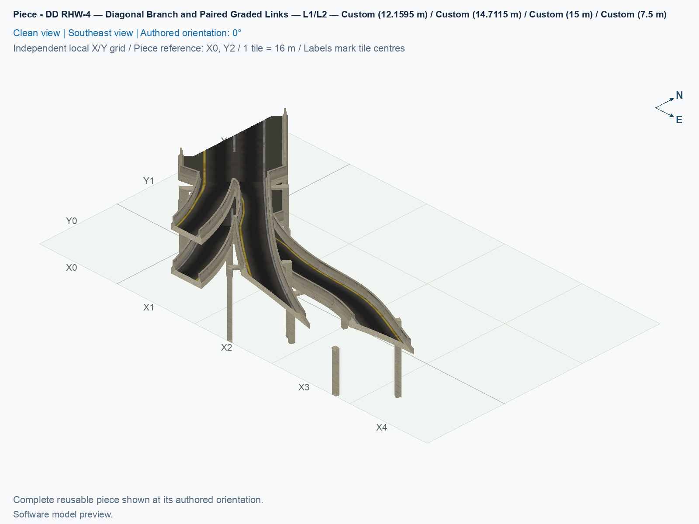
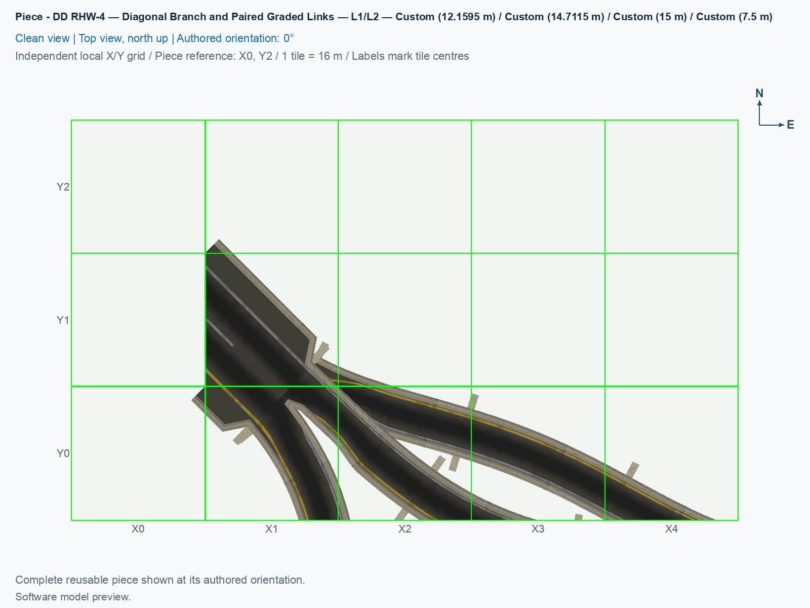
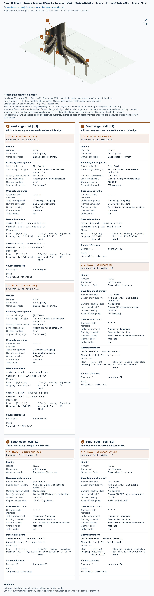

# DD RHW-4 — Diagonal Branch and Paired Graded Links — L1/L2

Purpose: Provide the northwest DD branch and the north portions of two separate one-lane links between the northwest and east branches.

<!-- PIECE README LAYOUT: 2 -->

[1. Views](#1-views) · [2. Piece and placement](#2-piece-and-placement) · [3. Connection matrix](#3-connection-matrix) · [Testing ↗ (separate document)](TESTING.md)

## 1. Views

The canonical [angled view](previews/preview.png) and [north-up view](previews/preview-top.png) show this component by itself at 0°. The [thumbnail](previews/preview-thumb.png) identifies the same type in the assembly guide. Each city tile measures 16 × 16 m. Software renders show saved models and ownership; game appearance and moving traffic have separate checks in [TESTING](TESTING.md).

<!-- BEGIN PIECE VIEWS -->

<!-- END PIECE VIEWS -->

## 2. Piece and placement

**DD RHW-4** is a double-decker RealHighway: each deck is a carriageway carrying two lanes in one direction, and the other deck carries the opposite direction. Level 1, or L1, is 7.5 m above ground; Level 2, or L2, is 15 m. This component carries cars and supplies no Avenue, pedestrian route, ground-highway transition, or custom cast shadows.

This is the north component of the three-part Y junction. It contains the ordinary northwest DD connection, fragments of the level A→B and B→A journeys, and the north portions of B→C and C→B. Both branch-to-branch journeys rise from the incoming 7.5 m deck to the other branch’s outgoing 15 m deck. The east core owns their remaining fragments; this component alone is not a complete pair of ramps.

In the unrotated [complete Y junction](../../01_assemblies/ddrhw-compact-diagonal-y-junction/README.md), A is the southwest stem, B is the northwest diagonal branch, and C is the east branch. The lower 7.5 m deck enters from the northwest, and the upper 15 m deck leaves toward the northwest. The exact reusable identifier is `ddrhw-y-diagonal-branch`, and the exact component name is **DD RHW-4 — Diagonal Branch and Paired Graded Links — L1/L2**.

### 2.1 Owned cells and native approach

This component owns **8 cells inside a 5 × 3-tile rectangle**, measuring 80 × 48 m. The rectangle describes its surrounding extent; only the cells listed below are owned. Local source addresses are `(column,row)`: column 0 is the left column, row 0 is the top row, columns increase eastward, and rows increase southward. These source rows run opposite to the assembly picture’s northward Y labels.

| Local source row | Owned columns |
| --- | --- |
| 0 | 1 |
| 1 | 1 and 2 |
| 2 | 0, 1, 2, 3, and 4 |

A **PATH** resource stores a tile’s directed traffic routes. The model-only cells are (1,0), (2,1), and (0,2). A model-only cell owns visible pavement, a barrier, or a support, but has an intentionally empty traffic PATH. Keep it clear of other construction just like a routed owned tile.

Its local reference (0,0) is unowned by this component and may contain the ordinary native approach after that line is built. The first owned tile is immediately east at (1,0). The northwest native socket is the separate unowned hole at local (0,1), next to the joining owner at (1,1). A **native socket** is an ordinary NAM DD highway tile requested beside the fixed custom construction. It remains unowned and draggable. The next outward native cell is local (0,0), immediately north of the socket and also this component’s unowned reference. Further native cells follow the northwest staircase; do not fill that reference with another custom piece. The complete original cell list is maintained in [piece.jsonc](piece.jsonc).

### 2.2 Place the component

1. Use a verified experimental build with the audited NAM 50 right-hand-traffic inputs, following the [build and installation guide](../../../../docs/BUILD_AND_INSTALL.md). Building a DAT, which is a game-resource archive, does not install it. Close the game before replacing an installed revision, restart it afterward, and use a fresh placement for these new construction rules, models, and traffic paths.
2. Open a disposable city, flatten the whole construction area, and leave all owned cells and the native approach clear. For the full junction, follow the [assembly placement plan](../../01_assemblies/ddrhw-compact-diagonal-y-junction/README.md#3-placements), which places this component as **P02** at **(X0, Y6), an unowned reference**, with a 0° rotation.
3. Open **Transportation → Highways → SCP → Assemblies**. In a prepared assembly menu, select **SCP | ASSEMBLY | DD RHW-4 — Compact Y-Junction — Diagonal Stem**, then press **Tab** or **Shift+Tab** until the tooltip shows **DD RHW-4 — Diagonal Branch and Paired Graded Links — L1/L2**. In a normal piece-only build, look for this exact component under **Transportation → Highways → SCP → Pieces**.
4. Press **Home** or **End** until the model and complete occupied-cell shape match the north-up construction plan. Click once to place this component. The coordinate reference and the actual tile under the mouse cursor have not been confirmed in the game; match the whole ownership pattern, and keep an unowned reference at its planned address even when an ordinary native approach occupies that tile.
5. Inspect the native socket at local **(0,1)**, which is **(X0, Y5)** in the complete assembly. Cancel placement with **Esc**, select **RealHighway (RHW-2)**, and drag outward from that socket toward the **northwest** for at least three native tiles. Stop at the socket when dragging inward from an existing line; do not drag across the custom-owned cells.
6. Place the other two components at their exact assembly references. Only after the complete layout and its three native approaches are present can all six journeys be tested. Internal custom boundaries require every matching route fragment and model profile; an ordinary highway cannot replace a missing component there.

For a prebuilt control, open **Transportation → Highways → RealHighway (RHW) Starter Pieces**, press **Tab** until the name is **Double-Decker RHW-4 Starter Piece (Upper Deck: Level 2, Lower Deck: Level 1)**, place it, and extend the required straight approach with **RealHighway (RHW-2)**. The separately named rail-based DDRHW starter is a different network. Test drawing outward, drawing inward from a working line, and placing beside prebuilt approaches as separate cases; the native byte checks do not confirm those game operations.

### 2.3 Reuse and limits

A grade is height change divided by horizontal travel distance: 20% means a 2 m rise over 10 m horizontally. Its source maximum grade is approximately 26.5725%, below the declared 30% experimental limit. Intermediate link fragments have their actual authored heights between 7.5 m and 15 m; they are not additional standard DD sockets. The steep profiles are compact game choices. Native joins retain at least 3 m of flat lane collar. Four proper rotations turn the entire component through 0°, 90°, 180°, and 270°; the eight cursor states repeat those four orientations and provide no reflected version.

Only the first measured native grid alignment is implemented. Reusing this type elsewhere requires agreement across every exposed route, height, direction, physical surface, and ownership boundary. The internal tile cuts are not interchangeable standard ramp sockets. Keep its sparse owned cells, native socket, and outward native staircase or straight run intact.

<!-- BEGIN PIECE OVERVIEW -->

Native diagonal branch and the two separate lower-to-upper connections. Place its owned cells at the matching assembly reference; every native deck retains its measured real car lanes.

Exact reusable identifier: `ddrhw-y-diagonal-branch`.

Footprint: **5 × 3 tiles**. Exact menu name: **DD RHW-4 — Diagonal Branch and Paired Graded Links — L1/L2**.

<!-- END PIECE OVERVIEW -->

## 3. Connection matrix

The generated matrix below describes journeys within this one component, including its cuts through longer assembly routes. It does not certify all six whole-junction journeys or compatibility with arbitrary neighbours. **Saved PATH** means the saved traffic-route check, **Route Query** means the route displayed by the game, and **Visible travel** means a vehicle actually completing the journey. Each has separate evidence in [TESTING](TESTING.md).

<!-- BEGIN PIECE CONNECTION MATRIX -->

### Directed entrance/exit matrix

Read **from an entrance row to an exit column**. **Saved PATH** checks the saved traffic route; **Route Query** checks the route shown by the game; **Visible travel** checks a vehicle completing that journey. For HSR, visible travel means a moving train.

**Game appearance:** [?](TESTING.md#case-in_game_render-60fbce2bda6789f974ad) — the complete piece’s appearance in the game, checked separately from its journeys.

**Legend:** ✅ confirmed; ❌ failed; ? not established. **Forbidden** means the movement is unavailable; its in-game check confirms that it stays unavailable. Click a result for its exact test case. Scope, evidence, and limitations remain in [the test checklist](TESTING.md#test-checklist).

| Entrance ↓ / Exit → | **Road · West exit** `a-b-out` Variant: dd-rhw-l2 | **Road · West exit** `c-b-out` Variant: dd-rhw-l2 | **Road · South exit** `b-a-out` Variant: dd-rhw-l1 | **Road · South exit** `b-c-out` Variant: access-ramp |
| --- | --- | --- | --- | --- |
| **Road · West entrance** `b-a-in` Variant: dd-rhw-l1 | **Forbidden** **Saved PATH:** [?](TESTING.md#case-software_connectivity-ec376e6fa1716751b556) In-game check: [?](TESTING.md#case-in_game_forbidden_transfer-7fa8b9592f6a639ee36e) | **Forbidden** **Saved PATH:** [?](TESTING.md#case-software_connectivity-ec376e6fa1716751b556) In-game check: [?](TESTING.md#case-in_game_forbidden_transfer-c06936a1bff2f63c1977) | **Saved PATH:** [?](TESTING.md#case-software_connectivity-ec376e6fa1716751b556) **Route Query:** [?](TESTING.md#case-in_game_route_query-15ba8bd904b6b832725b) **Visible travel:** [?](TESTING.md#case-in_game_visible_travel-15ba8bd904b6b832725b) | **Forbidden** **Saved PATH:** [?](TESTING.md#case-software_connectivity-ec376e6fa1716751b556) In-game check: [?](TESTING.md#case-in_game_forbidden_transfer-cacfa795515477b82029) |
| **Road · West entrance** `b-c-in` Variant: dd-rhw-l1 | **Forbidden** **Saved PATH:** [?](TESTING.md#case-software_connectivity-ec376e6fa1716751b556) In-game check: [?](TESTING.md#case-in_game_forbidden_transfer-2a0312013b1d659a3669) | **Forbidden** **Saved PATH:** [?](TESTING.md#case-software_connectivity-ec376e6fa1716751b556) In-game check: [?](TESTING.md#case-in_game_forbidden_transfer-d621aecb7eb220cbc0f8) | **Forbidden** **Saved PATH:** [?](TESTING.md#case-software_connectivity-ec376e6fa1716751b556) In-game check: [?](TESTING.md#case-in_game_forbidden_transfer-c599d6a9553cea12c6b2) | **Saved PATH:** [?](TESTING.md#case-software_connectivity-ec376e6fa1716751b556) **Route Query:** [?](TESTING.md#case-in_game_route_query-ee5f31d25c79064c4daf) **Visible travel:** [?](TESTING.md#case-in_game_visible_travel-ee5f31d25c79064c4daf) |
| **Road · South entrance** `a-b-in` Variant: dd-rhw-l2 | **Saved PATH:** [?](TESTING.md#case-software_connectivity-ec376e6fa1716751b556) **Route Query:** [?](TESTING.md#case-in_game_route_query-2ad590bfc17e792e0a14) **Visible travel:** [?](TESTING.md#case-in_game_visible_travel-2ad590bfc17e792e0a14) | **Forbidden** **Saved PATH:** [?](TESTING.md#case-software_connectivity-ec376e6fa1716751b556) In-game check: [?](TESTING.md#case-in_game_forbidden_transfer-dec454c8ba455651efef) | **Forbidden** **Saved PATH:** [?](TESTING.md#case-software_connectivity-ec376e6fa1716751b556) In-game check: [?](TESTING.md#case-in_game_forbidden_transfer-0eeb6efdb601854a5d00) | **Forbidden** **Saved PATH:** [?](TESTING.md#case-software_connectivity-ec376e6fa1716751b556) In-game check: [?](TESTING.md#case-in_game_forbidden_transfer-3a723fd8968e20243fd4) |
| **Road · South entrance** `c-b-in` Variant: access-ramp | **Forbidden** **Saved PATH:** [?](TESTING.md#case-software_connectivity-ec376e6fa1716751b556) In-game check: [?](TESTING.md#case-in_game_forbidden_transfer-09b8c450622528744501) | **Saved PATH:** [?](TESTING.md#case-software_connectivity-ec376e6fa1716751b556) **Route Query:** [?](TESTING.md#case-in_game_route_query-09d9eba8ffc415b5d352) **Visible travel:** [?](TESTING.md#case-in_game_visible_travel-09d9eba8ffc415b5d352) | **Forbidden** **Saved PATH:** [?](TESTING.md#case-software_connectivity-ec376e6fa1716751b556) In-game check: [?](TESTING.md#case-in_game_forbidden_transfer-a8526b9072a32b582b26) | **Forbidden** **Saved PATH:** [?](TESTING.md#case-software_connectivity-ec376e6fa1716751b556) In-game check: [?](TESTING.md#case-in_game_forbidden_transfer-c163d04f1fda03d67ef1) |

Source: [connections.json](connections.json).

<!-- END PIECE CONNECTION MATRIX -->

<!-- BEGIN CONNECTOR OVERVIEW -->

### Connection overview

Generated from this piece's source-bound connector metadata and the current compiled model; marker letters refer to the boundary cards below.

[Rendering sources and verification scope](evidence/connection-overview.json).

Headings: 0° = North, 90° = East, 180° = South, and 270° = West; clockwise in plan view, pointing out of the piece.

Coordinates [E,N,H] = [east,north,height] in metres. Source cells [column,row] increase east and south.

Display grid: X = source column − (0); Y = 2 − source row.

Slope is measured outward at the joining edge; the interior may differ. Offsets are + left and − right facing out of the tile edge.

Member offsets use the section origin. Counts distinguish physical channels / edge cuts / directed members; modes do not multiply channels.

Incoming flow enters this piece; outgoing flow leaves it. Letters identify boundary cards; source IDs remain the stable identities.

Not declared means no section origin or offset was authored. Its marker uses an actual member endpoint; the measured intersections remain authoritative.

#### Boundary A: `boundary-01`

All 2 service groups are required together at this edge.

##### Service group 1 / 2: ROAD — Custom (7.5 m)

| Field | Value |
| --- | --- |
| End / component | `boundary-01-dd-highway-01` / `dd-highway` |
| Network / game class / role | road / Engine class (1); primary |
| Source cell / edge | `[1,1]` / West |
| Section origin [E,N] (m) | Not declared; see member endpoints |
| Centring / section offset | Not declared |
| Level (path height) | Custom (7.5 m); no nominal level |
| Outward heading | 315° |
| Slope at joining edge | 0% outward |
| Channels / edge cuts / directed members | 2 / 2 / 2 |
| Traffic arrangement / running | 2 incoming; 0 outgoing; See member directions |
| Channel spacing | 4.52548 m |
| Channel kinds | road-lane |
| Traffic modes | car |
| Profile | No profile reference |

| Member / measured source | Channel / cut / modes | Flow | Endpoint [E,N,H] (m) | Offset (m) | Outward heading | Edge slope (%) |
| --- | --- | --- | --- | ---: | ---: | ---: |
| `member-b-a-in` / `b-a-in` | `b-a` / `cut-b-a-in` / car | Incoming | `[8,-19.2,7.5]` | Not declared | 315° | 0 |
| `member-b-c-in` / `b-c-in` | `b-c` / `cut-b-c-in` / car | Incoming | `[8,-12.8,7.5]` | Not declared | 315° | 0 |

##### Service group 2 / 2: ROAD — Custom (15 m)

| Field | Value |
| --- | --- |
| End / component | `boundary-01-dd-highway-02` / `dd-highway` |
| Network / game class / role | road / Engine class (1); primary |
| Source cell / edge | `[1,1]` / West |
| Section origin [E,N] (m) | Not declared; see member endpoints |
| Centring / section offset | Not declared |
| Level (path height) | Custom (15 m); no nominal level |
| Outward heading | 315° |
| Slope at joining edge | 0% outward |
| Channels / edge cuts / directed members | 2 / 2 / 2 |
| Traffic arrangement / running | 0 incoming; 2 outgoing; See member directions |
| Channel spacing | 4.52548 m |
| Channel kinds | road-lane |
| Traffic modes | car |
| Profile | No profile reference |

| Member / measured source | Channel / cut / modes | Flow | Endpoint [E,N,H] (m) | Offset (m) | Outward heading | Edge slope (%) |
| --- | --- | --- | --- | ---: | ---: | ---: |
| `member-a-b-out` / `a-b-out` | `a-b` / `cut-a-b-out` / car | Outgoing | `[8,-19.2,15]` | Not declared | 315° | 0 |
| `member-c-b-out` / `c-b-out` | `c-b` / `cut-c-b-out` / car | Outgoing | `[8,-12.8,15]` | Not declared | 315° | 0 |

#### Boundary B: `boundary-02`

All 2 service groups are required together at this edge.

##### Service group 1 / 2: ROAD — Custom (7.5 m)

| Field | Value |
| --- | --- |
| End / component | `boundary-02-dd-highway-01` / `dd-highway` |
| Network / game class / role | road / Engine class (1); primary |
| Source cell / edge | `[1,2]` / South |
| Section origin [E,N] (m) | Not declared; see member endpoints |
| Centring / section offset | Not declared |
| Level (path height) | Custom (7.5 m); no nominal level |
| Outward heading | 165.093° |
| Slope at joining edge | 0% outward |
| Channels / edge cuts / directed members | 1 / 1 / 1 |
| Traffic arrangement / running | 0 incoming; 1 outgoing; See member directions |
| Channel spacing | See individual measured intersections |
| Channel kinds | road-lane |
| Traffic modes | car |
| Profile | No profile reference |

| Member / measured source | Channel / cut / modes | Flow | Endpoint [E,N,H] (m) | Offset (m) | Outward heading | Edge slope (%) |
| --- | --- | --- | --- | ---: | ---: | ---: |
| `member-b-a-out` / `b-a-out` | `b-a` / `cut-b-a-out` / car | Outgoing | `[22.3328,-40,7.5]` | Not declared | 165.093° | 0 |

##### Service group 2 / 2: ROAD — Custom (15 m)

| Field | Value |
| --- | --- |
| End / component | `boundary-02-dd-highway-02` / `dd-highway` |
| Network / game class / role | road / Engine class (1); primary |
| Source cell / edge | `[1,2]` / South |
| Section origin [E,N] (m) | Not declared; see member endpoints |
| Centring / section offset | Not declared |
| Level (path height) | Custom (15 m); no nominal level |
| Outward heading | 165.093° |
| Slope at joining edge | 0% outward |
| Channels / edge cuts / directed members | 1 / 1 / 1 |
| Traffic arrangement / running | 1 incoming; 0 outgoing; See member directions |
| Channel spacing | See individual measured intersections |
| Channel kinds | road-lane |
| Traffic modes | car |
| Profile | No profile reference |

| Member / measured source | Channel / cut / modes | Flow | Endpoint [E,N,H] (m) | Offset (m) | Outward heading | Edge slope (%) |
| --- | --- | --- | --- | ---: | ---: | ---: |
| `member-a-b-in` / `a-b-in` | `a-b` / `cut-a-b-in` / car | Incoming | `[22.3328,-40,15]` | Not declared | 165.093° | 0 |

#### Boundary C: `boundary-03`

This service group is required at this edge.

##### Service group 1 / 1: ROAD — Custom (12.1595 m)

| Field | Value |
| --- | --- |
| End / component | `boundary-03-dd-highway-01` / `dd-highway` |
| Network / game class / role | road / Engine class (1); primary |
| Source cell / edge | `[2,2]` / South |
| Section origin [E,N] (m) | Not declared; see member endpoints |
| Centring / section offset | Not declared |
| Level (path height) | Custom (12.1595 m); no nominal level |
| Outward heading | 116.834° |
| Slope at joining edge | -24.8977% outward |
| Channels / edge cuts / directed members | 1 / 1 / 1 |
| Traffic arrangement / running | 1 incoming; 0 outgoing; See member directions |
| Channel spacing | See individual measured intersections |
| Channel kinds | road-lane |
| Traffic modes | car |
| Profile | No profile reference |

| Member / measured source | Channel / cut / modes | Flow | Endpoint [E,N,H] (m) | Offset (m) | Outward heading | Edge slope (%) |
| --- | --- | --- | --- | ---: | ---: | ---: |
| `member-c-b-in` / `c-b-in` | `c-b` / `cut-c-b-in` / car | Incoming | `[39.7,-40,12.1595]` | Not declared | 116.834° | -24.8977 |

#### Boundary D: `boundary-04`

This service group is required at this edge.

##### Service group 1 / 1: ROAD — Custom (14.7115 m)

| Field | Value |
| --- | --- |
| End / component | `boundary-04-dd-highway-01` / `dd-highway` |
| Network / game class / role | road / Engine class (1); primary |
| Source cell / edge | `[4,2]` / South |
| Section origin [E,N] (m) | Not declared; see member endpoints |
| Centring / section offset | Not declared |
| Level (path height) | Custom (14.7115 m); no nominal level |
| Outward heading | 117.491° |
| Slope at joining edge | 8.58944% outward |
| Channels / edge cuts / directed members | 1 / 1 / 1 |
| Traffic arrangement / running | 0 incoming; 1 outgoing; See member directions |
| Channel spacing | See individual measured intersections |
| Channel kinds | road-lane |
| Traffic modes | car |
| Profile | No profile reference |

| Member / measured source | Channel / cut / modes | Flow | Endpoint [E,N,H] (m) | Offset (m) | Outward heading | Edge slope (%) |
| --- | --- | --- | --- | ---: | ---: | ---: |
| `member-b-c-out` / `b-c-out` | `b-c` / `cut-b-c-out` / car | Outgoing | `[62.2479,-40,14.7115]` | Not declared | 117.491° | 8.58944 |

The overview uses source metadata, current compiled resource identities, and the saved model. Current placement, connection, and traffic results belong to the generated connection matrix and linked testing records.

<!-- END CONNECTOR OVERVIEW -->
